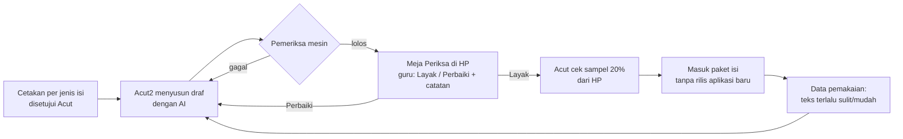

# Rencana Isi — Siapa Membuat Apa, Kapan, dan Berapa Biayanya

**Ringkas:** (1) Isi tahun pertama dibuat dengan tiga cara: **buatan mesin** (soal Lancar, tangga suku kata), **disusun AI lalu diperiksa mesin dan guru** (teks bacaan, layar jurus, modul Paham), dan **bahan TKA yang sudah ada** dipindahkan ke HP tanpa diketik ulang. (2) Sampai Mei 2027 dibutuhkan ± **114 jam guru pemeriksa (± Rp5,7 juta; cadangan Rp8,5 juta)**, dibayar **per butir/topik** sesuai keputusan 19 Okt, dan biaya AI ± Rp330 ribu, sebab pekerjaan terbesar adalah memeriksa 252 teks bacaan, bukan menulisnya. (3) Yang paling mendesak bukan menulis, tetapi dua hal yang menunggu Acut: **berkas TKA dari laptop paling lambat 31 Oktober**, dan pemeriksaan isi oleh **Acut sendiri sampai Rilis 2** (keputusan 20 Okt); guru pemeriksa dipilih paling lambat Jumat 15 Januari 2027 dan mulai bekerja Februari (bagian 6.2a).

Tahap 2, butir 4. Disusun 19 Oktober 2026. Kurs estimasi Rp16.500 per US$1. Label: **[FAKTA + sumber] · [ESTIMASI + cara hitung] · [ASUMSI — perlu diuji]**.

---

## 1. Tiga cara membuat isi

| Cara | Dipakai untuk | Siapa | Pemeriksaan | Kenapa |
|---|---|---|---|---|
| **A. Buatan mesin** | Soal Lancar Matematika kelas 1–6; tangga suku kata kelas 1; latihan kata dari teks | Kode di aplikasi (aturan dari Acut2) | Uji otomatis: semua kunci dihitung ulang | Tidak ada yang perlu diketik; 8.100 lembar versi 5 sudah 0 kunci salah |
| **B. AI menyusun → mesin memeriksa → guru memeriksa** | Teks bacaan dan pertanyaannya; layar jurus; modul Paham; pesan semangat siap pakai; pertanyaan masukan | Acut2 menyusun di Project ini; guru memeriksa | Mesin: panjang, kata per kalimat, daftar kata terlarang, hitungan. Guru: kewajaran bahasa, ketepatan, kepantasan | Cepat dan murah ditulis, tetapi isi untuk anak wajib dibaca manusia |
| **C. Bahan yang sudah ada** | 24 modul Matematika + 12 modul Bahasa Indonesia TKA, 5 simulasi, 36 teks baca cepat, 29 latihan rumah | Acut2 mengubah berkas Markdown menjadi data | Pemeriksa kunci yang sudah ada + guru mencocokkan sampel 10% | Sudah melewati pemeriksaan mutu 17 butir, 0 kunci salah **[FAKTA — `bahan/tka-sd-status.md`]** |

### Alur cara B

**Meja Periksa** adalah satu halaman web pribadi (bukan bagian aplikasi anak) yang menampilkan satu butir isi per layar dengan tombol **Layak / Perbaiki** dan kolom catatan. Guru dan Acut memeriksa dari HP kapan saja, tanpa bertemu. Dibangun Acut2 di Tahap 3 bersama alat pengelola.

---

## 2. Peta isi per mata pelajaran dan kelas — tahun pertama

| Mapel / lapis | Kelas 1 | Kelas 2 | Kelas 3 | Kelas 4 | Kelas 5 | Kelas 6 | Cara | Rilis |
|---|---|---|---|---|---|---|---|---|
| **Matematika Lancar** (6 level + jurus) | ✓ | ✓ | ✓ | ✓ | ✓ | ✓ | A + B (jurus) | R1 |
| **Bahasa Indonesia harian** (baca ulang) | ✓ + tangga suku kata | ✓ | ✓ | ✓ | ✓ | ✓ (36 teks TKA dipakai) | B + C | R2 |
| **Persiapan TKA** | — | — | — | — | — | ✓ | C | R1.1 |
| **Matematika Paham** (modul topik) | nanti | nanti | nanti | ✓ topik TKA | ✓ topik TKA | ✓ topik TKA | B + C | R3 |
| **Bahasa Indonesia modul** | nanti | nanti | ✓ | ✓ | ✓ | ✓ (12 modul TKA) | B + C | R4 |
| **Belajar Bahasa Inggris** (paket tingkat 3–6, bebas dipilih semua kelas) | ✓ boleh | ✓ boleh | ✓ | ✓ | ✓ | ✓ | B | Tingkat 3–4 R2; 5–6 R3; ngobrol AI R5 (`11-belajar-bahasa-inggris.md`) |
| **Gudang Ilmu** (peta topik + kartu ilmu) | ✓ | ✓ | ✓ | ✓ | ✓ | ✓ | B + C | Peta R1; **kelas 6 dulu** (Matematika 4 Jan, Bahasa Indonesia 1 Feb 2027), kelas lain bertahap 2027 (`10-gudang-ilmu-…` 2.3) |

**Kenapa Paham dimulai dari kelas 4–6:** 24 modul Matematika TKA sudah mencakup topik kelas 4, 5, dan 6 (± 28% / 38% / 34%) **[FAKTA — `bahan/program-tka-sd-kelas-6.md` Bagian 2]**, jadi bahannya tinggal diubah bentuk untuk anak yang belajar di rumah. Kelas 1–3 belum punya bahan sama sekali.

**Batas jujur:** tahun pertama tidak menutup seluruh ± 360 topik di Prompt RCTOR. Yang tertutup: latihan harian 2 mapel × 6 kelas, TKA kelas 6, dan Paham untuk 12 topik pertama. **Ditambah 28 Okt atas permintaan Acut: Gudang Ilmu** — peta topik lengkap SD kelas 1–6 sudah ada di R1, lalu kartu ilmu diisi bertahap sepanjang 2027 (**kelas 6 dulu**: Matematika 4 Jan dan Bahasa Indonesia 1 Feb; Matematika kelas 4–5 Maret, kelas 1–3 Juni, Bahasa Indonesia kelas 1–5 Desember), ± 120 jam pemeriksaan untuk dua mapel (`10-gudang-ilmu-bimbingan-dan-waktu.md` bagian 2).

---

## 3. Daftar isi yang harus dibuat, per rilis

| # | Isi | Jumlah | Cara | Siap paling lambat (target · cadangan) | Untuk |
|---|---|---|---|---|---|
| 1 | Layar jurus Lancar (inti jurus, 2–3 contoh jadi, catatan ingat) | 36 (6 kelas × 6 level) | B (diperiksa Acut; guru mengambil sampel ulang mulai Feb) | Jumat 13 Nov · 20 Nov | R1 |
| 2 | Kalimat petunjuk bersuara (semua tombol dan layar anak kelas 1–2) | ± 150 kalimat | B + suara buatan | Jumat 13 Nov · 20 Nov | R1 |
| 3 | Pesan semangat siap pakai untuk orang tua | ± 40 | B | Jumat 13 Nov · 20 Nov | R1 |
| 4 | Bank pertanyaan masukan (orang tua + anak) | ± 60 | B (dari `08-sistem-masukan.md`) | Jumat 13 Nov · 20 Nov | R1 |
| 5 | Soal TKA menjadi data: 36 modul, 5 simulasi, 36 teks | ± 1.050 butir **[ESTIMASI: ± 25 butir per modul × 36 + 150 butir simulasi; dicek setelah berkas diterima]** | C | 20 Des · 31 Des | R1.1 |
| 6 | Penanda jenis salah per pengecoh TKA (Baca / Hitung / Salah paham) | ± 3.000 pengecoh | B (dari baris "Kenapa pengecoh menarik") | 20 Des · 31 Des | R1.1 |
| 7 | Teks baca ulang kelas 1–5 + 2 pertanyaan per hari | 180 teks (36 × 5) | B | 15 Jan · 22 Jan | R2 |
| 8 | Tangga suku kata kelas 1 (suku kata terbuka → kata → kalimat) | ± 100 suku kata + 300 kata | A + rekaman suara guru | 15 Jan · 22 Jan | R2 |
| 9 | Modul Paham kelas 4–6, 12 topik pertama (pecahan, KPK/FPB, satuan, data) | 12 | B + C | 8 Mar · 15 Mar | R3 |
| 10 | Teks baca ulang tambahan kelas 1–6 | 72 (12 × 6) | B | 1 Mei · 15 Mei | Sampai akhir tahun ajaran |
| 11 | Paket kelas tahun ajaran 2027/2028 + modul Bahasa Indonesia kelas 3–6 | ditetapkan Mei | B + C | 31 Mei · 14 Jun | R4 |

---

## 4. Cetakan per jenis isi (yang disetujui Acut sebelum AI menulis)

| Jenis | Isi cetakan | Pemeriksa mesin |
|---|---|---|
| **Teks baca ulang** | Kelas, panjang kata, panjang kalimat, latar Aceh (pasar, meunasah, laut, sawah, sekolah), tokoh laki-laki dan perempuan bergantian, 3–5 kata baru yang terjelaskan dari kalimat sekitarnya, 2 pertanyaan per hari (hari 1: tersurat; hari 2: tersirat) | Jumlah kata dalam batas kelas; kata per kalimat; tidak ada kata di daftar terlarang; nama bergantian; pertanyaan PG dengan 3–4 pilihan |
| **Layar jurus** | Satu kalimat inti; 2–3 contoh jadi polos (tanpa menyuruh menjelaskan); satu "catatan ingat"; lambang sesuai standar istilah (bagi ":") | Semua contoh dihitung ulang; tidak ada lambang ÷ |
| **Modul Paham** | Diambil dari cetakan 7 halaman modul TKA, diubah untuk belajar di rumah: salah paham di depan, contoh jadi berpasangan, latihan 8 soal campur, kunci berjenjang (Petunjuk → Langkah) | Format standar soal TKA + baris Periksa bernilai benar |
| **Pesan dan pertanyaan** | Kalimat ≤ 15 kata, sapaan hangat, tanpa istilah Inggris | Panjang kalimat; daftar kata terlarang |

**Aturan kepantasan isi untuk anak** (diperiksa guru, 100% untuk teks): tidak ada kekerasan, merek dagang, tokoh nyata selain nama tempat umum, kegiatan berbahaya, atau ejekan terhadap kelompok mana pun; adat dan suasana Aceh ditulis wajar; tidak ada isi yang mendorong anak menghubungi orang asing atau membeli sesuatu.

---

## 5. Suara

| Pilihan | Biaya | Untung | Rugi | Putusan |
|---|---|---|---|---|
| **Suara buatan Google Chirp 3 HD, dibuat sekali lalu disimpan di paket isi** | Gratis sampai 1 juta karakter per bulan, lalu US$30 per juta **[FAKTA — Google Cloud, halaman harga Text-to-Speech]**; bahasa Indonesia tersedia **[FAKTA — dokumentasi Chirp 3 HD]** | Seragam, bisa diperbarui kapan saja, jalan tanpa sinyal | Nama Aceh (Lampulo, meunasah) bisa salah ucap | **✓ Diusulkan** |
| Rekaman guru atau Acut | Waktu ± 7 jam untuk 252 teks | Paling alami | Sulit diperbarui; mutu rekaman HP tidak seragam | Hanya untuk suku kata kelas 1 (suara buatan untuk suku kata lepas sering janggal) |
| Suara bawaan HP | Rp0 | Tanpa unduh | Suara berbeda tiap HP; sebagian HP murah tidak punya suara Indonesia | ✗ |

**[ESTIMASI]** Seluruh isi tahun pertama ± 220 ribu karakter (252 teks × 80–170 kata × 7 karakter + jurus + petunjuk), jadi **Rp0** karena masih di bawah batas gratis bulanan. Ukuran berkas: suara terkompresi ± 0,25 MB per menit; ± 50 teks per kelas ≈ **± 15 MB per paket kelas**.

**Pemeriksaan suara:** Acut mendengarkan 10% berkas dari HP; kata yang salah ucap diberi ejaan bantu lalu dibuat ulang.

---

## 6. Biaya dan jam kerja

### 6.1 Biaya AI menyusun draf

**[ESTIMASI]** Tarif Opus 5.5 US$4/20 per juta token masuk/keluar; Sonnet 5.5 dengan potongan kiriman sekaligus (batch) 50% = US$1/5.

| Isi | Hitungan | Biaya |
|---|---|---|
| 252 teks + pertanyaan | 252 × (3.000 masuk + 1.500 keluar) dengan Opus | ± Rp175 ribu |
| 36 layar jurus | 36 × (4.000 + 1.500) dengan Opus | ± Rp27 ribu |
| 12 modul Paham | 12 × (20.000 + 15.000) dengan Opus | ± Rp75 ribu |
| Penanda jenis salah ± 1.050 soal TKA | 1.050 × (1.500 + 300) dengan Sonnet kiriman sekaligus | ± Rp52 ribu |
| **Jumlah** | | **± Rp330 ribu** (cadangan Rp500 ribu) |

Kalau draf disusun Acut2 di dalam Project ini dengan langganan Claude yang sudah ada, tambahan biayanya ± Rp0. Hitungan di atas berlaku kalau penyusunan dijalankan otomatis lewat layanan API.

### 6.2 Jam guru pemeriksa

**[ASUMSI]** Keputusan 19 Okt: guru **dibayar per topik/butir yang diperiksa**. Besarnya diturunkan dari setara Rp50.000 per jam (mengikuti jaminan Rp50.000 per sesi pengajar di `bahan/rancangan-modul-interaktif.md` Bagian 2): **jurus Rp12.500 per layar, teks + pertanyaan Rp12.500 per teks, modul Paham Rp100.000 per modul, butir pendek (pesan, petunjuk, pertanyaan) Rp1.700**. Angka akhir disepakati dengan guru.

| Isi | Hitungan **[ESTIMASI]** | Jam |
|---|---|---|
| 36 layar jurus | 15 menit per layar | 9 |
| 252 teks + pertanyaan | 15 menit per teks (baca, cek pertanyaan, cek kepantasan) | 63 |
| Cocokkan sampel soal TKA yang dipindah | 10% × 1.050 = 105 butir × 2 menit | 3,5 |
| 12 modul Paham | 2 jam per modul | 24 |
| Rekaman suku kata kelas 1 | sekali duduk | 1 |
| Pesan, petunjuk, pertanyaan masukan | ± 250 butir × 2 menit | 8,3 |
| Sampel penanda pengecoh TKA (B/H/S), sebab rapor penyebab salah bertumpu padanya | 20% × ± 3.000 = 600 × 0,5 menit | 5 |
| **Jumlah** | | **± 114 jam ≈ Rp5,7 juta** (cadangan 1,5× = **Rp8,5 juta**) |

**Sebaran waktu (rencana lama, sebelum keputusan 20 Okt):** ± 20 jam November, ± 54 jam Desember–Januari, ± 25 jam Februari–Maret, ± 15 jam April–Mei.

### 6.2a Keputusan 20 Okt: Acut memeriksa sendiri sampai Rilis 2

Supaya beban Acut tidak meledak di Desember–Januari, pemeriksaan dibagi menurut **kapan isi itu benar-benar dipakai anak**. Satu teks Baca Ulang dipakai 2 hari, jadi di bulan pertama R2 setiap kelas baru memakai ± 10–14 teks.

| Isi | Diperiksa Acut (Nov–Jan) | Diperiksa guru (Feb–Mei) |
|---|---|---|
| 36 layar jurus Lancar | Semua, 2–13 Nov (± 9 jam) | Sampel ulang 20% (± 2 jam) |
| Pesan, petunjuk, pertanyaan masukan (± 250 butir) | Semua (± 8 jam) | — |
| Soal TKA yang dipindah (sampel 10%) dan penanda pengecoh (sampel 20%) | Semua sampel (± 8,5 jam), Des | — |
| Rekaman suku kata kelas 1 | Semua (± 1 jam) | — |
| Teks Baca Ulang kelas 1–5 (180) | **10 teks pertama per kelas = 50 teks** (± 12,5 jam), sebelum 15 Jan | 130 teks sisanya, sebelum dipakai (± 32,5 jam) |
| 72 teks tambahan (termasuk bacaan dingin kelas 6) | — | Semua (± 18 jam) |
| 12 modul Paham | — | Semua, sebelum R3 (± 24 jam) |
| **Jumlah** | **± 39 jam ≈ ± 3 jam per minggu** selama 13 minggu | **± 77 jam ≈ Rp3,9 juta**, Feb–Mei (± Rp960 ribu per bulan) |

Semua angka **[ESTIMASI — 15 menit per teks, 2 menit per butir pendek, sama dengan tabel 6.2]**. Untungnya: honor November–Januari Rp0, dan Acut mengenal isinya sendiri. Biayanya: ± 3 jam kerja Acut per minggu, di atas ± 4–5 jam pekerjaan masa gratis. Risikonya: kalau Acut tertinggal, 10 teks pertama per kelas belum siap pada 15 Januari dan R2 mundur ke cadangan 22 Februari. Tanda awalnya: < 25 teks selesai diperiksa pada Jumat 1 Januari. Bulan terberat (Desember–Januari) bertepatan dengan persiapan kelas luring TKA, jadi **guru pemeriksa teks sebaiknya bukan pengajar kelas luring**.

### 6.3 Pekerjaan Acut, semuanya bisa dari HP

| Pekerjaan | Kapan | Waktu **[ESTIMASI]** |
|---|---|---|
| Menyetujui 4 cetakan isi (bagian 4) | Minggu ini, sebelum 26 Okt | 1 jam |
| Mengirim berkas TKA dari laptop (atau membagikan folder) | Paling lambat 31 Okt | 15 menit |
| Memilih dan menghubungi guru pemeriksa | Paling lambat Jumat 15 Jan 2027 (diubah 20 Okt) | — |
| Memeriksa isi Nov–Jan sesuai bagian 6.2a | Nov–Jan | ± 3 jam per minggu |
| Memeriksa 36 layar jurus R1 di Meja Periksa (sebelum guru ada) | 2–13 Nov | ± 3 jam |
| Cek sampel 20% di Meja Periksa | Mingguan, Nov–Mei | ± 1 jam per minggu |
| Dengar 10% berkas suara | Saat paket isi dibuat | ± 30 menit per paket |
| Coba 36 latihan rumah TKA di HP sendiri | 21–31 Des | 3 jam |

---

## 7. Isi mengikuti pemakaian

| Tanda dari data | Batas **[ASUMSI]** | Tindakan |
|---|---|---|
| Teks terlalu sulit | Median pemahaman < 60%, atau kata per menit bacaan pertama < 70% patokan kelas | Teks dipendekkan atau dipindah ke tingkat lebih rendah |
| Teks terlalu mudah | Pemahaman 100% pada > 80% anak | Pertanyaan diganti yang lebih dalam |
| Butir TKA bermasalah | > 70% anak memilih pengecoh yang sama | Guru memeriksa: kunci salah, atau salah paham umum (masuk rapor) |
| Jurus tidak menolong | Anak yang membuka jurus tetap salah ≥ 4 di lembar berikutnya | Contoh jadi ditambah atau diganti |

---

## 8. Risiko isi

| Risiko | Tanda awal | Pencegahan |
|---|---|---|
| Guru pemeriksa belum ada saat draf teks siap (Desember) | 13 Nov lewat tanpa nama | Dua calon dihubungi sekaligus; cadangan: Acut memeriksa sendiri 36 teks kelas 1–2 dulu, sisanya menyusul sebelum 22 Jan |
| Berkas TKA dari laptop terlambat | 31 Okt lewat | Cadangan: R1.1 memakai 5 simulasi saja (paling penting untuk tempo), latihan rumah menyusul; kelas luring tetap memakai PDF |
| Hak cipta modul TKA belum jelas (siapa penulisnya) | Tidak ada perjanjian tertulis **[FAKTA — `bahan/kelemahan-rencana-lama.md` A3]** | Masuk daftar pertanyaan ahli hukum; perjanjian pengalihan hak sebelum isi masuk aplikasi |
| Teks AI terasa kaku atau tidak bernuansa Aceh | Catatan guru "kaku" pada > 20% teks pertama | Cetakan diperbaiki setelah 10 teks pertama, bukan setelah 180 |
| Suara buatan salah mengucap nama tempat | Acut menemukan salah ucap | Ejaan bantu; rekam manual untuk kata yang tetap salah |
