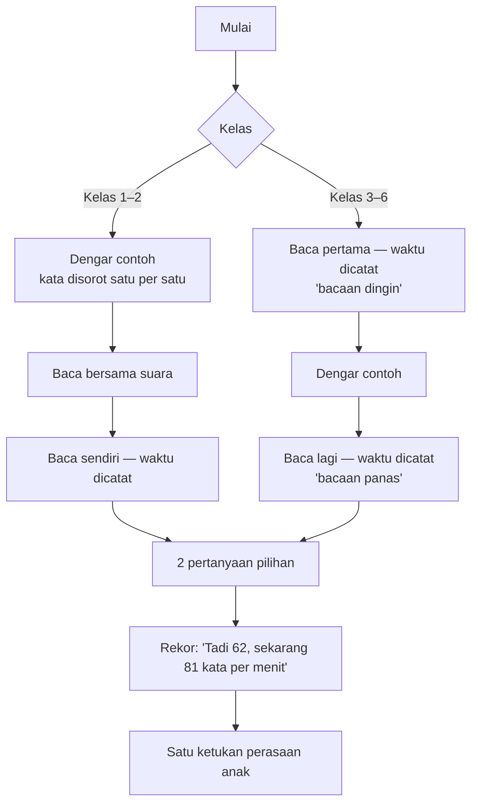

# Latihan Harian Bahasa Indonesia — "Baca Ulang"

**Ringkas:** (1) Latihan harian Bahasa Indonesia adalah **baca ulang**: anak membaca teks pendek, mendengar contoh bacaan, membaca lagi, lalu menjawab pertanyaan. Kata per menit dicatat. Cara ini dipilih karena buktinya paling kuat (efek 0,75 untuk kelancaran dan 0,73 untuk pemahaman). (2) Kecepatan harian diukur dengan anak menekan tombol mulai dan selesai sendiri. **Angka rapor untuk semua keluarga adalah bacaan dingin dengan tombol** (hasil yang ditandai curang dibuang); **Dengar Bacaan** orang tua di Mode Dampingi seminggu sekali menjadi penguat yang lebih tepat (kata *benar* per menit), sebab mendampingi adalah pilihan dan sebagian besar keluarga tidak mendampingi (diubah 20 Okt). Tidak perlu AI suara dan tidak ada rekaman suara anak. (3) Celah terbesar: anak bisa menekan "selesai" tanpa membaca, dan kelas 1 di semester 2 sebagian belum bisa membaca. Keduanya punya penjaga di bagian 6 dan 4.

Tahap 2, butir 6. Disusun 19 Oktober 2026. Tayang di Rilis 2 (target 1 Februari 2027). Dasar: `riset-penguat.md` bagian 3.

---

## 1. Kenapa baca ulang, bukan latihan ejaan atau imbuhan

| Cara | Efek ke membaca | Sumber | Putusan |
|---|---|---|---|
| **Baca ulang** | 0,75 kelancaran; 0,73 pemahaman | **[FAKTA — Therrien 2004]** | **Inti harian** |
| Baca ulang dengan contoh bacaan dan patokan | Lebih baik daripada tanpa keduanya | **[FAKTA — Stevens, Walker & Vaughn 2017]** | Contoh suara dan patokan dipasang |
| Kosakata lewat teks yang akan dibaca | 0,50 untuk teks itu; 0,10 untuk tes umum | **[FAKTA — Elleman dkk. 2009]** | Kata baru diajarkan di dalam teks |
| Imbuhan (morfologi) | Pemahaman 0,13, tidak bermakna; bukti untuk bahasa Inggris saja | **[FAKTA — Colenbrander dkk. 2024]** | Pelengkap mingguan, bukan inti |

**Catatan untuk keputusan 19 Okt:** catatan diskusi menyebut latihan harian Bahasa Indonesia buatan mesin berisi "ejaan, imbuhan, kosakata dari daftar kata". Riset Tahap 1 mengubahnya: **ejaan dan imbuhan turun menjadi pelengkap mingguan**, sebab efeknya ke pemahaman tidak terbukti. Ini ganti arah yang perlu disetujui Acut (bagian 10).

---

## 2. Alur satu sesi

| Aturan | Isi | Dasar |
|---|---|---|
| Satu teks dipakai **2 hari** | Hari 1: alur penuh + pertanyaan tersurat. Hari 2: bacaan panas lagi + pertanyaan tersirat | Mengurangi kebutuhan teks setengahnya; tambah ulangan |
| Kelas 3–6 membaca 2 kali, bukan 3–6 kali | Bacaan dingin + bacaan panas | 6 kali lebih cepat tetapi tidak berpindah ke teks baru **[FAKTA — Stevens dkk. 2017]**; durasi tetap pendek |
| Bacaan dingin = ukuran kemajuan | Kecepatan pada teks **baru** yang belum pernah dibaca | Yang dikejar adalah kemampuan membaca teks apa pun, bukan hafal satu teks |
| Bacaan panas = rasa mampu | Anak melihat dirinya lebih cepat dalam 3 menit | Prinsip R: rekor sendiri |
| Membaca nyaring | Diminta, tidak dipaksa; tombol "baca dalam hati" tersedia | Anak yang malu tetap berlatih; hasilnya ditandai |

### Durasi **[ESTIMASI]**

| Kelas | Panjang teks **[ASUMSI]** | Hitungan | Lama Baca Ulang | Batas sesi total (dari `01-profil`) |
|---|---|---|---|---|
| 1 | 20–40 kata | dengar 0,5 + bersama 1 + sendiri 1 + soal 1 | ± 3,5 menit | ≤ 10 menit |
| 2 | 40–70 kata | ± 1 + 1 + 1 + 1 | ± 4 menit | ≤ 10 menit |
| 3–4 | 70–130 kata | dingin 1,5 + dengar 1 + panas 1,3 + soal 1 | ± 5 menit | ≤ 15 menit |
| 5–6 | 130–200 kata | 1,8 + 1,5 + 1,5 + 1 | ± 6 menit | ≤ 20 menit |

Ditambah Lancar Matematika ± 2–5 menit, semua kelas masih di bawah batas sesi.

---

## 3. Patokan kecepatan

**Kesenjangan data:** tidak ada patokan resmi kata per menit per kelas untuk Indonesia **[FAKTA — `riset-penguat.md` bagian 3]**. Yang ada hanya kelas 3: **64,4–69,2 kata benar per menit**, dan siswa Aceh ± 17–20 kata per menit lebih lambat daripada siswa Jawa **[FAKTA — USAID PRIORITAS, RTI 2017]**.

| Kelas | Patokan sementara (kata benar per menit, akhir tahun) **[ASUMSI]** | Cara menyusun |
|---|---|---|
| 1 | 30 | Diturunkan dari kelas 3 dengan selisih ± 15–20 per tahun |
| 2 | 50 | sama |
| 3 | 65 | Data USAID |
| 4 | 80 | Dinaikkan ± 15 per tahun |
| 5 | 95 | sama |
| 6 | 110 | Teks TKA 150–200 kata dalam waktu 2,5 menit per soal |

**Patokan ini bukan syarat lulus.** Yang ditampilkan ke anak dan orang tua adalah **kenaikan pribadi**. Patokan dipakai mesin untuk memilih tingkat teks, lalu **dikalibrasi ulang setelah 4 minggu** dari data anak-anak uji (sudah dicatat di `keputusan.md` bagian E).

### Ukuran keberhasilan

| Ukuran | Target | Cadangan |
|---|---|---|
| Kenaikan kecepatan bacaan **dingin** dalam 8 minggu | +15% | +8% |
| Pertanyaan pemahaman benar | ≥ 80% | ≥ 70% |
| Hari Baca Ulang per minggu | ≥ 4 | ≥ 3 |
| Orang tua yang mendengar bacaan minimal 2 kali per bulan | 6 dari 10 | 4 dari 10 |

---

## 4. Kelompok kelas

| Kelompok | Masalah utamanya | Isi Baca Ulang | Penjaga |
|---|---|---|---|
| **Kelas 1** (Februari = semester 2) | Sebagian sudah membaca kalimat, sebagian belum lancar suku kata **[ASUMSI]** | Tes penempatan: 3 kartu (suku kata → kata → kalimat). Yang belum lolos kata masuk **Tangga Suku Kata** (buatan mesin: ba–bi–bu → bola, mata → kalimat 3 kata); yang lolos masuk teks 20–40 kata | Semua petunjuk bersuara; teks disorot per kata saat suara berjalan |
| **Kelas 2** | Kelancaran | Teks 40–70 kata, kalimat ≤ 8 kata | Baca bersama suara dulu sebelum baca sendiri |
| **Kelas 3–4** | Kelancaran ke pemahaman | Teks 70–130 kata; pertanyaan tersurat dan tersirat | Patokan kelas 3 dari data USAID |
| **Kelas 5–6** | Pemahaman dan kecepatan untuk TKA | Teks 130–200 kata; pertanyaan mengikuti tiga tingkat TKA (tekstual, inferensial, evaluasi). Kelas 6 memakai **36 teks baca cepat TKA yang sudah ada** | Pertanyaan berbentuk PG, PG kompleks, PG kategori seperti TKA |

**Kelas 6 dan kelas luring:** murid kelas luring membaca teks yang sama di kelas (5 menit baca cepat). Di rumah, aplikasi memberi **teks pertemuan itu sebagai bacaan panas** pada hari yang sama. Itu justru baca ulang yang sebenarnya, sehingga tidak ada pekerjaan ganda.

**Ukuran kemajuan untuk murid luring (ditambah 20 Okt):** teks pertemuan sudah dibaca di kelas, jadi bukan bacaan dingin. Karena itu murid luring mendapat **satu bacaan dingin terpisah per minggu** dari 72 teks tambahan (`03-rencana-isi.md`), dan hanya bacaan itu yang dipakai untuk rapor kecepatan dan janji 1b. Biaya: ± 12 teks kelas 6 dari 72 teks tambahan dipakai lebih awal; tidak menambah honor.

### Naik tingkat teks

Mengikuti pola Metode LANCAR:

| Keadaan | Aturan **[ASUMSI]** |
|---|---|
| Naik tingkat | Bacaan dingin ≥ patokan tingkat itu pada 3 teks berturut-turut **dan** pemahaman ≥ 80% |
| Tetap | Selain itu |
| Turun tingkat | Bacaan dingin < 60% patokan pada 3 teks berturut-turut, atau pemahaman < 50% |

---

## 5. Mengukur kecepatan — tiga cara

| Cara | Siapa | Seberapa sering | Mengukur | Untung | Rugi | Dipakai untuk |
|---|---|---|---|---|---|---|
| **Tombol mulai–selesai** | Anak sendiri | Setiap sesi | Kata per menit (tanpa tahu salah) | Tanpa bantuan siapa pun | Bisa dicurangi; salah baca tidak terhitung | Rekor anak, pemilihan tingkat, dan **angka rapor + janji 1b untuk semua keluarga** (bacaan dingin saja, tanda curang dibuang) |
| **Dengar Bacaan** di Mode Dampingi | Orang tua | Seminggu sekali | **Kata benar per menit** + kata yang tersandung | Paling tepat; orang tua terlibat; tanpa rekaman | Butuh orang tua 3 menit; hanya keluarga pendamping (± 20% **[ASUMSI]**) | **Penguat**: ditampilkan di samping angka tombol. Keluarga yang tidak mendampingi melihat "belum diukur orang tua", bukan kolom kosong |
| AI pengenal suara | Mesin | — | — | Otomatis | Salah ± 25% pada suara anak **[FAKTA — The Learning Agency, Okt 2025]**; perlu izin rekaman suara anak | **Tidak dipakai** di R2; dinilai ulang setelah uji suara Bahasa Inggris |

### Dengar Bacaan — naskah untuk orang tua

Layar orang tua menampilkan teks dengan kata yang bisa diketuk. Naskahnya tampil di atas:

1. "Minta anak membaca nyaring. Tekan **Mulai** saat ia mulai."
2. "Jangan memotong. Kalau ia salah atau berhenti lebih dari 3 detik, **ketuk kata itu** saja."
3. "Tekan **Selesai** saat ia selesai."
4. "Puji satu hal yang benar-benar ia lakukan, misalnya: 'Kamu tidak berhenti di kata *perahu* lagi.'"

Aplikasi menghitung kata benar per menit dan menyimpan daftar kata yang tersandung. **Yang disimpan hanya angka dan kata, bukan suara.** Kata yang tersandung masuk ke latihan kata mingguan.

**Dasar peran orang tua:** keterlibatan yang mendukung menolong, yang mengontrol merusak **[FAKTA — `rancangan-modul-interaktif.md` Bagian 3]**. Karena itu naskah melarang memotong dan menutup dengan pujian yang spesifik.

---

## 6. Penjaga mutu data

| Celah | Tanda | Tindakan |
|---|---|---|
| Anak menekan "selesai" tanpa membaca | Kecepatan > 2× patokan kelas atau > 250 kata per menit | Hasil tidak dihitung; anak diminta "coba baca lagi pelan-pelan" sekali; tidak dimarahi |
| Kecepatan tinggi tapi pemahaman rendah | Kecepatan ≥ patokan tetapi pertanyaan salah 2 dari 2 pada 3 teks | Mesin tidak menaikkan tingkat; jurus "baca untuk paham" tampil |
| Membaca dalam hati | Tombol "baca dalam hati" dipakai | Ditandai, tidak dibandingkan dengan bacaan nyaring |
| Selisih tombol dan Dengar Bacaan | Kecepatan tombol > 1,5× angka orang tua | Rapor menampilkan keduanya dengan keterangan; mesin memakai rerata keduanya; janji 1b tetap memakai angka tombol supaya semua keluarga diukur dengan cara yang sama |
| Gangguan di rumah | Jeda > 10 detik di tengah bacaan | Tombol jeda; waktu jeda tidak dihitung |

---

## 7. Pelengkap mingguan (prioritas Penting, boleh dipotong)

| Pelengkap | Isi | Cara |
|---|---|---|
| **Kata minggu ini** | 5 kata dari teks minggu itu + kata yang tersandung di Dengar Bacaan | Buatan mesin dari teks; pilih arti dari kalimat |
| **Imbuhan dan ejaan** | 5 soal pendek (me-/di-, huruf kapital) dari kata di teks | Buatan mesin; sekali seminggu, ± 2 menit |

---

## 8. Data yang dicatat per sesi

| Data | Untuk apa |
|---|---|
| Teks, tingkat, tanggal, hari ke-1 atau ke-2 | Urutan dan naik tingkat |
| Waktu bacaan dingin dan panas; jeda | Kecepatan dan kemajuan |
| Cara mengukur (tombol / orang tua), nyaring atau dalam hati | Membedakan mutu angka |
| Jawaban 2 pertanyaan + jenis pertanyaan | Pemahaman per tingkat |
| Kata yang tersandung (dari orang tua) | Latihan kata dan rapor |
| Ketukan perasaan anak | Masukan |

---

## 9. Isi yang dibutuhkan

| Isi | Jumlah | Siap paling lambat | Rincian di |
|---|---|---|---|
| Teks kelas 1–5 + pertanyaan | 180 (36 × 5; cukup ± 14 minggu dengan 2,5 teks per minggu) | 15 Jan 2027 | `03-rencana-isi.md` no. 7 |
| Teks kelas 6 | 36 teks TKA yang sudah ada | Ikut R1.1 | no. 5 |
| Tangga Suku Kata kelas 1 | ± 100 suku kata + 300 kata | 15 Jan 2027 | no. 8 |
| Teks tambahan sampai akhir tahun ajaran | 72 (12 × 6) | 1 Mei 2027 | no. 10 |

---

## 10. Keputusan Acut (19 Okt ± 21.50: semua usul disetujui)

| # | Keputusan | Usul Acut2 |
|---|---|---|
| 1 | Inti harian Bahasa Indonesia = baca ulang; ejaan dan imbuhan jadi pelengkap mingguan (ganti arah dari catatan 19 Okt) | Setuju, sebab buktinya |
| 2 | Angka rapor resmi dari Dengar Bacaan orang tua seminggu sekali, bukan dari AI suara | Setuju; tanpa rekaman suara anak. **20 Okt:** angka rapor untuk semua keluarga = bacaan dingin dengan tombol; Dengar Bacaan menjadi penguat, sebab mendampingi adalah pilihan (keputusan B 17 Okt) |
| 3 | Satu teks dipakai 2 hari | Setuju; kebutuhan teks setengahnya |
| 4 | Patokan sementara kelas 1–6 (bagian 3) dipakai sampai data 4 minggu | Setuju |
