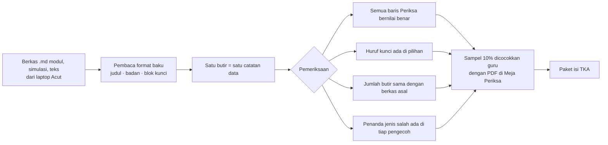

# Persiapan TKA Kelas 6 di Aplikasi

**Ringkas:** (1) TKA di aplikasi melayani **dua kelompok**: murid kelas luring (aplikasi menjadi pendamping kelas: latihan rumah, simulasi bertempo, rapor kesiapan) dan anak kelas 6 di luar kelas luring (**Jalur Mandiri**: 36 topik yang sama, dipelajari sendiri dengan kunci berjenjang). (2) Bahan tidak diketik ulang: berkas Markdown modul sudah berformat baku yang bisa dibaca mesin, sehingga ± 1.050 butir diubah otomatis menjadi data dan diperiksa ulang kuncinya. Mesin soal masuk Rilis 1, isinya masuk 4 Januari 2027 sebagai paket isi. (3) Pembeda terbesar adalah **rapor penyebab salah**: setiap pengecoh di bahan TKA sudah punya nama salah paham, jadi aplikasi bisa memberi tahu orang tua *kenapa* anak salah (salah baca, salah hitung, salah paham, atau kehabisan waktu), bukan hanya skornya.

Tahap 2, butir 7. Disusun 19 Oktober 2026. Dasar: `bahan/program-tka-sd-kelas-6.md`, `bahan/tka-sd-induk-04-standar-soal.md`, `bahan/tka-sd-status.md`, `keputusan.md` B2 no. 1–2.

---

## 1. Fakta yang mengikat rancangan

| Fakta | Sumber | Akibat |
|---|---|---|
| 30 soal per mata uji dalam 75 menit (2,5 menit per soal) | **[FAKTA — `program-tka-sd-kelas-6.md`, dari FAQ Pusat Informasi Kemendikdasmen]** | Simulasi bertempo wajib |
| Tiga bentuk: PG, PG kompleks, PG kategori; tanpa nilai sebagian | sama | Penilaian semua-atau-tidak; rapor tetap menunjukkan "hampir benar" |
| Domain Matematika: Bilangan, Geometri & Pengukuran, Data (tanpa Aljabar dan Peluang) | sama | Tidak ada isi Peluang |
| Bahasa Indonesia: membaca saja | sama | Tidak ada latihan menulis |
| TKA 2026: 20–30 April; rerata Bahasa Indonesia 60,14, Matematika 43,41 | **[FAKTA — Siaran Pers Kemendikdasmen No. 15444, 27 Mei 2026]** | Matematika diberi porsi dua kali |
| Jadwal TKA 2027 dan status IPA | **Belum diumumkan per 19 Okt 2026** | Isi IPA tidak dibuat; dipantau tiap 2 minggu |
| Ujian berbasis komputer | sama | Latihan di HP mendekati, tetapi layar lebih kecil (bagian 6) |

---

## 2. Dua kelompok pemakai

| | **Murid kelas luring** | **Jalur Mandiri** |
|---|---|---|
| Siapa | 6–8 anak per kelas Paket Siap TKA SD | Anak kelas 6 pemakai aplikasi yang tidak ikut kelas |
| Urutan topik | Mengikuti pertemuan P01–P36 | Sama, 3 topik per minggu |
| Yang dibuka | Latihan rumah topik itu terbuka pada **tanggal pertemuan** yang diisi Acut di panel untuk kelas itu (diubah 20 Okt: pengajar tidak punya akses tulis, jadi tidak bisa "menandai selesai") | Semua topik terbuka berurutan; topik berikut terbuka setelah latihan topik sebelumnya selesai |
| Belajar materi baru | Di kelas, dengan pengajar | Di aplikasi: salah paham di depan → contoh jadi → latihan dengan kunci berjenjang |
| Simulasi | Sesuai jadwal kelas | S1–S4 setelah M07, M13, M19, M23; S5 setelah B11 |
| Peran orang tua | Menyuruh, memberi semangat, mengawasi simulasi | Sama, ditambah Mode Dampingi untuk topik yang macet |
| **[ASUMSI]** Hasil | Lebih kuat, sebab ada pengajar | Lebih lemah; janji ke orang tua harus lebih hati-hati |

**Kenapa Jalur Mandiri tetap dibuat:** bahannya sudah ada, dan kunci berjenjang (Petunjuk dulu, baru Langkah) adalah umpan balik korektif yang memang dirancang untuk dibacakan saat anak salah **[FAKTA — `tka-sd-induk-04` bagian 3.3, mengutip Rohrer dkk. 2020]**. Di aplikasi, layar yang membacakannya.

---

## 3. Isi yang dipindah dari bahan TKA

| Bahan | Jumlah **[FAKTA — `tka-sd-status.md`]** | Masuk aplikasi sebagai | Tetap di kertas/kelas |
|---|---|---|---|
| Modul Matematika M01–M24 | 24 | Jalur Mandiri: halaman salah paham, contoh jadi, soal halaman 5 | Naskah menit per menit untuk pengajar, papan jawaban serentak |
| Modul Bahasa Indonesia B01–B12 | 12 | sama | sama |
| Latihan rumah (bagian D lembar kerja anak) | 29 lembar | **Latihan rumah digital** dengan kunci berjenjang | PDF tetap ada sebagai cadangan |
| Paket simulasi S1–S5 | 5 × 30 butir | **Simulasi bertempo** | Naskah PDF tetap ada |
| Teks baca cepat T01–T36 | 36 | Baca Ulang kelas 6 (`05-bahasa-indonesia.md`) | Dipakai juga di kelas |
| Tiket keluar | per pertemuan | Tidak dipindah | Tetap di kertas, sebab dipakai pengajar saat itu juga |
| Kartu fakta perkalian | 1 | Diganti Lancar kelas 3–4 | — |

---

## 4. Cara memindah tanpa mengetik ulang

Setiap soal di bahan TKA sudah ditulis dengan judul, badan, dan blok kunci yang baku, dan pemeriksa otomatisnya sudah ada **[FAKTA — `tka-sd-induk-04`: "lembar kerja anak dan pemeriksa kunci dibangkitkan otomatis dari format ini"]**. Jadi pemindahannya adalah membaca format yang sama dengan alat lain.



**Contoh bentuk satu butir sebagai data** (potongan penjelas, bukan kode aplikasi):

```json
{
  "id": "M02-soal-07",
  "modul": "M02", "jenis": "Soal", "lambang": "●", "bentuk": "PG",
  "badan": "Lampu hijau berkedip setiap 6 detik. ...",
  "pilihan": {"A": "2", "B": "14", "C": "24", "D": "48"},
  "kunci": ["C"],
  "petunjuk": "Kejadiannya berulang ... kelipatan atau faktor?",
  "langkah": "Kelipatan 6: 6, 12, 18, 24 ...",
  "pengecoh": {
    "A": {"alasan": "memakai FPB", "jenis": "S"},
    "B": {"alasan": "menjumlahkan kedua waktu", "jenis": "S"},
    "D": {"alasan": "mengalikan langsung", "jenis": "S"}
  },
  "periksa": ["lcm(6, 8) == 24"]
}
```

**Yang dibutuhkan dari Acut:** berkas `kursus-tka-sd/01-modul-matematika/`, `02-modul-bahasa-indonesia/`, `03-bank-teks-baca-cepat/`, dan `_alat/periksa.py` — dengan membagikan folder laptop ke sesi, atau mengirim satu berkas zip ke percakapan. **Paling lambat 31 Oktober**, sebab mesin soal di Rilis 1 harus diuji dengan butir sungguhan.

---

## 5. Latihan rumah digital

| Aturan | Isi |
|---|---|
| Jumlah | Sama dengan bagian D lembar kerja topik itu |
| Saat salah pertama kali | Tampil **Petunjuk** (pertanyaan pancingan); anak mencoba lagi |
| Saat salah kedua kali | Tampil **Langkah**; butir masuk antrean ulang 3 hari kemudian |
| PG kompleks dan kategori | Dinilai semua-atau-tidak seperti TKA; setelah dijawab, tampil pernyataan mana yang keliru |
| Waktu | Dicatat per butir; sasaran ± 2,5 menit per butir bertempo, ± 45 detik per soal kelas |
| Ulang berjarak | Butir topik lama muncul di latihan topik baru: 2 dari minggu lalu, 1 dari bulan lalu |
| Untuk pengajar kelas luring | **Link rapor kelas** (lihat bagian 8) |

---

## 6. Simulasi bertempo

| Hal | **Mode Latihan** (S1–S3) | **Mode Ujian** (S4, S5) |
|---|---|---|
| Waktu | 75 menit, waktu jeda tidak dihitung | 75 menit tanpa jeda, seperti ujian sebenarnya |
| Jeda | Boleh, paling banyak 3 kali | Tidak ada; kalau aplikasi tertutup, waktu tetap berjalan |
| Lompat soal dan tanda "ragu" | Ya | Ya |
| Umpan balik | Setelah selesai, per butir dengan Langkah | Setelah selesai |
| Orang tua | Disarankan | **Pengawas simulasi** (bukan Mode Dampingi, sebab Mode Dampingi keluar sendiri setelah 15 menit diam): orang tua memasukkan PIN sekali di awal sebagai tanda "diawasi", lalu memastikan suasana tenang dan tidak membantu. HP orang tua (kalau berbeda) hanya menampilkan sisa waktu dan nomor soal, tanpa kunci (layar D7) |
| Jadwal yang disarankan | Bebas | Sabtu pagi, mengikuti saran `kelemahan-rencana-lama.md` (simulasi tidak di sore hari puasa) |

### Layar HP lawan layar komputer ujian

| Masalah | Penanganan |
|---|---|
| Teks stimulus 150–200 kata tidak muat bersama soal | Dua tab: **Teks** dan **Soal**, dengan tombol pindah di tempat yang sama; teks tetap di posisi gulir terakhir |
| Tabel lebar | Tabel bisa digeser ke samping; huruf tidak dikecilkan |
| Denah angka susunan kubus | Ditampilkan sebagai kisi angka yang bisa diperbesar |
| Ujian sebenarnya memakai komputer | **[ASUMSI]** Latihan di HP tetap melatih tempo dan bentuk soal; untuk S5, orang tua yang punya laptop disarankan membuka halaman rapor dan simulasi di laptop (Tahap 3 menilai apakah simulasi bisa dibuka di peramban) |

---

### 6a. Mini try out mingguan (ditambah 29 Okt)

Diambil dari perbandingan dengan Edufic (Try Out Akbar 4 jam setiap Minggu), tetapi dibuat pendek supaya muat di batas waktu belajar kelas 6.

| Hal | Aturan |
|---|---|
| Isi | **6 soal campuran** dari topik yang sudah dipelajari: 4 dari topik 1–2 minggu terakhir, 2 dari topik ≥ 3 minggu lalu (sekaligus uji tunda). Tiga bentuk soal TKA (PG, PG kompleks, PG kategori) |
| Waktu | **15 menit** (2,5 menit per soal, sama dengan patokan TKA). Waktu terlihat seperti di simulasi, sebab tujuannya membiasakan tempo ujian |
| Kapan | Sekali seminggu, hari dipilih anak atau orang tua (bawaan Sabtu). **Tidak ada** di minggu simulasi penuh |
| Soal | Diambil dari bank ± 1.050 butir yang sudah ada; tidak ada isi baru. Soal yang sudah keluar di mini try out tidak dipakai lagi dalam 4 minggu |
| Hasil | Skor masuk **grafik kemajuan** di rapor TKA (O4) dan rapor penyebab salah (B/H/S/W). Tanpa peringkat, tanpa hadiah |
| Layar | Memakai layar simulasi K15 dengan pengaturan 6 soal / 15 menit lewat paket isi, jadi hampir tidak ada layar baru |

### 6b. "Rencana minggu ini" untuk orang tua (ditambah 29 Okt)

Orang tua suka melihat rencana yang jelas (poster topik harian Edufic), tetapi rencana kita **disusun dari keadaan anak itu sendiri**, bukan jadwal yang sama untuk semua anak.

| Hal | Aturan |
|---|---|
| Disusun | Setiap Senin pagi, otomatis dari peta 36 topik |
| Isi | 1 topik baru (urutan peta spiral, atau jadwal kelas luring) · 1–2 topik yang masih lemah (status "Latihan" < 80%) · 1 topik ulang yang jatuh tempo uji tunda · hari mini try out |
| Contoh | "Minggu ini: pecahan (masih 60%) · luas bangun datar (baru) · ulang KPK · mini try out Sabtu" |
| Tampil di | Rapor TKA (O4), kartu anak di beranda Kabar, dan Peta Perjalanan (R2). Di HP anak, daftar topik TKA (K13) memberi tanda "minggu ini" pada topik yang sama |
| Bukan perintah | Anak tetap boleh memilih topik lain; rencana hanya saran |

### 6c. Pola bilangan: dicek, tidak ditambah (29 Okt)

Edufic memasukkan "pola bilangan" ke jadwalnya. Kisi-kisi TKA Matematika SD/MI 2026 berdasarkan Peraturan Kepala BSKAP 047/H/AN/2025 hanya memuat tiga elemen, yaitu Bilangan (bilangan rasional, operasi, kelipatan, faktor, KPK, FPB), Geometri dan Pengukuran, serta Data, **tanpa pola bilangan dan aljabar** **[FAKTA — reproduksi kisi-kisi di websitependidikan.com]**. Karena itu 36 topik tetap. Satu artikel bimbel menyebut "Aljabar Dasar: pola bilangan", tetapi tanpa merujuk dokumen resmi. Catatan lama tetap berlaku: Acut mengunduh PDF Perka BSKAP aslinya untuk memastikan.

**Akibat ke pembangunan R1** **[ESTIMASI]**: mini try out ± 0,5 hari (pengaturan baru di layar K15), Rencana minggu ini ± 1 hari (kartu di O4 + tanda di K13). Kalau pembangunan R1 tertinggal, Rencana minggu ini digeser ke R2 bersama Peta Perjalanan; mini try out tetap di R1.

## 7. Rapor penyebab salah

Setiap pengecoh di bahan TKA sudah punya alasan tertulis ("Kenapa pengecoh menarik"). AI memberi setiap alasan satu kode, guru memeriksa **sampel 20%** (± 600 dari ± 3.000 pengecoh; soal butir dicocokkan 10%), lalu aplikasi menghitung otomatis.

| Kode | Arti | Cara aplikasi mengenali | Saran untuk orang tua |
|---|---|---|---|
| **B — Baca** | Salah membaca soal atau teks | Pengecoh berkode B (misal "yang ditanya selisih dijawab jumlah", "menjawab dari pengetahuan sendiri, bukan dari teks") | "Minta anak menunjuk kata penting di soal sebelum menjawab" |
| **H — Hitung** | Cara benar, hitungan meleset | Pengecoh berkode H (misal selisih satu, salah simpan) | "Latihan Lancar harian akan membantu bagian ini" |
| **S — Salah paham** | Konsepnya keliru | Pengecoh berkode S (misal KPK tertukar FPB, keliling tertukar luas) | "Buka topik ini bersama di Mode Dampingi" |
| **W — Waktu** | Tidak terjawab, atau dijawab asal di menit terakhir | Butir kosong saat waktu habis, atau dijawab < 10 detik dalam 3 menit terakhir | "Latih melompati soal sulit lalu kembali" |

### Isi rapor kesiapan TKA

| Bagian | Isi | Aturan |
|---|---|---|
| Peta 36 topik | Belum · Latihan · **Kuasai** | Kuasai = ≥ 80% benar pada 2 kesempatan, salah satunya ≥ 3 minggu setelah topik dipelajari (sama dengan aturan kelas luring) |
| Garis simulasi | Persen benar S1 → S4 (Matematika) dan S5 (Bahasa Indonesia) | Ditulis **"persen benar latihan, bukan nilai TKA"**, sebab cara penilaian resmi tidak kita ketahui |
| Penyebab salah | Bagian terbesar dari B / H / S / W | Satu saran untuk orang tua dari kode terbesar |
| Bentuk soal | Benar per bentuk (PG, PG kompleks, PG kategori) + persen pernyataan benar pada PG kategori | Menunjukkan "hampir benar" yang tidak terlihat di skor |

### Ukuran keberhasilan **[ASUMSI — dikalibrasi setelah S1]**

| Ukuran | Target | Cadangan |
|---|---|---|
| Kenaikan persen benar Matematika S1 → S4 | +15 poin | +8 poin |
| Persen benar Matematika S4 | ≥ 60% | ≥ 50% |
| Penyebab salah **W** di S4 dibanding S1 | Turun setengah | Turun sepertiga |
| Latihan rumah diselesaikan | ≥ 80% lembar | ≥ 65% |

---

## 8. Link rapor untuk pengajar kelas luring

| Pilihan | Untung | Rugi | Putusan |
|---|---|---|---|
| Pengajar tidak melihat apa pun | Paling sederhana; privasi paling aman | Pengajar tetap memakai lembar xlsx; latihan rumah digital tidak membantu kelas | ✗ |
| **Link rapor kelas** (hanya baca): siapa sudah mengerjakan latihan rumah, topik yang paling banyak salah, kode penyebab | Pengajar tahu apa yang dibahas di pertemuan berikutnya; tanpa akun baru | Data anak dilihat orang di luar keluarga | **✓ Diusulkan, dengan persetujuan orang tua yang terpisah** |
| Akun pengajar penuh | Bisa memberi tugas | Menambah jenis pengguna, profil risiko PP Tunas naik | ✗ untuk tahun pertama |

Persetujuan "rapor anak boleh dilihat pengajar kelas" menjadi **satu tujuan tersendiri** di formulir persetujuan, sebab PP 33/2026 meminta persetujuan spesifik yang tidak digabung **[FAKTA — `riset-penguat.md`]**. Masuk paket draf ahli hukum di Tahap 3.

### Cara kerjanya (ditambah 20 Okt setelah pemeriksaan)

Pemeriksa menemukan bahwa link rapor dirancang per anak, sedangkan rapor kelas lintas keluarga, dan pengajar tidak punya cara menandai pertemuan. Rancangannya sekarang:

| Bagian | Cara |
|---|---|
| Data kelas | Tabel `kelas_luring` (nama kelas, pengajar, tanggal pertemuan P01–P36) dan `anggota_kelas` (anak, kelas, izin 6 ya/tidak), diisi Acut di panel (`02-rancangan/03-basis-data.md`) |
| Membuka latihan rumah | Menurut tanggal pertemuan di tabel itu. Kalau pertemuan bergeser, Acut mengubah tanggalnya di panel (± 2 menit) |
| Rapor kelas | Fungsi server khusus membuat satu link per kelas; isinya hanya anak yang orang tuanya memberi Izin 6. Hanya baca, bisa dicabut, berlaku sampai kelas selesai |
| Pengajar sebagai penerima data | Menandatangani pernyataan menjaga kerahasiaan sebelum link dikirim; ditanyakan ke ahli hukum apakah cukup (pertanyaan formulir no. 3) |
| Tanggal kelas | **Perlu dari Acut:** siapa pengajarnya dan tanggal pertemuan pertama (rencana Januari) |

---

## 9. Beban waktu harian anak kelas 6

| Hari | Lancar | Baca Ulang | TKA | Jumlah **[ESTIMASI]** |
|---|---|---|---|---|
| Hari ada kelas luring | 3 menit | 6 menit (teks pertemuan) | Latihan rumah ± 10 menit | ± 19 menit |
| Hari tanpa kelas (Jalur Mandiri) | 3 menit | 6 menit | Satu topik ± 12 menit | ± 21 menit |
| Sabtu simulasi | — | — | 75 menit | 75 menit |
| Hari mini try out (29 Okt) | 3 menit | 6 menit | Mini try out 15 menit | ± 24 menit |

Batas sesi kelas 5–6 adalah ≤ 20 menit (`01-profil-dan-perjalanan.md`). **Hari Jalur Mandiri sedikit melewati batas**, jadi aplikasi membagi topik menjadi dua bagian (materi dan latihan) yang boleh dikerjakan di dua waktu berbeda.

---

## 10. Risiko

| Risiko | Tanda awal | Pencegahan |
|---|---|---|
| Format TKA 2027 berubah (IPA masuk, waktu berubah) | Pengumuman resmi | Paket isi bisa diperbarui tanpa rilis; pantau tiap 2 minggu |
| Berkas dari laptop tidak lengkap atau ada yang menyimpang dari format | Jumlah butir hasil baca ≠ jumlah di berkas | Daftar butir yang gagal dibaca dikirim ke Acut; cadangan: PDF |
| Orang tua menyamakan persen benar dengan nilai TKA | Pertanyaan "berarti nilainya 60?" | Kalimat peringatan tetap di rapor |
| Jalur Mandiri dijanjikan setara kelas luring | Kalimat promosi | Janji hanya "latihan dan rapor kesiapan", bukan kenaikan nilai |
| Hak cipta modul belum jelas | Tidak ada perjanjian penulis | Masuk daftar pertanyaan ahli hukum sebelum R1.1 |

---

## 11. Keputusan Acut (19 Okt ± 21.50: semua usul disetujui)

| # | Keputusan | Usul Acut2 |
|---|---|---|
| 1 | Jalur Mandiri untuk anak kelas 6 di luar kelas luring | Buat, sebab bahannya ada; janji ke orang tua dibatasi |
| 2 | Link rapor kelas untuk pengajar, dengan persetujuan orang tua tersendiri | Buat |
| 3 | S4 dan S5 dalam Mode Ujian tanpa jeda | Ya |
| 4 | Kirim berkas TKA dari laptop paling lambat 31 Oktober | — |
