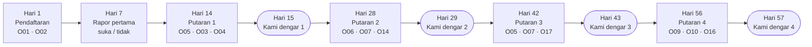
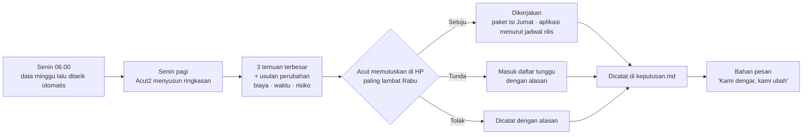

# Sistem Masukan — Bayaran dari Masa Gratis

**Ringkas:** (1) Setiap pertanyaan dipasangkan dengan satu keputusan dan satu ambang ("kalau ≥ X% menjawab begini, kami melakukan itu"). Yang bisa dijawab data pemakaian **tidak ditanyakan**. Hasilnya, bank pertanyaan dipangkas menjadi 19 pertanyaan orang tua (O08 dihapus 20 Okt) dan 5 ketukan anak. (2) Jadwal 8 minggu mengikuti keputusan "paling sering dua minggu sekali": pendaftaran, lalu empat putaran pada **Senin minggu ganjil kalender** (≥ 14 hari setelah mendaftar). Pertanyaan yang dipicu kejadian **masuk antrean putaran berikutnya**, tidak muncul sendiri (diperbaiki 20 Okt). Ini juga memperbaiki satu pertentangan di bahan lama: catatan 19 Okt menjadwalkan pertanyaan di hari ke-7, padahal itu kurang dari dua minggu. (3) Syarat lembut: **Acut memilih B** (19 Okt): tidak ada yang ditahan; penjawab mendapat kartu terima kasih dan kabar perubahan. Hak "fitur lebih awal" hanya untuk Keluarga Perintis yang diundang (disempitkan 20 Okt supaya sesuai Syarat dan Ketentuan).

Tahap 2, butir 10. Disusun 19 Oktober 2026. Dasar: keputusan 19 Okt bagian C, `catatan-diskusi-19-okt.md` bagian 2, `riset-penguat.md` bagian 4, 6, dan 9.

---

## 1. Batas jujur dengan sedikit keluarga (target 30, cadangan 20)

| Hal | Hitungan **[ESTIMASI]** | Akibat |
|---|---|---|
| Tanggapan survei di aplikasi HP | Rata-rata 36,1% **[FAKTA — Refiner 2025, sebagian besar aplikasi bisnis]** | Target kita harus jauh di atas rata-rata, sebab masukan adalah bayaran gratis |
| Jawaban per putaran | 30 keluarga × 60% = **± 18 jawaban** (dulu dihitung 50 keluarga = ± 30 jawaban) | Hanya cukup untuk melihat arah besar; selisih di bawah ± 20 poin disebut "belum bisa disimpulkan" |
| Batas ketelitian | Untuk 30–40 jawaban, persen bisa meleset **± 15 poin** (selang kepercayaan 95% untuk 40%: 1,96 × √(0,4 × 0,6 ÷ 40) ≈ 0,15) | Ambang di peta (bagian 2) adalah **pemicu untuk memeriksa**, bukan bukti |
| Uji "sangat kecewa" | Butuh ± 40 jawaban dari pemakai aktif **[Klaim vendor — Koji]** → butuh tanggapan ± 80% | Tidak dipakai sendirian untuk gerbang berbayar (`09-gerbang-berbayar.md`) |

Karena itu sistem masukan menyandarkan diri pada tiga hal sekaligus: **data pemakaian** (lengkap untuk semua anak), **pertanyaan pilihan** (arah), dan **Keluarga Perintis** (alasan di balik angka).

---

## 2. Peta pertanyaan pengembangan

Kolom "Sumber": **D** = data pemakaian · **O** = pertanyaan orang tua · **A** = ketukan anak · **P** = Keluarga Perintis.

| # | Yang harus kami ketahui | Sumber | Keputusan yang diambil | Ambang **[ASUMSI]** |
|---|---|---|---|---|
| K1 | Kesulitan terbesar anak saat mulai | O01 | Urutan isi yang dikerjakan duluan (per keluarga, jalur di beranda mengikuti jawaban ini sebagai fungsi layanan, bukan keputusan pengembangan) | Pilihan terbanyak menentukan isi berikutnya yang dipercepat |
| K2 | Harapan orang tua dalam 2 bulan | O02 | Janji gerbang berbayar mana yang paling penting bagi orang tua (`09` bagian 2). Rapor keluarga itu menonjolkan ukuran yang dipilih sebagai fungsi layanan, bukan keputusan | Pilihan terbanyak ≥ 40% → janji itu dijadikan janji utama di pesan berbayar |
| K3 | Apakah anak makin cepat dan tepat | **D** (tidak ditanya) | Naik/turun level, kalibrasi target waktu | `04-mesin-lancar.md` bagian 5 |
| K4 | Apakah orang tua **melihat** kemajuan itu | O05 + D | Kalau data naik tetapi orang tua menjawab "sama" → rapor dirancang ulang | ≥ 40% "sama/tidak tahu" padahal data naik ≥ 15% |
| K5 | Apakah anak mulai latihan tanpa disuruh | O06 + D | Kejutan dan pilihan jalur dipertahankan atau diganti | < 30% keluarga melapor "1 kali atau lebih" di minggu ke-4 → ubah |
| K6 | Apakah tugas sekolah terasa lebih mudah | O07 | Isi Paham mana yang didahulukan (O07 tidak lagi menjadi syarat gerbang; gerbang memakai janji data, `09` bagian 2) | ≥ 40% "sama saja" pada satu mapel → isi Paham mapel itu didahulukan |
| ~~K7~~ | ~~Apakah nilai sekolah berubah~~ | ~~O08~~ | **Dihapus 20 Okt**: tidak terhubung ke satu keputusan pun (aturan 5). Nilai ulangan punya terlalu banyak penyebab lain | — |
| K8 | Siapa yang mengingatkan anak | O03 | Pengingat bawaan dikirim ke Ayah, Ibu, atau keduanya | Pilihan terbanyak |
| K9 | Apakah aplikasi mudah dipakai | O04 + D (titik orang berhenti di pendaftaran) | Alur pendaftaran dan beranda diperbaiki | ≥ 20% "agak sulit/sulit" |
| K10 | Jam latihan yang cocok | O14 + D | Jam pengingat bawaan; jam kirim pertanyaan | Jam terbanyak |
| K11 | Apakah latihan terlalu sulit, pas, atau terlalu mudah | **D** + A01 | Penjaga mesin; level dipecah atau digabung | `04-mesin-lancar.md` 5.2 |
| K12 | Apakah jurus menolong | D + A03 | Jurus diganti | ≥ 30% anak "masih bingung" pada satu jurus, atau data gagal (`03-rencana-isi.md` bagian 7) |
| K13 | Apakah teks bacaan cocok | D + A04 + O15 | Tingkat teks; cetakan teks | ≥ 30% "susah dimengerti" atau pemahaman < 60% |
| K14 | Apakah kegiatan Mode Dampingi dijalankan dan disukai | D + O13 | Kegiatan dipertahankan, diganti, atau naskahnya dipendekkan | ≥ 30% "sulit diikuti" |
| K15 | Kabar kejadian berguna atau mengganggu | O12 | Jumlah dan jenis kabar | ≥ 30% "tidak perlu" |
| K16 | Fitur yang paling bermanfaat | O16 + D | Prioritas pengembangan | Urutan pilihan |
| K17 | Yang diinginkan berikutnya | O17 + A05 | Urutan rilis R3–R5 | Urutan pilihan |
| K18 | Kenapa keluarga berhenti | O11 + O18 + D | Perbaikan yang menahan keluarga | Penyebab terbanyak |
| K19 | Apakah rapor TKA menenangkan atau membingungkan | O19 | Bahasa rapor TKA | ≥ 30% "bingung" |
| K20 | Apakah orang tua akan kecewa kalau aplikasi hilang | O09 | Gerbang berbayar | `09-gerbang-berbayar.md` |
| K21 | Harga yang wajar | O10 | Harga | Median rentang |
| K22 | Kenapa tidak berlangganan | O20 | Harga, isi gratis, isi berbayar | Penyebab terbanyak |

**Yang sengaja tidak ditanyakan, sebab data sudah menjawab:** berapa kali anak latihan, berapa lama, level berapa, soal mana yang lambat, apakah anak berhenti di tengah, jam berapa anak latihan.

---

## 3. Bank pertanyaan orang tua

Semua pertanyaan berupa pilihan, cukup diketuk. Setiap pertanyaan punya pilihan jujur seperti "Belum terlihat" atau "Tidak tahu" supaya orang tua tidak terdorong memilih jawaban yang menyenangkan.

| Kode | Pertanyaan | Pilihan | Ke peta | Kapan |
|---|---|---|---|---|
| O01 | Apa kesulitan belajar terbesar anak saat ini? | Menghitung masih lambat · Soal cerita · Membaca masih lambat · Memahami bacaan · Susah diajak belajar · Belum ada | K1 | Pendaftaran |
| O02 | Dalam 2 bulan, apa yang paling Anda harapkan? | Lebih cepat menghitung · Lebih lancar membaca · Belajar tanpa disuruh · Tugas sekolah lebih mudah · Siap TKA (kelas 6) | K2 | Pendaftaran |
| O03 | Pengingat latihan sebaiknya dikirim ke HP siapa? | Ibu · Ayah · Keduanya · Tidak perlu pengingat | K8 | Putaran 1 |
| O04 | Seberapa mudah aplikasi ini dipakai? | Sangat mudah · Mudah · Agak sulit · Sulit → kalau "agak sulit/sulit": Bagian mana? (Mendaftar · Menghubungkan HP · Membaca rapor · Mode Dampingi) | K9 | Putaran 1 |
| O05 | Dibanding 2 minggu lalu, cara anak menghitung (atau membaca) … | Lebih cepat · Sama · Lebih lambat · Belum terlihat | K4 | Putaran 1 dan 3 |
| O06 | Minggu ini, berapa kali anak mulai latihan **tanpa disuruh**? | Belum pernah · 1–2 kali · 3 kali atau lebih · Tidak tahu | K5 | Putaran 2 |
| O07 | Minggu ini, tugas Matematika atau Bahasa Indonesia dari sekolah terasa … bagi anak | Lebih mudah · Sama saja · Lebih sulit · Tidak ada tugas | K6 | Putaran 2 dan 3 |
| O09 | Bagaimana perasaan Anda kalau aplikasi ini **tidak bisa dipakai lagi**? | Sangat kecewa · Agak kecewa · Tidak kecewa · Sudah tidak memakai | K20 | Putaran 4 (hanya pemakai aktif) |
| O10 | Kalau nanti berbayar, berapa per bulan yang wajar untuk **semua anak** di keluarga Anda? | < Rp25 ribu · Rp25–50 ribu · Rp50–75 ribu · Rp75–100 ribu · > Rp100 ribu · Saya tidak akan membayar | K21 | Putaran 4 |
| O11 | Beberapa hari ini anak belum latihan. Apa sebab utamanya? | Sedang sibuk atau libur · HP dipakai orang lain · Anak bosan · Terlalu sulit · Terlalu mudah · Lupa | K18 | Dipicu: 5 hari tidak aktif |
| O12 | Kabar "lulus level" tadi … | Berguna, saya memuji anak · Berguna, tapi tidak sempat · Tidak perlu kabar seperti ini | K15 | Dipicu: lulus level pertama |
| O13 | Kegiatan bersama tadi … | Seru, mau lagi · Biasa saja · Sulit diikuti · Tidak sempat dikerjakan | K14 | Dipicu: kegiatan Dampingi pertama |
| O14 | Jam latihan yang paling cocok di rumah? | Pagi sebelum sekolah · Pulang sekolah · Sore · Setelah magrib · Setelah isya | K10 | Putaran 2 |
| O15 | Baca Ulang untuk anak Anda terasa … | Terlalu mudah · Pas · Terlalu sulit · Belum dicoba | K13 | Dipicu: 7 hari setelah Baca Ulang dimulai |
| O16 | Bagian mana yang paling bermanfaat? | Kabar harian · Rapor mingguan · Kirim semangat · Mode Dampingi · Link rapor | K16 | Putaran 4 |
| O17 | Apa yang paling ingin Anda tambahkan berikutnya? | Bahasa Inggris · Soal cerita · Game belajar · Latihan dari buku tulis · Lainnya (boleh isi) | K17 | Putaran 3 |
| O18 | Apa alasan utama berhenti? | Anak tidak mau · Tidak ada waktu · Tidak terlihat manfaatnya · Ada aplikasi/les lain · Masalah teknis · Lainnya | K18 | Saat menghapus akun atau 21 hari tidak aktif |
| O19 | Hasil simulasi TKA pertama membuat Anda … | Lebih tenang · Khawatir · Bingung membaca rapornya | K19 | Dipicu: S1 selesai |
| O20 | Apa alasan utama belum berlangganan? | Harga · Gratisnya sudah cukup · Manfaat belum terasa · Nanti saja · Lainnya | K22 | Akhir masa gratis |

**Isian terbuka**, sekali di akhir setiap putaran dan boleh dilewati: "Ada yang ingin Anda sampaikan? Boleh ketik atau kirim pesan suara ke WhatsApp."

---

## 4. Bank ketukan anak — terasa seperti permainan

| Kode | Bentuk | Pilihan | Ke peta | Kapan |
|---|---|---|---|---|
| A01 | "Latihan tadi rasanya seperti hewan apa?" | 🐦 Burung terbang (gampang sekali) · 🦌 Kancil lincah (seru, pas) · 🐢 Kura-kura (susah) · 🐘 Gajah mengantuk (bosan) | K11 | Setelah latihan Lancar, paling banyak 1 kali sehari |
| A02 | "Pilih jalan untuk besok" | 2–3 gambar jalur | K16 (dari perilaku memilih) | Akhir sesi, bergantian dengan A01 |
| A03 | "Jurus tadi bikin kamu …" | 💡 Paham · 🤔 Masih bingung | K12 | Pertama kali membuka jurus suatu level |
| A04 | "Cerita tadi …" | 😄 Seru · 😐 Biasa · 😵 Susah dimengerti | K13 | Setelah Baca Ulang, bergantian dengan A01 |
| A05 | "Besok mau lebih banyak apa?" (diubah 20 Okt: bingkai "hadiah untuk Gampong" dibuang, sebab Gampong baru ada di R4 dan ketukan anak tidak boleh berbau hadiah) | 📚 Cerita · 🔢 Tantangan angka · 👨‍👧 Main bareng Ayah/Bunda · 🎲 Game | K17 | Setiap 4 minggu |

**Kenapa hewan, bukan wajah senang–sedih:** anak yang lebih muda cenderung memilih wajah paling senang **[FAKTA — Read & Horton 2025]**. Empat hewan menggambarkan empat **keadaan** yang tidak berurutan dari baik ke buruk, jadi tidak ada pilihan yang terasa "jawaban benar".

**Aturan ketukan anak:**

| Aturan | Sebab |
|---|---|
| Paling banyak 1 ketukan per hari; tombol lewati selalu ada | Tidak mengganggu latihan |
| **Tanpa hadiah** untuk menjawab | Supaya jawaban jujur dan tidak menjadi hadiah yang dijanjikan |
| Jawaban terlihat berpengaruh: "Besok ada cerita tentang laut, karena kamu memilih Cerita" | Anak belajar bahwa suaranya didengar. Penyesuaian ini adalah **fungsi layanan** yang diminta anak saat itu (memilih isi berikutnya), bukan profil: tidak ada ciri anak yang disimpan dan dipakai untuk hal lain. Ditulis begitu di kertas kerja penilaian mandiri (`paket-hukum/03`) |
| Untuk kelas 1–3, ketukan dibaca bersama perilaku, bukan sendirian | Jawaban "senang" anak kecil kurang berarti **[FAKTA — `riset-penguat.md` bagian 6]** |
| Dilaporkan sebagai persen tiap pilihan, bukan rata-rata | sama |

---

## 5. Jadwal 8 minggu

### 5.1 Pertentangan yang diperbaiki

Keputusan 19 Okt: pertanyaan orang tua **paling sering dua minggu sekali**. Catatan diskusi 19 Okt menjadwalkan hari 1, **7**, 14, 28, 42, 56. Hari ke-7 melanggar aturan dua minggu, dan riset menunjukkan dua survei berdekatan menurunkan tanggapan 10–22 poin **[FAKTA — Porter dkk. 2004]**. Usul: pertanyaan hari ke-7 dipindah ke putaran 1 (hari ke-14), sedangkan hari ke-7 hanya berisi rapor mingguan pertama dengan satu tombol "Rapor ini mudah dipahami? 👍 👎" yang tidak dikirim sebagai pemberitahuan.

### 5.2 Jadwal

**Diubah 20 Okt: putaran memakai tanggal kalender, bukan hari ke-N per keluarga.** Sebab: pesan "Kami dengar" disiarkan ke semua keluarga sekaligus, dan gelombang masuk berselang (± 10 Des, 4 Jan, 1 Feb). Dengan hari ke-N per keluarga, putaran akan tersebar di setiap minggu dan Acut menyusun ringkasan terus-menerus. Aturannya sekarang:

| Aturan | Isi |
|---|---|
| Hari putaran | **Senin di minggu ganjil kalender** (misal 11 Jan, 25 Jan, 8 Feb, …) untuk semua keluarga |
| Keluarga baru | Ikut putaran berikutnya yang jatuh **≥ 14 hari** setelah mendaftar. Jadi jarak antarpertanyaan tetap ≥ 14 hari |
| Isi putaran | Mengikuti urutan putaran keluarga itu (putaran 1 = O05 · O03 · O04, dan seterusnya), jadi dua keluarga bisa mendapat pertanyaan berbeda di Senin yang sama |
| "Kami dengar" | Selasa sesudahnya, satu pesan untuk semua |
| Ramadan dan Idulfitri (± 8 Feb–19 Mar 2027, `06-rilis/04`) dan libur | Putaran tetap ada, tetapi hanya 1 pertanyaan; ditandai di laporan |

Tabel di bawah tetap memakai "hari ke-N" untuk menunjukkan urutan pertanyaan satu keluarga; tanggal sebenarnya jatuh di Senin putaran terdekat.

| Hari | Orang tua | Anak | Keluarga Perintis |
|---|---|---|---|
| 1 | O01, O02 (bagian dari pendaftaran) | A01 setelah lembar pertama | — |
| 7 | Rapor pertama + 👍👎 | A01/A04 bergantian; A03 saat jurus baru | Pesan suara 1: "Ceritakan minggu pertama" |
| 14 | **Putaran 1:** O05 → (lanjut?) O03, O04 | — | — |
| 15 | Pesan "Kami dengar, kami ubah" 1 | — | — |
| 21 | — | — | Pesan suara 2 |
| 28 | **Putaran 2:** O06 → O07, O14 | A05 pertama | — |
| 29 | Pesan 2 | — | — |
| 35 | — | — | Pesan suara 3 |
| 42 | **Putaran 3:** O05 → O07, O17 | — | — |
| 43 | Pesan 3 | — | — |
| 49 | — | — | Pesan suara 4 |
| 56 | **Putaran 4:** O09 → O10, O16 | A05 kedua | — |
| 57 | Pesan 4 | — | — |

**Aturan satu putaran:**

| Aturan | Isi | Dasar |
|---|---|---|
| Bentuk | Satu pertanyaan tampil; setelah dijawab: "Mau 2 pertanyaan lagi? ± 30 detik" | Satu pertanyaan paling aman; berhenti di tengah naik untuk setiap pertanyaan tambahan **[FAKTA — SurveyMonkey; Refiner]** |
| Panjang | Paling banyak 3 pertanyaan, selesai ≤ 1 menit | Keputusan 19 Okt |
| Tempat | Kartu di beranda mode orang tua **dan** di bawah link rapor (supaya orang tua [L] juga bisa menjawab) | Semua cara terlibat ikut |
| Waktu muncul | Pada jam yang paling sering keluarga itu membuka aplikasi (dari data) | K10 |
| Kalau belum dijawab | Kartu tetap di beranda 5 hari; satu pengingat WhatsApp di hari ke-3 (hanya keluarga dengan Izin 7); setelah itu hilang | Tidak mengejar |
| Jawaban dari link rapor | Dicatat `sumber = link` dan dihitung terpisah, sebab siapa pun yang memegang link bisa menjawab (`02-rancangan/03` jawaban_masukan) | Persetujuan masukan diberikan pemilik akun |

### 5.3 Pertanyaan yang dipicu kejadian

**Diubah 20 Okt:** aturan lama (pemicu paling banyak 1 per 14 hari, di luar ± 3 hari dari putaran) ternyata membuat orang tua bisa ditanya **dua kali dalam 14 hari**, melanggar keputusan terkunci "paling sering dua minggu sekali". Sekarang pertanyaan pemicu **tidak muncul sendiri**: ia masuk antrean dan menjadi pertanyaan pertama di putaran berikutnya (menggantikan satu pertanyaan putaran itu, jadi tetap ≤ 3 pertanyaan). Kekurangannya: jawaban datang paling lambat 14 hari setelah kejadian, jadi ingatan orang tua sedikit kabur. Diterima, sebab aturan dua minggu lebih penting.

| Pemicu | Pertanyaan | Batas |
|---|---|---|
| Anak 5 hari tidak latihan | O11 | Masuk antrean putaran berikutnya; paling banyak 1 pertanyaan pemicu per putaran |
| Lulus level pertama | O12 | sama |
| Kegiatan Dampingi pertama | O13 | sama |
| 7 hari setelah Baca Ulang dimulai | O15 | sama |
| Simulasi TKA S1 selesai | O19 | sama |
| Hapus akun / 21 hari tidak aktif | O18 | Sekali saja. Satu-satunya pengecualian aturan antre: saat menghapus akun, sebab tidak ada putaran berikutnya. Untuk 21 hari tidak aktif, O18 ikut putaran berikutnya |

Kalau dua pemicu jatuh di periode yang sama, yang dipakai adalah yang paling dekat dengan keputusan minggu itu (urutan: O11 → O19 → O13 → O15 → O12); sisanya dibuang, bukan ditunda lagi.

**Tombol 👍👎 rapor pertama** (hari ke-7) tidak dihitung sebagai pertanyaan, sebab tidak dikirim sebagai pemberitahuan dan hanya satu ketuk di bawah rapor yang memang dibuka orang tua.

---

## 6. Syarat lembut — dirancang ulang

### 6.1 Kenapa keputusan 19 Okt perlu ditinjau

Keputusan yang dikunci: *"Kalau orang tua melewatkan dua putaran pertanyaan, yang tertunda hanya fitur tambahan orang tua (misal rapor lengkap) sampai menjawab."* Acut2 tidak mengubahnya. Ini bukti untuk dipertimbangkan:

| Bukti | Sumber | Akibat untuk syarat lembut |
|---|---|---|
| Kalau konsumen menolak memberi persetujuan, layanan tetap diberikan **tanpa menurunkan mutu**, kecuali datanya memang diperlukan | **[FAKTA — PP 33/2026 Ps. 35(1), lewat Bisnis.com 29 Agu 2026]** | Jawaban masukan adalah data pribadi orang tua. Menahan rapor bagi yang tidak memberi data itu bisa dianggap menurunkan mutu. **[ASUMSI — perlu ahli hukum]** |
| Persetujuan harus bebas dan tidak digabung dengan syarat | **[FAKTA — PP 33/2026, lewat RSM Indonesia]** | Persetujuan yang dipaksa dengan ancaman fitur bisa dianggap tidak bebas |
| Imbalan di muka lebih kuat daripada imbalan yang dijanjikan | **[FAKTA — Church 1993; Edwards dkk. 2002]** | Ancaman kehilangan bukan cara terkuat menaikkan tanggapan |
| Jawaban terpaksa cenderung asal-asalan | **[ASUMSI]** sejalan dengan tanda jawaban asal **[FAKTA — CASRAI]** | Orang tua yang terpaksa menjawab demi rapor akan mengetuk cepat; mutu masukan turun |
| Rapor adalah yang paling diutamakan orang tua | Deskripsi Project | Menahan rapor menyentuh nilai utama aplikasi |

### 6.2 Tiga pilihan

| | **A. Tetap seperti keputusan 19 Okt** | **B. Ajakan dengan imbalan** (usul) | **C. Kesepakatan Program Perintis** |
|---|---|---|---|
| Isi | Setelah 2 putaran terlewat, rapor lengkap ditahan sampai menjawab | Tidak ada yang ditahan. Yang menjawab langsung mendapat imbalan kecil: kartu terima kasih dan kabar "Kami dengar" yang menyebut perubahan dari jawabannya. (Disempitkan 20 Okt: "fitur baru lebih awal" hanya untuk Keluarga Perintis yang diundang, bukan untuk semua penjawab, dan "poin Perintis" dihapus, supaya sama dengan Syarat dan Ketentuan 5.2 dan 6, dan supaya keuntungan tidak dikaitkan dengan memberi data) | Saat mendaftar, orang tua memilih: **Program Perintis** (berjanji menjawab 1 menit tiap 2 minggu; mendapat hak Perintis saat berbayar) atau **pemakai biasa** (semua fitur sama, tanpa hak Perintis) |
| Risiko hukum | **Tinggi** (Ps. 35(1)) | Rendah, **setelah disempitkan** (versi lama dengan fitur lebih awal untuk penjawab sama dengan C: Sedang) | Sedang: imbalan dihubungkan dengan data; perlu dicek ahli hukum |
| Tanggapan | Mungkin tinggi, tetapi banyak jawaban asal | Bergantung pada imbalan dan pesan "Kami dengar" | Kemungkinan tertinggi dengan jawaban jujur, sebab orang tua memilih sendiri |
| Sesuai "anak tidak jadi korban" | Ya | Ya | Ya |
| Biaya | Kecil | Kecil | Kecil; hak Perintis menurunkan pendapatan awal |
| Waktu bangun | Sama untuk ketiganya (± 2–3 hari) | | |

**Diputuskan Acut 19 Okt: B.** (Usul Acut2 semula: pakai **B** di Rilis 1, sebab paling aman secara hukum dan tidak menurunkan mutu masukan; tanyakan **C** ke ahli hukum dan pindah ke C kalau diizinkan. **A tidak disarankan.**)

### 6.3 Pengingat yang tetap berlaku di semua pilihan

| Keadaan | Yang terjadi |
|---|---|
| Satu putaran terlewat | Tidak ada apa-apa selain kartu yang hilang setelah 5 hari |
| Dua putaran berturut-turut terlewat | Satu pesan WhatsApp pribadi dari Acut (cetakan siap pakai): "Kami ingin tahu pendapat Anda — ada yang membuat Anda sulit menjawab?" |
| Tiga putaran terlewat | Keluarga dicatat "diam" dan tidak dihitung dalam angka tanggapan pemakai aktif; tidak dihubungi lagi sampai mereka aktif |

---

## 7. Keluarga Perintis

| Aturan | Isi |
|---|---|
| **Jumlah** | 5–10 keluarga (keputusan 19 Okt) |
| **Cara terpilih** | **Atas undangan Acut** (diubah 20 Okt): (a) 3–5 keluarga diajak sejak awal dari jaringannya; (b) sisanya diundang dari semua keluarga menurut sebaran kelas dan cara terlibat. Banyaknya jawaban **tidak** menjadi syarat, sebab itu sama dengan memberi keuntungan karena memberi data. Keluarga harus memberi Izin 7 (WhatsApp) |
| **Sebaran** | Diusahakan mencakup kelas 1–2, 3–4, dan 5–6, serta ketiga cara terlibat, supaya tidak hanya keluarga Pendamping yang terdengar |
| **Kewajiban** | Satu pesan suara WhatsApp ≤ 2 menit tiap 2 minggu, menanggapi satu pertanyaan pancingan; mencoba fitur baru lebih dulu; boleh berhenti kapan saja |
| **Imbalan di muka** (sejak bergabung) | Fitur baru terbuka lebih awal; kartu satwa khusus "Perintis" untuk anak (diberikan sebagai kejutan); disebut namanya (inisial, dengan izin) di pesan "Kami dengar, kami ubah" saat usulannya dipakai |
| **Hak saat berbayar** | Diatur di `09-gerbang-berbayar.md` bagian 5 |
| **Penjaga bias** | Jawaban Perintis dilaporkan terpisah; keputusan memakai data semua keluarga; Perintis biasanya lebih puas daripada rata-rata (`01-profil` 1.4) |
| **Kalau keluar** | Hak saat berbayar dihitung dari jumlah bulan aktif sebagai Perintis |

**Pertanyaan pancingan pesan suara** (satu per 2 minggu):

| Minggu | Pancingan |
|---|---|
| 1 | "Ceritakan kejadian paling berkesan minggu ini saat anak memakai aplikasi." |
| 3 | "Kapan anak terlihat paling semangat, dan kapan paling malas?" |
| 5 | "Apa yang Anda lakukan saat anak macet atau salah? Apa yang berhasil?" |
| 7 | "Kalau Anda bisa mengubah satu hal di aplikasi ini, apa?" |
| 9 | "Apa yang akan Anda katakan ke teman yang bertanya tentang aplikasi ini?" |
| 11 | "Apa yang membuat Anda ragu membayar, kalau nanti berbayar?" |

**Mengolah pesan suara:** Claude tidak menerima suara **[FAKTA — dokumentasi Claude]**. Acut mendengar pesan lalu mengetik 1–3 poin ke **Meja Masukan** (halaman pribadi di HP, sama dengan Meja Periksa) — ± 3 menit per pesan, ± 30 menit per 2 minggu untuk 10 keluarga **[ESTIMASI]**. Rekaman tidak disimpan di sistem aplikasi.

---

## 8. Pesan "Kami dengar, kami ubah"

| Aturan | Isi |
|---|---|
| Kapan | Sehari setelah setiap putaran (hari 15, 29, 43, 57), lalu tiap 2 minggu |
| Di mana | Kartu di beranda orang tua + pesan WhatsApp (siaran ke daftar keluarga, bukan grup) |
| Panjang | ≤ 80 kata |
| Isi wajib | (1) Berapa yang menjawab · (2) 2–3 perubahan dengan pola "Anda bilang … → kami ubah …" · (3) Satu hal yang belum bisa diubah beserta alasannya · (4) Terima kasih |
| Yang dilarang | Angka anak tertentu; janji tanggal yang belum pasti; pujian berlebihan untuk aplikasi sendiri |

**Contoh 1 (hari 15):**
> *Kami dengar, kami ubah — 2 minggu pertama.* 34 dari 47 keluarga menjawab. Terima kasih!
> • Anda bilang menghubungkan HP kedua membingungkan → kodenya sekarang cukup 6 angka.
> • Anda bilang kabar harian terlalu sering → sekarang hanya saat ada kemajuan.
> Belum bisa: latihan dari buku tulis. Kami ingin memastikan HP bisa membaca tulisan anak dengan benar dulu.

**Contoh 2 (hari 29):**
> *Kami dengar, kami ubah.* 29 keluarga menjawab. Banyak yang memilih latihan setelah magrib → pengingat bawaan kami pindah ke 18.45. Tiga keluarga bilang ×7 terlalu lama → level ×6 ×7 kami pecah dua. Belum bisa: Bahasa Inggris — menyusul setelah kami uji dengan suara anak-anak Aceh.

---

## 9. Mengolah masukan setiap minggu

**Bentuk ringkasan mingguan** (satu layar HP):

| Bagian | Isi |
|---|---|
| Angka minggu ini | Keluarga aktif, hari latihan rata-rata, tanggapan putaran (kalau ada), ketukan anak |
| Temuan 1–3 | Apa yang terlihat · buktinya (angka + kutipan) · siapa yang terdampak · peta K berapa |
| Usulan | Satu perubahan per temuan, dengan biaya, waktu, risiko, dan cara mengukur berhasil-tidaknya |
| Keputusan minggu lalu | Apa yang sudah berubah dan apa akibatnya di data |
| Peringatan | Tanda yang melewati ambang, termasuk tanda biaya |

**Pembagian kerja:** ringkasan disusun Acut2 (lewat tugas terjadwal setiap Senin, dirancang di Tahap 3 dan 5); Acut membaca dan memutuskan ± 15–20 menit per minggu **[ESTIMASI]**.

**Data yang dibaca tugas terjadwal** (diubah 20 Okt): langganan Claude tunduk pada syarat konsumen, bukan syarat API. Karena itu berkas ekspor mingguan **hanya berisi angka gabungan dan jawaban pilihan tanpa nomor keluarga**. Isian terbuka dan poin Perintis dibaca Acut sendiri di Meja Masukan, atau dikirim lewat API (Haiku, data dihapus 30 hari) kalau perlu diringkas.

---

## 10. Menjaga mutu jawaban

| Tanda | Batas | Tindakan |
|---|---|---|
| Terlalu cepat | Waktu menjawab < ⅓ median semua orang tua untuk pertanyaan itu **[FAKTA — CASRAI]** | Ditandai |
| Pola sama | Memilih urutan pilihan yang sama di semua pertanyaan dua putaran berturut-turut | Ditandai |
| Bertentangan dengan data | Misal "anak latihan tanpa disuruh 3 kali atau lebih" padahal data minggu itu 0 latihan | Ditandai |
| Dua tanda atau lebih | — | Jawaban dihitung terpisah dan tidak dipakai untuk keputusan; **orang tua tidak diberi tahu dan tidak dihukum** |

Selain itu, setiap laporan menyebut **berapa jawaban** di balik setiap persen, dan selisih di bawah ± 15 poin disebut "belum bisa disimpulkan".

---

## 11. Privasi masukan

| Data | Persetujuan | Siapa yang membaca | Disimpan |
|---|---|---|---|
| Jawaban orang tua | Tujuan "masukan untuk pengembangan" (terpisah) | Acut dan Acut2, dalam bentuk ringkasan | Selama akun aktif; dihapus bersama akun |
| Ketukan anak | Sama, disetujui orang tua | Hanya dalam bentuk jumlah; dipakai menyesuaikan isi, **bukan membuat profil anak** (larangan profiling PP Tunas) | sama |
| Pesan suara Perintis | Izin 7 (WhatsApp dan Perintis) | Acut | Rekaman tidak masuk sistem; hanya 1–3 poin tertulis; pesan di WhatsApp dihapus setelah poinnya diketik (≤ 14 hari). WhatsApp (Meta) disebut sebagai pihak pemroses di kebijakan privasi |
| Data pemakaian | Tujuan "data pemakaian" (terpisah) | Ringkasan | Dirinci di Tahap 3 |

Kalau orang tua tidak memberi persetujuan masukan, aplikasi tetap penuh dan pertanyaan tidak pernah muncul.

---

## 12. Ukuran keberhasilan sistem masukan

| Ukuran | Target | Cadangan |
|---|---|---|
| Tanggapan per putaran (pemakai aktif) | ≥ 60% | ≥ 45% |
| Hari dengan ketukan anak ÷ hari latihan (diubah 20 Okt: "per sesi" mustahil dicapai karena batas 1 ketukan per hari) | ≥ 70% | ≥ 50% |
| Perubahan nyata dari masukan per 2 minggu | 2 | 1 |
| Keluarga Perintis aktif | 8 | 5 |
| Minggu dengan keputusan tercatat (dari 8 minggu) | 8 | 6 |
| Jawaban yang ditandai asal | ≤ 10% | ≤ 20% |

---

## 13. Keputusan Acut (19 Okt ± 21.50: semua disetujui, syarat lembut = B)

| # | Keputusan | Usul Acut2 |
|---|---|---|
| 1 | **Syarat lembut:** A, B, atau C (bagian 6.2) | **B** sekarang; C kalau ahli hukum mengizinkan; A tidak disarankan |
| 2 | Pertanyaan hari ke-7 dipindah ke hari ke-14 supaya sesuai aturan dua minggu | Setuju |
| 3 | Pertanyaan pemicu paling banyak 1 per 14 hari per keluarga | Setuju. **20 Okt:** diperketat menjadi "masuk antrean putaran berikutnya" supaya tidak melanggar aturan dua minggu (bagian 5.3) |
| 4 | Imbalan di muka untuk Keluarga Perintis (fitur lebih awal, kartu khusus, inisial disebut) | Setuju |
| 5 | Acut mengetik poin pesan suara Perintis ke Meja Masukan (± 30 menit per 2 minggu) | Setuju, atau tunjuk orang lain |
