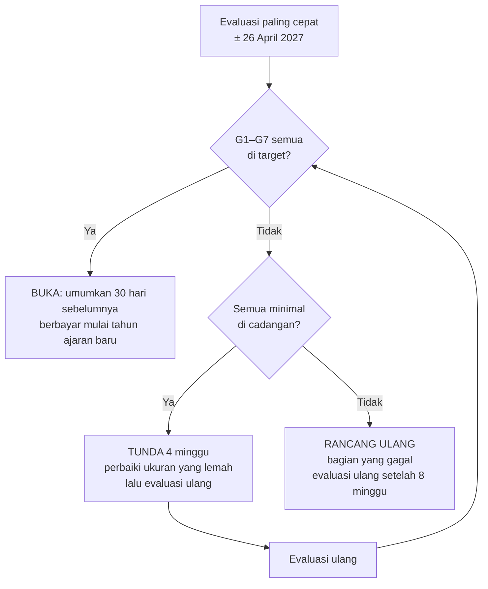

# Gerbang Menuju Berbayar

**Ringkas:** (1) Arah besar 6 berbunyi "anak makin pintar **atau** semangat belajar naik **atau** tugas sekolah lebih mudah". Karena itu gerbang dihitung **per keluarga**: satu keluarga dianggap "terpenuhi" kalau **minimal satu janji kemampuan terukur dari data (1a, 1b, atau 1c) dan minimal satu janji yang dirasakan orang tua (2 atau 3)** tercapai untuk anaknya (diperketat 20 Okt setelah pemeriksaan akhir). Tombol berlangganan dibuka kalau **≥ 70% keluarga aktif terpenuhi (cadangan 60%)**, ditambah syarat jumlah, lama pakai, dan "sangat kecewa". (2) Evaluasi paling cepat **± 26 April 2027** (12 minggu setelah gelombang 3 masuk, dan minggu Ramadan–Idulfitri tidak dihitung), atau pertengahan Mei setelah TKA. Pada 29 Maret baru ± 28–30 keluarga yang sudah memakai 12 minggu, terlalu sedikit untuk dinilai. Usulnya, berbayar dimulai bersama **tahun ajaran baru (Juli 2027)**, sebab keluarga kelas 6 cenderung berhenti setelah TKA. (3) Usul harga: inti Lancar Matematika dan rapor ringkas **tetap gratis selamanya**; Paket Keluarga **± Rp49 ribu per bulan untuk semua anak** (diuji dengan pertanyaan harga, diputuskan di Tahap 5); Keluarga Perintis mendapat 3 bulan gratis tambahan dan harga 50% selama 12 bulan.

> **Status 19 Okt ± 21.50:** seluruh isi berkas ini masih **usulan**. Acut memutuskan membahas bentuk, waktu, harga, gerbang, dan hak Perintis dalam **diskusi khusus** (Januari 2027, paling lambat Jumat 29 Jan; `keputusan.md` bagian J).

Tahap 2, butir 11. Disusun 19 Oktober 2026. Semua ambang di sini **[ASUMSI]** awal dan dinilai ulang dengan data minggu ke-4 dan ke-8.

---

## 1. Empat janji menjadi ukuran

Ukuran kelompok dipakai untuk menilai aplikasi; ukuran per keluarga dipakai untuk menghitung "terpenuhi".

| Janji (Arah besar 6) | Ukuran kelompok | Target · cadangan | Ukuran per keluarga ("terpenuhi" kalau …) | Sumber data |
|---|---|---|---|---|
| **1a. Makin pintar — berhitung** | Kecepatan pada tes tetap kelas itu (awal vs minggu ke-8) | Turun 30% · 15%; ketepatan ≥ 95% · 90% | Kecepatan turun ≥ 20% dan ketepatan ≥ 90% | Data (`04-mesin-lancar.md` bagian 8) |
| | Daya tahan 3 minggu | ≥ 90% · 80% masih benar | — | Data |
| **1b. Makin pintar — membaca** (mulai R2) | Kata per menit **bacaan dingin dengan tombol** (tanda curang dibuang), 8 minggu di luar Ramadan; Dengar Bacaan orang tua sebagai penguat | +15% · +8%; pemahaman ≥ 80% · 70% | Naik ≥ 10% dan pemahaman ≥ 70% (murid kelas luring kelas 6 memakai teks dingin terpisah) | Data (`05-bahasa-indonesia.md` bagian 3, 5) |
| **1c. Makin pintar — TKA** (kelas 6) | Persen benar Matematika S1 → S4 | +15 poin · +8 poin | Naik ≥ 10 poin | Data (`06-persiapan-tka.md` bagian 7) |
| **2. Semangat belajar naik** | Latihan yang dimulai anak sendiri (tanpa ajakan, pengingat, atau kabar orang tua dalam 2 jam sebelumnya) | ≥ 30% · 20% sesi di minggu ke-8 (di luar Ramadan) | Rata-rata **≥ 2 sesi dimulai sendiri per minggu** dalam 4 minggu terakhir **dan** O06 "1–2 kali" atau lebih | Data + O06 |
| | Anak masih latihan setelah 30 hari | ≥ 60% · 45% | — | Data |
| | Hari latihan per minggu | ≥ 5 · 4 (mengikuti `claude/metode-lancar.md`; tabel induk `06-rilis/02`) | — | Data |
| **3. Tugas sekolah lebih mudah** | O07 "lebih mudah" di antara yang ada tugas | ≥ 40% · 25%; "lebih sulit" ≤ 10% | O07 "lebih mudah" | O07 |
| **4. Hasil sekolah lebih baik** | Tidak diukur dengan pertanyaan (O08 dihapus 20 Okt, sebab tidak terhubung ke satu keputusan). Hanya dicatat dari cerita Keluarga Perintis | — | (tidak dihitung "terpenuhi") | Perintis |
| **Pantas berbayar** | O09 "sangat kecewa" di antara pemakai aktif | ≥ 40% · 30% | — | O09 |

**Kenapa janji 4 tidak diukur:** nilai ulangan sekolah dipengaruhi banyak hal di luar aplikasi (guru, materi, waktu ulangan), dan sebagian keluarga belum ada ulangan dalam 8 minggu. Kenaikan nilai sekolah tidak dijadikan syarat dan **tidak pernah dijanjikan dalam promosi**, sebab janji angka memicu permintaan uang kembali (`bahan/rancangan-modul-interaktif.md` Bagian 3).

**Tes tetap:** satu lembar 20 soal campuran level kelas itu, dikerjakan **sekali di hari ke-1 sampai ke-3** (tes tetap awal, terpisah dari tes penempatan) lalu setiap 4 minggu dengan susunan yang sama (angka diacak dari benih baru). Inilah dasar perbandingan "awal lawan minggu ke-8", bukan lembar harian yang levelnya terus naik. Untuk memisahkan kemajuan sungguhan dari efek terbiasa dengan tes, setiap tes tetap juga memuat 5 soal dari level kelas di bawahnya sebagai pembanding **[ASUMSI — cara ini dinilai ulang di laporan minggu ke-4]**. Anak yang sudah di level teratas kelasnya tetap mengerjakan tes yang sama; kemajuannya dibaca dari waktu.

---

## 2. Aturan gerbang

| # | Syarat | Target | Cadangan | Kenapa |
|---|---|---|---|---|
| G1 | Lama **setiap keluarga yang dihitung** memakai aplikasi (minggu kalender) | ≥ 12 minggu | ≥ 10 minggu | Melewati titik rendah efek kebaruan minggu ke-4–6 |
| G2 | Keluarga aktif (≥ 2 hari latihan per minggu dalam 4 minggu terakhir) | **≥ 30** | **≥ 20** | Diturunkan 20 Okt mengikuti target pemakai baru. Di bawah 30 keluarga, persen meleset ± 17–20 poin, jadi G3 dan G5 dibaca bersama G8 |
| G3 | **Keluarga aktif yang "terpenuhi"** (minimal satu dari 1a/1b/1c **dan** minimal satu dari 2/3) | **≥ 70%** | **≥ 60%** | Terjemahan kata "atau" di Arah besar 6, dengan syarat ada bukti data supaya satu ketukan orang tua saja tidak cukup. Dilaporkan bersama selang kepercayaannya: pada 40 keluarga, 70% bisa meleset ± 14 poin |
| G4 | Tidak ada ukuran kelompok di bawah cadangannya | 0 ukuran | ≤ 1 ukuran, dengan rencana perbaikan | Mencegah satu bagian jelek tertutup bagian lain |
| G5 | "Sangat kecewa" (O09) | ≥ 40% | ≥ 30% **dan** G3 mencapai target | Patokan 40% tidak terverifikasi dan jawabannya sedikit, jadi tidak dipakai sendirian |
| G6 | Penjaga "tidak merusak" | Ketepatan tidak turun; anak "kewalahan" (`04-mesin-lancar.md` 5.1) ≤ 10% | ≤ 15% | Kewalahan adalah penyebab berhenti nomor satu **[Klaim vendor — Churnkey, `riset-penguat.md` bagian 5]** |
| G8 | **Cerita Keluarga Perintis** (ditambah 20 Okt, sebab jumlah keluarga kecil) | ≥ 4 dari 5–8 Perintis menyebut perubahan nyata pada anak **dan** alasan konkret mau membayar, dalam pesan suara minggu ke-11 ("Apa yang membuat Anda ragu membayar?") | ≥ 3 | Dengan 20–30 keluarga, persen saja tidak cukup kuat; cerita konkret menunjukkan alasan di balik angka |
| G7 | Harga yang diuji | Median O10 ≥ rentang harga yang direncanakan; "tidak akan membayar" ≤ 30% | ≤ 40% | Menghindari tombol dibuka pada harga yang ditolak |

### Hasil evaluasi

---

## 3. Kapan, dengan memperhitungkan kalender

| Peristiwa | Tanggal **[FAKTA — kalender 2026/27, `riset-penguat.md` bagian 7; TKA 2027 belum diumumkan]** | Minggu ke- (dihitung dari gelombang 2, 4 Jan) |
|---|---|---|
| Gelombang 2 masuk (gelombang 1 ± 9 Des, gelombang 3 ± 1 Feb) | 4 Jan 2027 **[ASUMSI — jadwal Tahap 5]** | 1 |
| Libur awal puasa | 8–10 Feb | 6 |
| Ramadan | ± 8 Feb – 8 Mar | 6–10 |
| Libur Idulfitri | 8–19 Mar | 10–11 |
| Evaluasi gerbang paling cepat: gelombang 3 (masuk 1 Feb) genap 12 minggu, sehingga ketiga gelombang (target 30 keluarga aktif) bisa dihitung | ± 26 Apr | 17 |
| TKA SD (kalau pola 2026 berulang) | ± akhir April | 16–17 |
| Paket kelas baru (R4) | 14 Jun | 24 |
| Tahun ajaran baru | ± 12 Jul | 28 |

| Pilihan | Untung | Rugi | Putusan |
|---|---|---|---|
| Berbayar segera setelah lulus gerbang (April) | Pendapatan lebih cepat; menangkap kebutuhan TKA | Data minggu ke-6–11 terganggu Ramadan; keluarga kelas 6 berhenti setelah TKA **[`riset-penguat.md` bagian 5, akibat 4]**; berbayar di tengah semester terasa seperti "ditarik setelah terbiasa" | ✗ |
| **Lulus gerbang April–Mei, berbayar mulai tahun ajaran baru (Juli 2027)** | Waktu alami untuk mulai berlangganan; R4 (naik kelas, Gampong) memberi alasan baru; data 4 minggu tambahan setelah Ramadan | Pendapatan mundur 3 bulan | **✓ Diusulkan** |
| Cadangan kalau gerbang belum lulus sampai Juni | — | — | Evaluasi ulang akhir September; berbayar paling cepat Oktober 2027 |

**Akibat untuk ukuran:** minggu Ramadan dan libur ditandai di data dan **tidak dipakai sebagai jendela ukur** untuk "hari latihan per minggu", "minggu ke-8", dimulai sendiri, dan janji 1b (jendela digeser ke minggu terdekat di luar Ramadan); lama pakai G1 tetap dihitung dengan minggu kalender. Kalau pada evaluasi ± 26 April jumlah keluarga yang memenuhi G1 masih < 30, evaluasi digeser ke pertengahan Mei atau Juni — tetap sebelum keputusan berbayar tahun ajaran baru.

---

## 4. Harga dan apa yang tetap gratis

### 4.1 Patokan pasar

| Hal | Angka | Sumber |
|---|---|---|
| Median harga langganan aplikasi di India dan Asia Tenggara (semua kategori) | US$3,75 per bulan (± Rp62 ribu) | **[FAKTA — RevenueCat 2026]** |
| Pengunduh yang membayar dalam 35 hari, India dan Asia Tenggara | 0,7% | sama |
| Perpanjangan langganan pendidikan | Bulanan 56%; tahunan 24% | **[FAKTA — RevenueCat, dikutip Churnkey]** |
| Kumon | ± Rp430–480 ribu per mapel per bulan | **[FAKTA — riset pasar, `01-profil` 1.1]** |
| Guru privat Banda Aceh | ± Rp54 ribu per jam | sama |
| Pesaing gratis | Rumah Pendidikan (Ruang Murid, Ruang Orang Tua) | **[FAKTA — GNFI 24 Jan 2025]** |
| Potongan Google Play | ± 15% untuk langganan; pengembang menerima ± 77% harga setelah PPN | **[Catatan proyek Peta Belajar — dicek ulang di Tahap 3]** |

### 4.2 Pilihan bentuk berbayar

| | **X. Inti gratis selamanya + Paket Keluarga** (usul) | Y. Coba 14 hari, lalu semua berbayar | Z. Bayar per mapel |
|---|---|---|---|
| Gratis | Akun keluarga, Lancar Matematika semua level, rapor mingguan ringkas (3 angka), link rapor, riwayat | 14 hari | 1 mapel |
| Berbayar | Baca Ulang, modul Paham, Mode Dampingi lengkap, rapor lengkap (peta jenis salah, rapor cerita), game dan Gampong, Belajar Bahasa Inggris (R2; bagian gratis atau berbayar ikut diskusi khusus berbayar), ngobrol Bahasa Inggris dengan AI (R5) | Semua | Mapel lain |
| Untung | Keluarga yang tidak membayar tetap terbantu; bersaing dengan Rumah Pendidikan yang gratis; mulut ke mulut tetap jalan | Pendapatan per keluarga lebih tinggi | Mudah dipahami |
| Rugi | Sebagian merasa "gratisnya sudah cukup" (O20 dipantau) | Pengguna masa gratis kehilangan semua; konversi Asia Tenggara rendah (0,7%) | Saudara dan mapel ganda membuat harga mahal; bertentangan dengan paket keluarga |

**Usul: X**, sebab niat Acut agar anak terbantu tetap terjaga untuk keluarga yang belum mampu, dan pembeda yang dibayar adalah **bimbingan dan bukti kemajuan**, yang memang paling diutamakan orang tua.

### 4.3 Usul harga awal **[ASUMSI — diuji dengan O10, diputuskan di Tahap 5 setelah hitungan biaya]**

| Paket | Harga | Diterima kita (± 77%) **[ESTIMASI]** | Sebab |
|---|---|---|---|
| **Paket Keluarga** (semua anak satu keluarga) | **Rp49 ribu per bulan** | ± Rp37.700 | Di bawah median Asia Tenggara (± Rp62 ribu); kurang dari satu jam guru privat; satu harga untuk saudara |
| Paket Keluarga tahunan | Rp490 ribu per tahun (2 bulan gratis) | ± Rp377 ribu | Pilihan, bukan bawaan, sebab paket tahunan di muka adalah keluhan utama pada pesaing (`riset-pasar-dan-pesaing.md`) |
| **Siap TKA** (kelas 6, Januari–April) | Termasuk Paket Keluarga; untuk murid kelas luring **sudah termasuk biaya kelas** | — | Murid kelas luring tidak membayar dua kali |

**Aturan harga:** bulanan, harga ditulis lengkap tanpa kata "mulai", bisa berhenti kapan saja dari aplikasi, dan tanpa perpanjangan diam-diam ke paket tahunan.

---

## 5. Hak saat peralihan

| Kelompok | Hak **[ASUMSI — angka diputuskan Acut]** | Biaya bagi kita **[ESTIMASI]** |
|---|---|---|
| **Keluarga Perintis** (5–10) | Gratis 3 bulan tambahan sejak berbayar dimulai, lalu harga 50% (Rp24.500) **terkunci 12 bulan** | 10 keluarga × Rp24.500 selisih = ± Rp245 ribu per bulan pendapatan yang dilepas |
| Keluarga masa gratis lain yang aktif | Potongan 25% selama 6 bulan | 40 × Rp12.250 = ± Rp490 ribu per bulan |
| Semua keluarga | Bagian gratis tetap jalan; riwayat tidak pernah dihapus; pemberitahuan ≥ 30 hari | — |
| Anak | Tidak diberi tahu soal uang; fitur berbayar yang berhenti tidak dihapus progresnya (Gampong "beristirahat", tidak hilang) | — |

**Hak Perintis harus tertulis di syarat dan ketentuan sejak hari pertama**, sebab itu janji yang mengikat dan dibuat sebelum harga diketahui. Masuk paket draf ahli hukum (Tahap 3).

### Langkah peralihan

| Waktu | Orang tua | Anak |
|---|---|---|
| H−30 | Kabar di aplikasi dan WhatsApp + ringkasan kemajuan anak sejak awal | — |
| H−30 sampai H−1 | Bisa memilih berlangganan lebih awal (hak tetap berlaku) | — |
| H | Yang tidak berlangganan pindah ke bagian gratis | Lancar dan rekor tetap; bagian berbayar tampil "istirahat" tanpa pesan menekan |
| H+7 | O20 (sekali, boleh dilewati) | — |

---

## 6. Risiko

| Risiko | Tanda awal | Pencegahan |
|---|---|---|
| Jumlah keluarga aktif < 30, gerbang tidak bisa dinilai | Minggu ke-8 aktif < 35 | Ajakan gelombang kedua (Tahap 5); gerbang ditunda, bukan diturunkan |
| Ramadan merusak data | Hari latihan turun tajam minggu ke-6–10 | Minggu Ramadan dipisah dalam hitungan; Mode Ramadan (lembar lebih pendek) **[ASUMSI — dinilai Tahap 4]** |
| Keluarga kelas 6 berhenti setelah TKA | Rencana berhenti di O18 "tujuan tercapai" | Rapor "dari TKA ke SMP"; paket kelas 7 dinilai di R4+ |
| "Gratisnya sudah cukup" | O20 > 40% memilih itu | Pindahkan satu fitur ke berbayar **hanya untuk pengguna baru**, tidak mencabut dari yang lama |
| Orang tua merasa dijebak setelah gratis | Keluhan di WhatsApp | Sejak pendaftaran ditulis: "Gratis selama masa uji. Inti latihan tetap gratis selamanya." |
| Gerbang dibuka terlalu cepat karena ingin pendapatan | Tekanan biaya | Angka gerbang dicatat di `keputusan.md` sebelum data terlihat, supaya tidak digeser belakangan |

---

## 7. Yang perlu diputuskan Acut

| # | Keputusan | Usul Acut2 |
|---|---|---|
| 1 | Gerbang dihitung per keluarga ("terpenuhi" kalau satu janji tercapai), ≥ 70% · 60% | Setuju, sebab sesuai kata "atau" di Arah besar 6 |
| 2 | Berbayar mulai tahun ajaran baru (Juli 2027), walau gerbang lulus April | Setuju |
| 3 | Bentuk X: inti Lancar + rapor ringkas gratis selamanya | Setuju |
| 4 | Harga awal Rp49 ribu per bulan per keluarga (diuji O10, dikunci di Tahap 5) | Sementara |
| 5 | Hak Perintis: 3 bulan gratis + 50% terkunci 12 bulan; pemakai lain 25% selama 6 bulan | Sementara, dicek ahli hukum |
| 6 | Angka gerbang dikunci di `keputusan.md` sekarang, sebelum data ada | Setuju |
