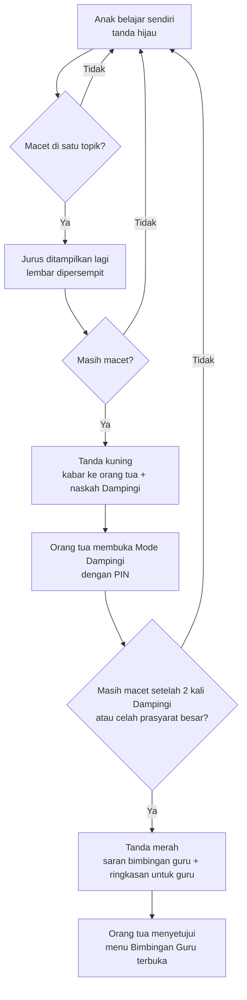

# Lima Penegasan Acut (28 Okt) — Gudang Ilmu, Bimbingan, Waktu Belajar, dan Isi per Kelas

**Ringkas:** (1) Dari lima poin yang ditegaskan Acut 28 Oktober, **satu sudah lengkap** di rancangan (isi dan fasilitas hanya untuk kelas anak, poin 5), **dua sebagian** (belajar sambil bermain dan mandiri, poin 2; menu bimbingan dibuka orang tua, poin 3), dan **dua belum ada** (gudang ilmu SD lengkap, poin 1; batas waktu belajar dan game berdasarkan riset, poin 4). Berkas ini menambahkan semuanya. (2) Hasil riset poin 4: waktu belajar efektif **tidak sama untuk semua kelas**. Patokannya **10 menit × kelas** per hari (kelas 1 = 10 menit, kelas 6 = 60 menit), dipecah menjadi blok pendek. Sesudah itu game **paling lama 30 menit** (kelas 1–2: 20 menit), dan orang tua boleh menaikkannya sampai 60 menit, tidak lebih. (3) Tambahan terbesar adalah **Gudang Ilmu**: peta lengkap semua topik SD kelas 1–6 sejak awal, lalu diisi bertahap. Matematika dan Bahasa Indonesia lebih dulu, mata pelajaran lain menyusul atas keputusan Acut. Isinya **tidak mungkin lengkap di Rilis 1**: ± 360 topik untuk dua mapel butuh ± 120 jam pemeriksaan.

**Pembaruan keputusan Acut 28 Okt (sore):** (a) batas waktu belajar dan game di bagian 5.2 **disetujui**; (b) kartu Gudang Ilmu **kelas 6 diisi lebih dulu** (Matematika 4 Jan, Bahasa Indonesia 1 Feb 2027, fokus TKA), kelas lain menyusul, dan aplikasi tetap untuk kelas 1–6; (c) Bahasa Inggris menjadi paket tersendiri **"Belajar Bahasa Inggris"** tingkat 3–6 yang bebas dipilih semua anak, mulai 1 Feb 2027 tanpa AI suara (`11-belajar-bahasa-inggris.md`); (d) **guru sekolah hanya melihat kemampuan dan memberi komentar**, sedangkan **guru les** boleh memberi tugas dan catatan (bagian 4.1).

Disusun 28 Oktober 2026 atas permintaan Acut. Label: **[FAKTA + sumber] · [ESTIMASI + cara hitung] · [ASUMSI — perlu diuji]**.

---

## 1. Pemeriksaan lima poin terhadap rancangan

| # | Permintaan Acut | Status sebelum 28 Okt | Yang ditambahkan di berkas ini |
|---|---|---|---|
| 1 | Gudang data ilmu pelajaran SD **lengkap**, kelas 1–6 | **Belum.** Tahun pertama hanya latihan harian 2 mapel, TKA, dan 12 topik Paham; Paham kelas 1–3 dan modul Bahasa Indonesia kelas 1–2 ditunda (`03-rencana-isi.md` bagian 2) | Gudang Ilmu: peta topik lengkap + kartu ilmu per topik + jadwal pengisian (bagian 2) |
| 2 | Belajar sambil bermain, anak diarahkan mandiri; yang tidak bisa diberi tanda **perlu bimbingan orang tua** atau **perlu bimbingan guru** | **Sebagian.** Ada Mode Dampingi, saran "coba Mode Dampingi" saat macet, dan tombol "Bantu aku". Belum ada tanda tiga tingkat dan belum ada jalur ke guru | Tanda bimbingan tiga tingkat dengan aturan yang jelas (bagian 3) |
| 3 | Menu bimbingan orang tua dan guru baru terbuka di akun anak **setelah disetujui orang tua** | **Sebagian.** Mode Dampingi sudah dibuka dengan PIN orang tua. Bimbingan guru belum ada (hanya link baca untuk pengajar kelas luring) | Bimbingan guru dengan persetujuan orang tua (bagian 4) |
| 4 | Waktu belajar efektif (30 menit atau 1 jam, sesuai riset), sesudahnya game dengan batas waktu yang sesuai riset | **Belum berdasar riset.** Batas sesi 10/15/20 menit dan game 10/15 menit masih [ASUMSI]; game bawaannya terbuka kapan saja | Batas waktu dari riset + urutan "belajar dulu, lalu main" (bagian 5) |
| 5 | Isi dan fasilitas hanya untuk kelas yang didaftarkan, supaya aplikasi ringan | **Sudah.** Keputusan 19 Okt: satu aplikasi, paket isi per kelas diunduh sesuai kelas, otomatis berganti saat naik kelas (`02-rancangan/05-paket-isi.md`) | Penegasan daftar fasilitas per kelas dan ukuran unduhan (bagian 6) |

---

## 2. Gudang Ilmu — peta lengkap SD, diisi bertahap

### 2.1 Bentuknya

Gudang Ilmu adalah **perpustakaan pelajaran** di dalam aplikasi. Setiap topik SD punya satu **kartu ilmu**, disusun menurut Capaian Pembelajaran Kurikulum Merdeka Fase A (kelas 1–2), Fase B (kelas 3–4), dan Fase C (kelas 5–6).

| Isi satu kartu ilmu | Untuk apa |
|---|---|
| Penjelasan singkat bergambar (1–2 layar, bersuara untuk kelas 1–2) | Anak belajar sendiri |
| 2 contoh jadi, langkah demi langkah | Cara paling kuat untuk materi baru (contoh jadi sebelum latihan) |
| 5–10 soal latihan berjenjang, dengan kunci bertahap | Belajar mandiri, soal muncul dari mudah ke sulit |
| Salah paham yang sering terjadi | Mesin tahu kenapa anak salah, rapor bisa menjelaskan |
| Petunjuk untuk orang tua ("tanyakan ini, jangan sebut jawabannya") | Bahan Mode Dampingi |
| Prasyarat (topik kelas di bawahnya yang harus dikuasai dulu) | Mesin bisa mundur ke topik dasar kalau anak macet |

**Peta lengkap, isi bertahap:** semua topik kelas 1–6 sudah tercantum sejak awal, jadi Acut, orang tua, dan anak bisa melihat seluruh peta pelajaran. Topik yang kartunya belum siap ditandai **"segera"**, sebab menulis dan memeriksa ratusan kartu sekaligus tidak mungkin dilakukan dengan baik dalam 5 minggu pembangunan.

### 2.2 Berapa banyak dan berapa lama

| Mapel | Topik **[ESTIMASI — ± 30 per kelas, angka di Prompt RCTOR]** | Sudah ada bahannya | Jam pemeriksaan **[ESTIMASI — 20 menit per kartu]** |
|---|---|---|---|
| Matematika kelas 1–6 | ± 180 | 24 modul TKA (kelas 4–6) + 36 jurus Lancar | ± 60 jam |
| Bahasa Indonesia kelas 1–6 | ± 180 | 12 modul TKA + 36 teks baca cepat | ± 60 jam |
| **Jumlah dua mapel** | **± 360** | | **± 120 jam ≈ Rp6 juta** kalau oleh guru (setara Rp50 ribu per jam) |
| Bahasa Inggris tingkat 3–6 | 48 unit (paket tersendiri, bukan kartu per kelas) | Belum ada | ± 16 jam (`11-belajar-bahasa-inggris.md`) |
| IPAS (kelas 3–6) dan Pendidikan Pancasila (kelas 1–6) | ± 240–300 | Belum ada | ± 80–100 jam |

Biaya AI menyusun draf kartu: ± Rp1–2 ribu per kartu dengan Sonnet lewat kiriman sekaligus, atau Rp0 kalau disusun di langganan Claude Acut **[ESTIMASI — ± 3.000 token masuk + 2.000 keluar per kartu]**.

### 2.3 Urutan pengisian (keputusan Acut 28 Okt: kelas 6 dulu)

| Tahap | Isi | Kartu **[ESTIMASI]** | Siap | Pemeriksa | Sebab |
|---|---|---|---|---|---|
| A | **Peta topik lengkap** semua mapel SD kelas 1–6 (judul, kode CP, urutan, prasyarat) | — | Rilis 1, 22 Des 2026 | Acut (sampel) | Kerangka murah (± 6 jam), dan langsung berguna untuk mesin dan rapor |
| B1 | **Kartu Matematika kelas 6** (fokus topik TKA) | ± 30 | **R1.1, 4 Jan 2027** (bersama isi TKA) | Acut, ± 10 jam di Desember | Bahan 24 modul TKA sudah ada, tinggal diubah bentuk; anak kelas 6 butuh sebelum TKA April |
| B2 | **Kartu Bahasa Indonesia kelas 6** (fokus TKA: ide pokok, simpulan, jenis teks, kalimat efektif) | ± 30 | **R2, 1 Feb 2027** | Acut, ± 10 jam di Januari | 12 modul TKA dan teks baca cepat sudah ada |
| C | Kartu Matematika kelas 4–5 | ± 60 | R3, 22 Mar 2027 | Guru pemeriksa | Sebagian bahan dari modul TKA (topik kelas 4–5 yang diuji) |
| D | Kartu Matematika kelas 1–3 | ± 90 | R4, Juni 2027 | Guru pemeriksa | Belum ada bahan; disusun AI, diperiksa guru |
| E | Kartu Bahasa Indonesia kelas 1–5 | ± 150 | Desember 2027 | Guru pemeriksa | Baca Ulang harian sudah jalan sejak Februari; kartu topik (ejaan, imbuhan, jenis teks) melengkapinya |
| F | IPAS dan Pendidikan Pancasila | — | 2028, **atas keputusan Acut** | — | Dinilai setelah gerbang berbayar |

Bahasa Inggris **tidak** masuk urutan ini, sebab sudah menjadi paket tersendiri dengan tingkat yang bebas dipilih (`11-belajar-bahasa-inggris.md`).

**Akibat untuk Acut:** memeriksa ± 60 kartu kelas 6 (± 20 jam) di Desember–Januari, di samping isi TKA dan Baca Ulang. Kalau tidak terkejar, B2 bergeser ke 22 Feb (cadangan R2) dan diperiksa guru yang mulai Februari.

**Kenapa tidak semua sekaligus:** kartu yang salah lebih merusak daripada kartu yang belum ada, sebab anak belajar sendiri dan orang tua percaya pada isinya. Setiap kartu wajib dibaca manusia sebelum terbit. Dengan guru ± 30 jam per bulan, dua mapel selesai ± 4 bulan kerja guru, yang dipecah di sepanjang 2027.

### 2.4 Data

Tabel baru di basis data (melengkapi `02-rancangan/03-basis-data.md`):

| Tabel | Kolom penting |
|---|---|
| `topik` | kode (misal `MAT-4-07`), mapel, kelas, fase, kode CP, judul, urutan, status (`segera` · `uji` · `terbit`) |
| `prasyarat` | topik, topik_prasyarat |
| `kartu_ilmu` | topik_id, versi, isi (penjelasan, contoh, petunjuk orang tua, salah paham), diperiksa_oleh, terbit |
| `kemajuan_topik` | anak_id, topik_id, tingkat (`belum` · `belajar` · `kuasai`), tanda_bimbingan (`mandiri` · `orang_tua` · `guru`), diperbarui |

Soal latihan di kartu memakai bank soal yang sudah dirancang (`02-rancangan/06-pembuat-soal-dan-bank-soal.md`), jadi tidak perlu jalur baru.

---

## 3. Belajar sambil bermain, mandiri dulu, dan tanda bimbingan tiga tingkat

### 3.1 Yang sudah ada dan tetap berlaku

Latihan pendek di level yang pas, jurus sebelum level baru, kejutan yang tidak dijanjikan (kartu satwa, Jurus Sulap Angka), Gampong yang tumbuh, pilihan jalur, tanpa peringkat dan tanpa rangkaian hari beruntun (`07-fitur-orang-tua-dan-anak.md` bagian 3). Semua latihan bisa dikerjakan anak sendiri.

### 3.2 Tanda bimbingan

Setiap topik di `kemajuan_topik` punya satu tanda. Tanda **tidak pernah ditampilkan ke anak sebagai kegagalan**. Anak hanya melihat "Topik ini lebih seru dikerjakan bersama Ayah/Bunda". Orang tua melihat tandanya dengan alasan.

| Tanda | Kapan diberikan otomatis **[ASUMSI — ambang dikalibrasi di laporan minggu ke-4]** | Yang terjadi |
|---|---|---|
| 🟢 **Mandiri** | Bawaan semua topik | Anak belajar sendiri |
| 🟡 **Perlu bimbingan orang tua** | Topik macet: 4 lembar berturut-turut tanpa kemajuan, **atau** "Masih bingung" pada jurus dua kali, **atau** salah ≥ 60% di kartu ilmu setelah jurus dibuka ulang | Kabar ke orang tua: "Rani macet di ×7. Coba kegiatan Dampingi 10 menit, naskahnya sudah disiapkan." Di HP anak muncul ajakan "kerjakan bersama Ayah/Bunda" yang terbuka setelah orang tua memasukkan PIN |
| 🔴 **Perlu bimbingan guru** | Masih macet setelah **2 kegiatan Dampingi** pada topik yang sama, **atau** celah prasyarat ≥ 2 kelas di bawah (misal anak kelas 5 belum menguasai perkalian dasar), **atau** rapor TKA menunjukkan "salah paham konsep" di ≥ 3 topik | Kabar ke orang tua: "Topik ini sebaiknya dibantu guru." Disertai ringkasan satu layar yang bisa dikirim ke guru sekolah atau guru les (bagian 4). Latihan anak **tidak dikunci**; mesin memberi latihan topik prasyarat sambil menunggu |

**Penjaga:** tanda kuning dan merah paling banyak 1 kabar per topik per minggu, supaya orang tua tidak merasa dikejar. Kalau anak berhasil, tanda kembali hijau dan orang tua mendapat kabar positif ("×7 sudah lancar lagi").

---

## 4. Menu bimbingan baru terbuka setelah disetujui orang tua

| Menu di HP anak | Cara terbuka | Siapa yang memberi persetujuan | Rilis |
|---|---|---|---|
| **Belajar bersama Ayah/Bunda** (Mode Dampingi) | Orang tua memasukkan PIN di HP anak, atau menyalakannya dari HP orang tua untuk satu topik | Orang tua pemilik atau orang tua kedua | R1 (sudah dirancang) |
| **Bimbingan Guru** | Orang tua mengundang guru dari mode orang tua dan memilih jenisnya (**guru sekolah** atau **guru les**), guru menerima, lalu orang tua menekan "Izinkan" | **Hanya orang tua pemilik** | **R3, Maret 2027** (setelah profil risiko ditetapkan dan penilaian mandiri diperbarui) |

### 4.1 Bimbingan Guru — dua jenis guru (keputusan Acut 28 Okt)

| Hal | **Guru sekolah** — lihat + komentar | **Guru les** — tugas + catatan |
|---|---|---|
| Melihat kemampuan anak (peta topik, tanda bimbingan, ringkasan Lancar dan TKA) untuk mapel yang dipilih orang tua | ✓ | ✓ |
| Menulis **komentar** (≤ 200 huruf) | ✓ **ditujukan ke orang tua**, tampil di mode orang tua. Orang tua boleh meneruskannya ke HP anak dengan satu ketukan | ✓ |
| Memberi **tugas** dari Gudang Ilmu ("kerjakan kartu Pecahan Senilai sampai Jumat") | — | ✓ |
| Menulis **catatan** yang tampil di menu Bimbingan Guru anak, **selalu terlihat oleh orang tua** | — | ✓ |
| Menandai topik "sudah dibantu" (tanda merah kembali kuning atau hijau) | — | ✓ |
| Ada menu di HP anak | Tidak. Anak hanya melihat komentar yang diteruskan orang tua | Ya, menu "Bimbingan Guru" |
| Anak membalas | — | Hanya stiker ("Sudah", "Masih bingung", "Terima kasih") |
| Sebab | Tidak ada jalur langsung dari orang dewasa luar keluarga ke anak, jadi risiko aturan paling kecil (permintaan Acut) | Guru les dibayar dan dipilih orang tua untuk mengajar; tugas dan catatan memang pekerjaannya |

**Yang tidak bisa dilakukan kedua jenis guru:** melihat pesan keluarga, data akun, atau anak lain di keluarga; mengirim isi buatan sendiri, tautan, foto, atau nomor HP; mengobrol dengan anak; mengubah level atau nilai anak.

**Siapa gurunya:** guru sekolah anak, guru les, atau pengajar kelas luring TKA (masuk sebagai guru les), **dipilih dan diundang sendiri oleh orang tua**. Aplikasi tidak menyediakan atau mencarikan guru. Masuknya lewat link undangan dan email guru, dengan batas percobaan yang sama seperti undangan orang tua kedua (`02-rancangan/02-akun-keluarga.md` bagian 7a). Persetujuan bisa dicabut kapan saja, dan menu langsung hilang dari HP anak.

**Hubungan dengan keputusan sebelumnya:** akun pengajar penuh sengaja ditunda ke tahun kedua (`keputusan.md` bagian F), dan gagasan guru melatih sistem sudah dibatalkan Acut 20 Okt. Bimbingan Guru di sini **bukan** keduanya. Ini akses terbatas atas undangan orang tua, dimajukan ke R3 atas permintaan Acut 28 Okt.

**Risiko hukum:** guru les adalah orang dewasa di luar keluarga yang bisa menulis catatan untuk anak. Itu menyentuh parameter "kontak dengan orang tidak dikenal" di penilaian mandiri PP Tunas (KK03, bobot 14,04%). Guru sekolah tidak menyentuhnya secara langsung, sebab komentarnya sampai ke orang tua, bukan ke anak. Penjaga untuk guru les: diundang orang tua dengan izin tersendiri, tidak ada obrolan, semua catatan terlihat orang tua, dan bisa dicabut. Karena itu fitur ini tetap **wajib masuk pembaruan penilaian mandiri** dan pertanyaan ahli hukum sebelum tayang (`paket-hukum/06`, pertanyaan no. 26). Kalau Komdigi menilai jalur guru les menaikkan profil, guru les diturunkan menjadi seperti guru sekolah (lihat + komentar ke orang tua), dan tugas dikirim lewat orang tua.

**Biaya dan waktu [ESTIMASI]:** ± 5–7 hari kerja pembangunan (undangan, persetujuan, menu anak, halaman guru), tanpa biaya server tambahan yang berarti.

---

## 5. Waktu belajar efektif dan batas game — hasil riset

### 5.1 Yang ditemukan

| Temuan | Angka | Sumber |
|---|---|---|
| Waktu belajar di rumah yang wajar per hari bertambah menurut kelas: **"aturan 10 menit"** | Kelas 1 ± 10 menit, kelas 2 ± 20 menit, dan seterusnya bertambah ± 10 menit per kelas | **[FAKTA — Harris Cooper, Duke University, 2009]** ([Duke Today](https://today.duke.edu/2009/08/school_tip.html)) |
| Satu jam pelajaran SD di sekolah | 35 menit | **[FAKTA — struktur Kurikulum Merdeka SD/MI]** ([dokumen struktur kurikulum](https://mmc.tirto.id/documents/2024/07/15/2634-struktur-kurikulum-merdeka-sd-mi-compress.pdf?x=2676)) |
| Anak yang main game **kurang dari 1 jam per hari** lebih baik penyesuaian sosial-emosionalnya daripada yang tidak main; yang **≥ 3 jam** paling buruk | ± 5.000 anak usia 10–15 tahun | **[FAKTA — Przybylski, *Pediatrics* 2014]** ([Universitas Oxford](https://www.ox.ac.uk/node/21944)) |
| Batas waktu layar untuk hiburan (bukan sekolah) anak 5–17 tahun | **Paling banyak 2 jam per hari** | **[FAKTA — Pedoman Gerak 24 Jam Australia, 2021]** ([Kemenkes Australia](https://www.health.gov.au/sites/default/files/documents/2021/05/24-hour-movement-guidelines-children-and-young-people-5-to-17-years-fact-sheet.pdf)) |
| Rekomendasi IDAI untuk anak usia sekolah | Tidak ditemukan angka khusus di sumber yang terbaca; yang terbaca hanya usia di bawah 6 tahun (≤ 1 jam) dan berhenti memakai gawai 1 jam sebelum tidur | **[FAKTA — IDAI lewat Metro TV, 25 Feb 2026]** ([Metro TV](https://www.metrotvnews.com/read/bJECjn44-bahaya-screen-time-berlebih-pada-anak-idai-ingatkan-dampaknya)) |

**Batas jujurnya:** aturan 10 menit adalah pedoman PR dari penelitian Amerika, bukan uji coba aplikasi. Penelitian game Przybylski berupa survei (hubungan, bukan sebab-akibat) dan usianya 10–15 tahun. Keduanya dipakai sebagai **batas atas yang wajar**, lalu diuji dengan data keluarga kita.

### 5.2 Jawaban untuk pertanyaan "30 menit atau 1 jam?"

**Tidak satu angka untuk semua.** 1 jam pas untuk kelas 6 dan terlalu berat untuk kelas 1. Aturannya:

| Kelas | Batas belajar per hari di aplikasi | Dipecah menjadi | Game sesudahnya (bawaan) | Batas game yang bisa diatur orang tua |
|---|---|---|---|---|
| 1 | 10–15 menit | 2 blok pendek | 20 menit | 0–60 menit |
| 2 | 20 menit | 2 blok × 10 menit | 20 menit | 0–60 menit |
| 3 | 30 menit | 2–3 blok | 30 menit | 0–60 menit |
| 4 | 40 menit | 3 blok | 30 menit | 0–60 menit |
| 5 | 50 menit | 3–4 blok | 30 menit | 0–60 menit |
| 6 | 60 menit (hari simulasi TKA: 75 menit, ≤ 5 kali setahun) | 4 blok | 30 menit | 0–60 menit |

| Aturan | Isi | Sebab |
|---|---|---|
| **Inti harian wajib singkat** | Lancar 2–5 menit + Baca Ulang ± 5 menit (+ latihan TKA ± 10 menit untuk kelas 6) | Itu yang dihitung untuk kemajuan dan rapor; anak yang hanya mengerjakan inti tetap maju |
| **Sisa waktu belajar adalah pilihan** | Kartu Gudang Ilmu, tugas guru, Paham, mengulang topik | "10 menit × kelas" adalah **batas atas**, bukan target. Kalau ada PR sekolah, waktu itu dipakai untuk PR |
| **Satu blok paling lama 15 menit** | Setelah 15 menit muncul jeda: "Istirahat 2 menit, minum dulu" | Anak SD lebih mudah fokus dalam blok pendek; 1 jam pelajaran di sekolah pun hanya 35 menit |
| **Belajar dulu, lalu main** | Game terbuka setelah **inti harian** selesai: 1 lembar Lancar + 1 sesi Baca Ulang (mulai R2) + latihan TKA hari itu untuk kelas 6. Lembar Lancar kedua (sore/malam) tidak menahan game. Bukan setelah seluruh batas belajar | Permintaan Acut 28 Okt. Kalau syaratnya seluruh 60 menit belajar, game menjadi hadiah besar yang dikejar terburu-buru |
| **Game bukan hadiah yang dijanjikan** | Tidak ada tulisan "selesaikan latihan untuk dapat game". Game tampil sebagai "Waktu main" setelah latihan, seperti istirahat di sekolah | Hadiah yang dijanjikan merusak minat (−0,43) **[FAKTA — Deci, Koestner & Ryan 2001]** |
| **Batas atas mutlak** | Game ≤ 60 menit per hari walau orang tua mengatur lebih; belajar + game kelas 6 ≤ 1,5 jam | Di bawah "kurang dari 1 jam" (Przybylski) dan di bawah 2 jam layar hiburan |
| **Jam tenang** | Game mati otomatis setelah 21.00 dan 1 jam sebelum jam tidur yang diatur orang tua | Anjuran berhenti memakai gawai 1 jam sebelum tidur (IDAI) |

**Kapan berlaku:** pengatur waktu belajar (blok ≤ 15 menit, jeda, batas harian per kelas) dibangun di **R1**. Game di luar jam belajar baru ada di **R4 (Juni 2027)**, jadi aturan "waktu main" baru terasa saat itu. Sebelum R4, setelah inti harian anak melihat Tantang Ayah dan kartu satwa yang sudah dikumpulkan, bukan game.

**Ganti arah:** ini mengubah keputusan 19 Okt (B3 no. 2: game bawaannya terbuka kapan saja, orang tua boleh memilih "setelah latihan"). Sekarang bawaannya **"setelah inti harian"**, dan orang tua boleh memilih "selalu terbuka". Batas game naik dari 10/15 menit menjadi 20/30 menit, sebab angka lama hanya asumsi dan riset mendukung sampai di bawah 1 jam. Kelompok "setelah latihan" dan "selalu terbuka" tetap dibandingkan di laporan minggu ke-4.

---

## 6. Isi dan fasilitas hanya untuk kelas yang didaftarkan (sudah ada, ditegaskan)

| Hal | Aturan |
|---|---|
| Saat mendaftar | Orang tua mengisi kelas anak. Aplikasi hanya mengunduh **paket kelas itu**: Lancar, Baca Ulang, Gudang Ilmu, dan (khusus kelas 6) Siap TKA |
| Ukuran unduhan per anak **[ESTIMASI]** | Aplikasi ± 25–35 MB + paket satu kelas ± 15–40 MB (terbesar karena suara bacaan kelas 1–2). Bandingkan dengan semua kelas sekaligus ± 150–200 MB |
| Satu pengecualian: Bahasa Inggris | Paket Belajar Bahasa Inggris memakai **tingkat yang dipilih**, bukan kelas anak. Hanya tingkat itu yang diunduh (± 10–15 MB), dan tingkat lain diunduh saat dipilih |
| Topik kelas di bawah | Tidak diunduh semua. Hanya kartu **prasyarat** yang dibutuhkan, saat mesin menemukan celah (tanda merah karena prasyarat), ± 1–3 MB |
| Naik kelas | Paket kelas baru terunduh otomatis saat orang tua mengubah kelas (atau ditawarkan pada Juli). Paket lama dihapus setelah 30 hari; riwayat dan rapor tetap tersimpan |
| Kakak-adik satu HP | HP mengunduh paket untuk setiap kelas anak yang memakai HP itu, dan setiap anak hanya melihat isi kelasnya |
| Fasilitas per kelas | Lihat tabel di bawah |

| Fasilitas | Kelas 1–2 | Kelas 3–5 | Kelas 6 |
|---|---|---|---|
| Lancar Matematika | ✓ | ✓ | ✓ |
| Baca Ulang | ✓ + tangga suku kata dan suara penuh | ✓ | ✓ (+ teks TKA) |
| Gudang Ilmu kelasnya | ✓ (kartu Juni 2027) | ✓ (Matematika kelas 4–5 Maret 2027) | ✓ **lebih dulu**: Matematika 4 Jan, Bahasa Indonesia 1 Feb 2027 |
| Belajar Bahasa Inggris (tingkat 3–6, bebas dipilih) | ✓ dengan suara penuh | ✓ | ✓ |
| Siap TKA (latihan rumah, simulasi, rapor penyebab salah) | — | — | ✓ |
| Petunjuk bersuara di semua layar | ✓ | Bisa dinyalakan | Bisa dinyalakan |
| Game | Game hitung dan kata dasar | Game sesuai kelas | Game sesuai kelas |

---

## 7. Yang perlu diputuskan Acut

Ketiganya **sudah dijawab Acut 28 Okt** (`keputusan.md` bagian B9):

| # | Keputusan | Jawaban Acut |
|---|---|---|
| 1 | Mapel di Gudang Ilmu selain Matematika dan Bahasa Indonesia | Kelas 6 diisi dulu (fokus TKA). Bahasa Inggris menjadi paket "Belajar Bahasa Inggris" tingkat 3–6, bebas dipilih semua anak, mulai 1 Feb 2027 tanpa AI suara. IPAS dan Pancasila tetap 2028 |
| 2 | Bimbingan Guru | Guru sekolah: lihat kemampuan + komentar. Guru les: tugas + catatan |
| 3 | Batas waktu belajar dan game di bagian 5.2 | Setuju |

---

## 8. Tindak lanjut

| Apa | Siapa | Kapan | Bukti selesai |
|---|---|---|---|
| Peta topik lengkap Matematika dan Bahasa Indonesia kelas 1–6 (kode CP, urutan, prasyarat) | Acut2 menyusun, Acut memeriksa sampel | Jumat 11 Des 2026 | Berkas peta di Project; paket `ilmu-k1`–`k6` (kerangka) di kanal uji |
| Peta topik mapel lain (judul saja) | Acut2 | Jumat 18 Des 2026 | Berkas peta |
| Aturan tanda bimbingan dan batas waktu masuk ke pembangunan R1 | Acut2 (sesi pembangunan) | Jumat 27 Nov 2026 | Uji otomatis tanda kuning/merah dan pengatur waktu lulus |
| Pertanyaan ahli hukum no. 26 (Bimbingan Guru) dan pembaruan penilaian mandiri | Acut2 menyiapkan, Acut mengajukan | Sebelum pembangunan R3, Jumat 29 Jan 2027 | Draf pertanyaan dan kertas kerja v0.3 |
| Kartu Matematika kelas 6 (± 30) | Acut2 menyusun, Acut memeriksa | Jumat 18 Des 2026 | Paket `ilmu-k6` (Matematika) di kanal uji |
| Kartu Bahasa Indonesia kelas 6 (± 30) | Acut2 menyusun, Acut memeriksa | Jumat 15 Jan 2027 | Paket `ilmu-k6` (Bahasa Indonesia) di kanal uji |
| Kartu Matematika kelas 4–5 | Acut2 menyusun, guru memeriksa | Senin 22 Mar 2027 | Paket di kanal umum |
| Paket Belajar Bahasa Inggris | lihat `11-belajar-bahasa-inggris.md` bagian 7 | 15 Des 2026 – 5 Mar 2027 | Paket `inggris-t3`–`t6` |

Sumber riset bagian 5: [Duke Today — Harris Cooper](https://today.duke.edu/2009/08/school_tip.html) · [Universitas Oxford — Przybylski 2014](https://www.ox.ac.uk/node/21944) · [Pedoman Gerak 24 Jam Australia](https://www.health.gov.au/sites/default/files/documents/2021/05/24-hour-movement-guidelines-children-and-young-people-5-to-17-years-fact-sheet.pdf) · [Metro TV — IDAI](https://www.metrotvnews.com/read/bJECjn44-bahaya-screen-time-berlebih-pada-anak-idai-ingatkan-dampaknya) · [Struktur Kurikulum Merdeka SD/MI](https://mmc.tirto.id/documents/2024/07/15/2634-struktur-kurikulum-merdeka-sd-mi-compress.pdf?x=2676)
