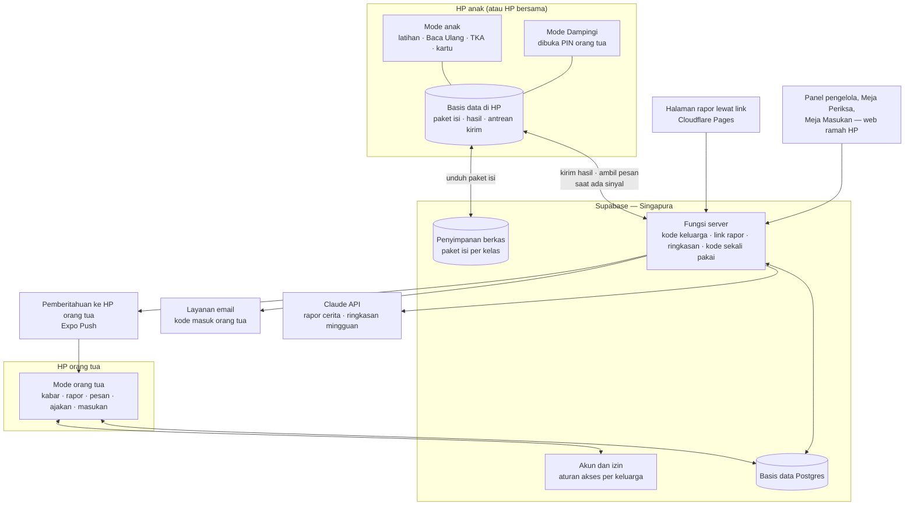

# Arsitektur dan Pilihan Teknologi

**Ringkas:** (1) Usulnya **Expo (React Native) + Supabase di Singapura**, sebab sama dengan proyek Peta Belajar (bisa dipakai ulang), memakai basis data SQL yang cocok untuk rapor dan hitungan gerbang berbayar, dan paling mudah dibangun dengan bantuan AI. Pembandingnya Flutter + Firebase di Jakarta, yang unggul di letak data dan dukungan tanpa sinyal tetapi berarti belajar teknologi baru dari nol. (2) Semua latihan dibuat dan dinilai **di HP** dari paket isi yang sudah diunduh, jadi aplikasi tetap jalan tanpa sinyal. Server hanya menyimpan, menyinkronkan, dan menyajikan rapor. (3) Biaya selama masa gratis: **± Rp0** sampai keluarga uji masuk, lalu **± Rp415–465 ribu per bulan** (terutama Supabase Pro). **Diputuskan Acut 19 Okt: pilihan A.** Risiko terbesarnya bukan biaya, tetapi data yang disimpan di luar negeri. Karena itu data anak dibuat seminim mungkin, dan dasar hukumnya masuk paket ahli hukum.

Tahap 3, butir 1. Disusun 19 Oktober 2026. Kurs Rp16.500 per US$1. Label: **[FAKTA + sumber] · [ESTIMASI + cara hitung] · [ASUMSI — perlu diuji]**.

---

## 1. Gambar besar

| Bagian | Tugas | Jalan tanpa sinyal? |
|---|---|---|
| **Mode anak** | Tes penempatan, Lancar, Baca Ulang, TKA, kartu, pesan orang tua yang sudah terunduh | **Ya**, sepenuhnya |
| **Mode Dampingi** | Jurus, kunci, naskah kegiatan, Dengar Bacaan | Ya |
| **Mode orang tua** | Kabar, rapor, pesan, ajakan, pertanyaan masukan | Sebagian: data terakhir tetap terbaca; kirim pesan diantrekan |
| **Basis data di HP** | Paket isi, hasil yang belum terkirim, salinan rapor | — |
| **Supabase** | Akun, aturan akses, penyimpanan hasil, paket isi, fungsi server | — |
| **Halaman rapor** | Rapor satu layar tanpa instal | Tidak (halaman web) |
| **Panel pengelola** | Acut melihat ringkasan, memutuskan, memeriksa isi, mengatur jadwal pertanyaan | Tidak |
| **Layanan luar** | Email (kode masuk), Claude (rapor cerita, ringkasan), Expo Push (pemberitahuan ke orang tua) | — |

**Prinsip utama:** soal Lancar dibuat oleh kode di HP dengan benih acak, dan soal TKA serta teks dibaca dari paket isi di HP. Server **tidak pernah dibutuhkan untuk berlatih**, sebab hasil dua malam pertama versi 4 hilang karena bergantung pada sambungan.

---

## 2. Membandingkan pilihan teknologi

| Ukuran | **A. Expo + Supabase (Singapura)** — usul | B. Flutter + Firebase (Jakarta) | C. Expo + Firebase (Jakarta) |
|---|---|---|---|
| Sudah dipakai Acut | **Ya**, proyek Peta Belajar | Tidak | Sebagian (Expo) |
| Kemudahan dibangun dengan bantuan AI | Tinggi: JavaScript/TypeScript dan SQL paling banyak contohnya **[ASUMSI]** | Sedang: bahasa Dart | Sedang: pustaka Firebase untuk React Native butuh pengaturan khusus |
| Basis data | Postgres (SQL): rapor, rekap mingguan, dan hitungan gerbang cukup dengan kueri biasa | Firestore (dokumen): rekap lintas anak harus disiapkan sendiri | Sama dengan B |
| Tanpa sinyal | Dibangun sendiri (antrean di HP), ± 3–5 hari kerja **[ESTIMASI]** | **Bawaan Firestore** | Bawaan Firestore |
| Letak data | **Singapura** (tidak ada wilayah Jakarta) **[FAKTA — dokumentasi wilayah Supabase]** | **Jakarta** (asia-southeast2) **[FAKTA — dokumentasi lokasi Firestore]** | Jakarta |
| Aturan akses per keluarga | Aturan per baris di basis data (Row Level Security), bisa diuji dengan SQL | Aturan keamanan Firestore | Sama dengan B |
| Biaya masa gratis (± 50 keluarga) | Rp0 sampai Desember, lalu US$25 per bulan (± Rp412 ribu) | Kemungkinan Rp0 di paket Spark (1 GiB, 20 ribu tulis per hari) **[FAKTA — harga Firebase]**; fungsi server butuh paket Blaze | Sama dengan B |
| Kode masuk lewat SMS | Butuh penyedia luar | 10 SMS pertama per hari gratis, lalu US$0,35 per SMS untuk Indonesia **[FAKTA — harga Identity Platform]**; hanya di paket Blaze | Sama dengan B |
| Syarat layanan untuk aplikasi anak | Tidak ada larangan aplikasi anak di syarat Supabase **[FAKTA — supabase.com/terms, dicek 19 Okt 2026]** | Firebase Analytics harus dimatikan atau diberi tanda anak **[ASUMSI — dicek sebelum dipilih]** | Sama dengan B |
| Halaman rapor web | Mudah (fungsi server + halaman statis) | Mudah | Mudah |
| Risiko terbesar | Data di luar negeri; antrean tanpa sinyal harus diuji ketat | Belajar bahasa dan pola baru; terikat penyedia; rekap sulit | Pustaka asli (native) menambah kerumitan pembuatan aplikasi |

**Usul: A**, sebab tiga keunggulannya (dipakai ulang dari Peta Belajar, SQL untuk rapor dan gerbang, kemudahan dibangun dengan AI) mengenai pekerjaan yang paling banyak. Dua kekurangannya bisa ditutup:

| Kekurangan A | Penutup | Biaya · waktu |
|---|---|---|
| Data di Singapura = transfer ke luar negeri | (1) Data anak dibuat minimal: nama panggilan, bulan dan tahun lahir, kelas; tanpa foto, sekolah, lokasi. (2) Dasar transfer menurut UU PDP Ps. 56: negara tujuan setara → pelindungan mengikat → persetujuan subjek data **[FAKTA — UU 27/2022 Ps. 56, lewat Hukumonline]**. Persetujuan transfer dicantumkan di formulir sebagai lapis terakhir. (3) Ditanyakan ke ahli hukum | Rp0; masuk paket hukum |
| Tanpa sinyal dibangun sendiri | Rancangan rinci di `04-tahan-putus-sinyal.md`; data hasil hampir semuanya "tambah baru", jadi bentrok jarang terjadi | ± 3–5 hari kerja, diuji dengan 6 skenario |

**Kalau ahli hukum menyatakan data anak wajib di Indonesia:** pindah ke C (Expo + Firebase Jakarta). Aplikasi tetap Expo, jadi tampilan tidak dibangun ulang; yang berubah adalah lapisan data (± 1–2 minggu **[ESTIMASI]**). Karena itu kode aplikasi dibangun dengan **lapisan data terpisah** sejak awal.

---

## 3. Komponen dan biayanya — masa gratis (± 50 keluarga)

| Komponen | Pilihan | Paket | Biaya per bulan | Sumber |
|---|---|---|---|---|
| Server | Supabase | Gratis (uji internal, Okt–Nov) → **Pro** sejak keluarga uji (Des) | Rp0 → **± Rp412 ribu** (US$25, sudah termasuk kredit komputasi US$10 untuk ukuran komputasi terkecil, "Micro") | **[FAKTA — supabase.com/pricing: 8 GB basis data, 100 ribu pemakai aktif, cadangan harian 7 hari, tidak berhenti sendiri]** |
| Pembuatan aplikasi | Expo EAS | Gratis: 15 pembuatan Android, antrean lambat; 1.000 pemakai aktif untuk pembaruan lewat udara | Rp0 (naik ke paket Starter, paket berbayar terkecil, US$19 kalau antrean terlalu lambat) | **[FAKTA — expo.dev/pricing]** |
| Halaman rapor dan panel | Cloudflare Pages | Gratis; boleh untuk usaha | Rp0 | **[FAKTA — perbandingan paket gratis, Sep 2026]**; Vercel Hobby dilarang untuk usaha |
| Kode masuk orang tua | Email lewat Brevo (lihat `02-akun-keluarga.md`) | Gratis 300 email per hari | Rp0 | **[FAKTA — perbandingan layanan email Supabase, Jan 2026]** |
| AI | Claude Haiku/Sonnet 5.5 | Per token | ± Rp11–70 ribu pada 75 anak (rinci di `07-layanan-ai.md`; disamakan 20 Okt) | `riset-penguat.md` bagian 8 |
| Suara | Google Chirp 3 HD, dibuat sekali | Gratis sampai 1 juta karakter | Rp0 | `01-produk/03-rencana-isi.md` bagian 5 |
| Pemberitahuan | Expo Push | Gratis | Rp0 | **[ASUMSI — dicek di Tahap 5]** |
| **Jumlah** | | | **± Rp415–465 ribu per bulan** sejak Desember (dihitung ulang di Tahap 5: **± Rp478 ribu**, `06-rilis/03` — angka itu yang dipakai) | |

PPN layanan digital luar negeri bisa menambah ± 11–12% **[ASUMSI — dihitung di Tahap 5]**.

---

## 4. HP murah dan ukuran

| Batas | Usul | Sebab |
|---|---|---|
| Android paling rendah | Android 8 ke atas **[ASUMSI — disesuaikan versi Expo yang dipakai]** | Mencakup sebagian besar HP murah yang masih dipakai |
| RAM | Lancar di HP 2 GB | Keluarga dengan satu HP murah bersama |
| Ukuran aplikasi | ≤ 40 MB saat dipasang, tanpa paket isi **[ASUMSI]** | Kuota dan ruang HP |
| Paket isi | Kelas Lancar: < 2 MB (soal dibuat kode); Baca Ulang: ± 15 MB per kelas (suara); TKA: ± 5 MB | Diunduh sekali lewat Wi-Fi atau kuota, lalu dipakai tanpa sinyal |
| Tema | Terang lembut (latar krem) sebagai bawaan, mode gelap pilihan | Tampilan terang lebih baik untuk membaca, juga di malam hari **[FAKTA — NN/g 2020]** (`03-antarmuka/03` bagian 3) |

---

## 5. Aturan Google Play yang mengikat arsitektur

| Aturan | Isi | Akibat |
|---|---|---|
| Pustaka pihak ketiga (SDK) untuk aplikasi anak | Aplikasi yang menyasar anak tidak boleh memuat API atau pustaka pihak ketiga (SDK) yang menurut syarat penyedianya tidak disetujui untuk layanan anak **[FAKTA — Kebijakan Keluarga Google Play]** | Daftar pustaka diperiksa satu per satu sebelum uji tertutup; tanpa Firebase Analytics, iklan, atau pelacak |
| Pengenal perangkat | Tidak boleh mengirim AAID, SIM Serial, Build Serial, BSSID, MAC, SSID, IMEI, IMSI **[FAKTA — sama]** | Izin pengenal iklan (AD_ID) dihapus dari manifes; analitik dibuat sendiri di basis data kita |
| Lokasi | Aplikasi khusus anak tidak boleh meminta izin lokasi **[FAKTA — sama]** | Tidak ada izin lokasi |
| Fitur sosial | Pengingat aman di dalam aplikasi; tindakan orang dewasa sebelum anak bertukar info pribadi; orang dewasa bisa mengatur fitur sosial **[FAKTA — sama]** | Pesan hanya dalam keluarga, anak hanya stiker, orang tua mengatur semuanya |
| Kebijakan privasi | Wajib dan akurat; aplikasi termasuk pustaka pihak ketiganya mematuhi COPPA, GDPR, dan hukum lain yang berlaku **[FAKTA — sama]** | Paket hukum gelombang 3 |

**Sasaran usia di Play Console — usul:** "anak-anak dan orang dewasa" (kelompok 6–8, 9–12, dan 18+), sebab orang tua juga memakai aplikasi yang sama. Aplikasi dibuka dengan **pendaftaran orang tua dulu**, yang berfungsi sebagai penyaring usia netral sebelum mode anak terbuka. **[ASUMSI — dicek ulang terhadap formulir Play Console saat uji tertutup]**

**Risiko yang pernah terjadi pada aplikasi Expo:** pada 2020 aplikasi Expo pernah ditolak Kebijakan Keluarga karena pustaka iklan yang terbawa otomatis **[FAKTA — forum Expo 2020]**. Expo sekarang hanya membawa modul yang dipakai **[ASUMSI]**, tetapi manifes Android tetap diperiksa sebelum dikirim ke Play Store (daftar periksa di `11-privasi-dan-keamanan.md`).

---

## 6. Badan usaha dan pendaftaran yang memengaruhi teknis

| Hal | Isi | Akibat teknis |
|---|---|---|
| Pendaftaran PSE lingkup privat | Wajib **sebelum sistem digunakan pengguna**; tiap aplikasi dan situs didaftarkan terpisah; lewat OSS; tanpa biaya PNBP **[FAKTA — izin.co.id, Jul 2026, mengutip Permenkominfo 5/2020 jo. 10/2021]** | Aplikasi Android **dan** halaman rapor web kemungkinan perlu didaftarkan terpisah **[ASUMSI — ditanyakan ke ahli hukum]**; masuk jadwal sebelum uji keluarga |
| Penerbit di Play Store | Akun Play Console Acut | Nama penerbit, pengendali data, dan PSE sebaiknya satu nama; atas nama pribadi atau badan usaha dibahas khusus |
| Akun Play Console | Akun pribadi Acut yang sudah ada; akun organisasi butuh nomor D-U-N-S (gratis dari Dun & Bradstreet tetapi bisa sampai 30 hari) **[FAKTA — Bantuan Play Console]** | Dibahas dalam diskusi khusus badan usaha |

---

## 7. Keputusan

| # | Keputusan | Usul Acut2 |
|---|---|---|
| 1 | Pilihan teknologi A (Expo + Supabase Singapura), dengan jalan pindah ke C kalau ahli hukum mewajibkan data di Indonesia | **Diputuskan Acut 19 Okt: A** |
| 2 | Halaman rapor dan panel di Cloudflare Pages (gratis, boleh untuk usaha) | Ya |
| 3 | Sasaran usia di Play Console: anak + dewasa, dengan pendaftaran orang tua sebagai penyaring | Ya, dicek saat uji tertutup |
