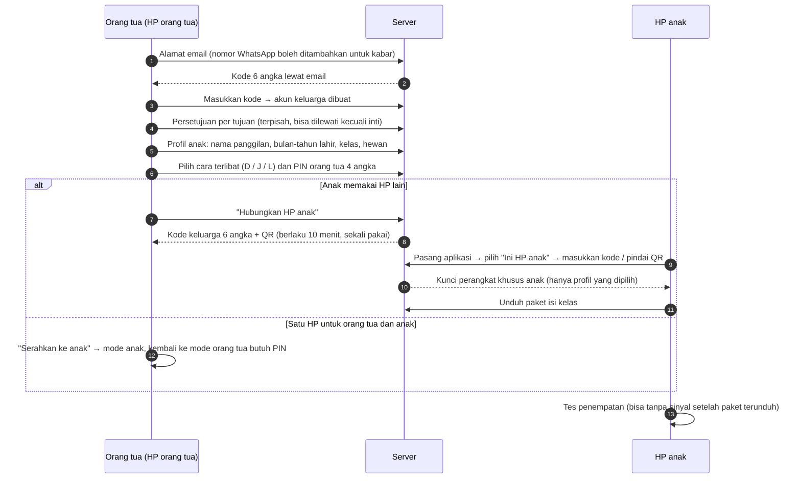

# Akun Keluarga

**Ringkas:** (1) Hanya orang tua yang punya akun masuk. Anak **tidak punya akun, email, atau nomor HP**; anak adalah profil di bawah akun keluarga, sebab data anak harus seminimal mungkin dan persetujuan datang dari orang tua. (2) Orang tua masuk dengan **email + kode 6 angka** (keputusan Acut 19 Okt: email saja dulu), lewat layanan email gratis (Brevo 300 email per hari). Nomor WhatsApp **boleh diisi** untuk kabar dan Keluarga Perintis, tetapi tidak dipakai untuk masuk. HP anak dihubungkan dengan **kode keluarga 6 angka atau QR** yang berlaku 10 menit. (3) Celah yang ditutup: anak masuk ke mode orang tua (PIN orang tua, terkunci setelah 5 kali salah), kakak mengerjakan lembar adik (pilih profil + PIN anak opsional), dan HP hilang (orang tua bisa memutus HP dari jauh).

Tahap 3, butir 2. Disusun 19 Oktober 2026.

---

## 1. Siapa punya apa

| Peran | Cara masuk | Bisa melihat | Bisa mengubah |
|---|---|---|---|
| **Orang tua pemilik** | Email + kode | Semua anak di keluarganya | Profil anak, persetujuan data, PIN, link rapor, HP terhubung, hapus akun |
| **Orang tua kedua** (ayah atau ibu yang lain) | Diundang pemilik dengan kode; masuk dengan emailnya sendiri | Semua anak di keluarga | Pesan, ajakan, Mode Dampingi; **tidak bisa** menghapus akun atau mengubah persetujuan |
| **HP anak** (perangkat, bukan orang) | Kode keluarga atau QR dari HP orang tua | Profil anak yang dipilih orang tua untuk HP itu | Hanya hasil latihan anak itu |
| **Penerima link rapor** | Membuka link | Rapor satu anak | Tidak ada |
| **Pengajar kelas luring** (kalau orang tua setuju, Izin 6) | Link rapor kelas dari fungsi server khusus (`03-basis-data.md` tabel `kelas_luring`) | Ringkasan latihan rumah anak yang orang tuanya setuju | Tidak ada. Latihan rumah dibuka menurut **tanggal pertemuan** yang diisi Acut di panel, bukan oleh pengajar (`01-produk/06` bagian 8) |
| **Guru pembimbing — guru sekolah** (R3, ditambah 28 Okt) | Diundang orang tua pemilik lewat email guru dengan jenis "guru sekolah", lalu **disetujui** orang tua; batas percobaan sama dengan bagian 7a | Kemampuan anak (peta topik, tanda bimbingan, ringkasan) untuk mapel yang diizinkan, satu anak | Hanya **komentar ke orang tua** (≤ 200 huruf). Tidak ada menu di HP anak; orang tua boleh meneruskan komentar ke anak (`01-produk/10` bagian 4.1) |
| **Guru pembimbing — guru les** (R3, ditambah 28 Okt) | Sama, dengan jenis "guru les" (termasuk pengajar kelas luring TKA) | Sama | Tugas dari Gudang Ilmu dan catatan pendek ke anak yang selalu terlihat orang tua; anak membalas stiker; tanpa obrolan |
| **Pengelola (Acut)** | Panel pengelola, dua langkah masuk | Ringkasan semua keluarga; data per anak hanya untuk perbaikan masalah, tercatat di log | Isi, jadwal pertanyaan, pengaturan |

---

## 2. Cara masuk orang tua

| Pilihan | Biaya per kode | Untung | Rugi | Putusan |
|---|---|---|---|---|
| WhatsApp + kode 6 angka | ± Rp367 (kategori Authentication) **[FAKTA — harga Qontak, Okt 2026]** | Akrab bagi orang tua Aceh | Butuh verifikasi bisnis Meta dan templat pesan; nomor WhatsApp atas nama badan usaha | Dinilai ulang setelah R1, kalau banyak orang tua kesulitan dengan email |
| **Email + kode 6 angka** | Rp0: Brevo gratis 300 email per hari, Resend gratis 100 per hari / 3.000 per bulan **[FAKTA — perbandingan layanan email untuk Supabase, Jan 2026]** | Tanpa verifikasi pihak ketiga; hampir semua pemilik HP Android punya akun Gmail **[ASUMSI]** | Sebagian orang tua jarang membuka email; kode bisa masuk folder spam | **✓ Diputuskan Acut 19 Okt** |
| SMS + kode | ± US$0,35 = ± Rp5.800 per SMS **[FAKTA — harga Identity Platform Google untuk Indonesia]** | Tidak butuh aplikasi lain | Mahal; sering terlambat | ✗ |
| Masuk dengan akun Google | Rp0 | Satu ketuk | Syarat layanan masuk-dengan-Google untuk aplikasi anak belum dicek; menambah pustaka pihak ketiga | ✗ untuk Rilis 1 |

**Catatan teknis:** pengirim email bawaan Supabase hanya untuk uji dan dibatasi; untuk keluarga sungguhan wajib memakai pengirim email sendiri (SMTP), dengan batas bawaan 30 email per jam yang bisa diubah **[FAKTA — sumber yang sama]**. Pengirim memakai nama domain sendiri supaya tidak masuk spam.

**Menjaga orang tua yang kesulitan email:** layar kode menampilkan "Periksa folder Spam atau Promosi" dan tombol kirim ulang setelah 60 detik. Kalau > 20% pendaftar berhenti di layar kode **[ASUMSI]**, kode lewat WhatsApp dinilai ulang.

**Aturan keamanan kode:** berlaku 10 menit; paling banyak 5 permintaan per email per jam; 5 kali salah → email dikunci 15 menit. Sesi orang tua tetap masuk sampai keluar sendiri atau HP diputus dari jauh.

---

## 3. Alur pendaftaran dan menghubungkan HP

| Langkah | Batas waktu orang tua **[ASUMSI]** |
|---|---|
| Masuk + kode (buka email) | ± 1–2 menit |
| Persetujuan | ± 2–3 menit (teks pendek per tujuan, tautan ke versi lengkap) |
| Profil anak + cara terlibat + PIN | ± 2 menit per anak |
| Menghubungkan HP anak | ± 2 menit |
| **Jumlah** | **≤ 10 menit untuk satu anak** — di bawah batas 15 menit hari pertama (`01-profil-dan-perjalanan.md` 2.1) |

---

## 4. Profil anak — data seminimal mungkin

| Data | Disimpan? | Sebab |
|---|---|---|
| Nama panggilan | Ya | Sapaan di layar dan rapor |
| **Bulan dan tahun lahir** (bukan tanggal lengkap) | Ya | Cukup untuk kelompok usia (Permenkomdigi 9/2026: 6–9 dan 10–12) dan kelompok kelas; tanggal lengkap tidak dibutuhkan |
| Kelas | Ya | Paket isi |
| Hewan profil | Ya | Pengenal di layar pilih profil |
| PIN anak (opsional) | Ya, hanya dalam bentuk acak satu arah (hash) | Saudara satu HP |
| Nama lengkap, foto, sekolah, alamat, NISN | **Tidak** | Tidak dibutuhkan; menekan risiko |
| Rekaman suara | **Tidak** (fitur Dengar Bedanya ditunda) | — |

**Catatan untuk keputusan 19 Okt:** catatan diskusi menyebut anak mengisi "nama, tanggal lahir, kelas". Usulnya: **orang tua** yang mengisi, dan cukup bulan-tahun lahir. Hasilnya sama untuk aplikasi, tetapi datanya lebih sedikit.

---

## 5. PIN dan perlindungan mode

| Kunci | Aturan |
|---|---|
| **PIN orang tua** (4 angka) | Membuka Mode Dampingi, kembali dari mode anak ke mode orang tua di HP bersama, mengubah pengaturan, membuka game di luar batas. 5 kali salah → terkunci 5 menit, lalu bertambah. Lupa PIN → atur ulang dengan kode lewat email |
| **PIN anak** (4 angka, opsional) | Dipasang orang tua kalau saudara berbagi HP. Lupa → orang tua menghapusnya dari mode orang tua |
| Keluar otomatis dari Mode Dampingi | Setelah 15 menit tanpa sentuhan (`01-produk/07` 2.2). **Simulasi TKA tidak memakai Mode Dampingi**: orang tua memasukkan PIN sekali di awal untuk menandai "diawasi", lalu simulasi berjalan 75 menit tanpa batas diam (`01-produk/06` bagian 6) |
| Tombol masuk Mode Dampingi | Kecil di pojok layar anak, tidak menarik perhatian |

**Celah yang diterima:** anak yang melihat orang tua mengetik PIN bisa menghafalnya. Penjaganya: PIN orang tua bisa diganti kapan saja, dan setiap pembukaan Mode Dampingi tercatat di riwayat orang tua.

---

## 6. Satu HP, beberapa anak

| Keadaan | Cara kerja |
|---|---|
| Kakak-adik satu HP | Layar awal: pilih hewan profil. Hasil hanya tercatat di profil yang aktif. PIN anak opsional |
| Anak berpindah HP (HP ayah siang, HP ibu malam) | Satu profil boleh terhubung ke beberapa HP; hasil digabung di server berdasarkan waktu (`04-tahan-putus-sinyal.md` bagian 5) |
| HP orang tua juga dipakai anak | "Serahkan ke anak" → mode anak; kembali butuh PIN orang tua |
| Pola mencurigakan (lembar adik dikerjakan sangat cepat dengan pola kakak) | Ditandai di data, tidak dihukum; orang tua diberi saran memasang PIN anak (`01-profil` bagian 3) |

---

## 7. Mengelola HP terhubung dan akun

| Tindakan | Siapa | Di mana |
|---|---|---|
| Melihat daftar HP terhubung, terakhir terhubung, jumlah hasil belum terkirim | Orang tua | Mode orang tua → Pengaturan |
| Memutus HP dari jauh (HP hilang atau dijual) | Orang tua pemilik | Sama; HP itu kehilangan akses saat berikutnya tersambung, data lokalnya dihapus |
| Mengundang orang tua kedua | Pemilik | Undangan diikat ke **alamat email tujuan** yang diketik pemilik; kode 6 angka hanya berlaku untuk email itu, 24 jam, sekali pakai. Setelah orang itu masuk, **pemilik harus menyetujui** ("Budi ingin bergabung — izinkan?") sebelum data anak terlihat. Pemilik menerima kabar setiap ada orang tua baru (bagian 7a) |
| Mengunduh data keluarga | Pemilik | Berkas ringkas yang mudah dibaca (hak subjek data) |
| **Menghapus akun** | Pemilik | Di aplikasi **dan** lewat halaman web, sebab Google Play mewajibkan tautan hapus akun dari luar aplikasi **[ASUMSI — dicek ulang terhadap kebijakan penghapusan akun Google Play di Tahap 5]**. Data dihapus dalam 30 hari; cadangan ikut terhapus setelah masa simpan cadangan (7 hari di Supabase Pro) |

### 7a. Batas percobaan semua kode (diperbaiki 20 Okt setelah pemeriksaan)

Pemeriksa menemukan bahwa kode undangan (24 jam) dan kode keluarga (10 menit) tidak punya batas percobaan. Dengan 10⁶ kemungkinan, ± 12 tebakan per detik cukup untuk mencoba semua kode undangan dalam 24 jam. Orang asing yang berhasil bisa membaca data anak dan mengirim pesan ke anak, sebab orang tua kedua punya hak itu. Aturannya sekarang:

| Kode | Batas percobaan | Ikatan | Persetujuan | Kabar |
|---|---|---|---|---|
| Kode masuk email | 5 salah → email dikunci 15 menit; 5 permintaan per jam | Satu email | — | — |
| **Kode undangan orang tua kedua** | 5 salah per akun penebak → akun itu tidak bisa memakai undangan apa pun selama 24 jam; 20 salah per alamat IP per jam → IP diblok 1 jam; 10 salah untuk satu undangan → undangan itu batal | Hanya email tujuan | **Wajib** disetujui pemilik | Email + kabar di aplikasi ke pemilik: "Budi (b…@gmail.com) bergabung pada 10 Des 19.02. Bukan Anda yang mengundang? Keluarkan" |
| **Kode keluarga (HP anak)** | 5 salah per HP → HP itu menunggu 15 menit; 20 salah per IP per jam → diblok 1 jam | Dibuat dari HP orang tua yang sudah masuk; sekali pakai, 10 menit | HP baru muncul di daftar "HP terhubung" dengan tombol putus | Kabar di aplikasi orang tua: "HP baru terhubung ke profil Rani" |

Dengan batas ini, peluang menebak satu undangan sebelum batal adalah 10 ÷ 10⁶ = 0,001% **[ESTIMASI — 10 percobaan dibagi semua kemungkinan]**, dan orang asing yang lolos pun belum bisa melihat apa-apa sebelum pemilik menyetujui. Klaim "0%" untuk aspek kontak orang asing (KK03 di `01-produk/07` bagian 4) sekarang bersandar pada persetujuan pemilik, bukan pada sulitnya menebak.

---

## 8. Verifikasi usia

Permenkomdigi 9/2026 mewajibkan verifikasi usia **[FAKTA — `riset-penguat.md` bagian 9]**, tetapi caranya belum dirinci di bahan yang kita baca.

| Lapisan | Cara | Kekuatan |
|---|---|---|
| Orang tua dewasa | Pernyataan "saya orang tua/wali berusia 18+" saat mendaftar + email terverifikasi | Lemah–sedang |
| Usia anak | Bulan-tahun lahir dari orang tua → isi dan pengaturan sesuai kelompok 6–9 atau 10–12 | Bergantung kejujuran orang tua |
| Anak mendaftar sendiri | Tidak bisa: tidak ada jalur daftar anak | Kuat |

**[ASUMSI — pertanyaan untuk ahli hukum]** Apakah lapisan ini cukup untuk Permenkomdigi 9/2026, atau perlu cara lain (misalnya verifikasi KTP orang tua). Verifikasi KTP menambah data sensitif dan tidak diusulkan kecuali diwajibkan.

---

## 9. Keputusan

| # | Keputusan | Usul Acut2 |
|---|---|---|
| 1 | Masuk dengan email + kode | **Diputuskan Acut 19 Okt** |
| 2 | Orang tua yang mengisi profil anak, cukup bulan-tahun lahir | Ya |
| 3 | Orang tua kedua tidak bisa menghapus akun atau mengubah persetujuan | Ya |
