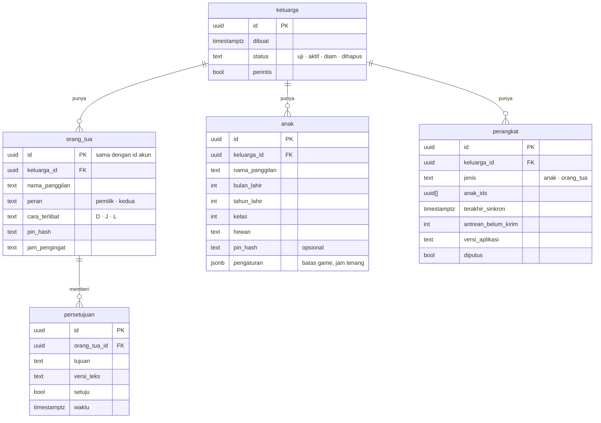
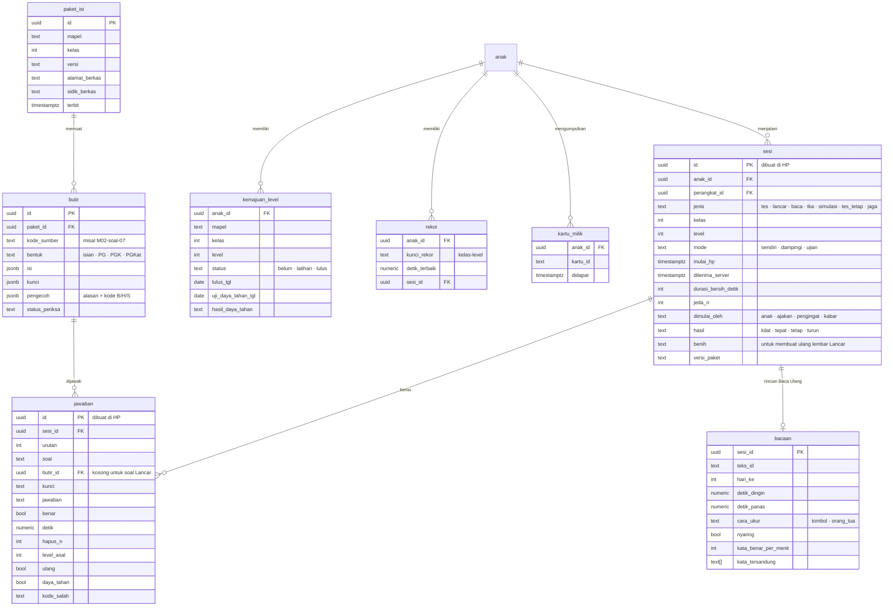
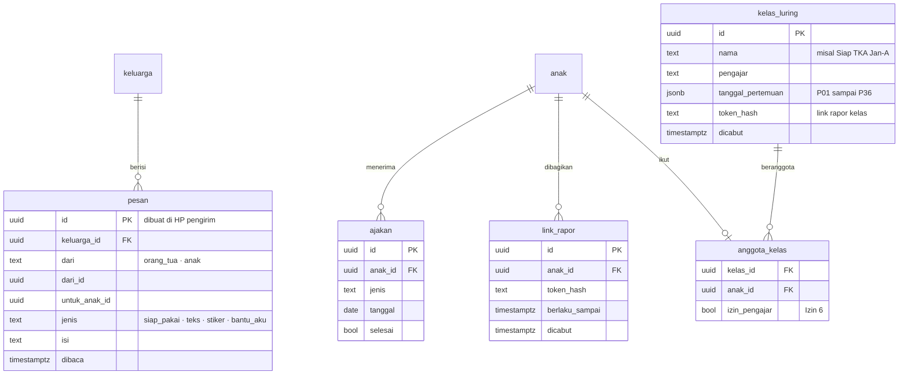
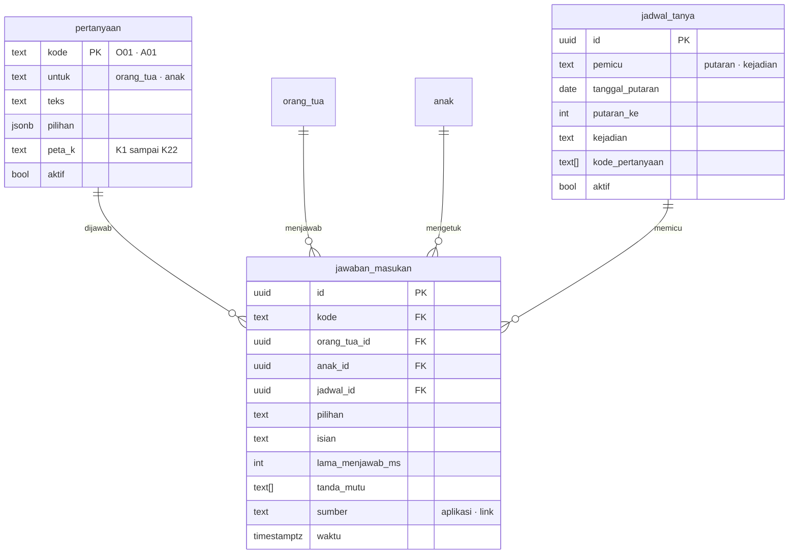
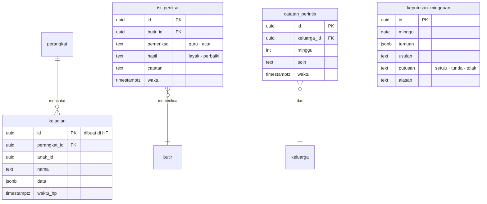

# Rancangan Basis Data

**Ringkas:** (1) Basis data disusun di sekitar **keluarga**: setiap baris yang menyangkut anak membawa nomor keluarga, sehingga aturan akses per baris cukup satu pola ("hanya keluarga sendiri"). (2) Hasil latihan disimpan **per soal** (jawaban, detik, jumlah hapus, kode salah), sebab rapor, peta jenis salah, penjaga terlalu rumit/mudah, dan gerbang berbayar semuanya dihitung dari situ. Nomor setiap sesi dan jawaban **dibuat di HP**, jadi pengiriman ulang tidak menghasilkan data ganda. (3) Level anak **tidak disimpan sebagai angka yang bisa diubah sembarangan**, tetapi dihitung ulang dari riwayat sesi. Dengan begitu, hasil dari dua HP atau yang terlambat terkirim tetap menghasilkan level yang sama.

Tahap 3, butir 3. Disusun 19 Oktober 2026. Nama tabel dan kolom dalam Bahasa Indonesia, huruf kecil, dengan garis bawah.

---

## 1. Gambar hubungan tabel — inti

Diperbaiki 20 Okt: satu gambar besar dipecah menjadi tiga supaya terbaca di HP dan di PDF. Tabel `keluarga` dan `anak` ditulis lengkap di gambar 1a; di gambar lain hanya namanya.

### 1a. Keluarga dan akun

### 1b. Latihan, kemajuan, dan isi

### 1c. Pesan, rapor, dan kelas luring

---

## 2. Gambar hubungan tabel — masukan, catatan, dan pengelola

### 2a. Pertanyaan masukan

### 2b. Catatan pemakaian dan alat pengelola

**Ditambah 28 Okt:** tabel Gudang Ilmu (`topik`, `prasyarat`, `kartu_ilmu`, `kemajuan_topik` dengan tanda bimbingan) dan Bimbingan Guru (`guru_pembimbing`: anak, email guru, **jenis (`sekolah` · `les`)**, mapel yang diizinkan, disetujui, dicabut; `komentar_guru` untuk orang tua, dengan kolom diteruskan_ke_anak; `tugas_guru` dan `catatan_guru` hanya untuk jenis `les`) serta Belajar Bahasa Inggris (`tingkat_inggris`: anak, tingkat dipilih, tanggal; kemajuan unit memakai `kemajuan_topik` dengan mapel `ING`) dirinci di `01-produk/10-gudang-ilmu-bimbingan-dan-waktu.md` bagian 2.4 dan 4. Aturan akses: guru hanya membaca baris anak yang ia bimbing dan mapel yang diizinkan, lewat fungsi server; fungsi penulis tugas dan catatan menolak guru berjenis `sekolah`.

Tabel `keputusan_mingguan` berdiri sendiri: diisi panel pengelola, dibaca saat menyusun pesan "Kami dengar, kami ubah".

---

## 3. Aturan yang dipegang basis data

| Aturan | Isi | Sebab |
|---|---|---|
| **Nomor dibuat di HP** | `sesi.id`, `jawaban.id`, `pesan.id`, `kejadian.id` memakai nomor acak universal (UUID) yang dibuat di HP | Pengiriman ulang = baris yang sama, bukan baris baru (`04-tahan-putus-sinyal.md`) |
| **Tambah, bukan ubah** | Sesi dan jawaban hanya ditambah, tidak pernah diubah atau dihapus oleh HP | Riwayat jujur; tidak ada bentrok antar-HP |
| **Level dihitung, bukan diketik** | `kemajuan_level` dihitung ulang server dari semua `sesi` anak, diurutkan menurut `mulai_hp` | Hasil terlambat atau dari HP lain tetap menghasilkan level yang sama |
| **Tiga penanda waktu** | `mulai_hp` (jam HP), `diterima_server` (jam server), dan `urutan_hp` + `detik_sejak_sinkron` (penghitung yang hanya naik dan jam monoton HP sejak sinkron terakhir) | Jam HP anak bisa salah. Kalau selisih > 10 menit, urutan sesi memakai `urutan_hp`, dan tanggal diperkirakan dari jam server saat sinkron terakhir + `detik_sejak_sinkron`, **bukan** dari jam terima (diubah 20 Okt: sesi yang terkirim berhari-hari kemudian akan salah urut kalau memakai jam terima) |
| **Satu logika LANCAR** | Aturan naik/turun level ditulis sekali sebagai satu pustaka TypeScript, dipakai di HP dan di fungsi server | Dua salinan logika pasti berbeda suatu saat; level di HP dan di server harus sama |
| **Soal Lancar disimpan sebagai teks** | `jawaban.soal` = "7 × 8", `butir_id` kosong | Soal dibuat kode, tidak ada di bank; teks cukup untuk rapor dan peta jenis salah |
| **Satu pola akses** | Setiap tabel anak terhubung ke `keluarga_id` | Aturan akses per baris sederhana dan mudah diuji |

---

## 4. Aturan akses per baris (Row Level Security)

| Pembaca | Boleh membaca | Boleh menulis |
|---|---|---|
| Orang tua (akun) | Semua baris dengan `keluarga_id` miliknya | Profil anak, pesan, ajakan, persetujuan (pemilik), jawaban masukan miliknya |
| HP anak (kunci perangkat) | Baris anak yang terdaftar di `perangkat.anak_ids`; pesan untuk anak itu; paket isi | Sesi, jawaban, bacaan, kejadian, pesan stiker, ketukan anak — **hanya untuk anak-anak itu** |
| Link rapor | Tidak membaca tabel langsung; fungsi server memeriksa `token_hash`, `berlaku_sampai`, `dicabut`, lalu menyusun rapor satu anak | Jawaban masukan, ditandai `sumber = link` |
| Link rapor kelas (pengajar) | Tidak membaca tabel langsung; fungsi server memeriksa `kelas_luring.token_hash`, lalu menyusun ringkasan **hanya** untuk anggota dengan `izin_pengajar = ya` | — |
| Panel pengelola | Lewat fungsi server dengan kunci khusus; setiap akses data per anak tercatat | Isi, jadwal, pertanyaan, keputusan |

Uji wajib sebelum uji keluarga: orang tua keluarga A **tidak bisa** membaca satu baris pun milik keluarga B, dan HP anak tidak bisa menulis atas nama anak lain. Rinciannya di rencana uji Tahap 5.

---

## 5. Perkiraan ukuran — masa gratis

Dasar hitungan yang sama di semua berkas: **50 keluarga = 75 anak** (1,5 anak per keluarga, `06-rilis/03`). Diperbaiki 20 Okt; versi lama memakai 50 anak dan salah hitung "1,5 tahun".

**[ESTIMASI]** 75 anak × 2 lembar × 20 soal × 30 hari = 90.000 baris jawaban per bulan; ± 300 byte per baris dengan indeks → **± 27 MB per bulan**. Ditambah sesi, bacaan, dan kejadian, kira-kira ± 45 MB per bulan, atau **± 540 MB per tahun**.

| Paket | Batas | Cukup untuk |
|---|---|---|
| Supabase Gratis | 500 MB | < 1 tahun, dan berhenti sendiri setelah seminggu tidak dipakai → hanya untuk uji internal |
| Supabase Pro | 8 GB, lebihnya US$0,125 per GB per bulan | ± 15 tahun pada 50 keluarga; **± 9 bulan pada 1.000 keluarga** **[ESTIMASI: 1.000 keluarga = 1.500 anak = 20 × 540 MB ≈ 10,8 GB per tahun; 8 ÷ 10,8 × 12 ≈ 8,9 bulan]**. Kelebihan 2,8 GB ≈ US$0,35 per bulan, jadi bukan masalah biaya |

**Tanda peringatan dini:** ukuran basis data > 5 GB, atau tumbuh > 500 MB per bulan → tinjau masa simpan tabel `kejadian` (usul: rinci 12 bulan, lalu dirangkum).

---

## 6. Masa simpan

| Data | Disimpan | Sebab |
|---|---|---|
| Sesi, jawaban, bacaan | Selama akun aktif | Rapor tahunan dan uji daya tahan |
| Kejadian (catatan pemakaian) | Rinci 12 bulan, lalu dirangkum per minggu | Ukuran |
| Jawaban masukan | Selama akun aktif | Membandingkan antarputaran |
| Persetujuan | Selama akun aktif + 5 tahun setelah dihapus **[ASUMSI — ahli hukum]** | Bukti persetujuan (PP 33/2026) |
| Akun dihapus | Semua data anak dan orang tua dihapus dalam 30 hari; cadangan terhapus sendiri setelah 7 hari | Hak subjek data |
