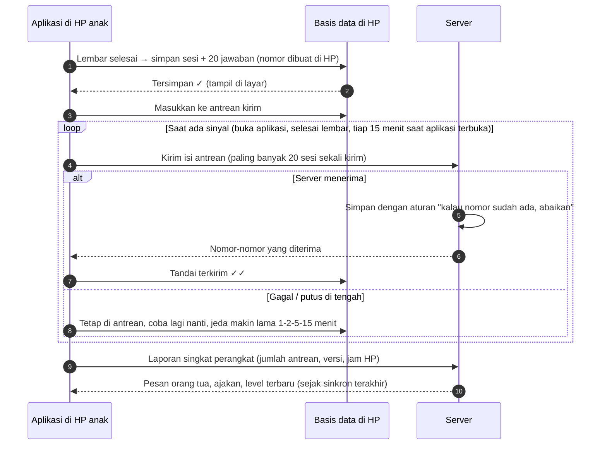

# Tahan Putus Sinyal

**Ringkas:** (1) Setiap hasil **disimpan dulu di HP**, baru dikirim. Pengirimannya diulang otomatis sampai server menjawab "diterima", dan nomor yang dibuat di HP membuat kiriman ulang tidak pernah menghasilkan data ganda. (2) Kegagalan versi 4 (dua malam hasil hilang) dicegah di tiga lapis: hasil tidak bergantung pada akun di peramban, ada tanda "tersimpan / terkirim" di layar anak, dan orang tua melihat "HP Aisyah terakhir terhubung 2 hari lalu, 4 lembar belum terkirim". (3) Celah yang tetap ada: kalau aplikasi dihapus atau data HP dibersihkan **sebelum** hasil terkirim, hasil itu hilang. Penjaganya: peringatan setelah 24 jam belum terkirim dan tombol "Salin hasil" seperti versi 4.

Tahap 3, butir 4. Disusun 19 Oktober 2026. Wajib, sebab hasil dua malam pertama versi 4 hilang (Prompt RCTOR, Pelajaran uji coba).

---

## 1. Apa yang terjadi di versi 4, dan apa bedanya sekarang

| Versi 4 (17–18 Okt) | Penyebab **[FAKTA — Prompt RCTOR]** | Aplikasi |
|---|---|---|
| Anak latihan di HP yang tidak masuk akun Acut | Penyimpanan bergantung pada akun di halaman web | Hasil disimpan di basis data HP; akun tidak diperlukan untuk menyimpan |
| Tidak ada yang terkirim, dan tidak ada yang tahu | Tidak ada tanda | Tanda di layar anak + kabar di HP orang tua + angka di panel pengelola |
| Hasil hilang | Tidak ada antrean | Antrean kirim yang bertahan walau HP dimatikan |

---

## 2. Cara kerja

| Aturan | Isi | Sebab |
|---|---|---|
| **Simpan dulu, kirim kemudian** | Lembar dianggap selesai saat tersimpan di HP, bukan saat terkirim | Latihan tidak pernah gagal karena sinyal |
| **Nomor dibuat di HP** | Setiap sesi, jawaban, pesan, dan kejadian punya nomor acak universal sejak dibuat | Kiriman ulang menimpa baris yang sama → tanpa ganda |
| **Server "abaikan kalau sudah ada"** | Penyimpanan di server memakai aturan sisip-atau-abaikan (upsert) berdasarkan nomor | Putus setelah server menyimpan tetapi sebelum HP menerima jawaban → kiriman berikutnya aman |
| **Satu sesi utuh** | Sesi dan semua jawabannya dikirim bersama dalam satu transaksi | Tidak ada sesi setengah terkirim |
| **Kapan mencoba** | Saat aplikasi dibuka, saat lembar selesai, dan tiap 15 menit selama aplikasi terbuka | Tugas latar belakang di HP Android murah sering dimatikan sistem **[ASUMSI]**, jadi tidak diandalkan |
| **Jeda bertambah** | 1, 2, 5, lalu 15 menit | Tidak menghabiskan baterai dan kuota |
| **Simpanan lokal** | Hasil terkirim tetap disimpan di HP 30 hari | Rekor dan rapor anak tetap terbaca tanpa sinyal |

---

## 3. Tanda yang terlihat

| Siapa | Tanda | Kapan |
|---|---|---|
| **Anak** | Di layar akhir lembar: "Tersimpan ✓" lalu "Terkirim ✓✓" | Setiap lembar |
| **Anak** (kelas 1–2 dengan suara) | Ikon awan kecil di beranda; tidak ada pesan menakutkan | Saat ada antrean |
| **Anak** | Spanduk "Ada 4 lembar yang belum terkirim. Minta Ayah/Bunda menyalakan internet sebentar" | Antrean > 24 jam |
| **Orang tua [J]** | "HP Aisyah terakhir terhubung 2 hari lalu · 4 lembar menunggu di HP" | Saat membuka mode orang tua |
| **Orang tua [J]** | Kabar: "Ada hasil Aisyah yang belum terkirim sejak 2 hari. Sambungkan HP-nya ke internet sebentar" | Antrean > 48 jam, paling banyak sekali sehari |
| **Orang tua [L]** | Di link rapor: "Data sampai Senin 19.40 — kalau anak latihan setelah itu, hasilnya belum masuk" | Selalu |
| **Acut** | Panel: daftar HP dengan antrean > 48 jam dan selisih jam HP > 10 menit | Ringkasan harian |

**Catatan:** orang tua hanya tahu jumlah antrean dari laporan terakhir HP anak. Kalau HP anak belum pernah tersambung sejak latihan, orang tua melihat "terakhir terhubung" saja. Ini batas yang jujur, bukan kesalahan.

---

## 4. Arah sebaliknya: server ke HP

| Data | Arah | Cara |
|---|---|---|
| Pesan orang tua, ajakan | Server → HP anak | Diambil saat sinkron dengan penanda "sejak waktu terakhir"; tampil saat anak membuka aplikasi |
| Pesan dan ketukan anak | HP anak → server | Lewat antrean yang sama |
| Paket isi | Server → HP | Unduhan berkas dengan nomor versi dan sidik berkas (`05-paket-isi.md`) |
| Level dan kemajuan | Dihitung di HP saat tanpa sinyal; dihitung ulang server dari semua sesi | Bagian 5 |
| Pengaturan (batas game, jam tenang, PIN) | Server → HP | Berlaku sejak sinkron berikutnya; perubahan PIN orang tua langsung berlaku di HP orang tua |

---

## 5. Kalau satu anak memakai dua HP

| Keadaan | Penanganan |
|---|---|
| Anak latihan di HP ayah siang dan di HP ibu malam, keduanya tanpa sinyal | Masing-masing HP menghitung level dari sesi yang ia tahu. Saat keduanya terkirim, server mengurutkan **semua** sesi menurut jam mulai, lalu menghitung ulang level, rekor, dan uji daya tahan |
| Hasil hitung ulang server berbeda dengan HP | HP mengambil hasil server pada sinkron berikutnya. Kalau level turun karenanya, anak tidak diberi pesan "turun" — lembar berikutnya saja yang menyesuaikan |
| Jam HP salah (misal mundur sehari) | HP menyimpan penghitung urutan yang hanya naik (`urutan_hp`) dan jam monoton sejak sinkron terakhir (`detik_sejak_sinkron`), yang tidak berubah kalau jam HP diubah. Kalau selisih jam HP dengan server > 10 menit, urutan memakai `urutan_hp` dan tanggal diperkirakan dari sinkron terakhir + jam monoton; sesi ditandai. **Bukan** jam terima, sebab sesi yang terkirim berhari-hari kemudian akan salah urut dan merusak aturan jeda ≥ 1 jam dan uji daya tahan 21 hari (diperbaiki 20 Okt). Celah yang diterima: jam monoton mulai dari nol setelah HP dinyalakan ulang. Dalam keadaan itu urutan tetap benar, tetapi tanggal ditandai "perkiraan" dan jeda ≥ 1 jam tidak dipakai untuk naik level (sesi itu hanya bisa naik lewat "kilat") |

**Kenapa cara ini aman:** sesi dan jawaban hanya pernah ditambah, tidak pernah diubah, jadi tidak ada dua versi data yang harus dipilih salah satunya. Yang dihitung ulang hanya turunannya.

---

## 6. Mode orang tua tanpa sinyal

| Tindakan | Tanpa sinyal |
|---|---|
| Membaca rapor dan kabar terakhir | Bisa (salinan terakhir) dengan keterangan "data sampai …" |
| Mengirim semangat atau ajakan | Diantrekan, dikirim saat tersambung; tampil "akan terkirim" |
| Menjawab pertanyaan masukan | Diantrekan |
| Mengubah persetujuan atau menghapus akun | **Butuh sinyal**, sebab perubahan harus langsung tercatat di server |

---

## 7. Celah yang tetap ada dan penjaganya

| Celah | Akibat | Penjaga |
|---|---|---|
| Aplikasi dihapus atau data dibersihkan sebelum terkirim | Hasil di antrean hilang | Spanduk 24 jam; kabar ke orang tua 48 jam; layar konfirmasi Android tidak bisa kita kendalikan, jadi pengingatnya ada di aplikasi |
| HP rusak atau hilang dengan antrean | Hasil di antrean hilang | Sama; makin sering tersambung, makin kecil kerugian |
| Tidak pernah tersambung sama sekali selama berminggu-minggu | Orang tua dan Acut tidak melihat apa pun | Tombol **"Salin hasil"** (seperti versi 4): ringkasan teks yang bisa dikirim lewat WhatsApp, dan bisa ditempel di mode orang tua untuk dimasukkan |
| Server mati | Latihan tetap jalan; antrean menumpuk | Tidak ada tindakan anak; panel pengelola memberi peringatan |

---

## 8. Skenario uji wajib (dirinci di rencana uji Tahap 5)

| # | Skenario | Lulus kalau |
|---|---|---|
| 1 | Mode pesawat 2 hari, 4 lembar, lalu sinyal kembali | 4 sesi dan 80 jawaban tiba di server, tepat satu kali |
| 2 | Aplikasi ditutup paksa di tengah pengiriman | Kiriman berikutnya tidak menghasilkan ganda |
| 3 | Server menyimpan tetapi jawaban ke HP putus | Kiriman ulang diabaikan server; HP menandai terkirim |
| 4 | Jam HP dimundurkan 1 hari | Sesi ditandai; level tidak kacau |
| 5 | Satu anak di dua HP, keduanya tanpa sinyal, lalu tersambung bergantian | Level akhir sama dengan menghitung semua sesi berurutan |
| 6 | Antrean > 24 jam dan > 48 jam | Spanduk anak dan kabar orang tua muncul sesuai aturan |

**Biaya dan waktu:** ± 3–5 hari kerja pembangunan + ± 1 hari uji **[ESTIMASI]**. Kalau terlambat, bagian ini **tidak boleh dipotong** (`01-produk/02-fitur-per-rilis.md` bagian 5).
