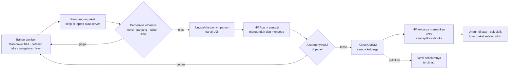

# Paket Isi per Kelas

**Ringkas:** (1) Isi aplikasi dikirim sebagai **paket berkas per mapel dan kelas** (misal `lancar-k4`, `baca-k2`, `tka-k6`) yang diunduh sekali, disimpan di HP, dan dipakai tanpa sinyal. Paket bisa diperbarui kapan saja **tanpa rilis aplikasi baru** dan tanpa uji tertutup Play Store. (2) Setiap paket punya nomor versi, sidik berkas untuk memastikan unduhan utuh, dan batas versi aplikasi minimum. Paket baru hanya dipakai setelah terunduh utuh, sehingga paket lama tetap jalan kalau unduhan putus. (3) Setiap paket lewat **kanal uji** (HP Acut dan penguji) sebelum terbit ke semua keluarga, dan versi sebelumnya bisa dipulihkan dengan satu ketuk di panel. Ini penting karena isi akan sering diubah mengikuti masukan.

Tahap 3, butir 5. Disusun 19 Oktober 2026.

---

## 1. Jenis paket

| Paket | Isi | Ukuran **[ESTIMASI]** | Rilis |
|---|---|---|---|
| `umum` | Kartu satwa, pesan semangat siap pakai, stiker anak, naskah kegiatan Mode Dampingi, kalimat petunjuk bersuara, bank pertanyaan masukan (salinan) | ± 5 MB (suara petunjuk) | R1 |
| `lancar-k1` … `lancar-k6` | **Pengaturan** 6 level (rentang angka, target detik, keluarga soal), teks 6 layar jurus + suaranya (kelas 1–2), tes tetap | < 2 MB per kelas (soalnya dibuat kode) | R1 |
| `tka-k6` | ± 1.050 butir dengan stimulus, kunci berjenjang, penanda pengecoh B/H/S; 5 simulasi; peta 36 topik | ± 5 MB | R1.1 |
| `baca-k1` … `baca-k6` | Teks, pertanyaan, suara contoh bacaan; tangga suku kata (kelas 1) | ± 15 MB per kelas | R2 |
| `paham-k4` … `paham-k6` | Modul topik (salah paham, contoh jadi, latihan, kunci berjenjang) | ± 3 MB per kelas | R3 |
| `ilmu-k1` … `ilmu-k6` | **Gudang Ilmu** kelas itu: peta topik lengkap semua mapel (R1), lalu kartu ilmu yang sudah terbit (kelas 6 lebih dulu: Januari–Februari 2027; kelas lain bertahap 2027). Kartu prasyarat kelas di bawah diunduh terpisah hanya saat dibutuhkan (`01-produk/10` bagian 2 dan 6) | Peta < 0,5 MB; kartu ± 20–50 KB per topik, ± 2–5 MB per kelas saat penuh | Peta R1; kartu bertahap |
| `inggris-t3` … `inggris-t6` | **Belajar Bahasa Inggris** per tingkat: unit kosakata, pola kalimat, suara rekaman, permainan kata. **Diunduh menurut tingkat yang dipilih, bukan kelas anak** (satu-satunya pengecualian) (`01-produk/11`) | ± 10–15 MB per tingkat | t3–t4 R2; t5–t6 R3 |
| `game` | Aset game di luar jam belajar | Ditentukan R4 | R4 |

**Kenapa soal Lancar tidak dimasukkan ke paket:** soal dibuat kode dengan benih acak, jadi paket cukup berisi **pengaturan** level. Akibatnya target waktu bisa dikalibrasi dan satu level bisa dipecah dua **tanpa rilis aplikasi**, selama memakai keluarga soal yang sudah ada di kode. Keluarga soal yang benar-benar baru (misal jenis soal baru) tetap butuh rilis aplikasi.

---

## 2. Isi satu paket

| Berkas | Isi |
|---|---|
| `manifest.json` | Nama paket, mapel, kelas, **versi**, versi aplikasi minimum, tanggal terbit, daftar berkas + ukuran + **sidik** (hash SHA-256) |
| `data.json` | Isi (level, butir, teks, pertanyaan) |
| `suara/*.opus` | Berkas suara terkompresi, satu per teks atau layar |
| `catatan-perubahan.md` | Apa yang berubah dari versi sebelumnya (dibaca Acut di panel, tidak tampil ke anak) |

**Aturan nomor versi** (mayor.minor.tambalan):

| Naik | Kapan | Contoh |
|---|---|---|
| Tambalan | Salah ketik, suara dibuat ulang, kunci diperbaiki | 1.0.0 → 1.0.1 |
| Minor | Teks atau butir ditambah, target waktu dikalibrasi, level dipecah | 1.0.1 → 1.1.0 |
| Mayor | Bentuk data berubah sehingga butuh versi aplikasi baru | 1.1.0 → 2.0.0 (dengan versi aplikasi minimum dinaikkan) |

---

## 3. Dari bahan sampai ke HP

| Langkah | Siapa | Waktu **[ESTIMASI]** |
|---|---|---|
| Membangun dan memeriksa paket | Acut2 (skrip) | Menit |
| Mencoba di kanal uji | Acut (dan 1–2 penguji), dari HP | 10–30 menit per paket |
| Terbit | Acut, satu ketuk di panel | — |
| Pulihkan versi sebelumnya | Acut, satu ketuk | — |

---

## 4. Mengunduh dan memperbarui di HP

| Aturan | Isi | Sebab |
|---|---|---|
| Kapan memeriksa versi | Saat aplikasi dibuka, paling sering sekali sehari | Hemat kuota |
| Unduhan pertama | Saat profil anak dibuat; disarankan Wi-Fi, tetapi kuota boleh (ukuran ditampilkan) | Tanpa paket, latihan belum bisa jalan |
| Unduhan pembaruan | Di latar belakang; dilanjutkan kalau putus | HP murah dan sinyal Aceh |
| **Tukar setelah utuh** | Paket baru disimpan di tempat terpisah, sidik diperiksa, baru menggantikan paket lama. Kalau sidik tidak cocok, unduh ulang | Paket setengah jadi tidak pernah dipakai |
| Tidak menukar di tengah sesi | Paket baru berlaku pada sesi berikutnya | Lembar yang sedang dikerjakan tidak berubah |
| Versi aplikasi terlalu lama | Paket mayor tidak diunduh; orang tua diberi tahu "Perbarui aplikasi untuk isi terbaru" | Aplikasi lama tetap jalan dengan paket lama |
| Ruang HP penuh | Unduhan ditunda; orang tua diberi tahu ukuran yang dibutuhkan | — |

---

## 5. Naik kelas dan paket lama

| Keadaan | Cara kerja |
|---|---|
| Seminggu sebelum tahun ajaran baru | Orang tua ditawari paket kelas berikutnya (`01-profil` 2.5); unduhan dimulai setelah orang tua setuju |
| Setelah naik kelas | Paket kelas lama **tetap disimpan** selama level-levelnya masih perlu uji daya tahan, lalu dihapus otomatis untuk menghemat ruang |
| Orang tua mengubah kelas di tengah tahun | Paket kelas baru diunduh; riwayat lama tetap |

---

## 6. Menjaga riwayat tetap benar walau isi berubah

| Aturan | Sebab |
|---|---|
| Setiap sesi mencatat `versi_paket` | Rapor tahu soal versi mana yang dikerjakan |
| Nomor butir **tidak pernah dipakai ulang**; butir yang diubah mendapat revisi baru (misal `M02-soal-07` revisi 2) | Jawaban lama tetap terhubung ke butir yang benar-benar dilihat anak |
| Butir yang dihapus ditandai "tidak dipakai", bukan dihapus dari basis data | Riwayat jawaban tidak putus |
| Perubahan target waktu Lancar tidak menilai ulang lembar lama | Hasil lama tetap sesuai aturan saat dikerjakan |

---

## 7. Celah dan penjaganya

| Celah | Penjaga |
|---|---|
| Kunci jawaban ikut ada di HP (diperlukan untuk menilai tanpa sinyal), jadi anak yang sangat teknis bisa membukanya | Diterima: ini aplikasi latihan, bukan ujian resmi. Berkas paket tidak mudah dibaca dari pengelola berkas biasa |
| Paket rusak terbit ke semua keluarga | Kanal uji wajib + pemulihan satu ketuk |
| Paket terlalu besar untuk kuota keluarga | Suara dipisah per berkas, sehingga pembaruan teks tidak mengunduh ulang semua suara |
