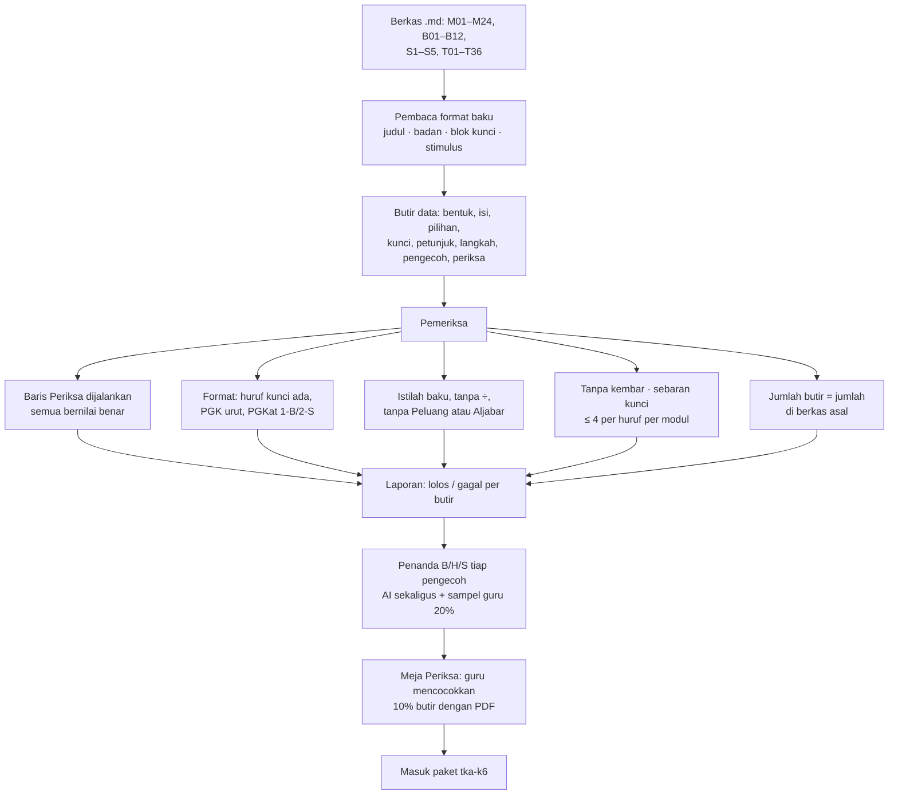

# Pembuat Soal dan Bank Soal

**Ringkas:** (1) Ada dua sumber soal. **Soal Lancar dibuat kode** di HP dengan benih acak, memindahkan pembuat soal versi 5 yang sudah lolos 8.100 lembar uji. Benihnya disimpan, sehingga setiap lembar bisa dibuat ulang persis untuk diperiksa. **Soal TKA, teks, dan modul berasal dari bank soal** yang diperiksa manusia. (2) Bahan TKA dipindah dari **berkas Markdown** (sumber asli; berkas Word dibangun dari Markdown), jadi tidak ada yang diketik ulang. Pemindahannya memakai format baku yang sudah dipakai pemeriksa kunci yang ada. (3) Setiap perubahan pada pembuat soal atau bank soal melewati **uji otomatis** sebelum paket dibangun: kunci dihitung ulang, batas angka, tanpa soal kembar, istilah baku, dan sebaran kunci.

Tahap 3, butir 6. Disusun 19 Oktober 2026.

---

## 1. Dua sumber soal

| | **Pembuat soal Lancar** | **Bank soal** |
|---|---|---|
| Untuk | Lancar kelas 1–6, tes penempatan, tes tetap, Tantang Ayah, Lembar Jaga | TKA, Baca Ulang, modul Paham |
| Dibuat oleh | Kode di aplikasi | Bahan TKA yang ada + AI lalu diperiksa guru |
| Disimpan | Tidak disimpan; dibuat saat dibutuhkan | Di paket isi |
| Diperiksa | Uji otomatis pada setiap perubahan kode | Pemeriksa mesin + guru (Meja Periksa) |
| Asal | Port dari `bahan/latihan-v5-lancar.html` | `kursus-tka-sd/` di laptop Acut + cetakan `01-produk/03-rencana-isi.md` |

---

## 2. Pembuat soal Lancar

| Bagian | Isi |
|---|---|
| **Keluarga soal** | Fungsi pembuat per jenis (tambah sampai 10, ×6 ×7, bagi dari tabel, pecahan ↔ persen, KPK kecil, dan seterusnya) — ada di kode aplikasi |
| **Pengaturan level** | Rentang angka, keluarga soal yang dipakai, target detik per soal — ada di paket isi `lancar-kN` (`05-paket-isi.md`), sehingga bisa diubah tanpa rilis |
| **Benih** | Dibentuk dari nomor anak + nomor sesi dan disimpan di `sesi`, sehingga lembar bisa dibuat ulang persis untuk memeriksa laporan "soalnya salah" |
| **Susunan lembar** | 20 soal: soal baru dan lama sesuai aturan `01-produk/04-mesin-lancar.md` bagian 3 (8+12 → 11+9 → 14+6), soal perbaikan di posisi tetap, urut mudah ke sulit di dalam bagian baru |
| **Peta jenis salah** | Aturan TUKAR, SELISIH 1, PULUHAN, TERBALIK, TETANGGA, LAMBAT dijalankan di HP setelah lembar selesai (`04-mesin-lancar.md` bagian 6) |
| **Lambang** | Bagi memakai ":" (standar istilah TKA); lambang ÷ dilarang |

### Uji otomatis pembuat soal (dijalankan pada setiap perubahan kode)

| # | Uji | Lulus kalau |
|---|---|---|
| 1 | Kunci benar | Untuk 1.000 lembar per level per kelas (36.000 lembar), setiap kunci sama dengan hitungan ulang yang ditulis terpisah |
| 2 | Batas angka | Tidak ada hasil negatif, hasil bagi selalu bulat, angka dalam rentang level |
| 3 | Tanpa kembar | Tidak ada soal yang sama dua kali dalam satu lembar (termasuk 3 × 4 dan 4 × 3 di level yang melarangnya) |
| 4 | Susunan | Jumlah soal baru/lama dan posisinya sesuai aturan |
| 5 | Lambang | Tidak ada ÷ dan tidak ada karakter yang tidak bisa diketik di papan angka |
| 6 | Bisa dibuat ulang | Benih yang sama → lembar yang sama |
| 7 | Peta jenis salah | 50 contoh jawaban salah buatan tangan diberi kode yang benar |
| 8 | Target waktu | Target lembar = jumlah target per soal (sesuai versi 5) |

Versi 5 lolos 8.100 lembar dengan 0 kunci salah **[FAKTA — Prompt RCTOR]**; uji di atas memperluasnya untuk dua level kelas 6 yang baru.

---

## 3. Bank soal: memindah bahan TKA tanpa mengetik ulang

**Sumber yang dipakai: berkas Markdown**, bukan Word. Berkas Word dan PDF dibangun dari Markdown oleh `bangun.py` **[FAKTA — `bahan/tka-sd-status.md`]**, jadi Markdown adalah sumber aslinya.

| Unsur di Markdown **[FAKTA — `bahan/tka-sd-induk-04-standar-soal.md`]** | Menjadi kolom |
|---|---|
| `#### <Jenis> <nomor> <lambang> · <bentuk>` | `jenis`, `nomor`, `lambang`, `bentuk` |
| Badan soal sampai baris kunci pertama | `isi.badan`, `isi.pilihan` atau `isi.pernyataan` |
| `### Stimulus <huruf>: <judul>` | `stimulus` (dipakai beberapa butir) |
| `> **Kunci:**` | `kunci` |
| `> **Kelompok:**` | `kelompok` (hari ini / minggu lalu / bulan lalu + kode topik) |
| `> **Petunjuk:**`, `> **Langkah:**` | `petunjuk`, `langkah` (kunci berjenjang) |
| `> **Kenapa pengecoh menarik:**` | `pengecoh[huruf].alasan` + `pengecoh[huruf].kode` (B/H/S, ditambahkan) |
| `> **Periksa:**` | `periksa[]` — dijalankan saat membangun paket, **tidak** dibawa ke HP |

**Ekspresi Periksa dijalankan dengan aman:** hanya angka, operator, `F()` (pecahan), `gcd`, `lcm`, `sum`, `min`, `max`, `abs`, `round`, perbandingan, dan `and/or/not`, sesuai daftar di standar soal. Ekspresi lain ditolak, bukan dijalankan.

**Yang dibutuhkan:** berkas Markdown dan `_alat/periksa.py` dari laptop (tenggat 31 Oktober, `01-produk/06-persiapan-tka.md` bagian 4). Pembaca baru dicocokkan dengan hasil `periksa.py` yang lama pada semua berkas: kalau hitungan butir dan hasil Periksa sama, pembaca dianggap benar.

---

## 4. Bank soal: teks Baca Ulang dan modul Paham

| Langkah | Isi |
|---|---|
| Draf | Acut2 menyusun dengan AI mengikuti cetakan yang disetujui Acut (`03-rencana-isi.md` bagian 4) |
| Pemeriksa mesin | Teks: jumlah kata dalam batas kelas, kata per kalimat, daftar kata terlarang, nama laki-laki dan perempuan bergantian, 2 pertanyaan per hari dengan 3–4 pilihan. Modul: format standar soal + baris Periksa |
| Meja Periksa | Guru: Layak / Perbaiki + catatan; Acut: sampel 20% |
| Terbit | Masuk paket `baca-kN` atau `paham-kN` lewat kanal uji |

---

## 5. Status butir dan revisi

| Status | Arti |
|---|---|
| `draf` | Baru dibuat atau baru diubah |
| `lolos_mesin` | Semua pemeriksaan otomatis lolos |
| `layak` | Guru menandai Layak (untuk butir yang wajib diperiksa manusia) |
| `terbit` | Ada di paket kanal umum |
| `tidak_dipakai` | Ditarik, tetapi tetap disimpan untuk riwayat |

| Aturan revisi | Sebab |
|---|---|
| Butir berubah → revisi naik, nomor lama tetap ada | Jawaban lama tetap terhubung ke versi yang dilihat anak |
| Revisi hanya terbit setelah melewati status yang sama lagi | Perbaikan kecil pun diperiksa |
| Laporan "soal ini salah" dari orang tua (tombol di Mode Dampingi) | Langsung masuk Meja Periksa dengan nomor butir dan revisinya |

---

## 6. Uji otomatis bank soal (dijalankan setiap paket dibangun)

| # | Uji | Lulus kalau |
|---|---|---|
| 1 | Periksa | Semua ekspresi bernilai benar |
| 2 | Format | Setiap butir punya kunci, petunjuk, langkah, dan alasan untuk setiap pengecoh |
| 3 | Kunci cocok | PG: satu huruf yang ada di pilihan; PGK: huruf urut dan ada; PGKat: satu B/S per pernyataan, minimal satu B dan satu S |
| 4 | Kembar | Tidak ada dua butir dengan teks yang sama setelah dinormalkan (spasi, huruf besar-kecil) |
| 5 | Istilah | Tidak ada ÷; notasi dan istilah mengikuti `bahan/tka-sd-induk-03-standar-istilah.md`; tanpa topik terlarang (Peluang, Aljabar, menulis) |
| 6 | Sebaran kunci | ≤ 4 kali per huruf per modul (soal halaman 5) |
| 7 | Kelengkapan | Jumlah butir = jumlah di sumber; setiap stimulus dipakai minimal satu butir |
| 8 | Penanda pengecoh | Setiap pengecoh punya kode B, H, atau S |
