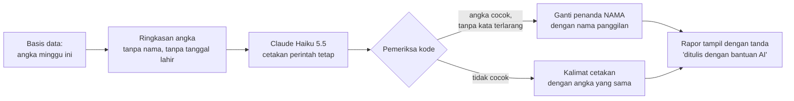

# Layanan AI

**Ringkas:** (1) Di Rilis 1–4, **anak tidak pernah berbicara dengan AI**. AI dipakai di tiga tempat: **rapor cerita** untuk orang tua (Haiku 5.5, ± Rp35 per anak per bulan), **ringkasan masukan mingguan** untuk Acut, dan **menyusun isi** sebelum diperiksa guru. Biaya AI saat aplikasi berjalan untuk ± 50 keluarga (75 anak): **± Rp11–70 ribu per bulan** (dihitung ulang 20 Okt dengan dasar 75 anak, sama dengan `06-rilis/03`). (2) Setiap angka di rapor cerita **diperiksa ulang oleh kode** terhadap basis data. Kalau tidak cocok, atau layanan AI mati, rapor memakai kalimat cetakan dengan angka yang sama, jadi orang tua tidak pernah kehilangan rapor. (3) Yang dikirim ke AI hanya angka ringkas tanpa nama dan tanpa tanggal lahir, sebab data dikirim ke luar negeri (Amerika Serikat) dan karena panduan Anthropic untuk layanan yang menyentuh anak.

Tahap 3, butir 7. Disusun 19 Oktober 2026. Harga dari `01-produk/riset-penguat.md` bagian 8; kurs Rp16.500.

---

## 1. Pekerjaan AI

| Pekerjaan | Kapan berjalan | Model | Biaya **[ESTIMASI]** | Rilis | Kalau AI mati atau mahal |
|---|---|---|---|---|---|
| **Rapor cerita mingguan** untuk orang tua | Minggu malam, otomatis | Haiku 5.5 (US$0,10/0,50 per juta token) | ± Rp35 per anak per bulan → **± Rp2.600** untuk 75 anak | R1 (prioritas Penting) | Rapor cetakan dengan angka yang sama |
| Rapor cerita, mutu lebih tinggi | sama | Sonnet 5.5 (US$2/10) | ± Rp715 per anak per bulan → **± Rp53.600** untuk 75 anak | Pilihan kalau mutu Haiku kurang | Turun ke Haiku |
| **Ringkasan masukan mingguan** untuk Acut | Senin pagi | Sonnet 5.5 atau Opus 5.5 | ± 40 ribu token masuk + 3 ribu keluar per minggu → Sonnet ± Rp8 ribu, Opus ± Rp16 ribu per bulan. **Rp0** kalau dijalankan sebagai tugas terjadwal di langganan Claude Acut | R1 | Acut membaca angka mentah di panel |
| **Menyusun isi** (teks, jurus, modul) | Saat membuat paket, bukan saat aplikasi dipakai | Opus 5.5 | ± Rp330 ribu sekali untuk tahun pertama (`01-produk/03-rencana-isi.md` 6.1) | Sebelum R1–R3 | Ditunda; isi lama tetap jalan |
| **Penanda pengecoh** B/H/S | Sekali saat memindah bahan TKA | Sonnet 5.5 kiriman sekaligus (batch, −50%) | ± Rp52 ribu sekali | R1.1 | Guru menandai manual (± 3.000 pengecoh, lama) |
| Memeriksa foto lembar buku | Ditunda | Haiku 5.5 | ± Rp4 per foto | Setelah uji 20 foto | — |
| Ngobrol Bahasa Inggris | Ditunda | Bukan Claude (Claude tidak menerima suara **[FAKTA — dokumentasi Claude]**) | ± Rp15.200 per anak per bulan (Gemini Live, perkiraan blog) | R5, kalau uji suara 5 anak lulus | — |

**Jumlah saat aplikasi berjalan (75 anak):** ± Rp11 ribu (Haiku + Sonnet untuk ringkasan) sampai ± Rp70 ribu (Sonnet + Opus) per bulan. Angka peringatan US$10 (± Rp165 ribu) tetap di atas keduanya.

---

## 2. Aturan rapor cerita

| Aturan | Sebab |
|---|---|
| Yang dikirim hanya angka ringkas: hari latihan, kecepatan, ketepatan, level, keluarga fakta yang lambat, kata per menit, ukuran yang dipilih orang tua (O02) | Data minimal; tidak ada data yang bisa mengenali anak |
| Nama anak diganti penanda `{nama}`, lalu diisi setelah teks kembali | Nama tidak pernah dikirim ke luar negeri |
| **Setiap angka di kalimat dicocokkan dengan basis data** oleh kode; satu saja tidak cocok → kalimat cetakan | ± 23,5–27,1% kalimat umpan balik AI tidak didukung data **[FAKTA — EDM 2024]** |
| Daftar kata terlarang: "malas", "bodoh", "lambat sekali", "gagal", membandingkan dengan anak lain | Rapor tidak boleh melabeli anak; pesan positif + satu langkah berikutnya (`01-produk/07` 2.5) |
| Panjang ≤ 60 kata; pola: satu kemajuan, satu langkah berikutnya, satu cara membantu tanpa mengambil alih | Sama dengan isi rapor mingguan |
| Tanda "ditulis dengan bantuan AI" | Panduan Anthropic: memberi tahu bahwa isi berasal dari AI **[FAKTA — `riset-penguat.md` bagian 8]** |
| Hanya untuk keluarga yang menyetujui tujuan "rapor buatan AI" | Persetujuan terpisah; yang tidak setuju mendapat rapor cetakan dengan angka sama (tidak diturunkan mutunya) |

---

## 3. Ringkasan masukan mingguan untuk Acut

| Masukan | Dari |
|---|---|
| Angka minggu ini (aktif, lembar, kecepatan, ketepatan, tanggapan) | Basis data, sudah dihitung kode |
| Jawaban pilihan (persen per pilihan, jumlah jawaban) | `jawaban_masukan` |
| Isian terbuka dan poin pesan suara Perintis | `jawaban_masukan.isian`, `catatan_perintis` — tanpa nama. **Hanya lewat fungsi server (API)**, tidak lewat berkas ekspor untuk tugas terjadwal (lihat di bawah) |
| Keputusan minggu lalu | `keputusan_mingguan` |

Keluarannya mengikuti bentuk di `01-produk/08-sistem-masukan.md` bagian 9: 3 temuan, usulan dengan biaya-waktu-risiko, dan peringatan. **Angka di ringkasan juga dicocokkan oleh kode**, sebab keputusan Acut bergantung padanya.

**Cara menjalankan — dua pilihan:**

| Pilihan | Biaya | Untung | Rugi |
|---|---|---|---|
| **Tugas terjadwal Claude** tiap Senin, membaca berkas ekspor mingguan dari panel | Rp0 (termasuk langganan Acut) | Acut2 yang sama dengan sesi rancangan; bisa bertanya balik | Butuh berkas ekspor yang bisa dibaca tugas itu (dirancang di panel) |
| Fungsi server memanggil Claude API | ± Rp8–16 ribu per bulan | Otomatis penuh, tampil langsung di panel | Satu kunci API lagi yang harus dijaga |

Usul: mulai dengan **tugas terjadwal** (Rp0) untuk **angka gabungan dan jawaban pilihan tanpa nomor keluarga** saja; pindah ke fungsi server kalau ekspor merepotkan.

**Batas tugas terjadwal (ditambah 20 Okt):** langganan Claude Acut tunduk pada syarat konsumen, bukan syarat API (aturan penghapusan 30 hari di bagian 4 berlaku untuk API). Karena itu berkas ekspor untuk tugas terjadwal tidak memuat isian terbuka, poin Perintis, atau apa pun per keluarga. Isian terbuka dibaca Acut sendiri di Meja Masukan; kalau perlu diringkas mesin, dikirim lewat fungsi server ke API (± Rp1–2 ribu per minggu **[ESTIMASI — ± 5.000 kata masukan per minggu pada tarif Haiku]**). Langganan Claude pengelola disebut di kebijakan privasi bagian 7.

---

## 4. Data, privasi, dan aturan

| Hal | Isi |
|---|---|
| Ke mana data pergi | Server Anthropic (Amerika Serikat) → transfer ke luar negeri; dasar UU PDP Ps. 56 dan persetujuan "rapor buatan AI" |
| Berapa lama disimpan Anthropic | Input dan output API dihapus dalam 30 hari setelah diterima atau dibuat, dengan pengecualian (misal penegakan kebijakan, kewajiban hukum) **[FAKTA — Pusat Privasi Anthropic]** |
| Dipakai melatih model? | **[ASUMSI — dicek ulang di syarat komersial Anthropic sebelum tayang]** Data API tidak dipakai melatih model secara bawaan |
| Panduan Anthropic untuk layanan yang menyentuh anak | Batas usia, penyaringan isi, pemantauan, edukasi, kepatuhan hukum, pemberitahuan AI **[FAKTA — `riset-penguat.md` bagian 8]**. Karena anak tidak berinteraksi langsung dengan AI dan semua keluaran AI dibaca orang tua, rancangan ini memenuhinya lewat penyaringan kata, pemeriksa angka, dan tanda AI |
| Kunci API | Hanya di server (fungsi server atau tugas terjadwal), **tidak pernah** di aplikasi HP |

---

## 5. Penjaga biaya

| Penjaga | Batas **[ASUMSI — angka final di Tahap 5]** |
|---|---|
| Angka peringatan bulanan | US$10 per bulan selama masa gratis (± 4× perkiraan pemakaian) |
| Peringatan ke Acut | Saat belanja mencapai 50%, 80%, dan 100% angka itu |
| Kalau angka tercapai | **Rapor cerita tetap berjalan** (diubah 20 Okt, sebab keputusan B 19 Okt: kemampuan sistem tidak dibatasi karena biaya). Acut menerima peringatan dan memutuskan menaikkan angka atau tidak. Batas keras di konsol Anthropic dipasang **US$50**, hanya sebagai pengaman kalau ada kesalahan program (misal perulangan tanpa henti); kalau batas keras itu tercapai, rapor sementara memakai kalimat cetakan dengan angka yang sama dan kejadian itu dicatat sebagai kesalahan |
| Pemakaian tak wajar | Lebih dari 2 rapor cerita per anak per minggu → dihentikan dan dilaporkan di panel |
