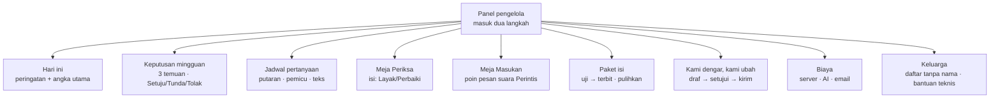

# Panel Pengelola (Ramah HP)

**Ringkas:** (1) Panel adalah halaman web pribadi yang dibuka Acut dari HP, untuk **melihat, memutuskan, dan menyetujui tanpa menyentuh kode**: ringkasan harian, keputusan mingguan, jadwal pertanyaan, Meja Periksa, Meja Masukan, paket isi, biaya, dan pesan "Kami dengar, kami ubah". (2) Acut butuh **± 2–2,5 jam per minggu** di panel selama masa gratis. Guru pemeriksa hanya bisa membuka Meja Periksa. (3) Panel juga menjadi tempat **tanda peringatan dini**: biaya, antrean yang tidak terkirim, tanggapan yang turun, dan anak yang kewalahan muncul di bagian atas, bukan tersembunyi di laporan.

Tahap 3, butir 10. Disusun 19 Oktober 2026.

---

## 1. Menu panel

| Menu | Yang dilihat | Yang bisa diubah | Seberapa sering **[ESTIMASI]** |
|---|---|---|---|
| **Hari ini** | Peringatan di atas; keluarga aktif, lembar hari ini, HP dengan antrean > 48 jam, kesalahan aplikasi | — | Sekali sehari, 2 menit |
| **Keputusan mingguan** | Ringkasan Acut2 (temuan, bukti, usulan dengan biaya-waktu-risiko) | Setuju / Tunda / Tolak + alasan → tercatat di `keputusan_mingguan` | Senin–Rabu, 15–20 menit |
| **Jadwal pertanyaan** | Tanggal putaran (Senin minggu ganjil), urutan putaran tiap keluarga, antrean pertanyaan pemicu, angka tanggapan per pertanyaan (jawaban dari link dipisah) | Aktif/nonaktif, geser tanggal, ubah teks (membuat versi baru) | Sesekali, tanpa rilis aplikasi |
| **Meja Periksa** | Satu butir isi per layar (teks, soal, jurus) dengan catatan pemeriksa mesin | Layak / Perbaiki + catatan; cek sampel 20% | Mingguan, ± 1 jam |
| **Meja Masukan** | Daftar pesan suara Perintis yang belum dicatat | Ketik 1–3 poin per pesan | Dua mingguan, ± 30 menit |
| **Paket isi** | Versi di kanal uji dan umum, catatan perubahan, hasil pemeriksa otomatis | Terbitkan / pulihkan versi sebelumnya | Saat ada paket baru |
| **Kami dengar, kami ubah** | Draf pesan dari keputusan dua minggu terakhir | Sunting → setujui → salin ke WhatsApp atau kirim | Dua mingguan, 10 menit |
| **Biaya** | Pemakaian Supabase (basis data, lalu lintas keluar), belanja AI, jumlah email kode masuk | Batas peringatan | Mingguan, 2 menit |
| **Keluarga** | Daftar keluarga dengan kode, bukan nama; status aktif/diam; versi aplikasi | Membuka data satu keluarga **hanya untuk bantuan teknis**, dengan alasan yang wajib diisi dan tercatat | Saat ada laporan masalah |

**Jumlah waktu Acut di panel:** ± 2–2,5 jam per minggu **[ESTIMASI: 14 menit harian + 20 menit keputusan + 1 jam Meja Periksa + 15 menit Meja Masukan + 5 menit Kami dengar + 2 menit biaya]**.

---

## 2. Tanda peringatan dini

| Tanda | Batas **[ASUMSI — angka final di Tahap 5]** | Tindakan yang disarankan panel |
|---|---|---|
| **Biaya server** | Basis data > 5 GB atau lalu lintas keluar > 150 GB per bulan | Periksa tabel `kejadian` dan unduhan paket berulang |
| **Biaya AI** | Belanja > 50% batas bulanan sebelum tanggal 15 | Periksa rapor cerita yang dibuat berulang |
| **Email kode masuk** | > 200 per hari (batas gratis Brevo 300) atau > 300 per bulan pada ± 50 keluarga | Periksa percobaan masuk mencurigakan |
| **Antrean tidak terkirim** | > 10% HP anak dengan antrean > 48 jam | Tanya keluarga lewat pesan; periksa kesalahan sinkron |
| **Kesalahan aplikasi** | > 2% sesi berakhir dengan kesalahan | Hentikan terbit paket baru; periksa versi aplikasi |
| **Tanggapan turun** | Tanggapan putaran < 45% (cadangan `08-sistem-masukan.md`) | Pesan pribadi Acut ke keluarga yang dua kali melewatkan |
| **Anak kewalahan** | > 10% anak aktif kena tanda "macet" atau "ditinggalkan" minggu itu | Tinjau level yang paling banyak macet |
| **Keluarga diam** | Keluarga aktif turun > 20% dalam seminggu | Masuk temuan mingguan |

---

## 3. Keamanan panel

| Aturan | Sebab |
|---|---|
| Masuk dua langkah (kata sandi + kode) | Panel bisa membuka data banyak keluarga |
| Peran: **Acut** (semua menu), **guru pemeriksa** (hanya Meja Periksa) | Guru tidak perlu melihat data keluarga |
| Data keluarga tampil dengan kode, bukan nama; membuka rincian butuh alasan dan tercatat | Prinsip data minimal; jejak akses untuk penilaian dampak |
| Panel berjalan lewat fungsi server, bukan akses langsung ke basis data | Kunci khusus tidak pernah ada di peramban |

---

## 4. Ekspor mingguan untuk Acut2

Setiap Senin pukul 06.00, panel membuat **satu berkas ringkasan** (angka yang sudah dihitung, jawaban pilihan dalam bentuk persen, isian tanpa nama, poin Perintis, keputusan minggu lalu) untuk dibaca tugas terjadwal Acut2 (`07-layanan-ai.md` bagian 3). Berkas ini **tidak memuat data per anak**.

---

## 5. Biaya dan waktu bangun **[ESTIMASI]**

| Bagian | Hari kerja | Rilis |
|---|---|---|
| Hari ini, Biaya, Keluarga | 2 | R1 |
| Keputusan mingguan + ekspor | 1,5 | R1 |
| Jadwal pertanyaan | 1,5 | R1 |
| Meja Periksa | 1,5 | Sebelum 22 Nov (teks dan jurus mulai diperiksa) |
| Paket isi (uji → terbit → pulihkan) | 1,5 | R1 |
| Meja Masukan, Kami dengar | 1 | R1 |
| **Jumlah** | **± 9 hari kerja** | |

Kalau jadwal R1 terlalu ketat, **Meja Periksa dan Paket isi didahulukan** (isi tidak bisa terbit tanpanya). Jadwal pertanyaan bisa sementara diubah lewat pengaturan di basis data oleh Acut2.
