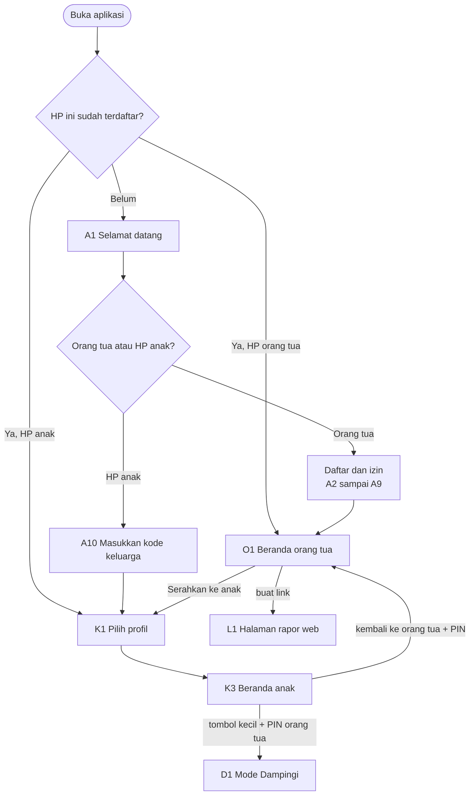
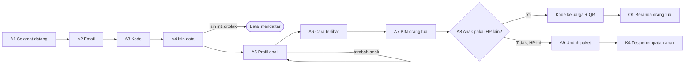
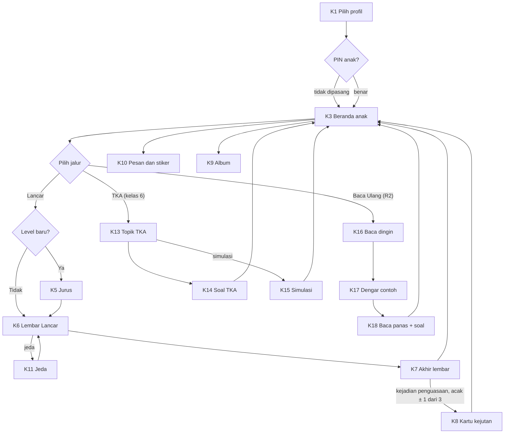
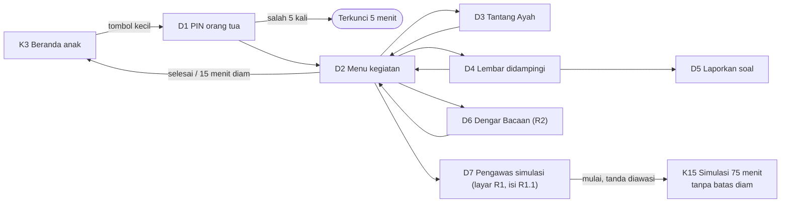
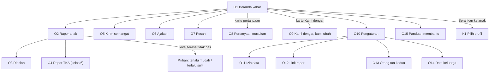

# Daftar Layar dan Alur Antarlayar

**Ringkas:** (1) Aplikasi punya **55 layar** (menjadi **65** setelah tambahan 28 Okt di bagian 8) dalam empat bagian: awal dan akun (10), mode anak (21), Mode Dampingi (7), dan mode orang tua (17). Ditambah 4 keadaan halaman rapor lewat link; panel pengelola sudah dirinci di `02-rancangan/09`. (2) Prinsip alurnya: anak **paling banyak 2 ketukan** dari beranda ke soal pertama, dan orang tua **paling banyak 2 ketukan** dari beranda ke rapor atau kirim semangat. Tidak ada jalan keluar dari mode anak ke mode orang tua tanpa PIN. (3) Setiap layar diberi kode (A, K, D, O, L) yang dipakai di kerangka layar dan rencana uji.

Tahap 4, butir 1. Disusun 19 Oktober 2026. Kolom "Rilis" mengikuti `01-produk/02-fitur-per-rilis.md`.

---

## 1. Peta besar

---

## 2. Awal dan akun (A)

| Kode | Layar | Rilis |
|---|---|---|
| A1 | Selamat datang: "Saya orang tua" / "Ini HP anak" | R1 |
| A2 | Masuk: alamat email (+ nomor WhatsApp opsional) | R1 |
| A3 | Kode 6 angka dari email (petunjuk "periksa Spam", kirim ulang 60 detik) | R1 |
| A4 | Izin data: pembuka → 6 kartu tujuan → ringkasan | R1 |
| A5 | Profil anak: nama panggilan, bulan-tahun lahir, kelas, hewan (bisa tambah anak) | R1 |
| A6 | Cara terlibat: Duduk bersama / Dari jauh / Cukup rapor lewat link | R1 |
| A7 | PIN orang tua (buat + ulangi) | R1 |
| A8 | Anak memakai HP lain? → kode keluarga + QR / "Serahkan HP ini ke anak" | R1 |
| A9 | Mengunduh paket isi (ukuran, sisa waktu, bisa lanjut nanti) | R1 |
| A10 | HP anak: masukkan kode keluarga / pindai QR → pilih profil yang memakai HP ini | R1 |

---

## 3. Mode anak (K)

| Kode | Layar | Rilis |
|---|---|---|
| K1 | Pilih profil (hewan besar per anak) | R1 |
| K2 | PIN anak (kalau dipasang) | R1 |
| K3 | **Beranda anak**: pesan orang tua, ajakan, pilihan jalur hari ini, album kartu | R1 |
| K4 | Tes penempatan (pengantar bersuara → soal). Layar yang sama dipakai untuk **tes tetap** ("lembar tantangan" 20 + 5 soal, hari ke-1–3 lalu tiap 4 minggu; ditambah 20 Okt) | R1 |
| K5 | Layar jurus (sebelum level baru; bisa dibuka lagi) | R1 |
| K6 | **Lembar Lancar** (soal + papan angka) | R1 |
| K7 | **Akhir lembar**: hasil, rekor, tersimpan/terkirim, ketukan perasaan | R1 |
| K8 | Kartu kejutan (muncul tak terduga) | R1 |
| K9 | Album kartu satwa | R1 |
| K10 | Pesan: pesan dari orang tua + kirim stiker (termasuk "Bantu aku") | R1 |
| K11 | Jeda (tutup soal, waktu berhenti) | R1 |
| K12 | "Untuk kamu": penjelasan privasi bergambar | R1 |
| K13 | TKA: daftar topik / latihan rumah; tanda "minggu ini" dari Rencana minggu ini (29 Okt) | R1 (isi R1.1) |
| K14 | TKA: soal dengan petunjuk dan langkah bertahap | R1 (isi R1.1) |
| K15 | TKA: simulasi (pengantar, soal dengan tab Teks/Soal, daftar soal + ragu, kumpulkan, hasil); juga dipakai untuk **mini try out mingguan 6 soal / 15 menit** (29 Okt) | R1 (isi R1.1) |
| K16 | Baca Ulang: bacaan dingin (tombol mulai–selesai) | R2 |
| K17 | Baca Ulang: dengar contoh (kata disorot) | R2 |
| K18 | Baca Ulang: bacaan panas + 2 pertanyaan + rekor | R2 |
| K19 | Tangga suku kata (kelas 1) | R2 |
| K20 | Modul Paham (contoh jadi → latihan) | R3 |
| K21 | Game dan Gampong (dengan batas waktu) | R4 |

**Aturan alur mode anak:**

| Aturan | Sebab |
|---|---|
| Dari K3 ke soal pertama ≤ 2 ketukan | Sesi pendek dan langsung |
| Tidak ada tombol "keluar ke orang tua" yang besar; hanya tombol kecil berPIN | Anak tidak masuk mode orang tua |
| Layar soal (K6, K14, K16, K18) tanpa pesan, kartu, atau iklan internal yang menyela | Perhatian penuh pada soal |
| Tombol kembali Android di tengah lembar → K11 Jeda, bukan keluar | Lembar tidak hilang karena salah tekan |
| Anak bisa berhenti kapan saja dari K11 ("Lanjut nanti") | Tidak memaksa |

---

## 4. Mode Dampingi (D)

| Kode | Layar | Rilis |
|---|---|---|
| D1 | PIN orang tua (dari tombol kecil di K3) | R1 |
| D2 | Menu kegiatan: Tantang Ayah · Dengar Bacaan · Soal Cerita · Lembar didampingi · Pengawas simulasi | R1 |
| D3 | Tantang Ayah (anak memilih 10 soal → bergantian → hasil) | R1 |
| D4 | Lembar didampingi: soal + kunci + "petunjuk untuk diucapkan" + jurus | R1 |
| D5 | Laporkan soal ("soal ini salah / membingungkan") | R1 |
| D6 | Dengar Bacaan (teks yang bisa diketuk, naskah di atas) | R2 |
| D7 | Pengawas simulasi (tanpa kunci; waktu dan nomor soal saja). Dibuka dari D2, tetapi setelah dimulai **keluar dari Mode Dampingi**: tidak ada batas 15 menit diam, simulasi berjalan 75 menit di K15 dengan tanda "diawasi" | R1 (isi R1.1) |

---

## 5. Mode orang tua (O)

| Kode | Layar | Rilis |
|---|---|---|
| O1 | **Beranda kabar**: kartu per anak, kartu pertanyaan masukan, kartu "Kami dengar" | R1 |
| O2 | **Rapor anak** (mingguan): 3 angka, kemajuan, langkah berikutnya, cara membantu, tombol "level terasa tidak pas" | R1 |
| O3 | Rincian: peta jenis salah per keluarga fakta, riwayat lembar | R1 (P) |
| O4 | Rapor TKA: peta 36 topik, simulasi, penyebab salah; **Rencana minggu ini** dan grafik skor mini try out (29 Okt) | R1 (isi R1.1) |
| O5 | Kirim semangat (pesan siap pakai + teks pendek) | R1 |
| O6 | Ajakan (pilihan siap, 1 per hari) | R1 (P) |
| O7 | Pesan (riwayat pesan dua arah, stiker anak) | R1 |
| O8 | **Pertanyaan masukan** (1 pertanyaan → "mau 2 lagi?") | R1 |
| O9 | Kami dengar, kami ubah (edisi terbaru + arsip) | R1 |
| O10 | Pengaturan: anak dan profil · HP terhubung · PIN · batas game dan jam tenang · Mode Ramadan | R1 |
| O11 | Izin data (6 tujuan, bisa diubah) | R1 |
| O12 | Link rapor: buat, salin, kirim ke WhatsApp, cabut | R1 |
| O13 | Orang tua kedua: undang dengan kode | R1 |
| O14 | Data keluarga: unduh, hapus akun | R1 |
| O15 | Panduan singkat "membantu tanpa mengambil alih" (5 kartu) | R1 |
| O16 | Hubungi kami / laporkan masalah (dengan "Salin hasil") | R1 |
| O17 | Masa gratis dan berlangganan | Setelah diskusi berbayar |

**Navigasi orang tua:** bilah bawah 4 tombol — **Kabar** (O1) · **Rapor** (O2) · **Pesan** (O7) · **Pengaturan** (O10). Semua layar lain dibuka dari keempatnya.

---

## 6. Halaman rapor lewat link (L)

| Kode | Keadaan | Isi |
|---|---|---|
| L1 | Rapor | Rapor satu layar (O2 versi ringkas) + "data sampai …" |
| L2 | Pertanyaan | Kartu pertanyaan masukan di bawah rapor (kalau ada putaran dan izin masukan diberikan) |
| L3 | Link dicabut atau kedaluwarsa | "Link ini sudah tidak berlaku. Minta link baru ke orang tua yang membagikannya." |
| L4 | Ajakan | "Ingin melihat anak latihan dan mengirim semangat? Pasang aplikasinya" + tautan Play Store |

---

## 7. Hitungan layar

Diperbaiki 20 Okt. Hitungan lama (43) salah jumlah, dan layar TKA ditandai R1.1 padahal R1.1 hanya paket isi tanpa rilis aplikasi. Karena itu layar TKA (K13–K15, D7, O4) **harus ada di aplikasi R1**; isinya baru terbuka 4 Januari lewat paket `tka-k6`.

| Bagian | Jumlah | Di aplikasi R1 | Rilis aplikasi berikutnya |
|---|---|---|---|
| Awal dan akun (A) | 10 | 10 | — |
| Mode anak (K) | 21 | 15 (K1–K15) | R2: K16–K19 · R3: K20 · R4: K21 |
| Mode Dampingi (D) | 7 | 6 (D1–D5, D7) | R2: D6 |
| Mode orang tua (O) | 17 | 16 (O1–O16; O3 dan O6 Penting) | Setelah diskusi berbayar: O17 |
| **Jumlah layar aplikasi** | **55** | **47** | R2 = 5 layar baru → rilis aplikasi + tinjauan Play (pembangunan 14 Des – 22 Jan, `06-rilis/04`) |
| Halaman rapor (L) | 4 keadaan | 4 |

---

## 8. Layar tambahan dari penegasan Acut 28 Okt

Rincian aturan di `01-produk/10-gudang-ilmu-bimbingan-dan-waktu.md`.

| Kode | Layar | Rilis |
|---|---|---|
| K22 | **Gudang Ilmu**: peta topik kelas anak per mapel, status tiap topik (belum · belajar · kuasai · segera), tanda "lebih seru bersama Ayah/Bunda" | R1 (peta), kartu bertahap |
| K23 | **Kartu ilmu**: penjelasan bergambar dan bersuara → 2 contoh jadi → 5–10 soal berjenjang dengan kunci bertahap | Bertahap 2027 |
| K24 | **Istirahat dulu** (setelah blok 15 menit) dan **Cukup belajar hari ini** (batas harian tercapai) | R1 |
| K25 | **Waktu main**: game setelah inti harian, sisa menit terlihat, berhenti di akhir babak | R4 |
| K26 | **Bimbingan Guru** di HP anak (hanya untuk **guru les**): tugas dari guru, catatan guru, balasan stiker; komentar guru sekolah yang diteruskan orang tua juga tampil di sini. Hanya muncul setelah orang tua menyetujui | R3 |
| K27 | **Belajar Bahasa Inggris — pilih tingkat**: tes singkat ± 2 menit, saran tingkat, empat pilihan tingkat 3–6 (bebas dipilih) | R2 |
| K28 | **Unit Bahasa Inggris**: kenal kata bersuara → pola kalimat → dengar lalu pilih → susun kata → permainan kata | R2 |
| O18 | **Tanda bimbingan** di mode orang tua: daftar topik kuning/merah dengan alasan, tombol "Mulai Dampingi" dan "Minta bantuan guru" | R1 |
| O19 | **Kelola guru**: undang guru (email), pilih jenis (**guru sekolah** · **guru les**) dan mapel yang diizinkan, Izinkan / Cabut, baca komentar guru sekolah dan teruskan ke anak, lihat semua tugas dan catatan guru les | R3 |
| O20 | **Pengaturan waktu**: batas belajar per hari, game 0–60 menit, "game setelah inti harian" atau "selalu terbuka", jam tenang | R1 (belajar), R4 (game) |
| O21 | **Peta Perjalanan** (29 Okt): jalan berliku per paket (Lancar 6 level, Baca Ulang, Bahasa Inggris 3–6, TKA 36 topik), titik lulus berwarna, posisi anak ditandai Pinci; tombol kirim gambar ke WhatsApp | R2 |
| D8 | **Cerita Ulang** (29 Okt): setelah Baca Ulang, anak menceritakan isi teks 1 menit; orang tua mencentang tokoh · kejadian · akhir cerita | R2 |
| D9 | **Ucapkan ke Bunda** (29 Okt): anak mengucapkan 5 kata/kalimat Bahasa Inggris; orang tua menekan "jelas" / "coba lagi"; tombol 🔊 contoh | R2 |
| K29 | **Hari Pamer** (29 Okt): ajakan akhir bulan, anak memilih yang dipamerkan, orang tua mengetuk "sudah ditonton", kartu kenangan ke album | R2 |
| G1–G3 | **Halaman guru** (web, lewat link undangan): daftar anak bimbingan, kemampuan per topik, tulis komentar untuk orang tua; tombol beri tugas dan catatan **hanya untuk guru les** | R3 |

Jumlah layar aplikasi bertambah 10 (K22–K28, O18–O20); 4 di antaranya ada di aplikasi R1 (K22, K24, O18, O20), jadi aplikasi R1 menjadi **51 layar** dan seluruh aplikasi **65 layar**. K27–K28 (Belajar Bahasa Inggris, keputusan Acut 28 Okt) masuk R2.

**Ditambah 29 Okt:** O21, D8, D9, K29 (semuanya R2), jadi seluruh aplikasi **69 layar**; aplikasi R1 tetap 51 layar.

