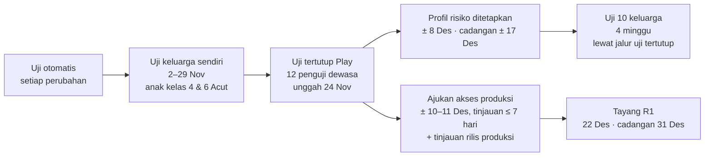

# Rencana Uji

**Ringkas:** (1) Ada empat lapis uji, berurutan: **uji otomatis** (setiap perubahan kode dan paket), **uji keluarga sendiri** (anak kelas 4 dan kelas 6 Acut, 2–29 November), **uji tertutup Play Store** (12 penguji dewasa, diunggah **Selasa 24 November** dengan versi apa adanya), dan **uji 10 keluarga** (cadangan 5) lewat jalur uji tertutup yang sama **setelah profil risiko ditetapkan** (target ± 8 Desember, cadangan ± 17 Desember). (2) Tayang 22 Desember hanya mungkin kalau unggahan pertama lolos tinjauan dan 12 penguji ikut sejak ± 26–27 November, sebab Google mewajibkan 14 hari berturut-turut, lalu meninjau permohonan akses produksi (≤ 7 hari) dan rilis produksinya. (3) Setiap lapis punya syarat lulus. Kalau tidak lulus, tanggal mundur ke cadangan (31 Desember), bukan syaratnya yang diturunkan; keluarga tetap bisa memakai aplikasi lewat jalur uji tertutup.

Tahap 5, butir 1. Disusun 19 Oktober 2026.

---

## 1. Urutan uji

| Lapis | Siapa | Kapan | Syarat lulus |
|---|---|---|---|
| Uji otomatis | Acut2 | Setiap perubahan | 100% uji lulus |
| Uji keluarga sendiri | Acut + 2 anak | 2–29 Nov | Bagian 3 |
| Uji tertutup Play | 12 penguji yang sudah ada | 24 Nov – tayang | 12 penguji ikut 14 hari berturut-turut **[FAKTA — Bantuan Play Console]**; tanpa kerusakan berat |
| Uji 10 keluarga | 10 keluarga (cadangan 5) | Setelah profil risiko ditetapkan (± 9 Des, cadangan ± 4 Jan), 4 minggu | Bagian 5 |

---

## 2. Uji otomatis

| Kelompok | Isi | Rincian di |
|---|---|---|
| Pembuat soal Lancar | 36.000 lembar (1.000 per level × 36): kunci, batas angka, tanpa kembar, susunan, lambang ":", bisa dibuat ulang, peta jenis salah, target waktu | `02-rancangan/06` bagian 2 |
| Bank soal dan paket isi | Baris Periksa, format, kunci, kembar, istilah, sebaran kunci, kelengkapan, penanda pengecoh; sidik berkas, nomor versi, ukuran | `02-rancangan/05`, `06` bagian 6 |
| Pemindahan bahan TKA | Jumlah butir dan hasil Periksa sama dengan `periksa.py` lama | `02-rancangan/06` bagian 3 |
| Akses antarkeluarga | Orang tua keluarga A tidak bisa membaca atau menulis satu baris pun milik keluarga B; HP anak tidak bisa menulis atas nama anak lain; link rapor yang dicabut tidak terbuka | `02-rancangan/03` bagian 4 |
| Tahan putus sinyal | 6 skenario (mode pesawat 2 hari, tutup paksa, jawaban server putus, jam mundur, dua HP, antrean 24/48 jam) | `02-rancangan/04` bagian 8 |
| Persetujuan | 6 tujuan tersimpan dengan versi teks dan waktu; mengubah izin membuat baris baru | `paket-hukum/01` bagian 4 |
| Rapor cerita | Angka di kalimat AI cocok dengan basis data; kata terlarang ditolak; cetakan cadangan muncul saat tidak cocok | `02-rancangan/07` bagian 2 |
| Manifes Android | Tanpa izin AD_ID, lokasi, kontak, kamera; daftar pustaka diperiksa terhadap Kebijakan Keluarga | `02-rancangan/11` bagian 7 |
| Mesin LANCAR | Naik (2 lembar tepat dari 2 sesi), kilat, tetap, turun, daya tahan 21 hari, lembar Dampingi tidak dihitung — diuji dengan riwayat buatan | `01-produk/04` bagian 3 |

**Biaya dan waktu:** dibangun bersama kode (± 3–4 hari kerja dari total pembangunan **[ESTIMASI]**). Dijalankan otomatis setiap kali kode atau paket berubah.

---

## 3. Uji keluarga sendiri (2–29 November)

Anak kelas 4 dan kelas 6 Acut memakai purwarupa seperti keluarga biasa. Ini juga pemakaian yang diperbolehkan sebelum profil risiko ditetapkan (keputusan Acut 19 Okt).

| Minggu | Yang diuji | Cara | Lulus kalau |
|---|---|---|---|
| 2–8 Nov | Lancar: tes penempatan, jurus, lembar, akhir lembar | Acut mengamati 2 sesi per anak + rekaman layar | Anak mulai dan selesai tanpa bantuan; salah ketuk ≤ 1 per lembar |
| 9–15 Nov | Tahan putus sinyal di HP nyata; mode orang tua dan pesan | Mode pesawat 1 malam; kirim semangat | Hasil tiba tepat sekali; pesan tampil di beranda anak |
| 16–22 Nov | Mode Dampingi (Tantang Ayah, lembar didampingi), ketukan perasaan, pertanyaan masukan | Acut sebagai orang tua | Kegiatan ≤ 10 menit; naskah bisa diikuti tanpa membaca petunjuk lain |
| 23–29 Nov | Semua bagian R1 + mesin soal TKA dengan contoh butir | Pemakaian harian biasa | Daftar periksa tampilan (`03-antarmuka/03` bagian 7) lulus |

**Catatan Acut** setiap minggu: 3 hal yang membingungkan anak, 3 hal yang disukai, dan kesalahan aplikasi. Dikirim lewat percakapan ini atau ditulis di Meja Masukan.

---

## 4. Uji tertutup Play Store

| Aturan Google | Isi **[FAKTA — Bantuan Play Console]** |
|---|---|
| Siapa wajib | Akun pengembang pribadi yang dibuat setelah 13 Nov 2023 |
| Jumlah | Minimal 12 penguji ikut saat mengajukan |
| Lama | Ikut terus-menerus selama 14 hari sebelum mengajukan; yang keluar lalu masuk lagi mengulang hitungan |
| Pengajuan | Dasbor Play Console → "Apply for production"; pertanyaan tentang perekrutan penguji, fitur yang dicoba, masukan, dan perubahan yang dibuat |
| Tinjauan | Biasanya ≤ 7 hari |

| Langkah | Tanggal (target · cadangan) | Siapa |
|---|---|---|
| Halaman Play Store, formulir Keamanan Data, sasaran usia diisi | 20 Nov · 23 Nov | Acut2 menyiapkan, Acut mengisi |
| Rilis uji tertutup diunggah (versi apa adanya), 12 penguji diundang | **Selasa 24 Nov** · 1 Des | Acut |
| Tinjauan unggahan pertama selesai; penguji efektif ikut | ± 26–27 Nov | Google |
| Penguji mencoba **sebagai orang dewasa** sampai profil risiko ditetapkan | sampai ± 8 Des (cadangan 17 Des) | 12 penguji |
| 10 keluarga uji masuk jalur yang sama (anak-anak boleh memakai) | ± 9 Des · 4 Jan | Acut |
| Hari ke-14 → ajukan akses produksi | ± 10–11 Des · 18 Des | Acut (jawaban disiapkan Acut2 dari catatan uji) |
| Tinjauan akses (≤ 7 hari) lalu tinjauan rilis produksi | ± 18–21 Des | Google |
| Tayang R1 | 22 Des · 31 Des | — |

**Kenapa penguji mencoba sebagai orang dewasa dulu:** sebelum profil risiko ditetapkan, anak dari keluarga lain belum boleh memakai aplikasi (Permenkomdigi 9/2026). Pertanyaan ini juga ada di daftar pertanyaan hukum (no. 4).

**Bahan untuk 12 penguji** (dikirim lewat WhatsApp): tautan bergabung, cara memasang, "tolong buka minimal 3 kali seminggu selama 14 hari", dan satu formulir masukan pendek.

---

## 5. Uji 10 keluarga (cadangan 5)

| Hal | Isi |
|---|---|
| Siapa | 10 keluarga dari gelombang ajakan pertama (`06-rilis/01-rencana-50-pemakai.md`), sebaran kelas 1–6, minimal 2 keluarga kelas 1–2 dan 2 keluarga kelas 6 |
| Kapan | Setelah profil risiko ditetapkan: ± 9 Des – 8 Jan (target) atau ± 4 Jan – 1 Feb (cadangan) |
| Cara masuk | Jalur uji tertutup Play (mereka sekaligus menambah jumlah penguji) |
| Yang diukur | Angka keberhasilan minggu ke-4 (`06-rilis/02-angka-keberhasilan.md`), masalah teknis, tanggapan pertanyaan masukan |
| Pendamping | Acut lewat WhatsApp; tanpa tatap muka |

**Syarat membuka ajakan gelombang 2 (± 4 Jan, atau ± 18 Jan pada jalur cadangan):**

| Ukuran | Target | Cadangan (masih boleh lanjut dengan perbaikan) |
|---|---|---|
| Keluarga yang masih latihan di minggu ke-3 | 8 dari 10 | 6 dari 10 |
| Hasil latihan yang hilang | 0 | 0 (tidak ada cadangan) |
| Kesalahan aplikasi yang menghentikan latihan | 0 per minggu | ≤ 1 per minggu, sudah diperbaiki |
| Orang tua menjawab "mudah / sangat mudah" (O04) | ≥ 8 dari 10 | ≥ 6 dari 10 |

Kalau di bawah cadangan: gelombang 2 ditunda 2 minggu, perbaikan dulu.

---

## 6. Uji yang dijadwalkan nanti

| Uji | Kapan | Untuk |
|---|---|---|
| Uji suara anak berlogat Aceh (5 anak) | Jan–Feb 2027 | Keputusan Bahasa Inggris R5 |
| Uji paket Belajar Bahasa Inggris tingkat 3–4 (kecocokan gambar, suara, tes pilih tingkat) oleh guru Bahasa Inggris + 3 anak keluarga uji | 15–29 Jan 2027 | Tayang di R2 atau mundur ke 22 Feb |
| Uji jenis guru: fungsi server menolak tugas dan catatan dari guru sekolah; komentar guru sekolah hanya tampil di mode orang tua | Sebelum R3 (Mar 2027) | Bimbingan Guru tayang di R3 |
| Uji AI membaca 20 foto lembar | Setelah R1 | Jalur buku + foto |
| Uji Mode Ramadan | Februari 2027 | `03-antarmuka/02` O10 |
| Uji pembaca Baca Ulang dengan 5 anak kelas 1–2 | Januari 2027 | R2 |
| Uji layar kelas 1–2 (paling bergantung suara) sebelum gelombang 1 | Begitu profil ditetapkan, dengan 2 anak kelas 1–2 dari keluarga pertama; atau lebih awal dengan kerabat Acut kalau ahli hukum membolehkan | Temuan pemeriksaan no. 32 |
