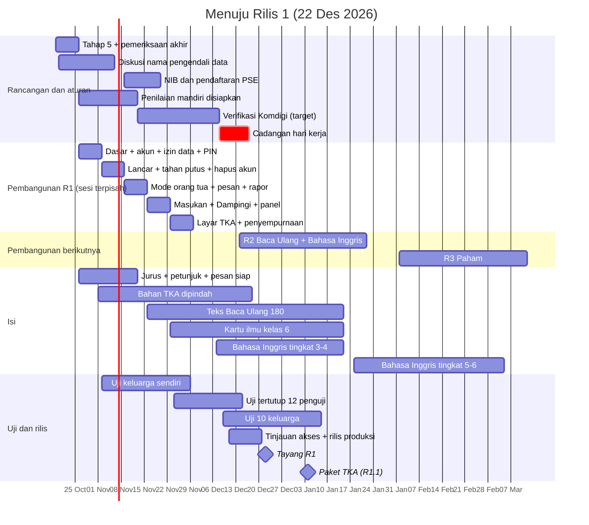

# Jadwal per Minggu sampai Tayang di Play Store

**Ringkas:** (1) Jadwal berjalan **11 minggu** (19 Okt – 3 Jan) sampai **tayang Rilis 1 pada 22 Desember 2026** (cadangan 31 Desember), lalu paket TKA 4 Januari 2027. Kalau verifikasi Komdigi dihitung dalam hari kerja, keluarga uji baru masuk ± 4 Januari; jadwal ini memuat jalur cadangan itu. (2) Ada empat titik yang tidak boleh mundur: **nama pengendali data Jumat 6 November**, **pengajuan penilaian mandiri Jumat 13 November**, **unggah uji tertutup Selasa 24 November** (versi apa adanya, supaya hitungan 14 hari dan dua tinjauan Google tidak memakan Desember), dan **pembangunan Rilis 1 selesai Jumat 27 November**. (3) Kalau produksi belum tayang pada 4 Januari, gelombang ajakan tetap jalan **lewat jalur uji tertutup**, jadi kelas luring TKA tidak bergantung pada tanggal tayang.

Tahap 5, butir 5. Disusun 19 Oktober 2026, diperbaiki 20 Oktober setelah pemeriksaan akhir. Minggu dihitung **Senin–Minggu**; tenggat sengaja ditaruh di hari kerja.

---

## 1. Gambaran

---

## 2. Rincian per minggu

| Minggu | Tanggal | Acut2 | Acut | Bukti selesai minggu ini |
|---|---|---|---|---|
| **1** | 19–25 Okt | Tahap 5, pemeriksaan akhir, perbaikan, dokumen gabungan; cetakan isi siap disetujui | Menyetujui rancangan; menyetujui 4 cetakan isi; mengunduh Kepmenkomdigi 142/2026; memutuskan pemasangan versi 5 ke link lama; mengisi data awal versi 4 | Rancangan disetujui; PDF Kepmen di percakapan |
| **2** | 26 Okt–1 Nov | Mulai bangun: proyek Expo, masuk dengan email, basis data + aturan akses, **layar izin data dan PIN orang tua** (dibutuhkan sebagai bukti kertas kerja DP01/DP05/DP06), pembuat soal dipindah dari versi 5; draf 36 jurus | Mengirim berkas TKA (Sabtu 31 Okt); diskusi khusus nama pengendali data | Aplikasi terpasang di HP Acut; berkas TKA diterima |
| **3** | 2–8 Nov | Lancar lengkap + antrean tahan putus + **hapus akun**; Meja Periksa; kertas kerja aspek e–g dan bukti layar | **Uji keluarga sendiri minggu 1**; **nama pengendali data (Jumat 6 Nov)**; memastikan apakah sistem Komdigi mensyaratkan akun PSE terdaftar (Jumat 6 Nov) | Catatan uji; keputusan nama di `keputusan.md` |
| **4** | 9–15 Nov | Mode orang tua (kabar, rapor, kirim semangat, pesan, ajakan); suara jurus dan petunjuk; dokumen pengajuan final | **NIB lewat OSS dan permohonan TDPSE (Senin 9 Nov)**; **mengajukan penilaian mandiri (Jumat 13 Nov)** dengan nomor TDPSE atau nomor permohonannya; memeriksa 36 jurus sendiri di Meja Periksa (guru menyusul); nama guru pemeriksa (Jumat 13 Nov) | Tanda bukti penerimaan Komdigi; paket `lancar-k1`–`k6` siap (Jumat 13 Nov) |
| **5** | 16–22 Nov | Pertanyaan masukan; Mode Dampingi; link rapor; panel (Hari ini, Keputusan, Jadwal, Paket isi); halaman Play Store dan formulir Keamanan Data | Uji keluarga sendiri minggu 3; menjawab klarifikasi Komdigi (≤ 7 hari); **TDPSE (Jumat 20 Nov)** | Semua fitur Wajib R1 ada di purwarupa; nomor TDPSE |
| **6** | 23–29 Nov | **Layar TKA** (tiga bentuk PG, soal bergrup, simulasi, rapor TKA, pengawas simulasi) — layar ini wajib ada di aplikasi R1 sebab R1.1 hanya paket isi; seluruh uji otomatis lulus | **Mengunggah rilis uji tertutup dan mengundang 12 penguji (Selasa 24 Nov)**, versi apa adanya; uji keluarga sendiri minggu 4 | Unggahan lolos tinjauan pertama; 12 penguji ikut |
| **7** | 30 Nov–6 Des | Perbaikan dari uji tertutup (diunggah sebagai pembaruan) | Mengirim bahan penguji; memantau 12 penguji tetap ikut | 12 penguji masih ikut (Play Console) |
| **8** | 7–13 Des | Perbaikan; jawaban permohonan akses produksi; konversi TKA berjalan | **Target: profil risiko ditetapkan (± Selasa 8 Des)** → gelombang 1 (10–15 keluarga) masuk jalur uji tertutup; **hari ke-14 uji tertutup (± 10–11 Des, dihitung dari penguji efektif ikut setelah tinjauan unggahan pertama ± 26–27 Nov) → mengajukan akses produksi** | Surel penetapan profil; permohonan terkirim |
| **9** | 14–20 Des | Perbaikan dari keluarga uji; paket TKA di kanal uji; mulai pembangunan R2 | **Cadangan: profil ditetapkan (± Kamis 17 Des)**; mencoba 36 latihan rumah TKA | Akses produksi diberikan |
| **10** | 21–27 Des | Rilis produksi ditinjau; pemantauan | **Tayang R1 (Selasa 22 Des)** begitu rilis produksi lolos tinjauan | Aplikasi di Play Store |
| **11** | 28 Des–3 Jan | Paket TKA siap terbit | Pesan C ke orang tua kelas luring; syarat gelombang 2 dinilai | Paket `tka-k6` siap |

---

## 3. Jalur cadangan

| Keadaan | Gelombang 1 (keluarga uji) | Gelombang 2 | Gelombang 3 |
|---|---|---|---|
| **Target:** profil ditetapkan ± 8 Des (hari kalender) | ± 9 Des | ± 4 Jan (bersama paket TKA) | ± 1 Feb (bersama Baca Ulang) |
| **Cadangan:** profil ± 17 Des (kalau "hari" di Kepmen = hari kerja: 13 Nov + 14 → 3 Des, + 7 → 14 Des, + 3 → 17 Des) | **± 4 Jan** (setelah libur sekolah) | **± 18 Jan** | ± 1 Feb |
| Produksi belum tayang saat gelombang mulai | Lewat jalur uji tertutup | Lewat jalur uji tertutup | — |

Arti "hari" di Kepmenkomdigi 142/2026 dipastikan dari lampiran yang diunduh Acut (tindak lanjut 26 Okt).

---

## 4. Sesudah tayang (ringkas)

| Tanggal | Peristiwa |
|---|---|
| Senin 4 Jan 2027 | R1.1 paket TKA; kelas luring mulai; ajakan gelombang 2 (60 keluarga) kalau syarat lulus |
| 15 Des | Guru Bahasa Inggris pemeriksa dipilih (keputusan Acut 28 Okt) |
| 18 Des | Kartu Gudang Ilmu Matematika kelas 6 selesai diperiksa Acut (terbit bersama paket TKA 4 Jan) |
| 14 Des – 22 Jan | Pembangunan R2 (layar Baca Ulang, Dengar Bacaan, tangga suku kata, **Belajar Bahasa Inggris**) — butuh rilis aplikasi dan tinjauan Play |
| 15 Jan | 180 teks Baca Ulang selesai diperiksa; kartu Bahasa Indonesia kelas 6 dan Bahasa Inggris tingkat 3–4 selesai diperiksa |
| 1 Feb | R2 Baca Ulang + Belajar Bahasa Inggris tingkat 3–4 + kartu Bahasa Indonesia kelas 6 (cadangan 22 Feb); ajakan gelombang 3 (80 keluarga) |
| 1 Feb – 12 Mar | Pembangunan R3 (modul Paham) |
| 8 Feb – 19 Mar | Ramadan dan Idulfitri (Mode Ramadan diuji) |
| 22 Mar | R3 Paham kelas 4–6 (cadangan 5 Apr) |
| April | TKA SD (kalau pola 2026 berulang) |
| ± 26 Apr (atau pertengahan Mei) | Evaluasi gerbang berbayar paling cepat (`01-produk/09` bagian 3, usulan diperbaiki) |
| 14 Jun | R4 Dunia dan naik kelas |

---

## 5. Kalau tergelincir

| Yang tergelincir | Akibat | Tindakan |
|---|---|---|
| Pembangunan lewat Jumat 27 Nov | Rilis produksi tidak siap 22 Des | Potong fitur Penting (kartu satwa, ajakan, peta jenis salah); tayang cadangan 31 Des; keluarga tetap lewat jalur uji tertutup |
| Nama pengendali data lewat 6 Nov | Pengajuan Komdigi mundur | Pakai jalur atas nama pribadi sebagai cadangan (`02-rancangan/11` bagian 5) |
| Pengajuan penilaian mandiri lewat 13 Nov | Profil mundur | Keluarga uji mulai saat profil ditetapkan |
| Komdigi meminta klarifikasi | + sampai 7 hari | Acut2 menyiapkan jawaban dalam 1 hari |
| Tinjauan Google lebih dari 7 hari | Tayang mundur | Tidak ada jalan pintas; keluarga memakai jalur uji tertutup |
| Berkas TKA tidak datang 31 Okt | R1.1 terancam | R1.1 mulai dengan 5 simulasi; latihan rumah menyusul; kelas luring memakai PDF |
