# Rancangan Sistem — Pintar Main

**Aplikasi Android keluarga untuk Matematika dan Bahasa Indonesia kelas 1–6 SD, plus Persiapan TKA kelas 6 dan Belajar Bahasa Inggris** · maskot Pinci, Si Kancil Pintar · *"Belajar dulu, main kemudian!"* (dulu Belajar Menarik, nama kerja Pandu Anak)

Versi 1.4 · 29 Oktober 2026 (memuat keputusan Acut 20 Okt, penegasan 28 Okt, keputusan 28 Okt sore, merek Pintar Main, dan keputusan 29 Okt dari perbandingan dengan Edufic) · Disusun Acut2 (Claude) bersama Acut · Sudah diperiksa pemeriksa terpisah (`pemeriksaan-akhir.md`)

**Ringkas:** (1) Dokumen ini menggabungkan seluruh rancangan Tahap 0–5 dalam satu berkas: pemahaman awal, produk, rancangan teknis, antarmuka, uji, rilis dan uang, catatan keputusan, dan hasil pemeriksaan akhir. Paket draf hukum dan riset penguat menjadi lampiran. (2) Rilis 1 dirancang tayang **22 Desember 2026** (cadangan 31 Desember), isi TKA dan kartu ilmu Matematika kelas 6 pada 4 Januari 2027, Baca Ulang + Belajar Bahasa Inggris 1 Februari, dan gerbang berbayar dievaluasi **paling cepat ± 26 April 2027**. (3) Keputusan Acut 20 dan 28 Oktober sudah masuk (kelas 6 dulu di Gudang Ilmu, paket Bahasa Inggris tingkat 3–6, guru sekolah hanya lihat + komentar); yang paling mendesak sekarang adalah nama pengendali data (Jumat 6 Nov).

Label yang dipakai di seluruh dokumen: **[FAKTA + sumber]** · **[ESTIMASI + cara hitung]** · **[ASUMSI — perlu diuji]**.

---

## Ringkasan untuk pengambil keputusan

### Apa yang dibangun

| Lapis | Isi | Rilis |
|---|---|---|
| Merek | **Pintar Main**, maskot **Pinci** (pemandu, penyemangat, penjaga waktu); aksesori Pinci dan kartu satwa sebagai kejutan acak | R1 |
| Lancar Matematika | Hitung cepat Metode LANCAR, 6 level per kelas, 2 lembar sehari (2–5 menit), tanpa kalkulator | R1 · 22 Des 2026 |
| Keluarga | Akun orang tua (email + kode), anak tanpa akun; tiga cara terlibat: Mode Dampingi, mode orang tua dari jauh, link rapor | R1 |
| Masukan | 19 pertanyaan orang tua + 5 ketukan anak, masing-masing terhubung ke satu keputusan; paling sering dua minggu sekali; Keluarga Perintis 5–10 keluarga | R1 |
| Persiapan TKA | 36 latihan rumah, 5 simulasi 75 menit, rapor penyebab salah; pendamping kelas luring dan Jalur Mandiri | Layar di R1, isi 4 Jan 2027 |
| Gudang Ilmu | Peta lengkap semua topik SD kelas 1–6 + kartu ilmu per topik (penjelasan, contoh jadi, latihan berjenjang). **Kelas 6 diisi dulu** (fokus TKA) | Peta R1; kartu kelas 6 4 Jan–1 Feb 2027; kelas lain bertahap 2027 |
| Tanda bimbingan | Tiap topik: mandiri · perlu bimbingan orang tua · perlu bimbingan guru | R1 |
| Bimbingan Guru | Diundang dan disetujui orang tua. **Guru sekolah:** lihat kemampuan + komentar ke orang tua. **Guru les:** tugas + catatan, terlihat orang tua | R3 · 22 Mar 2027 |
| Belajar Bahasa Inggris | Paket tingkat 3–6 bebas dipilih semua anak kelas 1–6: kosakata bersuara, pola kalimat, dengar lalu pilih, permainan kata; tanpa AI suara | Tingkat 3–4 R2 · 1 Feb 2027; 5–6 R3 |
| Bahasa Indonesia | Baca ulang harian dengan contoh suara dan kata per menit | R2 · 1 Feb 2027 |
| Tambahan 29 Okt | Pinci menyapa dengan nama (R1); mini try out TKA mingguan 15 menit dan "Rencana minggu ini" (R1.1); Peta Perjalanan untuk orang tua, Cerita Ulang, Ucapkan ke Bunda, Hari Pamer bulanan (R2) | R1–R2 |
| Paham Matematika | Modul kelas 4–6 untuk topik TKA | R3 · 22 Mar 2027 |

### Keputusan teknis utama

| Keputusan | Sebab |
|---|---|
| Expo (React Native) + Supabase Singapura | Bisa dipakai ulang dari proyek lain, SQL cocok untuk rapor dan gerbang; lapisan data terpisah supaya bisa pindah ke Jakarta |
| Semua latihan dibuat dan dinilai di HP; hasil diantrekan dan dikirim tanpa ganda | Sinyal di Aceh tidak selalu ada; hasil latihan tidak boleh hilang |
| Hanya isi kelas anak yang diunduh (kecuali Bahasa Inggris: tingkat yang dipilih); belajar ≤ 10 menit × kelas per hari, game 20–30 menit sesudahnya (disetujui Acut 28 Okt) | Aplikasi ringan di HP murah; waktu belajar dan main mengikuti riset |
| Data anak minimal: nama panggilan, bulan-tahun lahir, kelas | Profil risiko rendah (PP Tunas, Kepmenkomdigi 142/2026) dan UU PDP |
| Anak tidak berinteraksi dengan AI; AI hanya menulis rapor cerita untuk orang tua, dan setiap angkanya dicek kode | Panduan layanan anak; keluaran AI bisa tidak berdasar |

### Angka yang menentukan berhasil-tidaknya

Sumber induk: `06-rilis/02-angka-keberhasilan.md`.

| Ukuran | Target | Cadangan |
|---|---|---|
| Keluarga aktif di minggu ke-4 | 30 | 20 |
| Anak latihan lagi pada hari 30–36 | ≥ 60% | ≥ 45% |
| Hari latihan per minggu | ≥ 5 | ≥ 4 |
| Kecepatan tes tetap (awal → minggu ke-8) | turun 30% | turun 15% |
| Tanggapan per putaran pertanyaan | ≥ 60% | ≥ 45% |
| Gerbang berbayar: keluarga aktif "terpenuhi" (satu janji data + satu janji orang tua) | ≥ 70% | ≥ 60% |

### Uang

| Skala | Biaya per bulan | Catatan |
|---|---|---|
| Masa gratis (batas atas ± 50 keluarga) | ± Rp478 ribu (Des–Jan); ± Rp1,44 juta (Feb–Mei) | Desember–Januari hanya teknologi, sebab Acut memeriksa isi sendiri; guru mulai Februari |
| 500 keluarga | ± Rp1,44 juta | Titik impas pada Rp49 ribu: **39 keluarga membayar**; 87 kalau langganan Claude Acut ikut ditutup |
| 1.000 keluarga | ± Rp2,55 juta | Titik impas: 68 keluarga |

### Empat titik jadwal yang tidak boleh mundur

| Tanggal | Titik |
|---|---|
| Jumat 6 Nov 2026 | Nama pengendali data diputuskan (diskusi khusus 2) |
| Jumat 13 Nov 2026 | Penilaian mandiri profil risiko diajukan ke Komdigi |
| Selasa 24 Nov 2026 | Rilis uji tertutup diunggah dan 12 penguji diundang |
| Jumat 27 Nov 2026 | Pembangunan Rilis 1 selesai |

Kalau verifikasi Komdigi dihitung dalam hari kerja, profil risiko baru ± 17 Desember, dan keluarga uji masuk ± 4 Januari lewat jalur uji tertutup.

### Tiga risiko terbesar

| Risiko | Tanda awal | Penjaga |
|---|---|---|
| Pembangunan 5 minggu tidak cukup | Jumat 6 Nov Lancar + tahan putus belum jalan di HP Acut | Urutan pembangunan mendahulukan yang tidak boleh dipotong; fitur Penting dipotong lebih dulu |
| Penilaian mandiri terlambat atau profil bukan "rendah" | Pengajuan belum terkirim 13 Nov | Kertas kerja sudah menjelaskan parameter yang rawan; jawaban klarifikasi disiapkan dalam 1 hari |
| Keluarga berhenti di minggu ke-3–4 | Hari latihan < 3 per minggu; kembali hari 7–13 < 55% | Kejutan, pilihan jalur, kegiatan Dampingi mingguan, pesan "Kami dengar, kami ubah" |

### Yang perlu diputuskan sekarang

Tujuh keputusan dijawab Acut 20 Oktober (`keputusan.md` bagian B7): versi 5 sudah dipasang, A5 menjadi "gratis, dibayar dengan masukan sukarela", lembar tetap 20 soal (2–5 menit), target 30 keluarga aktif, jalur gampong hanya kontak pribadi, Acut memeriksa isi sendiri sampai Rilis 2. Tiga keputusan lagi dijawab 28 Oktober (bagian B9): batas waktu disetujui, Gudang Ilmu kelas 6 dulu + paket Belajar Bahasa Inggris Februari 2027, guru sekolah hanya lihat + komentar. Yang masih terbuka:

| # | Keputusan | Tenggat |
|---|---|---|
| 1 | Nama pengendali data dan penerbit (diskusi khusus 2) | Jumat 6 Nov |
| 2 | Guru pemeriksa isi untuk mulai Februari | Jumat 15 Jan 2027 |
| 3 | Pengajar dan tanggal pertemuan pertama kelas luring TKA | Jumat 11 Des |
| 4 | Aksen suara Bahasa Inggris (Amerika atau Inggris) | Jumat 4 Des |
| 5 | Guru Bahasa Inggris pemeriksa isi | Selasa 15 Des |
| 6 | Cek nama Pintar Main di Play Store dan PDKI (nama ikut diajukan 13 Nov) | Jumat 6 Nov |
| 7 | Paket "Siap SMP" (jembatan sesudah TKA) | Diskusi khusus berbayar, paling lambat 29 Jan 2027 |
| 8 | Unduh PDF asli Perka BSKAP 047/H/AN/2025 (kisi-kisi TKA) | Jumat 6 Nov |

Diskusi khusus 3 (ahli hukum) sebaiknya Jumat 6 Nov dan paling lambat Senin 30 Nov; diskusi khusus 1 (berbayar) paling lambat Jumat 29 Jan 2027. Semua tenggat ada di `keputusan.md` bagian J.

### Cara membaca dokumen ini

| Bagian | Isi | Untuk siapa |
|---|---|---|
| 0 | Pemahaman awal, pertentangan di bahan lama, pertanyaan pertama | Semua |
| 1 | Produk: profil keluarga, fitur per rilis, rencana isi, Mesin LANCAR, Bahasa Indonesia, TKA, fitur orang tua–anak, sistem masukan, gerbang berbayar, Gudang Ilmu dan waktu, Belajar Bahasa Inggris | Acut, guru pemeriksa |
| 2 | Rancangan teknis: arsitektur, akun, basis data, tahan putus sinyal, paket isi, bank soal, AI, pembayaran, panel, catatan kejadian, privasi | Sesi pembangunan |
| 3 | Antarmuka: 69 layar, kerangka 20 layar, aturan tampilan, identitas merek Pintar Main, brief desain Claude Design | Sesi pembangunan |
| 4 | Uji | Acut, sesi pembangunan |
| 5 | Rilis dan uang: 50 pemakai, angka keberhasilan, hitungan uang, jadwal, risiko, tindak lanjut | Acut |
| 6 | Keputusan, pertanyaan terbuka, pemeriksaan akhir | Acut |
| 7 | Perbandingan dengan Edufic, termasuk TKA Daily Drill | Acut |
| Lampiran A | Paket draf hukum (9 berkas) | Ahli hukum |
| Lampiran B | Riset penguat | Pemeriksa sumber |

Rujukan berkas ditulis seperti `01-produk/04-mesin-lancar.md`; di dokumen gabungan ini, berkas itu ada di bagian dengan judul yang sama.


# Bagian 0 — Pemahaman


## Tahap 0 — Pemahaman, Pertentangan, dan Pertanyaan

*Berkas: `rancangan/00-tahap-0-pemahaman.md`*

**Ringkas:** (1) Yang dirancang adalah satu aplikasi keluarga untuk Matematika dan Bahasa Indonesia kelas 1–6 plus Persiapan TKA kelas 6, gratis selama orang tua memberi masukan. (2) Bahan yang sudah matang baru dua: mesin hitung cepat Matematika (Metode LANCAR versi 5) dan Paket Siap TKA SD, tetapi Paket TKA dibuat untuk kelas tatap muka dengan pengajar, bukan untuk belajar di HP. (3) Ada 12 pertentangan; yang paling menentukan adalah jadwal TKA 2027 lawan urutan rilis, bahan TKA yang bergantung pada pengajar, dan versi 4 yang sampai malam ini belum menyimpan satu hasil pun.

Disusun 19 Oktober 2026 malam. Label: **[FAKTA + sumber]** · **[ESTIMASI + cara hitung]** · **[ASUMSI — perlu diuji]**.

---

### 0. Yang sudah dibaca

| Bahan | Status |
|---|---|
| 21 dokumen Project (prompt, catatan diskusi, Metode LANCAR, level per kelas, purwarupa versi 5, program TKA, 6 berkas induk TKA, status, daftar isi, 4 riset, peta mapel, modul interaktif, susunan folder, kelemahan rencana lama) | Dibaca semua |
| Halaman Latihan Hitung Cepat versi 4 dan basis datanya | Dibaca; **tidak diubah** |
| Laporan Ide Pandu Anak (dokumen) | Dibaca utuh |
| Bank Ide: `pandu-anak`, `peta-belajar`, `sistem-belajar-4-akun` | Dibaca |
| Folder laptop `D:\00 New App 2026\0 APP Dukungan Belajar Siswa` | **Belum bisa dibaca.** Laptop tersambung ke sesi ini, tetapi folder itu belum dibagikan. Dicatat di `pertanyaan-terbuka.md` |

---

### 1. Yang saya pahami

| Hal | Pemahaman |
|---|---|
| **Apa** | Satu aplikasi Android. Anak latihan; orang tua terlibat lewat tiga cara: duduk bersama (Mode Dampingi, PIN), dari jauh (mode orang tua di HP sendiri), atau sekadar melihat rapor lewat link WhatsApp |
| **Yang dijual** | Kepuasan orang tua karena kemajuan anak **terlihat dan terukur**, ditambah anak senang belajar. Hasil akhirnya diserahkan kepada Allah |
| **Isi saat tayang** | Matematika (tiga lapis: Lancar, Paham, Siap TKA) dan Bahasa Indonesia kelas 1–6, plus Persiapan TKA kelas 6. Bahasa Inggris dan game menyusul |
| **Mesin Matematika** | Metode LANCAR: tes penempatan, layar jurus, 6 level per kelas, 20 soal per lembar, 3–7 detik per soal, 70% level ini + 30% level lalu, soal salah atau lambat diulang, uji daya tahan 3 minggu |
| **Uang** | Gratis untuk waktu yang belum ditentukan. "Bayarannya" adalah masukan orang tua. Berbayar baru dibuka setelah orang tua tidak akan kecewa |
| **Skala masa gratis** | ± 50 pemakai aktif dari 100–150 keluarga yang diajak lewat WhatsApp, tanpa tatap muka |
| **Biaya** | [ESTIMASI Acut2, catatan 19 Okt] Di bawah ± Rp1 juta per bulan untuk 50 anak; yang mahal adalah isi dan waktu Acut |

#### Keadaan nyata malam ini

| Hal | Keadaan |
|---|---|
| Latihan Hitung Cepat versi 4 | **[FAKTA — basis data halaman, dibaca 19 Okt ± 18.20 WIB]** Koleksi `hasil` dan `anak` masih **kosong: 0 lembar, 0 anak**. Uji angka awal 19–25 Okt belum menghasilkan data yang bisa dibaca dari sini |
| Versi 5 (LANCAR) | Jadi, lolos uji otomatis, belum dipasang. Rencana dipasang ± 26 Okt **setelah** ada angka awal versi 4 |
| Paket Siap TKA SD | 36 modul, 5 simulasi, 36 teks baca cepat, rapor, pelatihan pengajar: selesai 17 Sep, **bentuknya kelas luring** |
| Proyek lain | Jeumpa dan Peta Belajar sama-sama menuju Play Store; Peta Belajar menargetkan tayang akhir November |

---

### 2. Keputusan yang dikunci

Tidak diulang di sini; daftar lengkap dengan tanggal dan sebabnya ada di `keputusan.md`. Intinya: enam arah besar, Metode LANCAR, tiga lapis Matematika, satu aplikasi dengan paket isi per kelas, tiga cara orang tua terlibat, isi dibangun bertahap, sistem masukan berbentuk pilihan dengan syarat lembut, Keluarga Perintis, kemampuan tidak dibatasi biaya, server Supabase.

### 3. Yang belum diputuskan

| Hal | Siapa yang memutuskan |
|---|---|
| Jadwal per mapel per minggu | Acut, setelah usulan Tahap 2 |
| Rilis ke berapa Persiapan TKA masuk | Acut (lihat Pertanyaan 1) |
| Batas anggaran bulanan dan angka peringatan dini | Acut, di Tahap 5 |
| Lama masa gratis dan angka gerbang berbayar | Acut, setelah usulan Tahap 2 |
| Bentuk latihan harian Bahasa Indonesia | Acut, setelah riset Tahap 1 |
| Jalur kertas + foto (AI membaca tulisan tangan) | Acut (Pertanyaan 5) |
| Apa yang dimaksud "game di luar jam belajar" dan batas waktunya | Acut, setelah usulan Tahap 2 |
| Kelas 1–2 ikut sejak awal atau menyusul | Acut (Pertanyaan 4) |
| Pilihan teknologi | Acut, di Tahap 3 |
| Siapa guru pemeriksa isi dan honornya | Acut |
| Nama aplikasi — **dijawab 28 Okt: Pintar Main**, maskot Pinci (`03-antarmuka/04-identitas-merek.md`) | Acut |

---

### 4. Pertentangan antar-bahan

#### P1. "Latihan mengingat lemah untuk Matematika" lawan hitung cepat yang bertumpu pada hafal fakta — **sebagian besar tidak bertentangan, tetapi ada celah**

- **Riset teknik Matematika:** **[FAKTA — Murray dkk. 2025]** latihan mengingat khusus Matematika g = 0,18, tidak kokoh, hanya 7 studi. **[FAKTA — Yang dkk. 2021]** di SD efeknya paling kecil (0,328).
- **Metode LANCAR:** **[FAKTA — Fuchs dkk. 2010]** jurus ditambah 4–6 menit latihan terarah paling baik untuk kelancaran fakta dasar kelas 3; **[FAKTA — McNeil dkk. 2025]** kelancaran memprediksi kemajuan Matematika selanjutnya.
- **Penilaian:** angka 0,18 mengukur kuis mengingat **materi pelajaran** (konsep dan prosedur). Bukti fakta dasar berasal dari kumpulan penelitian lain. Jadi lapis Lancar sah bertumpu pada latihan mengingat fakta, sebab yang dilatih memang fakta.
- **Celah yang nyata:**
  1. Bukti fakta dasar hanya untuk tambah, kurang, kali, bagi satu angka (kira-kira kelas 1–4). Level kelas 5–6 (×11, ×25, kuadrat, pangkat tiga, persen, urutan operasi) **bukan fakta dasar**. **[ASUMSI]** Manfaatnya untuk kelas 5–6 belum punya dasar penelitian.
  2. Angka campur-aduk d = 0,83 berasal dari kelas 7 yang harus **memilih cara** menyelesaikan soal. Pada lembar fakta, manfaat utama campuran 70/30 kemungkinan pengulangan berjarak (g = 0,28), bukan 0,83.
- **Akibat:** jangan menjual lapis Lancar kelas 5–6 dengan angka Fuchs atau 0,83, sebab keduanya tidak menguji isi itu.

#### P2. Isi Lancar kelas 6 lawan kurikulum dan TKA

- **Versi 4/5:** level 2 kelas 6 = pangkat tiga dan akar pangkat tiga; level 3 = bilangan negatif.
- **Spesifikasi TKA:** **[FAKTA — kerangka asesmen, lewat 01-spesifikasi]** domain TKA SD hanya Bilangan (cacah, pecahan, desimal, persen, KPK/FPB, rasio), Geometri & Pengukuran, dan Data. Negatif dan pangkat tiga tidak disebut.
- **[ASUMSI — dicek di Tahap 1 terhadap Capaian Pembelajaran Fase C]** Kalau keduanya materi SMP, dua dari enam level kelas 6 menyimpang dari "berstandar", sementara kelancaran yang dibutuhkan TKA (pecahan ↔ desimal ↔ persen, faktor kecil) belum ada di Lancar kelas 6.

#### P3. Lambang bagi

- **Versi 4/5:** memakai **÷**.
- **Standar istilah TKA §7:** bagi ditulis **:**, lambang ÷ dilarang.
- **[ASUMSI]** Buku sekolah memakai ":", jadi anak kelas 2–3 bisa bingung. Murah diperbaiki di versi 5 sebelum dipasang.

#### P4. Bahan TKA dibuat untuk kelas tatap muka; aplikasi untuk belajar di rumah — **pertentangan terbesar soal isi**

- **Spesifikasi TKA:** 6–8 anak, 45 menit, 3× seminggu, pengajar membaca naskah, papan jawaban serentak, dua anak menjelaskan, halaman "Kalau anak macet" untuk pengajar.
- **Riset teknik:** **[FAKTA — meta-analisis ALEKS]** aplikasi sebagai **pengganti** pengajar g = 0,05; sebagai **pelengkap** g = 0,43. **[FAKTA — NBER w35620]** Khanmigo 0,05 SD per tahun.
- **Susunan folder:** "bangun aplikasi sesudah angkatan pertama berjalan, bukan sebelumnya". **Modul interaktif:** buka luring dulu.
- **Bank Ide:** "aplikasi tinggal memindahkannya".
- **Penilaian:** yang bisa pindah utuh ke HP adalah contoh jadi (hal. 3), soal campur-aduk (hal. 5), tiket keluar (hal. 6), simulasi, 36 teks, peta spiral, dan aturan warna rapor. Yang tidak bisa pindah tanpa dirancang ulang: naskah 45 menit, papan jawaban, anak menjelaskan, dan halaman "Kalau anak macet". **[ESTIMASI]** Jadi TKA di aplikasi adalah pekerjaan merancang ulang, bukan memindahkan, sebab satu modul ± 5.300 kata disusun untuk 45 menit dengan pengajar, sedangkan sesi di HP 10–20 menit tanpa pengajar.

#### P5. Jadwal TKA 2027 lawan urutan rilis

- **[FAKTA — BBPMP Jatim, lewat riset pasar]** TKA SD 2026 berlangsung 20–30 April. Program 12 minggu harus mulai awal Januari.
- **Prompt:** rilis dimulai dari LANCAR + akun keluarga + sistem masukan; **[FAKTA — catatan Peta Belajar]** uji tertutup Play Store wajib 12 penguji selama 14 hari; Jeumpa dan Peta Belajar juga membutuhkan penguji.
- **[ESTIMASI]** Kalau TKA masuk rilis ke-3 atau lebih, ia hampir pasti lewat dari TKA April 2027, termasuk untuk anak Acut yang kelas 6. Angkatan berikutnya baru April 2028. → **Pertanyaan 1 dan 2.**

#### P6. Peran orang tua

- **Keputusan 19 Okt:** orang tua membimbing adalah nilai utama; mode jauh bisa **melihat anak latihan secara langsung**.
- **Riset metode belajar:** **[FAKTA — Nickow dkk., 96 uji acak]** orang tua sebagai pendamping memberi efek terlemah (0,20–0,25). **[FAKTA — Frontiers 2023, 16.338 siswa]** keterlibatan yang mengontrol −0,153, menyela atau membantu tanpa diminta −0,149, dua kali lebih besar dari manfaat keterlibatan suportif (+0,076); dukungan otonomi +0,133 paling kuat. Di SD kerusakannya lebih kecil (−0,093).
- **Keputusan 17 Okt** "cukup menyuruh" dan **19 Okt** "membimbing adalah nilai utama" sama-sama dikunci. Keduanya bisa hidup berdampingan, tetapi pesan jualnya harus memilih satu kalimat.
- **Tidak diubah.** Akibat untuk rancangan: Mode Dampingi dan mode jauh harus mendorong orang tua memberi petunjuk, bukan jawaban, dan tidak menyela saat soal berwaktu, sebab di situlah kerusakannya terjadi.

#### P7. Game dan hadiah

- **Deskripsi Project:** game interaktif di luar jam belajar.
- **Laporan Ide:** "permainannya harus pelajaran itu sendiri, bukan hadiah setelah belajar".
- **Riset:** **[FAKTA — Deci dkk. 1999]** hadiah karena menyelesaikan tugas d = −0,36 terhadap minat melanjutkan sendiri; hadiah tak terduga ≈ 0. **[FAKTA — Sala dkk.]** latihan otak: perpindahan jauh g = 0,001. **[FAKTA — EdWeek 2021]** Prodigy diadukan ke FTC karena iklan dan dorongan membeli.
- **Keputusan yang menyentuhnya:** kartu satwa dibuka saat lulus level, barang Gampong sebagai imbalan menjawab pertanyaan dan memainkan game akhir pekan.
- **[ASUMSI — dicek Tahap 1]** Benda maya yang dijanjikan di muka kemungkinan bekerja seperti hadiah yang dijanjikan; bukti di atas berasal dari hadiah berwujud. Selain itu ukuran gerbang "latihan dimulai anak sendiri" bisa tercemar, sebab anak membuka aplikasi untuk main, bukan belajar.

#### P8. Gratis lama dan syarat lembut

- **Riset metode belajar:** **[FAKTA — Reich & Ruipérez-Valiente 2019, pelajar dewasa]** kursus gratis diselesaikan 3,13%, berbayar 46%; 30% pendaftar tidak pernah mulai. **Laporan Ide:** siklus gratis bisa jadi bumerang.
- **Arah besar 4:** gratis tanpa batas waktu. **Tidak diubah.**
- **Pertentangan di dalam keputusan sendiri:** syarat lembut menahan **rapor lengkap** kalau orang tua melewatkan dua putaran, padahal rapor terukur adalah hasil yang dijual dan bukti yang nanti membuat orang tua mau membayar. Menahannya berarti menahan bukti. Usul untuk Tahap 2 (tanpa mengubah kunci): yang ditahan adalah fitur tambahan lain, bukan rapor.

#### P9. Patokan "40% sangat kecewa" dengan ± 50 pemakai

- **[ESTIMASI]** Kalau 30 orang tua menjawab, selang kepercayaan 95% untuk angka 40% adalah ± 18 poin (1,96 × √(0,4 × 0,6 ÷ 30) ≈ 0,18). Angka itu tidak bisa membedakan 25% dari 55%.
- **Akibat:** gerbang berbayar tidak boleh bertumpu pada satu angka ini; perlu digabung dengan ukuran kemajuan anak yang terukur.

#### P10. Latihan harian Bahasa Indonesia

- **Catatan diskusi:** latihan harian BI buatan mesin = ejaan, imbuhan, kosakata dari daftar kata.
- **Program TKA:** **[FAKTA — kerangka asesmen]** TKA Bahasa Indonesia hanya menguji membaca. **Pustaka model:** **[FAKTA — Brunmair & Richter 2019]** kosakata murni yang dicampur justru merugikan (g = −0,39), jadi harus diblok per tema. **Laporan Ide:** baca nyaring berwaktu (kata per menit), yang menuntut rekaman suara anak.
- **[ASUMSI]** Yang paling mudah dibuat mesin (ejaan, imbuhan) belum tentu yang menggerakkan kemampuan membaca. Dijawab riset Tahap 1 butir 3.

#### P11. Kelas 1–2

- **Peta mapel:** kelas 1–2 sebaiknya calistung terpadu; jenjang paling sulit dijalankan lewat layar; butuh pendamping di sebelahnya; sesi 25–30 menit.
- **Arah besar 2:** kelas 1–6 untuk tayang. **[ASUMSI]** Anak kelas 1 belum lancar membaca petunjuk, jadi semua layar butuh suara. → **Pertanyaan 4.**

#### P12. Angka yang saling bertentangan di bahan

| Hal | Bahan A | Bahan B | Dipakai sementara |
|---|---|---|---|
| Rerata TKA SD 2026 Bahasa Indonesia | Riset metode belajar: 69,14 | Program TKA: **60,14** (siaran pers Kemendikdasmen 15444) | 60,14, dicek ulang di Tahap 1 |
| IPA di TKA SD 2027 | Peta mapel: "mulai 2027 ditambah IPA" | Riset pasar dan program TKA: masih usulan, belum ada peraturan | Masih usulan, dicek di Tahap 1 butir 7 |
| Beban isi | Prompt: ± 360 topik × 1–2 jam | Modul TKA nyata: ± 3 jam per modul, lalu pemeriksaan mutu menemukan 23 kelemahan tinggi dan sedang | **[ESTIMASI]** 1–2 jam per topik kemungkinan terlalu rendah bila termasuk pemeriksaan manusia; dihitung ulang di Tahap 2 |

---

### 5. Kenapa rancangan ini bisa gagal

| # | Jalan menuju gagal | Tanda awal yang sudah terlihat |
|---|---|---|
| 1 | **Tidak ada angka awal**, jadi kenaikan tidak pernah bisa dibuktikan dan gerbang berbayar tidak pernah lolos dengan jujur | Versi 4: 0 hasil tersimpan per 19 Okt malam |
| 2 | **TKA 2027 terlewat**, padahal itu satu-satunya tenggat yang memaksa orang tua bergerak | Urutan rilis menaruh TKA di belakang; tiga aplikasi rebutan penguji |
| 3 | **Isi kebesaran**: 2 mapel × 6 kelas + TKA membuat rilis molor, keluarga uji keburu pergi | Bank Ide pernah menyimpan "Sistem Belajar 4 Akun" karena terlalu besar |
| 4 | **50 pemakai tidak datang**: tanpa tatap muka dan tanpa promosi, 100–150 keluarga harus diajak lewat WhatsApp | Belum ada daftar keluarga |
| 5 | **Masukan berhenti mengalir** setelah minggu ke-2 sampai ke-4, saat rasa baru pudar | **[FAKTA — riset gamifikasi]** efek kebaruan menurun setelah minggu ke-4 |
| 6 | **Fokus Acut terbelah** antara Jeumpa, Peta Belajar, dan aplikasi ini | Laporan Ide 17 Okt: bangun aplikasi ini setelah Jeumpa tayang |

---

### 6. Pertanyaan (maksimal 5)

Hanya hal yang belum dikunci dan yang jawabannya mengubah rancangan.

1. **TKA untuk angkatan April 2027 (termasuk anak Acut kelas 6):** harus bisa dipakai di aplikasi ± awal Januari 2027, atau boleh dilayani lewat jalur lain dulu dan aplikasinya menyasar TKA 2028?
2. **Paket Siap TKA SD luring** (kelas di rumah pengajar, rencana mulai Januari): jalan, ditunda, atau batal? Ini menentukan apakah TKA di aplikasi menggantikan pengajar atau mendampingi kelas, dan siapa yang bisa jadi guru pemeriksa.
3. **Urutan dan bentuk rilis:** aplikasi ini didahulukan, setelah Jeumpa, atau setelah Jeumpa dan Peta Belajar? Dan bolehkah masa uji ± 50 keluarga memakai versi web yang dibuka lewat link (bisa dipasang di layar HP dan tetap jalan tanpa sinyal) sebelum masuk Play Store?
4. **Kelas 1–2:** ikut sejak rilis awal, atau menyusul setelah kelas 3–6 berjalan?
5. **Kertas + foto:** latihan harian di layar saja dulu (seperti versi 5), atau jalur buku + foto yang diperiksa AI ikut sejak awal?

---

**Langkah berikutnya:** Acut menjawab lima pertanyaan di atas; setelah itu Tahap 1 (riset penguat lewat pencarian web) dimulai.


# Bagian 1 — Produk


## Ringkasan Tahap 2 — Rancangan Produk

*Berkas: `rancangan/01-produk/00-ringkasan-tahap-2.md`*

**Ringkas:** (1) Rancangan produk selesai dalam 9 berkas. Intinya: Rilis 1 (± 22 Des 2026) berisi Lancar Matematika kelas 1–6, akun keluarga dengan tiga cara orang tua terlibat, sistem masukan, dan mesin soal TKA. Isi TKA menyusul 4 Januari 2027, Baca Ulang Bahasa Indonesia 1 Februari, dan berbayar paling cepat tahun ajaran baru (Juli 2027). (2) Ada **empat keputusan besar** untuk Acut: syarat lembut (usul: tanpa menahan apa pun), game dikunci atau tidak, bentuk dan waktu berbayar, dan ganti arah latihan Bahasa Indonesia ke baca ulang. (3) Yang paling mendesak dalam dua minggu bukan menulis, tetapi tiga tindakan Acut: menyetujui cetakan isi (26 Okt), mengirim berkas TKA (31 Okt), dan menunjuk guru pemeriksa (Jumat 13 Nov).

Disusun 19 Oktober 2026 malam.

---

### 1. Isi Tahap 2

| Berkas | Isi singkat | Usul terpenting |
|---|---|---|
| `01-profil-dan-perjalanan.md` | 4 jenis pengguna, 6 momen perjalanan | Titik rawan hari 3–10 dan minggu ke-4 |
| `02-fitur-per-rilis.md` | R1–R5 dengan prioritas W/P/N | Mesin TKA di R1, isinya paket isi 4 Jan |
| `03-rencana-isi.md` | Siapa membuat apa, kapan, berapa | ± 100 jam guru (± Rp5 juta; cadangan Rp7,5 juta); AI ± Rp330 ribu; suara buatan Rp0 |
| `04-mesin-lancar.md` | Versi 5 + 12 celah yang ditutup | Kelas 6 L2/L3 diganti; lembar Mode Dampingi tidak dihitung naik level |
| `05-bahasa-indonesia.md` | Baca Ulang harian | Angka rapor dari Dengar Bacaan orang tua, tanpa AI suara |
| `06-persiapan-tka.md` | Pendamping kelas luring + Jalur Mandiri | Rapor penyebab salah B/H/S/W dari pengecoh yang sudah bernama |
| `07-fitur-orang-tua-dan-anak.md` | Fitur [D] [J] [L] dan fitur anak | Tanpa rangkaian hari, peringkat, notifikasi ke anak, obrolan bebas |
| `08-sistem-masukan.md` | Peta 22 kebutuhan ↔ keputusan, 20 pertanyaan orang tua, 5 ketukan anak | Jadwal dua mingguan; syarat lembut dirancang ulang |
| `09-gerbang-berbayar.md` | Janji → ukuran → gerbang → harga | Gerbang per keluarga ≥ 70% "terpenuhi"; Rp49 ribu per bulan per keluarga |

### 2. Usul jadwal per mapel per minggu

Menjawab hal yang belum dikunci sejak 17 Okt.

| Kegiatan | Kelas | Seberapa sering | Lama | Mulai |
|---|---|---|---|---|
| Lancar Matematika | 1–6 | 5–7 hari, 2 lembar | 2–5 menit (diubah 20 Okt) | R1 |
| Baca Ulang | 1–6 | 5 hari (satu teks untuk 2 hari) | 3,5–6 menit | R2 |
| Kegiatan Mode Dampingi | 1–6 | 1 kali | ± 10 menit | R1 |
| Modul Paham | 4–6 | 1–2 kali | ± 12 menit | R3 |
| TKA (latihan rumah atau Jalur Mandiri) | 6 | 3 kali | ± 10–12 menit | R1.1 |
| Simulasi TKA | 6 | 5 kali dalam 12 minggu, Sabtu pagi | 75 menit | R1.1 |
| Game lapangan akhir pekan | 1–6 | Pilihan, Sabtu | Bebas | R3 |
| Belajar Bahasa Inggris (tingkat 3–6, bebas dipilih; keputusan 28 Okt) | 1–6 | 2–3 kali | ± 5–8 menit | R2 (tingkat 3–4), R3 (5–6); ngobrol AI R5 |
| Kartu Gudang Ilmu (pilihan, di dalam batas belajar) | 1–6 (kelas 6 lebih dulu) | Bebas | ± 5–10 menit | Peta R1; kartu kelas 6 Jan–Feb 2027 |

### 3. Keputusan Acut

> **Jawaban Acut 19 Okt ± 21.50:** (1) syarat lembut **B**; (2) game **terbuka dengan batas waktu, orang tua boleh mengunci**; (3) berbayar **dibahas dalam diskusi khusus**; (4) baca ulang **disetujui**. Kelompok usul mesin LANCAR, Bahasa Indonesia, TKA, orang tua–anak, dan masukan **disetujui**; kelompok gerbang dan hak Perintis ikut diskusi khusus berbayar. Rinciannya di `keputusan.md` B3.

Daftar yang diajukan:

**Empat keputusan besar** (ditanyakan sekarang):

| # | Keputusan | Usul Acut2 | Di berkas |
|---|---|---|---|
| 1 | Syarat lembut: A (tahan rapor), B (ajakan dengan imbalan), C (Program Perintis pilihan) | **B**, lalu C kalau ahli hukum mengizinkan | `08` bagian 6 |
| 2 | Game dikunci sampai latihan selesai? | **C**: bawaan terbuka dengan batas waktu, orang tua boleh mengunci | `07` 3.4 |
| 3 | Bentuk dan waktu berbayar | Inti gratis selamanya; Paket Keluarga; mulai Juli 2027 | `09` bagian 3–4 |
| 4 | Latihan harian Bahasa Indonesia = baca ulang (ejaan dan imbuhan jadi pelengkap) | Setuju | `05` bagian 1 |

**Usul lain** (cukup disetujui per kelompok):

| Kelompok | Usul |
|---|---|
| Mesin LANCAR (`04` bagian 9) | Kelas 6 L2 → pecahan↔persen↔desimal, L3 → KPK/FPB kecil; kelas 2 L2–L5 dipertahankan; lembar Dampingi tidak dihitung naik level; dua lembar tepat dari dua sesi |
| Bahasa Indonesia (`05` bagian 10) | Angka rapor dari Dengar Bacaan; satu teks 2 hari; patokan sementara |
| TKA (`06` bagian 11) | Jalur Mandiri; link rapor untuk pengajar dengan persetujuan tersendiri; S4–S5 tanpa jeda |
| Orang tua dan anak (`07` bagian 6) | Anak hanya stiker pesan; status latihan tanpa benar/salah langsung; kartu tanpa kelangkaan |
| Masukan (`08` bagian 13) | Pertanyaan hari ke-7 pindah ke hari ke-14; pemicu 1 per 14 hari (20 Okt: masuk antrean putaran berikutnya); imbalan di muka untuk Perintis |
| Berbayar (`09` bagian 7) | Gerbang per keluarga 70% · 60%; harga dan hak Perintis sementara; angka gerbang dikunci sekarang |

### 4. Kelemahan yang masih terbuka

| Kelemahan | Kenapa belum bisa ditutup | Kapan ditutup |
|---|---|---|
| Semua ambang (target waktu, patokan baca, gerbang) masih tebakan | Belum ada data anak kita; data versi 4 masih 0 hasil | Minggu ke-4 uji keluarga |
| Dengan ± 50 keluarga, selisih < 15 poin tidak bisa disimpulkan | Jumlah pemakai kecil | Diterima; keputusan memakai data + Perintis |
| Jadwal Rilis 1 sangat ketat (pembangunan 5 minggu) | Bergantung Tahap 3–5 selesai akhir Oktober | Tahap 5 (jadwal per minggu) |
| Syarat lembut dan hak Perintis butuh ahli hukum | Ahli hukum belum dipilih | Sebaiknya 6 Nov, paling lambat 30 Nov (`keputusan.md` bagian J) |
| Hak cipta modul TKA | Tidak ada perjanjian penulis | Daftar pertanyaan ahli hukum, Tahap 3 |

### 5. Tindak lanjut

| Apa | Siapa | Kapan | Bukti selesai |
|---|---|---|---|
| ~~Menjawab 4 keputusan besar + kelompok usul~~ | Acut | **Selesai 19 Okt** | `keputusan.md` B3 |
| Diskusi khusus berbayar (bentuk, waktu, harga, gerbang, hak Perintis) | Acut + Acut2 | Paling lambat 15 Nov 2026, sebelum Tahap 5 | Keputusan tercatat di `keputusan.md` |
| Menyetujui jadwal per mapel per minggu (bagian 2) | Acut | 26 Okt 2026 | Pesan "jadwal disetujui" atau koreksi |
| Menyetujui 4 cetakan isi (`03` bagian 4) | Acut | 26 Okt 2026 | Pesan "cetakan disetujui" atau koreksi per cetakan |
| Mengirim berkas TKA (modul, simulasi, teks, `periksa.py`) | Acut | 31 Okt 2026 | Zip di percakapan atau folder laptop dibagikan |
| Menghubungi 2 calon guru pemeriksa | Acut | 15 Nov 2026 | Nama + kesediaan tertulis (tangkapan layar WhatsApp) |
| Mengisi data awal versi 4 | Acut | 25 Okt 2026 | Basis data > 0 hasil, atau "Salin hasil" terkirim |
| Memulai Tahap 3 (rancangan teknis + paket draf hukum) | Acut2 | Setelah Tahap 2 disetujui | Berkas di `rancangan/02-rancangan/` |


## Profil Pengguna dan Perjalanan Pengguna

*Berkas: `rancangan/01-produk/01-profil-dan-perjalanan.md`*

**Ringkas:** (1) Ada empat jenis pengguna: orang tua (yang nanti membayar), anak kelas 1–6 dalam tiga kelompok umur, saudara yang berbagi satu HP, dan Keluarga Perintis. (2) Perjalanan ditulis untuk enam momen (hari pertama, minggu pertama, minggu ke-8, saat ditanya, naik kelas, akhir masa gratis), terpisah untuk orang tua dan anak, dan untuk ketiga cara orang tua terlibat. (3) Titik paling rawan ada di **hari ke-3 sampai ke-10** dan **minggu ke-4**, sebab di situlah rasa baru pudar dan orang tua berhenti menyuruh.

Tahap 2, butir 1–2. Disusun 19 Oktober 2026. Label: **[FAKTA + sumber]** · **[ESTIMASI + cara hitung]** · **[ASUMSI — perlu diuji]**.

---

### 1. Profil pengguna

#### 1.1 Orang tua — yang memutuskan dan nanti membayar

| Hal | Isi | Dasar |
|---|---|---|
| Tempat | Banda Aceh dan Aceh Besar dulu; WhatsApp sebagai jalur utama | Keputusan 19 Okt: tanpa tatap muka, lewat WhatsApp dan mulut ke mulut |
| Daya beli | Kota terkuat di Aceh: UMK Rp4,16 juta (2026), kemiskinan 5,45% | **[FAKTA — riset pasar, GoodStats dan Databoks]** |
| Kebiasaan bayar | Sudah terbiasa membayar Kumon (± Rp430–480 ribu per mapel) dan guru privat (± Rp54 ribu per jam) | **[FAKTA — riset pasar]** |
| Internet | Penetrasi Aceh 75,65%, di bawah nasional | **[FAKTA — riset pasar, APJII]** → aplikasi harus tetap jalan tanpa sinyal |
| Waktu | Pulang kerja sudah lelah; banyak yang tidak paham materi, terutama Bahasa Inggris | **[ASUMSI — Laporan Ide 17 Okt]** |
| Yang dicari | Anak makin pintar, semangat belajar naik, atau tugas sekolah lebih mudah dan nilainya lebih baik | Arah besar 6 |
| Yang dikhawatirkan | Anak kecanduan HP; konten tidak pantas | **[FAKTA — UNICEF 2023, lewat riset pasar]** |
| Bahaya terbesar dari sisi kita | Orang tua menjadi pengontrol yang menyela dan mengambil alih, yang merusak hasil (−0,153) | **[FAKTA — riset metode belajar]** |

**Tiga gaya orang tua** (satu orang tua bisa berpindah gaya dari minggu ke minggu):

| Gaya | Cara terlibat | Perkiraan porsi | Yang dibutuhkan dari aplikasi |
|---|---|---|---|
| **Pendamping** | Duduk bersama lewat Mode Dampingi | **[ASUMSI]** ± 20% | Naskah singkat ("ucapkan ini, tanyakan ini"), kegiatan ± 10 menit seminggu sekali, cara memberi petunjuk tanpa memberi jawaban |
| **Pemantau jauh** | Mode orang tua di HP sendiri | **[ASUMSI]** ± 50% | Kabar singkat yang positif, satu langkah berikutnya, tombol kirim semangat |
| **Penyuruh** | Hanya membuka link rapor di WhatsApp | **[ASUMSI]** ± 30% | Rapor satu layar, tanpa instal, tanpa kata sandi |

Porsi di atas adalah tebakan awal; angka sebenarnya dihitung dari data minggu ke-4.

#### 1.2 Anak kelas 1–6 — tiga kelompok umur

| Kelompok | Kelas | Yang membedakan | Akibat untuk rancangan |
|---|---|---|---|
| **Umur 6–8** | 1–2 | Belum lancar membaca petunjuk; **[FAKTA — Read & Horton 2025]** cenderung memilih wajah paling senang di survei | Semua petunjuk bersuara; pilihan berupa gambar; sesi ≤ 10 menit; masukan anak dibaca dari perilaku, bukan dari jawaban "senang" |
| **Umur 8–10** | 3–4 | Sudah bisa membaca petunjuk; mulai bisa membedakan pengalaman | Petunjuk tertulis + suara opsional; pilihan 2–4 jalur |
| **Umur 10–12** | 5–6 | Kelas 6 menghadapi TKA; lebih peka terhadap rasa diatur | Lebih banyak pilihan, target pribadi, tanpa perbandingan dengan anak lain |

**Durasi harian yang disarankan** (diubah 28 Okt berdasarkan riset, `10-gudang-ilmu-bimbingan-dan-waktu.md` bagian 5): **inti harian** tetap singkat (± 8 menit kelas 1–2, ± 10–12 menit kelas 3–5, ± 20 menit kelas 6); **batas atas belajar** 10 menit × kelas (kelas 1 = 10–15 menit, kelas 6 = 60 menit), dalam blok ≤ 15 menit; game sesudahnya 20–30 menit.

#### 1.3 Saudara yang berbagi satu HP

| Hal | Isi |
|---|---|
| Keadaan | **[ASUMSI — Laporan Ide 17 Okt]** Banyak keluarga punya satu HP yang dipakai bergantian; keluarga Acut sendiri punya dua anak SD |
| Risiko | Kakak mengerjakan lembar adik (data rusak); adik melihat jurus kakak; anak saling membandingkan |
| Akibat | Pilih profil di layar awal dengan foto/hewan masing-masing + **PIN anak 4 angka opsional**; hasil hanya tercatat di profil yang aktif; tidak ada tampilan "siapa lebih cepat" |

#### 1.4 Keluarga Perintis

| Hal | Isi |
|---|---|
| Siapa | 5–10 keluarga yang paling rajin memberi masukan, termasuk lewat pesan suara WhatsApp (keputusan 19 Okt) |
| Yang mereka berikan | Jawaban lebih dalam, rekaman pengalaman, uji fitur baru lebih awal |
| Yang mereka dapat | Diatur di `08-sistem-masukan.md` dan `09-gerbang-berbayar.md` |
| Risiko | Pendapat 5–10 keluarga paling rajin bukan cermin semua pengguna; mereka biasanya lebih puas daripada rata-rata. Keputusan tetap memakai data semua keluarga |

---

### 2. Perjalanan pengguna

Kode cara orang tua terlibat: **[D]** Duduk bersama (Mode Dampingi), **[J]** Dari jauh (mode orang tua), **[L]** Sekadar memantau (link rapor).

#### 2.1 Hari pertama

| Langkah | Orang tua | Anak |
|---|---|---|
| 1 | Menerima pesan ajakan WhatsApp dengan link Play Store | — |
| 2 | Memasang aplikasi, mendaftar sebagai orang tua (email + kode), membaca dan menyetujui **persetujuan data terpisah per tujuan** (wajib, PP 33/2026) | — |
| 3 | Membuat profil anak: nama panggilan, bulan dan tahun lahir, kelas. Memilih hewan profil bersama anak | Memilih hewan profilnya sendiri (pilihan pertama = rasa memiliki) |
| 4 | Menjawab **satu** pertanyaan pilihan: "Kesulitan terbesar anak saat ini?" | — |
| 5 | Memilih cara terlibat: [D], [J], atau [L]. Bisa diganti kapan saja | — |
| 6 | [J] memasang aplikasi juga di HP sendiri lewat kode keluarga. [L] menerima link rapor | — |
| 7 | — | Tes penempatan ± 3 menit, dengan suara untuk kelas 1–2 |
| 8 | — | Layar jurus level pertama, lalu lembar pertama. Selesai dengan cap nilai besar dan rekor pertama |
| 9 | [D] duduk di samping dan membaca naskah pendek "Hari pertama". [J] menerima kabar: "Aisyah mulai di Level 3, latihan pertama 1 menit 40 detik." [L] menerima link rapor hari pertama | Satu ketukan: memilih hewan yang "terasa seperti latihan tadi" (senang, biasa, capek) |

**Batas hari pertama:** paling lama 15 menit untuk orang tua, termasuk mendaftar. **[ASUMSI]** Lebih dari itu, orang tua yang lelah menunda dan tidak kembali.

#### 2.2 Minggu pertama

| Hari | Orang tua | Anak | Yang dijaga aplikasi |
|---|---|---|---|
| 1–3 | Menyuruh latihan; [J] melihat kabar harian | 2 lembar sehari, sebaiknya sore dan malam. **Sekali di hari ke-1–3: tes tetap awal** (20 soal campur level kelas + 5 soal pembanding dari kelas di bawahnya, ± 2 menit), muncul sebagai "lembar tantangan" menggantikan satu lembar biasa (ditambah 20 Okt) | Kalau anak salah ≥ 6 → turun level; kalau terlalu mudah → naik langsung. Tes tetap menjadi dasar grafik kemajuan dan janji 1a (`09-gerbang-berbayar.md` bagian 1) |
| 3–5 | **Titik rawan pertama:** rasa baru mulai pudar | Kartu satwa pertama muncul **sebagai kejutan** setelah lulus level | Kalau anak 2 hari tidak latihan → satu pesan ajakan lembut ke orang tua, bukan ke anak |
| 7 | Rapor mingguan pertama dengan satu tombol "mudah dipahami? 👍 👎" (bukan putaran pertanyaan; pertanyaan "siapa yang mengingatkan" pindah ke hari ke-14, lihat `08-sistem-masukan.md` 5.1) | Satu ketukan pilihan permainan berikutnya | Rapor mingguan pertama: kecepatan per keluarga fakta yang sama dan ketepatan, dibanding saat pertama dilatih |
| 7 | [D] kegiatan Mode Dampingi pertama: **Tantang Ayah** ± 10 menit | Menantang ayah atau bunda pada soal yang sudah ia latih | — |

#### 2.3 Minggu ke-8

| Hal | Orang tua | Anak |
|---|---|---|
| Keadaan | Sudah ada 8 rapor mingguan; **[FAKTA — riset gamifikasi]** efek kebaruan pernah turun di minggu ke-4–6 lalu bisa naik lagi | Sudah naik beberapa level; uji daya tahan pertama sudah lewat |
| Yang dilihat orang tua | Grafik tes tetap (awal, minggu 4, minggu 8), peta soal yang masih lambat, jumlah latihan yang dimulai anak sendiri, kata per menit membaca (kalau Bahasa Indonesia sudah tayang) | — |
| Momen kejutan | **Dengar Bedanya** (kalau rekaman diizinkan) atau **Hari Pamer**: anak menunjukkan kemampuannya di depan keluarga | Tampil di depan keluarga |
| Pertanyaan | Pertanyaan "sangat kecewa kalau aplikasi ini hilang?" dan harga yang wajar (hanya untuk pemakai aktif) | — |

#### 2.4 Saat sistem bertanya

| Hal | Orang tua | Anak |
|---|---|---|
| Bentuk | Kartu di layar beranda mode orang tua, atau di halaman rapor link; satu pertanyaan, maksimal 3 kalau orang tua mau lanjut | Satu ketukan seusai latihan, berupa gambar hewan, hadiah Gampong, atau kartu jurus |
| Waktu | Putaran terjadwal paling sering dua minggu sekali (Senin minggu ganjil kalender); pertanyaan pemicu kejadian masuk antrean putaran berikutnya (`08` bagian 5.3) | Paling banyak satu ketukan per hari |
| Setelah menjawab | Ucapan terima kasih + satu kalimat "apa yang akan kami lakukan dengan jawaban ini" | Tidak ada hadiah; jawabannya langsung terlihat berpengaruh (misal permainan pilihannya muncul besok) |
| Kalau dilewati | Tidak ada hukuman langsung; aturan lengkap ada di `08-sistem-masukan.md` | Tidak ada apa-apa |

#### 2.5 Saat anak naik kelas (Juli 2027)

| Langkah | Orang tua | Anak |
|---|---|---|
| 1 | Menerima kabar seminggu sebelum tahun ajaran baru: "Paket kelas 5 siap. Pasang sekarang?" | — |
| 2 | Mengetuk Ya; paket kelas baru terunduh; riwayat lama tetap ada | — |
| 3 | — | Tes penempatan kelas baru; level kelas lama yang sudah lulus diuji daya tahan |
| 4 | Rapor "Satu tahun bersama": perbandingan awal dan akhir tahun | Kartu khusus kenaikan kelas sebagai kejutan |

#### 2.6 Saat masa gratis berakhir

| Langkah | Orang tua | Anak |
|---|---|---|
| 1 | Diberi tahu **minimal 30 hari sebelumnya**, lewat aplikasi dan WhatsApp, dengan ringkasan kemajuan anak | Tidak diberi tahu soal uang (anak tidak boleh jadi alat menekan orang tua; **[FAKTA — kasus Prodigy, riset metode belajar]**) |
| 2 | Keluarga Perintis menerima haknya lebih dulu | — |
| 3 | Memilih berlangganan, atau tetap di bagian yang tetap gratis | Bagian yang tetap gratis tetap jalan; riwayat tidak dihapus |
| 4 | Kalau tidak berlangganan: satu pertanyaan "alasan utama tidak berlangganan" (boleh dilewati) | — |

---

### 3. Titik rawan dan penjaganya

| Titik rawan | Tanda awal | Penjaga di rancangan |
|---|---|---|
| Hari 3–10: rasa baru pudar | Latihan turun dari 2 ke 1 lembar sehari | Kartu kejutan, pilihan jalur, pesan ajakan ke orang tua (bukan ke anak) |
| Minggu ke-4: titik terendah efek kebaruan | Hari latihan per minggu < 4 | Kegiatan Mode Dampingi baru, rapor yang menunjukkan kemajuan nyata, "Kami dengar, kami ubah" |
| Anak kewalahan | 4 lembar berturut-turut tanpa kemajuan, atau lembar ditinggalkan di tengah | Turun level, tampilkan jurus lagi, kabari orang tua dengan saran konkret |
| Orang tua jadi pengontrol | Orang tua membuka rapor lebih dari 5 kali sehari, atau mengirim pesan berisi teguran | Rapor tidak menampilkan setiap salah secara langsung; panduan singkat "cara membantu tanpa mengambil alih" |
| Saudara berebut HP | Lembar adik dikerjakan sangat cepat dengan pola seperti kakak | Pilih profil + PIN anak opsional |


## Daftar Fitur per Rilis

*Berkas: `rancangan/01-produk/02-fitur-per-rilis.md`*

**Ringkas:** (1) Target tayang dipecah menjadi lima rilis kecil yang masing-masing sudah berguna, dimulai dari **Rilis 1 (tayang ± 22 Desember 2026)**: akun keluarga, Lancar Matematika kelas 1–6, tiga cara orang tua terlibat, sistem masukan, tahan putus sinyal, dan **mesin soal TKA**. (2) **Isi Persiapan TKA masuk sebagai paket isi pada 4 Januari 2027 (Rilis 1.1) tanpa rilis aplikasi baru**, sebab kelas luring mulai saat semester genap dan TKA kemungkinan April. (3) Jadwal ini ketat: kalau terlambat, yang dipotong lebih dulu adalah fitur berlabel Penting, dan kelas luring TKA tetap aman karena lembar latihan rumah PDF sudah ada.

Tahap 2, butir 3. Disusun 19 Oktober 2026. Prioritas: **W** = Wajib (tanpa ini rilis tidak berguna atau melanggar aturan) · **P** = Penting (dipotong kalau terlambat) · **N** = Nanti.

---

### 1. Peta rilis

| Rilis | Tayang (target · cadangan) | Inti | Kenapa urutannya begini |
|---|---|---|---|
| **R1 — Lancar dan Keluarga** | 22 Des 2026 · 31 Des 2026 | Akun keluarga, Lancar Matematika kelas 1–6, tiga cara orang tua, masukan v1, tahan putus sinyal, persetujuan data, mesin soal TKA; **(29 Okt)** Pinci menyapa dengan nama (suara nama dibuat sekali di server) | Metode LANCAR sudah jadi dan teruji (8.100 lembar, 0 kunci salah); keluarga uji butuh sesuatu yang berguna sejak hari pertama |
| **R1.1 — Paket Siap TKA** (paket isi, bukan rilis aplikasi) | 4 Jan 2027 · 11 Jan 2027 | 36 latihan rumah digital, 5 simulasi bertempo, **mini try out mingguan 15 menit** dan **"Rencana minggu ini"** untuk orang tua (29 Okt), rapor kesiapan TKA, **kartu Gudang Ilmu Matematika kelas 6** (ditambah 28 Okt) | Kelas luring mulai semester genap (4 Jan); TKA 2026 berlangsung akhir April **[FAKTA — Rumah Pendidikan]** |
| **R2 — Bahasa Indonesia harian** | 1 Feb 2027 · 22 Feb 2027 | Baca berulang harian kelas 1–6, Mode Dampingi "dengar bacaan", masukan v2, **kartu Gudang Ilmu Bahasa Indonesia kelas 6**, **paket Belajar Bahasa Inggris tingkat 3–4** (tingkat 5–6 menyusul 22 Mar; tanpa AI suara; ditambah 28 Okt) | Butuh teks baru untuk kelas 1–5; Ramadan mulai ± 8 Feb, jadi lebih baik tayang sebelumnya |
| **R3 — Paham Matematika** | 22 Mar 2027 · 5 Apr 2027 | Modul Paham kelas 4–6 (topik yang dipakai TKA dulu) sekaligus kartu Gudang Ilmu Matematika kelas 4–5, Bahasa Inggris tingkat 5–6, **Bimbingan Guru dengan persetujuan orang tua** (guru sekolah: lihat + komentar; guru les: tugas + catatan; ditambah 28 Okt), papan angka dan game lapangan akhir pekan | Setelah libur Idulfitri (8–19 Mar); butuh pemeriksaan guru |
| **R4 — Dunia dan naik kelas** | 14 Jun 2027 · 5 Jul 2027 | Gampong yang tumbuh, game di luar jam belajar ("waktu main" setelah inti harian, 20–30 menit, maks. 60), kartu Gudang Ilmu Matematika kelas 1–3, modul Bahasa Indonesia, paket kelas baru otomatis, rapor setahun | Harus siap sebelum tahun ajaran baru (± 12 Juli 2027) |
| **R5 — Bahasa Inggris bersuara AI** | Agustus 2027 (kalau uji suara lulus) | Ngobrol dengan AI, koreksi lembut, rapor ucapan dalam Bahasa Indonesia. Paket Belajar Bahasa Inggris tanpa AI sudah ada sejak R2 (`11-belajar-bahasa-inggris.md`) | Bahasa Inggris wajib mulai kelas 3 SD tahun ajaran 2027/2028; uji suara 5 anak dulu (Januari–Februari) |

**Gerbang berbayar** paling cepat dievaluasi ± 26 April 2027 (12 minggu setelah gelombang 3); rinciannya di `09-gerbang-berbayar.md` (usulan, menunggu diskusi berbayar).

---

### 2. Rilis 1 — Lancar dan Keluarga

#### 2.1 Fitur

| Bagian | Fitur | Prioritas |
|---|---|---|
| **Akun dan privasi** | Daftar orang tua (email + kode; nomor WhatsApp opsional untuk kabar) | W |
| | Persetujuan orang tua terpisah per tujuan (latihan, data pemakaian, masukan, rapor buatan AI) + kebijakan privasi | W |
| | Profil anak (nama panggilan, bulan dan tahun lahir, kelas, hewan profil), beberapa anak per keluarga | W |
| | Pilih profil di HP bersama + PIN anak opsional; PIN orang tua untuk Mode Dampingi | W |
| | Hubungkan HP kedua lewat kode keluarga | W |
| | Hapus akun dan unduh data (hak subjek data) | W |
| **Lancar Matematika** | Mesin LANCAR versi aplikasi: tes penempatan, layar jurus, 6 level per kelas, campur 70/30, soal salah diulang, uji daya tahan 3 minggu | W |
| | Perbaikan dari Tahap 1: lambang bagi ":", level kelas 6 L2–L3 diganti | W |
| | Suara untuk semua petunjuk dan layar jurus kelas 1–2 | W |
| | Peta jenis salah sederhana untuk rapor | P |
| | Jurus Sulap Angka (kejutan setelah lulus kelas) | N (R3) |
| **Mesin soal TKA** | Tampilan dan penilaian PG, PG kompleks, PG kategori; soal bergrup dengan bacaan; mode bertempo 75 menit dengan jeda; **layar rapor TKA (O4) dan pengawas simulasi (D7)** — semua layar TKA harus ada di aplikasi R1, sebab R1.1 hanya paket isi (diperjelas 20 Okt, `03-antarmuka/01` bagian 7) | W |
| **Orang tua [D]** | Mode Dampingi: jurus + kunci terlihat, naskah petunjuk, Tantang Ayah | W |
| **Orang tua [J]** | Beranda kabar, rapor mingguan, kirim semangat (pilihan pesan siap pakai), lihat latihan sedang berlangsung | W |
| | Memberi tugas (misal "1 lembar tambahan hari Sabtu") | P |
| **Orang tua [L]** | Halaman rapor lewat link WhatsApp, tanpa instal, link bisa dicabut | W |
| **Anak** | Kartu satwa Aceh sebagai kejutan, pilihan 2–4 jalur, rekor pribadi | P |
| | Pesan dari orang tua tampil di beranda anak | W |
| **Masukan v1** | Pertanyaan pilihan untuk orang tua sesuai jadwal 8 minggu; satu ketukan anak; data pemakaian (dengan izin) | W |
| | Pesan "Kami dengar, kami ubah" tiap 2 minggu | W |
| **Gudang Ilmu** (ditambah 28 Okt) | Peta topik lengkap semua mapel SD kelas anak, topik yang belum siap bertanda "segera" (`01-produk/10` bagian 2) | W |
| **Tanda bimbingan** (ditambah 28 Okt) | Tiga tingkat per topik: mandiri · perlu bimbingan orang tua · perlu bimbingan guru, dengan kabar ke orang tua dan ringkasan untuk guru (`01-produk/10` bagian 3) | W |
| **Waktu belajar** (ditambah 28 Okt) | Batas belajar per hari 10 menit × kelas, blok ≤ 15 menit dengan jeda, inti harian singkat (`01-produk/10` bagian 5) | W |
| **Tahan putus sinyal** | Semua latihan jalan tanpa sinyal; hasil antre di HP; tanda "belum terkirim" yang jelas; kirim ulang otomatis tanpa ganda | W |
| **Pengelola (Acut)** | Panel di HP: ringkasan pemakaian, jawaban masukan, ubah jadwal pertanyaan, pasang paket isi | W |
| **Aturan** | Penilaian mandiri PP Tunas dan penilaian dampak selesai **sebelum** keluarga uji memakai | W |

#### 2.2 Yang sengaja tidak ada di Rilis 1

| Tidak ada | Sebab |
|---|---|
| Jalur buku + foto | Keputusan Acut 19 Okt: layar dulu |
| Bahasa Indonesia | Teks kelas 1–5 belum ada |
| Modul Paham | Butuh pemeriksaan guru |
| Game di luar jam belajar, Gampong penuh | Paling mahal dibangun; buktinya untuk hasil belajar lemah; risiko dianggap teknik dorongan |
| Obrolan bebas | Menaikkan profil risiko PP Tunas; pesan orang tua–anak berupa pilihan siap pakai + teks pendek dari orang tua |
| Pembayaran | Masa gratis |

---

### 3. Di mana Persiapan TKA masuk, dan kenapa

| Pilihan | Untung | Rugi | Putusan |
|---|---|---|---|
| TKA penuh di R1 | Satu kali rilis | Menambah beban 5 minggu pembangunan yang sudah ketat | ✗ |
| **Mesin soal TKA di R1, isi di R1.1 (4 Jan) sebagai paket isi** | Kelas luring dan isi TKA tidak menunggu rilis aplikasi; isi bisa diperbaiki tanpa uji ulang Play Store | Mesin soal TKA harus jadi di R1 walau belum dipakai | **✓ Diusulkan**, sebab paket isi per kelas memang sudah diputuskan bisa diperbarui tanpa rilis baru |
| TKA di R3 (Maret) | Lebih longgar | Terlalu dekat dengan TKA April; tidak mendampingi kelas luring sejak awal | ✗ |

**Cadangan kalau R1 terlambat:** kelas luring tetap jalan dengan lembar latihan rumah PDF yang sudah ada (29 lembar, `06-siap-pakai/lembar-kerja-anak/`). Aplikasi menyusul tanpa mengganggu kelas.

---

### 4. Rilis 2–5 — ringkas

| Rilis | Fitur W | Fitur P | Fitur N |
|---|---|---|---|
| **R2** | Baca berulang harian kelas 1–6 (bacaan bersuara untuk kelas 1–2); kata per menit; 2 pertanyaan pemahaman; Mode Dampingi "dengar bacaan"; **Belajar Bahasa Inggris tingkat 3–4** (kosakata bersuara, pola kalimat, dengar lalu pilih, permainan kata); **(29 Okt)** Peta Perjalanan untuk orang tua; Cerita Ulang dan Ucapkan ke Bunda di Mode Dampingi; Hari Pamer bulanan | Peta kata sulit; masukan v2 (pertanyaan dipicu kejadian) | Rekaman Dengar Bedanya (butuh izin khusus) |
| **R3** | Modul Paham kelas 4–6 untuk topik TKA (pecahan, KPK/FPB, pengukuran, data); model batang | Papan angka dan ular tangga cetak; survei game lapangan akhir pekan | Jurus Sulap Angka |
| **R4** | Paket kelas baru otomatis; rapor setahun; modul Bahasa Indonesia kelas 3–6 | Gampong yang tumbuh; game di luar jam belajar dengan batas waktu | ~~Hari Pamer bersuara~~ (dimajukan ke R2, 29 Okt) |
| **R5** | Ngobrol Bahasa Inggris dengan AI (topik terkunci), rapor ucapan dalam Bahasa Indonesia | Perintah gerak Bahasa Inggris | — |

---

### 5. Aturan memotong kalau terlambat

1. **Yang tidak pernah dipotong:** persetujuan data dan penilaian mandiri, tahan putus sinyal, mesin LANCAR, akun keluarga, sistem masukan, mesin soal TKA. Sebab tanpa itu rilis melanggar aturan, kehilangan data seperti 17–18 Oktober, atau tidak menghasilkan masukan.
2. **Dipotong lebih dulu:** fitur P (kartu satwa, memberi tugas, peta jenis salah) → pindah ke rilis berikutnya.
3. **Tanggal tayang R1 boleh mundur sampai 31 Desember**; lebih dari itu, keluarga uji mulai bertahap mulai 4 Januari dengan keluarga yang sudah siap.

**[ASUMSI — dihitung di Tahap 5]** Jadwal R1 hanya mungkin kalau rancangan Tahap 3–5 selesai paling lambat akhir Oktober dan pembangunan berjalan ± 5 minggu (27 Okt–27 Nov), lalu uji tertutup sejak unggah Selasa 24 Nov (`06-rilis/04`).


## Rencana Isi — Siapa Membuat Apa, Kapan, dan Berapa Biayanya

*Berkas: `rancangan/01-produk/03-rencana-isi.md`*

**Ringkas:** (1) Isi tahun pertama dibuat dengan tiga cara: **buatan mesin** (soal Lancar, tangga suku kata), **disusun AI lalu diperiksa mesin dan guru** (teks bacaan, layar jurus, modul Paham), dan **bahan TKA yang sudah ada** dipindahkan ke HP tanpa diketik ulang. (2) Sampai Mei 2027 dibutuhkan ± **114 jam guru pemeriksa (± Rp5,7 juta; cadangan Rp8,5 juta)**, dibayar **per butir/topik** sesuai keputusan 19 Okt, dan biaya AI ± Rp330 ribu, sebab pekerjaan terbesar adalah memeriksa 252 teks bacaan, bukan menulisnya. (3) Yang paling mendesak bukan menulis, tetapi dua hal yang menunggu Acut: **berkas TKA dari laptop paling lambat 31 Oktober**, dan pemeriksaan isi oleh **Acut sendiri sampai Rilis 2** (keputusan 20 Okt); guru pemeriksa dipilih paling lambat Jumat 15 Januari 2027 dan mulai bekerja Februari (bagian 6.2a).

Tahap 2, butir 4. Disusun 19 Oktober 2026. Kurs estimasi Rp16.500 per US$1. Label: **[FAKTA + sumber] · [ESTIMASI + cara hitung] · [ASUMSI — perlu diuji]**.

---

### 1. Tiga cara membuat isi

| Cara | Dipakai untuk | Siapa | Pemeriksaan | Kenapa |
|---|---|---|---|---|
| **A. Buatan mesin** | Soal Lancar Matematika kelas 1–6; tangga suku kata kelas 1; latihan kata dari teks | Kode di aplikasi (aturan dari Acut2) | Uji otomatis: semua kunci dihitung ulang | Tidak ada yang perlu diketik; 8.100 lembar versi 5 sudah 0 kunci salah |
| **B. AI menyusun → mesin memeriksa → guru memeriksa** | Teks bacaan dan pertanyaannya; layar jurus; modul Paham; pesan semangat siap pakai; pertanyaan masukan | Acut2 menyusun di Project ini; guru memeriksa | Mesin: panjang, kata per kalimat, daftar kata terlarang, hitungan. Guru: kewajaran bahasa, ketepatan, kepantasan | Cepat dan murah ditulis, tetapi isi untuk anak wajib dibaca manusia |
| **C. Bahan yang sudah ada** | 24 modul Matematika + 12 modul Bahasa Indonesia TKA, 5 simulasi, 36 teks baca cepat, 29 latihan rumah | Acut2 mengubah berkas Markdown menjadi data | Pemeriksa kunci yang sudah ada + guru mencocokkan sampel 10% | Sudah melewati pemeriksaan mutu 17 butir, 0 kunci salah **[FAKTA — `bahan/tka-sd-status.md`]** |

#### Alur cara B

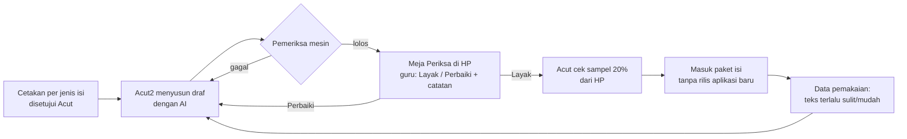

**Meja Periksa** adalah satu halaman web pribadi (bukan bagian aplikasi anak) yang menampilkan satu butir isi per layar dengan tombol **Layak / Perbaiki** dan kolom catatan. Guru dan Acut memeriksa dari HP kapan saja, tanpa bertemu. Dibangun Acut2 di Tahap 3 bersama alat pengelola.

---

### 2. Peta isi per mata pelajaran dan kelas — tahun pertama

| Mapel / lapis | Kelas 1 | Kelas 2 | Kelas 3 | Kelas 4 | Kelas 5 | Kelas 6 | Cara | Rilis |
|---|---|---|---|---|---|---|---|---|
| **Matematika Lancar** (6 level + jurus) | ✓ | ✓ | ✓ | ✓ | ✓ | ✓ | A + B (jurus) | R1 |
| **Bahasa Indonesia harian** (baca ulang) | ✓ + tangga suku kata | ✓ | ✓ | ✓ | ✓ | ✓ (36 teks TKA dipakai) | B + C | R2 |
| **Persiapan TKA** | — | — | — | — | — | ✓ | C | R1.1 |
| **Matematika Paham** (modul topik) | nanti | nanti | nanti | ✓ topik TKA | ✓ topik TKA | ✓ topik TKA | B + C | R3 |
| **Bahasa Indonesia modul** | nanti | nanti | ✓ | ✓ | ✓ | ✓ (12 modul TKA) | B + C | R4 |
| **Belajar Bahasa Inggris** (paket tingkat 3–6, bebas dipilih semua kelas) | ✓ boleh | ✓ boleh | ✓ | ✓ | ✓ | ✓ | B | Tingkat 3–4 R2; 5–6 R3; ngobrol AI R5 (`11-belajar-bahasa-inggris.md`) |
| **Gudang Ilmu** (peta topik + kartu ilmu) | ✓ | ✓ | ✓ | ✓ | ✓ | ✓ | B + C | Peta R1; **kelas 6 dulu** (Matematika 4 Jan, Bahasa Indonesia 1 Feb 2027), kelas lain bertahap 2027 (`10-gudang-ilmu-…` 2.3) |

**Kenapa Paham dimulai dari kelas 4–6:** 24 modul Matematika TKA sudah mencakup topik kelas 4, 5, dan 6 (± 28% / 38% / 34%) **[FAKTA — `bahan/program-tka-sd-kelas-6.md` Bagian 2]**, jadi bahannya tinggal diubah bentuk untuk anak yang belajar di rumah. Kelas 1–3 belum punya bahan sama sekali.

**Batas jujur:** tahun pertama tidak menutup seluruh ± 360 topik di Prompt RCTOR. Yang tertutup: latihan harian 2 mapel × 6 kelas, TKA kelas 6, dan Paham untuk 12 topik pertama. **Ditambah 28 Okt atas permintaan Acut: Gudang Ilmu** — peta topik lengkap SD kelas 1–6 sudah ada di R1, lalu kartu ilmu diisi bertahap sepanjang 2027 (**kelas 6 dulu**: Matematika 4 Jan dan Bahasa Indonesia 1 Feb; Matematika kelas 4–5 Maret, kelas 1–3 Juni, Bahasa Indonesia kelas 1–5 Desember), ± 120 jam pemeriksaan untuk dua mapel (`10-gudang-ilmu-bimbingan-dan-waktu.md` bagian 2).

---

### 3. Daftar isi yang harus dibuat, per rilis

| # | Isi | Jumlah | Cara | Siap paling lambat (target · cadangan) | Untuk |
|---|---|---|---|---|---|
| 1 | Layar jurus Lancar (inti jurus, 2–3 contoh jadi, catatan ingat) | 36 (6 kelas × 6 level) | B (diperiksa Acut; guru mengambil sampel ulang mulai Feb) | Jumat 13 Nov · 20 Nov | R1 |
| 2 | Kalimat petunjuk bersuara (semua tombol dan layar anak kelas 1–2) | ± 150 kalimat | B + suara buatan | Jumat 13 Nov · 20 Nov | R1 |
| 3 | Pesan semangat siap pakai untuk orang tua | ± 40 | B | Jumat 13 Nov · 20 Nov | R1 |
| 4 | Bank pertanyaan masukan (orang tua + anak) | ± 60 | B (dari `08-sistem-masukan.md`) | Jumat 13 Nov · 20 Nov | R1 |
| 5 | Soal TKA menjadi data: 36 modul, 5 simulasi, 36 teks | ± 1.050 butir **[ESTIMASI: ± 25 butir per modul × 36 + 150 butir simulasi; dicek setelah berkas diterima]** | C | 20 Des · 31 Des | R1.1 |
| 6 | Penanda jenis salah per pengecoh TKA (Baca / Hitung / Salah paham) | ± 3.000 pengecoh | B (dari baris "Kenapa pengecoh menarik") | 20 Des · 31 Des | R1.1 |
| 7 | Teks baca ulang kelas 1–5 + 2 pertanyaan per hari | 180 teks (36 × 5) | B | 15 Jan · 22 Jan | R2 |
| 8 | Tangga suku kata kelas 1 (suku kata terbuka → kata → kalimat) | ± 100 suku kata + 300 kata | A + rekaman suara guru | 15 Jan · 22 Jan | R2 |
| 9 | Modul Paham kelas 4–6, 12 topik pertama (pecahan, KPK/FPB, satuan, data) | 12 | B + C | 8 Mar · 15 Mar | R3 |
| 10 | Teks baca ulang tambahan kelas 1–6 | 72 (12 × 6) | B | 1 Mei · 15 Mei | Sampai akhir tahun ajaran |
| 11 | Paket kelas tahun ajaran 2027/2028 + modul Bahasa Indonesia kelas 3–6 | ditetapkan Mei | B + C | 31 Mei · 14 Jun | R4 |

---

### 4. Cetakan per jenis isi (yang disetujui Acut sebelum AI menulis)

| Jenis | Isi cetakan | Pemeriksa mesin |
|---|---|---|
| **Teks baca ulang** | Kelas, panjang kata, panjang kalimat, latar Aceh (pasar, meunasah, laut, sawah, sekolah), tokoh laki-laki dan perempuan bergantian, 3–5 kata baru yang terjelaskan dari kalimat sekitarnya, 2 pertanyaan per hari (hari 1: tersurat; hari 2: tersirat) | Jumlah kata dalam batas kelas; kata per kalimat; tidak ada kata di daftar terlarang; nama bergantian; pertanyaan PG dengan 3–4 pilihan |
| **Layar jurus** | Satu kalimat inti; 2–3 contoh jadi polos (tanpa menyuruh menjelaskan); satu "catatan ingat"; lambang sesuai standar istilah (bagi ":") | Semua contoh dihitung ulang; tidak ada lambang ÷ |
| **Modul Paham** | Diambil dari cetakan 7 halaman modul TKA, diubah untuk belajar di rumah: salah paham di depan, contoh jadi berpasangan, latihan 8 soal campur, kunci berjenjang (Petunjuk → Langkah) | Format standar soal TKA + baris Periksa bernilai benar |
| **Pesan dan pertanyaan** | Kalimat ≤ 15 kata, sapaan hangat, tanpa istilah Inggris | Panjang kalimat; daftar kata terlarang |

**Aturan kepantasan isi untuk anak** (diperiksa guru, 100% untuk teks): tidak ada kekerasan, merek dagang, tokoh nyata selain nama tempat umum, kegiatan berbahaya, atau ejekan terhadap kelompok mana pun; adat dan suasana Aceh ditulis wajar; tidak ada isi yang mendorong anak menghubungi orang asing atau membeli sesuatu.

---

### 5. Suara

| Pilihan | Biaya | Untung | Rugi | Putusan |
|---|---|---|---|---|
| **Suara buatan Google Chirp 3 HD, dibuat sekali lalu disimpan di paket isi** | Gratis sampai 1 juta karakter per bulan, lalu US$30 per juta **[FAKTA — Google Cloud, halaman harga Text-to-Speech]**; bahasa Indonesia tersedia **[FAKTA — dokumentasi Chirp 3 HD]** | Seragam, bisa diperbarui kapan saja, jalan tanpa sinyal | Nama Aceh (Lampulo, meunasah) bisa salah ucap | **✓ Diusulkan** |
| Rekaman guru atau Acut | Waktu ± 7 jam untuk 252 teks | Paling alami | Sulit diperbarui; mutu rekaman HP tidak seragam | Hanya untuk suku kata kelas 1 (suara buatan untuk suku kata lepas sering janggal) |
| Suara bawaan HP | Rp0 | Tanpa unduh | Suara berbeda tiap HP; sebagian HP murah tidak punya suara Indonesia | ✗ |

**[ESTIMASI]** Seluruh isi tahun pertama ± 220 ribu karakter (252 teks × 80–170 kata × 7 karakter + jurus + petunjuk), jadi **Rp0** karena masih di bawah batas gratis bulanan. Ukuran berkas: suara terkompresi ± 0,25 MB per menit; ± 50 teks per kelas ≈ **± 15 MB per paket kelas**.

**Pemeriksaan suara:** Acut mendengarkan 10% berkas dari HP; kata yang salah ucap diberi ejaan bantu lalu dibuat ulang.

---

### 6. Biaya dan jam kerja

#### 6.1 Biaya AI menyusun draf

**[ESTIMASI]** Tarif Opus 5.5 US$4/20 per juta token masuk/keluar; Sonnet 5.5 dengan potongan kiriman sekaligus (batch) 50% = US$1/5.

| Isi | Hitungan | Biaya |
|---|---|---|
| 252 teks + pertanyaan | 252 × (3.000 masuk + 1.500 keluar) dengan Opus | ± Rp175 ribu |
| 36 layar jurus | 36 × (4.000 + 1.500) dengan Opus | ± Rp27 ribu |
| 12 modul Paham | 12 × (20.000 + 15.000) dengan Opus | ± Rp75 ribu |
| Penanda jenis salah ± 1.050 soal TKA | 1.050 × (1.500 + 300) dengan Sonnet kiriman sekaligus | ± Rp52 ribu |
| **Jumlah** | | **± Rp330 ribu** (cadangan Rp500 ribu) |

Kalau draf disusun Acut2 di dalam Project ini dengan langganan Claude yang sudah ada, tambahan biayanya ± Rp0. Hitungan di atas berlaku kalau penyusunan dijalankan otomatis lewat layanan API.

#### 6.2 Jam guru pemeriksa

**[ASUMSI]** Keputusan 19 Okt: guru **dibayar per topik/butir yang diperiksa**. Besarnya diturunkan dari setara Rp50.000 per jam (mengikuti jaminan Rp50.000 per sesi pengajar di `bahan/rancangan-modul-interaktif.md` Bagian 2): **jurus Rp12.500 per layar, teks + pertanyaan Rp12.500 per teks, modul Paham Rp100.000 per modul, butir pendek (pesan, petunjuk, pertanyaan) Rp1.700**. Angka akhir disepakati dengan guru.

| Isi | Hitungan **[ESTIMASI]** | Jam |
|---|---|---|
| 36 layar jurus | 15 menit per layar | 9 |
| 252 teks + pertanyaan | 15 menit per teks (baca, cek pertanyaan, cek kepantasan) | 63 |
| Cocokkan sampel soal TKA yang dipindah | 10% × 1.050 = 105 butir × 2 menit | 3,5 |
| 12 modul Paham | 2 jam per modul | 24 |
| Rekaman suku kata kelas 1 | sekali duduk | 1 |
| Pesan, petunjuk, pertanyaan masukan | ± 250 butir × 2 menit | 8,3 |
| Sampel penanda pengecoh TKA (B/H/S), sebab rapor penyebab salah bertumpu padanya | 20% × ± 3.000 = 600 × 0,5 menit | 5 |
| **Jumlah** | | **± 114 jam ≈ Rp5,7 juta** (cadangan 1,5× = **Rp8,5 juta**) |

**Sebaran waktu (rencana lama, sebelum keputusan 20 Okt):** ± 20 jam November, ± 54 jam Desember–Januari, ± 25 jam Februari–Maret, ± 15 jam April–Mei.

#### 6.2a Keputusan 20 Okt: Acut memeriksa sendiri sampai Rilis 2

Supaya beban Acut tidak meledak di Desember–Januari, pemeriksaan dibagi menurut **kapan isi itu benar-benar dipakai anak**. Satu teks Baca Ulang dipakai 2 hari, jadi di bulan pertama R2 setiap kelas baru memakai ± 10–14 teks.

| Isi | Diperiksa Acut (Nov–Jan) | Diperiksa guru (Feb–Mei) |
|---|---|---|
| 36 layar jurus Lancar | Semua, 2–13 Nov (± 9 jam) | Sampel ulang 20% (± 2 jam) |
| Pesan, petunjuk, pertanyaan masukan (± 250 butir) | Semua (± 8 jam) | — |
| Soal TKA yang dipindah (sampel 10%) dan penanda pengecoh (sampel 20%) | Semua sampel (± 8,5 jam), Des | — |
| Rekaman suku kata kelas 1 | Semua (± 1 jam) | — |
| Teks Baca Ulang kelas 1–5 (180) | **10 teks pertama per kelas = 50 teks** (± 12,5 jam), sebelum 15 Jan | 130 teks sisanya, sebelum dipakai (± 32,5 jam) |
| 72 teks tambahan (termasuk bacaan dingin kelas 6) | — | Semua (± 18 jam) |
| 12 modul Paham | — | Semua, sebelum R3 (± 24 jam) |
| **Jumlah** | **± 39 jam ≈ ± 3 jam per minggu** selama 13 minggu | **± 77 jam ≈ Rp3,9 juta**, Feb–Mei (± Rp960 ribu per bulan) |

Semua angka **[ESTIMASI — 15 menit per teks, 2 menit per butir pendek, sama dengan tabel 6.2]**. Untungnya: honor November–Januari Rp0, dan Acut mengenal isinya sendiri. Biayanya: ± 3 jam kerja Acut per minggu, di atas ± 4–5 jam pekerjaan masa gratis. Risikonya: kalau Acut tertinggal, 10 teks pertama per kelas belum siap pada 15 Januari dan R2 mundur ke cadangan 22 Februari. Tanda awalnya: < 25 teks selesai diperiksa pada Jumat 1 Januari. Bulan terberat (Desember–Januari) bertepatan dengan persiapan kelas luring TKA, jadi **guru pemeriksa teks sebaiknya bukan pengajar kelas luring**.

#### 6.3 Pekerjaan Acut, semuanya bisa dari HP

| Pekerjaan | Kapan | Waktu **[ESTIMASI]** |
|---|---|---|
| Menyetujui 4 cetakan isi (bagian 4) | Minggu ini, sebelum 26 Okt | 1 jam |
| Mengirim berkas TKA dari laptop (atau membagikan folder) | Paling lambat 31 Okt | 15 menit |
| Memilih dan menghubungi guru pemeriksa | Paling lambat Jumat 15 Jan 2027 (diubah 20 Okt) | — |
| Memeriksa isi Nov–Jan sesuai bagian 6.2a | Nov–Jan | ± 3 jam per minggu |
| Memeriksa 36 layar jurus R1 di Meja Periksa (sebelum guru ada) | 2–13 Nov | ± 3 jam |
| Cek sampel 20% di Meja Periksa | Mingguan, Nov–Mei | ± 1 jam per minggu |
| Dengar 10% berkas suara | Saat paket isi dibuat | ± 30 menit per paket |
| Coba 36 latihan rumah TKA di HP sendiri | 21–31 Des | 3 jam |

---

### 7. Isi mengikuti pemakaian

| Tanda dari data | Batas **[ASUMSI]** | Tindakan |
|---|---|---|
| Teks terlalu sulit | Median pemahaman < 60%, atau kata per menit bacaan pertama < 70% patokan kelas | Teks dipendekkan atau dipindah ke tingkat lebih rendah |
| Teks terlalu mudah | Pemahaman 100% pada > 80% anak | Pertanyaan diganti yang lebih dalam |
| Butir TKA bermasalah | > 70% anak memilih pengecoh yang sama | Guru memeriksa: kunci salah, atau salah paham umum (masuk rapor) |
| Jurus tidak menolong | Anak yang membuka jurus tetap salah ≥ 4 di lembar berikutnya | Contoh jadi ditambah atau diganti |

---

### 8. Risiko isi

| Risiko | Tanda awal | Pencegahan |
|---|---|---|
| Guru pemeriksa belum ada saat draf teks siap (Desember) | 13 Nov lewat tanpa nama | Dua calon dihubungi sekaligus; cadangan: Acut memeriksa sendiri 36 teks kelas 1–2 dulu, sisanya menyusul sebelum 22 Jan |
| Berkas TKA dari laptop terlambat | 31 Okt lewat | Cadangan: R1.1 memakai 5 simulasi saja (paling penting untuk tempo), latihan rumah menyusul; kelas luring tetap memakai PDF |
| Hak cipta modul TKA belum jelas (siapa penulisnya) | Tidak ada perjanjian tertulis **[FAKTA — `bahan/kelemahan-rencana-lama.md` A3]** | Masuk daftar pertanyaan ahli hukum; perjanjian pengalihan hak sebelum isi masuk aplikasi |
| Teks AI terasa kaku atau tidak bernuansa Aceh | Catatan guru "kaku" pada > 20% teks pertama | Cetakan diperbaiki setelah 10 teks pertama, bukan setelah 180 |
| Suara buatan salah mengucap nama tempat | Acut menemukan salah ucap | Ejaan bantu; rekam manual untuk kata yang tetap salah |


## Mesin Belajar Metode LANCAR — Versi Aplikasi

*Berkas: `rancangan/01-produk/04-mesin-lancar.md`*

**Ringkas:** (1) Purwarupa versi 5 dipertahankan sebagai inti, sebab sudah lolos 8.100 lembar uji otomatis dengan 0 kunci salah, dan sebagian besar aturannya sudah sesuai Metode LANCAR. (2) Ada 12 celah yang ditutup di versi aplikasi. Yang terbesar: dua level kelas 6 di luar materi SD, belum ada penyelipan fakta baru secara bertahap, belum ada penjaga "terlalu rumit / terlalu mudah" selain turun level, dan lembar yang dikerjakan bersama orang tua ikut dihitung untuk naik level. (3) Semua angka ambang di sini adalah **[ASUMSI]** awal yang dikalibrasi ulang dari data minggu ke-4.

Tahap 2, butir 5. Disusun 19 Oktober 2026. Dasar: `bahan/latihan-v5-lancar.html`, `claude/metode-lancar.md`, `rancangan/01-produk/riset-penguat.md`.

---

### 1. Yang dipertahankan dari versi 5

| Bagian | Cara kerja di versi 5 | Kenapa dipertahankan |
|---|---|---|
| Pembuat soal dengan benih acak | Soal dibuat kode, bukan disalin; tiap soal unik dalam satu lembar; urut dari mudah ke sulit | Tidak menjiplak lembar siapa pun; kunci selalu benar (8.100 lembar diuji) |
| 6 level per kelas | Sesuai `latihan-hitung-cepat-level-per-kelas.md` | Keputusan 19 Okt |
| Tes penempatan | 4 soal per level dari Level 1; berhenti di level pertama yang belum lancar (4/4 benar dan di bawah target waktu); ada tombol "Belum bisa" dan pilihan "lewati, mulai Level 1" | Prinsip L: mulai dari level anak |
| Layar jurus | Satu layar per level: inti jurus, 2–3 contoh jadi polos, catatan ingat; bisa dibuka lagi | Prinsip A; contoh jadi tanpa disuruh menjelaskan (β = −0,24 bila disuruh) |
| Susunan lembar | 20 soal: 14 level ini + 6 level sebelumnya (Level ≥ 3: 4 dari level −1, 2 dari level −2) | Prinsip C |
| Naik level | 2 lembar **tepat** berturut-turut (salah ≤ 1 dan waktu ≤ target); **kilat** (0 salah dan ≤ 66% target) langsung naik | Prinsip N |
| Turun level | Salah ≥ 6 dalam satu lembar | Mencegah anak tenggelam |
| Pengulangan soal | Sampai 4 soal yang salah atau terlalu lama (> 2× target) muncul lagi di lembar berikutnya | Umpan balik korektif |
| Uji daya tahan | 3 minggu setelah lulus, 6 soal level itu menggantikan soal lama; dianggap ingat bila salah ≤ 1 | Prinsip "penguasaan dihitung kalau masih bisa 3 minggu kemudian" |
| Data per soal | Soal, jawaban, benar/salah, detik, jumlah hapus, level asal, tanda pengulangan | Prinsip R: rapor per soal, bukan per lembar |

---

### 2. Celah di versi 5 dan perbaikannya

| # | Celah | Akibat kalau dibiarkan | Perbaikan di aplikasi |
|---|---|---|---|
| 1 | Lambang bagi **÷** | Berbeda dengan buku sekolah dan standar TKA (":") | Ganti ":" di semua soal dan jurus |
| 2 | Kelas 6 L2 (pangkat tiga) dan L3 (bilangan negatif) | Materi SMP **[FAKTA — CP 032/2024; Buku Guru Kelas VII]**; tidak membantu TKA | Ganti (lihat bagian 4) |
| 3 | Fakta baru dikenalkan sekaligus satu keluarga | Bertentangan dengan prinsip "selipkan" di Metode LANCAR | Lembar pertama level baru 8 soal baru + 12 lama; lembar kedua 11 + 9; sesudahnya 14 + 6 |
| 4 | Dua lembar boleh dikerjakan berturut-turut tanpa jeda dan langsung dihitung naik | **[FAKTA — ringkasan Peltier, belum ditelaah sejawat; lewat `claude/metode-lancar.md`]** jeda 10 menit terlalu pendek, jeda 3 jam membantu | Dua lembar tepat harus dari **dua sesi berbeda (jeda ≥ 1 jam)** untuk dihitung naik; kilat tetap langsung naik |
| 5 | Lembar yang dikerjakan di Mode Dampingi tetap dihitung | Orang tua bisa membantu, sehingga level naik palsu | Lembar Mode Dampingi ditandai dan **tidak dihitung untuk naik level** (tetap dihitung untuk latihan) |
| 6 | Tidak ada tombol jeda | Azan, tamu, atau adik menangis membuat waktu membengkak dan anak "gagal" | Tombol jeda menyembunyikan soal dan menghentikan waktu; paling banyak 2 kali per lembar |
| 7 | Uji daya tahan gagal hanya menjadwalkan ulang 3 minggu lagi | Fakta yang mulai lupa tidak dilatih | Bila gagal: soal level itu masuk antrean pengulangan 3 lembar berikutnya, lalu diuji ulang **1 minggu** kemudian |
| 8 | Uji daya tahan hilang saat ganti kelas | Level kelas lama tidak pernah dicek lagi | Minggu pertama kelas baru: semua level kelas lama yang lulus diuji sekali |
| 9 | Penjaga "terlalu rumit / terlalu mudah" hanya turun level dan kilat | Anak bisa macet berminggu-minggu di salah 2–5 tanpa kemajuan | Penjaga lengkap di bagian 5 |
| 10 | Kesalahan hanya dicatat per soal | Rapor tidak bisa menjelaskan **kenapa** salah | Peta jenis salah (bagian 6) |
| 11 | Tes penempatan dihitung lancar hanya kalau 4/4 | Satu salah ketik menempatkan anak terlalu rendah (terlalu mudah) | Tetap 4/4 untuk "lancar", tetapi bila anak kilat di 2 lembar pertama, aplikasi menawarkan tes loncat level |
| 12 | Setelah Level 6 lulus, anak harus pindah kelas secara manual | Anak bingung, atau maju jauh melampaui sekolah tanpa sepengetahuan orang tua | Mode "Lembar Jaga": 1 lembar campur semua level per hari (Jurus Sulap Angka ikut terbuka mulai Rilis 3); pindah ke kelas berikutnya hanya kalau orang tua memilih |

---

### 3. Aturan lengkap versi aplikasi

| Aturan | Isi | Dasar |
|---|---|---|
| Takaran | 2 lembar per hari, sebaiknya sore dan malam; lembar ke-3 boleh tetapi tidak dihitung untuk naik level. Lama latihan **2–5 menit per hari** (diputuskan Acut 20 Okt) | Takaran 2–5 menit per hari **[FAKTA — Duhon 2022; Peltier]** |
| Panjang lembar | **20 soal untuk semua level** (keputusan Acut 20 Okt; usul lembar 15 soal tidak dipakai) | Kelas 1: 20 × 3 detik = 1 menit + mengetik. **[ASUMSI]** Cukup pendek untuk umur 6; dicek di uji keluarga. Level terberat ± 4,7 menit untuk dua lembar, masih di dalam takaran 2–5 menit |
| Susunan lembar | Lihat celah #3; soal lama ditaruh di posisi tersebar, bukan di belakang | Prinsip C |
| Target waktu | Jumlah target per soal di lembar itu (3–7 detik per soal, sesuai level) | Jawaban dari ingatan ± 2–3 detik **[FAKTA — Rocket Math]** |
| Tepat | Salah ≤ 1 **dan** waktu ≤ target | Versi 5 |
| Naik | 2 lembar tepat dari 2 sesi berbeda, atau 1 lembar kilat | Celah #4 |
| Tetap | Salah 2–5, atau tepat tapi lewat waktu | Versi 5 |
| Turun | Salah ≥ 6 | Versi 5 |
| Pengulangan | Sampai 4 soal yang salah atau > 2× target muncul lagi di lembar berikutnya | Versi 5 |
| Daya tahan | 21 hari setelah lulus; ingat bila salah ≤ 1 dari 6 | Versi 5 + celah #7–8 |
| Jeda | Paling banyak 2 kali per lembar, soal disembunyikan | Celah #6 |
| Mode Dampingi | Tidak dihitung untuk naik level | Celah #5 |

---

### 4. Level per kelas — usulan revisi

Yang berubah dari versi 4/5 ditandai **tebal**.

| Kelas | L1 | L2 | L3 | L4 | L5 | L6 |
|---|---|---|---|---|---|---|
| 1 | Tambah sampai 10 | Kurang sampai 10 | Belasan (13 + 5) | Tambah sampai 20 | Kurang sampai 20 | Campur |
| 2 | Puluhan (30 + 40) | 2 angka + 1 angka | 2 angka − 1 angka | ×2 ×5 ×10 | :2 :5 :10 | Campur |
| 3 | ×3 ×4 | ×6 ×7 | ×8 ×9 | Bagi dari tabel (56 : 7) | Tambah/kurang 2 angka | Campur kali bagi |
| 4 | Pemanasan tabel | Kali puluhan/ratusan | 2 angka × 1 angka, hasil ≤ 150 | Bagi hasil belasan | Ratusan | Campur |
| 5 | **2 angka × 1 angka, hasil ≤ 200** (diturunkan 20 Okt dari ≤ 400) | Bagi puluhan | ×11 dan ×25 | Kuadrat ≤ 15 | ½ ¼ ⅓ ¾ dari bilangan | Campur |
| 6 | Kuadrat dan akar ≤ 15 | **Pecahan ↔ persen ↔ desimal setara** (½ = …%, 0,4 = …%) | **KPK dan FPB bilangan kecil** (KPK 4 dan 6; FPB 12 dan 18) | Persen mudah (25% dari 80) | Urutan operasi | Campur |

#### 4.1 Target detik per soal dan lama latihan harian (ditambah 20 Okt)

Pemeriksa menemukan bahwa target per level tidak tertulis di rancangan, dan level atas melewati takaran 2–4 menit yang waktu itu dikunci. **Acut memutuskan 20 Okt: lembar tetap 20 soal dan takaran menjadi 2–5 menit.** Angka di bawah diambil dari versi 5 (`bahan/latihan-v5-lancar.html`), kecuali kelas 5 L1 dan kelas 6 L2–L3 yang levelnya baru.

| Kelas | L1 | L2 | L3 | L4 | L5 | L6 |
|---|---|---|---|---|---|---|
| 1 | 3 | 3 | 3 | 3,5 | 3,5 | 3,5 |
| 2 | 3 | 3,5 | 3,5 | 3 | 3 | 4 |
| 3 | 3 | 3 | 3 | 3,5 | **6** | 3,5 |
| 4 | 3 | 4 | **6** | **6** | **6** | **5** |
| 5 | **6** | **5** | **5** | 4 | 5 | **5,5** |
| 6 | 4 | 5 (baru) | **6 (baru)** | **5** | **7** | **5,5** |

Angka = target detik per soal. **Tebal** = level yang target 20 soalnya (termasuk soal level lama) > 100 detik; level ini yang paling dekat ke batas 5 menit, jadi dipantau di laporan minggu ke-4.

| Hitungan **[ESTIMASI]** | Lembar 20 soal | Lembar 15 soal |
|---|---|---|
| Level terberat (kelas 6 L5): 14 × 7 + 4 × 5 + 2 × 6 | 130 detik | 98 detik |
| Dua lembar pada kecepatan target, + 20% untuk membaca jurus dan hasil | 2 × 130 × 1,2 = **5,2 menit** ✗ | 2 × 98 × 1,2 = **3,9 menit** ✓ |
| Level teringan (kelas 1 L1) | 2 × 60 × 1,2 = 2,4 menit | — |

Anak yang belum lancar bekerja lebih lambat dari target, jadi lama sebenarnya bisa ± 1,5× angka ini di minggu pertama sebuah level. Itu diterima, sebab level itu justru sedang dilatih, dan penjaga "macet" (5.1) mempersempit lembar kalau anak terlalu lama.

**Kelas 5 L1 diturunkan** menjadi hasil ≤ 200 (misal 24 × 6, 35 × 4), sebab hasil sampai 400 dalam ≤ 6 detik bukan lagi jawaban dari ingatan (± 2–3 detik **[FAKTA — Rocket Math]**) dan berisiko "terlalu rumit" (aturan 4). Hasil sampai 400 tetap muncul di soal Paham, bukan Lancar.

**Diputuskan Acut 20 Okt: (b)** — lembar tetap 20 soal, takaran 2–5 menit (masih di dalam rentang riset Duhon 2–5 menit). Kolom "Lembar 15 soal" di tabel hitungan di atas tidak dipakai, hanya disimpan sebagai cadangan kalau data minggu ke-4 menunjukkan anak kelas 4–6 kelelahan atau meninggalkan lembar (tanda "kelelahan" dan "ditinggalkan" di bagian 5.1).

**Kenapa dua penggantinya ini:** keduanya ada di CP Fase C dan di muatan TKA SD **[FAKTA — CP 032/2024; program TKA]**, dan bisa dijawab dengan angka bulat di papan angka (tanpa tombol koma). Contoh: "¾ = …%" dijawab 75; "KPK 4 dan 6" dijawab 12.

**Catatan kelas 2:** L2–L5 mendahului CP Fase A, yang hanya sampai "tambah dan kurang sampai 20" dan belum menyebut kali dan bagi **[FAKTA — CP 032/2024, lihat `riset-penguat.md` bagian 2]**. Usul: **dipertahankan**, sebab menyiapkan kelancaran kelas 3. Jurus L4–L5 harus mengajarkan dari nol ("kali = tambah berulang", dengan gambar). Keputusan di tangan Acut.

---

### 5. Penjaga "tidak terlalu rumit, tidak terlalu mudah"

#### 5.1 Untuk tiap anak

| Tanda | Batas **[ASUMSI]** | Tindakan otomatis |
|---|---|---|
| **Terlalu mudah** | Kilat di lembar pertama level baru, atau 3 lembar berturut-turut 0 salah dan < 66% target | Naik langsung, atau tawarkan tes loncat level |
| **Terlalu rumit — tenggelam** | Salah ≥ 6 | Turun satu level (versi 5) |
| **Terlalu rumit — macet** | 4 lembar berturut-turut "tetap" tanpa kemajuan waktu | Tampilkan jurus lagi; persempit lembar ke keluarga fakta yang belum hafal (misal hanya ×7, bukan ×6 dan ×7); kabari orang tua dengan saran Mode Dampingi |
| **Ditinggalkan** | 2 lembar berturut-turut tidak diselesaikan | Lembar berikutnya dibuat lebih pendek (10 soal) dan dimulai dari soal termudah |
| **Kelelahan** | Waktu per soal di 5 soal terakhir > 2× rata-rata 5 soal pertama | Catat; bila berulang 3 hari, sarankan pindah jam latihan |

#### 5.2 Untuk tiap level (dilihat Acut di panel pengelola)

| Tanda | Batas **[ASUMSI]** | Arti | Tindakan |
|---|---|---|---|
| Lembar sampai lulus | Median > 8 lembar | Level terlalu besar | Pecah jadi dua level |
| Lembar sampai lulus | > 50% anak lulus dalam 2 lembar pertama | Level terlalu kecil | Gabung dengan level berikutnya |
| Benar di lembar pertama | Median < 70% | Lompatan terlalu jauh | Tambah jurus atau level antara |
| Target waktu | > 30% anak yang benar ≥ 95% tetap lewat target | Target terlalu ketat | Naikkan target level itu |

Dengan ± 50 anak yang tersebar di 6 kelas, tiap level hanya berisi beberapa anak. **[ESTIMASI]** Penyesuaian level baru layak setelah minimal 5 anak menyelesaikan level itu.

---

### 6. Peta jenis salah

Setiap jawaban salah diberi satu kode secara otomatis. Aturannya sederhana dan bisa diperiksa.

| Kode | Arti | Cara mengenali | Kalimat di rapor orang tua |
|---|---|---|---|
| **TUKAR** | Operasi tertukar | Jawaban = hasil operasi lain dengan angka yang sama (misal 6 × 4 dijawab 10) | "Kadang tanda + dan × tertukar" |
| **SELISIH 1** | Meleset satu | Selisih jawaban dan kunci = 1 | "Masih menghitung dengan jari di beberapa soal" |
| **PULUHAN** | Salah simpan atau pinjam | Selisih = 10, atau angka satuan benar tapi puluhan salah | "Perlu latihan menyimpan puluhan" |
| **TERBALIK** | Angka terbalik | Angka jawaban kebalikan kunci (42 ↔ 24) | "Kadang menulis angka terbalik" |
| **TETANGGA** | Fakta tetangga | Jawaban = a × (b ± 1) | "×7 dan ×8 masih tertukar" |
| **LAMBAT** | Benar tapi > 2× target | Bukan salah, tetapi belum dari ingatan | "Benar, tapi masih dihitung, belum diingat" |
| **LAIN** | Tidak masuk pola | — | (tidak disebut per soal) |

Rapor menampilkan **per keluarga fakta**, bukan daftar semua salah, sebab daftar panjang mendorong orang tua mengontrol.

---

### 7. Data yang dicatat per soal

| Data | Untuk apa |
|---|---|
| Soal, kunci, jawaban, benar/salah, detik, jumlah hapus | Sama dengan versi 5 |
| Level asal soal, tanda pengulangan, tanda daya tahan | Menghitung daya tahan dan efek campuran |
| **Kode jenis salah** | Peta jenis salah |
| **Jumlah jeda dan lamanya** | Memisahkan lambat karena terganggu dari lambat karena belum hafal |
| **Mode (sendiri / didampingi)** | Celah #5 |
| **Dimulai oleh** (anak sendiri / setelah pesan orang tua / setelah pengingat) | Ukuran "belajar tanpa disuruh" untuk gerbang berbayar |

---

### 8. Ukuran keberhasilan mesin

Diambil dari `claude/metode-lancar.md` Bagian 5 (sudah ditetapkan), dihitung pada **tes tetap** (lembar 20 soal campuran level kelas, dikerjakan di hari ke-1–3 lalu tiap 4 minggu; `09-gerbang-berbayar.md` bagian 1). Tabel induk semua target ada di `06-rilis/02-angka-keberhasilan.md`.

| Ukuran | Target | Cadangan |
|---|---|---|
| Kecepatan (detik per soal) | Turun 30% | Turun 15% |
| Ketepatan | ≥ 95% | ≥ 90% |
| Daya tahan 3 minggu | ≥ 90% tetap benar | ≥ 80% |
| Hari latihan per minggu | ≥ 5 | ≥ 4 |
| Anak masih latihan di minggu ke-4 | 8 dari 10 | 6 dari 10 |

---

### 9. Keputusan Acut (19 Okt ± 21.50: semua usul disetujui)

| # | Keputusan | Usul Acut2 |
|---|---|---|
| 1 | Ganti kelas 6 L2 dan L3 dengan "pecahan ↔ persen ↔ desimal" dan "KPK dan FPB bilangan kecil" | Setuju, sebab keduanya materi SD dan TKA |
| 2 | Kelas 2 L2–L5 dipertahankan walau mendahului CP | Dipertahankan, jurus mengajar dari nol |
| 3 | Lembar Mode Dampingi tidak dihitung untuk naik level | Ya |
| 4 | Dua lembar tepat harus dari sesi berbeda (jeda ≥ 1 jam) | Ya; kilat tetap langsung naik |
| 5 | Kapan perubahan ini dipasang ke halaman yang sudah dibagikan | Perbaikan #1 (lambang bagi) dan #2 (level kelas 6) bisa ikut saat versi 5 dipasang ± 26 Okt, **kalau Acut menyetujui**; sisanya langsung di aplikasi |


## Latihan Harian Bahasa Indonesia — "Baca Ulang"

*Berkas: `rancangan/01-produk/05-bahasa-indonesia.md`*

**Ringkas:** (1) Latihan harian Bahasa Indonesia adalah **baca ulang**: anak membaca teks pendek, mendengar contoh bacaan, membaca lagi, lalu menjawab pertanyaan. Kata per menit dicatat. Cara ini dipilih karena buktinya paling kuat (efek 0,75 untuk kelancaran dan 0,73 untuk pemahaman). (2) Kecepatan harian diukur dengan anak menekan tombol mulai dan selesai sendiri. **Angka rapor untuk semua keluarga adalah bacaan dingin dengan tombol** (hasil yang ditandai curang dibuang); **Dengar Bacaan** orang tua di Mode Dampingi seminggu sekali menjadi penguat yang lebih tepat (kata *benar* per menit), sebab mendampingi adalah pilihan dan sebagian besar keluarga tidak mendampingi (diubah 20 Okt). Tidak perlu AI suara dan tidak ada rekaman suara anak. (3) Celah terbesar: anak bisa menekan "selesai" tanpa membaca, dan kelas 1 di semester 2 sebagian belum bisa membaca. Keduanya punya penjaga di bagian 6 dan 4.

Tahap 2, butir 6. Disusun 19 Oktober 2026. Tayang di Rilis 2 (target 1 Februari 2027). Dasar: `riset-penguat.md` bagian 3.

---

### 1. Kenapa baca ulang, bukan latihan ejaan atau imbuhan

| Cara | Efek ke membaca | Sumber | Putusan |
|---|---|---|---|
| **Baca ulang** | 0,75 kelancaran; 0,73 pemahaman | **[FAKTA — Therrien 2004]** | **Inti harian** |
| Baca ulang dengan contoh bacaan dan patokan | Lebih baik daripada tanpa keduanya | **[FAKTA — Stevens, Walker & Vaughn 2017]** | Contoh suara dan patokan dipasang |
| Kosakata lewat teks yang akan dibaca | 0,50 untuk teks itu; 0,10 untuk tes umum | **[FAKTA — Elleman dkk. 2009]** | Kata baru diajarkan di dalam teks |
| Imbuhan (morfologi) | Pemahaman 0,13, tidak bermakna; bukti untuk bahasa Inggris saja | **[FAKTA — Colenbrander dkk. 2024]** | Pelengkap mingguan, bukan inti |

**Catatan untuk keputusan 19 Okt:** catatan diskusi menyebut latihan harian Bahasa Indonesia buatan mesin berisi "ejaan, imbuhan, kosakata dari daftar kata". Riset Tahap 1 mengubahnya: **ejaan dan imbuhan turun menjadi pelengkap mingguan**, sebab efeknya ke pemahaman tidak terbukti. Ini ganti arah yang perlu disetujui Acut (bagian 10).

---

### 2. Alur satu sesi

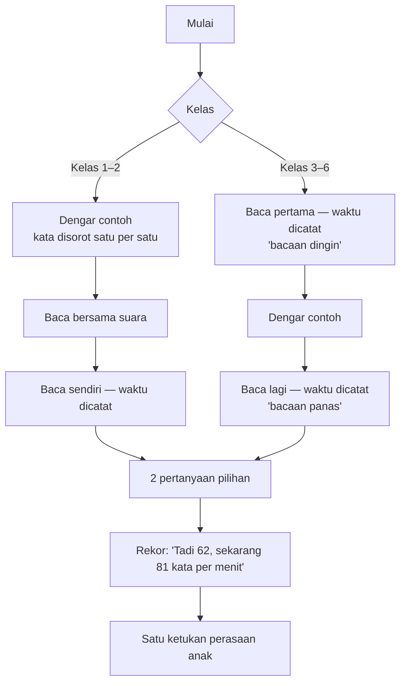

| Aturan | Isi | Dasar |
|---|---|---|
| Satu teks dipakai **2 hari** | Hari 1: alur penuh + pertanyaan tersurat. Hari 2: bacaan panas lagi + pertanyaan tersirat | Mengurangi kebutuhan teks setengahnya; tambah ulangan |
| Kelas 3–6 membaca 2 kali, bukan 3–6 kali | Bacaan dingin + bacaan panas | 6 kali lebih cepat tetapi tidak berpindah ke teks baru **[FAKTA — Stevens dkk. 2017]**; durasi tetap pendek |
| Bacaan dingin = ukuran kemajuan | Kecepatan pada teks **baru** yang belum pernah dibaca | Yang dikejar adalah kemampuan membaca teks apa pun, bukan hafal satu teks |
| Bacaan panas = rasa mampu | Anak melihat dirinya lebih cepat dalam 3 menit | Prinsip R: rekor sendiri |
| Membaca nyaring | Diminta, tidak dipaksa; tombol "baca dalam hati" tersedia | Anak yang malu tetap berlatih; hasilnya ditandai |

#### Durasi **[ESTIMASI]**

| Kelas | Panjang teks **[ASUMSI]** | Hitungan | Lama Baca Ulang | Batas sesi total (dari `01-profil`) |
|---|---|---|---|---|
| 1 | 20–40 kata | dengar 0,5 + bersama 1 + sendiri 1 + soal 1 | ± 3,5 menit | ≤ 10 menit |
| 2 | 40–70 kata | ± 1 + 1 + 1 + 1 | ± 4 menit | ≤ 10 menit |
| 3–4 | 70–130 kata | dingin 1,5 + dengar 1 + panas 1,3 + soal 1 | ± 5 menit | ≤ 15 menit |
| 5–6 | 130–200 kata | 1,8 + 1,5 + 1,5 + 1 | ± 6 menit | ≤ 20 menit |

Ditambah Lancar Matematika ± 2–5 menit, semua kelas masih di bawah batas sesi.

---

### 3. Patokan kecepatan

**Kesenjangan data:** tidak ada patokan resmi kata per menit per kelas untuk Indonesia **[FAKTA — `riset-penguat.md` bagian 3]**. Yang ada hanya kelas 3: **64,4–69,2 kata benar per menit**, dan siswa Aceh ± 17–20 kata per menit lebih lambat daripada siswa Jawa **[FAKTA — USAID PRIORITAS, RTI 2017]**.

| Kelas | Patokan sementara (kata benar per menit, akhir tahun) **[ASUMSI]** | Cara menyusun |
|---|---|---|
| 1 | 30 | Diturunkan dari kelas 3 dengan selisih ± 15–20 per tahun |
| 2 | 50 | sama |
| 3 | 65 | Data USAID |
| 4 | 80 | Dinaikkan ± 15 per tahun |
| 5 | 95 | sama |
| 6 | 110 | Teks TKA 150–200 kata dalam waktu 2,5 menit per soal |

**Patokan ini bukan syarat lulus.** Yang ditampilkan ke anak dan orang tua adalah **kenaikan pribadi**. Patokan dipakai mesin untuk memilih tingkat teks, lalu **dikalibrasi ulang setelah 4 minggu** dari data anak-anak uji (sudah dicatat di `keputusan.md` bagian E).

#### Ukuran keberhasilan

| Ukuran | Target | Cadangan |
|---|---|---|
| Kenaikan kecepatan bacaan **dingin** dalam 8 minggu | +15% | +8% |
| Pertanyaan pemahaman benar | ≥ 80% | ≥ 70% |
| Hari Baca Ulang per minggu | ≥ 4 | ≥ 3 |
| Orang tua yang mendengar bacaan minimal 2 kali per bulan | 6 dari 10 | 4 dari 10 |

---

### 4. Kelompok kelas

| Kelompok | Masalah utamanya | Isi Baca Ulang | Penjaga |
|---|---|---|---|
| **Kelas 1** (Februari = semester 2) | Sebagian sudah membaca kalimat, sebagian belum lancar suku kata **[ASUMSI]** | Tes penempatan: 3 kartu (suku kata → kata → kalimat). Yang belum lolos kata masuk **Tangga Suku Kata** (buatan mesin: ba–bi–bu → bola, mata → kalimat 3 kata); yang lolos masuk teks 20–40 kata | Semua petunjuk bersuara; teks disorot per kata saat suara berjalan |
| **Kelas 2** | Kelancaran | Teks 40–70 kata, kalimat ≤ 8 kata | Baca bersama suara dulu sebelum baca sendiri |
| **Kelas 3–4** | Kelancaran ke pemahaman | Teks 70–130 kata; pertanyaan tersurat dan tersirat | Patokan kelas 3 dari data USAID |
| **Kelas 5–6** | Pemahaman dan kecepatan untuk TKA | Teks 130–200 kata; pertanyaan mengikuti tiga tingkat TKA (tekstual, inferensial, evaluasi). Kelas 6 memakai **36 teks baca cepat TKA yang sudah ada** | Pertanyaan berbentuk PG, PG kompleks, PG kategori seperti TKA |

**Kelas 6 dan kelas luring:** murid kelas luring membaca teks yang sama di kelas (5 menit baca cepat). Di rumah, aplikasi memberi **teks pertemuan itu sebagai bacaan panas** pada hari yang sama. Itu justru baca ulang yang sebenarnya, sehingga tidak ada pekerjaan ganda.

**Ukuran kemajuan untuk murid luring (ditambah 20 Okt):** teks pertemuan sudah dibaca di kelas, jadi bukan bacaan dingin. Karena itu murid luring mendapat **satu bacaan dingin terpisah per minggu** dari 72 teks tambahan (`03-rencana-isi.md`), dan hanya bacaan itu yang dipakai untuk rapor kecepatan dan janji 1b. Biaya: ± 12 teks kelas 6 dari 72 teks tambahan dipakai lebih awal; tidak menambah honor.

#### Naik tingkat teks

Mengikuti pola Metode LANCAR:

| Keadaan | Aturan **[ASUMSI]** |
|---|---|
| Naik tingkat | Bacaan dingin ≥ patokan tingkat itu pada 3 teks berturut-turut **dan** pemahaman ≥ 80% |
| Tetap | Selain itu |
| Turun tingkat | Bacaan dingin < 60% patokan pada 3 teks berturut-turut, atau pemahaman < 50% |

---

### 5. Mengukur kecepatan — tiga cara

| Cara | Siapa | Seberapa sering | Mengukur | Untung | Rugi | Dipakai untuk |
|---|---|---|---|---|---|---|
| **Tombol mulai–selesai** | Anak sendiri | Setiap sesi | Kata per menit (tanpa tahu salah) | Tanpa bantuan siapa pun | Bisa dicurangi; salah baca tidak terhitung | Rekor anak, pemilihan tingkat, dan **angka rapor + janji 1b untuk semua keluarga** (bacaan dingin saja, tanda curang dibuang) |
| **Dengar Bacaan** di Mode Dampingi | Orang tua | Seminggu sekali | **Kata benar per menit** + kata yang tersandung | Paling tepat; orang tua terlibat; tanpa rekaman | Butuh orang tua 3 menit; hanya keluarga pendamping (± 20% **[ASUMSI]**) | **Penguat**: ditampilkan di samping angka tombol. Keluarga yang tidak mendampingi melihat "belum diukur orang tua", bukan kolom kosong |
| AI pengenal suara | Mesin | — | — | Otomatis | Salah ± 25% pada suara anak **[FAKTA — The Learning Agency, Okt 2025]**; perlu izin rekaman suara anak | **Tidak dipakai** di R2; dinilai ulang setelah uji suara Bahasa Inggris |

#### Dengar Bacaan — naskah untuk orang tua

Layar orang tua menampilkan teks dengan kata yang bisa diketuk. Naskahnya tampil di atas:

1. "Minta anak membaca nyaring. Tekan **Mulai** saat ia mulai."
2. "Jangan memotong. Kalau ia salah atau berhenti lebih dari 3 detik, **ketuk kata itu** saja."
3. "Tekan **Selesai** saat ia selesai."
4. "Puji satu hal yang benar-benar ia lakukan, misalnya: 'Kamu tidak berhenti di kata *perahu* lagi.'"

Aplikasi menghitung kata benar per menit dan menyimpan daftar kata yang tersandung. **Yang disimpan hanya angka dan kata, bukan suara.** Kata yang tersandung masuk ke latihan kata mingguan.

**Dasar peran orang tua:** keterlibatan yang mendukung menolong, yang mengontrol merusak **[FAKTA — `rancangan-modul-interaktif.md` Bagian 3]**. Karena itu naskah melarang memotong dan menutup dengan pujian yang spesifik.

---

### 6. Penjaga mutu data

| Celah | Tanda | Tindakan |
|---|---|---|
| Anak menekan "selesai" tanpa membaca | Kecepatan > 2× patokan kelas atau > 250 kata per menit | Hasil tidak dihitung; anak diminta "coba baca lagi pelan-pelan" sekali; tidak dimarahi |
| Kecepatan tinggi tapi pemahaman rendah | Kecepatan ≥ patokan tetapi pertanyaan salah 2 dari 2 pada 3 teks | Mesin tidak menaikkan tingkat; jurus "baca untuk paham" tampil |
| Membaca dalam hati | Tombol "baca dalam hati" dipakai | Ditandai, tidak dibandingkan dengan bacaan nyaring |
| Selisih tombol dan Dengar Bacaan | Kecepatan tombol > 1,5× angka orang tua | Rapor menampilkan keduanya dengan keterangan; mesin memakai rerata keduanya; janji 1b tetap memakai angka tombol supaya semua keluarga diukur dengan cara yang sama |
| Gangguan di rumah | Jeda > 10 detik di tengah bacaan | Tombol jeda; waktu jeda tidak dihitung |

---

### 7. Pelengkap mingguan (prioritas Penting, boleh dipotong)

| Pelengkap | Isi | Cara |
|---|---|---|
| **Kata minggu ini** | 5 kata dari teks minggu itu + kata yang tersandung di Dengar Bacaan | Buatan mesin dari teks; pilih arti dari kalimat |
| **Imbuhan dan ejaan** | 5 soal pendek (me-/di-, huruf kapital) dari kata di teks | Buatan mesin; sekali seminggu, ± 2 menit |

---

### 8. Data yang dicatat per sesi

| Data | Untuk apa |
|---|---|
| Teks, tingkat, tanggal, hari ke-1 atau ke-2 | Urutan dan naik tingkat |
| Waktu bacaan dingin dan panas; jeda | Kecepatan dan kemajuan |
| Cara mengukur (tombol / orang tua), nyaring atau dalam hati | Membedakan mutu angka |
| Jawaban 2 pertanyaan + jenis pertanyaan | Pemahaman per tingkat |
| Kata yang tersandung (dari orang tua) | Latihan kata dan rapor |
| Ketukan perasaan anak | Masukan |

---

### 9. Isi yang dibutuhkan

| Isi | Jumlah | Siap paling lambat | Rincian di |
|---|---|---|---|
| Teks kelas 1–5 + pertanyaan | 180 (36 × 5; cukup ± 14 minggu dengan 2,5 teks per minggu) | 15 Jan 2027 | `03-rencana-isi.md` no. 7 |
| Teks kelas 6 | 36 teks TKA yang sudah ada | Ikut R1.1 | no. 5 |
| Tangga Suku Kata kelas 1 | ± 100 suku kata + 300 kata | 15 Jan 2027 | no. 8 |
| Teks tambahan sampai akhir tahun ajaran | 72 (12 × 6) | 1 Mei 2027 | no. 10 |

---

### 10. Keputusan Acut (19 Okt ± 21.50: semua usul disetujui)

| # | Keputusan | Usul Acut2 |
|---|---|---|
| 1 | Inti harian Bahasa Indonesia = baca ulang; ejaan dan imbuhan jadi pelengkap mingguan (ganti arah dari catatan 19 Okt) | Setuju, sebab buktinya |
| 2 | Angka rapor resmi dari Dengar Bacaan orang tua seminggu sekali, bukan dari AI suara | Setuju; tanpa rekaman suara anak. **20 Okt:** angka rapor untuk semua keluarga = bacaan dingin dengan tombol; Dengar Bacaan menjadi penguat, sebab mendampingi adalah pilihan (keputusan B 17 Okt) |
| 3 | Satu teks dipakai 2 hari | Setuju; kebutuhan teks setengahnya |
| 4 | Patokan sementara kelas 1–6 (bagian 3) dipakai sampai data 4 minggu | Setuju |


## Persiapan TKA Kelas 6 di Aplikasi

*Berkas: `rancangan/01-produk/06-persiapan-tka.md`*

**Ringkas:** (1) TKA di aplikasi melayani **dua kelompok**: murid kelas luring (aplikasi menjadi pendamping kelas: latihan rumah, simulasi bertempo, rapor kesiapan) dan anak kelas 6 di luar kelas luring (**Jalur Mandiri**: 36 topik yang sama, dipelajari sendiri dengan kunci berjenjang). (2) Bahan tidak diketik ulang: berkas Markdown modul sudah berformat baku yang bisa dibaca mesin, sehingga ± 1.050 butir diubah otomatis menjadi data dan diperiksa ulang kuncinya. Mesin soal masuk Rilis 1, isinya masuk 4 Januari 2027 sebagai paket isi. (3) Pembeda terbesar adalah **rapor penyebab salah**: setiap pengecoh di bahan TKA sudah punya nama salah paham, jadi aplikasi bisa memberi tahu orang tua *kenapa* anak salah (salah baca, salah hitung, salah paham, atau kehabisan waktu), bukan hanya skornya.

Tahap 2, butir 7. Disusun 19 Oktober 2026. Dasar: `bahan/program-tka-sd-kelas-6.md`, `bahan/tka-sd-induk-04-standar-soal.md`, `bahan/tka-sd-status.md`, `keputusan.md` B2 no. 1–2.

---

### 1. Fakta yang mengikat rancangan

| Fakta | Sumber | Akibat |
|---|---|---|
| 30 soal per mata uji dalam 75 menit (2,5 menit per soal) | **[FAKTA — `program-tka-sd-kelas-6.md`, dari FAQ Pusat Informasi Kemendikdasmen]** | Simulasi bertempo wajib |
| Tiga bentuk: PG, PG kompleks, PG kategori; tanpa nilai sebagian | sama | Penilaian semua-atau-tidak; rapor tetap menunjukkan "hampir benar" |
| Domain Matematika: Bilangan, Geometri & Pengukuran, Data (tanpa Aljabar dan Peluang) | sama | Tidak ada isi Peluang |
| Bahasa Indonesia: membaca saja | sama | Tidak ada latihan menulis |
| TKA 2026: 20–30 April; rerata Bahasa Indonesia 60,14, Matematika 43,41 | **[FAKTA — Siaran Pers Kemendikdasmen No. 15444, 27 Mei 2026]** | Matematika diberi porsi dua kali |
| Jadwal TKA 2027 dan status IPA | **Belum diumumkan per 19 Okt 2026** | Isi IPA tidak dibuat; dipantau tiap 2 minggu |
| Ujian berbasis komputer | sama | Latihan di HP mendekati, tetapi layar lebih kecil (bagian 6) |

---

### 2. Dua kelompok pemakai

| | **Murid kelas luring** | **Jalur Mandiri** |
|---|---|---|
| Siapa | 6–8 anak per kelas Paket Siap TKA SD | Anak kelas 6 pemakai aplikasi yang tidak ikut kelas |
| Urutan topik | Mengikuti pertemuan P01–P36 | Sama, 3 topik per minggu |
| Yang dibuka | Latihan rumah topik itu terbuka pada **tanggal pertemuan** yang diisi Acut di panel untuk kelas itu (diubah 20 Okt: pengajar tidak punya akses tulis, jadi tidak bisa "menandai selesai") | Semua topik terbuka berurutan; topik berikut terbuka setelah latihan topik sebelumnya selesai |
| Belajar materi baru | Di kelas, dengan pengajar | Di aplikasi: salah paham di depan → contoh jadi → latihan dengan kunci berjenjang |
| Simulasi | Sesuai jadwal kelas | S1–S4 setelah M07, M13, M19, M23; S5 setelah B11 |
| Peran orang tua | Menyuruh, memberi semangat, mengawasi simulasi | Sama, ditambah Mode Dampingi untuk topik yang macet |
| **[ASUMSI]** Hasil | Lebih kuat, sebab ada pengajar | Lebih lemah; janji ke orang tua harus lebih hati-hati |

**Kenapa Jalur Mandiri tetap dibuat:** bahannya sudah ada, dan kunci berjenjang (Petunjuk dulu, baru Langkah) adalah umpan balik korektif yang memang dirancang untuk dibacakan saat anak salah **[FAKTA — `tka-sd-induk-04` bagian 3.3, mengutip Rohrer dkk. 2020]**. Di aplikasi, layar yang membacakannya.

---

### 3. Isi yang dipindah dari bahan TKA

| Bahan | Jumlah **[FAKTA — `tka-sd-status.md`]** | Masuk aplikasi sebagai | Tetap di kertas/kelas |
|---|---|---|---|
| Modul Matematika M01–M24 | 24 | Jalur Mandiri: halaman salah paham, contoh jadi, soal halaman 5 | Naskah menit per menit untuk pengajar, papan jawaban serentak |
| Modul Bahasa Indonesia B01–B12 | 12 | sama | sama |
| Latihan rumah (bagian D lembar kerja anak) | 29 lembar | **Latihan rumah digital** dengan kunci berjenjang | PDF tetap ada sebagai cadangan |
| Paket simulasi S1–S5 | 5 × 30 butir | **Simulasi bertempo** | Naskah PDF tetap ada |
| Teks baca cepat T01–T36 | 36 | Baca Ulang kelas 6 (`05-bahasa-indonesia.md`) | Dipakai juga di kelas |
| Tiket keluar | per pertemuan | Tidak dipindah | Tetap di kertas, sebab dipakai pengajar saat itu juga |
| Kartu fakta perkalian | 1 | Diganti Lancar kelas 3–4 | — |

---

### 4. Cara memindah tanpa mengetik ulang

Setiap soal di bahan TKA sudah ditulis dengan judul, badan, dan blok kunci yang baku, dan pemeriksa otomatisnya sudah ada **[FAKTA — `tka-sd-induk-04`: "lembar kerja anak dan pemeriksa kunci dibangkitkan otomatis dari format ini"]**. Jadi pemindahannya adalah membaca format yang sama dengan alat lain.

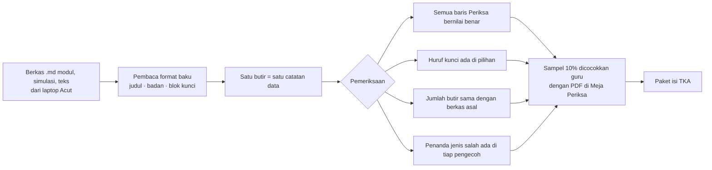

**Contoh bentuk satu butir sebagai data** (potongan penjelas, bukan kode aplikasi):

```json
{
  "id": "M02-soal-07",
  "modul": "M02", "jenis": "Soal", "lambang": "●", "bentuk": "PG",
  "badan": "Lampu hijau berkedip setiap 6 detik. ...",
  "pilihan": {"A": "2", "B": "14", "C": "24", "D": "48"},
  "kunci": ["C"],
  "petunjuk": "Kejadiannya berulang ... kelipatan atau faktor?",
  "langkah": "Kelipatan 6: 6, 12, 18, 24 ...",
  "pengecoh": {
    "A": {"alasan": "memakai FPB", "jenis": "S"},
    "B": {"alasan": "menjumlahkan kedua waktu", "jenis": "S"},
    "D": {"alasan": "mengalikan langsung", "jenis": "S"}
  },
  "periksa": ["lcm(6, 8) == 24"]
}
```

**Yang dibutuhkan dari Acut:** berkas `kursus-tka-sd/01-modul-matematika/`, `02-modul-bahasa-indonesia/`, `03-bank-teks-baca-cepat/`, dan `_alat/periksa.py` — dengan membagikan folder laptop ke sesi, atau mengirim satu berkas zip ke percakapan. **Paling lambat 31 Oktober**, sebab mesin soal di Rilis 1 harus diuji dengan butir sungguhan.

---

### 5. Latihan rumah digital

| Aturan | Isi |
|---|---|
| Jumlah | Sama dengan bagian D lembar kerja topik itu |
| Saat salah pertama kali | Tampil **Petunjuk** (pertanyaan pancingan); anak mencoba lagi |
| Saat salah kedua kali | Tampil **Langkah**; butir masuk antrean ulang 3 hari kemudian |
| PG kompleks dan kategori | Dinilai semua-atau-tidak seperti TKA; setelah dijawab, tampil pernyataan mana yang keliru |
| Waktu | Dicatat per butir; sasaran ± 2,5 menit per butir bertempo, ± 45 detik per soal kelas |
| Ulang berjarak | Butir topik lama muncul di latihan topik baru: 2 dari minggu lalu, 1 dari bulan lalu |
| Untuk pengajar kelas luring | **Link rapor kelas** (lihat bagian 8) |

---

### 6. Simulasi bertempo

| Hal | **Mode Latihan** (S1–S3) | **Mode Ujian** (S4, S5) |
|---|---|---|
| Waktu | 75 menit, waktu jeda tidak dihitung | 75 menit tanpa jeda, seperti ujian sebenarnya |
| Jeda | Boleh, paling banyak 3 kali | Tidak ada; kalau aplikasi tertutup, waktu tetap berjalan |
| Lompat soal dan tanda "ragu" | Ya | Ya |
| Umpan balik | Setelah selesai, per butir dengan Langkah | Setelah selesai |
| Orang tua | Disarankan | **Pengawas simulasi** (bukan Mode Dampingi, sebab Mode Dampingi keluar sendiri setelah 15 menit diam): orang tua memasukkan PIN sekali di awal sebagai tanda "diawasi", lalu memastikan suasana tenang dan tidak membantu. HP orang tua (kalau berbeda) hanya menampilkan sisa waktu dan nomor soal, tanpa kunci (layar D7) |
| Jadwal yang disarankan | Bebas | Sabtu pagi, mengikuti saran `kelemahan-rencana-lama.md` (simulasi tidak di sore hari puasa) |

#### Layar HP lawan layar komputer ujian

| Masalah | Penanganan |
|---|---|
| Teks stimulus 150–200 kata tidak muat bersama soal | Dua tab: **Teks** dan **Soal**, dengan tombol pindah di tempat yang sama; teks tetap di posisi gulir terakhir |
| Tabel lebar | Tabel bisa digeser ke samping; huruf tidak dikecilkan |
| Denah angka susunan kubus | Ditampilkan sebagai kisi angka yang bisa diperbesar |
| Ujian sebenarnya memakai komputer | **[ASUMSI]** Latihan di HP tetap melatih tempo dan bentuk soal; untuk S5, orang tua yang punya laptop disarankan membuka halaman rapor dan simulasi di laptop (Tahap 3 menilai apakah simulasi bisa dibuka di peramban) |

---

#### 6a. Mini try out mingguan (ditambah 29 Okt)

Diambil dari perbandingan dengan Edufic (Try Out Akbar 4 jam setiap Minggu), tetapi dibuat pendek supaya muat di batas waktu belajar kelas 6.

| Hal | Aturan |
|---|---|
| Isi | **6 soal campuran** dari topik yang sudah dipelajari: 4 dari topik 1–2 minggu terakhir, 2 dari topik ≥ 3 minggu lalu (sekaligus uji tunda). Tiga bentuk soal TKA (PG, PG kompleks, PG kategori) |
| Waktu | **15 menit** (2,5 menit per soal, sama dengan patokan TKA). Waktu terlihat seperti di simulasi, sebab tujuannya membiasakan tempo ujian |
| Kapan | Sekali seminggu, hari dipilih anak atau orang tua (bawaan Sabtu). **Tidak ada** di minggu simulasi penuh |
| Soal | Diambil dari bank ± 1.050 butir yang sudah ada; tidak ada isi baru. Soal yang sudah keluar di mini try out tidak dipakai lagi dalam 4 minggu |
| Hasil | Skor masuk **grafik kemajuan** di rapor TKA (O4) dan rapor penyebab salah (B/H/S/W). Tanpa peringkat, tanpa hadiah |
| Layar | Memakai layar simulasi K15 dengan pengaturan 6 soal / 15 menit lewat paket isi, jadi hampir tidak ada layar baru |

#### 6b. "Rencana minggu ini" untuk orang tua (ditambah 29 Okt)

Orang tua suka melihat rencana yang jelas (poster topik harian Edufic), tetapi rencana kita **disusun dari keadaan anak itu sendiri**, bukan jadwal yang sama untuk semua anak.

| Hal | Aturan |
|---|---|
| Disusun | Setiap Senin pagi, otomatis dari peta 36 topik |
| Isi | 1 topik baru (urutan peta spiral, atau jadwal kelas luring) · 1–2 topik yang masih lemah (status "Latihan" < 80%) · 1 topik ulang yang jatuh tempo uji tunda · hari mini try out |
| Contoh | "Minggu ini: pecahan (masih 60%) · luas bangun datar (baru) · ulang KPK · mini try out Sabtu" |
| Tampil di | Rapor TKA (O4), kartu anak di beranda Kabar, dan Peta Perjalanan (R2). Di HP anak, daftar topik TKA (K13) memberi tanda "minggu ini" pada topik yang sama |
| Bukan perintah | Anak tetap boleh memilih topik lain; rencana hanya saran |

#### 6c. Pola bilangan: dicek, tidak ditambah (29 Okt)

Edufic memasukkan "pola bilangan" ke jadwalnya. Kisi-kisi TKA Matematika SD/MI 2026 berdasarkan Peraturan Kepala BSKAP 047/H/AN/2025 hanya memuat tiga elemen, yaitu Bilangan (bilangan rasional, operasi, kelipatan, faktor, KPK, FPB), Geometri dan Pengukuran, serta Data, **tanpa pola bilangan dan aljabar** **[FAKTA — reproduksi kisi-kisi di websitependidikan.com]**. Karena itu 36 topik tetap. Satu artikel bimbel menyebut "Aljabar Dasar: pola bilangan", tetapi tanpa merujuk dokumen resmi. Catatan lama tetap berlaku: Acut mengunduh PDF Perka BSKAP aslinya untuk memastikan.

**Akibat ke pembangunan R1** **[ESTIMASI]**: mini try out ± 0,5 hari (pengaturan baru di layar K15), Rencana minggu ini ± 1 hari (kartu di O4 + tanda di K13). Kalau pembangunan R1 tertinggal, Rencana minggu ini digeser ke R2 bersama Peta Perjalanan; mini try out tetap di R1.

### 7. Rapor penyebab salah

Setiap pengecoh di bahan TKA sudah punya alasan tertulis ("Kenapa pengecoh menarik"). AI memberi setiap alasan satu kode, guru memeriksa **sampel 20%** (± 600 dari ± 3.000 pengecoh; soal butir dicocokkan 10%), lalu aplikasi menghitung otomatis.

| Kode | Arti | Cara aplikasi mengenali | Saran untuk orang tua |
|---|---|---|---|
| **B — Baca** | Salah membaca soal atau teks | Pengecoh berkode B (misal "yang ditanya selisih dijawab jumlah", "menjawab dari pengetahuan sendiri, bukan dari teks") | "Minta anak menunjuk kata penting di soal sebelum menjawab" |
| **H — Hitung** | Cara benar, hitungan meleset | Pengecoh berkode H (misal selisih satu, salah simpan) | "Latihan Lancar harian akan membantu bagian ini" |
| **S — Salah paham** | Konsepnya keliru | Pengecoh berkode S (misal KPK tertukar FPB, keliling tertukar luas) | "Buka topik ini bersama di Mode Dampingi" |
| **W — Waktu** | Tidak terjawab, atau dijawab asal di menit terakhir | Butir kosong saat waktu habis, atau dijawab < 10 detik dalam 3 menit terakhir | "Latih melompati soal sulit lalu kembali" |

#### Isi rapor kesiapan TKA

| Bagian | Isi | Aturan |
|---|---|---|
| Peta 36 topik | Belum · Latihan · **Kuasai** | Kuasai = ≥ 80% benar pada 2 kesempatan, salah satunya ≥ 3 minggu setelah topik dipelajari (sama dengan aturan kelas luring) |
| Garis simulasi | Persen benar S1 → S4 (Matematika) dan S5 (Bahasa Indonesia) | Ditulis **"persen benar latihan, bukan nilai TKA"**, sebab cara penilaian resmi tidak kita ketahui |
| Penyebab salah | Bagian terbesar dari B / H / S / W | Satu saran untuk orang tua dari kode terbesar |
| Bentuk soal | Benar per bentuk (PG, PG kompleks, PG kategori) + persen pernyataan benar pada PG kategori | Menunjukkan "hampir benar" yang tidak terlihat di skor |

#### Ukuran keberhasilan **[ASUMSI — dikalibrasi setelah S1]**

| Ukuran | Target | Cadangan |
|---|---|---|
| Kenaikan persen benar Matematika S1 → S4 | +15 poin | +8 poin |
| Persen benar Matematika S4 | ≥ 60% | ≥ 50% |
| Penyebab salah **W** di S4 dibanding S1 | Turun setengah | Turun sepertiga |
| Latihan rumah diselesaikan | ≥ 80% lembar | ≥ 65% |

---

### 8. Link rapor untuk pengajar kelas luring

| Pilihan | Untung | Rugi | Putusan |
|---|---|---|---|
| Pengajar tidak melihat apa pun | Paling sederhana; privasi paling aman | Pengajar tetap memakai lembar xlsx; latihan rumah digital tidak membantu kelas | ✗ |
| **Link rapor kelas** (hanya baca): siapa sudah mengerjakan latihan rumah, topik yang paling banyak salah, kode penyebab | Pengajar tahu apa yang dibahas di pertemuan berikutnya; tanpa akun baru | Data anak dilihat orang di luar keluarga | **✓ Diusulkan, dengan persetujuan orang tua yang terpisah** |
| Akun pengajar penuh | Bisa memberi tugas | Menambah jenis pengguna, profil risiko PP Tunas naik | ✗ untuk tahun pertama |

Persetujuan "rapor anak boleh dilihat pengajar kelas" menjadi **satu tujuan tersendiri** di formulir persetujuan, sebab PP 33/2026 meminta persetujuan spesifik yang tidak digabung **[FAKTA — `riset-penguat.md`]**. Masuk paket draf ahli hukum di Tahap 3.

#### Cara kerjanya (ditambah 20 Okt setelah pemeriksaan)

Pemeriksa menemukan bahwa link rapor dirancang per anak, sedangkan rapor kelas lintas keluarga, dan pengajar tidak punya cara menandai pertemuan. Rancangannya sekarang:

| Bagian | Cara |
|---|---|
| Data kelas | Tabel `kelas_luring` (nama kelas, pengajar, tanggal pertemuan P01–P36) dan `anggota_kelas` (anak, kelas, izin 6 ya/tidak), diisi Acut di panel (`02-rancangan/03-basis-data.md`) |
| Membuka latihan rumah | Menurut tanggal pertemuan di tabel itu. Kalau pertemuan bergeser, Acut mengubah tanggalnya di panel (± 2 menit) |
| Rapor kelas | Fungsi server khusus membuat satu link per kelas; isinya hanya anak yang orang tuanya memberi Izin 6. Hanya baca, bisa dicabut, berlaku sampai kelas selesai |
| Pengajar sebagai penerima data | Menandatangani pernyataan menjaga kerahasiaan sebelum link dikirim; ditanyakan ke ahli hukum apakah cukup (pertanyaan formulir no. 3) |
| Tanggal kelas | **Perlu dari Acut:** siapa pengajarnya dan tanggal pertemuan pertama (rencana Januari) |

---

### 9. Beban waktu harian anak kelas 6

| Hari | Lancar | Baca Ulang | TKA | Jumlah **[ESTIMASI]** |
|---|---|---|---|---|
| Hari ada kelas luring | 3 menit | 6 menit (teks pertemuan) | Latihan rumah ± 10 menit | ± 19 menit |
| Hari tanpa kelas (Jalur Mandiri) | 3 menit | 6 menit | Satu topik ± 12 menit | ± 21 menit |
| Sabtu simulasi | — | — | 75 menit | 75 menit |
| Hari mini try out (29 Okt) | 3 menit | 6 menit | Mini try out 15 menit | ± 24 menit |

Batas sesi kelas 5–6 adalah ≤ 20 menit (`01-profil-dan-perjalanan.md`). **Hari Jalur Mandiri sedikit melewati batas**, jadi aplikasi membagi topik menjadi dua bagian (materi dan latihan) yang boleh dikerjakan di dua waktu berbeda.

---

### 10. Risiko

| Risiko | Tanda awal | Pencegahan |
|---|---|---|
| Format TKA 2027 berubah (IPA masuk, waktu berubah) | Pengumuman resmi | Paket isi bisa diperbarui tanpa rilis; pantau tiap 2 minggu |
| Berkas dari laptop tidak lengkap atau ada yang menyimpang dari format | Jumlah butir hasil baca ≠ jumlah di berkas | Daftar butir yang gagal dibaca dikirim ke Acut; cadangan: PDF |
| Orang tua menyamakan persen benar dengan nilai TKA | Pertanyaan "berarti nilainya 60?" | Kalimat peringatan tetap di rapor |
| Jalur Mandiri dijanjikan setara kelas luring | Kalimat promosi | Janji hanya "latihan dan rapor kesiapan", bukan kenaikan nilai |
| Hak cipta modul belum jelas | Tidak ada perjanjian penulis | Masuk daftar pertanyaan ahli hukum sebelum R1.1 |

---

### 11. Keputusan Acut (19 Okt ± 21.50: semua usul disetujui)

| # | Keputusan | Usul Acut2 |
|---|---|---|
| 1 | Jalur Mandiri untuk anak kelas 6 di luar kelas luring | Buat, sebab bahannya ada; janji ke orang tua dibatasi |
| 2 | Link rapor kelas untuk pengajar, dengan persetujuan orang tua tersendiri | Buat |
| 3 | S4 dan S5 dalam Mode Ujian tanpa jeda | Ya |
| 4 | Kirim berkas TKA dari laptop paling lambat 31 Oktober | — |


## Fitur Orang Tua dan Fitur Anak

*Berkas: `rancangan/01-produk/07-fitur-orang-tua-dan-anak.md`*

**Ringkas:** (1) Fitur orang tua dibangun di atas dua bukti: keterlibatan yang berupa **kegiatan singkat terarah dan pesan positif** menaikkan hasil (+4 bulan), sedangkan **membantu PR dan mengontrol tidak** atau bahkan merusak. Karena itu Mode Dampingi berupa satu kegiatan ± 10 menit seminggu, mode jauh berisi kabar positif dan satu langkah berikutnya, dan tidak ada fitur "bantu PR". (2) Fitur anak bertumpu pada rasa mampu, pilihan 2–4 jalur, dan **kejutan yang tidak dijanjikan**. Tidak ada rangkaian hari beruntun, papan peringkat, notifikasi ke anak, toko, atau obrolan bebas, sebab semuanya berisiko dianggap teknik dorongan yang dilarang PP Tunas atau terbukti merusak minat. (3) Satu keputusan besar untuk Acut: **apakah game di luar jam belajar dikunci sampai latihan selesai**. Usul Acut2: tidak dikunci, tetapi diberi batas waktu harian yang diatur orang tua.

Tahap 2, butir 8–9. Disusun 19 Oktober 2026. Kode cara terlibat: **[D]** Mode Dampingi · **[J]** mode orang tua dari jauh · **[L]** link rapor WhatsApp. Prioritas: **W** Wajib · **P** Penting · **N** Nanti.

---

### 1. Prinsip yang mengikat semua fitur

| Prinsip | Sebab |
|---|---|
| Orang tua diberi **strategi dan pesan positif**, bukan daftar kesalahan | Bentuk keterlibatan yang terbukti (+4 bulan) **[FAKTA — EEF Toolkit]** |
| Kegiatan bersama **± sekali seminggu** | Sekali seminggu sudah cukup; dua kali atau lebih tidak menambah banyak **[FAKTA — Berkowitz dkk. 2015]** |
| **Tidak ada fitur bantu PR sekolah** | Melibatkan orang tua dalam PR umumnya tidak menaikkan hasil **[FAKTA — EEF Toolkit]** |
| Rapor tidak mendorong orang tua mengontrol | Mengontrol −0,153; dukungan otonomi +0,133 **[FAKTA — `bahan/riset-metode-belajar.md`]** |
| Hadiah untuk anak selalu **kejutan** | Hadiah yang dijanjikan merusak minat anak −0,43; kejutan ≈ 0 **[FAKTA — Deci, Koestner & Ryan 2001]** |
| Anak memilih dari **2–4 jalur** | Paling kuat pada anak, dengan 2–4 pilihan **[FAKTA — Patall dkk. 2008]** |
| Pesan hanya di dalam keluarga; tanpa iklan, lokasi, profiling, teknik dorongan | Supaya profil risiko PP Tunas tetap **rendah** (syarat untuk anak < 13 tahun) **[FAKTA — `riset-penguat.md` bagian 9]** |
| Anak tidak pernah diberi tahu soal uang | Anak tidak boleh dijadikan alat menekan orang tua (kasus Prodigy, `01-profil-dan-perjalanan.md` 2.6) |

---

### 2. Fitur orang tua

#### 2.1 Peta fitur per cara terlibat

| Kebutuhan | [D] Mode Dampingi (HP anak, PIN orang tua) | [J] Mode orang tua (HP orang tua) | [L] Link rapor (tanpa instal) | Rilis · prioritas |
|---|---|---|---|---|
| **Memantau** | — | Beranda kabar: sudah/belum latihan hari ini, rekor, satu langkah berikutnya | Rapor satu layar | R1 · W |
| **Memantau langsung** | — | Status "sedang latihan · Level 3 · soal 12 dari 20" (tanpa benar/salah per soal) | — | R1 · P |
| **Memeriksa** | Jurus dan kunci terlihat; tombol "petunjuk untuk diucapkan" | Rapor mingguan; peta jenis salah per keluarga fakta; rapor TKA (B/H/S/W) | Rapor mingguan | R1 · W (peta jenis salah: P) |
| **Memberi tugas** | — | Ajakan siap pakai, paling banyak 1 per hari | — | R1 · P |
| **Berkomunikasi** | Bicara langsung | Kirim semangat (pilihan siap pakai + teks ≤ 60 huruf); terima pesan anak | — | R1 · W |
| **Kegiatan bersama** | Tantang Ayah (R1), Dengar Bacaan (R2), **Cerita Ulang dan Ucapkan ke Bunda (R2, 29 Okt)**, Soal Cerita Bersama (R3), Pengawas Simulasi TKA (R1.1) | Jadwalkan kegiatan Dampingi | — | Sesuai rilis · W |
| **Kejutan** | Hari Pamer bulanan (**R2**, dimajukan 29 Okt) | Kabar "lulus level" dan "masih ingat setelah 3 minggu"; rapor "Satu tahun bersama" (R4) | Sama, versi singkat | R1 · W |
| **Game lapangan akhir pekan** | Dimainkan bersama | Survei pilihan: game mana Sabtu ini | — | R3 · P |
| **Rapor ke WhatsApp** | — | Tombol "kirim ke WhatsApp": gambar rapor atau link | Link itu sendiri | R1 · W (gambar: P) |
| **Pengaturan** | Batas waktu game, jam tenang | Sama + PIN, cabut link, persetujuan data | — | R1 · W |

#### 2.2 Mode Dampingi [D]

| Hal | Aturan |
|---|---|
| Masuk | Tombol kecil di layar anak → PIN orang tua 4 angka; keluar otomatis setelah 15 menit tanpa sentuhan. **Pengawas Simulasi bukan bagian Mode Dampingi** (lihat tabel kegiatan di bawah), sebab simulasi 75 menit tanpa sentuhan orang tua |
| Yang terlihat | Jurus level ini, kunci soal, **naskah kegiatan** di atas layar ("Ucapkan ini… Tanyakan ini… Jangan beri jawabannya") |
| Petunjuk untuk diucapkan | Satu tombol per soal: menampilkan satu kalimat pancingan, bukan jawaban (misal "Coba genapkan ke 10 dulu") |
| Hitungan | Lembar di Mode Dampingi **tidak dihitung untuk naik level** (`04-mesin-lancar.md` celah #5) |
| Jadwal | Disarankan sekali seminggu; aplikasi mengingatkan **orang tua** (bukan anak) di hari yang dipilih |

**Kegiatan Dampingi**

| Kegiatan | Isi | Lama | Kenapa |
|---|---|---|---|
| **Tantang Ayah** | Anak memilih 10 soal dari level yang **sudah ia lulus**; anak dan ayah/bunda bergantian menjawab; anak biasanya menang | ± 10 menit | Rasa mampu; orang tua melihat kemampuan anak tanpa menguji |
| **Dengar Bacaan** | Orang tua mendengar anak membaca dan mengetuk kata yang salah (`05-bahasa-indonesia.md` bagian 5) | ± 3–5 menit | Angka resmi kata per menit; tanpa rekaman suara |
| **Soal Cerita Bersama** | Satu soal cerita dari topik Paham; naskah tanya-jawab untuk orang tua | ± 10 menit | Pola aplikasi orang tua–anak Berkowitz (sekali seminggu) |
| **Pengawas Simulasi** (bukan Mode Dampingi) | Orang tua memasukkan PIN sekali di awal sebagai tanda "diawasi", lalu memastikan suasana tenang. HP anak menjalankan simulasi tanpa batas diam; HP orang tua (kalau berbeda) hanya menampilkan sisa waktu dan nomor soal, tanpa kunci (layar D7) | 75 menit | `06-persiapan-tka.md` bagian 6 |

#### 2.3 Mode orang tua dari jauh [J]

| Fitur | Isi | Batas yang sengaja dipasang |
|---|---|---|
| **Beranda kabar** | Satu kartu per anak: hari ini sudah/belum, rekor terbaru, **satu langkah berikutnya** ("Minggu ini ×7 mulai lancar. Coba Tantang Ayah Sabtu.") | Tidak menampilkan daftar soal salah di beranda |
| **Kirim semangat** | ± 40 pesan siap pakai ("Ayah bangga kamu tidak menyerah di ×8") + teks pendek ≤ 60 huruf | Pesan siap pakai menonjolkan **usaha**, bukan kecepatan; teks bebas tidak bisa berisi link atau nomor HP. **Kelas 1–2:** pesan siap pakai dibacakan dengan suara yang sudah ada di paket; teks bebas tampil dengan ikon "🔊 minta Ayah/Bunda membacakan", sebab aplikasi tidak punya mesin suara saat berjalan dan suara bawaan HP murah sering tanpa Bahasa Indonesia (`03-rencana-isi.md` bagian 5) |
| **Ajakan (memberi tugas)** | Pilihan siap: 1 lembar tambahan · baca ulang teks kemarin · Tantang Ayah hari Sabtu · ulang satu topik TKA | Paling banyak 1 ajakan per hari; ajakan **tidak pernah mengunci** apa pun; di layar anak tampil sebagai "Ajakan dari Ayah" |
| **Pengingat untuk orang tua** | Orang tua memilih jam pengingat (misal 16.30) | Pengingat dikirim ke **HP orang tua**, tidak pernah ke anak |
| **Kabar kejadian** | Lulus level; uji daya tahan "masih ingat"; 2 hari tidak latihan (ajakan lembut); anak menekan "Bantu aku" | Paling banyak 1 kabar per hari, kecuali "Bantu aku" |
| **Rapor mingguan** | Lihat 2.5 | — |

**Pesan dari anak ke orang tua:** anak memilih dari 6 stiker pesan ("Aku lulus level!", "Lihat rekorku", "Bantu aku dong", "Terima kasih, Ayah", "Aku capek hari ini", "Ayo Tantang Ayah"). "Bantu aku dong" mengirim kabar ke orang tua beserta saran Mode Dampingi untuk soal yang macet. **Tidak ada ketik bebas dari anak**, sebab obrolan bebas menaikkan profil risiko dan pesan anak cukup berupa pilihan.

#### 2.4 Link rapor [L]

| Hal | Aturan |
|---|---|
| Bentuk | Halaman web satu layar, terbuka tanpa instal dan tanpa kata sandi |
| Link | Unik per anak, panjang dan tidak bisa ditebak; **bisa dicabut** orang tua kapan saja; berlaku 90 hari lalu diperbarui otomatis di mode orang tua **[ASUMSI — dinilai di Tahap 3]** |
| Isi | Nama panggilan dan hewan profil saja; tanpa foto, nama sekolah, tanggal lahir |
| Risiko dan penjaganya | Link diteruskan ke grup WhatsApp sehingga rapor terbaca orang luar → tujuan "rapor lewat link" punya persetujuan tersendiri, ada peringatan "link ini hanya untuk keluarga", dan link bisa dicabut |
| Jalan naik | Di bawah rapor: "Ingin melihat anak latihan dan mengirim semangat? Pasang aplikasinya" — sebab orang tua tidak boleh hanya lewat link (koreksi Acut 19 Okt) |

#### 2.5 Isi rapor mingguan

| Bagian | Isi | Sebab |
|---|---|---|
| Tiga angka | Hari latihan · kecepatan **pada keluarga fakta yang sama** (misal ×6 dan ×7, detik per soal) · ketepatan (% benar), dibanding minggu lalu dan saat keluarga fakta itu pertama dilatih | Kemajuan terukur adalah yang paling diutamakan orang tua. **Diubah 20 Okt:** rata-rata detik per soal dari semua lembar tidak setara antarlevel, jadi rapor akan terlihat memburuk saat anak naik level |
| Grafik utama | Waktu **tes tetap** (setiap 4 minggu, susunan sama; `09-gerbang-berbayar.md` bagian 1) | Satu-satunya angka yang setara dari awal sampai akhir |
| Satu kalimat kemajuan | "Kecepatan ×6 dan ×7 naik dari 5,1 ke 3,4 detik per soal" | Pesan positif personal; selalu menyebut keluarga fakta yang dibandingkan |
| Satu langkah berikutnya | "Minggu depan ×8 dikenalkan" | Pesan positif = keberhasilan + langkah berikutnya **[FAKTA — EEF]** |
| Satu cara membantu tanpa mengambil alih | "Kalau ia ragu, tanyakan 'jurus apa yang cocok?', jangan sebut jawabannya" | Mencegah orang tua mengontrol |
| Baca Ulang (mulai R2) | Kata per menit bacaan dingin dengan tombol (semua keluarga); kata benar per menit dari Dengar Bacaan kalau orang tua mendampingi, atau tulisan "belum diukur orang tua" kalau tidak | `05-bahasa-indonesia.md` |
| TKA (kelas 6) | Peta 36 topik, penyebab salah B/H/S/W | `06-persiapan-tka.md` |
| Latihan yang dimulai anak sendiri | "4 dari 9 latihan minggu ini dimulai Aisyah sendiri" | Ukuran semangat belajar untuk gerbang berbayar |

**Rapor cerita buatan AI** (P, R1): kalimat disusun dari angka di basis data, angka di kalimat diperiksa ulang oleh kode, dan diberi tanda "ditulis dengan bantuan AI", sebab ± seperempat kalimat umpan balik AI bisa tidak berdasar **[FAKTA — EDM 2024]**. Kalau persetujuan "rapor buatan AI" tidak diberikan, rapor memakai kalimat cetakan biasa **dengan isi angka yang sama** (tidak diturunkan mutunya, PP 33/2026 Ps. 35(1)).

#### 2.6 Game lapangan akhir pekan (R3)

Setelah anak menyelesaikan 5–10 sesi, orang tua menerima satu pertanyaan pilihan pada hari Kamis: "Mau main apa Sabtu ini?" dengan 3 pilihan yang disusun dari materi yang **sudah** dilatih anak.

| Contoh game | Materi | Bahan |
|---|---|---|
| Belanja Pasar | Tambah, kurang, uang kembalian | Uang mainan atau uang asli |
| Lompat Garis Bilangan | Tambah/kurang, kelipatan | Kapur di lantai, angka berurutan lurus (papan lurus, bukan melingkar **[FAKTA — Siegler & Ramani]**) |
| Berburu Angka di Jalan | Jumlah angka pelat nomor, ×2 ×5 | Perjalanan naik motor atau labi-labi |
| Tebak Jam | Waktu, durasi | Jam dinding |
| Detektif Kata | Kata dari teks Baca Ulang minggu ini | Teks di aplikasi |

Aplikasi memberi petunjuk satu layar, lalu Senin menanyakan satu ketukan: "Jadi dimainkan? Seru / Biasa / Tidak sempat". Jawabannya menentukan game yang ditawarkan berikutnya.

---

### 3. Fitur anak

#### 3.1 Peta fitur

| Fitur | Isi | Rilis · prioritas |
|---|---|---|
| **Beranda anak** | Pesan dari orang tua (dibacakan untuk kelas 1–2), pilihan jalur hari ini, album kartu | R1 · W |
| **Pilihan 2–4 jalur** | "Mau mulai dari mana?" Lancar · Baca Ulang · Ajakan Ayah · Tantangan (setelah R3) | R1 · P |
| **Rekor pribadi** | Rekor waktu per level; "Tadi 62, sekarang 81" | R1 · W |
| **Kartu satwa Aceh** | Muncul **kadang-kadang, acak** (± 1 dari 3 kejadian penguasaan: lulus level, lulus uji daya tahan, naik tingkat teks) | R1 · P |
| **Tombol "Bantu aku"** | Mengirim kabar ke orang tua (2.3) | R1 · W |
| **Satu ketukan perasaan** | Seperti permainan; rinci di `08-sistem-masukan.md` | R1 · W |
| **Jurus Sulap Angka** | Sifat bilangan (×11, ×25, ×5, ×9 dengan jari) terbuka sebagai kejutan setelah lulus level kelas | R3 · P |
| **Gampong yang tumbuh** | Dunia anak tumbuh dari **penguasaan** | R4 · P |
| **Game di luar jam belajar** | Lihat 3.4 | R4 · P |

#### 3.2 Kartu satwa Aceh

| Aturan | Sebab |
|---|---|
| Muncul secara acak di sekitar **1 dari 3 kejadian penguasaan** (lulus level, lulus uji daya tahan, naik tingkat teks); tidak ada tulisan "lulus = kartu" (diubah 20 Okt: versi lama ± 1 kartu per level, sehingga anak cepat belajar bahwa lulus selalu berarti kartu) | Hadiah tak terduga tidak merusak minat (0,01); hadiah yang dijanjikan merusak minat anak (−0,43) **[FAKTA — Deci, Koestner & Ryan 2001]** |
| Setiap kartu unik, **tanpa tingkat kelangkaan**, tanpa tukar-menukar, tanpa beli | Kelangkaan acak mirip undian; jual-beli = eksploitasi anak sebagai konsumen (dimensi risiko Permenkomdigi 9/2026) |
| Setiap kartu memuat satu fakta singkat tentang satwa itu (gajah sumatra, rangkong, penyu belimbing, dan lain-lain) | Kartu ikut menjadi bacaan pendek |
| ± 36 kartu tahun pertama **[ASUMSI]** | Kejadian penguasaan setahun ± 36 level + ± 20 uji daya tahan + naik tingkat teks ≈ 60–100; sepertiganya ≈ 20–35 kartu **[ESTIMASI]** |

**Ditambah 28 Okt (merek Pintar Main):** kejutan kini bergantian antara **kartu satwa** dan **aksesori Pinci** (topi, syal, ransel berwarna lain), dengan aturan yang sama: acak ± 1 dari 3 kejadian penguasaan, tanpa poin, tanpa toko, tanpa kelangkaan. Bintang hanya tanda selesai satu lembar atau unit, sama untuk semua anak, tidak bisa ditukar (`03-antarmuka/04-identitas-merek.md` bagian 2).

#### 3.3 Gampong yang tumbuh (R4)

| Aturan | Sebab |
|---|---|
| Bangunan baru muncul dari kejadian **penguasaan** (lulus level, masih ingat setelah 3 minggu, naik tingkat teks) | Tumbuh karena kemampuan, bukan karena rajin membuka aplikasi |
| **Tidak pernah layu, mundur, atau hilang** saat anak tidak latihan | Ancaman kehilangan adalah teknik dorongan **[ASUMSI — `riset-penguat.md` bagian 9: daftar resmi belum ada]** |
| Anak memilih di mana bangunan diletakkan (2–4 pilihan) | Pilihan = pengungkit motivasi |
| Tidak bisa dikunjungi anak lain | Tanpa kontak dengan orang di luar keluarga |

#### 3.4 Game di luar jam belajar (R4)

| Hal | Usul |
|---|---|
| Arti | Permainan yang memakai kemampuan yang sudah dilatih: Pasar Gampong (hitung uang), Ular Tangga Lurus 1–100, Susun Kubus (tampak atas/depan/samping), Tebak Kata |
| Batas waktu | **Diubah 28 Okt berdasarkan riset:** bawaan kelas 1–2 **20 menit**, kelas 3–6 **30 menit** per hari; orang tua bisa mengubah 0–60 menit, tidak lebih (`10-gudang-ilmu-bimbingan-dan-waktu.md` bagian 5) |
| Jam tenang | Orang tua bisa mematikan game pada jam tertentu (bawaan: setelah 21.00) |
| Akhir sesi | Game berhenti di akhir babak dengan "Cukup untuk hari ini, sampai besok" — tanpa "satu babak lagi", tanpa putar otomatis |
| Hubungan dengan latihan | Lihat pilihan di bawah |

**Keputusan untuk Acut: apakah game dikunci sampai latihan selesai?**

| Pilihan | Untung | Rugi |
|---|---|---|
| **A. Game terbuka setelah latihan harian selesai** | Orang tua senang: latihan dulu, main kemudian | Game menjadi hadiah yang dijanjikan atas tugas (−0,44 pada hadiah berwujud **[FAKTA — Deci dkk. 2001]**; untuk hadiah maya belum ada data); anak bisa terburu-buru menyelesaikan latihan |
| **B. Game selalu terbuka dengan batas waktu** | Tidak mengikat latihan dengan hadiah | Sebagian anak main dulu dan tidak latihan |
| **C. Bawaan B, orang tua boleh memilih A** (usul) | Orang tua yang memutuskan; data kedua kelompok bisa dibandingkan | Pengaturan bertambah satu |

**Diputuskan Acut 19 Okt: C.** Usul Acut2 semula **C**, sebab buktinya belum cukup untuk melarang A, dan pilihan orang tua sekaligus menjadi data. Bandingkan "latihan yang dimulai anak sendiri" pada kedua kelompok setelah 4 minggu.

**Diubah Acut 28 Okt: bawaan menjadi A** (game tampil sebagai "Waktu main" setelah inti harian selesai), orang tua boleh memilih B. Penjaganya: tidak ada kalimat "selesaikan latihan untuk dapat game", dan inti harian dibuat singkat supaya tidak dikerjakan terburu-buru (`10-gudang-ilmu-bimbingan-dan-waktu.md` bagian 5.2).

#### 3.5 Yang sengaja tidak ada

| Tidak ada | Sebab |
|---|---|
| Rangkaian hari beruntun ("api 7 hari") | Tanpa bukti manfaat belajar; berisiko dianggap teknik dorongan |
| Papan peringkat antaranak, "siapa lebih cepat" antarsaudara | Hadiah berbasis kinerja yang tidak didapat semua anak −0,88 |
| Notifikasi ke anak | Semua pengingat lewat orang tua |
| Toko, koin, pembelian di dalam mode anak | Eksploitasi anak sebagai konsumen |
| Obrolan bebas, teman, kunjungan antarakun | Kontak dengan orang asing |
| Fitur foto atau kamera di mode anak | Jalur buku + foto ditunda (keputusan Acut 19 Okt) |

---

### 4. Fitur dan profil risiko PP Tunas

Aspek risiko dari Permenkomdigi 9/2026, dirinci menjadi tujuh aspek di Kepmenkomdigi 142/2026 **[FAKTA — `riset-penguat.md` bagian 9; `02-rancangan/11-privasi-dan-keamanan.md`]**:

| Dimensi | Fitur yang menyentuh | Penjaga | Perkiraan tingkat **[ASUMSI — dinilai ulang di penilaian mandiri, Tahap 3]**. Diubah 20 Okt: tiga aspek terakhir "belum dinilai" sampai parameter di lampiran Kepmen 142 dibaca |
|---|---|---|---|
| Kontak dengan orang asing | Pesan orang tua–anak, link rapor | Pesan hanya dalam keluarga; anak hanya stiker; link bisa dicabut | Rendah |
| Paparan isi | Teks, jurus, kartu, game | Semua isi dibuat dan diperiksa kita; tidak ada isi dari pengguna lain | Rendah |
| Eksploitasi sebagai konsumen | Pembayaran nanti | Pembayaran hanya di mode orang tua; tanpa toko di mode anak | Rendah |
| Keamanan data | Hasil per soal, kata per menit, pesan | Persetujuan per tujuan; tanpa lokasi dan pengenal iklan; dirinci di Tahap 3 | Rendah–sedang |
| Kecanduan | Game, kartu, Gampong | Batas waktu, tanpa rangkaian hari, tanpa ancaman kehilangan, tanpa notifikasi ke anak | **Belum dinilai** (penjaga diharapkan menghasilkan rendah) |
| Gangguan psikologis | Tekanan, perbandingan | Tanpa perbandingan dengan anak lain; rapor tanpa label negatif; target waktu sebagai rekor pribadi | **Belum dinilai** |
| Gangguan fisiologis | Lama menatap layar | Sesi ≤ 10/15/20 menit; batas waktu game; jam tenang; tema terang lembut (mode gelap pilihan). **Pengecualian beralasan:** simulasi TKA 75 menit, paling banyak 5 kali setahun, meniru ujian sebenarnya, dimulai atas pilihan orang tua, dianjurkan Sabtu pagi | **Belum dinilai** |

---

### 5. Persetujuan yang dibutuhkan fitur ini

| Tujuan (persetujuan terpisah) | Fitur | Kalau tidak disetujui |
|---|---|---|
| Latihan dan rapor (inti layanan) | Semua latihan, rapor angka | Aplikasi tidak bisa dipakai, sebab datanya memang diperlukan |
| Data pemakaian untuk pengembangan | Analisis pola pemakaian, sistem masukan | Latihan dan rapor tetap penuh |
| Rapor buatan AI | Rapor cerita | Rapor cetakan dengan angka yang sama |
| Rapor lewat link | [L] | Rapor hanya di aplikasi orang tua |
| Rapor dilihat pengajar kelas luring | `06-persiapan-tka.md` bagian 8 | Pengajar tidak melihat apa pun |
| Rekaman suara anak | Dengar Bedanya (Nanti) | Fitur tidak muncul |

---

### 6. Keputusan Acut (19 Okt ± 21.50: semua disetujui)

| # | Keputusan | Usul Acut2 |
|---|---|---|
| 1 | Game dikunci sampai latihan selesai? (3.4) | Pilihan **C**: bawaan terbuka dengan batas waktu, orang tua boleh mengunci |
| 2 | Anak hanya mengirim stiker pesan, tanpa ketik bebas | Ya |
| 3 | Status "sedang latihan" tanpa benar/salah per soal secara langsung | Ya, supaya orang tua tidak menyela |
| 4 | Kartu satwa tanpa tingkat kelangkaan | Ya |


## Sistem Masukan — Bayaran dari Masa Gratis

*Berkas: `rancangan/01-produk/08-sistem-masukan.md`*

**Ringkas:** (1) Setiap pertanyaan dipasangkan dengan satu keputusan dan satu ambang ("kalau ≥ X% menjawab begini, kami melakukan itu"). Yang bisa dijawab data pemakaian **tidak ditanyakan**. Hasilnya, bank pertanyaan dipangkas menjadi 19 pertanyaan orang tua (O08 dihapus 20 Okt) dan 5 ketukan anak. (2) Jadwal 8 minggu mengikuti keputusan "paling sering dua minggu sekali": pendaftaran, lalu empat putaran pada **Senin minggu ganjil kalender** (≥ 14 hari setelah mendaftar). Pertanyaan yang dipicu kejadian **masuk antrean putaran berikutnya**, tidak muncul sendiri (diperbaiki 20 Okt). Ini juga memperbaiki satu pertentangan di bahan lama: catatan 19 Okt menjadwalkan pertanyaan di hari ke-7, padahal itu kurang dari dua minggu. (3) Syarat lembut: **Acut memilih B** (19 Okt): tidak ada yang ditahan; penjawab mendapat kartu terima kasih dan kabar perubahan. Hak "fitur lebih awal" hanya untuk Keluarga Perintis yang diundang (disempitkan 20 Okt supaya sesuai Syarat dan Ketentuan).

Tahap 2, butir 10. Disusun 19 Oktober 2026. Dasar: keputusan 19 Okt bagian C, `catatan-diskusi-19-okt.md` bagian 2, `riset-penguat.md` bagian 4, 6, dan 9.

---

### 1. Batas jujur dengan sedikit keluarga (target 30, cadangan 20)

| Hal | Hitungan **[ESTIMASI]** | Akibat |
|---|---|---|
| Tanggapan survei di aplikasi HP | Rata-rata 36,1% **[FAKTA — Refiner 2025, sebagian besar aplikasi bisnis]** | Target kita harus jauh di atas rata-rata, sebab masukan adalah bayaran gratis |
| Jawaban per putaran | 30 keluarga × 60% = **± 18 jawaban** (dulu dihitung 50 keluarga = ± 30 jawaban) | Hanya cukup untuk melihat arah besar; selisih di bawah ± 20 poin disebut "belum bisa disimpulkan" |
| Batas ketelitian | Untuk 30–40 jawaban, persen bisa meleset **± 15 poin** (selang kepercayaan 95% untuk 40%: 1,96 × √(0,4 × 0,6 ÷ 40) ≈ 0,15) | Ambang di peta (bagian 2) adalah **pemicu untuk memeriksa**, bukan bukti |
| Uji "sangat kecewa" | Butuh ± 40 jawaban dari pemakai aktif **[Klaim vendor — Koji]** → butuh tanggapan ± 80% | Tidak dipakai sendirian untuk gerbang berbayar (`09-gerbang-berbayar.md`) |

Karena itu sistem masukan menyandarkan diri pada tiga hal sekaligus: **data pemakaian** (lengkap untuk semua anak), **pertanyaan pilihan** (arah), dan **Keluarga Perintis** (alasan di balik angka).

---

### 2. Peta pertanyaan pengembangan

Kolom "Sumber": **D** = data pemakaian · **O** = pertanyaan orang tua · **A** = ketukan anak · **P** = Keluarga Perintis.

| # | Yang harus kami ketahui | Sumber | Keputusan yang diambil | Ambang **[ASUMSI]** |
|---|---|---|---|---|
| K1 | Kesulitan terbesar anak saat mulai | O01 | Urutan isi yang dikerjakan duluan (per keluarga, jalur di beranda mengikuti jawaban ini sebagai fungsi layanan, bukan keputusan pengembangan) | Pilihan terbanyak menentukan isi berikutnya yang dipercepat |
| K2 | Harapan orang tua dalam 2 bulan | O02 | Janji gerbang berbayar mana yang paling penting bagi orang tua (`09` bagian 2). Rapor keluarga itu menonjolkan ukuran yang dipilih sebagai fungsi layanan, bukan keputusan | Pilihan terbanyak ≥ 40% → janji itu dijadikan janji utama di pesan berbayar |
| K3 | Apakah anak makin cepat dan tepat | **D** (tidak ditanya) | Naik/turun level, kalibrasi target waktu | `04-mesin-lancar.md` bagian 5 |
| K4 | Apakah orang tua **melihat** kemajuan itu | O05 + D | Kalau data naik tetapi orang tua menjawab "sama" → rapor dirancang ulang | ≥ 40% "sama/tidak tahu" padahal data naik ≥ 15% |
| K5 | Apakah anak mulai latihan tanpa disuruh | O06 + D | Kejutan dan pilihan jalur dipertahankan atau diganti | < 30% keluarga melapor "1 kali atau lebih" di minggu ke-4 → ubah |
| K6 | Apakah tugas sekolah terasa lebih mudah | O07 | Isi Paham mana yang didahulukan (O07 tidak lagi menjadi syarat gerbang; gerbang memakai janji data, `09` bagian 2) | ≥ 40% "sama saja" pada satu mapel → isi Paham mapel itu didahulukan |
| ~~K7~~ | ~~Apakah nilai sekolah berubah~~ | ~~O08~~ | **Dihapus 20 Okt**: tidak terhubung ke satu keputusan pun (aturan 5). Nilai ulangan punya terlalu banyak penyebab lain | — |
| K8 | Siapa yang mengingatkan anak | O03 | Pengingat bawaan dikirim ke Ayah, Ibu, atau keduanya | Pilihan terbanyak |
| K9 | Apakah aplikasi mudah dipakai | O04 + D (titik orang berhenti di pendaftaran) | Alur pendaftaran dan beranda diperbaiki | ≥ 20% "agak sulit/sulit" |
| K10 | Jam latihan yang cocok | O14 + D | Jam pengingat bawaan; jam kirim pertanyaan | Jam terbanyak |
| K11 | Apakah latihan terlalu sulit, pas, atau terlalu mudah | **D** + A01 | Penjaga mesin; level dipecah atau digabung | `04-mesin-lancar.md` 5.2 |
| K12 | Apakah jurus menolong | D + A03 | Jurus diganti | ≥ 30% anak "masih bingung" pada satu jurus, atau data gagal (`03-rencana-isi.md` bagian 7) |
| K13 | Apakah teks bacaan cocok | D + A04 + O15 | Tingkat teks; cetakan teks | ≥ 30% "susah dimengerti" atau pemahaman < 60% |
| K14 | Apakah kegiatan Mode Dampingi dijalankan dan disukai | D + O13 | Kegiatan dipertahankan, diganti, atau naskahnya dipendekkan | ≥ 30% "sulit diikuti" |
| K15 | Kabar kejadian berguna atau mengganggu | O12 | Jumlah dan jenis kabar | ≥ 30% "tidak perlu" |
| K16 | Fitur yang paling bermanfaat | O16 + D | Prioritas pengembangan | Urutan pilihan |
| K17 | Yang diinginkan berikutnya | O17 + A05 | Urutan rilis R3–R5 | Urutan pilihan |
| K18 | Kenapa keluarga berhenti | O11 + O18 + D | Perbaikan yang menahan keluarga | Penyebab terbanyak |
| K19 | Apakah rapor TKA menenangkan atau membingungkan | O19 | Bahasa rapor TKA | ≥ 30% "bingung" |
| K20 | Apakah orang tua akan kecewa kalau aplikasi hilang | O09 | Gerbang berbayar | `09-gerbang-berbayar.md` |
| K21 | Harga yang wajar | O10 | Harga | Median rentang |
| K22 | Kenapa tidak berlangganan | O20 | Harga, isi gratis, isi berbayar | Penyebab terbanyak |

**Yang sengaja tidak ditanyakan, sebab data sudah menjawab:** berapa kali anak latihan, berapa lama, level berapa, soal mana yang lambat, apakah anak berhenti di tengah, jam berapa anak latihan.

---

### 3. Bank pertanyaan orang tua

Semua pertanyaan berupa pilihan, cukup diketuk. Setiap pertanyaan punya pilihan jujur seperti "Belum terlihat" atau "Tidak tahu" supaya orang tua tidak terdorong memilih jawaban yang menyenangkan.

| Kode | Pertanyaan | Pilihan | Ke peta | Kapan |
|---|---|---|---|---|
| O01 | Apa kesulitan belajar terbesar anak saat ini? | Menghitung masih lambat · Soal cerita · Membaca masih lambat · Memahami bacaan · Susah diajak belajar · Belum ada | K1 | Pendaftaran |
| O02 | Dalam 2 bulan, apa yang paling Anda harapkan? | Lebih cepat menghitung · Lebih lancar membaca · Belajar tanpa disuruh · Tugas sekolah lebih mudah · Siap TKA (kelas 6) | K2 | Pendaftaran |
| O03 | Pengingat latihan sebaiknya dikirim ke HP siapa? | Ibu · Ayah · Keduanya · Tidak perlu pengingat | K8 | Putaran 1 |
| O04 | Seberapa mudah aplikasi ini dipakai? | Sangat mudah · Mudah · Agak sulit · Sulit → kalau "agak sulit/sulit": Bagian mana? (Mendaftar · Menghubungkan HP · Membaca rapor · Mode Dampingi) | K9 | Putaran 1 |
| O05 | Dibanding 2 minggu lalu, cara anak menghitung (atau membaca) … | Lebih cepat · Sama · Lebih lambat · Belum terlihat | K4 | Putaran 1 dan 3 |
| O06 | Minggu ini, berapa kali anak mulai latihan **tanpa disuruh**? | Belum pernah · 1–2 kali · 3 kali atau lebih · Tidak tahu | K5 | Putaran 2 |
| O07 | Minggu ini, tugas Matematika atau Bahasa Indonesia dari sekolah terasa … bagi anak | Lebih mudah · Sama saja · Lebih sulit · Tidak ada tugas | K6 | Putaran 2 dan 3 |
| O09 | Bagaimana perasaan Anda kalau aplikasi ini **tidak bisa dipakai lagi**? | Sangat kecewa · Agak kecewa · Tidak kecewa · Sudah tidak memakai | K20 | Putaran 4 (hanya pemakai aktif) |
| O10 | Kalau nanti berbayar, berapa per bulan yang wajar untuk **semua anak** di keluarga Anda? | < Rp25 ribu · Rp25–50 ribu · Rp50–75 ribu · Rp75–100 ribu · > Rp100 ribu · Saya tidak akan membayar | K21 | Putaran 4 |
| O11 | Beberapa hari ini anak belum latihan. Apa sebab utamanya? | Sedang sibuk atau libur · HP dipakai orang lain · Anak bosan · Terlalu sulit · Terlalu mudah · Lupa | K18 | Dipicu: 5 hari tidak aktif |
| O12 | Kabar "lulus level" tadi … | Berguna, saya memuji anak · Berguna, tapi tidak sempat · Tidak perlu kabar seperti ini | K15 | Dipicu: lulus level pertama |
| O13 | Kegiatan bersama tadi … | Seru, mau lagi · Biasa saja · Sulit diikuti · Tidak sempat dikerjakan | K14 | Dipicu: kegiatan Dampingi pertama |
| O14 | Jam latihan yang paling cocok di rumah? | Pagi sebelum sekolah · Pulang sekolah · Sore · Setelah magrib · Setelah isya | K10 | Putaran 2 |
| O15 | Baca Ulang untuk anak Anda terasa … | Terlalu mudah · Pas · Terlalu sulit · Belum dicoba | K13 | Dipicu: 7 hari setelah Baca Ulang dimulai |
| O16 | Bagian mana yang paling bermanfaat? | Kabar harian · Rapor mingguan · Kirim semangat · Mode Dampingi · Link rapor | K16 | Putaran 4 |
| O17 | Apa yang paling ingin Anda tambahkan berikutnya? | Bahasa Inggris · Soal cerita · Game belajar · Latihan dari buku tulis · Lainnya (boleh isi) | K17 | Putaran 3 |
| O18 | Apa alasan utama berhenti? | Anak tidak mau · Tidak ada waktu · Tidak terlihat manfaatnya · Ada aplikasi/les lain · Masalah teknis · Lainnya | K18 | Saat menghapus akun atau 21 hari tidak aktif |
| O19 | Hasil simulasi TKA pertama membuat Anda … | Lebih tenang · Khawatir · Bingung membaca rapornya | K19 | Dipicu: S1 selesai |
| O20 | Apa alasan utama belum berlangganan? | Harga · Gratisnya sudah cukup · Manfaat belum terasa · Nanti saja · Lainnya | K22 | Akhir masa gratis |

**Isian terbuka**, sekali di akhir setiap putaran dan boleh dilewati: "Ada yang ingin Anda sampaikan? Boleh ketik atau kirim pesan suara ke WhatsApp."

---

### 4. Bank ketukan anak — terasa seperti permainan

| Kode | Bentuk | Pilihan | Ke peta | Kapan |
|---|---|---|---|---|
| A01 | "Latihan tadi rasanya seperti hewan apa?" | 🐦 Burung terbang (gampang sekali) · 🦌 Kancil lincah (seru, pas) · 🐢 Kura-kura (susah) · 🐘 Gajah mengantuk (bosan) | K11 | Setelah latihan Lancar, paling banyak 1 kali sehari |
| A02 | "Pilih jalan untuk besok" | 2–3 gambar jalur | K16 (dari perilaku memilih) | Akhir sesi, bergantian dengan A01 |
| A03 | "Jurus tadi bikin kamu …" | 💡 Paham · 🤔 Masih bingung | K12 | Pertama kali membuka jurus suatu level |
| A04 | "Cerita tadi …" | 😄 Seru · 😐 Biasa · 😵 Susah dimengerti | K13 | Setelah Baca Ulang, bergantian dengan A01 |
| A05 | "Besok mau lebih banyak apa?" (diubah 20 Okt: bingkai "hadiah untuk Gampong" dibuang, sebab Gampong baru ada di R4 dan ketukan anak tidak boleh berbau hadiah) | 📚 Cerita · 🔢 Tantangan angka · 👨‍👧 Main bareng Ayah/Bunda · 🎲 Game | K17 | Setiap 4 minggu |

**Kenapa hewan, bukan wajah senang–sedih:** anak yang lebih muda cenderung memilih wajah paling senang **[FAKTA — Read & Horton 2025]**. Empat hewan menggambarkan empat **keadaan** yang tidak berurutan dari baik ke buruk, jadi tidak ada pilihan yang terasa "jawaban benar".

**Aturan ketukan anak:**

| Aturan | Sebab |
|---|---|
| Paling banyak 1 ketukan per hari; tombol lewati selalu ada | Tidak mengganggu latihan |
| **Tanpa hadiah** untuk menjawab | Supaya jawaban jujur dan tidak menjadi hadiah yang dijanjikan |
| Jawaban terlihat berpengaruh: "Besok ada cerita tentang laut, karena kamu memilih Cerita" | Anak belajar bahwa suaranya didengar. Penyesuaian ini adalah **fungsi layanan** yang diminta anak saat itu (memilih isi berikutnya), bukan profil: tidak ada ciri anak yang disimpan dan dipakai untuk hal lain. Ditulis begitu di kertas kerja penilaian mandiri (`paket-hukum/03`) |
| Untuk kelas 1–3, ketukan dibaca bersama perilaku, bukan sendirian | Jawaban "senang" anak kecil kurang berarti **[FAKTA — `riset-penguat.md` bagian 6]** |
| Dilaporkan sebagai persen tiap pilihan, bukan rata-rata | sama |

---

### 5. Jadwal 8 minggu

#### 5.1 Pertentangan yang diperbaiki

Keputusan 19 Okt: pertanyaan orang tua **paling sering dua minggu sekali**. Catatan diskusi 19 Okt menjadwalkan hari 1, **7**, 14, 28, 42, 56. Hari ke-7 melanggar aturan dua minggu, dan riset menunjukkan dua survei berdekatan menurunkan tanggapan 10–22 poin **[FAKTA — Porter dkk. 2004]**. Usul: pertanyaan hari ke-7 dipindah ke putaran 1 (hari ke-14), sedangkan hari ke-7 hanya berisi rapor mingguan pertama dengan satu tombol "Rapor ini mudah dipahami? 👍 👎" yang tidak dikirim sebagai pemberitahuan.

#### 5.2 Jadwal

**Diubah 20 Okt: putaran memakai tanggal kalender, bukan hari ke-N per keluarga.** Sebab: pesan "Kami dengar" disiarkan ke semua keluarga sekaligus, dan gelombang masuk berselang (± 10 Des, 4 Jan, 1 Feb). Dengan hari ke-N per keluarga, putaran akan tersebar di setiap minggu dan Acut menyusun ringkasan terus-menerus. Aturannya sekarang:

| Aturan | Isi |
|---|---|
| Hari putaran | **Senin di minggu ganjil kalender** (misal 11 Jan, 25 Jan, 8 Feb, …) untuk semua keluarga |
| Keluarga baru | Ikut putaran berikutnya yang jatuh **≥ 14 hari** setelah mendaftar. Jadi jarak antarpertanyaan tetap ≥ 14 hari |
| Isi putaran | Mengikuti urutan putaran keluarga itu (putaran 1 = O05 · O03 · O04, dan seterusnya), jadi dua keluarga bisa mendapat pertanyaan berbeda di Senin yang sama |
| "Kami dengar" | Selasa sesudahnya, satu pesan untuk semua |
| Ramadan dan Idulfitri (± 8 Feb–19 Mar 2027, `06-rilis/04`) dan libur | Putaran tetap ada, tetapi hanya 1 pertanyaan; ditandai di laporan |

Tabel di bawah tetap memakai "hari ke-N" untuk menunjukkan urutan pertanyaan satu keluarga; tanggal sebenarnya jatuh di Senin putaran terdekat.

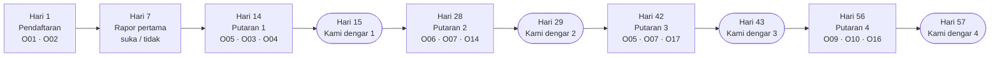

| Hari | Orang tua | Anak | Keluarga Perintis |
|---|---|---|---|
| 1 | O01, O02 (bagian dari pendaftaran) | A01 setelah lembar pertama | — |
| 7 | Rapor pertama + 👍👎 | A01/A04 bergantian; A03 saat jurus baru | Pesan suara 1: "Ceritakan minggu pertama" |
| 14 | **Putaran 1:** O05 → (lanjut?) O03, O04 | — | — |
| 15 | Pesan "Kami dengar, kami ubah" 1 | — | — |
| 21 | — | — | Pesan suara 2 |
| 28 | **Putaran 2:** O06 → O07, O14 | A05 pertama | — |
| 29 | Pesan 2 | — | — |
| 35 | — | — | Pesan suara 3 |
| 42 | **Putaran 3:** O05 → O07, O17 | — | — |
| 43 | Pesan 3 | — | — |
| 49 | — | — | Pesan suara 4 |
| 56 | **Putaran 4:** O09 → O10, O16 | A05 kedua | — |
| 57 | Pesan 4 | — | — |

**Aturan satu putaran:**

| Aturan | Isi | Dasar |
|---|---|---|
| Bentuk | Satu pertanyaan tampil; setelah dijawab: "Mau 2 pertanyaan lagi? ± 30 detik" | Satu pertanyaan paling aman; berhenti di tengah naik untuk setiap pertanyaan tambahan **[FAKTA — SurveyMonkey; Refiner]** |
| Panjang | Paling banyak 3 pertanyaan, selesai ≤ 1 menit | Keputusan 19 Okt |
| Tempat | Kartu di beranda mode orang tua **dan** di bawah link rapor (supaya orang tua [L] juga bisa menjawab) | Semua cara terlibat ikut |
| Waktu muncul | Pada jam yang paling sering keluarga itu membuka aplikasi (dari data) | K10 |
| Kalau belum dijawab | Kartu tetap di beranda 5 hari; satu pengingat WhatsApp di hari ke-3 (hanya keluarga dengan Izin 7); setelah itu hilang | Tidak mengejar |
| Jawaban dari link rapor | Dicatat `sumber = link` dan dihitung terpisah, sebab siapa pun yang memegang link bisa menjawab (`02-rancangan/03` jawaban_masukan) | Persetujuan masukan diberikan pemilik akun |

#### 5.3 Pertanyaan yang dipicu kejadian

**Diubah 20 Okt:** aturan lama (pemicu paling banyak 1 per 14 hari, di luar ± 3 hari dari putaran) ternyata membuat orang tua bisa ditanya **dua kali dalam 14 hari**, melanggar keputusan terkunci "paling sering dua minggu sekali". Sekarang pertanyaan pemicu **tidak muncul sendiri**: ia masuk antrean dan menjadi pertanyaan pertama di putaran berikutnya (menggantikan satu pertanyaan putaran itu, jadi tetap ≤ 3 pertanyaan). Kekurangannya: jawaban datang paling lambat 14 hari setelah kejadian, jadi ingatan orang tua sedikit kabur. Diterima, sebab aturan dua minggu lebih penting.

| Pemicu | Pertanyaan | Batas |
|---|---|---|
| Anak 5 hari tidak latihan | O11 | Masuk antrean putaran berikutnya; paling banyak 1 pertanyaan pemicu per putaran |
| Lulus level pertama | O12 | sama |
| Kegiatan Dampingi pertama | O13 | sama |
| 7 hari setelah Baca Ulang dimulai | O15 | sama |
| Simulasi TKA S1 selesai | O19 | sama |
| Hapus akun / 21 hari tidak aktif | O18 | Sekali saja. Satu-satunya pengecualian aturan antre: saat menghapus akun, sebab tidak ada putaran berikutnya. Untuk 21 hari tidak aktif, O18 ikut putaran berikutnya |

Kalau dua pemicu jatuh di periode yang sama, yang dipakai adalah yang paling dekat dengan keputusan minggu itu (urutan: O11 → O19 → O13 → O15 → O12); sisanya dibuang, bukan ditunda lagi.

**Tombol 👍👎 rapor pertama** (hari ke-7) tidak dihitung sebagai pertanyaan, sebab tidak dikirim sebagai pemberitahuan dan hanya satu ketuk di bawah rapor yang memang dibuka orang tua.

---

### 6. Syarat lembut — dirancang ulang

#### 6.1 Kenapa keputusan 19 Okt perlu ditinjau

Keputusan yang dikunci: *"Kalau orang tua melewatkan dua putaran pertanyaan, yang tertunda hanya fitur tambahan orang tua (misal rapor lengkap) sampai menjawab."* Acut2 tidak mengubahnya. Ini bukti untuk dipertimbangkan:

| Bukti | Sumber | Akibat untuk syarat lembut |
|---|---|---|
| Kalau konsumen menolak memberi persetujuan, layanan tetap diberikan **tanpa menurunkan mutu**, kecuali datanya memang diperlukan | **[FAKTA — PP 33/2026 Ps. 35(1), lewat Bisnis.com 29 Agu 2026]** | Jawaban masukan adalah data pribadi orang tua. Menahan rapor bagi yang tidak memberi data itu bisa dianggap menurunkan mutu. **[ASUMSI — perlu ahli hukum]** |
| Persetujuan harus bebas dan tidak digabung dengan syarat | **[FAKTA — PP 33/2026, lewat RSM Indonesia]** | Persetujuan yang dipaksa dengan ancaman fitur bisa dianggap tidak bebas |
| Imbalan di muka lebih kuat daripada imbalan yang dijanjikan | **[FAKTA — Church 1993; Edwards dkk. 2002]** | Ancaman kehilangan bukan cara terkuat menaikkan tanggapan |
| Jawaban terpaksa cenderung asal-asalan | **[ASUMSI]** sejalan dengan tanda jawaban asal **[FAKTA — CASRAI]** | Orang tua yang terpaksa menjawab demi rapor akan mengetuk cepat; mutu masukan turun |
| Rapor adalah yang paling diutamakan orang tua | Deskripsi Project | Menahan rapor menyentuh nilai utama aplikasi |

#### 6.2 Tiga pilihan

| | **A. Tetap seperti keputusan 19 Okt** | **B. Ajakan dengan imbalan** (usul) | **C. Kesepakatan Program Perintis** |
|---|---|---|---|
| Isi | Setelah 2 putaran terlewat, rapor lengkap ditahan sampai menjawab | Tidak ada yang ditahan. Yang menjawab langsung mendapat imbalan kecil: kartu terima kasih dan kabar "Kami dengar" yang menyebut perubahan dari jawabannya. (Disempitkan 20 Okt: "fitur baru lebih awal" hanya untuk Keluarga Perintis yang diundang, bukan untuk semua penjawab, dan "poin Perintis" dihapus, supaya sama dengan Syarat dan Ketentuan 5.2 dan 6, dan supaya keuntungan tidak dikaitkan dengan memberi data) | Saat mendaftar, orang tua memilih: **Program Perintis** (berjanji menjawab 1 menit tiap 2 minggu; mendapat hak Perintis saat berbayar) atau **pemakai biasa** (semua fitur sama, tanpa hak Perintis) |
| Risiko hukum | **Tinggi** (Ps. 35(1)) | Rendah, **setelah disempitkan** (versi lama dengan fitur lebih awal untuk penjawab sama dengan C: Sedang) | Sedang: imbalan dihubungkan dengan data; perlu dicek ahli hukum |
| Tanggapan | Mungkin tinggi, tetapi banyak jawaban asal | Bergantung pada imbalan dan pesan "Kami dengar" | Kemungkinan tertinggi dengan jawaban jujur, sebab orang tua memilih sendiri |
| Sesuai "anak tidak jadi korban" | Ya | Ya | Ya |
| Biaya | Kecil | Kecil | Kecil; hak Perintis menurunkan pendapatan awal |
| Waktu bangun | Sama untuk ketiganya (± 2–3 hari) | | |

**Diputuskan Acut 19 Okt: B.** (Usul Acut2 semula: pakai **B** di Rilis 1, sebab paling aman secara hukum dan tidak menurunkan mutu masukan; tanyakan **C** ke ahli hukum dan pindah ke C kalau diizinkan. **A tidak disarankan.**)

#### 6.3 Pengingat yang tetap berlaku di semua pilihan

| Keadaan | Yang terjadi |
|---|---|
| Satu putaran terlewat | Tidak ada apa-apa selain kartu yang hilang setelah 5 hari |
| Dua putaran berturut-turut terlewat | Satu pesan WhatsApp pribadi dari Acut (cetakan siap pakai): "Kami ingin tahu pendapat Anda — ada yang membuat Anda sulit menjawab?" |
| Tiga putaran terlewat | Keluarga dicatat "diam" dan tidak dihitung dalam angka tanggapan pemakai aktif; tidak dihubungi lagi sampai mereka aktif |

---

### 7. Keluarga Perintis

| Aturan | Isi |
|---|---|
| **Jumlah** | 5–10 keluarga (keputusan 19 Okt) |
| **Cara terpilih** | **Atas undangan Acut** (diubah 20 Okt): (a) 3–5 keluarga diajak sejak awal dari jaringannya; (b) sisanya diundang dari semua keluarga menurut sebaran kelas dan cara terlibat. Banyaknya jawaban **tidak** menjadi syarat, sebab itu sama dengan memberi keuntungan karena memberi data. Keluarga harus memberi Izin 7 (WhatsApp) |
| **Sebaran** | Diusahakan mencakup kelas 1–2, 3–4, dan 5–6, serta ketiga cara terlibat, supaya tidak hanya keluarga Pendamping yang terdengar |
| **Kewajiban** | Satu pesan suara WhatsApp ≤ 2 menit tiap 2 minggu, menanggapi satu pertanyaan pancingan; mencoba fitur baru lebih dulu; boleh berhenti kapan saja |
| **Imbalan di muka** (sejak bergabung) | Fitur baru terbuka lebih awal; kartu satwa khusus "Perintis" untuk anak (diberikan sebagai kejutan); disebut namanya (inisial, dengan izin) di pesan "Kami dengar, kami ubah" saat usulannya dipakai |
| **Hak saat berbayar** | Diatur di `09-gerbang-berbayar.md` bagian 5 |
| **Penjaga bias** | Jawaban Perintis dilaporkan terpisah; keputusan memakai data semua keluarga; Perintis biasanya lebih puas daripada rata-rata (`01-profil` 1.4) |
| **Kalau keluar** | Hak saat berbayar dihitung dari jumlah bulan aktif sebagai Perintis |

**Pertanyaan pancingan pesan suara** (satu per 2 minggu):

| Minggu | Pancingan |
|---|---|
| 1 | "Ceritakan kejadian paling berkesan minggu ini saat anak memakai aplikasi." |
| 3 | "Kapan anak terlihat paling semangat, dan kapan paling malas?" |
| 5 | "Apa yang Anda lakukan saat anak macet atau salah? Apa yang berhasil?" |
| 7 | "Kalau Anda bisa mengubah satu hal di aplikasi ini, apa?" |
| 9 | "Apa yang akan Anda katakan ke teman yang bertanya tentang aplikasi ini?" |
| 11 | "Apa yang membuat Anda ragu membayar, kalau nanti berbayar?" |

**Mengolah pesan suara:** Claude tidak menerima suara **[FAKTA — dokumentasi Claude]**. Acut mendengar pesan lalu mengetik 1–3 poin ke **Meja Masukan** (halaman pribadi di HP, sama dengan Meja Periksa) — ± 3 menit per pesan, ± 30 menit per 2 minggu untuk 10 keluarga **[ESTIMASI]**. Rekaman tidak disimpan di sistem aplikasi.

---

### 8. Pesan "Kami dengar, kami ubah"

| Aturan | Isi |
|---|---|
| Kapan | Sehari setelah setiap putaran (hari 15, 29, 43, 57), lalu tiap 2 minggu |
| Di mana | Kartu di beranda orang tua + pesan WhatsApp (siaran ke daftar keluarga, bukan grup) |
| Panjang | ≤ 80 kata |
| Isi wajib | (1) Berapa yang menjawab · (2) 2–3 perubahan dengan pola "Anda bilang … → kami ubah …" · (3) Satu hal yang belum bisa diubah beserta alasannya · (4) Terima kasih |
| Yang dilarang | Angka anak tertentu; janji tanggal yang belum pasti; pujian berlebihan untuk aplikasi sendiri |

**Contoh 1 (hari 15):**
> *Kami dengar, kami ubah — 2 minggu pertama.* 34 dari 47 keluarga menjawab. Terima kasih!
> • Anda bilang menghubungkan HP kedua membingungkan → kodenya sekarang cukup 6 angka.
> • Anda bilang kabar harian terlalu sering → sekarang hanya saat ada kemajuan.
> Belum bisa: latihan dari buku tulis. Kami ingin memastikan HP bisa membaca tulisan anak dengan benar dulu.

**Contoh 2 (hari 29):**
> *Kami dengar, kami ubah.* 29 keluarga menjawab. Banyak yang memilih latihan setelah magrib → pengingat bawaan kami pindah ke 18.45. Tiga keluarga bilang ×7 terlalu lama → level ×6 ×7 kami pecah dua. Belum bisa: Bahasa Inggris — menyusul setelah kami uji dengan suara anak-anak Aceh.

---

### 9. Mengolah masukan setiap minggu

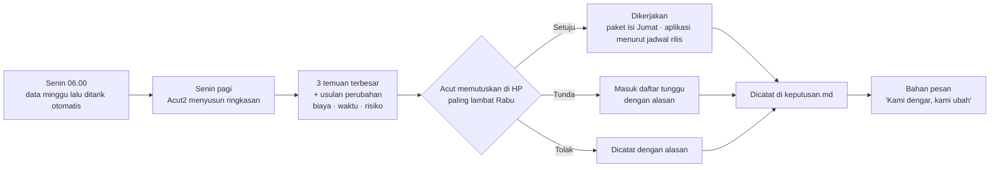

**Bentuk ringkasan mingguan** (satu layar HP):

| Bagian | Isi |
|---|---|
| Angka minggu ini | Keluarga aktif, hari latihan rata-rata, tanggapan putaran (kalau ada), ketukan anak |
| Temuan 1–3 | Apa yang terlihat · buktinya (angka + kutipan) · siapa yang terdampak · peta K berapa |
| Usulan | Satu perubahan per temuan, dengan biaya, waktu, risiko, dan cara mengukur berhasil-tidaknya |
| Keputusan minggu lalu | Apa yang sudah berubah dan apa akibatnya di data |
| Peringatan | Tanda yang melewati ambang, termasuk tanda biaya |

**Pembagian kerja:** ringkasan disusun Acut2 (lewat tugas terjadwal setiap Senin, dirancang di Tahap 3 dan 5); Acut membaca dan memutuskan ± 15–20 menit per minggu **[ESTIMASI]**.

**Data yang dibaca tugas terjadwal** (diubah 20 Okt): langganan Claude tunduk pada syarat konsumen, bukan syarat API. Karena itu berkas ekspor mingguan **hanya berisi angka gabungan dan jawaban pilihan tanpa nomor keluarga**. Isian terbuka dan poin Perintis dibaca Acut sendiri di Meja Masukan, atau dikirim lewat API (Haiku, data dihapus 30 hari) kalau perlu diringkas.

---

### 10. Menjaga mutu jawaban

| Tanda | Batas | Tindakan |
|---|---|---|
| Terlalu cepat | Waktu menjawab < ⅓ median semua orang tua untuk pertanyaan itu **[FAKTA — CASRAI]** | Ditandai |
| Pola sama | Memilih urutan pilihan yang sama di semua pertanyaan dua putaran berturut-turut | Ditandai |
| Bertentangan dengan data | Misal "anak latihan tanpa disuruh 3 kali atau lebih" padahal data minggu itu 0 latihan | Ditandai |
| Dua tanda atau lebih | — | Jawaban dihitung terpisah dan tidak dipakai untuk keputusan; **orang tua tidak diberi tahu dan tidak dihukum** |

Selain itu, setiap laporan menyebut **berapa jawaban** di balik setiap persen, dan selisih di bawah ± 15 poin disebut "belum bisa disimpulkan".

---

### 11. Privasi masukan

| Data | Persetujuan | Siapa yang membaca | Disimpan |
|---|---|---|---|
| Jawaban orang tua | Tujuan "masukan untuk pengembangan" (terpisah) | Acut dan Acut2, dalam bentuk ringkasan | Selama akun aktif; dihapus bersama akun |
| Ketukan anak | Sama, disetujui orang tua | Hanya dalam bentuk jumlah; dipakai menyesuaikan isi, **bukan membuat profil anak** (larangan profiling PP Tunas) | sama |
| Pesan suara Perintis | Izin 7 (WhatsApp dan Perintis) | Acut | Rekaman tidak masuk sistem; hanya 1–3 poin tertulis; pesan di WhatsApp dihapus setelah poinnya diketik (≤ 14 hari). WhatsApp (Meta) disebut sebagai pihak pemroses di kebijakan privasi |
| Data pemakaian | Tujuan "data pemakaian" (terpisah) | Ringkasan | Dirinci di Tahap 3 |

Kalau orang tua tidak memberi persetujuan masukan, aplikasi tetap penuh dan pertanyaan tidak pernah muncul.

---

### 12. Ukuran keberhasilan sistem masukan

| Ukuran | Target | Cadangan |
|---|---|---|
| Tanggapan per putaran (pemakai aktif) | ≥ 60% | ≥ 45% |
| Hari dengan ketukan anak ÷ hari latihan (diubah 20 Okt: "per sesi" mustahil dicapai karena batas 1 ketukan per hari) | ≥ 70% | ≥ 50% |
| Perubahan nyata dari masukan per 2 minggu | 2 | 1 |
| Keluarga Perintis aktif | 8 | 5 |
| Minggu dengan keputusan tercatat (dari 8 minggu) | 8 | 6 |
| Jawaban yang ditandai asal | ≤ 10% | ≤ 20% |

---

### 13. Keputusan Acut (19 Okt ± 21.50: semua disetujui, syarat lembut = B)

| # | Keputusan | Usul Acut2 |
|---|---|---|
| 1 | **Syarat lembut:** A, B, atau C (bagian 6.2) | **B** sekarang; C kalau ahli hukum mengizinkan; A tidak disarankan |
| 2 | Pertanyaan hari ke-7 dipindah ke hari ke-14 supaya sesuai aturan dua minggu | Setuju |
| 3 | Pertanyaan pemicu paling banyak 1 per 14 hari per keluarga | Setuju. **20 Okt:** diperketat menjadi "masuk antrean putaran berikutnya" supaya tidak melanggar aturan dua minggu (bagian 5.3) |
| 4 | Imbalan di muka untuk Keluarga Perintis (fitur lebih awal, kartu khusus, inisial disebut) | Setuju |
| 5 | Acut mengetik poin pesan suara Perintis ke Meja Masukan (± 30 menit per 2 minggu) | Setuju, atau tunjuk orang lain |


## Gerbang Menuju Berbayar

*Berkas: `rancangan/01-produk/09-gerbang-berbayar.md`*

**Ringkas:** (1) Arah besar 6 berbunyi "anak makin pintar **atau** semangat belajar naik **atau** tugas sekolah lebih mudah". Karena itu gerbang dihitung **per keluarga**: satu keluarga dianggap "terpenuhi" kalau **minimal satu janji kemampuan terukur dari data (1a, 1b, atau 1c) dan minimal satu janji yang dirasakan orang tua (2 atau 3)** tercapai untuk anaknya (diperketat 20 Okt setelah pemeriksaan akhir). Tombol berlangganan dibuka kalau **≥ 70% keluarga aktif terpenuhi (cadangan 60%)**, ditambah syarat jumlah, lama pakai, dan "sangat kecewa". (2) Evaluasi paling cepat **± 26 April 2027** (12 minggu setelah gelombang 3 masuk, dan minggu Ramadan–Idulfitri tidak dihitung), atau pertengahan Mei setelah TKA. Pada 29 Maret baru ± 28–30 keluarga yang sudah memakai 12 minggu, terlalu sedikit untuk dinilai. Usulnya, berbayar dimulai bersama **tahun ajaran baru (Juli 2027)**, sebab keluarga kelas 6 cenderung berhenti setelah TKA. (3) Usul harga: inti Lancar Matematika dan rapor ringkas **tetap gratis selamanya**; Paket Keluarga **± Rp49 ribu per bulan untuk semua anak** (diuji dengan pertanyaan harga, diputuskan di Tahap 5); Keluarga Perintis mendapat 3 bulan gratis tambahan dan harga 50% selama 12 bulan.

> **Status 19 Okt ± 21.50:** seluruh isi berkas ini masih **usulan**. Acut memutuskan membahas bentuk, waktu, harga, gerbang, dan hak Perintis dalam **diskusi khusus** (Januari 2027, paling lambat Jumat 29 Jan; `keputusan.md` bagian J).

Tahap 2, butir 11. Disusun 19 Oktober 2026. Semua ambang di sini **[ASUMSI]** awal dan dinilai ulang dengan data minggu ke-4 dan ke-8.

---

### 1. Empat janji menjadi ukuran

Ukuran kelompok dipakai untuk menilai aplikasi; ukuran per keluarga dipakai untuk menghitung "terpenuhi".

| Janji (Arah besar 6) | Ukuran kelompok | Target · cadangan | Ukuran per keluarga ("terpenuhi" kalau …) | Sumber data |
|---|---|---|---|---|
| **1a. Makin pintar — berhitung** | Kecepatan pada tes tetap kelas itu (awal vs minggu ke-8) | Turun 30% · 15%; ketepatan ≥ 95% · 90% | Kecepatan turun ≥ 20% dan ketepatan ≥ 90% | Data (`04-mesin-lancar.md` bagian 8) |
| | Daya tahan 3 minggu | ≥ 90% · 80% masih benar | — | Data |
| **1b. Makin pintar — membaca** (mulai R2) | Kata per menit **bacaan dingin dengan tombol** (tanda curang dibuang), 8 minggu di luar Ramadan; Dengar Bacaan orang tua sebagai penguat | +15% · +8%; pemahaman ≥ 80% · 70% | Naik ≥ 10% dan pemahaman ≥ 70% (murid kelas luring kelas 6 memakai teks dingin terpisah) | Data (`05-bahasa-indonesia.md` bagian 3, 5) |
| **1c. Makin pintar — TKA** (kelas 6) | Persen benar Matematika S1 → S4 | +15 poin · +8 poin | Naik ≥ 10 poin | Data (`06-persiapan-tka.md` bagian 7) |
| **2. Semangat belajar naik** | Latihan yang dimulai anak sendiri (tanpa ajakan, pengingat, atau kabar orang tua dalam 2 jam sebelumnya) | ≥ 30% · 20% sesi di minggu ke-8 (di luar Ramadan) | Rata-rata **≥ 2 sesi dimulai sendiri per minggu** dalam 4 minggu terakhir **dan** O06 "1–2 kali" atau lebih | Data + O06 |
| | Anak masih latihan setelah 30 hari | ≥ 60% · 45% | — | Data |
| | Hari latihan per minggu | ≥ 5 · 4 (mengikuti `claude/metode-lancar.md`; tabel induk `06-rilis/02`) | — | Data |
| **3. Tugas sekolah lebih mudah** | O07 "lebih mudah" di antara yang ada tugas | ≥ 40% · 25%; "lebih sulit" ≤ 10% | O07 "lebih mudah" | O07 |
| **4. Hasil sekolah lebih baik** | Tidak diukur dengan pertanyaan (O08 dihapus 20 Okt, sebab tidak terhubung ke satu keputusan). Hanya dicatat dari cerita Keluarga Perintis | — | (tidak dihitung "terpenuhi") | Perintis |
| **Pantas berbayar** | O09 "sangat kecewa" di antara pemakai aktif | ≥ 40% · 30% | — | O09 |

**Kenapa janji 4 tidak diukur:** nilai ulangan sekolah dipengaruhi banyak hal di luar aplikasi (guru, materi, waktu ulangan), dan sebagian keluarga belum ada ulangan dalam 8 minggu. Kenaikan nilai sekolah tidak dijadikan syarat dan **tidak pernah dijanjikan dalam promosi**, sebab janji angka memicu permintaan uang kembali (`bahan/rancangan-modul-interaktif.md` Bagian 3).

**Tes tetap:** satu lembar 20 soal campuran level kelas itu, dikerjakan **sekali di hari ke-1 sampai ke-3** (tes tetap awal, terpisah dari tes penempatan) lalu setiap 4 minggu dengan susunan yang sama (angka diacak dari benih baru). Inilah dasar perbandingan "awal lawan minggu ke-8", bukan lembar harian yang levelnya terus naik. Untuk memisahkan kemajuan sungguhan dari efek terbiasa dengan tes, setiap tes tetap juga memuat 5 soal dari level kelas di bawahnya sebagai pembanding **[ASUMSI — cara ini dinilai ulang di laporan minggu ke-4]**. Anak yang sudah di level teratas kelasnya tetap mengerjakan tes yang sama; kemajuannya dibaca dari waktu.

---

### 2. Aturan gerbang

| # | Syarat | Target | Cadangan | Kenapa |
|---|---|---|---|---|
| G1 | Lama **setiap keluarga yang dihitung** memakai aplikasi (minggu kalender) | ≥ 12 minggu | ≥ 10 minggu | Melewati titik rendah efek kebaruan minggu ke-4–6 |
| G2 | Keluarga aktif (≥ 2 hari latihan per minggu dalam 4 minggu terakhir) | **≥ 30** | **≥ 20** | Diturunkan 20 Okt mengikuti target pemakai baru. Di bawah 30 keluarga, persen meleset ± 17–20 poin, jadi G3 dan G5 dibaca bersama G8 |
| G3 | **Keluarga aktif yang "terpenuhi"** (minimal satu dari 1a/1b/1c **dan** minimal satu dari 2/3) | **≥ 70%** | **≥ 60%** | Terjemahan kata "atau" di Arah besar 6, dengan syarat ada bukti data supaya satu ketukan orang tua saja tidak cukup. Dilaporkan bersama selang kepercayaannya: pada 40 keluarga, 70% bisa meleset ± 14 poin |
| G4 | Tidak ada ukuran kelompok di bawah cadangannya | 0 ukuran | ≤ 1 ukuran, dengan rencana perbaikan | Mencegah satu bagian jelek tertutup bagian lain |
| G5 | "Sangat kecewa" (O09) | ≥ 40% | ≥ 30% **dan** G3 mencapai target | Patokan 40% tidak terverifikasi dan jawabannya sedikit, jadi tidak dipakai sendirian |
| G6 | Penjaga "tidak merusak" | Ketepatan tidak turun; anak "kewalahan" (`04-mesin-lancar.md` 5.1) ≤ 10% | ≤ 15% | Kewalahan adalah penyebab berhenti nomor satu **[Klaim vendor — Churnkey, `riset-penguat.md` bagian 5]** |
| G8 | **Cerita Keluarga Perintis** (ditambah 20 Okt, sebab jumlah keluarga kecil) | ≥ 4 dari 5–8 Perintis menyebut perubahan nyata pada anak **dan** alasan konkret mau membayar, dalam pesan suara minggu ke-11 ("Apa yang membuat Anda ragu membayar?") | ≥ 3 | Dengan 20–30 keluarga, persen saja tidak cukup kuat; cerita konkret menunjukkan alasan di balik angka |
| G7 | Harga yang diuji | Median O10 ≥ rentang harga yang direncanakan; "tidak akan membayar" ≤ 30% | ≤ 40% | Menghindari tombol dibuka pada harga yang ditolak |

#### Hasil evaluasi

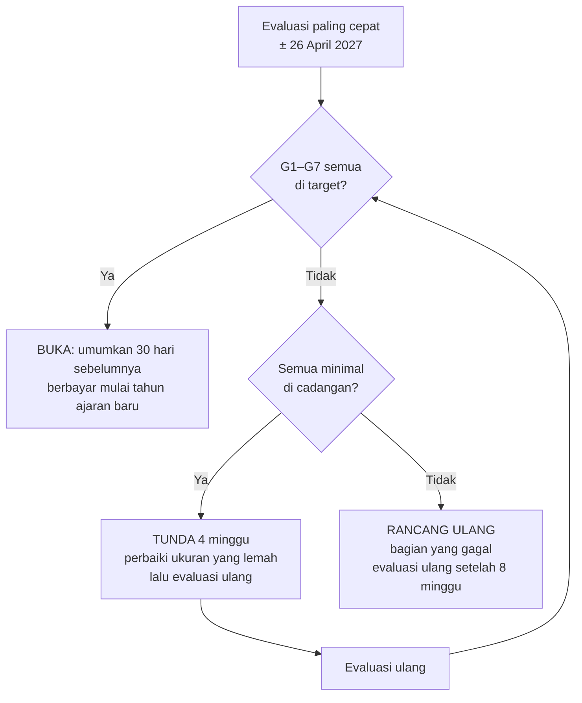

---

### 3. Kapan, dengan memperhitungkan kalender

| Peristiwa | Tanggal **[FAKTA — kalender 2026/27, `riset-penguat.md` bagian 7; TKA 2027 belum diumumkan]** | Minggu ke- (dihitung dari gelombang 2, 4 Jan) |
|---|---|---|
| Gelombang 2 masuk (gelombang 1 ± 9 Des, gelombang 3 ± 1 Feb) | 4 Jan 2027 **[ASUMSI — jadwal Tahap 5]** | 1 |
| Libur awal puasa | 8–10 Feb | 6 |
| Ramadan | ± 8 Feb – 8 Mar | 6–10 |
| Libur Idulfitri | 8–19 Mar | 10–11 |
| Evaluasi gerbang paling cepat: gelombang 3 (masuk 1 Feb) genap 12 minggu, sehingga ketiga gelombang (target 30 keluarga aktif) bisa dihitung | ± 26 Apr | 17 |
| TKA SD (kalau pola 2026 berulang) | ± akhir April | 16–17 |
| Paket kelas baru (R4) | 14 Jun | 24 |
| Tahun ajaran baru | ± 12 Jul | 28 |

| Pilihan | Untung | Rugi | Putusan |
|---|---|---|---|
| Berbayar segera setelah lulus gerbang (April) | Pendapatan lebih cepat; menangkap kebutuhan TKA | Data minggu ke-6–11 terganggu Ramadan; keluarga kelas 6 berhenti setelah TKA **[`riset-penguat.md` bagian 5, akibat 4]**; berbayar di tengah semester terasa seperti "ditarik setelah terbiasa" | ✗ |
| **Lulus gerbang April–Mei, berbayar mulai tahun ajaran baru (Juli 2027)** | Waktu alami untuk mulai berlangganan; R4 (naik kelas, Gampong) memberi alasan baru; data 4 minggu tambahan setelah Ramadan | Pendapatan mundur 3 bulan | **✓ Diusulkan** |
| Cadangan kalau gerbang belum lulus sampai Juni | — | — | Evaluasi ulang akhir September; berbayar paling cepat Oktober 2027 |

**Akibat untuk ukuran:** minggu Ramadan dan libur ditandai di data dan **tidak dipakai sebagai jendela ukur** untuk "hari latihan per minggu", "minggu ke-8", dimulai sendiri, dan janji 1b (jendela digeser ke minggu terdekat di luar Ramadan); lama pakai G1 tetap dihitung dengan minggu kalender. Kalau pada evaluasi ± 26 April jumlah keluarga yang memenuhi G1 masih < 30, evaluasi digeser ke pertengahan Mei atau Juni — tetap sebelum keputusan berbayar tahun ajaran baru.

---

### 4. Harga dan apa yang tetap gratis

#### 4.1 Patokan pasar

| Hal | Angka | Sumber |
|---|---|---|
| Median harga langganan aplikasi di India dan Asia Tenggara (semua kategori) | US$3,75 per bulan (± Rp62 ribu) | **[FAKTA — RevenueCat 2026]** |
| Pengunduh yang membayar dalam 35 hari, India dan Asia Tenggara | 0,7% | sama |
| Perpanjangan langganan pendidikan | Bulanan 56%; tahunan 24% | **[FAKTA — RevenueCat, dikutip Churnkey]** |
| Kumon | ± Rp430–480 ribu per mapel per bulan | **[FAKTA — riset pasar, `01-profil` 1.1]** |
| Guru privat Banda Aceh | ± Rp54 ribu per jam | sama |
| Pesaing gratis | Rumah Pendidikan (Ruang Murid, Ruang Orang Tua) | **[FAKTA — GNFI 24 Jan 2025]** |
| Potongan Google Play | ± 15% untuk langganan; pengembang menerima ± 77% harga setelah PPN | **[Catatan proyek Peta Belajar — dicek ulang di Tahap 3]** |

#### 4.2 Pilihan bentuk berbayar

| | **X. Inti gratis selamanya + Paket Keluarga** (usul) | Y. Coba 14 hari, lalu semua berbayar | Z. Bayar per mapel |
|---|---|---|---|
| Gratis | Akun keluarga, Lancar Matematika semua level, rapor mingguan ringkas (3 angka), link rapor, riwayat | 14 hari | 1 mapel |
| Berbayar | Baca Ulang, modul Paham, Mode Dampingi lengkap, rapor lengkap (peta jenis salah, rapor cerita), game dan Gampong, Belajar Bahasa Inggris (R2; bagian gratis atau berbayar ikut diskusi khusus berbayar), ngobrol Bahasa Inggris dengan AI (R5) | Semua | Mapel lain |
| Untung | Keluarga yang tidak membayar tetap terbantu; bersaing dengan Rumah Pendidikan yang gratis; mulut ke mulut tetap jalan | Pendapatan per keluarga lebih tinggi | Mudah dipahami |
| Rugi | Sebagian merasa "gratisnya sudah cukup" (O20 dipantau) | Pengguna masa gratis kehilangan semua; konversi Asia Tenggara rendah (0,7%) | Saudara dan mapel ganda membuat harga mahal; bertentangan dengan paket keluarga |

**Usul: X**, sebab niat Acut agar anak terbantu tetap terjaga untuk keluarga yang belum mampu, dan pembeda yang dibayar adalah **bimbingan dan bukti kemajuan**, yang memang paling diutamakan orang tua.

#### 4.3 Usul harga awal **[ASUMSI — diuji dengan O10, diputuskan di Tahap 5 setelah hitungan biaya]**

| Paket | Harga | Diterima kita (± 77%) **[ESTIMASI]** | Sebab |
|---|---|---|---|
| **Paket Keluarga** (semua anak satu keluarga) | **Rp49 ribu per bulan** | ± Rp37.700 | Di bawah median Asia Tenggara (± Rp62 ribu); kurang dari satu jam guru privat; satu harga untuk saudara |
| Paket Keluarga tahunan | Rp490 ribu per tahun (2 bulan gratis) | ± Rp377 ribu | Pilihan, bukan bawaan, sebab paket tahunan di muka adalah keluhan utama pada pesaing (`riset-pasar-dan-pesaing.md`) |
| **Siap TKA** (kelas 6, Januari–April) | Termasuk Paket Keluarga; untuk murid kelas luring **sudah termasuk biaya kelas** | — | Murid kelas luring tidak membayar dua kali |

**Aturan harga:** bulanan, harga ditulis lengkap tanpa kata "mulai", bisa berhenti kapan saja dari aplikasi, dan tanpa perpanjangan diam-diam ke paket tahunan.

---

### 5. Hak saat peralihan

| Kelompok | Hak **[ASUMSI — angka diputuskan Acut]** | Biaya bagi kita **[ESTIMASI]** |
|---|---|---|
| **Keluarga Perintis** (5–10) | Gratis 3 bulan tambahan sejak berbayar dimulai, lalu harga 50% (Rp24.500) **terkunci 12 bulan** | 10 keluarga × Rp24.500 selisih = ± Rp245 ribu per bulan pendapatan yang dilepas |
| Keluarga masa gratis lain yang aktif | Potongan 25% selama 6 bulan | 40 × Rp12.250 = ± Rp490 ribu per bulan |
| Semua keluarga | Bagian gratis tetap jalan; riwayat tidak pernah dihapus; pemberitahuan ≥ 30 hari | — |
| Anak | Tidak diberi tahu soal uang; fitur berbayar yang berhenti tidak dihapus progresnya (Gampong "beristirahat", tidak hilang) | — |

**Hak Perintis harus tertulis di syarat dan ketentuan sejak hari pertama**, sebab itu janji yang mengikat dan dibuat sebelum harga diketahui. Masuk paket draf ahli hukum (Tahap 3).

#### Langkah peralihan

| Waktu | Orang tua | Anak |
|---|---|---|
| H−30 | Kabar di aplikasi dan WhatsApp + ringkasan kemajuan anak sejak awal | — |
| H−30 sampai H−1 | Bisa memilih berlangganan lebih awal (hak tetap berlaku) | — |
| H | Yang tidak berlangganan pindah ke bagian gratis | Lancar dan rekor tetap; bagian berbayar tampil "istirahat" tanpa pesan menekan |
| H+7 | O20 (sekali, boleh dilewati) | — |

---

### 6. Risiko

| Risiko | Tanda awal | Pencegahan |
|---|---|---|
| Jumlah keluarga aktif < 30, gerbang tidak bisa dinilai | Minggu ke-8 aktif < 35 | Ajakan gelombang kedua (Tahap 5); gerbang ditunda, bukan diturunkan |
| Ramadan merusak data | Hari latihan turun tajam minggu ke-6–10 | Minggu Ramadan dipisah dalam hitungan; Mode Ramadan (lembar lebih pendek) **[ASUMSI — dinilai Tahap 4]** |
| Keluarga kelas 6 berhenti setelah TKA | Rencana berhenti di O18 "tujuan tercapai" | Rapor "dari TKA ke SMP"; paket kelas 7 dinilai di R4+ |
| "Gratisnya sudah cukup" | O20 > 40% memilih itu | Pindahkan satu fitur ke berbayar **hanya untuk pengguna baru**, tidak mencabut dari yang lama |
| Orang tua merasa dijebak setelah gratis | Keluhan di WhatsApp | Sejak pendaftaran ditulis: "Gratis selama masa uji. Inti latihan tetap gratis selamanya." |
| Gerbang dibuka terlalu cepat karena ingin pendapatan | Tekanan biaya | Angka gerbang dicatat di `keputusan.md` sebelum data terlihat, supaya tidak digeser belakangan |

---

### 7. Yang perlu diputuskan Acut

| # | Keputusan | Usul Acut2 |
|---|---|---|
| 1 | Gerbang dihitung per keluarga ("terpenuhi" kalau satu janji tercapai), ≥ 70% · 60% | Setuju, sebab sesuai kata "atau" di Arah besar 6 |
| 2 | Berbayar mulai tahun ajaran baru (Juli 2027), walau gerbang lulus April | Setuju |
| 3 | Bentuk X: inti Lancar + rapor ringkas gratis selamanya | Setuju |
| 4 | Harga awal Rp49 ribu per bulan per keluarga (diuji O10, dikunci di Tahap 5) | Sementara |
| 5 | Hak Perintis: 3 bulan gratis + 50% terkunci 12 bulan; pemakai lain 25% selama 6 bulan | Sementara, dicek ahli hukum |
| 6 | Angka gerbang dikunci di `keputusan.md` sekarang, sebelum data ada | Setuju |


## Lima Penegasan Acut (28 Okt) — Gudang Ilmu, Bimbingan, Waktu Belajar, dan Isi per Kelas

*Berkas: `rancangan/01-produk/10-gudang-ilmu-bimbingan-dan-waktu.md`*

**Ringkas:** (1) Dari lima poin yang ditegaskan Acut 28 Oktober, **satu sudah lengkap** di rancangan (isi dan fasilitas hanya untuk kelas anak, poin 5), **dua sebagian** (belajar sambil bermain dan mandiri, poin 2; menu bimbingan dibuka orang tua, poin 3), dan **dua belum ada** (gudang ilmu SD lengkap, poin 1; batas waktu belajar dan game berdasarkan riset, poin 4). Berkas ini menambahkan semuanya. (2) Hasil riset poin 4: waktu belajar efektif **tidak sama untuk semua kelas**. Patokannya **10 menit × kelas** per hari (kelas 1 = 10 menit, kelas 6 = 60 menit), dipecah menjadi blok pendek. Sesudah itu game **paling lama 30 menit** (kelas 1–2: 20 menit), dan orang tua boleh menaikkannya sampai 60 menit, tidak lebih. (3) Tambahan terbesar adalah **Gudang Ilmu**: peta lengkap semua topik SD kelas 1–6 sejak awal, lalu diisi bertahap. Matematika dan Bahasa Indonesia lebih dulu, mata pelajaran lain menyusul atas keputusan Acut. Isinya **tidak mungkin lengkap di Rilis 1**: ± 360 topik untuk dua mapel butuh ± 120 jam pemeriksaan.

**Pembaruan keputusan Acut 28 Okt (sore):** (a) batas waktu belajar dan game di bagian 5.2 **disetujui**; (b) kartu Gudang Ilmu **kelas 6 diisi lebih dulu** (Matematika 4 Jan, Bahasa Indonesia 1 Feb 2027, fokus TKA), kelas lain menyusul, dan aplikasi tetap untuk kelas 1–6; (c) Bahasa Inggris menjadi paket tersendiri **"Belajar Bahasa Inggris"** tingkat 3–6 yang bebas dipilih semua anak, mulai 1 Feb 2027 tanpa AI suara (`11-belajar-bahasa-inggris.md`); (d) **guru sekolah hanya melihat kemampuan dan memberi komentar**, sedangkan **guru les** boleh memberi tugas dan catatan (bagian 4.1).

Disusun 28 Oktober 2026 atas permintaan Acut. Label: **[FAKTA + sumber] · [ESTIMASI + cara hitung] · [ASUMSI — perlu diuji]**.

---

### 1. Pemeriksaan lima poin terhadap rancangan

| # | Permintaan Acut | Status sebelum 28 Okt | Yang ditambahkan di berkas ini |
|---|---|---|---|
| 1 | Gudang data ilmu pelajaran SD **lengkap**, kelas 1–6 | **Belum.** Tahun pertama hanya latihan harian 2 mapel, TKA, dan 12 topik Paham; Paham kelas 1–3 dan modul Bahasa Indonesia kelas 1–2 ditunda (`03-rencana-isi.md` bagian 2) | Gudang Ilmu: peta topik lengkap + kartu ilmu per topik + jadwal pengisian (bagian 2) |
| 2 | Belajar sambil bermain, anak diarahkan mandiri; yang tidak bisa diberi tanda **perlu bimbingan orang tua** atau **perlu bimbingan guru** | **Sebagian.** Ada Mode Dampingi, saran "coba Mode Dampingi" saat macet, dan tombol "Bantu aku". Belum ada tanda tiga tingkat dan belum ada jalur ke guru | Tanda bimbingan tiga tingkat dengan aturan yang jelas (bagian 3) |
| 3 | Menu bimbingan orang tua dan guru baru terbuka di akun anak **setelah disetujui orang tua** | **Sebagian.** Mode Dampingi sudah dibuka dengan PIN orang tua. Bimbingan guru belum ada (hanya link baca untuk pengajar kelas luring) | Bimbingan guru dengan persetujuan orang tua (bagian 4) |
| 4 | Waktu belajar efektif (30 menit atau 1 jam, sesuai riset), sesudahnya game dengan batas waktu yang sesuai riset | **Belum berdasar riset.** Batas sesi 10/15/20 menit dan game 10/15 menit masih [ASUMSI]; game bawaannya terbuka kapan saja | Batas waktu dari riset + urutan "belajar dulu, lalu main" (bagian 5) |
| 5 | Isi dan fasilitas hanya untuk kelas yang didaftarkan, supaya aplikasi ringan | **Sudah.** Keputusan 19 Okt: satu aplikasi, paket isi per kelas diunduh sesuai kelas, otomatis berganti saat naik kelas (`02-rancangan/05-paket-isi.md`) | Penegasan daftar fasilitas per kelas dan ukuran unduhan (bagian 6) |

---

### 2. Gudang Ilmu — peta lengkap SD, diisi bertahap

#### 2.1 Bentuknya

Gudang Ilmu adalah **perpustakaan pelajaran** di dalam aplikasi. Setiap topik SD punya satu **kartu ilmu**, disusun menurut Capaian Pembelajaran Kurikulum Merdeka Fase A (kelas 1–2), Fase B (kelas 3–4), dan Fase C (kelas 5–6).

| Isi satu kartu ilmu | Untuk apa |
|---|---|
| Penjelasan singkat bergambar (1–2 layar, bersuara untuk kelas 1–2) | Anak belajar sendiri |
| 2 contoh jadi, langkah demi langkah | Cara paling kuat untuk materi baru (contoh jadi sebelum latihan) |
| 5–10 soal latihan berjenjang, dengan kunci bertahap | Belajar mandiri, soal muncul dari mudah ke sulit |
| Salah paham yang sering terjadi | Mesin tahu kenapa anak salah, rapor bisa menjelaskan |
| Petunjuk untuk orang tua ("tanyakan ini, jangan sebut jawabannya") | Bahan Mode Dampingi |
| Prasyarat (topik kelas di bawahnya yang harus dikuasai dulu) | Mesin bisa mundur ke topik dasar kalau anak macet |

**Peta lengkap, isi bertahap:** semua topik kelas 1–6 sudah tercantum sejak awal, jadi Acut, orang tua, dan anak bisa melihat seluruh peta pelajaran. Topik yang kartunya belum siap ditandai **"segera"**, sebab menulis dan memeriksa ratusan kartu sekaligus tidak mungkin dilakukan dengan baik dalam 5 minggu pembangunan.

#### 2.2 Berapa banyak dan berapa lama

| Mapel | Topik **[ESTIMASI — ± 30 per kelas, angka di Prompt RCTOR]** | Sudah ada bahannya | Jam pemeriksaan **[ESTIMASI — 20 menit per kartu]** |
|---|---|---|---|
| Matematika kelas 1–6 | ± 180 | 24 modul TKA (kelas 4–6) + 36 jurus Lancar | ± 60 jam |
| Bahasa Indonesia kelas 1–6 | ± 180 | 12 modul TKA + 36 teks baca cepat | ± 60 jam |
| **Jumlah dua mapel** | **± 360** | | **± 120 jam ≈ Rp6 juta** kalau oleh guru (setara Rp50 ribu per jam) |
| Bahasa Inggris tingkat 3–6 | 48 unit (paket tersendiri, bukan kartu per kelas) | Belum ada | ± 16 jam (`11-belajar-bahasa-inggris.md`) |
| IPAS (kelas 3–6) dan Pendidikan Pancasila (kelas 1–6) | ± 240–300 | Belum ada | ± 80–100 jam |

Biaya AI menyusun draf kartu: ± Rp1–2 ribu per kartu dengan Sonnet lewat kiriman sekaligus, atau Rp0 kalau disusun di langganan Claude Acut **[ESTIMASI — ± 3.000 token masuk + 2.000 keluar per kartu]**.

#### 2.3 Urutan pengisian (keputusan Acut 28 Okt: kelas 6 dulu)

| Tahap | Isi | Kartu **[ESTIMASI]** | Siap | Pemeriksa | Sebab |
|---|---|---|---|---|---|
| A | **Peta topik lengkap** semua mapel SD kelas 1–6 (judul, kode CP, urutan, prasyarat) | — | Rilis 1, 22 Des 2026 | Acut (sampel) | Kerangka murah (± 6 jam), dan langsung berguna untuk mesin dan rapor |
| B1 | **Kartu Matematika kelas 6** (fokus topik TKA) | ± 30 | **R1.1, 4 Jan 2027** (bersama isi TKA) | Acut, ± 10 jam di Desember | Bahan 24 modul TKA sudah ada, tinggal diubah bentuk; anak kelas 6 butuh sebelum TKA April |
| B2 | **Kartu Bahasa Indonesia kelas 6** (fokus TKA: ide pokok, simpulan, jenis teks, kalimat efektif) | ± 30 | **R2, 1 Feb 2027** | Acut, ± 10 jam di Januari | 12 modul TKA dan teks baca cepat sudah ada |
| C | Kartu Matematika kelas 4–5 | ± 60 | R3, 22 Mar 2027 | Guru pemeriksa | Sebagian bahan dari modul TKA (topik kelas 4–5 yang diuji) |
| D | Kartu Matematika kelas 1–3 | ± 90 | R4, Juni 2027 | Guru pemeriksa | Belum ada bahan; disusun AI, diperiksa guru |
| E | Kartu Bahasa Indonesia kelas 1–5 | ± 150 | Desember 2027 | Guru pemeriksa | Baca Ulang harian sudah jalan sejak Februari; kartu topik (ejaan, imbuhan, jenis teks) melengkapinya |
| F | IPAS dan Pendidikan Pancasila | — | 2028, **atas keputusan Acut** | — | Dinilai setelah gerbang berbayar |

Bahasa Inggris **tidak** masuk urutan ini, sebab sudah menjadi paket tersendiri dengan tingkat yang bebas dipilih (`11-belajar-bahasa-inggris.md`).

**Akibat untuk Acut:** memeriksa ± 60 kartu kelas 6 (± 20 jam) di Desember–Januari, di samping isi TKA dan Baca Ulang. Kalau tidak terkejar, B2 bergeser ke 22 Feb (cadangan R2) dan diperiksa guru yang mulai Februari.

**Kenapa tidak semua sekaligus:** kartu yang salah lebih merusak daripada kartu yang belum ada, sebab anak belajar sendiri dan orang tua percaya pada isinya. Setiap kartu wajib dibaca manusia sebelum terbit. Dengan guru ± 30 jam per bulan, dua mapel selesai ± 4 bulan kerja guru, yang dipecah di sepanjang 2027.

#### 2.4 Data

Tabel baru di basis data (melengkapi `02-rancangan/03-basis-data.md`):

| Tabel | Kolom penting |
|---|---|
| `topik` | kode (misal `MAT-4-07`), mapel, kelas, fase, kode CP, judul, urutan, status (`segera` · `uji` · `terbit`) |
| `prasyarat` | topik, topik_prasyarat |
| `kartu_ilmu` | topik_id, versi, isi (penjelasan, contoh, petunjuk orang tua, salah paham), diperiksa_oleh, terbit |
| `kemajuan_topik` | anak_id, topik_id, tingkat (`belum` · `belajar` · `kuasai`), tanda_bimbingan (`mandiri` · `orang_tua` · `guru`), diperbarui |

Soal latihan di kartu memakai bank soal yang sudah dirancang (`02-rancangan/06-pembuat-soal-dan-bank-soal.md`), jadi tidak perlu jalur baru.

---

### 3. Belajar sambil bermain, mandiri dulu, dan tanda bimbingan tiga tingkat

#### 3.1 Yang sudah ada dan tetap berlaku

Latihan pendek di level yang pas, jurus sebelum level baru, kejutan yang tidak dijanjikan (kartu satwa, Jurus Sulap Angka), Gampong yang tumbuh, pilihan jalur, tanpa peringkat dan tanpa rangkaian hari beruntun (`07-fitur-orang-tua-dan-anak.md` bagian 3). Semua latihan bisa dikerjakan anak sendiri.

#### 3.2 Tanda bimbingan

Setiap topik di `kemajuan_topik` punya satu tanda. Tanda **tidak pernah ditampilkan ke anak sebagai kegagalan**. Anak hanya melihat "Topik ini lebih seru dikerjakan bersama Ayah/Bunda". Orang tua melihat tandanya dengan alasan.

| Tanda | Kapan diberikan otomatis **[ASUMSI — ambang dikalibrasi di laporan minggu ke-4]** | Yang terjadi |
|---|---|---|
| 🟢 **Mandiri** | Bawaan semua topik | Anak belajar sendiri |
| 🟡 **Perlu bimbingan orang tua** | Topik macet: 4 lembar berturut-turut tanpa kemajuan, **atau** "Masih bingung" pada jurus dua kali, **atau** salah ≥ 60% di kartu ilmu setelah jurus dibuka ulang | Kabar ke orang tua: "Rani macet di ×7. Coba kegiatan Dampingi 10 menit, naskahnya sudah disiapkan." Di HP anak muncul ajakan "kerjakan bersama Ayah/Bunda" yang terbuka setelah orang tua memasukkan PIN |
| 🔴 **Perlu bimbingan guru** | Masih macet setelah **2 kegiatan Dampingi** pada topik yang sama, **atau** celah prasyarat ≥ 2 kelas di bawah (misal anak kelas 5 belum menguasai perkalian dasar), **atau** rapor TKA menunjukkan "salah paham konsep" di ≥ 3 topik | Kabar ke orang tua: "Topik ini sebaiknya dibantu guru." Disertai ringkasan satu layar yang bisa dikirim ke guru sekolah atau guru les (bagian 4). Latihan anak **tidak dikunci**; mesin memberi latihan topik prasyarat sambil menunggu |

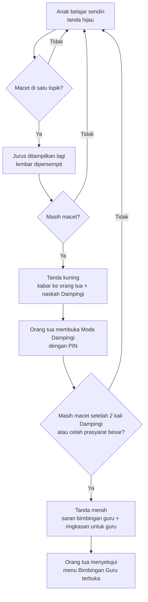

**Penjaga:** tanda kuning dan merah paling banyak 1 kabar per topik per minggu, supaya orang tua tidak merasa dikejar. Kalau anak berhasil, tanda kembali hijau dan orang tua mendapat kabar positif ("×7 sudah lancar lagi").

---

### 4. Menu bimbingan baru terbuka setelah disetujui orang tua

| Menu di HP anak | Cara terbuka | Siapa yang memberi persetujuan | Rilis |
|---|---|---|---|
| **Belajar bersama Ayah/Bunda** (Mode Dampingi) | Orang tua memasukkan PIN di HP anak, atau menyalakannya dari HP orang tua untuk satu topik | Orang tua pemilik atau orang tua kedua | R1 (sudah dirancang) |
| **Bimbingan Guru** | Orang tua mengundang guru dari mode orang tua dan memilih jenisnya (**guru sekolah** atau **guru les**), guru menerima, lalu orang tua menekan "Izinkan" | **Hanya orang tua pemilik** | **R3, Maret 2027** (setelah profil risiko ditetapkan dan penilaian mandiri diperbarui) |

#### 4.1 Bimbingan Guru — dua jenis guru (keputusan Acut 28 Okt)

| Hal | **Guru sekolah** — lihat + komentar | **Guru les** — tugas + catatan |
|---|---|---|
| Melihat kemampuan anak (peta topik, tanda bimbingan, ringkasan Lancar dan TKA) untuk mapel yang dipilih orang tua | ✓ | ✓ |
| Menulis **komentar** (≤ 200 huruf) | ✓ **ditujukan ke orang tua**, tampil di mode orang tua. Orang tua boleh meneruskannya ke HP anak dengan satu ketukan | ✓ |
| Memberi **tugas** dari Gudang Ilmu ("kerjakan kartu Pecahan Senilai sampai Jumat") | — | ✓ |
| Menulis **catatan** yang tampil di menu Bimbingan Guru anak, **selalu terlihat oleh orang tua** | — | ✓ |
| Menandai topik "sudah dibantu" (tanda merah kembali kuning atau hijau) | — | ✓ |
| Ada menu di HP anak | Tidak. Anak hanya melihat komentar yang diteruskan orang tua | Ya, menu "Bimbingan Guru" |
| Anak membalas | — | Hanya stiker ("Sudah", "Masih bingung", "Terima kasih") |
| Sebab | Tidak ada jalur langsung dari orang dewasa luar keluarga ke anak, jadi risiko aturan paling kecil (permintaan Acut) | Guru les dibayar dan dipilih orang tua untuk mengajar; tugas dan catatan memang pekerjaannya |

**Yang tidak bisa dilakukan kedua jenis guru:** melihat pesan keluarga, data akun, atau anak lain di keluarga; mengirim isi buatan sendiri, tautan, foto, atau nomor HP; mengobrol dengan anak; mengubah level atau nilai anak.

**Siapa gurunya:** guru sekolah anak, guru les, atau pengajar kelas luring TKA (masuk sebagai guru les), **dipilih dan diundang sendiri oleh orang tua**. Aplikasi tidak menyediakan atau mencarikan guru. Masuknya lewat link undangan dan email guru, dengan batas percobaan yang sama seperti undangan orang tua kedua (`02-rancangan/02-akun-keluarga.md` bagian 7a). Persetujuan bisa dicabut kapan saja, dan menu langsung hilang dari HP anak.

**Hubungan dengan keputusan sebelumnya:** akun pengajar penuh sengaja ditunda ke tahun kedua (`keputusan.md` bagian F), dan gagasan guru melatih sistem sudah dibatalkan Acut 20 Okt. Bimbingan Guru di sini **bukan** keduanya. Ini akses terbatas atas undangan orang tua, dimajukan ke R3 atas permintaan Acut 28 Okt.

**Risiko hukum:** guru les adalah orang dewasa di luar keluarga yang bisa menulis catatan untuk anak. Itu menyentuh parameter "kontak dengan orang tidak dikenal" di penilaian mandiri PP Tunas (KK03, bobot 14,04%). Guru sekolah tidak menyentuhnya secara langsung, sebab komentarnya sampai ke orang tua, bukan ke anak. Penjaga untuk guru les: diundang orang tua dengan izin tersendiri, tidak ada obrolan, semua catatan terlihat orang tua, dan bisa dicabut. Karena itu fitur ini tetap **wajib masuk pembaruan penilaian mandiri** dan pertanyaan ahli hukum sebelum tayang (`paket-hukum/06`, pertanyaan no. 26). Kalau Komdigi menilai jalur guru les menaikkan profil, guru les diturunkan menjadi seperti guru sekolah (lihat + komentar ke orang tua), dan tugas dikirim lewat orang tua.

**Biaya dan waktu [ESTIMASI]:** ± 5–7 hari kerja pembangunan (undangan, persetujuan, menu anak, halaman guru), tanpa biaya server tambahan yang berarti.

---

### 5. Waktu belajar efektif dan batas game — hasil riset

#### 5.1 Yang ditemukan

| Temuan | Angka | Sumber |
|---|---|---|
| Waktu belajar di rumah yang wajar per hari bertambah menurut kelas: **"aturan 10 menit"** | Kelas 1 ± 10 menit, kelas 2 ± 20 menit, dan seterusnya bertambah ± 10 menit per kelas | **[FAKTA — Harris Cooper, Duke University, 2009]** ([Duke Today](https://today.duke.edu/2009/08/school_tip.html)) |
| Satu jam pelajaran SD di sekolah | 35 menit | **[FAKTA — struktur Kurikulum Merdeka SD/MI]** ([dokumen struktur kurikulum](https://mmc.tirto.id/documents/2024/07/15/2634-struktur-kurikulum-merdeka-sd-mi-compress.pdf?x=2676)) |
| Anak yang main game **kurang dari 1 jam per hari** lebih baik penyesuaian sosial-emosionalnya daripada yang tidak main; yang **≥ 3 jam** paling buruk | ± 5.000 anak usia 10–15 tahun | **[FAKTA — Przybylski, *Pediatrics* 2014]** ([Universitas Oxford](https://www.ox.ac.uk/node/21944)) |
| Batas waktu layar untuk hiburan (bukan sekolah) anak 5–17 tahun | **Paling banyak 2 jam per hari** | **[FAKTA — Pedoman Gerak 24 Jam Australia, 2021]** ([Kemenkes Australia](https://www.health.gov.au/sites/default/files/documents/2021/05/24-hour-movement-guidelines-children-and-young-people-5-to-17-years-fact-sheet.pdf)) |
| Rekomendasi IDAI untuk anak usia sekolah | Tidak ditemukan angka khusus di sumber yang terbaca; yang terbaca hanya usia di bawah 6 tahun (≤ 1 jam) dan berhenti memakai gawai 1 jam sebelum tidur | **[FAKTA — IDAI lewat Metro TV, 25 Feb 2026]** ([Metro TV](https://www.metrotvnews.com/read/bJECjn44-bahaya-screen-time-berlebih-pada-anak-idai-ingatkan-dampaknya)) |

**Batas jujurnya:** aturan 10 menit adalah pedoman PR dari penelitian Amerika, bukan uji coba aplikasi. Penelitian game Przybylski berupa survei (hubungan, bukan sebab-akibat) dan usianya 10–15 tahun. Keduanya dipakai sebagai **batas atas yang wajar**, lalu diuji dengan data keluarga kita.

#### 5.2 Jawaban untuk pertanyaan "30 menit atau 1 jam?"

**Tidak satu angka untuk semua.** 1 jam pas untuk kelas 6 dan terlalu berat untuk kelas 1. Aturannya:

| Kelas | Batas belajar per hari di aplikasi | Dipecah menjadi | Game sesudahnya (bawaan) | Batas game yang bisa diatur orang tua |
|---|---|---|---|---|
| 1 | 10–15 menit | 2 blok pendek | 20 menit | 0–60 menit |
| 2 | 20 menit | 2 blok × 10 menit | 20 menit | 0–60 menit |
| 3 | 30 menit | 2–3 blok | 30 menit | 0–60 menit |
| 4 | 40 menit | 3 blok | 30 menit | 0–60 menit |
| 5 | 50 menit | 3–4 blok | 30 menit | 0–60 menit |
| 6 | 60 menit (hari simulasi TKA: 75 menit, ≤ 5 kali setahun) | 4 blok | 30 menit | 0–60 menit |

| Aturan | Isi | Sebab |
|---|---|---|
| **Inti harian wajib singkat** | Lancar 2–5 menit + Baca Ulang ± 5 menit (+ latihan TKA ± 10 menit untuk kelas 6) | Itu yang dihitung untuk kemajuan dan rapor; anak yang hanya mengerjakan inti tetap maju |
| **Sisa waktu belajar adalah pilihan** | Kartu Gudang Ilmu, tugas guru, Paham, mengulang topik | "10 menit × kelas" adalah **batas atas**, bukan target. Kalau ada PR sekolah, waktu itu dipakai untuk PR |
| **Satu blok paling lama 15 menit** | Setelah 15 menit muncul jeda: "Istirahat 2 menit, minum dulu" | Anak SD lebih mudah fokus dalam blok pendek; 1 jam pelajaran di sekolah pun hanya 35 menit |
| **Belajar dulu, lalu main** | Game terbuka setelah **inti harian** selesai: 1 lembar Lancar + 1 sesi Baca Ulang (mulai R2) + latihan TKA hari itu untuk kelas 6. Lembar Lancar kedua (sore/malam) tidak menahan game. Bukan setelah seluruh batas belajar | Permintaan Acut 28 Okt. Kalau syaratnya seluruh 60 menit belajar, game menjadi hadiah besar yang dikejar terburu-buru |
| **Game bukan hadiah yang dijanjikan** | Tidak ada tulisan "selesaikan latihan untuk dapat game". Game tampil sebagai "Waktu main" setelah latihan, seperti istirahat di sekolah | Hadiah yang dijanjikan merusak minat (−0,43) **[FAKTA — Deci, Koestner & Ryan 2001]** |
| **Batas atas mutlak** | Game ≤ 60 menit per hari walau orang tua mengatur lebih; belajar + game kelas 6 ≤ 1,5 jam | Di bawah "kurang dari 1 jam" (Przybylski) dan di bawah 2 jam layar hiburan |
| **Jam tenang** | Game mati otomatis setelah 21.00 dan 1 jam sebelum jam tidur yang diatur orang tua | Anjuran berhenti memakai gawai 1 jam sebelum tidur (IDAI) |

**Kapan berlaku:** pengatur waktu belajar (blok ≤ 15 menit, jeda, batas harian per kelas) dibangun di **R1**. Game di luar jam belajar baru ada di **R4 (Juni 2027)**, jadi aturan "waktu main" baru terasa saat itu. Sebelum R4, setelah inti harian anak melihat Tantang Ayah dan kartu satwa yang sudah dikumpulkan, bukan game.

**Ganti arah:** ini mengubah keputusan 19 Okt (B3 no. 2: game bawaannya terbuka kapan saja, orang tua boleh memilih "setelah latihan"). Sekarang bawaannya **"setelah inti harian"**, dan orang tua boleh memilih "selalu terbuka". Batas game naik dari 10/15 menit menjadi 20/30 menit, sebab angka lama hanya asumsi dan riset mendukung sampai di bawah 1 jam. Kelompok "setelah latihan" dan "selalu terbuka" tetap dibandingkan di laporan minggu ke-4.

---

### 6. Isi dan fasilitas hanya untuk kelas yang didaftarkan (sudah ada, ditegaskan)

| Hal | Aturan |
|---|---|
| Saat mendaftar | Orang tua mengisi kelas anak. Aplikasi hanya mengunduh **paket kelas itu**: Lancar, Baca Ulang, Gudang Ilmu, dan (khusus kelas 6) Siap TKA |
| Ukuran unduhan per anak **[ESTIMASI]** | Aplikasi ± 25–35 MB + paket satu kelas ± 15–40 MB (terbesar karena suara bacaan kelas 1–2). Bandingkan dengan semua kelas sekaligus ± 150–200 MB |
| Satu pengecualian: Bahasa Inggris | Paket Belajar Bahasa Inggris memakai **tingkat yang dipilih**, bukan kelas anak. Hanya tingkat itu yang diunduh (± 10–15 MB), dan tingkat lain diunduh saat dipilih |
| Topik kelas di bawah | Tidak diunduh semua. Hanya kartu **prasyarat** yang dibutuhkan, saat mesin menemukan celah (tanda merah karena prasyarat), ± 1–3 MB |
| Naik kelas | Paket kelas baru terunduh otomatis saat orang tua mengubah kelas (atau ditawarkan pada Juli). Paket lama dihapus setelah 30 hari; riwayat dan rapor tetap tersimpan |
| Kakak-adik satu HP | HP mengunduh paket untuk setiap kelas anak yang memakai HP itu, dan setiap anak hanya melihat isi kelasnya |
| Fasilitas per kelas | Lihat tabel di bawah |

| Fasilitas | Kelas 1–2 | Kelas 3–5 | Kelas 6 |
|---|---|---|---|
| Lancar Matematika | ✓ | ✓ | ✓ |
| Baca Ulang | ✓ + tangga suku kata dan suara penuh | ✓ | ✓ (+ teks TKA) |
| Gudang Ilmu kelasnya | ✓ (kartu Juni 2027) | ✓ (Matematika kelas 4–5 Maret 2027) | ✓ **lebih dulu**: Matematika 4 Jan, Bahasa Indonesia 1 Feb 2027 |
| Belajar Bahasa Inggris (tingkat 3–6, bebas dipilih) | ✓ dengan suara penuh | ✓ | ✓ |
| Siap TKA (latihan rumah, simulasi, rapor penyebab salah) | — | — | ✓ |
| Petunjuk bersuara di semua layar | ✓ | Bisa dinyalakan | Bisa dinyalakan |
| Game | Game hitung dan kata dasar | Game sesuai kelas | Game sesuai kelas |

---

### 7. Yang perlu diputuskan Acut

Ketiganya **sudah dijawab Acut 28 Okt** (`keputusan.md` bagian B9):

| # | Keputusan | Jawaban Acut |
|---|---|---|
| 1 | Mapel di Gudang Ilmu selain Matematika dan Bahasa Indonesia | Kelas 6 diisi dulu (fokus TKA). Bahasa Inggris menjadi paket "Belajar Bahasa Inggris" tingkat 3–6, bebas dipilih semua anak, mulai 1 Feb 2027 tanpa AI suara. IPAS dan Pancasila tetap 2028 |
| 2 | Bimbingan Guru | Guru sekolah: lihat kemampuan + komentar. Guru les: tugas + catatan |
| 3 | Batas waktu belajar dan game di bagian 5.2 | Setuju |

---

### 8. Tindak lanjut

| Apa | Siapa | Kapan | Bukti selesai |
|---|---|---|---|
| Peta topik lengkap Matematika dan Bahasa Indonesia kelas 1–6 (kode CP, urutan, prasyarat) | Acut2 menyusun, Acut memeriksa sampel | Jumat 11 Des 2026 | Berkas peta di Project; paket `ilmu-k1`–`k6` (kerangka) di kanal uji |
| Peta topik mapel lain (judul saja) | Acut2 | Jumat 18 Des 2026 | Berkas peta |
| Aturan tanda bimbingan dan batas waktu masuk ke pembangunan R1 | Acut2 (sesi pembangunan) | Jumat 27 Nov 2026 | Uji otomatis tanda kuning/merah dan pengatur waktu lulus |
| Pertanyaan ahli hukum no. 26 (Bimbingan Guru) dan pembaruan penilaian mandiri | Acut2 menyiapkan, Acut mengajukan | Sebelum pembangunan R3, Jumat 29 Jan 2027 | Draf pertanyaan dan kertas kerja v0.3 |
| Kartu Matematika kelas 6 (± 30) | Acut2 menyusun, Acut memeriksa | Jumat 18 Des 2026 | Paket `ilmu-k6` (Matematika) di kanal uji |
| Kartu Bahasa Indonesia kelas 6 (± 30) | Acut2 menyusun, Acut memeriksa | Jumat 15 Jan 2027 | Paket `ilmu-k6` (Bahasa Indonesia) di kanal uji |
| Kartu Matematika kelas 4–5 | Acut2 menyusun, guru memeriksa | Senin 22 Mar 2027 | Paket di kanal umum |
| Paket Belajar Bahasa Inggris | lihat `11-belajar-bahasa-inggris.md` bagian 7 | 15 Des 2026 – 5 Mar 2027 | Paket `inggris-t3`–`t6` |

Sumber riset bagian 5: [Duke Today — Harris Cooper](https://today.duke.edu/2009/08/school_tip.html) · [Universitas Oxford — Przybylski 2014](https://www.ox.ac.uk/node/21944) · [Pedoman Gerak 24 Jam Australia](https://www.health.gov.au/sites/default/files/documents/2021/05/24-hour-movement-guidelines-children-and-young-people-5-to-17-years-fact-sheet.pdf) · [Metro TV — IDAI](https://www.metrotvnews.com/read/bJECjn44-bahaya-screen-time-berlebih-pada-anak-idai-ingatkan-dampaknya) · [Struktur Kurikulum Merdeka SD/MI](https://mmc.tirto.id/documents/2024/07/15/2634-struktur-kurikulum-merdeka-sd-mi-compress.pdf?x=2676)


## Paket Belajar Bahasa Inggris — Tingkat 3 sampai 6

*Berkas: `rancangan/01-produk/11-belajar-bahasa-inggris.md`*

**Ringkas:** (1) Atas keputusan Acut 28 Okt, Bahasa Inggris dimajukan dari Agustus 2027 menjadi **satu paket "Belajar Bahasa Inggris"** dengan empat tingkat tetap yang setara kelas 3, 4, 5, dan 6 SD. Paket ini **boleh dibuka semua anak kelas 1–6**, dan tingkatnya **bebas dipilih**. Ini satu-satunya isi yang tidak terikat kelas anak. (2) Paket dibuka **1 Februari 2027 tanpa AI suara**: kosakata bergambar dengan suara rekaman, pola kalimat, dengar lalu pilih, susun kata, dan permainan kata. Tingkat 3 dan 4 siap 1 Februari, tingkat 5 dan 6 menyusul 22 Maret. Ngobrol dengan AI tetap menunggu uji suara (R5, Agustus 2027). (3) Risiko terbesarnya: Acut memeriksa isi sendiri sampai Rilis 2, padahal **isi Bahasa Inggris harus diperiksa orang yang mahir Bahasa Inggris**. Usulnya, satu guru Bahasa Inggris dipilih paling lambat **Selasa 15 Des 2026** untuk memeriksa ± 48 unit (± 16 jam ≈ Rp800 ribu).

Disusun 28 Oktober 2026. Label: **[FAKTA + sumber] · [ESTIMASI + cara hitung] · [ASUMSI — perlu diuji]**.

---

### 1. Bentuk paket

| Hal | Aturan |
|---|---|
| Nama di aplikasi | **Belajar Bahasa Inggris** |
| Tingkat | Tingkat 3, 4, 5, 6 (setara kelas 3–6 SD; mengikuti Capaian Pembelajaran Bahasa Inggris Fase B untuk tingkat 3–4 dan Fase C untuk tingkat 5–6) |
| Siapa boleh membuka | **Semua anak kelas 1–6** (keputusan Acut). Kelas 1–2 mendapat suara penuh dan petunjuk bergambar, sebab mereka belum lancar membaca |
| Memilih tingkat | Bebas. Saat pertama dibuka ada **tes singkat ± 2 menit** yang menyarankan tingkat; anak atau orang tua boleh memilih tingkat lain. Anak kelas 6 boleh mulai dari tingkat 3 |
| Pengecualian dari aturan "isi sesuai kelas" | Ya, khusus paket ini. Hanya **tingkat yang dipilih** yang diunduh (± 10–15 MB per tingkat karena suara), bukan keempatnya |
| Waktu | Dihitung di dalam batas belajar harian (10 menit × kelas, `10-gudang-ilmu-bimbingan-dan-waktu.md` bagian 5). Satu sesi ± 5–8 menit |

### 2. Isi per tingkat

| Tingkat | Unit **[ESTIMASI — 12 tema per tingkat]** | Contoh tema | Siap |
|---|---|---|---|
| 3 | 12 | Salam dan perkenalan, angka 1–20, warna, anggota keluarga, benda di kelas, hewan | **1 Feb 2027** |
| 4 | 12 | Bagian tubuh, makanan dan minuman, hari dan bulan, kegiatan sehari-hari, perasaan, rumah | **1 Feb 2027** |
| 5 | 12 | Jam dan waktu, pekerjaan, tempat di kota, cuaca, hobi, kata kerja sehari-hari | 22 Mar 2027 |
| 6 | 12 | Arah dan lokasi, kegiatan kemarin, membandingkan benda, cerita pendek, kesehatan, rencana | 22 Mar 2027 |

**Satu unit berisi:**

| Bagian | Isi | Lama |
|---|---|---|
| Kenal kata | 8–10 kosakata bergambar, diketuk untuk mendengar suara | ± 2 menit |
| Pola kalimat | 2–3 kalimat pola ("This is my …", "I like …") dengan suara dan arti dalam Bahasa Indonesia | ± 1 menit |
| Dengar lalu pilih | Mendengar kata atau kalimat, memilih gambar yang benar | ± 1–2 menit |
| Susun kata | Menyusun kata menjadi kalimat (tingkat 4–6) | ± 1 menit |
| Permainan kata | Cocokkan pasangan, tebak gambar; muncul lagi untuk kata yang sering salah | ± 1–2 menit |

Kata yang salah diulang di sesi berikutnya dengan cara yang sama seperti Lancar (pengulangan berjarak). **Tidak ada rekaman suara anak** di R2, jadi tidak ada data sensitif baru.

### 3. Suara

Suara dibuat sekali saat paket disusun dengan layanan suara Google (aksen Amerika atau Inggris, dipilih satu dan dipakai konsisten), lalu disimpan di paket. Tidak memakai data anak. Biaya ± Rp0–200 ribu sekali **[ESTIMASI — ± 600 kata dan ± 150 kalimat per tingkat; masih di dalam batas gratis bulanan layanan suara]**.

### 4. Siapa memeriksa

| Isi | Pemeriksa | Jam **[ESTIMASI — 20 menit per unit]** | Biaya |
|---|---|---|---|
| 48 unit (kosakata, kalimat, terjemahan, kecocokan gambar) | **Guru Bahasa Inggris** (bukan Acut, sebab Bahasa Inggris tulis Acut masih lemah) | ± 16 jam | ± Rp800 ribu (setara Rp50 ribu per jam, dibayar per unit ± Rp17 ribu) |
| Suara (pelafalan) | Guru yang sama mendengarkan sampel 20% | ± 2 jam | termasuk |
| Kecocokan gambar dan tampilan | Acut, dari HP | ± 2 jam | — |

Guru Bahasa Inggris ini bisa orang yang sama dengan guru pemeriksa isi mulai Februari, kalau ia mahir Bahasa Inggris. Kalau tidak, dua orang berbeda.

### 5. Akibat ke jadwal dan biaya

| Hal | Akibat |
|---|---|
| R2 (1 Feb 2027) | Rilis aplikasi R2 sekarang memuat **layar Baca Ulang + layar Belajar Bahasa Inggris** (± 5 layar baru, ± 5–7 hari pembangunan tambahan di 14 Des – 22 Jan). Cadangan tetap 22 Feb |
| R5 (Agustus 2027) | Tinggal **ngobrol dengan AI** dan rapor ucapan, kalau uji suara 5 anak lulus |
| Biaya | Honor pemeriksa ± Rp800 ribu sekali (Jan–Mar), suara ± Rp0–200 ribu, ukuran unduhan ± 10–15 MB per tingkat |
| Risiko | Kalau guru Bahasa Inggris belum ada pada 15 Des, tingkat 3–4 mundur ke 22 Feb dan tingkat 5–6 ke April |

### 6. Ukuran keberhasilan

| Ukuran | Target | Cadangan |
|---|---|---|
| Anak yang membuka paket Bahasa Inggris dan menyelesaikan ≥ 3 unit dalam 4 minggu | ≥ 40% dari keluarga aktif | ≥ 25% |
| Ketepatan "dengar lalu pilih" pada kata yang sudah dipelajari, setelah 3 minggu | ≥ 85% | ≥ 75% |
| Tanggapan orang tua "Bahasa Inggris bermanfaat" (pertanyaan masukan putaran 3) | ≥ 60% | ≥ 45% |

### 7. Tindak lanjut

| Apa | Siapa | Kapan | Bukti selesai |
|---|---|---|---|
| Memilih guru Bahasa Inggris pemeriksa | Acut | Selasa 15 Des 2026 | Nama + kesediaan tertulis |
| Daftar tema dan kosakata tingkat 3–6 sesuai CP Fase B dan C | Acut2 | Jumat 4 Des 2026 | Berkas di Project |
| Unit tingkat 3–4 + suara, diperiksa guru | Acut2 menyusun, guru memeriksa | Jumat 15 Jan 2027 | Paket `inggris-t3`, `inggris-t4` di kanal uji |
| Unit tingkat 5–6 + suara, diperiksa guru | Acut2 menyusun, guru memeriksa | Jumat 5 Mar 2027 | Paket `inggris-t5`, `inggris-t6` di kanal uji |


# Bagian 2 — Rancangan Teknis


## Ringkasan Tahap 3 — Rancangan Teknis

*Berkas: `rancangan/02-rancangan/00-ringkasan-tahap-3.md`*

**Ringkas:** (1) Rancangan teknis selesai dalam 11 berkas + paket draf hukum (9 berkas). Usul utamanya **Expo + Supabase (Singapura)**, latihan berjalan sepenuhnya di HP, hasil diantrekan dan dikirim tanpa ganda, dan isi diperbarui lewat paket tanpa rilis aplikasi. Biaya teknologi masa gratis ± **Rp415–465 ribu per bulan** sejak Desember (Tahap 5 menghitung ulang: ± Rp478 ribu, `06-rilis/03`). (2) **Temuan terbesar Tahap 3 adalah soal jadwal, bukan teknis.** Penilaian mandiri profil risiko harus diajukan dan diverifikasi Komdigi (± 24 hari) sebelum anak dari keluarga lain memakai aplikasi. Karena itu pengajuan harus ± **13 November**, dan ahli hukum sebaiknya dipilih **Jumat 6 November** (paling lambat Senin 30 November, `keputusan.md` bagian J), bukan akhir November. (3) Empat keputusan untuk Acut: pilihan teknologi, cara mengajukan penilaian mandiri, badan usaha penerbit, dan cara orang tua masuk.

Disusun 19 Oktober 2026 malam.

---

### 1. Isi Tahap 3

| Berkas | Isi | Usul terpenting |
|---|---|---|
| `01-arsitektur.md` | Gambar besar, perbandingan 3 pilihan teknologi, biaya, aturan Play | Expo + Supabase; lapisan data terpisah supaya bisa pindah ke Firebase Jakarta |
| `02-akun-keluarga.md` | Peran, cara masuk, alur daftar, PIN, satu HP banyak anak | Masuk lewat email + kode; anak tanpa akun; cukup bulan-tahun lahir |
| `03-basis-data.md` | Dua gambar tabel, aturan akses per keluarga, ukuran, masa simpan | Nomor dibuat di HP; level dihitung ulang dari riwayat |
| `04-tahan-putus-sinyal.md` | Antrean kirim, tanda tersimpan/terkirim, dua HP, 6 skenario uji | Simpan dulu, kirim kemudian; server "abaikan kalau sudah ada" |
| `05-paket-isi.md` | Jenis paket, versi, kanal uji → umum, pemulihan | Pengaturan level Lancar di paket → kalibrasi tanpa rilis |
| `06-pembuat-soal-dan-bank-soal.md` | Pembuat soal + bank soal + uji otomatis | Bahan TKA dipindah dari Markdown, dicocokkan dengan `periksa.py` lama |
| `07-layanan-ai.md` | Pekerjaan AI, aturan rapor cerita, biaya | Anak tidak berbicara dengan AI; angka dicek kode; ± Rp11–70 ribu/bulan pada 75 anak |
| `08-pembayaran.md` | Jalur Play, QRIS, pembayaran alternatif, pajak | Hanya tabel hak dan saklar fitur yang dibangun sekarang |
| `09-panel-pengelola.md` | 9 menu, tanda peringatan dini, keamanan | ± 2–2,5 jam Acut per minggu; ± 9 hari kerja bangun |
| `10-catatan-kejadian.md` | Kejadian ↔ ukuran, definisi ukuran utama | Tanpa analitik pihak ketiga; tanpa profiling |
| `11-privasi-dan-keamanan.md` | Aturan, perkiraan profil risiko, data, pengamanan, jadwal kepatuhan, daftar periksa | Profil rendah; ajukan Jumat 13 Nov |
| `paket-hukum/00`–`08` | Pengantar, persetujuan, kebijakan privasi, kertas kerja, syarat dan ketentuan, penilaian dampak, 25 pertanyaan, bahan memilih ahli hukum, cetakan kebocoran | Siap dikirim ke ahli hukum setelah badan usaha diputuskan |

### 2. Kenapa rancangan teknis ini bisa gagal — dan penjaganya

| Cara gagal | Tanda awal | Penjaga |
|---|---|---|
| Penilaian mandiri belum ditetapkan saat uji keluarga mau mulai | 13 Nov lewat tanpa pengajuan | Pengajuan oleh Acut berdasarkan draf kita; ahli hukum memeriksa sejajar |
| Ahli hukum menyatakan data anak wajib di Indonesia | Jawaban pertanyaan 11 | Lapisan data terpisah; pindah ke Firebase Jakarta (± 1–2 minggu) |
| Antrean tanpa sinyal menghasilkan data ganda atau hilang | Skenario uji 1–6 gagal | Bagian ini tidak boleh dipotong; diuji sebelum keluarga lain memakai |
| Aplikasi ditolak Kebijakan Keluarga karena pustaka tersembunyi | Penolakan saat uji tertutup | Pemeriksaan manifes dan daftar pustaka sebelum dikirim |
| Orang tua kesulitan dengan kode email | > 20% pendaftar berhenti di layar kode | Petunjuk "periksa Spam", kirim ulang; kode WhatsApp dinilai ulang |
| Bahan TKA dari laptop tidak datang | 31 Okt lewat | R1.1 mulai dengan 5 simulasi; PDF tetap untuk kelas luring |

### 3. Keputusan Acut

> **Jawaban Acut 19 Okt:** (1) teknologi **Expo + Supabase Singapura**; (2) penilaian mandiri **diajukan sendiri Jumat 13 Nov**, urusan ahli hukum dibahas dan dicari solusinya nanti; (3) penerbit dan pengendali data **dibahas khusus**: badan usaha terkendala nomor D-U-N-S (jalur cepat ± Rp3 juta), atas nama pribadi dulu sedang dipertimbangkan; (4) orang tua masuk dengan **email saja dulu**. Rincian di `keputusan.md` B4.

**Empat keputusan utama** (ditanyakan sekarang):

| # | Keputusan | Usul Acut2 | Di berkas |
|---|---|---|---|
| 1 | Pilihan teknologi | A: Expo + Supabase Singapura | `01` bagian 2 |
| 2 | Cara mengajukan penilaian mandiri | A: Acut mengajukan sendiri Jumat 13 Nov; ahli hukum memeriksa sejajar; sampai ditetapkan, hanya anak-anak Acut yang memakai | `11` bagian 6 |
| 3 | Badan usaha penerbit dan pengendali data | PT yang sudah ada atau badan baru, diputuskan paling lambat 31 Okt | `11` bagian 5 |
| 4 | Cara orang tua masuk | WhatsApp + kode, cadangan email | `02` bagian 2 |

**Usul lain** (disetujui sekaligus kecuali dikoreksi):

| Usul | Di berkas |
|---|---|
| Halaman rapor dan panel di Cloudflare Pages | `01` bagian 3 |
| Sasaran usia Play: anak + dewasa, pendaftaran orang tua sebagai penyaring | `01` bagian 5 |
| Profil anak diisi orang tua, cukup bulan-tahun lahir | `02` bagian 4 |
| Orang tua kedua tidak bisa menghapus akun atau mengubah izin | `02` bagian 1 |
| Ringkasan mingguan lewat tugas terjadwal Claude (Rp0) | `07` bagian 3 |
| Keluarga yang menolak izin data pemakaian tidak dihitung dalam ukuran mana pun | `10` bagian 3 |
| Ahli hukum dipilih paling lambat 6 Nov (dipercepat dari akhir Nov) | `paket-hukum/07` |

### 4. Tindak lanjut

| Apa | Siapa | Kapan | Bukti selesai |
|---|---|---|---|
| ~~Menjawab 4 keputusan utama~~ | Acut | **Selesai 19 Okt** (badan usaha → diskusi khusus) | `keputusan.md` B4 |
| Mengunduh Kepmenkomdigi 142/2026 lengkap dengan lampiran (JDIH Komdigi) dan mengirimnya ke percakapan | Acut | 26 Okt | Berkas PDF |
| Membahas solusi ahli hukum (keputusan Acut: dibahas nanti) | Acut + Acut2 | Sebelum 6 Nov kalau ingin diperiksa sebelum pengajuan | `keputusan.md` |
| Diskusi khusus: atas nama pribadi atau badan usaha (D-U-N-S) | Acut + Acut2 | 6 Nov | `keputusan.md` |
| Mengirim berkas TKA dari laptop | Acut | 31 Okt | Zip di percakapan |
| Melengkapi kertas kerja aspek e–g | Acut2 | 2 Nov | Kertas kerja v0.2 |
| Mengajukan penilaian mandiri | Acut | Jumat 13 Nov | Tanda bukti penerimaan |
| Pendaftaran PSE | Acut | Jumat 20 Nov | Nomor TDPSE |
| Memulai Tahap 4 (antarmuka) | Acut2 | Setelah Tahap 3 disetujui | Berkas di `rancangan/03-antarmuka/` |


## Arsitektur dan Pilihan Teknologi

*Berkas: `rancangan/02-rancangan/01-arsitektur.md`*

**Ringkas:** (1) Usulnya **Expo (React Native) + Supabase di Singapura**, sebab sama dengan proyek Peta Belajar (bisa dipakai ulang), memakai basis data SQL yang cocok untuk rapor dan hitungan gerbang berbayar, dan paling mudah dibangun dengan bantuan AI. Pembandingnya Flutter + Firebase di Jakarta, yang unggul di letak data dan dukungan tanpa sinyal tetapi berarti belajar teknologi baru dari nol. (2) Semua latihan dibuat dan dinilai **di HP** dari paket isi yang sudah diunduh, jadi aplikasi tetap jalan tanpa sinyal. Server hanya menyimpan, menyinkronkan, dan menyajikan rapor. (3) Biaya selama masa gratis: **± Rp0** sampai keluarga uji masuk, lalu **± Rp415–465 ribu per bulan** (terutama Supabase Pro). **Diputuskan Acut 19 Okt: pilihan A.** Risiko terbesarnya bukan biaya, tetapi data yang disimpan di luar negeri. Karena itu data anak dibuat seminim mungkin, dan dasar hukumnya masuk paket ahli hukum.

Tahap 3, butir 1. Disusun 19 Oktober 2026. Kurs Rp16.500 per US$1. Label: **[FAKTA + sumber] · [ESTIMASI + cara hitung] · [ASUMSI — perlu diuji]**.

---

### 1. Gambar besar

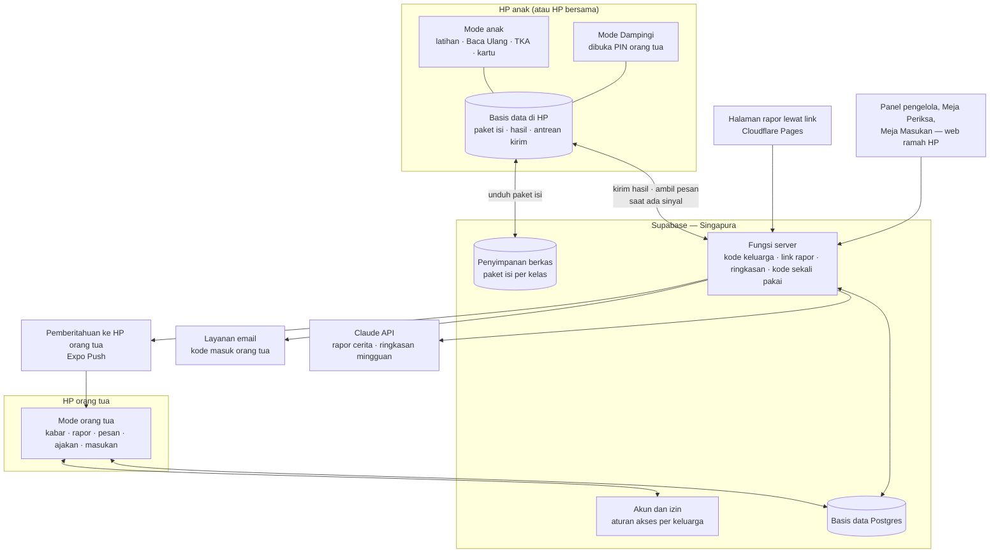

| Bagian | Tugas | Jalan tanpa sinyal? |
|---|---|---|
| **Mode anak** | Tes penempatan, Lancar, Baca Ulang, TKA, kartu, pesan orang tua yang sudah terunduh | **Ya**, sepenuhnya |
| **Mode Dampingi** | Jurus, kunci, naskah kegiatan, Dengar Bacaan | Ya |
| **Mode orang tua** | Kabar, rapor, pesan, ajakan, pertanyaan masukan | Sebagian: data terakhir tetap terbaca; kirim pesan diantrekan |
| **Basis data di HP** | Paket isi, hasil yang belum terkirim, salinan rapor | — |
| **Supabase** | Akun, aturan akses, penyimpanan hasil, paket isi, fungsi server | — |
| **Halaman rapor** | Rapor satu layar tanpa instal | Tidak (halaman web) |
| **Panel pengelola** | Acut melihat ringkasan, memutuskan, memeriksa isi, mengatur jadwal pertanyaan | Tidak |
| **Layanan luar** | Email (kode masuk), Claude (rapor cerita, ringkasan), Expo Push (pemberitahuan ke orang tua) | — |

**Prinsip utama:** soal Lancar dibuat oleh kode di HP dengan benih acak, dan soal TKA serta teks dibaca dari paket isi di HP. Server **tidak pernah dibutuhkan untuk berlatih**, sebab hasil dua malam pertama versi 4 hilang karena bergantung pada sambungan.

---

### 2. Membandingkan pilihan teknologi

| Ukuran | **A. Expo + Supabase (Singapura)** — usul | B. Flutter + Firebase (Jakarta) | C. Expo + Firebase (Jakarta) |
|---|---|---|---|
| Sudah dipakai Acut | **Ya**, proyek Peta Belajar | Tidak | Sebagian (Expo) |
| Kemudahan dibangun dengan bantuan AI | Tinggi: JavaScript/TypeScript dan SQL paling banyak contohnya **[ASUMSI]** | Sedang: bahasa Dart | Sedang: pustaka Firebase untuk React Native butuh pengaturan khusus |
| Basis data | Postgres (SQL): rapor, rekap mingguan, dan hitungan gerbang cukup dengan kueri biasa | Firestore (dokumen): rekap lintas anak harus disiapkan sendiri | Sama dengan B |
| Tanpa sinyal | Dibangun sendiri (antrean di HP), ± 3–5 hari kerja **[ESTIMASI]** | **Bawaan Firestore** | Bawaan Firestore |
| Letak data | **Singapura** (tidak ada wilayah Jakarta) **[FAKTA — dokumentasi wilayah Supabase]** | **Jakarta** (asia-southeast2) **[FAKTA — dokumentasi lokasi Firestore]** | Jakarta |
| Aturan akses per keluarga | Aturan per baris di basis data (Row Level Security), bisa diuji dengan SQL | Aturan keamanan Firestore | Sama dengan B |
| Biaya masa gratis (± 50 keluarga) | Rp0 sampai Desember, lalu US$25 per bulan (± Rp412 ribu) | Kemungkinan Rp0 di paket Spark (1 GiB, 20 ribu tulis per hari) **[FAKTA — harga Firebase]**; fungsi server butuh paket Blaze | Sama dengan B |
| Kode masuk lewat SMS | Butuh penyedia luar | 10 SMS pertama per hari gratis, lalu US$0,35 per SMS untuk Indonesia **[FAKTA — harga Identity Platform]**; hanya di paket Blaze | Sama dengan B |
| Syarat layanan untuk aplikasi anak | Tidak ada larangan aplikasi anak di syarat Supabase **[FAKTA — supabase.com/terms, dicek 19 Okt 2026]** | Firebase Analytics harus dimatikan atau diberi tanda anak **[ASUMSI — dicek sebelum dipilih]** | Sama dengan B |
| Halaman rapor web | Mudah (fungsi server + halaman statis) | Mudah | Mudah |
| Risiko terbesar | Data di luar negeri; antrean tanpa sinyal harus diuji ketat | Belajar bahasa dan pola baru; terikat penyedia; rekap sulit | Pustaka asli (native) menambah kerumitan pembuatan aplikasi |

**Usul: A**, sebab tiga keunggulannya (dipakai ulang dari Peta Belajar, SQL untuk rapor dan gerbang, kemudahan dibangun dengan AI) mengenai pekerjaan yang paling banyak. Dua kekurangannya bisa ditutup:

| Kekurangan A | Penutup | Biaya · waktu |
|---|---|---|
| Data di Singapura = transfer ke luar negeri | (1) Data anak dibuat minimal: nama panggilan, bulan dan tahun lahir, kelas; tanpa foto, sekolah, lokasi. (2) Dasar transfer menurut UU PDP Ps. 56: negara tujuan setara → pelindungan mengikat → persetujuan subjek data **[FAKTA — UU 27/2022 Ps. 56, lewat Hukumonline]**. Persetujuan transfer dicantumkan di formulir sebagai lapis terakhir. (3) Ditanyakan ke ahli hukum | Rp0; masuk paket hukum |
| Tanpa sinyal dibangun sendiri | Rancangan rinci di `04-tahan-putus-sinyal.md`; data hasil hampir semuanya "tambah baru", jadi bentrok jarang terjadi | ± 3–5 hari kerja, diuji dengan 6 skenario |

**Kalau ahli hukum menyatakan data anak wajib di Indonesia:** pindah ke C (Expo + Firebase Jakarta). Aplikasi tetap Expo, jadi tampilan tidak dibangun ulang; yang berubah adalah lapisan data (± 1–2 minggu **[ESTIMASI]**). Karena itu kode aplikasi dibangun dengan **lapisan data terpisah** sejak awal.

---

### 3. Komponen dan biayanya — masa gratis (± 50 keluarga)

| Komponen | Pilihan | Paket | Biaya per bulan | Sumber |
|---|---|---|---|---|
| Server | Supabase | Gratis (uji internal, Okt–Nov) → **Pro** sejak keluarga uji (Des) | Rp0 → **± Rp412 ribu** (US$25, sudah termasuk kredit komputasi US$10 untuk ukuran komputasi terkecil, "Micro") | **[FAKTA — supabase.com/pricing: 8 GB basis data, 100 ribu pemakai aktif, cadangan harian 7 hari, tidak berhenti sendiri]** |
| Pembuatan aplikasi | Expo EAS | Gratis: 15 pembuatan Android, antrean lambat; 1.000 pemakai aktif untuk pembaruan lewat udara | Rp0 (naik ke paket Starter, paket berbayar terkecil, US$19 kalau antrean terlalu lambat) | **[FAKTA — expo.dev/pricing]** |
| Halaman rapor dan panel | Cloudflare Pages | Gratis; boleh untuk usaha | Rp0 | **[FAKTA — perbandingan paket gratis, Sep 2026]**; Vercel Hobby dilarang untuk usaha |
| Kode masuk orang tua | Email lewat Brevo (lihat `02-akun-keluarga.md`) | Gratis 300 email per hari | Rp0 | **[FAKTA — perbandingan layanan email Supabase, Jan 2026]** |
| AI | Claude Haiku/Sonnet 5.5 | Per token | ± Rp11–70 ribu pada 75 anak (rinci di `07-layanan-ai.md`; disamakan 20 Okt) | `riset-penguat.md` bagian 8 |
| Suara | Google Chirp 3 HD, dibuat sekali | Gratis sampai 1 juta karakter | Rp0 | `01-produk/03-rencana-isi.md` bagian 5 |
| Pemberitahuan | Expo Push | Gratis | Rp0 | **[ASUMSI — dicek di Tahap 5]** |
| **Jumlah** | | | **± Rp415–465 ribu per bulan** sejak Desember (dihitung ulang di Tahap 5: **± Rp478 ribu**, `06-rilis/03` — angka itu yang dipakai) | |

PPN layanan digital luar negeri bisa menambah ± 11–12% **[ASUMSI — dihitung di Tahap 5]**.

---

### 4. HP murah dan ukuran

| Batas | Usul | Sebab |
|---|---|---|
| Android paling rendah | Android 8 ke atas **[ASUMSI — disesuaikan versi Expo yang dipakai]** | Mencakup sebagian besar HP murah yang masih dipakai |
| RAM | Lancar di HP 2 GB | Keluarga dengan satu HP murah bersama |
| Ukuran aplikasi | ≤ 40 MB saat dipasang, tanpa paket isi **[ASUMSI]** | Kuota dan ruang HP |
| Paket isi | Kelas Lancar: < 2 MB (soal dibuat kode); Baca Ulang: ± 15 MB per kelas (suara); TKA: ± 5 MB | Diunduh sekali lewat Wi-Fi atau kuota, lalu dipakai tanpa sinyal |
| Tema | Terang lembut (latar krem) sebagai bawaan, mode gelap pilihan | Tampilan terang lebih baik untuk membaca, juga di malam hari **[FAKTA — NN/g 2020]** (`03-antarmuka/03` bagian 3) |

---

### 5. Aturan Google Play yang mengikat arsitektur

| Aturan | Isi | Akibat |
|---|---|---|
| Pustaka pihak ketiga (SDK) untuk aplikasi anak | Aplikasi yang menyasar anak tidak boleh memuat API atau pustaka pihak ketiga (SDK) yang menurut syarat penyedianya tidak disetujui untuk layanan anak **[FAKTA — Kebijakan Keluarga Google Play]** | Daftar pustaka diperiksa satu per satu sebelum uji tertutup; tanpa Firebase Analytics, iklan, atau pelacak |
| Pengenal perangkat | Tidak boleh mengirim AAID, SIM Serial, Build Serial, BSSID, MAC, SSID, IMEI, IMSI **[FAKTA — sama]** | Izin pengenal iklan (AD_ID) dihapus dari manifes; analitik dibuat sendiri di basis data kita |
| Lokasi | Aplikasi khusus anak tidak boleh meminta izin lokasi **[FAKTA — sama]** | Tidak ada izin lokasi |
| Fitur sosial | Pengingat aman di dalam aplikasi; tindakan orang dewasa sebelum anak bertukar info pribadi; orang dewasa bisa mengatur fitur sosial **[FAKTA — sama]** | Pesan hanya dalam keluarga, anak hanya stiker, orang tua mengatur semuanya |
| Kebijakan privasi | Wajib dan akurat; aplikasi termasuk pustaka pihak ketiganya mematuhi COPPA, GDPR, dan hukum lain yang berlaku **[FAKTA — sama]** | Paket hukum gelombang 3 |

**Sasaran usia di Play Console — usul:** "anak-anak dan orang dewasa" (kelompok 6–8, 9–12, dan 18+), sebab orang tua juga memakai aplikasi yang sama. Aplikasi dibuka dengan **pendaftaran orang tua dulu**, yang berfungsi sebagai penyaring usia netral sebelum mode anak terbuka. **[ASUMSI — dicek ulang terhadap formulir Play Console saat uji tertutup]**

**Risiko yang pernah terjadi pada aplikasi Expo:** pada 2020 aplikasi Expo pernah ditolak Kebijakan Keluarga karena pustaka iklan yang terbawa otomatis **[FAKTA — forum Expo 2020]**. Expo sekarang hanya membawa modul yang dipakai **[ASUMSI]**, tetapi manifes Android tetap diperiksa sebelum dikirim ke Play Store (daftar periksa di `11-privasi-dan-keamanan.md`).

---

### 6. Badan usaha dan pendaftaran yang memengaruhi teknis

| Hal | Isi | Akibat teknis |
|---|---|---|
| Pendaftaran PSE lingkup privat | Wajib **sebelum sistem digunakan pengguna**; tiap aplikasi dan situs didaftarkan terpisah; lewat OSS; tanpa biaya PNBP **[FAKTA — izin.co.id, Jul 2026, mengutip Permenkominfo 5/2020 jo. 10/2021]** | Aplikasi Android **dan** halaman rapor web kemungkinan perlu didaftarkan terpisah **[ASUMSI — ditanyakan ke ahli hukum]**; masuk jadwal sebelum uji keluarga |
| Penerbit di Play Store | Akun Play Console Acut | Nama penerbit, pengendali data, dan PSE sebaiknya satu nama; atas nama pribadi atau badan usaha dibahas khusus |
| Akun Play Console | Akun pribadi Acut yang sudah ada; akun organisasi butuh nomor D-U-N-S (gratis dari Dun & Bradstreet tetapi bisa sampai 30 hari) **[FAKTA — Bantuan Play Console]** | Dibahas dalam diskusi khusus badan usaha |

---

### 7. Keputusan

| # | Keputusan | Usul Acut2 |
|---|---|---|
| 1 | Pilihan teknologi A (Expo + Supabase Singapura), dengan jalan pindah ke C kalau ahli hukum mewajibkan data di Indonesia | **Diputuskan Acut 19 Okt: A** |
| 2 | Halaman rapor dan panel di Cloudflare Pages (gratis, boleh untuk usaha) | Ya |
| 3 | Sasaran usia di Play Console: anak + dewasa, dengan pendaftaran orang tua sebagai penyaring | Ya, dicek saat uji tertutup |


## Akun Keluarga

*Berkas: `rancangan/02-rancangan/02-akun-keluarga.md`*

**Ringkas:** (1) Hanya orang tua yang punya akun masuk. Anak **tidak punya akun, email, atau nomor HP**; anak adalah profil di bawah akun keluarga, sebab data anak harus seminimal mungkin dan persetujuan datang dari orang tua. (2) Orang tua masuk dengan **email + kode 6 angka** (keputusan Acut 19 Okt: email saja dulu), lewat layanan email gratis (Brevo 300 email per hari). Nomor WhatsApp **boleh diisi** untuk kabar dan Keluarga Perintis, tetapi tidak dipakai untuk masuk. HP anak dihubungkan dengan **kode keluarga 6 angka atau QR** yang berlaku 10 menit. (3) Celah yang ditutup: anak masuk ke mode orang tua (PIN orang tua, terkunci setelah 5 kali salah), kakak mengerjakan lembar adik (pilih profil + PIN anak opsional), dan HP hilang (orang tua bisa memutus HP dari jauh).

Tahap 3, butir 2. Disusun 19 Oktober 2026.

---

### 1. Siapa punya apa

| Peran | Cara masuk | Bisa melihat | Bisa mengubah |
|---|---|---|---|
| **Orang tua pemilik** | Email + kode | Semua anak di keluarganya | Profil anak, persetujuan data, PIN, link rapor, HP terhubung, hapus akun |
| **Orang tua kedua** (ayah atau ibu yang lain) | Diundang pemilik dengan kode; masuk dengan emailnya sendiri | Semua anak di keluarga | Pesan, ajakan, Mode Dampingi; **tidak bisa** menghapus akun atau mengubah persetujuan |
| **HP anak** (perangkat, bukan orang) | Kode keluarga atau QR dari HP orang tua | Profil anak yang dipilih orang tua untuk HP itu | Hanya hasil latihan anak itu |
| **Penerima link rapor** | Membuka link | Rapor satu anak | Tidak ada |
| **Pengajar kelas luring** (kalau orang tua setuju, Izin 6) | Link rapor kelas dari fungsi server khusus (`03-basis-data.md` tabel `kelas_luring`) | Ringkasan latihan rumah anak yang orang tuanya setuju | Tidak ada. Latihan rumah dibuka menurut **tanggal pertemuan** yang diisi Acut di panel, bukan oleh pengajar (`01-produk/06` bagian 8) |
| **Guru pembimbing — guru sekolah** (R3, ditambah 28 Okt) | Diundang orang tua pemilik lewat email guru dengan jenis "guru sekolah", lalu **disetujui** orang tua; batas percobaan sama dengan bagian 7a | Kemampuan anak (peta topik, tanda bimbingan, ringkasan) untuk mapel yang diizinkan, satu anak | Hanya **komentar ke orang tua** (≤ 200 huruf). Tidak ada menu di HP anak; orang tua boleh meneruskan komentar ke anak (`01-produk/10` bagian 4.1) |
| **Guru pembimbing — guru les** (R3, ditambah 28 Okt) | Sama, dengan jenis "guru les" (termasuk pengajar kelas luring TKA) | Sama | Tugas dari Gudang Ilmu dan catatan pendek ke anak yang selalu terlihat orang tua; anak membalas stiker; tanpa obrolan |
| **Pengelola (Acut)** | Panel pengelola, dua langkah masuk | Ringkasan semua keluarga; data per anak hanya untuk perbaikan masalah, tercatat di log | Isi, jadwal pertanyaan, pengaturan |

---

### 2. Cara masuk orang tua

| Pilihan | Biaya per kode | Untung | Rugi | Putusan |
|---|---|---|---|---|
| WhatsApp + kode 6 angka | ± Rp367 (kategori Authentication) **[FAKTA — harga Qontak, Okt 2026]** | Akrab bagi orang tua Aceh | Butuh verifikasi bisnis Meta dan templat pesan; nomor WhatsApp atas nama badan usaha | Dinilai ulang setelah R1, kalau banyak orang tua kesulitan dengan email |
| **Email + kode 6 angka** | Rp0: Brevo gratis 300 email per hari, Resend gratis 100 per hari / 3.000 per bulan **[FAKTA — perbandingan layanan email untuk Supabase, Jan 2026]** | Tanpa verifikasi pihak ketiga; hampir semua pemilik HP Android punya akun Gmail **[ASUMSI]** | Sebagian orang tua jarang membuka email; kode bisa masuk folder spam | **✓ Diputuskan Acut 19 Okt** |
| SMS + kode | ± US$0,35 = ± Rp5.800 per SMS **[FAKTA — harga Identity Platform Google untuk Indonesia]** | Tidak butuh aplikasi lain | Mahal; sering terlambat | ✗ |
| Masuk dengan akun Google | Rp0 | Satu ketuk | Syarat layanan masuk-dengan-Google untuk aplikasi anak belum dicek; menambah pustaka pihak ketiga | ✗ untuk Rilis 1 |

**Catatan teknis:** pengirim email bawaan Supabase hanya untuk uji dan dibatasi; untuk keluarga sungguhan wajib memakai pengirim email sendiri (SMTP), dengan batas bawaan 30 email per jam yang bisa diubah **[FAKTA — sumber yang sama]**. Pengirim memakai nama domain sendiri supaya tidak masuk spam.

**Menjaga orang tua yang kesulitan email:** layar kode menampilkan "Periksa folder Spam atau Promosi" dan tombol kirim ulang setelah 60 detik. Kalau > 20% pendaftar berhenti di layar kode **[ASUMSI]**, kode lewat WhatsApp dinilai ulang.

**Aturan keamanan kode:** berlaku 10 menit; paling banyak 5 permintaan per email per jam; 5 kali salah → email dikunci 15 menit. Sesi orang tua tetap masuk sampai keluar sendiri atau HP diputus dari jauh.

---

### 3. Alur pendaftaran dan menghubungkan HP

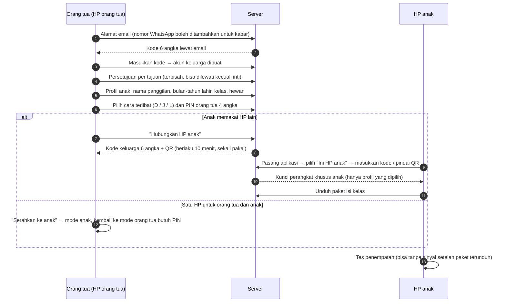

| Langkah | Batas waktu orang tua **[ASUMSI]** |
|---|---|
| Masuk + kode (buka email) | ± 1–2 menit |
| Persetujuan | ± 2–3 menit (teks pendek per tujuan, tautan ke versi lengkap) |
| Profil anak + cara terlibat + PIN | ± 2 menit per anak |
| Menghubungkan HP anak | ± 2 menit |
| **Jumlah** | **≤ 10 menit untuk satu anak** — di bawah batas 15 menit hari pertama (`01-profil-dan-perjalanan.md` 2.1) |

---

### 4. Profil anak — data seminimal mungkin

| Data | Disimpan? | Sebab |
|---|---|---|
| Nama panggilan | Ya | Sapaan di layar dan rapor |
| **Bulan dan tahun lahir** (bukan tanggal lengkap) | Ya | Cukup untuk kelompok usia (Permenkomdigi 9/2026: 6–9 dan 10–12) dan kelompok kelas; tanggal lengkap tidak dibutuhkan |
| Kelas | Ya | Paket isi |
| Hewan profil | Ya | Pengenal di layar pilih profil |
| PIN anak (opsional) | Ya, hanya dalam bentuk acak satu arah (hash) | Saudara satu HP |
| Nama lengkap, foto, sekolah, alamat, NISN | **Tidak** | Tidak dibutuhkan; menekan risiko |
| Rekaman suara | **Tidak** (fitur Dengar Bedanya ditunda) | — |

**Catatan untuk keputusan 19 Okt:** catatan diskusi menyebut anak mengisi "nama, tanggal lahir, kelas". Usulnya: **orang tua** yang mengisi, dan cukup bulan-tahun lahir. Hasilnya sama untuk aplikasi, tetapi datanya lebih sedikit.

---

### 5. PIN dan perlindungan mode

| Kunci | Aturan |
|---|---|
| **PIN orang tua** (4 angka) | Membuka Mode Dampingi, kembali dari mode anak ke mode orang tua di HP bersama, mengubah pengaturan, membuka game di luar batas. 5 kali salah → terkunci 5 menit, lalu bertambah. Lupa PIN → atur ulang dengan kode lewat email |
| **PIN anak** (4 angka, opsional) | Dipasang orang tua kalau saudara berbagi HP. Lupa → orang tua menghapusnya dari mode orang tua |
| Keluar otomatis dari Mode Dampingi | Setelah 15 menit tanpa sentuhan (`01-produk/07` 2.2). **Simulasi TKA tidak memakai Mode Dampingi**: orang tua memasukkan PIN sekali di awal untuk menandai "diawasi", lalu simulasi berjalan 75 menit tanpa batas diam (`01-produk/06` bagian 6) |
| Tombol masuk Mode Dampingi | Kecil di pojok layar anak, tidak menarik perhatian |

**Celah yang diterima:** anak yang melihat orang tua mengetik PIN bisa menghafalnya. Penjaganya: PIN orang tua bisa diganti kapan saja, dan setiap pembukaan Mode Dampingi tercatat di riwayat orang tua.

---

### 6. Satu HP, beberapa anak

| Keadaan | Cara kerja |
|---|---|
| Kakak-adik satu HP | Layar awal: pilih hewan profil. Hasil hanya tercatat di profil yang aktif. PIN anak opsional |
| Anak berpindah HP (HP ayah siang, HP ibu malam) | Satu profil boleh terhubung ke beberapa HP; hasil digabung di server berdasarkan waktu (`04-tahan-putus-sinyal.md` bagian 5) |
| HP orang tua juga dipakai anak | "Serahkan ke anak" → mode anak; kembali butuh PIN orang tua |
| Pola mencurigakan (lembar adik dikerjakan sangat cepat dengan pola kakak) | Ditandai di data, tidak dihukum; orang tua diberi saran memasang PIN anak (`01-profil` bagian 3) |

---

### 7. Mengelola HP terhubung dan akun

| Tindakan | Siapa | Di mana |
|---|---|---|
| Melihat daftar HP terhubung, terakhir terhubung, jumlah hasil belum terkirim | Orang tua | Mode orang tua → Pengaturan |
| Memutus HP dari jauh (HP hilang atau dijual) | Orang tua pemilik | Sama; HP itu kehilangan akses saat berikutnya tersambung, data lokalnya dihapus |
| Mengundang orang tua kedua | Pemilik | Undangan diikat ke **alamat email tujuan** yang diketik pemilik; kode 6 angka hanya berlaku untuk email itu, 24 jam, sekali pakai. Setelah orang itu masuk, **pemilik harus menyetujui** ("Budi ingin bergabung — izinkan?") sebelum data anak terlihat. Pemilik menerima kabar setiap ada orang tua baru (bagian 7a) |
| Mengunduh data keluarga | Pemilik | Berkas ringkas yang mudah dibaca (hak subjek data) |
| **Menghapus akun** | Pemilik | Di aplikasi **dan** lewat halaman web, sebab Google Play mewajibkan tautan hapus akun dari luar aplikasi **[ASUMSI — dicek ulang terhadap kebijakan penghapusan akun Google Play di Tahap 5]**. Data dihapus dalam 30 hari; cadangan ikut terhapus setelah masa simpan cadangan (7 hari di Supabase Pro) |

#### 7a. Batas percobaan semua kode (diperbaiki 20 Okt setelah pemeriksaan)

Pemeriksa menemukan bahwa kode undangan (24 jam) dan kode keluarga (10 menit) tidak punya batas percobaan. Dengan 10⁶ kemungkinan, ± 12 tebakan per detik cukup untuk mencoba semua kode undangan dalam 24 jam. Orang asing yang berhasil bisa membaca data anak dan mengirim pesan ke anak, sebab orang tua kedua punya hak itu. Aturannya sekarang:

| Kode | Batas percobaan | Ikatan | Persetujuan | Kabar |
|---|---|---|---|---|
| Kode masuk email | 5 salah → email dikunci 15 menit; 5 permintaan per jam | Satu email | — | — |
| **Kode undangan orang tua kedua** | 5 salah per akun penebak → akun itu tidak bisa memakai undangan apa pun selama 24 jam; 20 salah per alamat IP per jam → IP diblok 1 jam; 10 salah untuk satu undangan → undangan itu batal | Hanya email tujuan | **Wajib** disetujui pemilik | Email + kabar di aplikasi ke pemilik: "Budi (b…@gmail.com) bergabung pada 10 Des 19.02. Bukan Anda yang mengundang? Keluarkan" |
| **Kode keluarga (HP anak)** | 5 salah per HP → HP itu menunggu 15 menit; 20 salah per IP per jam → diblok 1 jam | Dibuat dari HP orang tua yang sudah masuk; sekali pakai, 10 menit | HP baru muncul di daftar "HP terhubung" dengan tombol putus | Kabar di aplikasi orang tua: "HP baru terhubung ke profil Rani" |

Dengan batas ini, peluang menebak satu undangan sebelum batal adalah 10 ÷ 10⁶ = 0,001% **[ESTIMASI — 10 percobaan dibagi semua kemungkinan]**, dan orang asing yang lolos pun belum bisa melihat apa-apa sebelum pemilik menyetujui. Klaim "0%" untuk aspek kontak orang asing (KK03 di `01-produk/07` bagian 4) sekarang bersandar pada persetujuan pemilik, bukan pada sulitnya menebak.

---

### 8. Verifikasi usia

Permenkomdigi 9/2026 mewajibkan verifikasi usia **[FAKTA — `riset-penguat.md` bagian 9]**, tetapi caranya belum dirinci di bahan yang kita baca.

| Lapisan | Cara | Kekuatan |
|---|---|---|
| Orang tua dewasa | Pernyataan "saya orang tua/wali berusia 18+" saat mendaftar + email terverifikasi | Lemah–sedang |
| Usia anak | Bulan-tahun lahir dari orang tua → isi dan pengaturan sesuai kelompok 6–9 atau 10–12 | Bergantung kejujuran orang tua |
| Anak mendaftar sendiri | Tidak bisa: tidak ada jalur daftar anak | Kuat |

**[ASUMSI — pertanyaan untuk ahli hukum]** Apakah lapisan ini cukup untuk Permenkomdigi 9/2026, atau perlu cara lain (misalnya verifikasi KTP orang tua). Verifikasi KTP menambah data sensitif dan tidak diusulkan kecuali diwajibkan.

---

### 9. Keputusan

| # | Keputusan | Usul Acut2 |
|---|---|---|
| 1 | Masuk dengan email + kode | **Diputuskan Acut 19 Okt** |
| 2 | Orang tua yang mengisi profil anak, cukup bulan-tahun lahir | Ya |
| 3 | Orang tua kedua tidak bisa menghapus akun atau mengubah persetujuan | Ya |


## Rancangan Basis Data

*Berkas: `rancangan/02-rancangan/03-basis-data.md`*

**Ringkas:** (1) Basis data disusun di sekitar **keluarga**: setiap baris yang menyangkut anak membawa nomor keluarga, sehingga aturan akses per baris cukup satu pola ("hanya keluarga sendiri"). (2) Hasil latihan disimpan **per soal** (jawaban, detik, jumlah hapus, kode salah), sebab rapor, peta jenis salah, penjaga terlalu rumit/mudah, dan gerbang berbayar semuanya dihitung dari situ. Nomor setiap sesi dan jawaban **dibuat di HP**, jadi pengiriman ulang tidak menghasilkan data ganda. (3) Level anak **tidak disimpan sebagai angka yang bisa diubah sembarangan**, tetapi dihitung ulang dari riwayat sesi. Dengan begitu, hasil dari dua HP atau yang terlambat terkirim tetap menghasilkan level yang sama.

Tahap 3, butir 3. Disusun 19 Oktober 2026. Nama tabel dan kolom dalam Bahasa Indonesia, huruf kecil, dengan garis bawah.

---

### 1. Gambar hubungan tabel — inti

Diperbaiki 20 Okt: satu gambar besar dipecah menjadi tiga supaya terbaca di HP dan di PDF. Tabel `keluarga` dan `anak` ditulis lengkap di gambar 1a; di gambar lain hanya namanya.

#### 1a. Keluarga dan akun

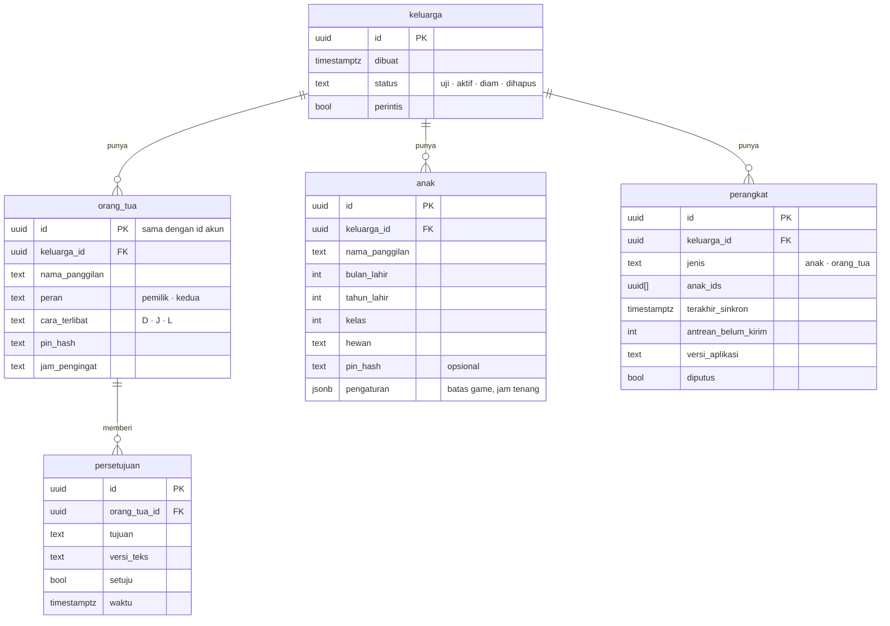

#### 1b. Latihan, kemajuan, dan isi

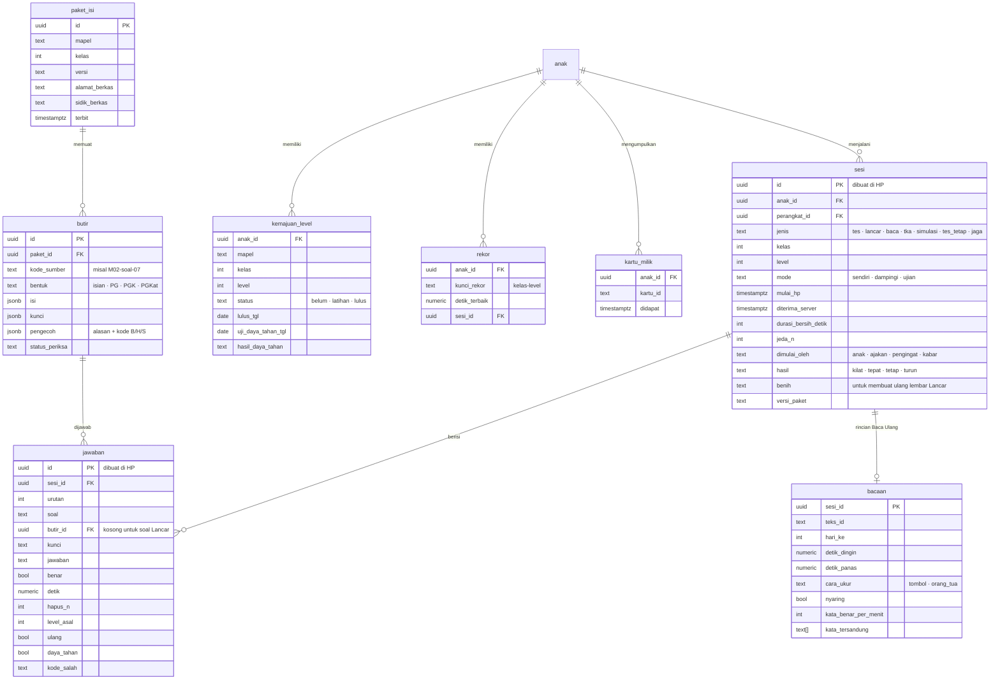

#### 1c. Pesan, rapor, dan kelas luring

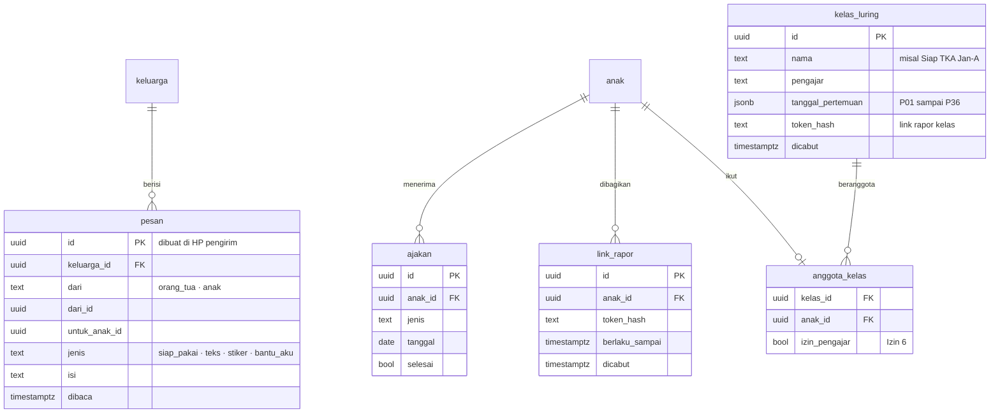


---

### 2. Gambar hubungan tabel — masukan, catatan, dan pengelola

#### 2a. Pertanyaan masukan

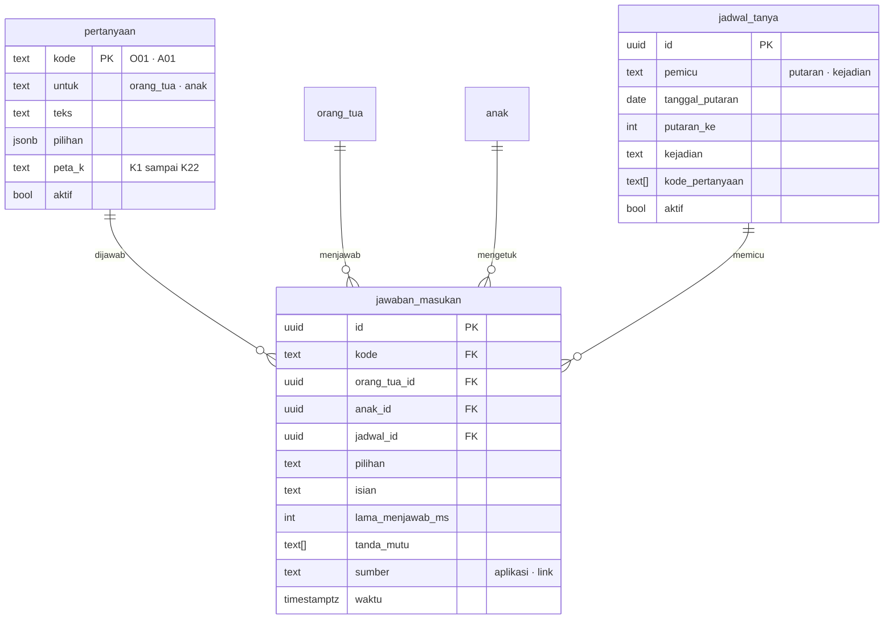

#### 2b. Catatan pemakaian dan alat pengelola

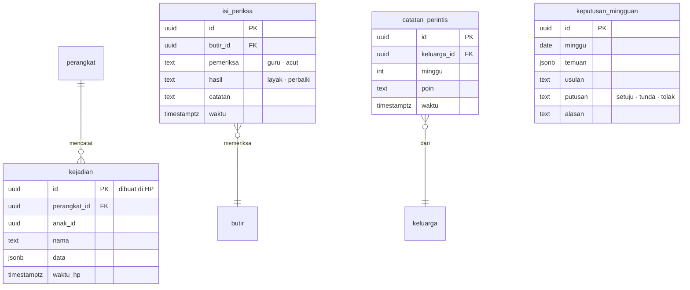


**Ditambah 28 Okt:** tabel Gudang Ilmu (`topik`, `prasyarat`, `kartu_ilmu`, `kemajuan_topik` dengan tanda bimbingan) dan Bimbingan Guru (`guru_pembimbing`: anak, email guru, **jenis (`sekolah` · `les`)**, mapel yang diizinkan, disetujui, dicabut; `komentar_guru` untuk orang tua, dengan kolom diteruskan_ke_anak; `tugas_guru` dan `catatan_guru` hanya untuk jenis `les`) serta Belajar Bahasa Inggris (`tingkat_inggris`: anak, tingkat dipilih, tanggal; kemajuan unit memakai `kemajuan_topik` dengan mapel `ING`) dirinci di `01-produk/10-gudang-ilmu-bimbingan-dan-waktu.md` bagian 2.4 dan 4. Aturan akses: guru hanya membaca baris anak yang ia bimbing dan mapel yang diizinkan, lewat fungsi server; fungsi penulis tugas dan catatan menolak guru berjenis `sekolah`.

Tabel `keputusan_mingguan` berdiri sendiri: diisi panel pengelola, dibaca saat menyusun pesan "Kami dengar, kami ubah".

---

### 3. Aturan yang dipegang basis data

| Aturan | Isi | Sebab |
|---|---|---|
| **Nomor dibuat di HP** | `sesi.id`, `jawaban.id`, `pesan.id`, `kejadian.id` memakai nomor acak universal (UUID) yang dibuat di HP | Pengiriman ulang = baris yang sama, bukan baris baru (`04-tahan-putus-sinyal.md`) |
| **Tambah, bukan ubah** | Sesi dan jawaban hanya ditambah, tidak pernah diubah atau dihapus oleh HP | Riwayat jujur; tidak ada bentrok antar-HP |
| **Level dihitung, bukan diketik** | `kemajuan_level` dihitung ulang server dari semua `sesi` anak, diurutkan menurut `mulai_hp` | Hasil terlambat atau dari HP lain tetap menghasilkan level yang sama |
| **Tiga penanda waktu** | `mulai_hp` (jam HP), `diterima_server` (jam server), dan `urutan_hp` + `detik_sejak_sinkron` (penghitung yang hanya naik dan jam monoton HP sejak sinkron terakhir) | Jam HP anak bisa salah. Kalau selisih > 10 menit, urutan sesi memakai `urutan_hp`, dan tanggal diperkirakan dari jam server saat sinkron terakhir + `detik_sejak_sinkron`, **bukan** dari jam terima (diubah 20 Okt: sesi yang terkirim berhari-hari kemudian akan salah urut kalau memakai jam terima) |
| **Satu logika LANCAR** | Aturan naik/turun level ditulis sekali sebagai satu pustaka TypeScript, dipakai di HP dan di fungsi server | Dua salinan logika pasti berbeda suatu saat; level di HP dan di server harus sama |
| **Soal Lancar disimpan sebagai teks** | `jawaban.soal` = "7 × 8", `butir_id` kosong | Soal dibuat kode, tidak ada di bank; teks cukup untuk rapor dan peta jenis salah |
| **Satu pola akses** | Setiap tabel anak terhubung ke `keluarga_id` | Aturan akses per baris sederhana dan mudah diuji |

---

### 4. Aturan akses per baris (Row Level Security)

| Pembaca | Boleh membaca | Boleh menulis |
|---|---|---|
| Orang tua (akun) | Semua baris dengan `keluarga_id` miliknya | Profil anak, pesan, ajakan, persetujuan (pemilik), jawaban masukan miliknya |
| HP anak (kunci perangkat) | Baris anak yang terdaftar di `perangkat.anak_ids`; pesan untuk anak itu; paket isi | Sesi, jawaban, bacaan, kejadian, pesan stiker, ketukan anak — **hanya untuk anak-anak itu** |
| Link rapor | Tidak membaca tabel langsung; fungsi server memeriksa `token_hash`, `berlaku_sampai`, `dicabut`, lalu menyusun rapor satu anak | Jawaban masukan, ditandai `sumber = link` |
| Link rapor kelas (pengajar) | Tidak membaca tabel langsung; fungsi server memeriksa `kelas_luring.token_hash`, lalu menyusun ringkasan **hanya** untuk anggota dengan `izin_pengajar = ya` | — |
| Panel pengelola | Lewat fungsi server dengan kunci khusus; setiap akses data per anak tercatat | Isi, jadwal, pertanyaan, keputusan |

Uji wajib sebelum uji keluarga: orang tua keluarga A **tidak bisa** membaca satu baris pun milik keluarga B, dan HP anak tidak bisa menulis atas nama anak lain. Rinciannya di rencana uji Tahap 5.

---

### 5. Perkiraan ukuran — masa gratis

Dasar hitungan yang sama di semua berkas: **50 keluarga = 75 anak** (1,5 anak per keluarga, `06-rilis/03`). Diperbaiki 20 Okt; versi lama memakai 50 anak dan salah hitung "1,5 tahun".

**[ESTIMASI]** 75 anak × 2 lembar × 20 soal × 30 hari = 90.000 baris jawaban per bulan; ± 300 byte per baris dengan indeks → **± 27 MB per bulan**. Ditambah sesi, bacaan, dan kejadian, kira-kira ± 45 MB per bulan, atau **± 540 MB per tahun**.

| Paket | Batas | Cukup untuk |
|---|---|---|
| Supabase Gratis | 500 MB | < 1 tahun, dan berhenti sendiri setelah seminggu tidak dipakai → hanya untuk uji internal |
| Supabase Pro | 8 GB, lebihnya US$0,125 per GB per bulan | ± 15 tahun pada 50 keluarga; **± 9 bulan pada 1.000 keluarga** **[ESTIMASI: 1.000 keluarga = 1.500 anak = 20 × 540 MB ≈ 10,8 GB per tahun; 8 ÷ 10,8 × 12 ≈ 8,9 bulan]**. Kelebihan 2,8 GB ≈ US$0,35 per bulan, jadi bukan masalah biaya |

**Tanda peringatan dini:** ukuran basis data > 5 GB, atau tumbuh > 500 MB per bulan → tinjau masa simpan tabel `kejadian` (usul: rinci 12 bulan, lalu dirangkum).

---

### 6. Masa simpan

| Data | Disimpan | Sebab |
|---|---|---|
| Sesi, jawaban, bacaan | Selama akun aktif | Rapor tahunan dan uji daya tahan |
| Kejadian (catatan pemakaian) | Rinci 12 bulan, lalu dirangkum per minggu | Ukuran |
| Jawaban masukan | Selama akun aktif | Membandingkan antarputaran |
| Persetujuan | Selama akun aktif + 5 tahun setelah dihapus **[ASUMSI — ahli hukum]** | Bukti persetujuan (PP 33/2026) |
| Akun dihapus | Semua data anak dan orang tua dihapus dalam 30 hari; cadangan terhapus sendiri setelah 7 hari | Hak subjek data |


## Tahan Putus Sinyal

*Berkas: `rancangan/02-rancangan/04-tahan-putus-sinyal.md`*

**Ringkas:** (1) Setiap hasil **disimpan dulu di HP**, baru dikirim. Pengirimannya diulang otomatis sampai server menjawab "diterima", dan nomor yang dibuat di HP membuat kiriman ulang tidak pernah menghasilkan data ganda. (2) Kegagalan versi 4 (dua malam hasil hilang) dicegah di tiga lapis: hasil tidak bergantung pada akun di peramban, ada tanda "tersimpan / terkirim" di layar anak, dan orang tua melihat "HP Aisyah terakhir terhubung 2 hari lalu, 4 lembar belum terkirim". (3) Celah yang tetap ada: kalau aplikasi dihapus atau data HP dibersihkan **sebelum** hasil terkirim, hasil itu hilang. Penjaganya: peringatan setelah 24 jam belum terkirim dan tombol "Salin hasil" seperti versi 4.

Tahap 3, butir 4. Disusun 19 Oktober 2026. Wajib, sebab hasil dua malam pertama versi 4 hilang (Prompt RCTOR, Pelajaran uji coba).

---

### 1. Apa yang terjadi di versi 4, dan apa bedanya sekarang

| Versi 4 (17–18 Okt) | Penyebab **[FAKTA — Prompt RCTOR]** | Aplikasi |
|---|---|---|
| Anak latihan di HP yang tidak masuk akun Acut | Penyimpanan bergantung pada akun di halaman web | Hasil disimpan di basis data HP; akun tidak diperlukan untuk menyimpan |
| Tidak ada yang terkirim, dan tidak ada yang tahu | Tidak ada tanda | Tanda di layar anak + kabar di HP orang tua + angka di panel pengelola |
| Hasil hilang | Tidak ada antrean | Antrean kirim yang bertahan walau HP dimatikan |

---

### 2. Cara kerja

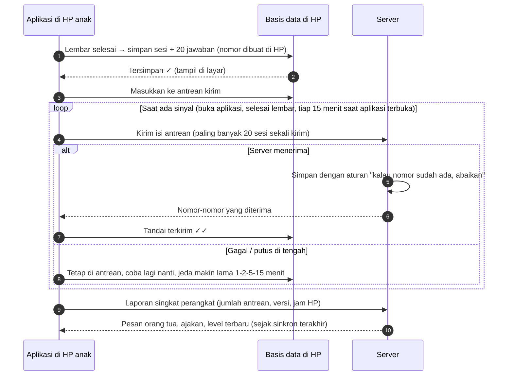

| Aturan | Isi | Sebab |
|---|---|---|
| **Simpan dulu, kirim kemudian** | Lembar dianggap selesai saat tersimpan di HP, bukan saat terkirim | Latihan tidak pernah gagal karena sinyal |
| **Nomor dibuat di HP** | Setiap sesi, jawaban, pesan, dan kejadian punya nomor acak universal sejak dibuat | Kiriman ulang menimpa baris yang sama → tanpa ganda |
| **Server "abaikan kalau sudah ada"** | Penyimpanan di server memakai aturan sisip-atau-abaikan (upsert) berdasarkan nomor | Putus setelah server menyimpan tetapi sebelum HP menerima jawaban → kiriman berikutnya aman |
| **Satu sesi utuh** | Sesi dan semua jawabannya dikirim bersama dalam satu transaksi | Tidak ada sesi setengah terkirim |
| **Kapan mencoba** | Saat aplikasi dibuka, saat lembar selesai, dan tiap 15 menit selama aplikasi terbuka | Tugas latar belakang di HP Android murah sering dimatikan sistem **[ASUMSI]**, jadi tidak diandalkan |
| **Jeda bertambah** | 1, 2, 5, lalu 15 menit | Tidak menghabiskan baterai dan kuota |
| **Simpanan lokal** | Hasil terkirim tetap disimpan di HP 30 hari | Rekor dan rapor anak tetap terbaca tanpa sinyal |

---

### 3. Tanda yang terlihat

| Siapa | Tanda | Kapan |
|---|---|---|
| **Anak** | Di layar akhir lembar: "Tersimpan ✓" lalu "Terkirim ✓✓" | Setiap lembar |
| **Anak** (kelas 1–2 dengan suara) | Ikon awan kecil di beranda; tidak ada pesan menakutkan | Saat ada antrean |
| **Anak** | Spanduk "Ada 4 lembar yang belum terkirim. Minta Ayah/Bunda menyalakan internet sebentar" | Antrean > 24 jam |
| **Orang tua [J]** | "HP Aisyah terakhir terhubung 2 hari lalu · 4 lembar menunggu di HP" | Saat membuka mode orang tua |
| **Orang tua [J]** | Kabar: "Ada hasil Aisyah yang belum terkirim sejak 2 hari. Sambungkan HP-nya ke internet sebentar" | Antrean > 48 jam, paling banyak sekali sehari |
| **Orang tua [L]** | Di link rapor: "Data sampai Senin 19.40 — kalau anak latihan setelah itu, hasilnya belum masuk" | Selalu |
| **Acut** | Panel: daftar HP dengan antrean > 48 jam dan selisih jam HP > 10 menit | Ringkasan harian |

**Catatan:** orang tua hanya tahu jumlah antrean dari laporan terakhir HP anak. Kalau HP anak belum pernah tersambung sejak latihan, orang tua melihat "terakhir terhubung" saja. Ini batas yang jujur, bukan kesalahan.

---

### 4. Arah sebaliknya: server ke HP

| Data | Arah | Cara |
|---|---|---|
| Pesan orang tua, ajakan | Server → HP anak | Diambil saat sinkron dengan penanda "sejak waktu terakhir"; tampil saat anak membuka aplikasi |
| Pesan dan ketukan anak | HP anak → server | Lewat antrean yang sama |
| Paket isi | Server → HP | Unduhan berkas dengan nomor versi dan sidik berkas (`05-paket-isi.md`) |
| Level dan kemajuan | Dihitung di HP saat tanpa sinyal; dihitung ulang server dari semua sesi | Bagian 5 |
| Pengaturan (batas game, jam tenang, PIN) | Server → HP | Berlaku sejak sinkron berikutnya; perubahan PIN orang tua langsung berlaku di HP orang tua |

---

### 5. Kalau satu anak memakai dua HP

| Keadaan | Penanganan |
|---|---|
| Anak latihan di HP ayah siang dan di HP ibu malam, keduanya tanpa sinyal | Masing-masing HP menghitung level dari sesi yang ia tahu. Saat keduanya terkirim, server mengurutkan **semua** sesi menurut jam mulai, lalu menghitung ulang level, rekor, dan uji daya tahan |
| Hasil hitung ulang server berbeda dengan HP | HP mengambil hasil server pada sinkron berikutnya. Kalau level turun karenanya, anak tidak diberi pesan "turun" — lembar berikutnya saja yang menyesuaikan |
| Jam HP salah (misal mundur sehari) | HP menyimpan penghitung urutan yang hanya naik (`urutan_hp`) dan jam monoton sejak sinkron terakhir (`detik_sejak_sinkron`), yang tidak berubah kalau jam HP diubah. Kalau selisih jam HP dengan server > 10 menit, urutan memakai `urutan_hp` dan tanggal diperkirakan dari sinkron terakhir + jam monoton; sesi ditandai. **Bukan** jam terima, sebab sesi yang terkirim berhari-hari kemudian akan salah urut dan merusak aturan jeda ≥ 1 jam dan uji daya tahan 21 hari (diperbaiki 20 Okt). Celah yang diterima: jam monoton mulai dari nol setelah HP dinyalakan ulang. Dalam keadaan itu urutan tetap benar, tetapi tanggal ditandai "perkiraan" dan jeda ≥ 1 jam tidak dipakai untuk naik level (sesi itu hanya bisa naik lewat "kilat") |

**Kenapa cara ini aman:** sesi dan jawaban hanya pernah ditambah, tidak pernah diubah, jadi tidak ada dua versi data yang harus dipilih salah satunya. Yang dihitung ulang hanya turunannya.

---

### 6. Mode orang tua tanpa sinyal

| Tindakan | Tanpa sinyal |
|---|---|
| Membaca rapor dan kabar terakhir | Bisa (salinan terakhir) dengan keterangan "data sampai …" |
| Mengirim semangat atau ajakan | Diantrekan, dikirim saat tersambung; tampil "akan terkirim" |
| Menjawab pertanyaan masukan | Diantrekan |
| Mengubah persetujuan atau menghapus akun | **Butuh sinyal**, sebab perubahan harus langsung tercatat di server |

---

### 7. Celah yang tetap ada dan penjaganya

| Celah | Akibat | Penjaga |
|---|---|---|
| Aplikasi dihapus atau data dibersihkan sebelum terkirim | Hasil di antrean hilang | Spanduk 24 jam; kabar ke orang tua 48 jam; layar konfirmasi Android tidak bisa kita kendalikan, jadi pengingatnya ada di aplikasi |
| HP rusak atau hilang dengan antrean | Hasil di antrean hilang | Sama; makin sering tersambung, makin kecil kerugian |
| Tidak pernah tersambung sama sekali selama berminggu-minggu | Orang tua dan Acut tidak melihat apa pun | Tombol **"Salin hasil"** (seperti versi 4): ringkasan teks yang bisa dikirim lewat WhatsApp, dan bisa ditempel di mode orang tua untuk dimasukkan |
| Server mati | Latihan tetap jalan; antrean menumpuk | Tidak ada tindakan anak; panel pengelola memberi peringatan |

---

### 8. Skenario uji wajib (dirinci di rencana uji Tahap 5)

| # | Skenario | Lulus kalau |
|---|---|---|
| 1 | Mode pesawat 2 hari, 4 lembar, lalu sinyal kembali | 4 sesi dan 80 jawaban tiba di server, tepat satu kali |
| 2 | Aplikasi ditutup paksa di tengah pengiriman | Kiriman berikutnya tidak menghasilkan ganda |
| 3 | Server menyimpan tetapi jawaban ke HP putus | Kiriman ulang diabaikan server; HP menandai terkirim |
| 4 | Jam HP dimundurkan 1 hari | Sesi ditandai; level tidak kacau |
| 5 | Satu anak di dua HP, keduanya tanpa sinyal, lalu tersambung bergantian | Level akhir sama dengan menghitung semua sesi berurutan |
| 6 | Antrean > 24 jam dan > 48 jam | Spanduk anak dan kabar orang tua muncul sesuai aturan |

**Biaya dan waktu:** ± 3–5 hari kerja pembangunan + ± 1 hari uji **[ESTIMASI]**. Kalau terlambat, bagian ini **tidak boleh dipotong** (`01-produk/02-fitur-per-rilis.md` bagian 5).


## Paket Isi per Kelas

*Berkas: `rancangan/02-rancangan/05-paket-isi.md`*

**Ringkas:** (1) Isi aplikasi dikirim sebagai **paket berkas per mapel dan kelas** (misal `lancar-k4`, `baca-k2`, `tka-k6`) yang diunduh sekali, disimpan di HP, dan dipakai tanpa sinyal. Paket bisa diperbarui kapan saja **tanpa rilis aplikasi baru** dan tanpa uji tertutup Play Store. (2) Setiap paket punya nomor versi, sidik berkas untuk memastikan unduhan utuh, dan batas versi aplikasi minimum. Paket baru hanya dipakai setelah terunduh utuh, sehingga paket lama tetap jalan kalau unduhan putus. (3) Setiap paket lewat **kanal uji** (HP Acut dan penguji) sebelum terbit ke semua keluarga, dan versi sebelumnya bisa dipulihkan dengan satu ketuk di panel. Ini penting karena isi akan sering diubah mengikuti masukan.

Tahap 3, butir 5. Disusun 19 Oktober 2026.

---

### 1. Jenis paket

| Paket | Isi | Ukuran **[ESTIMASI]** | Rilis |
|---|---|---|---|
| `umum` | Kartu satwa, pesan semangat siap pakai, stiker anak, naskah kegiatan Mode Dampingi, kalimat petunjuk bersuara, bank pertanyaan masukan (salinan) | ± 5 MB (suara petunjuk) | R1 |
| `lancar-k1` … `lancar-k6` | **Pengaturan** 6 level (rentang angka, target detik, keluarga soal), teks 6 layar jurus + suaranya (kelas 1–2), tes tetap | < 2 MB per kelas (soalnya dibuat kode) | R1 |
| `tka-k6` | ± 1.050 butir dengan stimulus, kunci berjenjang, penanda pengecoh B/H/S; 5 simulasi; peta 36 topik | ± 5 MB | R1.1 |
| `baca-k1` … `baca-k6` | Teks, pertanyaan, suara contoh bacaan; tangga suku kata (kelas 1) | ± 15 MB per kelas | R2 |
| `paham-k4` … `paham-k6` | Modul topik (salah paham, contoh jadi, latihan, kunci berjenjang) | ± 3 MB per kelas | R3 |
| `ilmu-k1` … `ilmu-k6` | **Gudang Ilmu** kelas itu: peta topik lengkap semua mapel (R1), lalu kartu ilmu yang sudah terbit (kelas 6 lebih dulu: Januari–Februari 2027; kelas lain bertahap 2027). Kartu prasyarat kelas di bawah diunduh terpisah hanya saat dibutuhkan (`01-produk/10` bagian 2 dan 6) | Peta < 0,5 MB; kartu ± 20–50 KB per topik, ± 2–5 MB per kelas saat penuh | Peta R1; kartu bertahap |
| `inggris-t3` … `inggris-t6` | **Belajar Bahasa Inggris** per tingkat: unit kosakata, pola kalimat, suara rekaman, permainan kata. **Diunduh menurut tingkat yang dipilih, bukan kelas anak** (satu-satunya pengecualian) (`01-produk/11`) | ± 10–15 MB per tingkat | t3–t4 R2; t5–t6 R3 |
| `game` | Aset game di luar jam belajar | Ditentukan R4 | R4 |

**Kenapa soal Lancar tidak dimasukkan ke paket:** soal dibuat kode dengan benih acak, jadi paket cukup berisi **pengaturan** level. Akibatnya target waktu bisa dikalibrasi dan satu level bisa dipecah dua **tanpa rilis aplikasi**, selama memakai keluarga soal yang sudah ada di kode. Keluarga soal yang benar-benar baru (misal jenis soal baru) tetap butuh rilis aplikasi.

---

### 2. Isi satu paket

| Berkas | Isi |
|---|---|
| `manifest.json` | Nama paket, mapel, kelas, **versi**, versi aplikasi minimum, tanggal terbit, daftar berkas + ukuran + **sidik** (hash SHA-256) |
| `data.json` | Isi (level, butir, teks, pertanyaan) |
| `suara/*.opus` | Berkas suara terkompresi, satu per teks atau layar |
| `catatan-perubahan.md` | Apa yang berubah dari versi sebelumnya (dibaca Acut di panel, tidak tampil ke anak) |

**Aturan nomor versi** (mayor.minor.tambalan):

| Naik | Kapan | Contoh |
|---|---|---|
| Tambalan | Salah ketik, suara dibuat ulang, kunci diperbaiki | 1.0.0 → 1.0.1 |
| Minor | Teks atau butir ditambah, target waktu dikalibrasi, level dipecah | 1.0.1 → 1.1.0 |
| Mayor | Bentuk data berubah sehingga butuh versi aplikasi baru | 1.1.0 → 2.0.0 (dengan versi aplikasi minimum dinaikkan) |

---

### 3. Dari bahan sampai ke HP

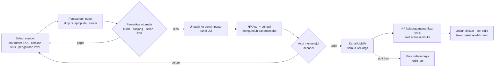

| Langkah | Siapa | Waktu **[ESTIMASI]** |
|---|---|---|
| Membangun dan memeriksa paket | Acut2 (skrip) | Menit |
| Mencoba di kanal uji | Acut (dan 1–2 penguji), dari HP | 10–30 menit per paket |
| Terbit | Acut, satu ketuk di panel | — |
| Pulihkan versi sebelumnya | Acut, satu ketuk | — |

---

### 4. Mengunduh dan memperbarui di HP

| Aturan | Isi | Sebab |
|---|---|---|
| Kapan memeriksa versi | Saat aplikasi dibuka, paling sering sekali sehari | Hemat kuota |
| Unduhan pertama | Saat profil anak dibuat; disarankan Wi-Fi, tetapi kuota boleh (ukuran ditampilkan) | Tanpa paket, latihan belum bisa jalan |
| Unduhan pembaruan | Di latar belakang; dilanjutkan kalau putus | HP murah dan sinyal Aceh |
| **Tukar setelah utuh** | Paket baru disimpan di tempat terpisah, sidik diperiksa, baru menggantikan paket lama. Kalau sidik tidak cocok, unduh ulang | Paket setengah jadi tidak pernah dipakai |
| Tidak menukar di tengah sesi | Paket baru berlaku pada sesi berikutnya | Lembar yang sedang dikerjakan tidak berubah |
| Versi aplikasi terlalu lama | Paket mayor tidak diunduh; orang tua diberi tahu "Perbarui aplikasi untuk isi terbaru" | Aplikasi lama tetap jalan dengan paket lama |
| Ruang HP penuh | Unduhan ditunda; orang tua diberi tahu ukuran yang dibutuhkan | — |

---

### 5. Naik kelas dan paket lama

| Keadaan | Cara kerja |
|---|---|
| Seminggu sebelum tahun ajaran baru | Orang tua ditawari paket kelas berikutnya (`01-profil` 2.5); unduhan dimulai setelah orang tua setuju |
| Setelah naik kelas | Paket kelas lama **tetap disimpan** selama level-levelnya masih perlu uji daya tahan, lalu dihapus otomatis untuk menghemat ruang |
| Orang tua mengubah kelas di tengah tahun | Paket kelas baru diunduh; riwayat lama tetap |

---

### 6. Menjaga riwayat tetap benar walau isi berubah

| Aturan | Sebab |
|---|---|
| Setiap sesi mencatat `versi_paket` | Rapor tahu soal versi mana yang dikerjakan |
| Nomor butir **tidak pernah dipakai ulang**; butir yang diubah mendapat revisi baru (misal `M02-soal-07` revisi 2) | Jawaban lama tetap terhubung ke butir yang benar-benar dilihat anak |
| Butir yang dihapus ditandai "tidak dipakai", bukan dihapus dari basis data | Riwayat jawaban tidak putus |
| Perubahan target waktu Lancar tidak menilai ulang lembar lama | Hasil lama tetap sesuai aturan saat dikerjakan |

---

### 7. Celah dan penjaganya

| Celah | Penjaga |
|---|---|
| Kunci jawaban ikut ada di HP (diperlukan untuk menilai tanpa sinyal), jadi anak yang sangat teknis bisa membukanya | Diterima: ini aplikasi latihan, bukan ujian resmi. Berkas paket tidak mudah dibaca dari pengelola berkas biasa |
| Paket rusak terbit ke semua keluarga | Kanal uji wajib + pemulihan satu ketuk |
| Paket terlalu besar untuk kuota keluarga | Suara dipisah per berkas, sehingga pembaruan teks tidak mengunduh ulang semua suara |


## Pembuat Soal dan Bank Soal

*Berkas: `rancangan/02-rancangan/06-pembuat-soal-dan-bank-soal.md`*

**Ringkas:** (1) Ada dua sumber soal. **Soal Lancar dibuat kode** di HP dengan benih acak, memindahkan pembuat soal versi 5 yang sudah lolos 8.100 lembar uji. Benihnya disimpan, sehingga setiap lembar bisa dibuat ulang persis untuk diperiksa. **Soal TKA, teks, dan modul berasal dari bank soal** yang diperiksa manusia. (2) Bahan TKA dipindah dari **berkas Markdown** (sumber asli; berkas Word dibangun dari Markdown), jadi tidak ada yang diketik ulang. Pemindahannya memakai format baku yang sudah dipakai pemeriksa kunci yang ada. (3) Setiap perubahan pada pembuat soal atau bank soal melewati **uji otomatis** sebelum paket dibangun: kunci dihitung ulang, batas angka, tanpa soal kembar, istilah baku, dan sebaran kunci.

Tahap 3, butir 6. Disusun 19 Oktober 2026.

---

### 1. Dua sumber soal

| | **Pembuat soal Lancar** | **Bank soal** |
|---|---|---|
| Untuk | Lancar kelas 1–6, tes penempatan, tes tetap, Tantang Ayah, Lembar Jaga | TKA, Baca Ulang, modul Paham |
| Dibuat oleh | Kode di aplikasi | Bahan TKA yang ada + AI lalu diperiksa guru |
| Disimpan | Tidak disimpan; dibuat saat dibutuhkan | Di paket isi |
| Diperiksa | Uji otomatis pada setiap perubahan kode | Pemeriksa mesin + guru (Meja Periksa) |
| Asal | Port dari `bahan/latihan-v5-lancar.html` | `kursus-tka-sd/` di laptop Acut + cetakan `01-produk/03-rencana-isi.md` |

---

### 2. Pembuat soal Lancar

| Bagian | Isi |
|---|---|
| **Keluarga soal** | Fungsi pembuat per jenis (tambah sampai 10, ×6 ×7, bagi dari tabel, pecahan ↔ persen, KPK kecil, dan seterusnya) — ada di kode aplikasi |
| **Pengaturan level** | Rentang angka, keluarga soal yang dipakai, target detik per soal — ada di paket isi `lancar-kN` (`05-paket-isi.md`), sehingga bisa diubah tanpa rilis |
| **Benih** | Dibentuk dari nomor anak + nomor sesi dan disimpan di `sesi`, sehingga lembar bisa dibuat ulang persis untuk memeriksa laporan "soalnya salah" |
| **Susunan lembar** | 20 soal: soal baru dan lama sesuai aturan `01-produk/04-mesin-lancar.md` bagian 3 (8+12 → 11+9 → 14+6), soal perbaikan di posisi tetap, urut mudah ke sulit di dalam bagian baru |
| **Peta jenis salah** | Aturan TUKAR, SELISIH 1, PULUHAN, TERBALIK, TETANGGA, LAMBAT dijalankan di HP setelah lembar selesai (`04-mesin-lancar.md` bagian 6) |
| **Lambang** | Bagi memakai ":" (standar istilah TKA); lambang ÷ dilarang |

#### Uji otomatis pembuat soal (dijalankan pada setiap perubahan kode)

| # | Uji | Lulus kalau |
|---|---|---|
| 1 | Kunci benar | Untuk 1.000 lembar per level per kelas (36.000 lembar), setiap kunci sama dengan hitungan ulang yang ditulis terpisah |
| 2 | Batas angka | Tidak ada hasil negatif, hasil bagi selalu bulat, angka dalam rentang level |
| 3 | Tanpa kembar | Tidak ada soal yang sama dua kali dalam satu lembar (termasuk 3 × 4 dan 4 × 3 di level yang melarangnya) |
| 4 | Susunan | Jumlah soal baru/lama dan posisinya sesuai aturan |
| 5 | Lambang | Tidak ada ÷ dan tidak ada karakter yang tidak bisa diketik di papan angka |
| 6 | Bisa dibuat ulang | Benih yang sama → lembar yang sama |
| 7 | Peta jenis salah | 50 contoh jawaban salah buatan tangan diberi kode yang benar |
| 8 | Target waktu | Target lembar = jumlah target per soal (sesuai versi 5) |

Versi 5 lolos 8.100 lembar dengan 0 kunci salah **[FAKTA — Prompt RCTOR]**; uji di atas memperluasnya untuk dua level kelas 6 yang baru.

---

### 3. Bank soal: memindah bahan TKA tanpa mengetik ulang

**Sumber yang dipakai: berkas Markdown**, bukan Word. Berkas Word dan PDF dibangun dari Markdown oleh `bangun.py` **[FAKTA — `bahan/tka-sd-status.md`]**, jadi Markdown adalah sumber aslinya.

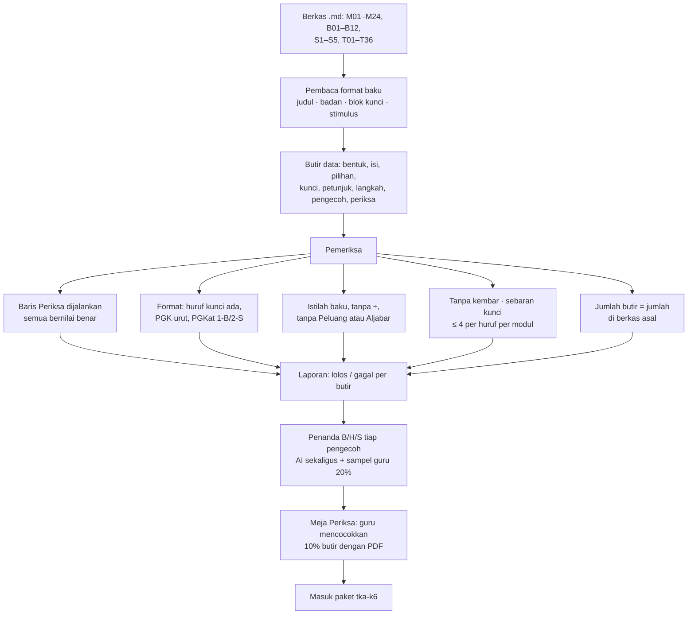

| Unsur di Markdown **[FAKTA — `bahan/tka-sd-induk-04-standar-soal.md`]** | Menjadi kolom |
|---|---|
| `#### <Jenis> <nomor> <lambang> · <bentuk>` | `jenis`, `nomor`, `lambang`, `bentuk` |
| Badan soal sampai baris kunci pertama | `isi.badan`, `isi.pilihan` atau `isi.pernyataan` |
| `### Stimulus <huruf>: <judul>` | `stimulus` (dipakai beberapa butir) |
| `> **Kunci:**` | `kunci` |
| `> **Kelompok:**` | `kelompok` (hari ini / minggu lalu / bulan lalu + kode topik) |
| `> **Petunjuk:**`, `> **Langkah:**` | `petunjuk`, `langkah` (kunci berjenjang) |
| `> **Kenapa pengecoh menarik:**` | `pengecoh[huruf].alasan` + `pengecoh[huruf].kode` (B/H/S, ditambahkan) |
| `> **Periksa:**` | `periksa[]` — dijalankan saat membangun paket, **tidak** dibawa ke HP |

**Ekspresi Periksa dijalankan dengan aman:** hanya angka, operator, `F()` (pecahan), `gcd`, `lcm`, `sum`, `min`, `max`, `abs`, `round`, perbandingan, dan `and/or/not`, sesuai daftar di standar soal. Ekspresi lain ditolak, bukan dijalankan.

**Yang dibutuhkan:** berkas Markdown dan `_alat/periksa.py` dari laptop (tenggat 31 Oktober, `01-produk/06-persiapan-tka.md` bagian 4). Pembaca baru dicocokkan dengan hasil `periksa.py` yang lama pada semua berkas: kalau hitungan butir dan hasil Periksa sama, pembaca dianggap benar.

---

### 4. Bank soal: teks Baca Ulang dan modul Paham

| Langkah | Isi |
|---|---|
| Draf | Acut2 menyusun dengan AI mengikuti cetakan yang disetujui Acut (`03-rencana-isi.md` bagian 4) |
| Pemeriksa mesin | Teks: jumlah kata dalam batas kelas, kata per kalimat, daftar kata terlarang, nama laki-laki dan perempuan bergantian, 2 pertanyaan per hari dengan 3–4 pilihan. Modul: format standar soal + baris Periksa |
| Meja Periksa | Guru: Layak / Perbaiki + catatan; Acut: sampel 20% |
| Terbit | Masuk paket `baca-kN` atau `paham-kN` lewat kanal uji |

---

### 5. Status butir dan revisi

| Status | Arti |
|---|---|
| `draf` | Baru dibuat atau baru diubah |
| `lolos_mesin` | Semua pemeriksaan otomatis lolos |
| `layak` | Guru menandai Layak (untuk butir yang wajib diperiksa manusia) |
| `terbit` | Ada di paket kanal umum |
| `tidak_dipakai` | Ditarik, tetapi tetap disimpan untuk riwayat |

| Aturan revisi | Sebab |
|---|---|
| Butir berubah → revisi naik, nomor lama tetap ada | Jawaban lama tetap terhubung ke versi yang dilihat anak |
| Revisi hanya terbit setelah melewati status yang sama lagi | Perbaikan kecil pun diperiksa |
| Laporan "soal ini salah" dari orang tua (tombol di Mode Dampingi) | Langsung masuk Meja Periksa dengan nomor butir dan revisinya |

---

### 6. Uji otomatis bank soal (dijalankan setiap paket dibangun)

| # | Uji | Lulus kalau |
|---|---|---|
| 1 | Periksa | Semua ekspresi bernilai benar |
| 2 | Format | Setiap butir punya kunci, petunjuk, langkah, dan alasan untuk setiap pengecoh |
| 3 | Kunci cocok | PG: satu huruf yang ada di pilihan; PGK: huruf urut dan ada; PGKat: satu B/S per pernyataan, minimal satu B dan satu S |
| 4 | Kembar | Tidak ada dua butir dengan teks yang sama setelah dinormalkan (spasi, huruf besar-kecil) |
| 5 | Istilah | Tidak ada ÷; notasi dan istilah mengikuti `bahan/tka-sd-induk-03-standar-istilah.md`; tanpa topik terlarang (Peluang, Aljabar, menulis) |
| 6 | Sebaran kunci | ≤ 4 kali per huruf per modul (soal halaman 5) |
| 7 | Kelengkapan | Jumlah butir = jumlah di sumber; setiap stimulus dipakai minimal satu butir |
| 8 | Penanda pengecoh | Setiap pengecoh punya kode B, H, atau S |


## Layanan AI

*Berkas: `rancangan/02-rancangan/07-layanan-ai.md`*

**Ringkas:** (1) Di Rilis 1–4, **anak tidak pernah berbicara dengan AI**. AI dipakai di tiga tempat: **rapor cerita** untuk orang tua (Haiku 5.5, ± Rp35 per anak per bulan), **ringkasan masukan mingguan** untuk Acut, dan **menyusun isi** sebelum diperiksa guru. Biaya AI saat aplikasi berjalan untuk ± 50 keluarga (75 anak): **± Rp11–70 ribu per bulan** (dihitung ulang 20 Okt dengan dasar 75 anak, sama dengan `06-rilis/03`). (2) Setiap angka di rapor cerita **diperiksa ulang oleh kode** terhadap basis data. Kalau tidak cocok, atau layanan AI mati, rapor memakai kalimat cetakan dengan angka yang sama, jadi orang tua tidak pernah kehilangan rapor. (3) Yang dikirim ke AI hanya angka ringkas tanpa nama dan tanpa tanggal lahir, sebab data dikirim ke luar negeri (Amerika Serikat) dan karena panduan Anthropic untuk layanan yang menyentuh anak.

Tahap 3, butir 7. Disusun 19 Oktober 2026. Harga dari `01-produk/riset-penguat.md` bagian 8; kurs Rp16.500.

---

### 1. Pekerjaan AI

| Pekerjaan | Kapan berjalan | Model | Biaya **[ESTIMASI]** | Rilis | Kalau AI mati atau mahal |
|---|---|---|---|---|---|
| **Rapor cerita mingguan** untuk orang tua | Minggu malam, otomatis | Haiku 5.5 (US$0,10/0,50 per juta token) | ± Rp35 per anak per bulan → **± Rp2.600** untuk 75 anak | R1 (prioritas Penting) | Rapor cetakan dengan angka yang sama |
| Rapor cerita, mutu lebih tinggi | sama | Sonnet 5.5 (US$2/10) | ± Rp715 per anak per bulan → **± Rp53.600** untuk 75 anak | Pilihan kalau mutu Haiku kurang | Turun ke Haiku |
| **Ringkasan masukan mingguan** untuk Acut | Senin pagi | Sonnet 5.5 atau Opus 5.5 | ± 40 ribu token masuk + 3 ribu keluar per minggu → Sonnet ± Rp8 ribu, Opus ± Rp16 ribu per bulan. **Rp0** kalau dijalankan sebagai tugas terjadwal di langganan Claude Acut | R1 | Acut membaca angka mentah di panel |
| **Menyusun isi** (teks, jurus, modul) | Saat membuat paket, bukan saat aplikasi dipakai | Opus 5.5 | ± Rp330 ribu sekali untuk tahun pertama (`01-produk/03-rencana-isi.md` 6.1) | Sebelum R1–R3 | Ditunda; isi lama tetap jalan |
| **Penanda pengecoh** B/H/S | Sekali saat memindah bahan TKA | Sonnet 5.5 kiriman sekaligus (batch, −50%) | ± Rp52 ribu sekali | R1.1 | Guru menandai manual (± 3.000 pengecoh, lama) |
| Memeriksa foto lembar buku | Ditunda | Haiku 5.5 | ± Rp4 per foto | Setelah uji 20 foto | — |
| Ngobrol Bahasa Inggris | Ditunda | Bukan Claude (Claude tidak menerima suara **[FAKTA — dokumentasi Claude]**) | ± Rp15.200 per anak per bulan (Gemini Live, perkiraan blog) | R5, kalau uji suara 5 anak lulus | — |

**Jumlah saat aplikasi berjalan (75 anak):** ± Rp11 ribu (Haiku + Sonnet untuk ringkasan) sampai ± Rp70 ribu (Sonnet + Opus) per bulan. Angka peringatan US$10 (± Rp165 ribu) tetap di atas keduanya.

---

### 2. Aturan rapor cerita

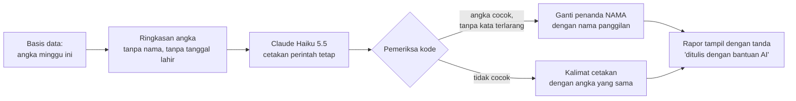

| Aturan | Sebab |
|---|---|
| Yang dikirim hanya angka ringkas: hari latihan, kecepatan, ketepatan, level, keluarga fakta yang lambat, kata per menit, ukuran yang dipilih orang tua (O02) | Data minimal; tidak ada data yang bisa mengenali anak |
| Nama anak diganti penanda `{nama}`, lalu diisi setelah teks kembali | Nama tidak pernah dikirim ke luar negeri |
| **Setiap angka di kalimat dicocokkan dengan basis data** oleh kode; satu saja tidak cocok → kalimat cetakan | ± 23,5–27,1% kalimat umpan balik AI tidak didukung data **[FAKTA — EDM 2024]** |
| Daftar kata terlarang: "malas", "bodoh", "lambat sekali", "gagal", membandingkan dengan anak lain | Rapor tidak boleh melabeli anak; pesan positif + satu langkah berikutnya (`01-produk/07` 2.5) |
| Panjang ≤ 60 kata; pola: satu kemajuan, satu langkah berikutnya, satu cara membantu tanpa mengambil alih | Sama dengan isi rapor mingguan |
| Tanda "ditulis dengan bantuan AI" | Panduan Anthropic: memberi tahu bahwa isi berasal dari AI **[FAKTA — `riset-penguat.md` bagian 8]** |
| Hanya untuk keluarga yang menyetujui tujuan "rapor buatan AI" | Persetujuan terpisah; yang tidak setuju mendapat rapor cetakan dengan angka sama (tidak diturunkan mutunya) |

---

### 3. Ringkasan masukan mingguan untuk Acut

| Masukan | Dari |
|---|---|
| Angka minggu ini (aktif, lembar, kecepatan, ketepatan, tanggapan) | Basis data, sudah dihitung kode |
| Jawaban pilihan (persen per pilihan, jumlah jawaban) | `jawaban_masukan` |
| Isian terbuka dan poin pesan suara Perintis | `jawaban_masukan.isian`, `catatan_perintis` — tanpa nama. **Hanya lewat fungsi server (API)**, tidak lewat berkas ekspor untuk tugas terjadwal (lihat di bawah) |
| Keputusan minggu lalu | `keputusan_mingguan` |

Keluarannya mengikuti bentuk di `01-produk/08-sistem-masukan.md` bagian 9: 3 temuan, usulan dengan biaya-waktu-risiko, dan peringatan. **Angka di ringkasan juga dicocokkan oleh kode**, sebab keputusan Acut bergantung padanya.

**Cara menjalankan — dua pilihan:**

| Pilihan | Biaya | Untung | Rugi |
|---|---|---|---|
| **Tugas terjadwal Claude** tiap Senin, membaca berkas ekspor mingguan dari panel | Rp0 (termasuk langganan Acut) | Acut2 yang sama dengan sesi rancangan; bisa bertanya balik | Butuh berkas ekspor yang bisa dibaca tugas itu (dirancang di panel) |
| Fungsi server memanggil Claude API | ± Rp8–16 ribu per bulan | Otomatis penuh, tampil langsung di panel | Satu kunci API lagi yang harus dijaga |

Usul: mulai dengan **tugas terjadwal** (Rp0) untuk **angka gabungan dan jawaban pilihan tanpa nomor keluarga** saja; pindah ke fungsi server kalau ekspor merepotkan.

**Batas tugas terjadwal (ditambah 20 Okt):** langganan Claude Acut tunduk pada syarat konsumen, bukan syarat API (aturan penghapusan 30 hari di bagian 4 berlaku untuk API). Karena itu berkas ekspor untuk tugas terjadwal tidak memuat isian terbuka, poin Perintis, atau apa pun per keluarga. Isian terbuka dibaca Acut sendiri di Meja Masukan; kalau perlu diringkas mesin, dikirim lewat fungsi server ke API (± Rp1–2 ribu per minggu **[ESTIMASI — ± 5.000 kata masukan per minggu pada tarif Haiku]**). Langganan Claude pengelola disebut di kebijakan privasi bagian 7.

---

### 4. Data, privasi, dan aturan

| Hal | Isi |
|---|---|
| Ke mana data pergi | Server Anthropic (Amerika Serikat) → transfer ke luar negeri; dasar UU PDP Ps. 56 dan persetujuan "rapor buatan AI" |
| Berapa lama disimpan Anthropic | Input dan output API dihapus dalam 30 hari setelah diterima atau dibuat, dengan pengecualian (misal penegakan kebijakan, kewajiban hukum) **[FAKTA — Pusat Privasi Anthropic]** |
| Dipakai melatih model? | **[ASUMSI — dicek ulang di syarat komersial Anthropic sebelum tayang]** Data API tidak dipakai melatih model secara bawaan |
| Panduan Anthropic untuk layanan yang menyentuh anak | Batas usia, penyaringan isi, pemantauan, edukasi, kepatuhan hukum, pemberitahuan AI **[FAKTA — `riset-penguat.md` bagian 8]**. Karena anak tidak berinteraksi langsung dengan AI dan semua keluaran AI dibaca orang tua, rancangan ini memenuhinya lewat penyaringan kata, pemeriksa angka, dan tanda AI |
| Kunci API | Hanya di server (fungsi server atau tugas terjadwal), **tidak pernah** di aplikasi HP |

---

### 5. Penjaga biaya

| Penjaga | Batas **[ASUMSI — angka final di Tahap 5]** |
|---|---|
| Angka peringatan bulanan | US$10 per bulan selama masa gratis (± 4× perkiraan pemakaian) |
| Peringatan ke Acut | Saat belanja mencapai 50%, 80%, dan 100% angka itu |
| Kalau angka tercapai | **Rapor cerita tetap berjalan** (diubah 20 Okt, sebab keputusan B 19 Okt: kemampuan sistem tidak dibatasi karena biaya). Acut menerima peringatan dan memutuskan menaikkan angka atau tidak. Batas keras di konsol Anthropic dipasang **US$50**, hanya sebagai pengaman kalau ada kesalahan program (misal perulangan tanpa henti); kalau batas keras itu tercapai, rapor sementara memakai kalimat cetakan dengan angka yang sama dan kejadian itu dicatat sebagai kesalahan |
| Pemakaian tak wajar | Lebih dari 2 rapor cerita per anak per minggu → dihentikan dan dilaporkan di panel |


## Pembayaran (Disiapkan, Belum Dibangun)

*Berkas: `rancangan/02-rancangan/08-pembayaran.md`*

**Ringkas:** (1) Selama masa gratis, pembayaran **tidak dibangun**. Yang disiapkan hanya tabel hak akses dan saklar fitur, supaya saat berbayar dibuka tidak ada perombakan. (2) Jalur utama nanti adalah **langganan Google Play** (potongan 15% untuk langganan berulang). Jalur kedua adalah **QRIS lewat halaman web** untuk orang tua (biaya ± 0,7%), kalau aturan Google Play di Indonesia mengizinkan. Mahkamah Agung sudah menguatkan putusan KPPU (Maret 2026) yang mewajibkan Google membuka pembayaran alternatif, tetapi pelaksanaannya belum terkonfirmasi. (3) Harga, bentuk, dan waktu berbayar menunggu **diskusi khusus** (keputusan Acut 19 Okt). Pajak dan badan usaha penerima uang masuk daftar pertanyaan ahli hukum dan konsultan pajak.

Tahap 3, butir 8. Disusun 19 Oktober 2026.

---

### 1. Jalur pembayaran

| Jalur | Potongan | Untung | Rugi | Status |
|---|---|---|---|---|
| **Langganan Google Play** | 15% untuk langganan berulang, berapa pun pendapatan pengembang **[FAKTA — halaman biaya layanan Google Play]** | Orang tua membayar dengan pulsa, e-wallet, atau kartu yang sudah tersambung ke Play; perpanjangan dan pembatalan diurus Google | Potongan 15%; pengembang menerima ± 77% setelah PPN **[catatan proyek Peta Belajar, dicek ulang]** | Jalur utama |
| **QRIS lewat halaman web** (gerbang pembayaran) | MDR 0,7% per transaksi untuk pedagang reguler **[FAKTA — Midtrans]** | Potongan jauh lebih kecil; akrab bagi orang tua | Perpanjangan bulanan harus dibayar manual (QRIS bukan tagihan otomatis); aturan Google soal menautkan pembayaran luar dari aplikasi harus dipatuhi | Bergantung aturan Play di Indonesia |
| Pembayaran alternatif di dalam aplikasi (User Choice Billing) | Di Korea Selatan dan India: 4% lebih rendah dari tarif Play **[FAKTA — halaman biaya Google Play]** | Pilihan bagi orang tua | Belum jelas di Indonesia | Dipantau |

**Status Indonesia:** Mahkamah Agung menolak permohonan Google (berita 17 Mar 2026). Kewajiban Google: menghapus kewajiban Google Play Billing, membuka pembayaran alternatif, menurunkan biaya layanan, dan mengumumkannya ke pengembang. Pelaksanaannya belum dilaporkan per tanggal berita itu **[FAKTA — InvestorTrust, 17 Mar 2026]**. **Dicek ulang di Play Console saat diskusi khusus berbayar.**

---

### 2. Yang disiapkan sekarang (masa gratis)

| Bagian | Isi | Biaya bangun **[ESTIMASI]** |
|---|---|---|
| Tabel `langganan` | `keluarga_id`, `sumber` (play · qris · perintis · uji), `status` (aktif · masa tenggang · berhenti), `berlaku_sampai`, `potongan` | ± 0,5 hari |
| Saklar fitur | Setiap fitur berbayar dibungkus satu pemeriksaan "apakah keluarga ini punya hak?"; selama masa gratis semua keluarga punya hak | ± 0,5 hari |
| Catatan hak Perintis | `keluarga.perintis` + tanggal mulai, dipakai saat peralihan | Sudah ada di basis data |

**Kenapa disiapkan sekarang:** kalau saklar baru ditambahkan saat berbayar, setiap layar harus disentuh ulang dan risiko salah mengunci latihan anak lebih besar.

---

### 3. Aturan yang sudah pasti, apa pun harganya

| Aturan | Sebab |
|---|---|
| Pembayaran **hanya di mode orang tua**, tidak pernah di mode anak | Anak tidak boleh menjadi sasaran penjualan (dimensi risiko eksploitasi konsumen, Permenkomdigi 9/2026) |
| Hak akses diperiksa **di server** (bukti pembelian Play diverifikasi lewat layanan Google), lalu disalin ke HP untuk dipakai tanpa sinyal | Mencegah hak palsu; anak tetap bisa latihan tanpa sinyal |
| Masa tenggang 7 hari setelah gagal bayar **[ASUMSI]** | Kartu atau pulsa gagal bukan alasan anak berhenti mendadak |
| Bagian gratis tidak pernah terkunci, apa pun status langganan | Keputusan bentuk berbayar menunggu diskusi khusus, tetapi riwayat anak tidak pernah dihapus (`01-produk/09` bagian 5) |
| Harga ditulis lengkap, bulanan, bisa berhenti dari aplikasi | Keluhan utama pada pesaing (`riset-pasar-dan-pesaing.md`) |

---

### 4. Pajak dan badan usaha — pertanyaan, bukan jawaban

| Pertanyaan | Kenapa penting | Untuk |
|---|---|---|
| Lewat Google Play, siapa yang memungut PPN dan apa kewajiban penerbit? | Menentukan harga bersih | Konsultan pajak |
| Lewat QRIS langsung, kapan badan usaha wajib menjadi PKP, dan tarif PPh yang berlaku (misal tarif UMKM) | Arus kas dan harga | Konsultan pajak |
| Uang masuk ke rekening badan usaha mana, dan apakah nama penerbit di Play harus sama | Kebijakan privasi, PSE, dan pembayaran memakai satu nama | Ahli hukum |
| Hak Keluarga Perintis (potongan terkunci) | Janji yang mengikat di syarat dan ketentuan | Ahli hukum |

Pembangunan pembayaran (± 4–6 hari kerja termasuk uji **[ESTIMASI]**) dijadwalkan setelah diskusi khusus dan sebelum tanggal berbayar yang diputuskan.


## Panel Pengelola (Ramah HP)

*Berkas: `rancangan/02-rancangan/09-panel-pengelola.md`*

**Ringkas:** (1) Panel adalah halaman web pribadi yang dibuka Acut dari HP, untuk **melihat, memutuskan, dan menyetujui tanpa menyentuh kode**: ringkasan harian, keputusan mingguan, jadwal pertanyaan, Meja Periksa, Meja Masukan, paket isi, biaya, dan pesan "Kami dengar, kami ubah". (2) Acut butuh **± 2–2,5 jam per minggu** di panel selama masa gratis. Guru pemeriksa hanya bisa membuka Meja Periksa. (3) Panel juga menjadi tempat **tanda peringatan dini**: biaya, antrean yang tidak terkirim, tanggapan yang turun, dan anak yang kewalahan muncul di bagian atas, bukan tersembunyi di laporan.

Tahap 3, butir 10. Disusun 19 Oktober 2026.

---

### 1. Menu panel

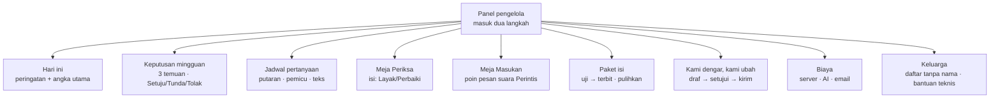

| Menu | Yang dilihat | Yang bisa diubah | Seberapa sering **[ESTIMASI]** |
|---|---|---|---|
| **Hari ini** | Peringatan di atas; keluarga aktif, lembar hari ini, HP dengan antrean > 48 jam, kesalahan aplikasi | — | Sekali sehari, 2 menit |
| **Keputusan mingguan** | Ringkasan Acut2 (temuan, bukti, usulan dengan biaya-waktu-risiko) | Setuju / Tunda / Tolak + alasan → tercatat di `keputusan_mingguan` | Senin–Rabu, 15–20 menit |
| **Jadwal pertanyaan** | Tanggal putaran (Senin minggu ganjil), urutan putaran tiap keluarga, antrean pertanyaan pemicu, angka tanggapan per pertanyaan (jawaban dari link dipisah) | Aktif/nonaktif, geser tanggal, ubah teks (membuat versi baru) | Sesekali, tanpa rilis aplikasi |
| **Meja Periksa** | Satu butir isi per layar (teks, soal, jurus) dengan catatan pemeriksa mesin | Layak / Perbaiki + catatan; cek sampel 20% | Mingguan, ± 1 jam |
| **Meja Masukan** | Daftar pesan suara Perintis yang belum dicatat | Ketik 1–3 poin per pesan | Dua mingguan, ± 30 menit |
| **Paket isi** | Versi di kanal uji dan umum, catatan perubahan, hasil pemeriksa otomatis | Terbitkan / pulihkan versi sebelumnya | Saat ada paket baru |
| **Kami dengar, kami ubah** | Draf pesan dari keputusan dua minggu terakhir | Sunting → setujui → salin ke WhatsApp atau kirim | Dua mingguan, 10 menit |
| **Biaya** | Pemakaian Supabase (basis data, lalu lintas keluar), belanja AI, jumlah email kode masuk | Batas peringatan | Mingguan, 2 menit |
| **Keluarga** | Daftar keluarga dengan kode, bukan nama; status aktif/diam; versi aplikasi | Membuka data satu keluarga **hanya untuk bantuan teknis**, dengan alasan yang wajib diisi dan tercatat | Saat ada laporan masalah |

**Jumlah waktu Acut di panel:** ± 2–2,5 jam per minggu **[ESTIMASI: 14 menit harian + 20 menit keputusan + 1 jam Meja Periksa + 15 menit Meja Masukan + 5 menit Kami dengar + 2 menit biaya]**.

---

### 2. Tanda peringatan dini

| Tanda | Batas **[ASUMSI — angka final di Tahap 5]** | Tindakan yang disarankan panel |
|---|---|---|
| **Biaya server** | Basis data > 5 GB atau lalu lintas keluar > 150 GB per bulan | Periksa tabel `kejadian` dan unduhan paket berulang |
| **Biaya AI** | Belanja > 50% batas bulanan sebelum tanggal 15 | Periksa rapor cerita yang dibuat berulang |
| **Email kode masuk** | > 200 per hari (batas gratis Brevo 300) atau > 300 per bulan pada ± 50 keluarga | Periksa percobaan masuk mencurigakan |
| **Antrean tidak terkirim** | > 10% HP anak dengan antrean > 48 jam | Tanya keluarga lewat pesan; periksa kesalahan sinkron |
| **Kesalahan aplikasi** | > 2% sesi berakhir dengan kesalahan | Hentikan terbit paket baru; periksa versi aplikasi |
| **Tanggapan turun** | Tanggapan putaran < 45% (cadangan `08-sistem-masukan.md`) | Pesan pribadi Acut ke keluarga yang dua kali melewatkan |
| **Anak kewalahan** | > 10% anak aktif kena tanda "macet" atau "ditinggalkan" minggu itu | Tinjau level yang paling banyak macet |
| **Keluarga diam** | Keluarga aktif turun > 20% dalam seminggu | Masuk temuan mingguan |

---

### 3. Keamanan panel

| Aturan | Sebab |
|---|---|
| Masuk dua langkah (kata sandi + kode) | Panel bisa membuka data banyak keluarga |
| Peran: **Acut** (semua menu), **guru pemeriksa** (hanya Meja Periksa) | Guru tidak perlu melihat data keluarga |
| Data keluarga tampil dengan kode, bukan nama; membuka rincian butuh alasan dan tercatat | Prinsip data minimal; jejak akses untuk penilaian dampak |
| Panel berjalan lewat fungsi server, bukan akses langsung ke basis data | Kunci khusus tidak pernah ada di peramban |

---

### 4. Ekspor mingguan untuk Acut2

Setiap Senin pukul 06.00, panel membuat **satu berkas ringkasan** (angka yang sudah dihitung, jawaban pilihan dalam bentuk persen, isian tanpa nama, poin Perintis, keputusan minggu lalu) untuk dibaca tugas terjadwal Acut2 (`07-layanan-ai.md` bagian 3). Berkas ini **tidak memuat data per anak**.

---

### 5. Biaya dan waktu bangun **[ESTIMASI]**

| Bagian | Hari kerja | Rilis |
|---|---|---|
| Hari ini, Biaya, Keluarga | 2 | R1 |
| Keputusan mingguan + ekspor | 1,5 | R1 |
| Jadwal pertanyaan | 1,5 | R1 |
| Meja Periksa | 1,5 | Sebelum 22 Nov (teks dan jurus mulai diperiksa) |
| Paket isi (uji → terbit → pulihkan) | 1,5 | R1 |
| Meja Masukan, Kami dengar | 1 | R1 |
| **Jumlah** | **± 9 hari kerja** | |

Kalau jadwal R1 terlalu ketat, **Meja Periksa dan Paket isi didahulukan** (isi tidak bisa terbit tanpanya). Jadwal pertanyaan bisa sementara diubah lewat pengaturan di basis data oleh Acut2.


## Catatan Kejadian untuk Mengukur

*Berkas: `rancangan/02-rancangan/10-catatan-kejadian.md`*

**Ringkas:** (1) Sebagian besar ukuran dihitung dari tabel yang sudah ada (sesi, jawaban, bacaan, jawaban masukan). Tabel `kejadian` hanya mencatat hal yang **tidak** tercatat di tempat lain: aplikasi dibuka, rapor dibuka, pesan dibaca, pertanyaan dilewati, dan kegagalan sinkron. (2) Setiap kejadian terhubung ke **ukuran keberhasilan atau ukuran gerbang** yang sudah ditetapkan di Tahap 2. Kejadian yang tidak dipakai untuk satu ukuran pun tidak dicatat. (3) Catatan dibuat sendiri di basis data kita, **tanpa analitik pihak ketiga dan tanpa pengenal perangkat**, sesuai Kebijakan Keluarga Google Play, dan dipakai dalam bentuk jumlah, bukan untuk membuat profil anak.

Tahap 3, butir 11. Disusun 19 Oktober 2026.

---

### 1. Daftar kejadian

| Kejadian | Data tambahan | Dicatat di | Untuk ukuran |
|---|---|---|---|
| `aplikasi_dibuka` | mode (anak/orang tua/dampingi) | `kejadian` | Kembali setelah 7 dan 30 hari |
| `profil_dipilih` | — | `kejadian` | Saudara satu HP |
| `tes_penempatan_selesai` | level hasil | `sesi` (jenis tes) | Titik mulai |
| `jurus_dibuka` | kelas-level, dari mana (sebelum level / saat macet) | `kejadian` | Jurus menolong (K12) |
| `lembar_mulai` / `lembar_selesai` | `dimulai_oleh` | `sesi` | **Dimulai anak sendiri** (gerbang janji 2), lembar per minggu |
| `lembar_ditinggalkan` | soal ke berapa | `kejadian` | Penjaga "ditinggalkan", kewalahan (G6) |
| `jeda_dipakai` | lama | `sesi.jeda_n` | Memisahkan lambat dan terganggu |
| `naik_level` / `turun_level` | dari–ke | turunan `sesi` | Kecepatan naik level, macet |
| `daya_tahan_diuji` | ingat / lupa | `jawaban.daya_tahan` | Daya tahan 3 minggu |
| `baca_selesai` | detik dingin/panas, cara ukur | `bacaan` | Janji 1b |
| `dengar_bacaan_selesai` | kata benar per menit | `bacaan` (cara ukur orang tua) | Janji 1b; orang tua mendengar ≥ 2×/bulan |
| `dampingi_dibuka` / `kegiatan_dampingi_selesai` | jenis kegiatan | `kejadian` + `sesi` (mode dampingi) | Kegiatan Dampingi per minggu (K14) |
| `simulasi_selesai` | persen benar, kode B/H/S/W | `sesi` + `jawaban` | Janji 1c |
| `pesan_dikirim` / `pesan_dibaca` | jenis | `pesan` | Keterlibatan [J] |
| `bantu_aku` | soal yang macet | `pesan` | Kewalahan; saran Dampingi |
| `ajakan_dibuat` / `ajakan_selesai` | jenis | `ajakan` | Ajakan berguna atau tidak |
| `kartu_didapat` | kartu | `kartu_milik` | Membandingkan latihan mandiri dengan dan tanpa kartu (kesenjangan data hadiah maya) |
| `game_mulai` / `game_selesai` | lama, mode kunci (terbuka/setelah latihan) | `kejadian` | Batas waktu; perbandingan pilihan C (`01-produk/07` 3.4) — R4 |
| `rapor_dibuka` | dari aplikasi / link | `kejadian` | Orang tua melihat kemajuan; tanda orang tua mengontrol (> 5×/hari) |
| `link_dibuat` / `link_dicabut` | — | `link_rapor` | Pemakaian [L] |
| `pertanyaan_tampil` / `dijawab` / `dilewati` | kode, lama menjawab | `jawaban_masukan` + `kejadian` | Tanggapan putaran; mutu jawaban |
| `kami_dengar_dibuka` | edisi | `kejadian` | Apakah pesan tutup lingkaran dibaca |
| `kabar_terkirim` / `kabar_dibuka` | jenis kabar | `kejadian` | Kabar berguna atau mengganggu (K15) |
| `sinkron_gagal` | jenis kesalahan | `kejadian` | Peringatan antrean dan kesalahan |
| `antrean_lama` | jam sejak terkirim terakhir | `perangkat.antrean_belum_kirim` | Tanda 24/48 jam |
| `persetujuan_diubah` | tujuan, setuju/tidak | `persetujuan` | Bukti persetujuan |
| `akun_dihapus` | alasan (O18) | `jawaban_masukan` | Alasan berhenti |

---

### 2. Definisi ukuran utama

| Ukuran | Cara hitung | Dipakai di |
|---|---|---|
| **Kembali setelah 7 / 30 hari** | Anak dengan ≥ 1 lembar pada hari 7–13 (atau 30–36) sejak lembar pertama ÷ semua anak yang mulai | Tahap 5 angka keberhasilan; gerbang |
| **Lembar per minggu** | Jumlah sesi `lancar` + `baca` per anak per minggu (minggu Ramadan ditandai) | Ukuran harian |
| **Dimulai anak sendiri** | Sesi dengan `dimulai_oleh = anak`: tidak ada ajakan, pengingat, atau kabar ke keluarga itu dalam 2 jam sebelumnya | Gerbang janji 2 |
| **Kenaikan kecepatan dan ketepatan** | Tes tetap minggu ke-8 dibanding tes awal (detik per soal, % benar) | Gerbang janji 1a |
| **Daya tahan 3 minggu** | Uji daya tahan "ingat" ÷ semua uji | Janji 1a |
| **Tanggapan putaran** | Dijawab ÷ ditampilkan, hanya keluarga aktif | Sistem masukan |
| **Kewalahan** | Anak dengan tanda macet/ditinggalkan dalam minggu itu ÷ anak aktif | G6 |
| **Keluarga terpenuhi** | Minimal satu janji tercapai menurut aturan per keluarga (`01-produk/09` bagian 1) | G3 |

**Batas ukuran "dimulai sendiri":** aplikasi tidak tahu kalau orang tua menyuruh anak secara lisan. Karena itu ukuran ini selalu dibaca bersama jawaban O06 (`01-produk/08` bagian 3).

---

### 3. Aturan pencatatan

| Aturan | Sebab |
|---|---|
| Kejadian dicatat di HP, masuk antrean yang sama dengan hasil latihan | Tanpa sinyal tetap tercatat |
| Tanpa pengenal iklan, IMEI, MAC, lokasi, atau pengenal perangkat lain | Kebijakan Keluarga Google Play **[FAKTA]** |
| Tanpa analitik pihak ketiga | Sama; dan data tidak keluar ke pihak lain |
| Dipakai dalam bentuk jumlah untuk keputusan produk, dan untuk fungsi aplikasi (misal penjaga level) — **tidak** untuk membuat profil anak atau menawarkan sesuatu | Larangan profiling anak di PP Tunas **[FAKTA — `riset-penguat.md` bagian 9]** |
| Hanya untuk keluarga yang menyetujui tujuan "data pemakaian"; tanpa persetujuan itu, hanya data yang dibutuhkan fungsi inti yang disimpan (sesi, jawaban) | Persetujuan terpisah per tujuan |
| Rinci 12 bulan, lalu dirangkum per minggu | Ukuran dan prinsip data minimal |

**Batas yang diterima:** keluarga yang tidak menyetujui data pemakaian tetap mendapat rapor penuh dari sesi dan jawabannya sendiri, tetapi **tidak masuk hitungan ukuran mana pun**, termasuk ukuran gerbang. Sebab memakai data untuk keputusan pengembangan adalah tujuan yang berbeda dari layanan inti. **[ASUMSI — dikonfirmasi ahli hukum]** Akibatnya, kalau banyak keluarga menolak, jumlah untuk gerbang (G2) bisa kurang; angka penolakan dipantau di panel.


## Privasi dan Keamanan Anak

*Berkas: `rancangan/02-rancangan/11-privasi-dan-keamanan.md`*

**Ringkas:** (1) Rancangan ini menyasar **profil risiko rendah**. Dari parameter resmi penilaian mandiri (Kepmenkomdigi 142/2026) yang sudah terbaca, hampir semua parameter berstatus "tidak ditemukan", sebab tidak ada kontak dengan orang asing, rekomendasi berbasis perilaku, iklan, pembelian oleh anak, atau data anak yang tampil ke publik. (2) Ada **temuan jadwal yang serius**: penilaian mandiri harus disampaikan ke Komdigi dan diverifikasi sebelum anak memakai aplikasi. Pemeriksaan kelengkapannya bisa memakan sampai 14 hari, ditambah klarifikasi 7 hari. Ahli hukum baru direncanakan dipilih akhir November, padahal uji keluarga dijadwalkan Desember. Usulnya: **Acut menyampaikan sendiri draf kita paling lambat Jumat 13 Nov**, ahli hukum memeriksa sejajar, dan sampai profil risiko ditetapkan hanya anak-anak Acut sendiri yang memakai aplikasi. (3) Daftar periksa sebelum tayang dan paket draf untuk ahli hukum ada di folder `paket-hukum/`.

Tahap 3, butir 9. Disusun 19 Oktober 2026. **Bukan nasihat hukum**; semua draf wajib diperiksa ahli hukum.

---

### 1. Aturan yang mengikat

| Aturan | Isi yang mengikat aplikasi ini | Sumber |
|---|---|---|
| **UU 27/2022 (PDP)** Ps. 25 | Data anak wajib persetujuan orang tua/wali | **[FAKTA — pasal.id]** |
| Ps. 21 | Saat meminta persetujuan wajib disampaikan: legalitas, tujuan, jenis dan relevansi data, masa simpan, rincian data yang dikumpulkan, jangka waktu pemrosesan, hak subjek data; perubahan diberitahukan **sebelum** terjadi | **[FAKTA — pasal.id, Ps. 21]** |
| Ps. 34 | Penilaian dampak bila berisiko tinggi | **[FAKTA — pasal.id]** |
| Ps. 46 | Kegagalan pelindungan data → pemberitahuan tertulis **≤ 3 × 24 jam** ke subjek data dan lembaga, berisi data yang terungkap, kapan dan bagaimana, serta upaya penanganan | **[FAKTA — pasal.id, Ps. 46]** |
| Ps. 56 | Transfer ke luar negeri: negara setara → pelindungan memadai dan mengikat → persetujuan subjek data | **[FAKTA — Hukumonline]** |
| **PP 33/2026** | Berlaku 16 Jan 2027; persetujuan bebas, spesifik, tidak digabung dengan syarat dan ketentuan, ada buktinya; layanan tidak diturunkan mutunya bagi yang menolak | **[FAKTA — RSM; Bisnis.com]** |
| **PP 17/2025 (PP Tunas)** | Persetujuan orang tua; privasi tinggi sejak awal; fitur sesuai usia; edukasi; pejabat pelindungan data; penilaian dampak; informasi tidak menyesatkan. **Dilarang:** profiling anak, lokasi tidak patut, teknik dorongan | **[FAKTA — Bisnis.com 5 Mei 2026]** |
| **Permenkomdigi 9/2026** | Penilaian mandiri profil risiko **disahkan sebelum anak dapat mengakses**; anak < 13 tahun hanya produk berprofil risiko rendah dengan persetujuan orang tua | **[FAKTA — pasal.id]** |
| **Kepmenkomdigi 142/2026** | Indikator "layanan dapat diakses anak" (cukup satu: misal ditujukan untuk anak); **tujuh aspek risiko** berbobot; satu aspek > 50% → profil tinggi; Kertas Kerja Penilaian Mandiri + bukti; disampaikan ke Direktur Jenderal lewat sistem elektronik Komdigi; periksa kelengkapan ≤ 14 hari, klarifikasi ≤ 7 hari, profil ditetapkan Dirjen Pengawasan Ruang Digital dan diumumkan | **[FAKTA — veritask.ai, 26 Mar 2026; teks Kepmen di JDIH Komdigi, terbaca sebagian]** |
| **Pendaftaran PSE** | Sebelum sistem digunakan pengguna; per aplikasi/situs; lewat OSS | **[FAKTA — izin.co.id, Jul 2026]** |
| **Kebijakan Keluarga Google Play** | Tanpa pustaka pihak ketiga (SDK) yang tidak disetujui untuk anak, tanpa AAID/IMEI/MAC/lokasi, kebijakan privasi akurat, patuh hukum yang berlaku | **[FAKTA — Bantuan Play Console]** |

**Catatan:** riset Tahap 1 menyebut enam dimensi risiko; Kepmenkomdigi 142/2026 merincinya menjadi **tujuh aspek** (gangguan psikologis dan fisiologis dipisah). `01-produk/07-fitur-orang-tua-dan-anak.md` bagian 4 diperbarui mengikuti ini.

---

### 2. Penilaian mandiri — perkiraan awal

Parameter aspek a–d terbaca dari teks Kepmen; aspek e–g (adiksi, psikologis, fisiologis) **belum terbaca** dan harus dilengkapi dari dokumen resmi. Kertas kerja lengkap ada di `paket-hukum/03-kertas-kerja-penilaian-mandiri.md`.

| Aspek | Parameter yang **ditemukan** di rancangan | Perkiraan bobot ditemukan **[ESTIMASI]** | Batas profil tinggi |
|---|---|---|---|
| a. Kontak dengan orang tak dikenal | Tidak ada (pesan hanya dalam keluarga; tanpa pencarian, rekomendasi akun, grup, atau indeks mesin pencari) | 0% | > 50% |
| b. Paparan isi tidak sesuai | Tidak ada rekomendasi otomatis, forum, komentar, atau iklan. KN06 (fitur blokir dan pelaporan) dinilai sebagai mitigasi: ada tombol "laporkan soal ini salah" | ± 0% (bergantung cara KN06 dinilai) | > 50% |
| c. Eksploitasi sebagai konsumen | EK06 (perpanjangan langganan otomatis) **bisa ditemukan** saat berbayar; mitigasi: pembelian hanya di mode orang tua dengan PIN | 0% masa gratis; ± 9,5% setelah berbayar | > 50% |
| d. Keamanan data | DP03–DP06 dipenuhi lewat rancangan ini (keamanan, penilaian dampak, pengawasan orang tua, pemberitahuan privasi mudah dipahami) | ± 0% | > 50% |
| e–g. Adiksi, psikologis, fisiologis | Parameter belum terbaca. Mitigasi yang sudah ada: tanpa rangkaian hari, tanpa notifikasi ke anak, batas waktu game, sesi ≤ 10/15/20 menit, tanpa perbandingan antaranak, jam tenang, tema terang lembut | Belum bisa dihitung | > 50% |

**Dua batas yang belum diketahui (ditambah 20 Okt):** (1) batas antara profil rendah dan sedang — yang terbaca baru "satu aspek > 50% = tinggi", jadi KN03 17,91% belum pasti "rendah"; (2) parameter e–g. Keduanya dicari di lampiran Kepmen 142. Simulasi TKA 75 menit dicatat sebagai **pengecualian beralasan** atas batas sesi (meniru ujian, ≤ 5 kali setahun, pilihan orang tua).

---

### 3. Data yang disimpan

| Data | Tujuan | Dasar | Disimpan di | Dilihat oleh | Masa simpan |
|---|---|---|---|---|---|
| Email orang tua | Masuk (kode) | Persetujuan inti | Supabase (Singapura) | Sistem; Acut hanya untuk bantuan teknis | Selama akun aktif |
| Nomor WhatsApp orang tua; pesan dan pesan suara ke Acut | Kabar dari Acut, pengingat, Keluarga Perintis | **Izin 7 (pilihan)** — dipisah dari persetujuan inti 20 Okt | Supabase (Singapura); pesan di WhatsApp (Meta) | Acut | Nomor: sampai izin ditarik; pesan suara: dihapus setelah poinnya diketik, ≤ 14 hari |
| Nama panggilan, bulan-tahun lahir, kelas, hewan anak | Menyesuaikan isi dan rapor | Persetujuan inti (orang tua) | Supabase + HP | Keluarga | Selama akun aktif |
| Hasil latihan per soal, waktu, level | Latihan dan rapor | Persetujuan inti | Supabase + HP | Keluarga; pengajar kalau disetujui | Selama akun aktif |
| Kata per menit dan kata yang tersandung | Rapor membaca | Persetujuan inti | Supabase + HP | Keluarga | Selama akun aktif |
| Pesan dalam keluarga | Komunikasi orang tua–anak | Persetujuan inti | Supabase + HP | Keluarga | 12 bulan **[ASUMSI]** |
| Catatan pemakaian | Pengembangan, ukuran | Persetujuan "data pemakaian" | Supabase | Acut dalam bentuk jumlah | Rinci 12 bulan, lalu dirangkum |
| Jawaban masukan | Pengembangan | Persetujuan "masukan" | Supabase | Acut, Acut2 dalam bentuk ringkasan | Selama akun aktif |
| Angka ringkas untuk rapor cerita (tanpa nama) | Rapor cerita | Persetujuan "rapor buatan AI" | Dikirim ke Anthropic (AS) | Tidak ada manusia | Dihapus Anthropic ≤ 30 hari |
| Bukti persetujuan | Kepatuhan | Kewajiban hukum | Supabase | Acut, ahli hukum, otoritas | Selama akun aktif + 5 tahun **[ASUMSI]** |
| Token pemberitahuan HP orang tua | Kabar rapor | Persetujuan inti (bisa dimatikan) | Supabase; dikirim lewat Expo + Firebase Cloud Messaging (AS) | Sistem | Sampai HP diputus atau pemberitahuan dimatikan |
| Ekspor mingguan untuk ringkasan (angka gabungan, jawaban pilihan **tanpa** nomor keluarga) | Ringkasan Senin | Persetujuan "masukan" dan "data pemakaian" | Dibaca langganan Claude Acut (syarat konsumen) | Acut, Acut2 | Berkas ekspor dihapus setelah ringkasan selesai |

**Tidak pernah dikumpulkan:** nama lengkap anak, foto, rekaman suara anak, sekolah, alamat, lokasi, NISN/NIK, pengenal iklan atau pengenal perangkat tetap, kontak di HP.

**Pustaka pemberitahuan di HP anak (ditambah 20 Okt, perlu dicek):** pemberitahuan Expo di Android berjalan lewat Firebase Cloud Messaging, jadi pustaka Firebase ikut di aplikasi yang sama yang dipasang di HP anak. Penjaganya: (1) aplikasi **tidak meminta izin pemberitahuan dan tidak mendaftarkan token** selama HP dalam mode anak atau terhubung sebagai "HP anak"; (2) Acut2 mengecek apakah pustaka itu termasuk daftar pustaka yang disertifikasi sendiri untuk Kebijakan Keluarga Google Play, dan apakah pustaka itu mengirim data walaupun token tidak didaftarkan — Rabu 4 Nov, bukti: catatan pemeriksaan manifes dan lalu lintas jaringan HP uji. Kalau gagal, pemberitahuan orang tua diganti email saja di R1.

---

### 4. Pengamanan

| Lapis | Pengamanan |
|---|---|
| Perjalanan data | Semua lewat HTTPS |
| Penyimpanan server | Enkripsi saat tersimpan di layanan awan **[ASUMSI — dicek di dokumentasi Supabase]**; cadangan harian 7 hari |
| Akses | Aturan per baris per keluarga (`03-basis-data.md` bagian 4); uji "keluarga A tidak bisa membaca keluarga B" wajib lulus |
| PIN dan kode | Disimpan sebagai acak satu arah; dikunci setelah 5 kali salah |
| Kunci rahasia | Kunci layanan dan API hanya di fungsi server, tidak pernah di aplikasi atau peramban |
| Panel | Masuk dua langkah; akses data per keluarga wajib alasan dan tercatat |
| HP hilang | Orang tua memutus HP dari jauh; data lokal terhapus saat HP itu tersambung |
| Pustaka pihak ketiga | Daftar pustaka diperiksa terhadap Kebijakan Keluarga sebelum setiap rilis |

#### Kalau terjadi kebocoran

| Waktu | Tindakan | Siapa |
|---|---|---|
| Jam 0 | Hentikan sumber (cabut kunci, matikan fungsi yang bocor) | Acut + Acut2 |
| ≤ 24 jam | Catat data apa, berapa keluarga, kapan dan bagaimana | Acut2 |
| **≤ 72 jam** | Pemberitahuan tertulis ke keluarga terdampak dan lembaga: data yang terungkap, kapan dan bagaimana, upaya penanganan (UU PDP Ps. 46) | Acut sebagai pejabat pelindungan data |
| Sesudahnya | Perbaikan + catatan di `keputusan.md` | Acut |

Cetakan pemberitahuan disiapkan di paket hukum.

---

### 5. Peran yang harus diisi

| Peran | Usul | Sebab |
|---|---|---|
| **Pengendali data** (nama di kebijakan privasi, PSE, Play Store) | **Dibahas dalam diskusi khusus** (keputusan Acut 19 Okt). Pilihan: atas nama pribadi Acut dulu, atau badan usaha. Kendala badan usaha: akun Play organisasi butuh nomor D-U-N-S — gratis dari Dun & Bradstreet tetapi bisa sampai 30 hari **[FAKTA — Bantuan Play Console]**; jalur cepat yang pernah dicoba Acut ± Rp3 juta. UU PDP menyebut pengendali data bisa "Setiap Orang", badan publik, atau organisasi internasional **[FAKTA — UU 27/2022 Ps. 19, lewat pasal.id]**, jadi atas nama pribadi dimungkinkan **[ASUMSI — PSE perorangan dicek]** | Satu nama untuk semua dokumen |
| **Pejabat pelindungan data** | Acut (sementara) | Diwajibkan PP Tunas; UU PDP Ps. 53 untuk kondisi tertentu |
| **Narahubung penilaian mandiri** | Acut | Diwajibkan Kepmenkomdigi 142/2026 |
| **Pemroses data** | Supabase, Anthropic, penyedia email (Brevo), Google (suara: saat membuat paket, dan sekali untuk nama panggilan anak serta pesan orang tua bagi kelas 1–2, keputusan 29 Okt) | Perjanjian pemrosesan data masing-masing diperiksa |

---

### 6. Jadwal kepatuhan — temuan yang mengubah rencana

| Langkah | Paling lambat (usul) | Sebab |
|---|---|---|
| Nama pengendali data diputuskan (diskusi khusus: pribadi atau badan usaha) | 6 Nov | Dibutuhkan untuk PSE dan semua dokumen pengajuan |
| Draf kertas kerja + kebijakan privasi + formulir persetujuan + penilaian dampak **selesai** | 6 Nov (Acut2) | — |
| **Penilaian mandiri disampaikan** lewat sistem Komdigi — **diputuskan Acut 19 Okt: diajukan sendiri** | **Jumat 13 Nov** | Periksa kelengkapan ≤ 14 hari + klarifikasi ≤ 7 hari + penetapan ≤ 3 hari ≈ **± 24 hari** → siap ± 8 Des |
| Pendaftaran PSE (aplikasi; halaman rapor kalau diwajibkan) | Jumat 20 Nov | Sebelum sistem digunakan pengguna |
| Ahli hukum memeriksa paket (sejajar, bukan sebelum) | Dipilih secepatnya, paling lambat 30 Nov | Rencana lama "dipilih akhir November" terlalu lambat untuk menjadi syarat pengajuan |
| Uji keluarga (anak dari keluarga lain) | **Setelah profil risiko ditetapkan** | Permenkomdigi 9/2026 |
| Sampai profil ditetapkan | Hanya anak-anak Acut sendiri; 12 penguji Play Store mencoba sebagai orang dewasa **[ASUMSI — ditanyakan ke ahli hukum]** | — |

**Pilihan untuk Acut:**

| Pilihan | Isi | Risiko |
|---|---|---|
| **A. Ajukan sendiri Jumat 13 Nov, ahli hukum memeriksa sejajar** (usul) | Draf kita diajukan; kalau ahli hukum menemukan perbaikan, dokumen diperbarui (Kepmen mengizinkan pembaruan) | Draf awal mungkin perlu klarifikasi |
| B. Tunggu ahli hukum dulu, baru ajukan | Lebih rapi | Uji keluarga mundur ke Januari atau lebih |
| C. Uji keluarga Desember tanpa menunggu profil | Jadwal tetap | **Melanggar** syarat "sebelum anak dapat mengakses"; tidak disarankan |

---

### 7. Daftar periksa sebelum anak dari keluarga lain memakai aplikasi

| # | Periksa | Bukti selesai |
|---|---|---|
| 1 | Profil risiko ditetapkan Komdigi (rendah) | Surel penetapan / nama di daftar publik |
| 2 | Tanda daftar PSE terbit | Nomor TDPSE |
| 3 | Kebijakan privasi diterbitkan di halaman web dan di aplikasi | Tautan |
| 4 | Formulir persetujuan per tujuan berjalan dan tercatat | Uji: 6 tujuan tersimpan dengan versi teks |
| 5 | Penilaian dampak pelindungan data selesai | Berkas bertanggal |
| 6 | Pejabat pelindungan data dan narahubung ditunjuk | Nama di kebijakan privasi |
| 7 | Manifes Android tanpa izin AD_ID, lokasi, kontak; daftar pustaka diperiksa | Laporan pemeriksaan |
| 8 | Formulir Keamanan Data dan sasaran usia di Play Console diisi sesuai kenyataan | Tangkapan layar |
| 9 | Uji akses antarkeluarga lulus | Laporan uji |
| 10 | Hapus akun dari aplikasi dan dari halaman web berjalan | Uji |
| 11 | Cetakan pemberitahuan kebocoran siap | Berkas |
| 12 | Perjanjian pemrosesan data Supabase dan Anthropic dibaca dan disimpan | Berkas |


# Bagian 3 — Antarmuka


## Ringkasan Tahap 4 — Antarmuka

*Berkas: `rancangan/03-antarmuka/00-ringkasan-tahap-4.md`*

**Ringkas:** (1) Antarmuka dirancang dalam 3 berkas: 55 layar dengan alurnya (65 setelah tambahan 28 Okt, termasuk Gudang Ilmu, Bimbingan Guru, dan Belajar Bahasa Inggris; 51 di aplikasi Rilis 1, termasuk layar TKA yang isinya terbuka 4 Januari; diperbaiki 20 Okt), kerangka 20 layar terpenting, dan aturan tampilan untuk anak 6–12 tahun di HP murah. (2) Empat keputusan desain paling berpengaruh: **waktu tidak ditampilkan berjalan saat lembar Lancar** (hanya rekor di akhir), **turun level tidak diumumkan**, **tombol anak jauh lebih besar dari batas umum Android**, dan **tema terang lembut sebagai bawaan**. Yang terakhir ini mengoreksi rancangan sebelumnya yang menyebut mode gelap untuk malam. (3) Langkah yang paling berguna berikutnya adalah menguji kerangka ini di tangan anak-anak Acut sendiri pada minggu pertama purwarupa, sebab semua ukuran huruf dan tombol masih asumsi.

Disusun 19 Oktober 2026 malam.

---

### 1. Isi Tahap 4

| Berkas | Isi | Keputusan desain terpenting |
|---|---|---|
| `01-daftar-layar-dan-alur.md` | 55 layar berkode (A, K, D, O) + 4 keadaan link rapor; 5 gambar alur | Anak ≤ 2 ketukan ke soal pertama; keluar dari mode anak hanya dengan PIN |
| `02-kerangka-layar.md` | Kerangka teks 20 layar: isi, tombol, aksi, suara | Waktu tidak tampak di tengah lembar; salah tanpa kata "salah"; tombol Setuju/Tidak sama besar di izin data |
| `03-aturan-tampilan.md` | Ukuran tombol, huruf, warna, suara, animasi, HP murah, daftar periksa | Tombol ≥ 64–72dp untuk kelas 1–2; huruf Andika; tanpa musik latar; tanpa animasi hiasan di layar soal |

### 2. Hal yang ditunda dari Tahap 2–3 dan sudah ditutup di sini

| Hal | Di mana |
|---|---|
| Mode Ramadan | `02-kerangka-layar.md` O10 |
| Tombol "level terasa tidak pas" (hak keberatan atas keputusan otomatis) | `02-kerangka-layar.md` O2 |
| Penjelasan privasi untuk anak (parameter DP06) | Layar K12 "Untuk kamu" |
| Paket Lancar bawaan di dalam aplikasi supaya tes pertama jalan tanpa sinyal | `02-kerangka-layar.md`, keadaan khusus |

### 3. Kenapa antarmuka ini bisa gagal — dan penjaganya

| Cara gagal | Tanda awal | Penjaga |
|---|---|---|
| Anak kelas 1–2 tidak bisa mulai sendiri | Anak menunggu dibacakan di uji pertama | Semua petunjuk bersuara; uji dengan anak kelas 1–2 sebelum keluarga lain |
| Tanpa jam berjalan, anak tidak merasa ditantang | Ketukan "gajah mengantuk" (bosan) tinggi di minggu 1–2 | Pilihan "tampilkan waktu" di Pengaturan bisa ditambah tanpa rilis besar **[ASUMSI]** |
| Ukuran huruf dan tombol terlalu besar sehingga soal panjang tidak muat (TKA) | Teks soal terpotong | Ukuran per kelas; teks TKA 18sp dengan gulir |
| Orang tua tidak menemukan pertanyaan masukan | Tanggapan < 45% | Kartu di beranda + di bawah link rapor |
| HP sangat murah tersendat | Pindah layar > 1 detik di HP 2 GB | Tanpa animasi hiasan, tanpa video, gambar dikompresi |

### 4. Keputusan Acut

> **19 Okt malam: keempat keputusan disetujui Acut** (`keputusan.md` B5).

| # | Keputusan | Usul Acut2 | Di berkas |
|---|---|---|---|
| 1 | Saat lembar Lancar, waktu **tidak** ditampilkan berjalan; hanya batang kemajuan dan rekor di akhir | Setuju, sebab anak bersaing dengan rekornya sendiri tanpa tekanan jam | `02` K6 |
| 2 | Turun level tidak diumumkan ke anak | Setuju | `02` K7 |
| 3 | Tema terang lembut sebagai bawaan, mode gelap pilihan (koreksi dari "mode gelap untuk malam") | Setuju, sebab buktinya | `03` bagian 3 |
| 4 | Mode Ramadan (lembar 10 soal, target mingguan diturunkan, pengingat digeser) | Setuju, diuji Februari 2027 | `02` O10 |

### 5. Tindak lanjut

| Apa | Siapa | Kapan | Bukti selesai |
|---|---|---|---|
| ~~Menjawab 4 keputusan Tahap 4~~ | Acut | **Selesai 19 Okt** | `keputusan.md` B5 |
| Memulai Tahap 5 (uji, rilis, uang) | Acut2 | Setelah Tahap 4 disetujui | Berkas di `rancangan/05-uji/` dan `06-rilis/` |
| Uji kerangka di tangan anak kelas 4 dan kelas 6 Acut | Acut | Minggu pertama purwarupa (± 3 Nov) | Catatan + video layar |


## Daftar Layar dan Alur Antarlayar

*Berkas: `rancangan/03-antarmuka/01-daftar-layar-dan-alur.md`*

**Ringkas:** (1) Aplikasi punya **55 layar** (menjadi **65** setelah tambahan 28 Okt di bagian 8) dalam empat bagian: awal dan akun (10), mode anak (21), Mode Dampingi (7), dan mode orang tua (17). Ditambah 4 keadaan halaman rapor lewat link; panel pengelola sudah dirinci di `02-rancangan/09`. (2) Prinsip alurnya: anak **paling banyak 2 ketukan** dari beranda ke soal pertama, dan orang tua **paling banyak 2 ketukan** dari beranda ke rapor atau kirim semangat. Tidak ada jalan keluar dari mode anak ke mode orang tua tanpa PIN. (3) Setiap layar diberi kode (A, K, D, O, L) yang dipakai di kerangka layar dan rencana uji.

Tahap 4, butir 1. Disusun 19 Oktober 2026. Kolom "Rilis" mengikuti `01-produk/02-fitur-per-rilis.md`.

---

### 1. Peta besar

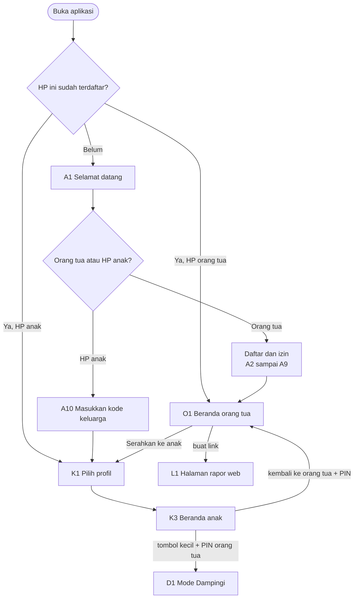

---

### 2. Awal dan akun (A)

| Kode | Layar | Rilis |
|---|---|---|
| A1 | Selamat datang: "Saya orang tua" / "Ini HP anak" | R1 |
| A2 | Masuk: alamat email (+ nomor WhatsApp opsional) | R1 |
| A3 | Kode 6 angka dari email (petunjuk "periksa Spam", kirim ulang 60 detik) | R1 |
| A4 | Izin data: pembuka → 6 kartu tujuan → ringkasan | R1 |
| A5 | Profil anak: nama panggilan, bulan-tahun lahir, kelas, hewan (bisa tambah anak) | R1 |
| A6 | Cara terlibat: Duduk bersama / Dari jauh / Cukup rapor lewat link | R1 |
| A7 | PIN orang tua (buat + ulangi) | R1 |
| A8 | Anak memakai HP lain? → kode keluarga + QR / "Serahkan HP ini ke anak" | R1 |
| A9 | Mengunduh paket isi (ukuran, sisa waktu, bisa lanjut nanti) | R1 |
| A10 | HP anak: masukkan kode keluarga / pindai QR → pilih profil yang memakai HP ini | R1 |

```mermaid
flowchart LR
  A1[A1 Selamat datang] --> A2[A2 Email]
  A2 --> A3[A3 Kode]
  A3 --> A4[A4 Izin data]
  A4 -- "izin inti ditolak" --> Batal([Batal mendaftar])
  A4 --> A5[A5 Profil anak]
  A5 -- "tambah anak" --> A5
  A5 --> A6[A6 Cara terlibat]
  A6 --> A7[A7 PIN orang tua]
  A7 --> A8{A8 Anak pakai HP lain?}
  A8 -- Ya --> Kode[Kode keluarga + QR]
  A8 -- "Tidak, HP ini" --> A9[A9 Unduh paket]
  Kode --> O1[O1 Beranda orang tua]
  A9 --> K4[K4 Tes penempatan anak]
```

---

### 3. Mode anak (K)

| Kode | Layar | Rilis |
|---|---|---|
| K1 | Pilih profil (hewan besar per anak) | R1 |
| K2 | PIN anak (kalau dipasang) | R1 |
| K3 | **Beranda anak**: pesan orang tua, ajakan, pilihan jalur hari ini, album kartu | R1 |
| K4 | Tes penempatan (pengantar bersuara → soal). Layar yang sama dipakai untuk **tes tetap** ("lembar tantangan" 20 + 5 soal, hari ke-1–3 lalu tiap 4 minggu; ditambah 20 Okt) | R1 |
| K5 | Layar jurus (sebelum level baru; bisa dibuka lagi) | R1 |
| K6 | **Lembar Lancar** (soal + papan angka) | R1 |
| K7 | **Akhir lembar**: hasil, rekor, tersimpan/terkirim, ketukan perasaan | R1 |
| K8 | Kartu kejutan (muncul tak terduga) | R1 |
| K9 | Album kartu satwa | R1 |
| K10 | Pesan: pesan dari orang tua + kirim stiker (termasuk "Bantu aku") | R1 |
| K11 | Jeda (tutup soal, waktu berhenti) | R1 |
| K12 | "Untuk kamu": penjelasan privasi bergambar | R1 |
| K13 | TKA: daftar topik / latihan rumah; tanda "minggu ini" dari Rencana minggu ini (29 Okt) | R1 (isi R1.1) |
| K14 | TKA: soal dengan petunjuk dan langkah bertahap | R1 (isi R1.1) |
| K15 | TKA: simulasi (pengantar, soal dengan tab Teks/Soal, daftar soal + ragu, kumpulkan, hasil); juga dipakai untuk **mini try out mingguan 6 soal / 15 menit** (29 Okt) | R1 (isi R1.1) |
| K16 | Baca Ulang: bacaan dingin (tombol mulai–selesai) | R2 |
| K17 | Baca Ulang: dengar contoh (kata disorot) | R2 |
| K18 | Baca Ulang: bacaan panas + 2 pertanyaan + rekor | R2 |
| K19 | Tangga suku kata (kelas 1) | R2 |
| K20 | Modul Paham (contoh jadi → latihan) | R3 |
| K21 | Game dan Gampong (dengan batas waktu) | R4 |

```mermaid
flowchart TB
  K1[K1 Pilih profil] --> K2{PIN anak?}
  K2 -- "tidak dipasang" --> K3
  K2 -- benar --> K3[K3 Beranda anak]
  K3 --> Jalur{Pilih jalur}
  Jalur -- Lancar --> Baru{Level baru?}
  Baru -- Ya --> K5[K5 Jurus]
  Baru -- Tidak --> K6
  K5 --> K6[K6 Lembar Lancar]
  K6 -- jeda --> K11[K11 Jeda] --> K6
  K6 --> K7[K7 Akhir lembar]
  K7 -- "kejadian penguasaan, acak ± 1 dari 3" --> K8[K8 Kartu kejutan]
  K7 --> K3
  K8 --> K3
  Jalur -- "Baca Ulang (R2)" --> K16[K16 Baca dingin] --> K17[K17 Dengar contoh] --> K18[K18 Baca panas + soal] --> K3
  Jalur -- "TKA (kelas 6)" --> K13[K13 Topik TKA] --> K14[K14 Soal TKA] --> K3
  K13 -- simulasi --> K15[K15 Simulasi] --> K3
  K3 --> K10[K10 Pesan dan stiker]
  K3 --> K9[K9 Album]
```

**Aturan alur mode anak:**

| Aturan | Sebab |
|---|---|
| Dari K3 ke soal pertama ≤ 2 ketukan | Sesi pendek dan langsung |
| Tidak ada tombol "keluar ke orang tua" yang besar; hanya tombol kecil berPIN | Anak tidak masuk mode orang tua |
| Layar soal (K6, K14, K16, K18) tanpa pesan, kartu, atau iklan internal yang menyela | Perhatian penuh pada soal |
| Tombol kembali Android di tengah lembar → K11 Jeda, bukan keluar | Lembar tidak hilang karena salah tekan |
| Anak bisa berhenti kapan saja dari K11 ("Lanjut nanti") | Tidak memaksa |

---

### 4. Mode Dampingi (D)

| Kode | Layar | Rilis |
|---|---|---|
| D1 | PIN orang tua (dari tombol kecil di K3) | R1 |
| D2 | Menu kegiatan: Tantang Ayah · Dengar Bacaan · Soal Cerita · Lembar didampingi · Pengawas simulasi | R1 |
| D3 | Tantang Ayah (anak memilih 10 soal → bergantian → hasil) | R1 |
| D4 | Lembar didampingi: soal + kunci + "petunjuk untuk diucapkan" + jurus | R1 |
| D5 | Laporkan soal ("soal ini salah / membingungkan") | R1 |
| D6 | Dengar Bacaan (teks yang bisa diketuk, naskah di atas) | R2 |
| D7 | Pengawas simulasi (tanpa kunci; waktu dan nomor soal saja). Dibuka dari D2, tetapi setelah dimulai **keluar dari Mode Dampingi**: tidak ada batas 15 menit diam, simulasi berjalan 75 menit di K15 dengan tanda "diawasi" | R1 (isi R1.1) |

```mermaid
flowchart LR
  K3[K3 Beranda anak] -- "tombol kecil" --> D1[D1 PIN orang tua]
  D1 -- "salah 5 kali" --> Kunci([Terkunci 5 menit])
  D1 --> D2[D2 Menu kegiatan]
  D2 --> D3[D3 Tantang Ayah]
  D2 --> D4[D4 Lembar didampingi]
  D4 --> D5[D5 Laporkan soal]
  D2 --> D6["D6 Dengar Bacaan (R2)"]
  D2 --> D7["D7 Pengawas simulasi (layar R1, isi R1.1)"]
  D7 -- "mulai, tanda diawasi" --> K15["K15 Simulasi 75 menit<br/>tanpa batas diam"]
  D3 --> D2
  D4 --> D2
  D6 --> D2
  D2 -- "selesai / 15 menit diam" --> K3
```

---

### 5. Mode orang tua (O)

| Kode | Layar | Rilis |
|---|---|---|
| O1 | **Beranda kabar**: kartu per anak, kartu pertanyaan masukan, kartu "Kami dengar" | R1 |
| O2 | **Rapor anak** (mingguan): 3 angka, kemajuan, langkah berikutnya, cara membantu, tombol "level terasa tidak pas" | R1 |
| O3 | Rincian: peta jenis salah per keluarga fakta, riwayat lembar | R1 (P) |
| O4 | Rapor TKA: peta 36 topik, simulasi, penyebab salah; **Rencana minggu ini** dan grafik skor mini try out (29 Okt) | R1 (isi R1.1) |
| O5 | Kirim semangat (pesan siap pakai + teks pendek) | R1 |
| O6 | Ajakan (pilihan siap, 1 per hari) | R1 (P) |
| O7 | Pesan (riwayat pesan dua arah, stiker anak) | R1 |
| O8 | **Pertanyaan masukan** (1 pertanyaan → "mau 2 lagi?") | R1 |
| O9 | Kami dengar, kami ubah (edisi terbaru + arsip) | R1 |
| O10 | Pengaturan: anak dan profil · HP terhubung · PIN · batas game dan jam tenang · Mode Ramadan | R1 |
| O11 | Izin data (6 tujuan, bisa diubah) | R1 |
| O12 | Link rapor: buat, salin, kirim ke WhatsApp, cabut | R1 |
| O13 | Orang tua kedua: undang dengan kode | R1 |
| O14 | Data keluarga: unduh, hapus akun | R1 |
| O15 | Panduan singkat "membantu tanpa mengambil alih" (5 kartu) | R1 |
| O16 | Hubungi kami / laporkan masalah (dengan "Salin hasil") | R1 |
| O17 | Masa gratis dan berlangganan | Setelah diskusi berbayar |

```mermaid
flowchart TB
  O1[O1 Beranda kabar] --> O2[O2 Rapor anak]
  O2 --> O3[O3 Rincian]
  O2 --> O4["O4 Rapor TKA (kelas 6)"]
  O2 -- "level terasa tidak pas" --> Lapor[Pilihan: terlalu mudah / terlalu sulit]
  O1 --> O5[O5 Kirim semangat]
  O1 --> O6[O6 Ajakan]
  O1 --> O7[O7 Pesan]
  O1 -- "kartu pertanyaan" --> O8[O8 Pertanyaan masukan]
  O1 -- "kartu Kami dengar" --> O9[O9 Kami dengar, kami ubah]
  O1 --> O10[O10 Pengaturan]
  O10 --> O11[O11 Izin data]
  O10 --> O12[O12 Link rapor]
  O10 --> O13[O13 Orang tua kedua]
  O10 --> O14[O14 Data keluarga]
  O1 --> O15[O15 Panduan membantu]
  O1 -- "Serahkan ke anak" --> K1[K1 Pilih profil]
```

**Navigasi orang tua:** bilah bawah 4 tombol — **Kabar** (O1) · **Rapor** (O2) · **Pesan** (O7) · **Pengaturan** (O10). Semua layar lain dibuka dari keempatnya.

---

### 6. Halaman rapor lewat link (L)

| Kode | Keadaan | Isi |
|---|---|---|
| L1 | Rapor | Rapor satu layar (O2 versi ringkas) + "data sampai …" |
| L2 | Pertanyaan | Kartu pertanyaan masukan di bawah rapor (kalau ada putaran dan izin masukan diberikan) |
| L3 | Link dicabut atau kedaluwarsa | "Link ini sudah tidak berlaku. Minta link baru ke orang tua yang membagikannya." |
| L4 | Ajakan | "Ingin melihat anak latihan dan mengirim semangat? Pasang aplikasinya" + tautan Play Store |

---

### 7. Hitungan layar

Diperbaiki 20 Okt. Hitungan lama (43) salah jumlah, dan layar TKA ditandai R1.1 padahal R1.1 hanya paket isi tanpa rilis aplikasi. Karena itu layar TKA (K13–K15, D7, O4) **harus ada di aplikasi R1**; isinya baru terbuka 4 Januari lewat paket `tka-k6`.

| Bagian | Jumlah | Di aplikasi R1 | Rilis aplikasi berikutnya |
|---|---|---|---|
| Awal dan akun (A) | 10 | 10 | — |
| Mode anak (K) | 21 | 15 (K1–K15) | R2: K16–K19 · R3: K20 · R4: K21 |
| Mode Dampingi (D) | 7 | 6 (D1–D5, D7) | R2: D6 |
| Mode orang tua (O) | 17 | 16 (O1–O16; O3 dan O6 Penting) | Setelah diskusi berbayar: O17 |
| **Jumlah layar aplikasi** | **55** | **47** | R2 = 5 layar baru → rilis aplikasi + tinjauan Play (pembangunan 14 Des – 22 Jan, `06-rilis/04`) |
| Halaman rapor (L) | 4 keadaan | 4 |

---

### 8. Layar tambahan dari penegasan Acut 28 Okt

Rincian aturan di `01-produk/10-gudang-ilmu-bimbingan-dan-waktu.md`.

| Kode | Layar | Rilis |
|---|---|---|
| K22 | **Gudang Ilmu**: peta topik kelas anak per mapel, status tiap topik (belum · belajar · kuasai · segera), tanda "lebih seru bersama Ayah/Bunda" | R1 (peta), kartu bertahap |
| K23 | **Kartu ilmu**: penjelasan bergambar dan bersuara → 2 contoh jadi → 5–10 soal berjenjang dengan kunci bertahap | Bertahap 2027 |
| K24 | **Istirahat dulu** (setelah blok 15 menit) dan **Cukup belajar hari ini** (batas harian tercapai) | R1 |
| K25 | **Waktu main**: game setelah inti harian, sisa menit terlihat, berhenti di akhir babak | R4 |
| K26 | **Bimbingan Guru** di HP anak (hanya untuk **guru les**): tugas dari guru, catatan guru, balasan stiker; komentar guru sekolah yang diteruskan orang tua juga tampil di sini. Hanya muncul setelah orang tua menyetujui | R3 |
| K27 | **Belajar Bahasa Inggris — pilih tingkat**: tes singkat ± 2 menit, saran tingkat, empat pilihan tingkat 3–6 (bebas dipilih) | R2 |
| K28 | **Unit Bahasa Inggris**: kenal kata bersuara → pola kalimat → dengar lalu pilih → susun kata → permainan kata | R2 |
| O18 | **Tanda bimbingan** di mode orang tua: daftar topik kuning/merah dengan alasan, tombol "Mulai Dampingi" dan "Minta bantuan guru" | R1 |
| O19 | **Kelola guru**: undang guru (email), pilih jenis (**guru sekolah** · **guru les**) dan mapel yang diizinkan, Izinkan / Cabut, baca komentar guru sekolah dan teruskan ke anak, lihat semua tugas dan catatan guru les | R3 |
| O20 | **Pengaturan waktu**: batas belajar per hari, game 0–60 menit, "game setelah inti harian" atau "selalu terbuka", jam tenang | R1 (belajar), R4 (game) |
| O21 | **Peta Perjalanan** (29 Okt): jalan berliku per paket (Lancar 6 level, Baca Ulang, Bahasa Inggris 3–6, TKA 36 topik), titik lulus berwarna, posisi anak ditandai Pinci; tombol kirim gambar ke WhatsApp | R2 |
| D8 | **Cerita Ulang** (29 Okt): setelah Baca Ulang, anak menceritakan isi teks 1 menit; orang tua mencentang tokoh · kejadian · akhir cerita | R2 |
| D9 | **Ucapkan ke Bunda** (29 Okt): anak mengucapkan 5 kata/kalimat Bahasa Inggris; orang tua menekan "jelas" / "coba lagi"; tombol 🔊 contoh | R2 |
| K29 | **Hari Pamer** (29 Okt): ajakan akhir bulan, anak memilih yang dipamerkan, orang tua mengetuk "sudah ditonton", kartu kenangan ke album | R2 |
| G1–G3 | **Halaman guru** (web, lewat link undangan): daftar anak bimbingan, kemampuan per topik, tulis komentar untuk orang tua; tombol beri tugas dan catatan **hanya untuk guru les** | R3 |

Jumlah layar aplikasi bertambah 10 (K22–K28, O18–O20); 4 di antaranya ada di aplikasi R1 (K22, K24, O18, O20), jadi aplikasi R1 menjadi **51 layar** dan seluruh aplikasi **65 layar**. K27–K28 (Belajar Bahasa Inggris, keputusan Acut 28 Okt) masuk R2.

**Ditambah 29 Okt:** O21, D8, D9, K29 (semuanya R2), jadi seluruh aplikasi **69 layar**; aplikasi R1 tetap 51 layar.


## Kerangka Layar Penting

*Berkas: `rancangan/03-antarmuka/02-kerangka-layar.md`*

**Ringkas:** (1) Dua puluh layar terpenting digambar sebagai kerangka teks: apa yang tampil, tombol apa saja, apa yang terjadi saat ditekan, dan apa yang dibacakan untuk kelas 1–2. Termasuk layar pertanyaan masukan untuk orang tua (O8) dan ketukan anak (K7). (2) Tiga aturan berlaku di semua layar anak: **satu tugas per layar**, **tombol utama di bawah dalam jangkauan ibu jari**, dan **umpan balik langsung** untuk setiap ketukan (warna + ikon + suara pendek), sebab anak sering mengetuk dua kali kalau tidak yakin ketukannya diterima. (3) Kerangka ini bukan desain warna atau gambar akhir; itu dikerjakan saat purwarupa, mengikuti `03-aturan-tampilan.md`.

Tahap 4, butir 2. Disusun 19 Oktober 2026. Kode layar dari `01-daftar-layar-dan-alur.md`. 🔊 = dibacakan otomatis untuk kelas 1–2 dan bisa diputar ulang di semua kelas.

---

### A3 — Kode dari email

```
┌──────────────────────────────┐
│  ← Kembali                   │
│                              │
│  Masukkan kode dari email    │
│  ayah.aisyah@gmail.com       │
│                              │
│   [ 4 ][ 8 ][ 2 ][ _ ][ _ ][ _ ] │
│                              │
│  Belum masuk? Periksa folder │
│  Spam atau Promosi.          │
│                              │
│  Kirim ulang (0:42)          │
│  Ganti email                 │
└──────────────────────────────┘
```

| Elemen | Saat ditekan / aturan |
|---|---|
| Kotak kode | Papan angka terbuka otomatis; kode dari email bisa ditempel sekali ketuk |
| Kirim ulang | Aktif setelah 60 detik; paling banyak 5 kali per jam |
| Salah 5 kali | "Coba lagi 15 menit lagi" |
| Benar | Lanjut ke A4 Izin data |

---

### A4 — Satu kartu izin

```
┌──────────────────────────────┐
│  Izin 4 dari 6   ● ● ● ○ ○ ○ │
│                              │
│  Rapor cerita dengan         │
│  bantuan AI        (pilihan) │
│                              │
│  Untuk apa: ringkasan minggu │
│  dalam kalimat mudah dibaca  │
│  Data dikirim: angka saja,   │
│  tanpa nama anak             │
│  Ke mana: Anthropic, AS;     │
│  dihapus dalam 30 hari       │
│  Kalau tidak: rapor tetap    │
│  ada dengan angka yang sama  │
│                              │
│  Selengkapnya ›              │
│                              │
│  [   Tidak   ]  [  Setuju  ] │
└──────────────────────────────┘
```

| Aturan | Sebab |
|---|---|
| Tombol Setuju dan Tidak **sama besar dan sama warna** | Tanpa trik desain yang mendorong persetujuan (parameter EK04) |
| Tidak ada centang yang sudah terisi | Persetujuan harus tindakan nyata (PP 33/2026) |
| Isi kartu mengikuti `02-rancangan/paket-hukum/01-formulir-persetujuan-orang-tua.md` | — |

---

### K3 — Beranda anak

```
┌──────────────────────────────┐
│ 🐘 Aisyah                ⋯ 🔒 │  ← tombol kecil (Mode Dampingi)
│ ┌──────────────────────────┐ │
│ │ 💬 Dari Ayah:            │ │
│ │ "Ayah bangga kamu tidak  │ │
│ │  menyerah di ×8" 🔊      │ │
│ └──────────────────────────┘ │
│  Mau mulai dari mana?   🔊   │
│ ┌────────────┐┌────────────┐ │
│ │  🔢        ││  📖        │ │
│ │  Lancar    ││  Baca Ulang│ │
│ │  Level 3   ││  (R2)      │ │
│ └────────────┘└────────────┘ │
│ ┌────────────┐               │
│ │ ✉ Ajakan   │               │
│ │ dari Ayah  │               │
│ └────────────┘               │
│                              │
│  [🃏 Album]        [💬 Pesan] │
│  ☁ 2 lembar belum terkirim   │  ← hanya kalau ada antrean
└──────────────────────────────┘
```

| Elemen | Isi | Saat ditekan |
|---|---|---|
| Pesan orang tua | Pesan terbaru yang belum dibaca. Pesan siap pakai: 🔊 dibacakan (suara ada di paket). Teks bebas untuk kelas 1–2: ikon "🔊 minta Ayah/Bunda membacakan", sebab tidak ada mesin suara saat aplikasi berjalan | Ketuk = baca semua di K10 |
| Pilihan jalur | 2–4 kartu besar; jalur yang belum tayang tidak ditampilkan | Langsung ke K5 (level baru) atau K6 |
| Ajakan | Muncul hanya kalau ada ajakan hari ini | Membuka kegiatan yang diajak |
| Album, Pesan | Tombol bawah | K9, K10 |
| ☁ antrean | Muncul kalau ada hasil belum terkirim; setelah 24 jam berubah jadi spanduk (`02-rancangan/04` bagian 3) | Penjelasan singkat: "Minta Ayah/Bunda menyalakan internet sebentar" |
| 🔒 kecil | Pojok kanan atas, kecil dan pucat | D1 PIN orang tua |

**Yang tidak ada di K3:** angka rangkaian hari, peringkat, pemberitahuan merah, hitungan mundur, atau tombol beli.

---

### K5 — Layar jurus

```
┌──────────────────────────────┐
│  Jurus baru! Level 4  🔊     │
│                              │
│  Genapkan ke 10 dulu,        │
│  baru tambah sisanya.        │
│                              │
│   8 + 5                      │
│   8 + 2 = 10                 │
│   10 + 3 = 13   ✓            │
│                              │
│   7 + 6                      │
│   7 + 3 = 10                 │
│   10 + 3 = 13   ✓            │
│                              │
│  Ingat: 7 + 7 = 14,          │
│  jadi 7 + 8 = 15             │
│                              │
│  [      Aku siap!       ]    │
└──────────────────────────────┘
```

| Aturan | Sebab |
|---|---|
| Contoh muncul satu per satu (ketuk untuk langkah berikutnya), lalu semua terlihat | Beban ingatan kecil; anak mengikuti langkah |
| Tidak ada pertanyaan "jelaskan caramu" | Contoh jadi polos (`01-produk/04` bagian 1) |
| Bisa dibuka lagi dari lembar lewat tombol 💡 | Jurus tersedia saat dibutuhkan |
| Saat pertama kali: ketukan A03 "💡 Paham / 🤔 Masih bingung" | `01-produk/08` bagian 4 |

---

### K6 — Lembar Lancar

```
┌──────────────────────────────┐
│ ⏸ Jeda        7 / 20     💡  │
│ ▓▓▓▓▓▓▓░░░░░░░░░░░░░         │  ← kemajuan, bukan hitungan mundur
│                              │
│                              │
│          7 × 8 = ?           │  ← huruf besar
│                              │
│         [   56   ]           │
│                              │
│  ┌─────┬─────┬─────┐         │
│  │  1  │  2  │  3  │         │
│  ├─────┼─────┼─────┤         │
│  │  4  │  5  │  6  │         │
│  ├─────┼─────┼─────┤         │
│  │  7  │  8  │  9  │         │
│  ├─────┼─────┼─────┤         │
│  │  ⌫  │  0  │  ✓  │         │
│  └─────┴─────┴─────┘         │
└──────────────────────────────┘
```

| Elemen | Aturan |
|---|---|
| Soal | Satu soal per layar; huruf sangat besar; tanda bagi ":" |
| Waktu | **Tidak ditampilkan sebagai jam yang berjalan**; hanya batang kemajuan soal. Waktu dicatat diam-diam dan ditunjukkan di akhir sebagai rekor, supaya tekanan waktu tidak tampak di tengah soal dan anak bersaing dengan rekornya sendiri |
| Papan angka | Tombol besar, rapat ke bawah layar; tombol ✓ paling kanan bawah, dalam jangkauan ibu jari. Papan ketik bawaan HP tidak dipakai, sebab bisa menutupi soal dan berbeda di tiap HP |
| Benar | Kilatan hijau + ✓ + bunyi pendek, langsung soal berikutnya (≤ 0,4 detik) |
| Salah | Kotak bergetar halus + jawaban benar tampil 1,5 detik ("7 × 8 = 56") tanpa kata "salah", lalu lanjut; soal masuk antrean ulang. Koreksi tanpa mempermalukan |
| ⏸ Jeda / tombol kembali Android | K11: soal disembunyikan, waktu berhenti; "Lanjut" / "Lanjut nanti" (`01-produk/04` celah #6) |
| 💡 | Membuka jurus level ini; dicatat di data |
| Ketukan ganda | Ketukan kedua di tempat sama dalam ± 0,3 detik diabaikan, sebab anak sering menekan dua kali **[FAKTA — Anthony dkk., ketukan tertinggal (holdover touches)]**; angka 0,3 detik **[ASUMSI]** |

---

### K7 — Akhir lembar + ketukan perasaan

```
┌──────────────────────────────┐
│        Selesai! 🎉   🔊      │
│                              │
│   19 dari 20 benar           │
│   1 menit 12 detik           │
│   🏅 Rekor baru! (tadi 1:31) │
│                              │
│   Tersimpan ✓  Terkirim ✓✓   │
│                              │
│  Latihan tadi rasanya        │
│  seperti hewan apa?  🔊      │
│  🐦      🦌      🐢      🐘   │
│  terbang lincah  pelan ngantuk│
│                  (lewati ›)  │
│                              │
│  [   Kembali ke beranda   ]  │
└──────────────────────────────┘
```

| Elemen | Aturan |
|---|---|
| Hasil | Benar, waktu, dan **rekor pribadi**; tanpa nilai huruf atau perbandingan dengan anak lain |
| Naik level | Kalimat "Kamu naik ke Level 5!" hanya muncul kalau naik; turun level **tidak diumumkan**, lembar berikutnya saja yang menyesuaikan |
| Tersimpan / Terkirim | Selalu tampil; terkirim ✓✓ menyala saat server menerima |
| Ketukan hewan (A01) | Paling banyak 1 kali sehari; tanpa hadiah; bisa dilewati |
| Kartu kejutan | Kadang muncul sesudah layar ini (K8), tidak pernah dijanjikan sebelumnya |
| Perayaan | ≤ 1,5 detik dan bisa dilewati dengan satu ketuk |

---

### K10 — Pesan dan stiker

```
┌──────────────────────────────┐
│ ← Pesan                      │
│  Ayah, 19.02:                │
│  "Ayah bangga kamu tidak     │
│   menyerah di ×8"   🔊       │
│  Kamu, 19.30: 🏅 Lihat rekorku│
│                              │
│  Kirim ke Ayah/Bunda:        │
│  [🏅 Aku lulus level!] [👀 Lihat rekorku] │
│  [🙋 Bantu aku dong]  [🙏 Terima kasih] │
│  [😴 Aku capek hari ini] [⚔ Ayo Tantang Ayah] │
└──────────────────────────────┘
```

| Aturan | Sebab |
|---|---|
| Anak hanya memilih stiker; tidak ada papan ketik | Profil risiko rendah; tidak ada info pribadi yang bisa dikirim |
| "Bantu aku dong" menyertakan soal yang macet | Orang tua tahu apa yang harus dibantu |
| Pesan hanya dari dan ke orang tua di keluarga yang sama | Tanpa kontak orang asing |

---

### K14 — Soal TKA dengan kunci berjenjang

```
┌──────────────────────────────┐
│ M03 · Soal 4 dari 8   [Teks] │
│ Pilih semua pecahan yang     │
│ senilai dengan 2/3.          │
│  ☐ A. 4/6                    │
│  ☐ B. 6/9                    │
│  ☐ C. 3/4                    │
│  ☐ D. 4/5                    │
│  ☐ E. 10/15                  │
│                              │
│ [        Periksa        ]    │
├──────────────────────────────┤
│ Belum tepat. Petunjuk:       │  ← setelah salah pertama
│ "Pembilang dan penyebut      │
│  diapakan dengan bilangan    │
│  yang sama?"  [Coba lagi]    │
└──────────────────────────────┘
```

| Bentuk soal | Cara menjawab |
|---|---|
| PG | Satu pilihan (bulatan) |
| PG kompleks | Kotak centang; teks "Pilih **semua** jawaban yang benar" tanpa menyebut jumlah |
| PG kategori | Tabel pernyataan dengan dua tombol Benar / Salah per baris |
| Soal bergrup | Tab **Teks** dan **Soal** di tempat yang sama; posisi gulir teks diingat |

| Langkah | Yang tampil |
|---|---|
| Salah pertama | **Petunjuk** (pertanyaan pancingan) + Coba lagi |
| Salah kedua | **Langkah** penyelesaian; butir masuk antrean ulang 3 hari |
| PG kategori dijawab | Baris yang keliru ditandai, supaya anak melihat "hampir benar" |

---

### K15 — Simulasi TKA

| Bagian | Isi |
|---|---|
| Pengantar | "30 soal · 75 menit · boleh lompat dan menandai ragu"; Mode Latihan (S1–S3, boleh jeda 3 kali) atau Mode Ujian (S4–S5, tanpa jeda); tombol "Minta Ayah/Bunda mengawasi" (membuka D7 di HP yang sama atau HP orang tua) |
| Soal | Seperti K14 tetapi **tanpa umpan balik**; bilah atas: sisa waktu (di simulasi waktu memang ditampilkan, seperti ujian sebenarnya), nomor soal, tombol 🚩 ragu |
| Daftar soal | Kisi 1–30: terjawab, kosong, ragu; ketuk untuk lompat |
| Kumpulkan | Konfirmasi "Masih ada 3 soal kosong. Kumpulkan?" |
| Hasil | Persen benar (dengan keterangan "bukan nilai TKA"), per bentuk soal, penyebab salah B/H/S/W, lalu pembahasan per soal dengan Langkah |

---

### K16–K18 — Baca Ulang (R2)

```
K16 Bacaan dingin                K18 Bacaan panas
┌──────────────────────────────┐ ┌──────────────────────────────┐
│ Baca nyaring, ya!   🔊       │ │ Baca sekali lagi! 🔊          │
│                              │ │ (teks yang sama)             │
│ Pukul lima pagi, perahu      │ │ ...                          │
│ merapat di Lampulo. Ikan     │ │                              │
│ tongkol diturunkan ...       │ │ [ Mulai ]      [ Selesai ]   │
│                              │ │                              │
│ [ Mulai ]      [ Selesai ]   │ │ Tadi 62 → sekarang 81        │
│ [ baca dalam hati ]          │ │ kata per menit 🏅            │
└──────────────────────────────┘ │ Pertanyaan 1 dari 2 🔊        │
                                 │ ...                          │
                                 └──────────────────────────────┘
```

| Aturan | Isi |
|---|---|
| Huruf | Lebih besar dari teks biasa; baris pendek; jarak baris lega (`03-aturan-tampilan.md`) |
| K17 Dengar contoh | Suara contoh, kata disorot satu per satu mengikuti suara; tombol ulang |
| Mulai/Selesai | Tombol besar terpisah jauh supaya tidak tertekan bersamaan |
| Terlalu cepat (> 250 kata per menit) | "Coba baca lagi pelan-pelan, ya" — sekali, tanpa nada menegur |
| Kelas 1–2 | Urutan berbeda: dengar dulu → baca bersama suara → baca sendiri (`01-produk/05` bagian 2) |

---

### D3 — Tantang Ayah

| Bagian | Isi | Saat ditekan |
|---|---|---|
| Pilih soal | Anak memilih level yang **sudah lulus**; aplikasi menyiapkan 10 soal | "Mulai tantangan" |
| Giliran | Layar dibagi: nama anak dan "Ayah" bergantian; papan angka sama | Jawaban dicatat per pemain |
| Hasil | "Aisyah 10 benar, 41 detik · Ayah 9 benar, 58 detik" + kalimat untuk orang tua: "Tanyakan jurus apa yang ia pakai" | Selesai → D2 |
| Data | Hanya hasil anak yang disimpan (mode dampingi, tidak dihitung naik level); hasil orang tua tidak disimpan | — |

---

### D4 — Lembar didampingi

| Elemen | Isi |
|---|---|
| Naskah atas | "Biarkan ia mencoba dulu. Kalau diam lebih dari 5 detik, ketuk 💬 dan ucapkan petunjuknya." |
| Soal + kunci kecil | Kunci tampil kecil di pojok, hanya terlihat orang tua yang duduk di samping |
| 💬 Petunjuk untuk diucapkan | Satu kalimat pancingan dari jurus, bukan jawaban |
| ⚑ Laporkan soal | D5: "Soal ini salah / membingungkan / terlalu sulit" + catatan opsional → Meja Periksa |

---

### D6 — Dengar Bacaan (R2)

```
┌──────────────────────────────┐
│ Naskah: jangan memotong.     │
│ Ketuk kata yang salah atau   │
│ macet > 3 detik.             │
│                              │
│ Pukul lima pagi, [perahu]    │  ← kata yang diketuk ditandai
│ merapat di Lampulo. Ikan     │
│ tongkol diturunkan ...       │
│                              │
│ [ Mulai ]          [Selesai] │
│                              │
│ Hasil: 74 kata benar/menit   │
│ Sering tersandung: perahu    │
│ Puji satu hal yang ia        │
│ lakukan dengan baik.         │
└──────────────────────────────┘
```

Tanpa rekaman suara; hanya waktu dan kata yang diketuk disimpan.

---

### O1 — Beranda kabar (orang tua)

```
┌──────────────────────────────┐
│ Kabar                    ⚙   │
│ ┌──────────────────────────┐ │
│ │ 🐘 Aisyah · Kelas 4      │ │
│ │ Hari ini: 2 lembar ✓     │ │
│ │ Rekor baru di ×7: 1:12   │ │
│ │ Langkah berikutnya:      │ │
│ │ ×8 dikenalkan minggu ini │ │
│ │ [Kirim semangat] [Rapor] │ │
│ └──────────────────────────┘ │
│ ┌──────────────────────────┐ │
│ │ 🐯 Rafli · Kelas 6       │ │
│ │ Belum latihan hari ini   │ │
│ │ HP terakhir terhubung    │ │
│ │ 2 hari lalu · 4 lembar   │ │
│ │ menunggu di HP           │ │
│ │ [Ajak latihan] [Rapor]   │ │
│ └──────────────────────────┘ │
│ ┌──────────────────────────┐ │
│ │ 💭 1 pertanyaan, 30 detik │ │
│ │ [Jawab]   [Nanti]        │ │
│ └──────────────────────────┘ │
│ Kabar · Rapor · Bimbingan · Atur│
└──────────────────────────────┘
```

| Aturan | Sebab |
|---|---|
| Satu kartu per anak dengan **satu langkah berikutnya** | Pesan positif + langkah berikutnya **[FAKTA — EEF]** |
| "Belum latihan" ditulis netral, dengan tombol ajakan, tanpa warna merah | Mencegah orang tua mengontrol |
| Kartu pertanyaan hanya saat ada putaran; bisa ditunda | `01-produk/08` bagian 5 |
| Tidak ada daftar soal salah di beranda | `01-produk/07` 2.3 |
| **28 Okt:** beranda bergaya daftar obrolan WhatsApp; pesan pindah ke Ruang anak, tab ketiga menjadi Bimbingan | Brief desain Pintar Main bagian 4 dan 6 |

---

### O2 — Rapor anak (mingguan)

| Bagian | Isi |
|---|---|
| Tiga angka | Hari latihan · detik per soal · % benar, dengan panah dibanding minggu lalu dan minggu pertama |
| Grafik kecil | Kecepatan 8 minggu (garis sederhana) |
| Kalimat kemajuan | Satu kalimat (rapor cerita AI bertanda, atau kalimat cetakan) |
| Langkah berikutnya | Satu kalimat |
| Cara membantu tanpa mengambil alih | Satu kalimat + "Lihat panduan" (O15) |
| Dimulai sendiri | "4 dari 9 latihan dimulai Aisyah sendiri" |
| Tombol | Rincian (O3) · Kirim ke WhatsApp (gambar atau link) · **"Level terasa tidak pas?"** → pilihan "terlalu mudah / terlalu sulit" → dicatat dan dipakai penjaga mesin |

---

### O5 — Kirim semangat

| Elemen | Isi |
|---|---|
| Pesan siap pakai | 6–8 pilihan yang disesuaikan dengan kejadian minggu ini (misal sesudah rekor: "Wah, rekor baru! Ayah bangga.") — menonjolkan usaha |
| Teks sendiri | ≤ 60 huruf; link dan nomor HP ditolak |
| Kirim | Pesan tampil di K3 saat anak membuka aplikasi; tanpa sinyal → "akan terkirim" |

---

### O8 — Pertanyaan masukan (orang tua)

```
┌──────────────────────────────┐
│ 💭 Satu pertanyaan           │
│                              │
│ Dibanding 2 minggu lalu,     │
│ cara Aisyah menghitung …     │
│                              │
│ ( ) Lebih cepat              │
│ ( ) Sama                     │
│ ( ) Lebih lambat             │
│ ( ) Belum terlihat           │
│                              │
│ [        Kirim        ]      │
├──────────────────────────────┤  ← setelah dikirim
│ Terima kasih! Jawaban ini    │
│ kami pakai untuk memeriksa   │
│ apakah rapor menunjukkan     │
│ kemajuan dengan jelas.       │
│ Mau 2 pertanyaan lagi?       │
│ (± 30 detik)                 │
│ [ Boleh ]      [ Cukup ]     │
└──────────────────────────────┘
```

| Aturan | Sebab |
|---|---|
| Satu pertanyaan dulu; dua lagi hanya kalau orang tua mau | Tanggapan terbaik dengan 1 pertanyaan **[FAKTA — Refiner]** |
| Setelah menjawab: satu kalimat "apa yang kami lakukan dengan jawaban ini" | Menutup lingkaran |
| Pilihan jujur ("Belum terlihat") selalu ada | Tidak mendorong jawaban menyenangkan |
| Isian terbuka di akhir, boleh dilewati, + "kirim pesan suara ke WhatsApp" | `01-produk/08` bagian 3 |
| **Tidak ada fitur yang terkunci** kalau tidak menjawab | Keputusan Acut 19 Okt (pilihan B) |

---

### O10 — Pengaturan (bagian anak)

| Pengaturan | Pilihan | Bawaan |
|---|---|---|
| Batas game per hari (R4) | 0–60 menit | Kelas 1–2: 20 · kelas 3–6: 30 (diubah 28 Okt, `01-produk/10` bagian 5.2) |
| Game setelah inti harian (R4) | Ya / Tidak (selalu terbuka) | **Ya** (diubah Acut 28 Okt; dulu Tidak) |
| Jam tenang | Jam mulai–selesai | 21.00–05.00 |
| Pengingat untuk orang tua | Jam | Mengikuti jawaban O14 |
| PIN anak | Pasang / hapus | Tidak dipasang |
| **Mode Ramadan** | Ya / Tidak | Tidak; kalau Ya: lembar Lancar 10 soal, target hari latihan per minggu diturunkan untuk rapor, pengingat digeser ke jam yang dipilih (misal setelah berbuka) **[ASUMSI — diuji Februari 2027]**. Aturan lembar 10 soal (ditambah 20 Okt): soal disusun 7 level ini + 3 level lama; **target waktu = jumlah target 10 soal itu**; "tepat" = salah ≤ 1 dan di bawah target; dua lembar 10 soal tepat dihitung sama dengan **satu** lembar 20 soal tepat (jadi naik level butuh empat); "kilat" tidak berlaku; turun level kalau salah ≥ 3. **Tes tetap tidak dikerjakan di Mode Ramadan**, digeser ke minggu sesudah Idulfitri |
| Suara | Petunjuk bersuara ya/tidak, efek suara ya/tidak | Kelas 1–2: petunjuk ya; semua: efek ya |

---

### L1 — Halaman rapor lewat link

```
┌──────────────────────────────┐
│ Pintar Main                  │
│ Rapor 🐘 Aisyah · minggu ini │
│ Data sampai Senin 19.40      │
│                              │
│ 5 hari latihan · 3,4 detik/  │
│ soal (↓ dari 5,1) · 96% benar│
│ Kemajuan: ×6 dan ×7 makin    │
│ lancar.                      │
│ Langkah berikutnya: ×8.      │
│ Cara membantu: tanyakan      │
│ "jurus apa yang cocok?"      │
│                              │
│ 💭 Satu pertanyaan (30 detik)│
│ ...                          │
│ Ingin mengirim semangat?     │
│ Pasang aplikasinya ›         │
│ Link ini hanya untuk keluarga│
└──────────────────────────────┘
```

| Aturan | Sebab |
|---|---|
| Tanpa nama lengkap, foto, sekolah | Data minimal |
| Halaman diberi tanda "jangan diindeks mesin pencari" | Parameter KK05 |
| Ringan (< 100 KB), terbaca di HP murah dan sinyal lemah | Orang tua [L] |

---

### Keadaan khusus yang berlaku di semua layar

| Keadaan | Yang tampil |
|---|---|
| Tanpa sinyal (mode anak) | Tidak ada pesan apa pun; semua latihan jalan. Ikon ☁ kecil kalau ada antrean |
| Tanpa sinyal (mode orang tua) | Pita tipis "Tanpa internet — data sampai …" |
| Paket isi belum terunduh | "Isi sedang disiapkan" + kemajuan unduhan. Tes penempatan dan lembar Lancar tetap bisa, sebab **salinan bawaan paket `lancar-k1`–`k6` (< 2 MB per kelas) ikut di dalam aplikasi**; paket yang lebih baru menggantikannya saat terunduh |
| Kesalahan aplikasi | Bahasa biasa: "Ada masalah. Hasil latihan aman tersimpan di HP." + tombol "Laporkan" (O16) |
| Jam tenang (game) | "Sekarang jam istirahat. Sampai besok!" |


## Aturan Tampilan untuk Anak 6–12 Tahun dan HP Murah

*Berkas: `rancangan/03-antarmuka/03-aturan-tampilan.md`*

**Ringkas:** (1) Tombol anak dibuat **jauh lebih besar dari batas umum Android (48dp)**: ≥ 64dp untuk kelas 1–2 dan ≥ 56dp untuk kelas 3–6. Sebab anak 7–10 tahun meleset pada ± 30% sasaran berukuran 6,4 mm, dan makin muda anak, makin besar sasaran yang dibutuhkan. (2) Satu temuan mengoreksi rancangan sebelumnya: **mode gelap bukan pilihan terbaik untuk malam**. Pada malam hari, tampilan terang justru menghasilkan kinerja membaca lebih baik. Karena itu bawaan aplikasi adalah tema terang yang lembut (latar krem, tidak putih menyilaukan), dengan mode gelap sebagai pilihan. (3) Tidak ada musik latar dan tidak ada animasi di layar soal, sebab suara dan hiasan yang tidak berhubungan dengan pelajaran terbukti menurunkan hasil belajar.

Tahap 4, butir 3. Disusun 19 Oktober 2026. Label: **[FAKTA + sumber] · [ESTIMASI] · [ASUMSI — diuji di purwarupa]**.

---

### 1. Ukuran tombol dan sasaran sentuh

| Temuan | Sumber |
|---|---|
| Batas umum Android: sasaran sentuh ≥ 48 × 48dp, berjarak ≥ 8dp | **[FAKTA — Bantuan Aksesibilitas Android]** |
| Anak 7–10 tahun meleset ± 30% pada sasaran 6,4 mm (0,25 inci); sasaran 3,2 mm meleset ± separuh pada semua umur | **[FAKTA — Anthony dkk. 2013, 44 anak 6–17 tahun]** |
| "Makin muda anak, makin besar sasaran yang dibutuhkan"; perluas area aktif supaya sentuhan yang sedikit meleset tetap terhitung; hindari sasaran kecil di tepi layar; beri umpan balik yang jelas supaya anak tidak mengetuk ulang | **[FAKTA — Anthony dkk., ringkasan 5 tahun proyek MTAGIC, IJHCS 2019]** |
| Hindari seret-lepas (drag-and-drop) dan cubit-perbesar untuk anak | **[FAKTA — sama]** |

| Unsur | Kelas 1–2 | Kelas 3–6 | Orang tua | Dasar |
|---|---|---|---|---|
| Tombol utama (Mulai, Aku siap, Kirim) | Tinggi ≥ 72dp, selebar layar | ≥ 64dp, selebar layar | ≥ 48dp | **[ASUMSI]** diturunkan dari temuan di atas; diuji dengan anak sendiri |
| Tombol papan angka | ≥ 72 × 64dp | ≥ 64 × 56dp | — | sama |
| Pilihan jawaban (PG, kartu jalur) | ≥ 64dp tinggi | ≥ 56dp | ≥ 48dp | sama |
| Jarak antartombol | ≥ 12dp | ≥ 8dp | ≥ 8dp | Android ≥ 8dp; lebih lega untuk anak kecil |
| Area aktif | Diperluas ± 8dp di luar bentuk tombol | sama | — | MTAGIC: sentuhan meleset biasanya dekat sasaran |
| Tepi layar | Tombol penting tidak diletakkan sebagai sasaran kecil di tepi; tombol lebar sampai tepi diperbolehkan | sama | — | MTAGIC |
| Gerakan | Hanya ketuk; tanpa seret, geser rumit, atau cubit | Ketuk + gulir biasa | Bebas | MTAGIC |
| Ketukan ganda | Ketukan kedua di tempat sama dalam ± 0,3 detik diabaikan | sama | — | MTAGIC: ketukan tertinggal |

**Tombol berbahaya untuk anak** (masuk Mode Dampingi, pengaturan) justru dibuat **kecil dan pucat** di pojok, dan selalu dilindungi PIN.

---

### 2. Huruf dan teks

| Temuan | Sumber |
|---|---|
| Andika: huruf yang dirancang untuk program literasi dan pembaca pemula; lisensi terbuka (SIL OFL), gratis | **[FAKTA — Wikipedia, Andika (typeface)]** |
| Sejumlah peneliti menyebut ukuran yang nyaman dibaca di layar mulai ± 14 poin; pada anak 10–12 tahun (huruf Arab) ukuran 16–18 lebih terbaca daripada yang lebih kecil | **[FAKTA — Abubaker & Lu 2012, Univ. Huddersfield]**; data untuk huruf Latin anak 6–8 tahun tidak ditemukan |

| Unsur | Kelas 1–2 | Kelas 3–4 | Kelas 5–6 | Orang tua |
|---|---|---|---|---|
| Huruf | Andika | Andika | Andika | **Nunito** (diubah 28 Okt; dulu huruf bawaan sistem) |
| Judul dan logo | Baloo 2 | Baloo 2 | Baloo 2 | Baloo 2 |
| Soal Lancar | 44sp | 40sp | 36sp | — |
| Teks Baca Ulang | 26sp, jarak baris 1,6 | 22sp, 1,5 | 20sp, 1,5 | — |
| Teks soal TKA | — | — | 18sp, 1,5 | — |
| Petunjuk dan label | 20sp | 18sp | 16sp | 16sp |
| Panjang baris teks bacaan | ≤ 30 huruf | ≤ 40 huruf | ≤ 50 huruf | — |

Semua ukuran **[ASUMSI]**, diuji dengan anak kelas 4 dan kelas 6 Acut di HP murah pada minggu pertama purwarupa. Ukuran huruf **mengikuti setelan besar huruf di HP** sampai 1,3× tanpa merusak tata letak.

| Aturan bahasa | Contoh |
|---|---|
| Kalimat pendek, kata sehari-hari, tanpa istilah Inggris | "Lanjut nanti", bukan "Resume later" |
| Ikon selalu bersama kata (kecuali kelas 1–2, yang dibantu suara) | 🔢 Lancar |
| Tidak ada kata yang mempermalukan | Tidak memakai "Salah!", "Gagal", "Payah" |
| Angka besar dan jelas; tanda bagi ":"; desimal dengan koma | 0,5 dan 25 : 5 |

---

### 3. Warna dan tema

| Temuan | Sumber |
|---|---|
| Pada pengguna berpenglihatan normal, tampilan terang (huruf gelap di latar terang) umumnya menghasilkan kinerja lebih baik; **pada malam hari tampilan terang juga lebih baik**, dan huruf kecil jauh lebih sulit dibaca di mode gelap pada malam hari | **[FAKTA — Nielsen Norman Group, Feb 2020]** |
| Tetap sarankan menyediakan pilihan mode gelap | **[FAKTA — sama]** |
| Kontras teks biasa ≥ 4,5 : 1 (standar aksesibilitas WCAG) | **[FAKTA — WCAG 2.x]** |

| Aturan | Isi | Sebab |
|---|---|---|
| **Bawaan: tema terang lembut** | Latar krem hangat, bukan putih murni; teks hampir hitam | Terang lebih baik untuk membaca, juga di malam hari; krem mengurangi silau di kamar remang **[ASUMSI]** |
| Mode gelap | Pilihan di Pengaturan, bukan bawaan | Sebagian anak dan orang tua menyukainya |
| Kecerahan | Mengikuti kecerahan HP; aplikasi tidak memaksa terang penuh | — |
| Kontras | Teks ≥ 4,5 : 1; angka soal ≥ 7 : 1 | WCAG; HP murah sering redup |
| Benar dan salah | **Tidak hanya warna**: hijau + ✓ + bunyi; salah: kotak bergetar + jawaban benar tampil | Sebagian anak laki-laki buta warna merah-hijau **[ASUMSI — prevalensi umum, tidak dicari ulang]** |
| Warna bagian | **Diubah 28 Okt mengikuti merek Pintar Main:** Matematika Biru Laut, Bahasa Indonesia Merah Bata, Bahasa Inggris Ungu Anggur, Dampingi Oranye Jeruk, Gudang Ilmu Hijau Daun, TKA memakai warna mapel + lencana (`04-identitas-merek.md` bagian 3) | Anak mengenali bagian tanpa membaca |
| Teks di atas warna merek | Tombol hijau dan oranye memakai **teks Biru Tinta `#2D3142`, bukan putih** (putih hanya 2,1–2,7 : 1); teks hijau memakai Hijau Tua `#1F7A4D` | WCAG ≥ 4,5 : 1 |
| Hindari | Merah untuk "belum latihan" atau "turun level" | Tidak menekan anak atau memancing orang tua mengontrol |

**Koreksi rancangan sebelumnya:** `02-rancangan/01-arsitektur.md` bagian 4, `01-produk/07` bagian 4, dan kertas kerja penilaian mandiri menyebut "mode gelap untuk malam". Berdasarkan temuan di atas, ketiganya diubah menjadi "tema terang lembut sebagai bawaan, mode gelap pilihan, jam tenang".

---

### 4. Suara

| Temuan | Sumber |
|---|---|
| Musik latar dan suara tambahan yang tidak berhubungan dengan pelajaran menurunkan ingatan dan kemampuan menerapkan; kelompok yang hanya mendengar penjelasan lebih unggul | **[FAKTA — Moreno & Mayer 2000]** |

| Aturan | Isi |
|---|---|
| Petunjuk bersuara | Kelas 1–2: semua petunjuk dibacakan otomatis. Kelas 3–6: tombol 🔊 untuk memutar |
| **Tanpa musik latar** | Di semua layar latihan; game (R4) boleh punya musik yang bisa dimatikan |
| Efek suara | Hanya untuk umpan balik (benar, selesai, kartu), ≤ 0,5 detik, bisa dimatikan |
| Tanpa suara | Semua yang dibacakan juga tertulis; aplikasi bisa dipakai dengan suara mati (misal saat adik tidur) |
| Volume | Mengikuti HP; tidak ada suara keras tiba-tiba |
| Suara contoh Baca Ulang | Suara buatan yang sudah diperiksa Acut (`01-produk/03` bagian 5); kecepatan bisa diperlambat untuk kelas 1–2 |

---

### 5. Animasi dan gerak

| Temuan | Sumber |
|---|---|
| Hiasan menarik yang tidak berhubungan dengan tujuan belajar (teks, gambar, suara, animasi) menurunkan hasil belajar ("seductive details") | **[FAKTA — Learning Scientists, meringkas meta-analisis 72 perbandingan (Sundararajan 2018)]** |

| Aturan | Isi |
|---|---|
| **Layar soal tanpa animasi hiasan** | Tidak ada maskot bergerak, latar bergerak, atau konfeti di K6, K14, K16, K18. **Pinci** di layar ini diam dan kecil; ekspresi "berpikir" muncul hanya saat "Bantu aku" ditekan (`04-identitas-merek.md` bagian 2) |
| Transisi antarlayar | ≤ 250 milidetik, sederhana (geser atau pudar) |
| Perayaan | Hanya di layar akhir, ≤ 1,5 detik, bisa dilewati |
| Animasi yang mengajar | Boleh, kalau bagian dari pelajaran (misal langkah jurus muncul bertahap, kata disorot mengikuti suara) |
| Setelan HP "hapus animasi" | Diikuti: semua animasi menjadi perubahan langsung |
| Target kelancaran | Bergerak mulus di HP 2 GB **[ASUMSI — diuji di HP murah]** |

---

### 6. HP murah dan keadaan di rumah

| Batas | Aturan | Dasar |
|---|---|---|
| RAM | Diuji di HP 2 GB | Android (Go edition) untuk Android 13 berjalan di RAM minimum 2 GB **[FAKTA — developer.android.com]** |
| Layar | Tata letak untuk layar 5,5–6,7 inci, resolusi 720p ke atas | **[ASUMSI]** HP murah yang umum |
| Huruf | Andika disertakan di aplikasi | Jalan tanpa sinyal |
| Gambar | Gambar kartu dan ikon dikompresi; tanpa video di R1–R3 | Ukuran aplikasi dan kuota |
| Orientasi | Tegak saja | Lebih mudah untuk anak; sesuai pegangan satu tangan |
| Layar menyala | Layar tidak mati sendiri selama lembar berjalan | Anak membaca soal tanpa menyentuh |
| Gangguan | Tombol kembali Android → Jeda, bukan keluar | `02-kerangka-layar.md` K6 |
| Malam | Tema terang lembut; jam tenang untuk game | Bagian 3 |
| HP bersama | Pilih profil besar dengan hewan; PIN opsional | `02-rancangan/02` bagian 6 |

---

### 7. Daftar periksa tampilan sebelum uji keluarga

| # | Periksa | Cara | Bukti |
|---|---|---|---|
| 1 | Anak kelas 4 dan kelas 6 Acut menyelesaikan lembar tanpa salah ketuk lebih dari 1 kali | Diamati Acut | Catatan + video layar |
| 2 | Anak kelas 1–2 (dari keluarga Acut atau kenalan, setelah profil risiko ditetapkan) bisa mulai latihan tanpa dibacakan orang tua | Diamati | Catatan |
| 3 | Semua teks lolos kontras 4,5 : 1 | Alat pemeriksa kontras | Laporan |
| 4 | Huruf 1,3× tidak merusak tata letak | Setelan HP | Tangkapan layar |
| 5 | Aplikasi mulus di HP 2 GB | HP murah | Catatan waktu buka dan pindah layar |
| 6 | Bisa dipakai tanpa suara | Suara dimatikan | Catatan |
| 7 | Tidak ada animasi hiasan di layar soal | Diperiksa per layar | Daftar layar |


## Identitas Merek — Pintar Main dan Pinci

*Berkas: `rancangan/03-antarmuka/04-identitas-merek.md`*

**Ringkas:** (1) Mulai 28 Okt 2026 nama resmi aplikasi adalah **Pintar Main**, dengan maskot **Pinci, Si Kancil Pintar**. Nama ini menggantikan "Belajar Menarik" dan nama kerja "Pandu Anak" di seluruh rancangan. Sumbernya dokumen branding Acut (`pintar-main-branding.md`). Bagian 1–3 dokumen itu dipakai apa adanya, dengan **empat penyesuaian** yang diputuskan Acut 28 Okt supaya tidak bertabrakan dengan aturan yang sudah dikunci. (2) Penyesuaiannya: aksesori Pinci menjadi **kejutan acak**, bukan poin yang ditukar; slogan "Belajar dulu, main kemudian!" **hanya untuk orang tua dan Play Store**, bukan di layar anak; bintang hanya **tanda selesai**, bukan nilai 1–3; huruf **gabungan** (Baloo 2 untuk judul, Andika untuk soal dan bacaan, Nunito untuk orang tua). (3) Pemeriksaan kontras menemukan satu masalah palet: **teks putih di atas Hijau Daun dan Oranye Jeruk tidak terbaca** (kontras 2,7 dan 2,1, padahal batasnya 4,5). Tombol memakai teks Biru Tinta, dan teks hijau memakai Hijau Tua `#1F7A4D`. Nama harus dicek di Play Store dan PDKI **paling lambat Jumat 6 Nov**, sebab nama aplikasi ikut diajukan dalam penilaian mandiri 13 Nov.

Disusun 28 Oktober 2026. Label: **[FAKTA + sumber] · [ESTIMASI] · [ASUMSI — perlu diuji]**.

---

### 1. Yang dipakai apa adanya

| Unsur | Isi | Sumber |
|---|---|---|
| Nama aplikasi | **Pintar Main** | Branding bagian 1 |
| Maskot | **Pinci**, Si Kancil Pintar (Pin-tar + Kan-ci-l). "Si Kancil Pintar" hanya julukan | Branding bagian 3 |
| Kepribadian Pinci | Penasaran, cerdik (memberi petunjuk, bukan jawaban), ceria, sabar dan empatik, disiplin yang ramah | Branding bagian 3 |
| Peran Pinci | Pemandu pelajaran, penyemangat, penjaga waktu | Branding bagian 3 |
| Di mode anak dan mode orang tua | Mode anak: Pinci tampil penuh dan bersuara. Mode orang tua: Pinci hanya ikon kecil, tampilan bersih | Branding bagian 3 |
| Gaya ilustrasi | Flat 2D membulat, garis tepi cokelat tua, bayangan satu tingkat, dunia hutan tropis Indonesia | Branding 4.3 |
| Desain Pinci | Kancil mungil bergaya chibi, cokelat `#A0673A`, perut krem, bintik putih, mata besar, ransel oranye, syal hijau | Branding 4.4 |
| Lima ekspresi awal | Senang, semangat, berpikir, empati, merayakan; mengantuk dan terkejut menyusul | Branding 4.5 |
| Logo dan ikon | Wordmark Baloo 2 ExtraBold ("Pintar" hijau, "Main" oranye) + kepala Pinci; ikon Play Store kepala Pinci di latar hijau tanpa teks | Branding 4.6 |
| Trio Penjelajah | Ditunda; rilis awal cukup Pinci | Branding bagian 3 |

**Dunia Pinci dan Gampong:** hutan tropis tempat Pinci berpetualang menjadi latar Gampong yang tumbuh (R4) dan kartu satwa. Profil anak tetap memakai lambang hewan pilihan anak (🐘, 🐢, dan seterusnya), sebab itu tanda pengenal anak, bukan maskot.

**Satu catatan cerita:** dalam dongeng, kancil juga dikenal suka mengakali (misalnya mencuri timun). Pinci **cerdik tetapi jujur**: tidak menipu, tidak mengejek, dan cerita Pinci tidak memakai kisah kancil mencuri. Ini dijaga di naskah kegiatan dan pesan semangat.

### 2. Empat penyesuaian (keputusan Acut 28 Okt)

| # | Di dokumen branding | Dipakai di rancangan | Sebab |
|---|---|---|---|
| 1 | Anak mendandani Pinci dengan **poin dari belajar** | **Aksesori Pinci menjadi kejutan acak**, bergantian dengan kartu satwa, ± 1 dari 3 kejadian penguasaan. Tidak ada poin, tidak ada toko, tidak ada tulisan "kumpulkan poin untuk topi" | Hadiah yang dijanjikan menurunkan minat (−0,43); kejutan ≈ 0 **[FAKTA — Deci, Koestner & Ryan 2001]** (`01-produk/07` bagian 3) |
| 2 | Slogan "Belajar dulu, main kemudian!" untuk anak | **Hanya untuk orang tua**: Play Store, promosi, mode orang tua. Di layar anak dipakai "Pintar itu seru!" dan "Belajar jadi petualangan." | Rancangan melarang tulisan "selesaikan latihan untuk dapat game" di layar anak (`01-produk/10` bagian 5.2). Aturan "game setelah inti harian" tetap berlaku, hanya tidak diucapkan sebagai janji |
| 3 | "Kamu dapat 3 bintang!"; slogan "Satu langkah, satu bintang" | **Bintang hanya tanda selesai**: satu bintang untuk setiap lembar atau unit yang selesai, sama untuk semua anak, tidak bisa ditukar. Tidak ada nilai 1–3 bintang. Slogan "Satu langkah, satu bintang" tidak dipakai | Nilai bintang adalah hadiah berbasis kinerja yang tidak didapat semua anak (−0,88), dan bertabrakan dengan aturan "tanpa peringkat" |
| 4 | Baloo 2 + Nunito untuk semua teks | **Baloo 2** untuk logo dan judul; **Andika** untuk soal, bacaan, dan petunjuk anak; **Nunito** untuk mode orang tua | Andika dirancang untuk pembaca pemula (bentuk "a" dan "g" seperti tulisan tangan anak) **[FAKTA — Wikipedia, Andika (typeface)]**; Nunito memakai "a" bertingkat dua yang lebih sulit untuk kelas 1–2 |

**Penyesuaian kecil tanpa keputusan baru:**

| Di dokumen branding | Dipakai | Sebab |
|---|---|---|
| "Akun anak" | **Mode anak** atau **profil anak** | Anak tidak punya akun (data minimal, PP Tunas); yang punya akun hanya orang tua (`02-rancangan/02-akun-keluarga.md`) |
| Pinci beranimasi aktif di semua layar | Pinci **bergerak** di layar awal, jurus, ajakan, dan layar akhir (≤ 1,5 detik, bisa dilewati). Di layar soal (K6, K14, K16, K18) Pinci **diam dan kecil**, dan muncul dengan ekspresi "berpikir" hanya saat tombol "Bantu aku" ditekan | Hiasan bergerak di layar soal menurunkan hasil belajar **[FAKTA — Sundararajan 2018, lewat Learning Scientists]** (`03-aturan-tampilan.md` bagian 5) |
| Ekspresi "sedih" saat jawaban salah | Tidak muncul per soal. Ekspresi empati dipakai di layar akhir lembar yang berat dan saat jurus dibuka ulang | Soal salah sudah ditandai kotak bergetar + jawaban benar; wajah sedih tiap soal membuat anak merasa diawasi |
| Slogan "Bahasa Indonesia, Matematika, English: seru dalam satu aplikasi" | "Bahasa Indonesia, Matematika, Bahasa Inggris: seru dalam satu aplikasi" | Aturan bahasa: tanpa istilah Inggris di pesan ke orang tua |

### 3. Palet warna dan aturan kontras

Hitungan kontras memakai rumus WCAG 2.x **[FAKTA — WCAG]**; angkanya dihitung Acut2 dari kode warna.

| Warna | Hex | Teks putih di atasnya | Teks Biru Tinta di atasnya | Aturan pakai |
|---|---|---|---|---|
| Hijau Daun (primer) | `#3BB273` | 2,7 ✗ | **4,8** ✓ | Tombol utama dengan **teks Biru Tinta**, bukan putih |
| Oranye Jeruk (sekunder) | `#FF9F1C` | 2,1 ✗ | **6,3** ✓ | Tombol Dampingi dan aksen, teks Biru Tinta |
| Cokelat Kancil | `#A0673A` | 4,7 ✓ | 2,8 ✗ | Tubuh Pinci saja, bukan latar teks |
| Krem Lembut (latar anak) | `#FFF6E5` | — | **12,0** ✓ | Latar mode anak; cocok dengan aturan "tema terang lembut" |
| Abu Terang (latar orang tua) | `#F5F7FA` | — | **12,0** ✓ | Latar mode orang tua |
| Biru Tinta (teks) | `#2D3142` | — | — | Semua teks dan angka soal (≥ 7 : 1 terpenuhi) |
| Hijau Segar (sukses) | `#2E9E5B` | 3,4 | 3,8 | Hanya untuk tanda ✓ dan garis, selalu bersama simbol, bukan latar teks kecil |
| Koral Lembut (perhatian) | `#FF6B6B` | 2,8 ✗ | 4,6 ✓ | Kotak bergetar saat salah; tidak dipakai untuk "belum latihan" |
| Biru Langit (info) | `#4EA8DE` | 2,6 ✗ | 4,9 ✓ | Kotak petunjuk dengan teks Biru Tinta |
| **Hijau Tua (tambahan)** | `#1F7A4D` | 5,3 ✓ | — | Teks hijau di latar krem (4,95), tautan, judul hijau |

**Warna per bagian** (menggantikan "Lancar biru, Baca Ulang hijau, TKA ungu, Dampingi oranye" di `03-aturan-tampilan.md`):

| Bagian | Warna | Hex | Catatan |
|---|---|---|---|
| Matematika (Lancar, Paham, kartu Matematika) | Biru Laut | `#3A86FF` | Kontras dengan Biru Tinta 3,7: dipakai sebagai pita, ikon, dan kartu dengan teks besar (≥ 24sp), tidak untuk teks kecil |
| Bahasa Indonesia (Baca Ulang, kartu Bahasa Indonesia) | Merah Bata | `#E85D5D` | Sama, pita dan ikon |
| Belajar Bahasa Inggris | Ungu Anggur | `#8E6CCF` | Sama |
| Siap TKA | Warna mapel soalnya + lencana "TKA" | — | Ungu sudah dipakai Bahasa Inggris |
| Mode Dampingi | Oranye Jeruk | `#FF9F1C` | Sama dengan rancangan lama |
| Gudang Ilmu | Hijau Daun | `#3BB273` | — |

### 4. Huruf

| Unsur | Huruf | Ukuran (dari `03-aturan-tampilan.md`) |
|---|---|---|
| Logo, judul layar, nama bagian | **Baloo 2** Bold/ExtraBold | Judul ≥ 24sp |
| Soal Lancar, teks Baca Ulang, soal TKA, petunjuk anak | **Andika** | Tetap: soal 36–44sp, bacaan 20–26sp, petunjuk 16–20sp |
| Mode orang tua, rapor, halaman guru | **Nunito** Regular/SemiBold | ≥ 16sp |

Ketiganya berlisensi terbuka (SIL OFL) dan disertakan di aplikasi supaya jalan tanpa sinyal. Tambahan ukuran unduhan ± 1–1,5 MB **[ESTIMASI — ukuran berkas huruf]**.

### 5. Gaya bahasa

Dipakai apa adanya dari branding 4.7 dan cocok dengan aturan bahasa yang sudah ada: kalimat pendek, ajakan positif, tanpa "Salah!" atau "Gagal!". Contoh baru untuk Pinci:

| Saat | Kalimat Pinci |
|---|---|
| Membuka aplikasi | "Halo, Rani! Yuk, kita cari tahu hari ini." |
| Jurus baru | "Pinci punya jurus. Lihat caranya, ya." |
| Tombol "Bantu aku" | "Coba lihat angka yang di depan dulu." (petunjuk, bukan jawaban) |
| Inti harian selesai | "Hebat! Sekarang waktunya istirahat." (tanpa menyebut game sebagai hadiah) |
| Waktu main habis | "Waktunya selesai main. Sampai besok, ya!" |
| Jam tenang | "Pinci sudah mengantuk. Kita lanjut besok." |

### 6. Tindak lanjut

| Apa | Siapa | Kapan | Bukti selesai |
|---|---|---|---|
| Cek nama "Pintar Main" di Play Store dan pangkalan merek PDKI (pdki-indonesia.dgip.go.id), serta "Pinci" di Google dan YouTube. Pencarian web awal Acut2 28 Okt **tidak menemukan** aplikasi atau kartun dengan nama sama **[FAKTA — pencarian web, belum menyeluruh]** | Acut | **Jumat 6 Nov 2026** (sebelum penilaian mandiri 13 Nov memuat nama aplikasi) | Tangkapan layar hasil pencarian Play Store dan PDKI |
| Cek domain (pintarmain.id / .com) dan nama akun Instagram, TikTok, YouTube | Acut | Jumat 6 Nov 2026 | Daftar ketersediaan |
| Pertanyaan hukum no. 17 diperbarui ke nama Pintar Main dan Pinci | Acut2 | Selesai 28 Okt | `paket-hukum/06` |
| Desain Pinci (5 ekspresi) dan ikon aplikasi oleh desainer | Acut memilih desainer | Jumat 20 Nov 2026 (ikon dibutuhkan untuk unggah uji tertutup 24 Nov) | Berkas gambar PNG + sumber |
| Daftarkan merek "Pintar Main" dan karakter Pinci ke DJKI | Acut (badan usaha atau pribadi sesuai diskusi khusus 2) | Setelah nama pengendali data diputuskan, Desember 2026 | Bukti pengajuan |
| Suara Pinci: satu suara buatan yang dipakai di semua petunjuk | Acut2 memilih 3 contoh, Acut memilih | Jumat 13 Nov 2026 | Contoh suara di Project |


## Brief Desain — Pintar Main

*Berkas: `rancangan/03-antarmuka/05-brief-desain-claude-design.md`*

> Untuk Claude Design. Lampirkan berkas ini, lalu ketik: **"Kerjakan Tahap 1 dulu."** Setelah Tahap 1 disetujui, lanjut dengan "Kerjakan Tahap 2", dan seterusnya.
>
> **Diperbarui 29 Oktober 2026:** Tahap 3 bertambah 4 layar (nomor 10–13: Peta Perjalanan, Cerita Ulang, Ucapkan ke Bunda, Hari Pamer), dan Pinci menyapa anak dengan namanya. Kalau Tahap 1 dan 2 sudah selesai, sistem desainnya tidak perlu diulang. Cukup ketik: **"Kerjakan Tahap 3 dengan sistem desain yang sudah ada."**

Pintar Main adalah aplikasi Android belajar untuk anak SD kelas 1–6 (Matematika, Bahasa Indonesia, Bahasa Inggris, Persiapan TKA kelas 6) dengan maskot **Pinci, Si Kancil Pintar**. Aplikasi punya dua mode di satu HP: **mode anak** dan **mode orang tua**. Disusun 28 Oktober 2026.

---

### Cara kerja untuk Claude Design

1. Kerjakan **satu tahap per permintaan**, urut dari Tahap 1 sampai Tahap 4.
2. Semua layar memakai **bingkai HP Android 360 × 800 dp**, tema terang.
3. Tahap 1 disimpan sebagai **sistem desain**, lalu Tahap 2–4 memakai komponen yang sama.
4. Aturan di bagian "Wajib" dan "Dilarang" berlaku di **semua tahap**.

---

### Arah desain

**Seakrab WhatsApp, seceria hutan Pinci.**

- **Mode orang tua** terasa seperti kotak obrolan keluarga yang tenang: tab di bawah, daftar obrolan dengan avatar bulat, gelembung pesan, tombol bulat mengambang, centang terkirim. Bersih, latar abu terang, huruf Nunito.
- **Mode anak** terasa seperti taman bermain di hutan tropis Indonesia yang rapi: latar krem, kartu besar berwarna, sudut membulat, Pinci menyapa. Tombol besar untuk jari anak.
- Yang ditiru dari WhatsApp hanya **cara kerjanya**. **Jangan** memakai logo, ikon, atau warna hijau khas WhatsApp.

| Prinsip | Wujud di layar |
|---|---|
| Satu layar, satu tugas | Satu soal per layar, satu tombol utama per layar |
| Lega | Banyak ruang kosong, paling banyak 4 pilihan per layar |
| Hangat | Latar krem, sudut membulat, ilustrasi hutan flat 2D |
| Tenang di layar soal | Tanpa hiasan bergerak; perayaan hanya di layar akhir, ≤ 1,5 detik |
| Ringan | Ilustrasi vektor sederhana, tanpa video, cocok untuk HP murah |
| Ramah semua kelas | Kelas 1–2: ikon besar + tombol suara 🔊, sedikit tulisan. Kelas 3–6: tulisan + ikon |

---

### Warna

**WAJIB: teks di atas tombol Hijau Daun dan Oranye Jeruk berwarna Biru Tinta #2D3142, bukan putih** (teks putih di atas kedua warna itu tidak terbaca).

| Peran | Nama | Hex | Dipakai untuk |
|---|---|---|---|
| Primer | Hijau Daun | #3BB273 | Tombol utama, tab aktif, Gudang Ilmu |
| Teks hijau | Hijau Tua | #1F7A4D | Judul hijau, tautan, tombol mengambang (ikon putih) |
| Sekunder | Oranye Jeruk | #FF9F1C | Mode Dampingi, tombol Waktu main, aksen |
| Teks | Biru Tinta | #2D3142 | Semua teks dan angka soal |
| Latar anak | Krem Lembut | #FFF6E5 | Latar mode anak |
| Latar orang tua | Abu Terang | #F5F7FA | Latar mode orang tua, kartu putih di atasnya |
| Benar | Hijau Segar | #2E9E5B | Kilatan dan tanda ✓, selalu bersama simbol |
| Perhatian | Koral Lembut | #FF6B6B | Kotak bergetar saat jawaban belum tepat |
| Info | Biru Langit | #4EA8DE | Kotak petunjuk (teks Biru Tinta) |
| Maskot | Cokelat Kancil | #A0673A | Tubuh Pinci saja |

**Warna mata pelajaran** (untuk pita, ikon, dan latar kartu yang dimudakan; bukan untuk teks kecil):

| Bagian | Warna | Hex | Latar kartu |
|---|---|---|---|
| Matematika | Biru Laut | #3A86FF | #E6F0FF |
| Bahasa Indonesia | Merah Bata | #E85D5D | #FDECEC |
| Bahasa Inggris | Ungu Anggur | #8E6CCF | #F1ECFA |
| Mode Dampingi | Oranye Jeruk | #FF9F1C | #FFF0D9 |
| Gudang Ilmu | Hijau Daun | #3BB273 | #E4F4EB |
| Siap TKA | Warna mapel soalnya + lencana "TKA" | — | — |

---

### Huruf

| Unsur | Huruf | Kelas 1–2 | Kelas 3–4 | Kelas 5–6 | Orang tua |
|---|---|---|---|---|---|
| Logo, judul layar | Baloo 2 Bold/ExtraBold | 28sp | 26sp | 24sp | 22sp |
| Soal hitung | Andika | 44sp | 40sp | 36sp | — |
| Teks bacaan | Andika | 26sp | 22sp | 20sp | — |
| Petunjuk dan label | Andika | 20sp | 18sp | 16sp | — |
| Isi mode orang tua | Nunito Regular/SemiBold | — | — | — | 16sp; nama 17sp tebal; jam 13sp |

---

### Bentuk, jarak, ikon

| Unsur | Aturan |
|---|---|
| Kisi jarak | Kelipatan 8dp; tepi layar 16dp |
| Sudut | Tombol dan kartu 16dp; kartu besar mode anak 24dp; tombol mengambang dan stiker bulat penuh |
| Bayangan | Satu tingkat, lembut (elevasi 2dp) |
| Ilustrasi | Flat 2D, garis tepi cokelat tua tebal dan lembut, bentuk membulat |
| Ikon | Garis membulat 2dp, selalu bersama kata |
| Avatar anak | Lingkaran berisi hewan (gajah, harimau, penyu, rangkong) di atas warna lembut |
| Latar ilustrasi | Hutan tropis Indonesia: pohon, sungai, bunga, rumah panggung gampong; hanya di beranda, layar akhir, dan game |

---

### Tombol dan komponen

| Komponen | Kelas 1–2 | Kelas 3–6 | Orang tua | Bentuk |
|---|---|---|---|---|
| Tombol utama | Tinggi ≥ 72dp, selebar layar | ≥ 64dp, selebar layar | ≥ 48dp | Hijau Daun, teks Biru Tinta tebal, di bawah layar |
| Tombol kedua | ≥ 56dp | ≥ 48dp | ≥ 40dp | Tanpa isi, garis tepi tipis |
| Papan angka 3 × 4 | ≥ 72 × 64dp per tombol | ≥ 64 × 56dp | — | Kotak putih besar, ✓ di kanan bawah |
| Kartu pilihan | ≥ 64dp | ≥ 56dp | ≥ 48dp | Latar warna mapel dimudakan, ikon besar di kiri |
| Jarak antartombol | ≥ 12dp | ≥ 8dp | ≥ 8dp | — |
| Tab bawah | 72dp, ikon 32dp | 64dp, ikon 28dp | 64dp, ikon 24dp | Tab aktif: ikon terisi + kapsul hijau muda |
| Stiker anak | ≥ 72dp | ≥ 64dp | — | Lingkaran besar, emoji + kata |
| Tombol mengambang | — | — | 56dp | Lingkaran Hijau Tua, ikon putih, kanan bawah |

**Keadaan tombol:** biasa · ditekan (mengecil 96% + lebih gelap) · nonaktif (abu, tetap terbaca) · memuat (titik bergerak di dalam tombol).

**Komponen lain:** kartu anak (avatar, nama, kelas, kabar hari ini, satu langkah berikutnya, dua tombol) · gelembung pesan kiri dan kanan · gelembung kartu hasil · batang kemajuan soal (bukan jam) · kotak petunjuk dengan 🔊 · lencana "Segera" (abu), "Baru" (oranye), "TKA" · tanda bimbingan hijau, kuning, merah (mode orang tua) · pita "Tanpa internet — data sampai 19.40" (mode orang tua) · ikon awan kecil (mode anak).

---

### Pinci, Si Kancil Pintar

| Bagian | Isi |
|---|---|
| Bentuk | Kancil mungil gaya chibi, kepala besar |
| Warna | Cokelat #A0673A, perut dan dada krem, bintik putih di punggung |
| Mata dan telinga | Mata besar bulat berbinar; telinga besar yang ekspresif |
| Aksesori tetap | Ransel kecil oranye, syal hijau |
| Lima ekspresi | Senang · Semangat · Berpikir · Empati · Merayakan |
| Sifat | Penasaran, cerdik tetapi jujur, ceria, sabar; memberi petunjuk, bukan jawaban. Bicara seperti kakak yang hangat: menyapa dengan nama anak ("Halo, Rani!"), ingat kejadian kemarin ("Kemarin kamu lulus Level 3!"), mengakui yang sulit ("×8 memang licin") |
| Tiga ukuran | Penuh (beranda, layar akhir) · sedang (jurus, ajakan) · kecil dan diam (pojok layar soal) |

Logo: tulisan "Pintar Main" dengan Baloo 2 ExtraBold, "Pintar" Hijau Tua dan "Main" oranye, dengan kepala Pinci kecil. Ikon aplikasi: kepala Pinci tersenyum di atas latar Hijau Daun, tanpa teks.

---

### Menu: empat tab di bawah, seperti WhatsApp

**Mode anak** (latar krem): **Belajar · Gudang Ilmu · Main · Pesan**

| Tab | Isi |
|---|---|
| Belajar (beranda) | Sapaan Pinci, pesan terbaru dari orang tua dengan 🔊, 2–4 kartu jalur hari ini (Lancar Matematika, Baca Ulang, Bahasa Inggris, TKA untuk kelas 6), gembok kecil pucat di pojok kanan atas untuk mode orang tua |
| Gudang Ilmu | Peta topik berbentuk jalan setapak di hutan, per mapel; status belum · belajar · kuasai · segera |
| Main | Album kartu satwa, lemari aksesori Pinci, dan (mulai Juni 2027) Waktu main + 4 game. Terbuka setelah latihan hari ini |
| Pesan | Gelembung pesan orang tua + stiker balasan anak. **Tanpa papan ketik** |

**Mode orang tua** (latar abu terang, Nunito): **Kabar · Rapor · Bimbingan · Atur**

| Tab | Isi |
|---|---|
| Kabar (beranda) | Daftar seperti obrolan WhatsApp, satu baris per anak. Ketuk anak → **Ruang anak**: linimasa kartu hasil, pesan, dan stiker, dengan kolom ketik di bawah |
| Rapor | Rapor mingguan per anak, rapor TKA, **Peta Perjalanan** per paket, kirim rapor atau peta ke WhatsApp |
| Bimbingan | Topik bertanda kuning (perlu bimbingan orang tua) dan merah (perlu bimbingan guru), Mulai Dampingi (termasuk Cerita Ulang dan Ucapkan ke Bunda), kartu Tips Ayah Bunda, Kelola guru |
| Atur | Anak dan profil, HP terhubung, PIN, pengaturan waktu, izin data |

---

### Wajib di semua tahap

- Teks di tombol hijau dan oranye berwarna **Biru Tinta**, bukan putih.
- Anak sampai ke soal pertama dalam **≤ 2 ketukan** dari beranda.
- Tombol anak **minimal 64dp**.
- Layar soal **tanpa jam berjalan dan tanpa hiasan bergerak**; yang ada hanya batang kemajuan.
- Jawaban belum tepat: kotak bergetar halus + jawaban benar tampil, **tanpa kata "salah"**.
- Kalimat pendek, bahasa sehari-hari, tanpa istilah Inggris (kecuali isi pelajaran Bahasa Inggris).

### Dilarang di semua tahap

- Poin, koin, permata, toko, atau "kumpulkan untuk membuka".
- Nilai 1–3 bintang, peringkat, papan juara, "siapa paling cepat". (Bintang hanya boleh sebagai tanda selesai.)
- Rangkaian hari beruntun (api, "7 hari berturut-turut").
- Hitung mundur di layar soal dan di dalam game.
- Kata "Salah!" atau "Gagal", tanda silang merah besar, wajah sedih di setiap soal.
- Lencana angka merah atau notifikasi di mode anak (cukup titik lembut).
- Iklan, tombol beli, harga, ajakan berlangganan di mode anak.
- Papan ketik, foto, atau kolom bebas di mode anak.
- Logo, ikon, atau warna khas WhatsApp.
- Slogan "Belajar dulu, main kemudian!" di layar anak (slogan itu hanya untuk orang tua dan Play Store; di layar anak pakai "Pintar itu seru!").

---

### TAHAP 1 — Sistem desain

Buat satu halaman sistem desain Pintar Main berisi:

1. Palet warna dan warna mata pelajaran (bagian Warna), dengan contoh tombol hijau dan oranye bertuliskan Biru Tinta.
2. Contoh huruf: Baloo 2 (judul), Andika (soal dan bacaan), Nunito (orang tua) pada ukuran di bagian Huruf.
3. Semua komponen di bagian Tombol dan komponen, lengkap dengan keadaannya (biasa, ditekan, nonaktif, memuat).
4. Tab bawah mode anak dan mode orang tua.
5. Gelembung pesan kiri/kanan, gelembung kartu hasil, stiker bulat.
6. Pinci dengan 5 ekspresi dan 3 ukuran.
7. Logo dan ikon aplikasi.

Simpan hasilnya sebagai sistem desain supaya Tahap 2–4 memakainya.

---

### TAHAP 2 — 12 layar inti (gelombang 1)

**Mode anak** (latar krem, tab bawah: Belajar, Gudang Ilmu, Main, Pesan):

1. **Selamat datang**: Pinci melambai, dua pilihan besar "Saya orang tua" dan "Ini HP anak".
2. **Pilih profil**: 3 avatar hewan besar — gajah "Aisyah", harimau "Rafli", penyu "Nisa".
3. **Beranda Belajar**: Pinci menyapa "Halo, Aisyah! Yuk, kita cari tahu hari ini." Gelembung pesan "Dari Ayah: Ayah bangga kamu tidak menyerah di ×8" dengan 🔊. Tiga kartu jalur besar: Lancar Matematika (Level 3), Baca Ulang, Bahasa Inggris. Gembok kecil pucat di pojok kanan atas.
4. **Jurus**: Pinci ukuran sedang, "Pinci punya jurus: genapkan ke 10 dulu." Contoh: 8 + 5 → 8 + 2 = 10 → 10 + 3 = 13. Tombol "Aku siap!".
5. **Lembar Lancar**: soal "7 × 8 = ?" sangat besar di tengah, kotak jawaban, batang kemajuan "7 / 20" di atas (bukan jam), papan angka besar di bawah, tombol ⏸ Jeda dan 💡 kecil di atas. Pinci kecil diam. Tanpa hiasan bergerak.
6. **Akhir lembar**: "Selesai!", "19 dari 20 benar", "1 menit 12 detik", "Rekor baru! (tadi 1:31)", "Tersimpan ✓ Terkirim ✓✓", pertanyaan "Latihan tadi rasanya seperti hewan apa?" dengan 4 hewan (burung terbang, rusa lincah, penyu pelan, gajah ngantuk), satu tombol "Kembali ke beranda".
7. **Istirahat**: Pinci minum air, "Istirahat 2 menit, minum dulu." Buat juga versi "Cukup belajar hari ini" dengan Pinci melambai.
8. **Pesan**: gelembung pesan Ayah (kiri, dengan 🔊), 6 stiker besar di bawah: Aku lulus level · Lihat rekorku · Bantu aku dong · Terima kasih · Aku capek hari ini · Ayo Tantang Ayah. Tanpa papan ketik.

**Mode orang tua** (latar abu terang, Nunito, tab bawah: Kabar, Rapor, Bimbingan, Atur):

9. **Kabar**: daftar seperti obrolan WhatsApp. Baris 1: avatar gajah, "Aisyah · Kelas 4", "2 lembar hari ini · rekor baru di ×7", "19.40", lencana. Baris 2: avatar harimau, "Rafli · Kelas 6", "Belum latihan hari ini" (ditulis netral, tanpa merah). Kartu "1 pertanyaan, 30 detik" dengan tombol Jawab dan Nanti. Tombol mengambang "Kirim semangat".
10. **Ruang anak (Aisyah)**: linimasa seperti obrolan — kartu hasil lembar (gelembung khusus dengan angka dan rekor), pesan Ayah di kanan, stiker anak "Lihat rekorku" di kiri. Di bawah: baris pesan siap pakai ("Wah, rekor baru! Ayah bangga.") dan kolom ketik.
11. **Rapor mingguan**: tiga angka besar — "5 hari latihan", "3,4 detik per soal (turun dari 5,1)", "96% benar" — dengan panah. Grafik garis kecepatan 8 minggu. Satu kalimat kemajuan, satu langkah berikutnya, satu cara membantu. Tombol "Kirim ke WhatsApp".
12. **Pengaturan waktu**: batas belajar per hari (kelas 4: 40 menit), penggeser waktu game 0–60 menit (bawaan 30), pilihan "Game setelah latihan hari ini" atau "Selalu terbuka", jam tenang mulai 21.00.

---

### TAHAP 3 — Layar isi lain (gelombang 2)

**Mode anak** (latar krem):

1. **Gudang Ilmu**: peta jalan setapak di hutan, tab Matematika (biru) dan Bahasa Indonesia (merah bata); tiap topik berupa batu loncatan berlabel belum / belajar / kuasai / segera.
2. **Kartu ilmu "Pecahan Senilai"**: penjelasan bergambar dengan 🔊 → 2 contoh jadi langkah demi langkah → latihan dari mudah ke sulit.
3. **Baca Ulang**: teks besar huruf Andika, kata disorot mengikuti suara, tombol "Mulai" dan "Selesai".
4. **Belajar Bahasa Inggris — pilih tingkat**: empat kartu ungu (Tingkat 3, 4, 5, 6) dengan saran "Pinci menyarankan Tingkat 3". Semua tingkat bisa dipilih.
5. **Unit Bahasa Inggris**: kenal kata bergambar (cat, dog, bird) dengan 🔊, lalu "dengar lalu pilih gambar".
6. **Siap TKA (kelas 6)**: soal pilihan ganda dengan lencana TKA dan tombol petunjuk bertahap.
7. **Mode Dampingi**: bingkai oranye tanda "sedang didampingi Ayah/Bunda", naskah untuk diucapkan orang tua di atas soal.

**Mode orang tua** (latar abu terang):

8. **Bimbingan**: daftar topik bertanda kuning ("perlu bimbingan orang tua") dan merah ("perlu bimbingan guru") dengan alasan singkat, tombol "Mulai Dampingi" dan "Minta bantuan guru".
9. **Kelola guru**: undang guru lewat email, pilih jenis "Guru sekolah (lihat + komentar)" atau "Guru les (tugas + catatan)", tombol Izinkan dan Cabut.
10. **Peta Perjalanan (Aisyah, Lancar Matematika)**: jalan berliku di hutan dengan 6 titik level. Level 1–2 berwarna Hijau Daun (sudah lulus), Pinci berdiri di Level 3 ("sekarang di sini"), Level 4–6 abu muda. Tiap titik punya satu kalimat isi level (misal "Level 3: tambah sampai 20, genapkan ke 10"). Di atas ada tab paket (Lancar · Baca Ulang · Bahasa Inggris · TKA), di bawah tombol "Kirim ke WhatsApp". Gambar yang dikirim hanya memuat nama panggilan dan hewan profil.

**Mode Dampingi** (bingkai oranye, naskah untuk orang tua di atas):

11. **Cerita Ulang**: setelah Baca Ulang, layar berkata "Minta Rani menceritakan isi bacaan tadi, 1 menit." Ada pengatur waktu 1 menit yang tenang (bukan hitung mundur merah), lalu 3 kotak centang besar untuk orang tua: **Tokoh** · **Kejadian** · **Akhir cerita**, dan tombol "Selesai". Tanpa rekaman suara.
12. **Ucapkan ke Bunda (Bahasa Inggris)**: 5 kartu kata bergambar berurutan (cat, dog, bird, fish, book), masing-masing dengan tombol 🔊 sebagai contoh. Anak mengucapkan, orang tua menekan **"Jelas"** (hijau) atau **"Coba lagi"** (garis tepi). Di akhir: "4 dari 5 jelas — hebat!" Tanpa rekaman suara.

**Mode anak** (latar krem):

13. **Hari Pamer**: ajakan akhir bulan dengan Pinci memegang panggung kecil dari kayu: "Hari Pamer! Mau tunjukkan apa ke keluarga?" Tiga kartu pilihan besar: Hitung cepat 10 soal · Bacakan teks favorit · 5 kata Bahasa Inggris. Setelah tampil, orang tua mengetuk "Sudah ditonton 👏", lalu kartu kenangan bergambar panggung masuk album. Tanpa nilai, tanpa bintang.

---

### TAHAP 4 — Waktu main dan game

Game harus **nyaman, tidak kaku, dan menyenangkan**. Gaya flat 2D hutan tropis Indonesia yang ceria.

**Aturan rasa game:**

| # | Aturan | Wujud |
|---|---|---|
| 1 | Tidak ada kalah | Tanpa nyawa, tanpa "game over", tanpa skor merah. Jawaban belum tepat membuat benda memantul kembali; setelah 2 kali, Pinci memberi petunjuk |
| 2 | Tidak ada tekanan waktu di dalam babak | Tanpa hitung mundur |
| 3 | Empuk dan hidup | Setiap ketukan dijawab dalam ± 0,1 detik: benda membal sedikit, kelopak bunga kecil beterbangan, bunyi "plop" pendek. Gerak 200–400 milidetik, melambat di akhir seperti pegas |
| 4 | Satu jari | Kelas 1–2 hanya ketuk. Kelas 3–6 boleh seret, dengan magnet: benda menempel sendiri kalau dilepas dekat tempatnya |
| 5 | Babak pendek | 2–4 menit, diakhiri pesta kecil ≤ 1,5 detik, lalu pilihan "Main lagi" atau "Ganti game" |
| 6 | Anak memilih | 4 game, 2 tingkat: Santai dan Seru |
| 7 | Kejutan lucu, bukan hadiah | Kadang rangkong lewat, Pinci bersin, ikan melompat. Tidak bisa dikumpulkan |
| 8 | Waktu terlihat tanpa menakut-nakuti | Sisa waktu main berupa **matahari kecil** yang bergerak pelan di pojok atas; dua menit terakhir langit jingga senja. Tanpa kedip merah atau alarm |
| 9 | Berhenti dengan lembut | Babak yang berjalan diselesaikan dulu, lalu langit malam dan Pinci menguap |

**Layar yang dibuat:**

1. **Waktu main**: peta Gampong dari atas dengan 4 tempat yang bisa diketuk — warung (Pasar Gampong), lapangan (Ular Tangga), bengkel kayu (Susun Kubus), pondok baca (Tebak Kata). Pinci di tengah, matahari kecil di pojok.
2. **Pilih tingkat**: dua kartu besar "Santai" dan "Seru".
3. **Pasar Gampong**: warung kayu, pembeli rusa tersenyum minta 2 pisang, harga Rp3.000, koin dan uang kertas **bergaya sederhana (bukan tiruan uang Rupiah asli)** untuk diketuk; totalnya tampil sambil dihitung.
4. **Ular Tangga Lurus 1–100**: papan 10 × 10 dengan angka berurutan kiri ke kanan di setiap baris, **sulur pohon yang ramah** sebagai ganti ular, dadu besar, avatar anak dan Pinci.
5. **Susun Kubus**: petak kayu, kubus kayu, kartu "tampak depan" yang harus dicocokkan, tombol urung besar; bagian yang belum cocok bergaris putus-putus (bukan tanda silang).
6. **Tebak Kata**: gambar baju dengan 🔊, tiga pilihan suku kata besar (ba · ju · bu).
7. **Akhir babak**: pesta kecil kelopak bunga, tombol "Main lagi" dan "Ganti game".
8. **Waktu habis**: langit malam berbintang, Pinci menguap, "Waktunya selesai main. Sampai besok, ya!", satu tombol "Kembali ke beranda".


# Bagian 4 — Uji


## Rencana Uji

*Berkas: `rancangan/05-uji/01-rencana-uji.md`*

**Ringkas:** (1) Ada empat lapis uji, berurutan: **uji otomatis** (setiap perubahan kode dan paket), **uji keluarga sendiri** (anak kelas 4 dan kelas 6 Acut, 2–29 November), **uji tertutup Play Store** (12 penguji dewasa, diunggah **Selasa 24 November** dengan versi apa adanya), dan **uji 10 keluarga** (cadangan 5) lewat jalur uji tertutup yang sama **setelah profil risiko ditetapkan** (target ± 8 Desember, cadangan ± 17 Desember). (2) Tayang 22 Desember hanya mungkin kalau unggahan pertama lolos tinjauan dan 12 penguji ikut sejak ± 26–27 November, sebab Google mewajibkan 14 hari berturut-turut, lalu meninjau permohonan akses produksi (≤ 7 hari) dan rilis produksinya. (3) Setiap lapis punya syarat lulus. Kalau tidak lulus, tanggal mundur ke cadangan (31 Desember), bukan syaratnya yang diturunkan; keluarga tetap bisa memakai aplikasi lewat jalur uji tertutup.

Tahap 5, butir 1. Disusun 19 Oktober 2026.

---

### 1. Urutan uji

```mermaid
flowchart LR
  A["Uji otomatis<br/>setiap perubahan"] --> B["Uji keluarga sendiri<br/>2–29 Nov<br/>anak kelas 4 & 6 Acut"]
  B --> C["Uji tertutup Play<br/>12 penguji dewasa<br/>unggah 24 Nov"]
  C --> D["Profil risiko ditetapkan<br/>± 8 Des · cadangan ± 17 Des"]
  D --> E["Uji 10 keluarga<br/>4 minggu<br/>lewat jalur uji tertutup"]
  C --> F["Ajukan akses produksi<br/>± 10–11 Des, tinjauan ≤ 7 hari<br/>+ tinjauan rilis produksi"]
  F --> G["Tayang R1<br/>22 Des · cadangan 31 Des"]
```

| Lapis | Siapa | Kapan | Syarat lulus |
|---|---|---|---|
| Uji otomatis | Acut2 | Setiap perubahan | 100% uji lulus |
| Uji keluarga sendiri | Acut + 2 anak | 2–29 Nov | Bagian 3 |
| Uji tertutup Play | 12 penguji yang sudah ada | 24 Nov – tayang | 12 penguji ikut 14 hari berturut-turut **[FAKTA — Bantuan Play Console]**; tanpa kerusakan berat |
| Uji 10 keluarga | 10 keluarga (cadangan 5) | Setelah profil risiko ditetapkan (± 9 Des, cadangan ± 4 Jan), 4 minggu | Bagian 5 |

---

### 2. Uji otomatis

| Kelompok | Isi | Rincian di |
|---|---|---|
| Pembuat soal Lancar | 36.000 lembar (1.000 per level × 36): kunci, batas angka, tanpa kembar, susunan, lambang ":", bisa dibuat ulang, peta jenis salah, target waktu | `02-rancangan/06` bagian 2 |
| Bank soal dan paket isi | Baris Periksa, format, kunci, kembar, istilah, sebaran kunci, kelengkapan, penanda pengecoh; sidik berkas, nomor versi, ukuran | `02-rancangan/05`, `06` bagian 6 |
| Pemindahan bahan TKA | Jumlah butir dan hasil Periksa sama dengan `periksa.py` lama | `02-rancangan/06` bagian 3 |
| Akses antarkeluarga | Orang tua keluarga A tidak bisa membaca atau menulis satu baris pun milik keluarga B; HP anak tidak bisa menulis atas nama anak lain; link rapor yang dicabut tidak terbuka | `02-rancangan/03` bagian 4 |
| Tahan putus sinyal | 6 skenario (mode pesawat 2 hari, tutup paksa, jawaban server putus, jam mundur, dua HP, antrean 24/48 jam) | `02-rancangan/04` bagian 8 |
| Persetujuan | 6 tujuan tersimpan dengan versi teks dan waktu; mengubah izin membuat baris baru | `paket-hukum/01` bagian 4 |
| Rapor cerita | Angka di kalimat AI cocok dengan basis data; kata terlarang ditolak; cetakan cadangan muncul saat tidak cocok | `02-rancangan/07` bagian 2 |
| Manifes Android | Tanpa izin AD_ID, lokasi, kontak, kamera; daftar pustaka diperiksa terhadap Kebijakan Keluarga | `02-rancangan/11` bagian 7 |
| Mesin LANCAR | Naik (2 lembar tepat dari 2 sesi), kilat, tetap, turun, daya tahan 21 hari, lembar Dampingi tidak dihitung — diuji dengan riwayat buatan | `01-produk/04` bagian 3 |

**Biaya dan waktu:** dibangun bersama kode (± 3–4 hari kerja dari total pembangunan **[ESTIMASI]**). Dijalankan otomatis setiap kali kode atau paket berubah.

---

### 3. Uji keluarga sendiri (2–29 November)

Anak kelas 4 dan kelas 6 Acut memakai purwarupa seperti keluarga biasa. Ini juga pemakaian yang diperbolehkan sebelum profil risiko ditetapkan (keputusan Acut 19 Okt).

| Minggu | Yang diuji | Cara | Lulus kalau |
|---|---|---|---|
| 2–8 Nov | Lancar: tes penempatan, jurus, lembar, akhir lembar | Acut mengamati 2 sesi per anak + rekaman layar | Anak mulai dan selesai tanpa bantuan; salah ketuk ≤ 1 per lembar |
| 9–15 Nov | Tahan putus sinyal di HP nyata; mode orang tua dan pesan | Mode pesawat 1 malam; kirim semangat | Hasil tiba tepat sekali; pesan tampil di beranda anak |
| 16–22 Nov | Mode Dampingi (Tantang Ayah, lembar didampingi), ketukan perasaan, pertanyaan masukan | Acut sebagai orang tua | Kegiatan ≤ 10 menit; naskah bisa diikuti tanpa membaca petunjuk lain |
| 23–29 Nov | Semua bagian R1 + mesin soal TKA dengan contoh butir | Pemakaian harian biasa | Daftar periksa tampilan (`03-antarmuka/03` bagian 7) lulus |

**Catatan Acut** setiap minggu: 3 hal yang membingungkan anak, 3 hal yang disukai, dan kesalahan aplikasi. Dikirim lewat percakapan ini atau ditulis di Meja Masukan.

---

### 4. Uji tertutup Play Store

| Aturan Google | Isi **[FAKTA — Bantuan Play Console]** |
|---|---|
| Siapa wajib | Akun pengembang pribadi yang dibuat setelah 13 Nov 2023 |
| Jumlah | Minimal 12 penguji ikut saat mengajukan |
| Lama | Ikut terus-menerus selama 14 hari sebelum mengajukan; yang keluar lalu masuk lagi mengulang hitungan |
| Pengajuan | Dasbor Play Console → "Apply for production"; pertanyaan tentang perekrutan penguji, fitur yang dicoba, masukan, dan perubahan yang dibuat |
| Tinjauan | Biasanya ≤ 7 hari |

| Langkah | Tanggal (target · cadangan) | Siapa |
|---|---|---|
| Halaman Play Store, formulir Keamanan Data, sasaran usia diisi | 20 Nov · 23 Nov | Acut2 menyiapkan, Acut mengisi |
| Rilis uji tertutup diunggah (versi apa adanya), 12 penguji diundang | **Selasa 24 Nov** · 1 Des | Acut |
| Tinjauan unggahan pertama selesai; penguji efektif ikut | ± 26–27 Nov | Google |
| Penguji mencoba **sebagai orang dewasa** sampai profil risiko ditetapkan | sampai ± 8 Des (cadangan 17 Des) | 12 penguji |
| 10 keluarga uji masuk jalur yang sama (anak-anak boleh memakai) | ± 9 Des · 4 Jan | Acut |
| Hari ke-14 → ajukan akses produksi | ± 10–11 Des · 18 Des | Acut (jawaban disiapkan Acut2 dari catatan uji) |
| Tinjauan akses (≤ 7 hari) lalu tinjauan rilis produksi | ± 18–21 Des | Google |
| Tayang R1 | 22 Des · 31 Des | — |

**Kenapa penguji mencoba sebagai orang dewasa dulu:** sebelum profil risiko ditetapkan, anak dari keluarga lain belum boleh memakai aplikasi (Permenkomdigi 9/2026). Pertanyaan ini juga ada di daftar pertanyaan hukum (no. 4).

**Bahan untuk 12 penguji** (dikirim lewat WhatsApp): tautan bergabung, cara memasang, "tolong buka minimal 3 kali seminggu selama 14 hari", dan satu formulir masukan pendek.

---

### 5. Uji 10 keluarga (cadangan 5)

| Hal | Isi |
|---|---|
| Siapa | 10 keluarga dari gelombang ajakan pertama (`06-rilis/01-rencana-50-pemakai.md`), sebaran kelas 1–6, minimal 2 keluarga kelas 1–2 dan 2 keluarga kelas 6 |
| Kapan | Setelah profil risiko ditetapkan: ± 9 Des – 8 Jan (target) atau ± 4 Jan – 1 Feb (cadangan) |
| Cara masuk | Jalur uji tertutup Play (mereka sekaligus menambah jumlah penguji) |
| Yang diukur | Angka keberhasilan minggu ke-4 (`06-rilis/02-angka-keberhasilan.md`), masalah teknis, tanggapan pertanyaan masukan |
| Pendamping | Acut lewat WhatsApp; tanpa tatap muka |

**Syarat membuka ajakan gelombang 2 (± 4 Jan, atau ± 18 Jan pada jalur cadangan):**

| Ukuran | Target | Cadangan (masih boleh lanjut dengan perbaikan) |
|---|---|---|
| Keluarga yang masih latihan di minggu ke-3 | 8 dari 10 | 6 dari 10 |
| Hasil latihan yang hilang | 0 | 0 (tidak ada cadangan) |
| Kesalahan aplikasi yang menghentikan latihan | 0 per minggu | ≤ 1 per minggu, sudah diperbaiki |
| Orang tua menjawab "mudah / sangat mudah" (O04) | ≥ 8 dari 10 | ≥ 6 dari 10 |

Kalau di bawah cadangan: gelombang 2 ditunda 2 minggu, perbaikan dulu.

---

### 6. Uji yang dijadwalkan nanti

| Uji | Kapan | Untuk |
|---|---|---|
| Uji suara anak berlogat Aceh (5 anak) | Jan–Feb 2027 | Keputusan Bahasa Inggris R5 |
| Uji paket Belajar Bahasa Inggris tingkat 3–4 (kecocokan gambar, suara, tes pilih tingkat) oleh guru Bahasa Inggris + 3 anak keluarga uji | 15–29 Jan 2027 | Tayang di R2 atau mundur ke 22 Feb |
| Uji jenis guru: fungsi server menolak tugas dan catatan dari guru sekolah; komentar guru sekolah hanya tampil di mode orang tua | Sebelum R3 (Mar 2027) | Bimbingan Guru tayang di R3 |
| Uji AI membaca 20 foto lembar | Setelah R1 | Jalur buku + foto |
| Uji Mode Ramadan | Februari 2027 | `03-antarmuka/02` O10 |
| Uji pembaca Baca Ulang dengan 5 anak kelas 1–2 | Januari 2027 | R2 |
| Uji layar kelas 1–2 (paling bergantung suara) sebelum gelombang 1 | Begitu profil ditetapkan, dengan 2 anak kelas 1–2 dari keluarga pertama; atau lebih awal dengan kerabat Acut kalau ahli hukum membolehkan | Temuan pemeriksaan no. 32 |


# Bagian 5 — Rilis dan Uang


## Ringkasan Tahap 5 — Uji, Rilis, dan Uang

*Berkas: `rancangan/06-rilis/00-ringkasan-tahap-5.md`*

**Ringkas:** (1) Rilis 1 bisa tayang **22 Desember 2026** (cadangan 31 Desember) kalau empat titik tetap terpenuhi: nama pengendali data **Jumat 6 Nov**, pengajuan penilaian mandiri **Jumat 13 Nov**, unggah uji tertutup **Selasa 24 Nov** (versi apa adanya), dan pembangunan R1 selesai **Jumat 27 Nov**. Kalau verifikasi Komdigi dihitung dalam hari kerja, profil risiko baru ± 17 Des dan keluarga uji masuk ± 4 Jan lewat jalur uji tertutup. (2) Masa gratis menghabiskan **± Rp478 ribu per bulan di Desember–Januari** (Acut memeriksa isi sendiri) dan **± Rp1,44 juta per bulan di Februari–Mei** (ditambah honor guru); dihitung untuk ± 50 keluarga sebagai batas atas. Setelah berbayar, pada 500 keluarga dan harga Rp49 ribu, titik impasnya **39 keluarga membayar**, atau **87 keluarga** kalau langganan Claude Acut (dengan PPN) ikut ditutup. (3) Target **30 keluarga aktif (cadangan 20)**, diturunkan Acut 20 Okt; tetap mengajak ± 150 keluarga dalam tiga gelombang lewat WhatsApp, tanpa tatap muka. Gerbang berbayar dievaluasi **paling cepat ± 26 April 2027**, bukan 29 Maret.

Disusun 19 Oktober 2026 malam; angka diperbarui 20 Oktober setelah pemeriksaan akhir (`rancangan/pemeriksaan-akhir.md`).

---

### 1. Isi Tahap 5

| Berkas | Isi | Angka terpenting |
|---|---|---|
| `05-uji/01-rencana-uji.md` | Uji otomatis, uji keluarga sendiri (2–29 Nov), uji tertutup Play, uji 10 keluarga, baris uji kelas 1–2 | Unggah Selasa 24 Nov; 12 penguji × 14 hari; dua tinjauan Google |
| `06-rilis/01-rencana-50-pemakai.md` | Corong, 7 jalur (jalur gampong ditahan sampai Acut memastikan), 3 gelombang, 5 pesan WhatsApp, Perintis atas undangan | 150 diajak → 50 aktif |
| `06-rilis/02-angka-keberhasilan.md` | **Satu-satunya sumber angka target**, dengan target dan cadangan | Kembali hari 30: ≥ 60% · 45%; hari latihan ≥ 5 · 4 |
| `06-rilis/03-hitungan-uang.md` | Biaya 50 / 500 / 1.000 keluarga, waktu Acut, peringatan dini, skenario harga dan titik impas (dibulatkan ke atas) | Masa gratis Rp478 rb (Des–Jan) / Rp1,44 jt (Feb–Mei); 500 keluarga 1,44 jt; 1.000 keluarga 2,55 jt; impas 39 / 87 |
| `06-rilis/04-jadwal-per-minggu.md` | 11 minggu sampai paket TKA, rincian per minggu, jalur cadangan, rencana kalau tergelincir | Tayang 22 Des; cadangan profil ± 17 Des |
| `06-rilis/05-risiko.md` | 7 risiko terbesar dengan tanda awal dan pencegahan | — |
| `06-rilis/06-tindak-lanjut.md` | 40 tindak lanjut: apa, siapa, kapan, bukti | — |

### 2. Yang perlu diputuskan Acut

Semua tenggat di `keputusan.md` bagian J.

| # | Keputusan | Usul Acut2 | Kapan |
|---|---|---|---|
| 1 | ~~Pemasangan versi 5 ke link versi 4~~ | **Selesai 20 Okt: dipasang** | — |
| 2 | ~~Rumusan A5 dan penyempitan imbalan B~~ | **Selesai 20 Okt: disetujui** | — |
| 3 | Jadwal per minggu dengan empat titik tetap (6 Nov, 13 Nov, 24 Nov, 27 Nov) | Setuju | Rabu 21 Okt |
| 4 | ~~Lembar 15 soal atau takaran 2–5 menit~~ | **Selesai 20 Okt: lembar 20 soal, takaran 2–5 menit** | — |
| 5 | ~~Jalur gampong~~ | **Selesai 20 Okt: kontak pribadi saja**; aturan etik tetap dicek Jumat 6 Nov | — |
| 5a | Target pemakai | **Selesai 20 Okt: 30 keluarga aktif (cadangan 20)** | — |
| 5b | Guru pemeriksa isi | **20 Okt: Acut memeriksa sendiri sampai R2**; nama guru paling lambat Jumat 15 Jan 2027 | 15 Jan 2027 |
| 6 | Pengajar kelas luring TKA dan tanggal pertemuan pertama | — | Jumat 11 Des |
| 7 | Batas anggaran bulanan masa gratis | Rp1,5 juta per bulan; dibahas bersama diskusi berbayar | Diskusi khusus 1 |

### 3. Diskusi khusus yang menunggu

| Diskusi | Batas waktu | Kenapa mendesak |
|---|---|---|
| 2 — Nama pengendali data (pribadi atau badan usaha, D-U-N-S) | **Jumat 6 Nov** | Dokumen pengajuan Komdigi 13 Nov butuh nama; NIB dan TDPSE diurus Senin 9 Nov |
| 3 — Solusi ahli hukum | Jumat 6 Nov (disarankan); terpilih paling lambat Senin 30 Nov | Supaya draf diperiksa sejajar dengan verifikasi; kalau belum ada, Acut menandatangani catatan menerima risiko transfer |
| 1 — Berbayar | Januari 2027, paling lambat Jumat 29 Jan | Sebelum evaluasi gerbang (± 26 Apr) |

### 4. Langkah sesudah Tahap 5

| Langkah | Siapa | Kapan |
|---|---|---|
| Pemeriksa terpisah membaca seluruh rancangan dan menulis laporan; perbaikan diterapkan; `pemeriksaan-akhir.md` | Sub-agen + Acut2 | **Selesai 20 Okt** |
| Dokumen gabungan Rancangan Sistem (Markdown + PDF A4) | Acut2 | Setelah perbaikan dari pemeriksaan |
| Sesi pembangunan purwarupa R1 | Acut membuka sesi baru | Selasa 27 Okt |


## Rencana Mendapat Pemakai Aktif Tanpa Tatap Muka (target 30 keluarga)

*Berkas: `rancangan/06-rilis/01-rencana-50-pemakai.md`*

**Ringkas:** (1) Target **30 keluarga aktif di minggu ke-4** (cadangan 20; diturunkan Acut 20 Okt dari 50 · 30) didapat dengan tetap mengajak **± 150 keluarga dalam tiga gelombang**, supaya ada ruang kalau corong lebih rendah dari perkiraan lewat WhatsApp: 10 keluarga uji (± 10 Des), 60 ajakan bersama paket TKA (± 4 Jan), dan 80 ajakan bersama Baca Ulang (± 1 Feb). (2) Semua jalur memakai jaringan yang sudah dimiliki Acut (kontak pribadi, grup orang tua sekolah anak, orang tua kelas luring TKA, kontak pribadi Acut di gampong), ditambah ajakan berantai dari keluarga yang puas. Tidak ada langkah tatap muka. (3) Pesan ajakan dibuat jujur: gratis selama masa uji, imbalannya pendapat orang tua, data anak minimal, tanpa iklan, dan **tanpa janji nilai naik**.

Tahap 5, butir 2. Disusun 19 Oktober 2026.

---

### 1. Corong **[ASUMSI — diukur di gelombang 1]**

| Tahap | Persen dari sebelumnya | Jumlah (dari 150) |
|---|---|---|
| Diajak lewat WhatsApp | — | 150 |
| Membuka tautan dan memasang | 60% | 90 |
| Mendaftar lengkap dan anak menyelesaikan tes penempatan | 75% | ± 68 |
| Masih latihan di minggu ke-4 | 75% | **± 50** |

Angka 75% di baris terakhir adalah perkiraan tengah untuk corong saja; patokan yang dinilai tetap tabel induk `06-rilis/02` (target 80%, cadangan 60%). Kalau corong sesuai perkiraan, 150 ajakan menghasilkan ± 50 aktif; target resmi tetap **30**, sebab Acut memperkirakan jumlah sebenarnya lebih kecil.

Kalau gelombang 1 menunjukkan persen yang lebih rendah, gelombang 2–3 ditambah, bukan targetnya diturunkan diam-diam.

---

### 2. Siapa yang diajak

| Jalur | Perkiraan keluarga | Kenapa | Cara (tanpa tatap muka) |
|---|---|---|---|
| Kontak pribadi Acut yang punya anak SD | 30 | Paling percaya; mau memberi masukan jujur | Pesan pribadi (Pesan A) |
| Grup WhatsApp orang tua kelas anak-anak Acut (kelas 4 dan kelas 6) | 40 | Satu sekolah, mudah saling mengajak | Izin admin grup dulu, lalu Pesan B |
| Orang tua murid kelas luring Paket Siap TKA | 15 | Aplikasi menjadi pendamping kelas | Pesan C lewat pengajar/Acut |
| Kontak pribadi Acut di gampong (diputuskan Acut 20 Okt) | 30 | Menjangkau keluarga di luar kota; menguji HP murah dan sinyal lemah | **Hanya kontak pribadi**, bukan grup perangkat desa atau saluran resmi pendamping desa, supaya tidak ada benturan kepentingan. Acut tetap mengecek aturan etik pendamping desa (Jumat 6 Nov) |
| Rekomendasi guru pemeriksa dan kenalan guru | 15 | Guru dipercaya orang tua | Guru meneruskan Pesan B |
| 12 penguji Play Store yang punya anak SD | 10 | Sudah memasang aplikasi | Diajak memakai bersama anak setelah profil risiko ditetapkan |
| Ajakan berantai (keluarga aktif mengajak 1 keluarga) | 10–20 | Mulut ke mulut | Tombol "Ajak keluarga lain" di mode orang tua (Pesan E) |
| **Jumlah** | **± 150–160** | | |

---

### 3. Gelombang

| Gelombang | Kapan | Berapa diajak | Syarat mulai | Tujuan |
|---|---|---|---|---|
| 1 — Keluarga uji | ± 10 Des 2026 (setelah profil risiko ditetapkan) | 10–15 | Uji keluarga sendiri lulus; profil risiko rendah ditetapkan | Uji 10 keluarga (`05-uji/01` bagian 5) |
| 2 — Bersama paket TKA | ± 4 Jan 2027 | 60 | Syarat gelombang 2 lulus | Kelas 1–6 + kelas 6 TKA |
| 3 — Bersama Baca Ulang | ± 1 Feb 2027 | 80 | Data 4 minggu gelombang 2 sehat | Mencapai 30 aktif (cadangan 20) di ± akhir Februari |

---

### 4. Pesan ajakan WhatsApp

**Pesan A — pesan pribadi**

> Assalamualaikum, [nama]. Saya sedang membuat aplikasi latihan belajar untuk anak SD: Matematika (hitung cepat 2–5 menit sehari), dan mulai Februari Bahasa Indonesia. Orang tua bisa melihat kemajuan anak dan ikut menemani.
>
> Selama masa uji **gratis**. Imbalannya, saya minta pendapat Bapak/Ibu: 1–3 pertanyaan pilihan, paling sering 2 minggu sekali. Data anak yang disimpan hanya nama panggilan, kelas, dan hasil latihan. Tanpa iklan.
>
> Kalau berkenan, boleh saya kirim tautannya? Anak kelas berapa?

**Pesan B — grup orang tua (setelah izin admin)**

> Assalamualaikum, Bapak/Ibu. Izin berbagi. Saya Acut, orang tua [nama anak, kelas]. Saya sedang menguji aplikasi latihan hitung cepat untuk anak SD kelas 1–6, 2–5 menit sehari, disesuaikan dengan kemampuan anak. Orang tua menerima rapor kemajuan.
>
> **Gratis selama masa uji**, tanpa iklan. Kami hanya minta pendapat orang tua sesekali.
> Yang berminat, cukup balas "minat" ke nomor saya secara pribadi. Terima kasih. 🙏

**Pesan C — orang tua kelas luring TKA**

> Assalamualaikum, Bapak/Ibu. Mulai 4 Januari, latihan rumah kelas Paket Siap TKA bisa dikerjakan di aplikasi: soal dengan petunjuk bertahap, simulasi 75 menit, dan rapor kesiapan yang menunjukkan **penyebab salah** (salah baca, salah hitung, salah paham, atau kehabisan waktu). Lembar PDF tetap tersedia.
> Gratis untuk murid kelas. Rapor bisa dilihat pengajar kalau Bapak/Ibu mengizinkan. Balas "ya" untuk tautannya.

**Pesan D — setelah memasang (otomatis di aplikasi + WhatsApp dari Acut)**

> Terima kasih sudah bergabung! Tiga hal penting:
> 1. Anak cukup 2 lembar sehari, sore dan malam, masing-masing ± 1–2 menit.
> 2. Rapor mingguan muncul setiap Minggu malam.
> 3. Ada kendala? Balas pesan ini.

**Pesan E — ajakan berantai (dari tombol di aplikasi)**

> Saya memakai aplikasi latihan [Pintar Main] untuk [nama panggilan anak]. Gratis selama masa uji, 2–5 menit sehari, ada rapor kemajuan. Kalau tertarik: [tautan]

**Yang tidak ditulis di pesan mana pun:** "nilai pasti naik", "lebih baik dari Kumon", "berbasis AI" sebagai jualan, atau hitungan mundur palsu ("tinggal 5 kursi").

---

### 5. Memilih 5–10 Keluarga Perintis

| Langkah | Kapan | Cara |
|---|---|---|
| 3–5 keluarga diajak sejak gelombang 1 | ± 10 Des | Dari kontak pribadi Acut yang mau memberi pesan suara |
| Sisanya diundang Acut | Minggu ke-4 setiap gelombang | Dipilih menurut sebaran (baris berikut) dari keluarga yang memberi Izin 7. **Banyaknya jawaban tidak menjadi syarat** (diubah 20 Okt, supaya keuntungan Perintis tidak dikaitkan dengan memberi data; `01-produk/08` bagian 7) |
| Sebaran | — | Kelas 1–2, 3–4, 5–6; ketiga cara terlibat; minimal 2 keluarga di luar Banda Aceh |
| Ajakan | — | Pesan pribadi dari Acut: apa yang diminta (pesan suara ≤ 2 menit tiap 2 minggu), apa yang didapat, boleh berhenti kapan saja |

---

### 6. Bahan yang disiapkan Acut2

| Bahan | Kapan |
|---|---|
| Pesan A–E final dengan nama aplikasi | Setelah nama aplikasi diputuskan |
| Gambar ajakan satu halaman (cara kerja dalam 3 langkah) | Sebelum gelombang 1 |
| Jawaban pertanyaan umum orang tua (gratis sampai kapan, data aman?, HP saya murah, anak saya dua) | Sebelum gelombang 1 |
| Daftar ajakan (siapa, jalur, tanggal, status) — bisa berupa lembar Sheets | Sebelum gelombang 1 |

---

### 7. Ukuran rencana ini

| Ukuran | Target | Cadangan |
|---|---|---|
| Keluarga aktif minggu ke-4 (gabungan) | 30 | 20 |
| Persen terpasang dari yang diajak | 60% | 40% |
| Keluarga dari ajakan berantai | 10 | 5 |
| Keluarga Perintis aktif | 8 | 5 |


## Angka Keberhasilan dan Patokan Sehat

*Berkas: `rancangan/06-rilis/02-angka-keberhasilan.md`*

**Ringkas:** (1) Satu tabel memuat semua angka yang dipantau masa gratis: kembali latihan setelah 7 dan 30 hari, lembar per minggu, kecepatan dan ketepatan, daya tahan, kepuasan orang tua, tanggapan pertanyaan masukan, dan ukuran gerbang berbayar. Setiap angka punya target, cadangan, dan cara hitung. (2) Angka dibagi tiga warna di panel: **sehat** (≥ target), **waspada** (antara target dan cadangan), **bahaya** (< cadangan). Bahaya selalu masuk temuan mingguan. (3) **Tabel ini adalah satu-satunya sumber angka target**; berkas lain merujuk ke sini (diputuskan 20 Okt setelah pemeriksaan menemukan angka yang berbeda-beda). Semua patokan **[ASUMSI]** awal, kecuali yang diambil dari `claude/metode-lancar.md` dan riset. Dinilai ulang di minggu ke-4 dan ke-8, tetapi angka gerbang berbayar dikunci sebelum data terlihat.

Tahap 5, butir 3. Disusun 19 Oktober 2026. Definisi hitungan di `02-rancangan/10-catatan-kejadian.md` bagian 2.

---

### 1. Tabel utama

| Kelompok | Ukuran | Target | Cadangan | Kapan dibaca | Sumber patokan |
|---|---|---|---|---|---|
| **Kembali** | Anak yang latihan lagi hari 7–13 | ≥ 70% | ≥ 55% | Mingguan | **[ASUMSI]** |
| | Anak yang latihan lagi hari 30–36 | ≥ 60% | ≥ 45% | Mingguan | `01-produk/09` (gerbang) |
| | Anak yang masih latihan di minggu ke-4 | ≥ 80% | ≥ 60% | Minggu ke-4 | `claude/metode-lancar.md` |
| **Kebiasaan** | Hari latihan per minggu (di luar Ramadan dan libur) | ≥ 5 | ≥ 4 | Mingguan | `claude/metode-lancar.md` |
| | Lembar Lancar per minggu | ≥ 10 | ≥ 8 | Mingguan | 2 lembar × 5 hari (cadangan × 4) |
| | Sesi Baca Ulang per minggu (mulai R2) | ≥ 4 | ≥ 3 | Mingguan | `01-produk/05` |
| | Latihan yang dimulai anak sendiri | ≥ 30% sesi | ≥ 20% | Minggu ke-8 | Gerbang janji 2 |
| **Kemampuan** | Kecepatan tes tetap (awal → minggu ke-8) | Turun 30% | Turun 15% | Minggu 4 dan 8 | `metode-lancar.md` |
| | Ketepatan tes tetap | ≥ 95% | ≥ 90% | Minggu 4 dan 8 | sama |
| | Daya tahan 3 minggu | ≥ 90% | ≥ 80% | Sejak minggu ke-4 | sama |
| | Kata per menit bacaan dingin (8 minggu) | +15% | +8% | Minggu ke-8 setelah R2 | `01-produk/05` |
| | Persen benar Matematika S1 → S4 (kelas 6) | +15 poin | +8 poin | Setelah S4 | `01-produk/06` |
| **Tidak merusak** | Anak "kewalahan" (macet/ditinggalkan) per minggu | ≤ 10% | ≤ 15% | Mingguan | Gerbang G6 |
| | Hasil latihan hilang | 0 | 0 | Harian | `02-rancangan/04` |
| **Orang tua** | "Mudah / sangat mudah" (O04) | ≥ 80% | ≥ 60% | Putaran 1 | `01-produk/08` |
| | Orang tua melihat kemajuan (O05 "lebih cepat") ketika data naik | ≥ 60% | ≥ 40% | Putaran 1 dan 3 | `01-produk/08` K4 |
| | Kegiatan Mode Dampingi per keluarga per bulan | ≥ 2 | ≥ 1 | Bulanan | `01-produk/07` |
| | "Sangat kecewa kalau aplikasi hilang" (O09) | ≥ 40% | ≥ 30% | Putaran 4 | Gerbang G5 |
| **Masukan** | Tanggapan per putaran (keluarga aktif) | ≥ 60% | ≥ 45% | Setiap putaran | `01-produk/08` bagian 12 |
| | Perubahan nyata dari masukan per 2 minggu | 2 | 1 | Dua mingguan | sama |
| | Keluarga Perintis aktif | 8 | 5 | Bulanan | sama |
| **Pertumbuhan** | Keluarga aktif minggu ke-4 | **30** | **20** | Bulanan | `06-rilis/01` (diturunkan Acut 20 Okt dari 50 · 30) |
| **Gerbang berbayar** | Keluarga aktif yang "terpenuhi" (satu janji data + satu janji orang tua) | ≥ 70% | ≥ 60% | Paling cepat ± 26 Apr | `01-produk/09` G3 — **masih usulan, menunggu diskusi berbayar** |

---

### 2. Cara membaca angka dengan jujur

| Aturan | Sebab |
|---|---|
| Setiap persen ditulis bersama jumlah orangnya ("18 dari 26") | Dengan 20–30 keluarga, persen bisa meleset ± 17–20 poin (`01-produk/08` bagian 1). Karena itu ukuran dari data latihan lebih dipercaya daripada persen jawaban orang tua |
| Minggu Ramadan dan libur ditandai dan dipisah | Data Februari–Maret terganggu (`01-produk/09` bagian 3) |
| Kenaikan kemampuan dibandingkan dengan **tes tetap**, bukan lembar harian | Lembar harian levelnya terus naik |
| Klaim keluar (promosi) hanya dari ukuran yang sudah dua kali mencapai target | Mencegah klaim berlebihan |
| Kalau satu ukuran bahaya dua minggu berturut-turut, ia menjadi temuan nomor 1 | Temuan mingguan fokus pada masalah terbesar |

---

### 3. Kapan dibaca dan oleh siapa

| Waktu | Yang dibaca | Siapa | Di mana |
|---|---|---|---|
| Harian (2 menit) | Hasil hilang, kesalahan aplikasi, antrean > 48 jam | Acut | Panel "Hari ini" |
| Mingguan (Senin) | Kembali, kebiasaan, kewalahan, tanggapan | Acut2 menyusun, Acut memutuskan | Ringkasan mingguan |
| Minggu ke-4 | Semua + kalibrasi patokan (target waktu Lancar, patokan baca) | Acut2 + Acut | Laporan minggu ke-4 |
| Minggu ke-8 | Kemampuan, dimulai sendiri, sangat kecewa | sama | Laporan minggu ke-8 |
| Minggu ke-12 | Gerbang berbayar | sama | Laporan gerbang |


## Hitungan Uang

*Berkas: `rancangan/06-rilis/03-hitungan-uang.md`*

**Ringkas:** (1) Selama masa gratis (dihitung untuk ± 50 keluarga sebagai batas atas; target resmi sekarang 30), biaya bulanan **± Rp478 ribu di Desember–Januari** (hanya teknologi, sebab Acut memeriksa isi sendiri sampai R2) dan **± Rp1,44 juta di Februari–Mei** (teknologi + honor guru). Rata-rata ± Rp1,29 juta di rencana lama turun menjadi ± Rp1,1 juta. Pada 500 keluarga ± Rp1,44 juta, dan pada 1.000 keluarga ± Rp2,55 juta per bulan. Jadi biaya teknologi tidak menjadi alasan membatasi fitur. (2) Titik impas setelah berbayar (skenario Rp49 ribu per keluarga per bulan, diterima ± 77% setelah potongan Play dan PPN) adalah **39 keluarga membayar** pada skala 500 keluarga. Kalau langganan Claude Acut (dengan PPN) ikut ditutup, angkanya naik menjadi **87 keluarga**. (3) Harga final menunggu diskusi khusus berbayar. Tabel di sini menyiapkan tiga skenario harga (Rp39, 49, dan 59 ribu) supaya diskusi itu cepat.

Tahap 5, butir 4. Disusun 19 Oktober 2026. Kurs Rp16.500 per US$1. PPN layanan luar negeri dihitung 11% **[ASUMSI — tarif efektif, dicek konsultan pajak]**. Semua angka **[ESTIMASI]** dengan cara hitung tertulis. Diperbaiki 20 Okt setelah pemeriksaan akhir (jam guru, pembulatan titik impas, PPN langganan Claude, hak Perintis).

---

### 1. Dasar hitungan

| Hal | Angka | Sumber |
|---|---|---|
| Anak per keluarga | 1,5 | **[ASUMSI]** |
| Supabase Pro | US$25/bulan, termasuk kredit komputasi US$10 (ukuran terkecil); basis data 8 GB, lebih US$0,125/GB; komputasi ukuran kecil US$15, sedang US$60; lalu lintas keluar (egress) 250 GB | **[FAKTA — supabase.com/pricing; Makerkit]** |
| Expo EAS | Gratis sampai 1.000 pemakai aktif pembaruan; paket Starter (berbayar terkecil) US$19 untuk 3.000 | **[FAKTA — expo.dev/pricing]** |
| Rapor cerita | Haiku 5.5 ± Rp35, Sonnet 5.5 ± Rp715 per anak per bulan | `01-produk/riset-penguat.md` bagian 8 |
| Ringkasan mingguan | Rp0 (tugas terjadwal) sampai ± Rp16 ribu (Opus lewat API) | `02-rancangan/07` |
| Kode masuk email | Rp0 (Brevo gratis 300 email per hari) | `02-rancangan/02` |
| Halaman rapor dan panel | Rp0 (Cloudflare Pages) | `02-rancangan/01` |
| Nama domain | ± Rp200 ribu per tahun ≈ Rp17 ribu per bulan | **[ASUMSI]** |
| Honor guru pemeriksa | **Diubah 20 Okt:** Nov–Jan Rp0 (Acut memeriksa sendiri ± 39 jam); Feb–Mei ± 77 jam ≈ Rp3,9 juta (± Rp960 ribu per bulan); dibayar per butir (setara Rp50 ribu per jam); sesudahnya ± 10–15 jam per bulan | `01-produk/03` bagian 6.2a. **Ditambah 28 Okt:** guru Bahasa Inggris ± 18 jam ≈ Rp800 ribu sekali (Jan–Mar) + suara Bahasa Inggris ± Rp0–200 ribu sekali (`01-produk/11` bagian 4) |
| Potongan Google Play | 15% untuk langganan berulang; pengembang menerima ± 77% harga setelah PPN | **[FAKTA — Google Play]**; 77% dari catatan proyek Peta Belajar, dicek ulang |

---

### 2. Biaya bulanan per skenario

| Pos | 50 keluarga (75 anak) — masa gratis | 500 keluarga (750 anak) | 1.000 keluarga (1.500 anak) |
|---|---|---|---|
| Supabase | Rp412.500 (Pro, ukuran terkecil) | Rp495.000 (Pro + komputasi kecil) | Rp1.241.625 (Pro + komputasi sedang + ± 2 GB tambahan) |
| Expo | Rp0 | Rp313.500 (Starter) | Rp313.500 (Starter) |
| AI rapor cerita (Haiku) | Rp2.625 | Rp26.250 | Rp52.500 |
| Email, Cloudflare, ringkasan | Rp0 | Rp0 | Rp0 |
| Domain | Rp17.000 | Rp17.000 | Rp17.000 |
| PPN 11% layanan luar negeri | Rp45.664 | Rp91.823 | Rp176.839 |
| **Teknologi** | **± Rp478 ribu** | **± Rp944 ribu** | **± Rp1,80 juta** |
| Honor guru pemeriksa | Rp814.286 | Rp500.000 | Rp750.000 |
| **Jumlah (target)** | **± Rp1,29 juta** | **± Rp1,44 juta** | **± Rp2,55 juta** |
| **Cadangan** (Sonnet untuk rapor, Opus untuk ringkasan, guru 1,5×) | ± Rp1,77 juta | ± Rp2,28 juta | ± Rp4,08 juta |

**Cara hitung cadangan 50 keluarga:** Supabase Rp412.500 + Sonnet 75 × Rp715 = Rp53.625 + ringkasan Rp16.000 + PPN 11% dari ketiganya (Rp53.034) + domain Rp17.000 + guru 1,5 × Rp814.286 = Rp1.221.429 → ± Rp1.773.588.

**Tidak dihitung bulanan (sekali bayar):**

| Pos | Biaya | Catatan |
|---|---|---|
| AI menyusun isi tahun pertama | ± Rp330 ribu (Rp0 kalau lewat langganan Claude Acut) | `01-produk/03` 6.1 |
| Ahli hukum | Menunggu penawaran (diskusi khusus 3) | Tidak ada data publik; `paket-hukum/07` bagian 5 |
| Nomor D-U-N-S | Rp0 (jalur gratis, ± 30 hari) atau ± Rp3 juta (jalur cepat yang pernah dicoba Acut) | Diskusi khusus 2 |
| Pendaftaran PSE | Rp0 (tanpa PNBP) | **[FAKTA — izin.co.id]** |
| Akun Play Console | Sudah ada | — |

**Masa gratis Desember–Juni (7 bulan), setelah keputusan 20 Okt:** teknologi 7 × Rp478 ribu ≈ Rp3,35 juta + honor guru Feb–Mei Rp3,9 juta + Juni ± Rp625 ribu ≈ **Rp7,9 juta** (rencana lama Rp9,0 juta; cadangan dengan guru 1,5× dan model AI lebih mahal ± Rp11 juta), ditambah biaya sekali di atas. Tabel bagian 2 di atas masih memakai honor rata-rata rencana lama (Rp814 ribu per bulan) sebagai pembanding.

---

### 3. Waktu Acut

| Masa | Pekerjaan | Jam per minggu **[ESTIMASI]** |
|---|---|---|
| 19 Okt – 29 Nov (rancangan + pembangunan) | Mencoba purwarupa bersama anak, memutuskan, menyetujui isi, urusan hukum dan PSE | ± 10–13 |
| November – Januari (tambahan: memeriksa isi sendiri, `01-produk/03` 6.2a) | Jurus, pesan, sampel TKA, 50 teks Baca Ulang pertama | **+ ± 3** |
| Desember – Juni (masa gratis, target 30 keluarga) | Panel (± 2–2,5 jam), WhatsApp keluarga dan Perintis (± 1,5 jam), cek isi (sudah termasuk panel) | ± 4–5; **± 7–8 di minggu ajakan** (± 150 ajakan, balasan, Pesan D, pengingat putaran) |
| Setelah berbayar (± 500 keluarga) | Ditambah bantuan pelanggan | ± 8–10 **[ASUMSI]** |

Waktu Acut tidak dirupiahkan di tabel, sebab tidak dibayar tunai. Tetapi kalau bantuan pelanggan melewati 10 jam per minggu, itu tanda perlu orang kedua.

---

### 4. Tanda peringatan dini biaya

Fitur **tidak dibatasi karena biaya** (keputusan 19 Okt). Yang dipasang adalah peringatan, supaya kenaikan tak terduga ketahuan sebelum menjadi tagihan besar.

| Tanda | Waspada | Bertindak | Tindakan |
|---|---|---|---|
| Biaya teknologi masa gratis per bulan | > Rp600 ribu | > Rp800 ribu | Cari pos yang naik di panel Biaya |
| Belanja AI | > US$10 dalam sebulan | > US$50 (batas pengaman kesalahan program, bukan pembatasan biaya) | Periksa penyebab; Acut memutuskan apakah batas dinaikkan |
| Basis data | > 5 GB | > 7 GB | Rangkum tabel `kejadian` |
| Lalu lintas keluar (egress) | > 150 GB per bulan | > 220 GB | Periksa unduhan paket berulang |
| Pemakai aktif pembaruan Expo | > 900 | > 1.000 | Naik ke Starter (US$19), memang direncanakan |
| Email kode masuk | > 200 per hari | > 280 per hari | Periksa percobaan masuk mencurigakan; pindah ke paket email berbayar kalau wajar |

Batas anggaran bulanan masih **belum diputuskan Acut** (`pertanyaan-terbuka.md`). Usul: **Rp1,5 juta per bulan** selama masa gratis (di antara target Rp1,29 juta dan cadangan Rp1,77 juta). Kalau terlewati, Acut memutuskan pos mana yang diubah; fitur tidak dikurangi karena biaya (keputusan 19 Okt). Diputuskan bersama diskusi berbayar.

---

### 5. Setelah berbayar — skenario harga dan titik impas

**Status:** bentuk dan harga berbayar menunggu **diskusi khusus 1**. Tabel ini hanya bahan diskusi.

#### 5.1 Uang diterima per keluarga

| Harga per keluarga per bulan | Diterima (± 77%) |
|---|---|
| Rp39.000 | Rp30.030 |
| Rp49.000 | Rp37.730 |
| Rp59.000 | Rp45.430 |

Pembanding: median harga langganan India dan Asia Tenggara ± Rp62 ribu per bulan **[FAKTA — RevenueCat 2026]**; Kumon ± Rp430–480 ribu per mapel per bulan; guru privat ± Rp54 ribu per jam.

#### 5.2 Titik impas (keluarga membayar)

| Skala | Biaya bulanan | Rp39 ribu | Rp49 ribu | Rp59 ribu |
|---|---|---|---|---|
| 500 keluarga | Rp1,44 juta | 49 | **39** | 32 |
| 500 keluarga + langganan Claude Acut (± Rp1,65 juta + PPN 11% = Rp1,83 juta **[ASUMSI: Max 5×, US$100 per bulan — dicek di support.claude.com]**) | Rp3,28 juta | 110 | **87** | 73 |
| 1.000 keluarga | Rp2,55 juta | 85 | 68 | 57 |
| 1.000 keluarga + langganan Claude Acut | Rp4,38 juta | 146 | 117 | 97 |

#### 5.3 Hasil bersih per bulan pada 500 keluarga aktif

| Persen yang membayar | Rp39 ribu | Rp49 ribu | Rp59 ribu |
|---|---|---|---|
| 10% (50 keluarga) | + Rp58 ribu | + Rp443 ribu | + Rp828 ribu |
| 20% (100 keluarga) | + Rp1,56 juta | + Rp2,33 juta | + Rp3,10 juta |
| 40% (200 keluarga) | + Rp4,56 juta | + Rp6,10 juta | + Rp7,64 juta |

(Pendapatan bersih dikurangi biaya bulanan Rp1,44 juta; belum dikurangi langganan Claude Acut dan pajak penghasilan.)

**Patokan persen membayar:** di India dan Asia Tenggara, 15,2% uji coba berlanjut membayar, dan hanya 0,7% pengunduh yang membayar dalam 35 hari **[FAKTA — RevenueCat 2026]**. Keluarga kita adalah pemakai aktif yang sudah merasakan manfaat, jadi **20% dipakai sebagai skenario tengah [ASUMSI]**. Pada skenario itu, langganan Claude Acut (tujuan Acut sejak awal) tertutup di harga Rp49 ribu kalau ada 87 keluarga membayar.

**Pendapatan yang dilepas karena hak peralihan** (usulan `01-produk/09` bagian 5, Rp49 ribu): Keluarga Perintis 10 × Rp49.000 = Rp490 ribu per bulan selama 3 bulan, lalu 10 × Rp24.500 = Rp245 ribu per bulan selama 12 bulan; keluarga masa gratis lain 40 × Rp12.250 = Rp490 ribu per bulan selama 6 bulan. Jadi 3 bulan pertama berbayar ± Rp980 ribu per bulan dilepas, bulan 4–6 ± Rp735 ribu, sesudahnya ± Rp245 ribu.

#### 5.4 Yang ditunjukkan hitungan ini

| Temuan | Akibat |
|---|---|
| Biaya teknologi kecil dibanding pendapatan pada skala 500 | Harga bisa ditentukan dari nilai bagi orang tua dan pembanding pasar, bukan dari biaya |
| Dengan hanya ± 50 keluarga masa gratis, berbayar tidak menutup biaya (20% × 50 = 10 keluarga, ditambah hak peralihan yang dilepas) | Promosi setelah berbayar (rencana Acut) memang syarat; masa gratis adalah biaya belajar |
| Pos terbesar masa gratis adalah honor guru, bukan server | Kalau anggaran ketat, yang dibahas adalah sumber dana, bukan memotong: fitur dan isi tidak dikurangi karena biaya (keputusan B 19 Okt). Kalau Acut tetap memilih memperlambat isi baru, itu dicatat sebagai ganti arah di `keputusan.md` bagian C |


## Jadwal per Minggu sampai Tayang di Play Store

*Berkas: `rancangan/06-rilis/04-jadwal-per-minggu.md`*

**Ringkas:** (1) Jadwal berjalan **11 minggu** (19 Okt – 3 Jan) sampai **tayang Rilis 1 pada 22 Desember 2026** (cadangan 31 Desember), lalu paket TKA 4 Januari 2027. Kalau verifikasi Komdigi dihitung dalam hari kerja, keluarga uji baru masuk ± 4 Januari; jadwal ini memuat jalur cadangan itu. (2) Ada empat titik yang tidak boleh mundur: **nama pengendali data Jumat 6 November**, **pengajuan penilaian mandiri Jumat 13 November**, **unggah uji tertutup Selasa 24 November** (versi apa adanya, supaya hitungan 14 hari dan dua tinjauan Google tidak memakan Desember), dan **pembangunan Rilis 1 selesai Jumat 27 November**. (3) Kalau produksi belum tayang pada 4 Januari, gelombang ajakan tetap jalan **lewat jalur uji tertutup**, jadi kelas luring TKA tidak bergantung pada tanggal tayang.

Tahap 5, butir 5. Disusun 19 Oktober 2026, diperbaiki 20 Oktober setelah pemeriksaan akhir. Minggu dihitung **Senin–Minggu**; tenggat sengaja ditaruh di hari kerja.

---

### 1. Gambaran

```mermaid
gantt
  title Menuju Rilis 1 (22 Des 2026)
  dateFormat YYYY-MM-DD
  axisFormat %d %b
  section Rancangan dan aturan
  Tahap 5 + pemeriksaan akhir      :a1, 2026-10-19, 7d
  Diskusi nama pengendali data     :a2, 2026-10-20, 2026-11-06
  NIB dan pendaftaran PSE          :a5, 2026-11-09, 2026-11-20
  Penilaian mandiri disiapkan      :a3, 2026-10-26, 2026-11-13
  Verifikasi Komdigi (target)      :a4, 2026-11-13, 2026-12-08
  Cadangan hari kerja              :crit, a6, 2026-12-08, 2026-12-17
  section Pembangunan R1 (sesi terpisah)
  Dasar + akun + izin data + PIN   :b1, 2026-10-26, 7d
  Lancar + tahan putus + hapus akun:b2, 2026-11-02, 7d
  Mode orang tua + pesan + rapor   :b3, 2026-11-09, 7d
  Masukan + Dampingi + panel       :b4, 2026-11-16, 7d
  Layar TKA + penyempurnaan        :b5, 2026-11-23, 7d
  section Pembangunan berikutnya
  R2 Baca Ulang + Bahasa Inggris   :b6, 2026-12-14, 2027-01-22
  R3 Paham                         :b7, 2027-02-01, 2027-03-12
  section Isi
  Jurus + petunjuk + pesan siap    :c1, 2026-10-26, 2026-11-13
  Bahan TKA dipindah               :c2, 2026-11-01, 2026-12-18
  Teks Baca Ulang 180              :c3, 2026-11-16, 2027-01-15
  Kartu ilmu kelas 6               :c4, 2026-11-23, 2027-01-15
  Bahasa Inggris tingkat 3-4       :c5, 2026-12-07, 2027-01-15
  Bahasa Inggris tingkat 5-6       :c6, 2027-01-18, 2027-03-05
  section Uji dan rilis
  Uji keluarga sendiri             :d1, 2026-11-02, 2026-11-29
  Uji tertutup 12 penguji          :d2, 2026-11-24, 2026-12-15
  Uji 10 keluarga                  :d3, 2026-12-09, 2027-01-08
  Tinjauan akses + rilis produksi  :d4, 2026-12-11, 2026-12-21
  Tayang R1                        :milestone, 2026-12-22, 0d
  Paket TKA (R1.1)                 :milestone, 2027-01-04, 0d
```

---

### 2. Rincian per minggu

| Minggu | Tanggal | Acut2 | Acut | Bukti selesai minggu ini |
|---|---|---|---|---|
| **1** | 19–25 Okt | Tahap 5, pemeriksaan akhir, perbaikan, dokumen gabungan; cetakan isi siap disetujui | Menyetujui rancangan; menyetujui 4 cetakan isi; mengunduh Kepmenkomdigi 142/2026; memutuskan pemasangan versi 5 ke link lama; mengisi data awal versi 4 | Rancangan disetujui; PDF Kepmen di percakapan |
| **2** | 26 Okt–1 Nov | Mulai bangun: proyek Expo, masuk dengan email, basis data + aturan akses, **layar izin data dan PIN orang tua** (dibutuhkan sebagai bukti kertas kerja DP01/DP05/DP06), pembuat soal dipindah dari versi 5; draf 36 jurus | Mengirim berkas TKA (Sabtu 31 Okt); diskusi khusus nama pengendali data | Aplikasi terpasang di HP Acut; berkas TKA diterima |
| **3** | 2–8 Nov | Lancar lengkap + antrean tahan putus + **hapus akun**; Meja Periksa; kertas kerja aspek e–g dan bukti layar | **Uji keluarga sendiri minggu 1**; **nama pengendali data (Jumat 6 Nov)**; memastikan apakah sistem Komdigi mensyaratkan akun PSE terdaftar (Jumat 6 Nov) | Catatan uji; keputusan nama di `keputusan.md` |
| **4** | 9–15 Nov | Mode orang tua (kabar, rapor, kirim semangat, pesan, ajakan); suara jurus dan petunjuk; dokumen pengajuan final | **NIB lewat OSS dan permohonan TDPSE (Senin 9 Nov)**; **mengajukan penilaian mandiri (Jumat 13 Nov)** dengan nomor TDPSE atau nomor permohonannya; memeriksa 36 jurus sendiri di Meja Periksa (guru menyusul); nama guru pemeriksa (Jumat 13 Nov) | Tanda bukti penerimaan Komdigi; paket `lancar-k1`–`k6` siap (Jumat 13 Nov) |
| **5** | 16–22 Nov | Pertanyaan masukan; Mode Dampingi; link rapor; panel (Hari ini, Keputusan, Jadwal, Paket isi); halaman Play Store dan formulir Keamanan Data | Uji keluarga sendiri minggu 3; menjawab klarifikasi Komdigi (≤ 7 hari); **TDPSE (Jumat 20 Nov)** | Semua fitur Wajib R1 ada di purwarupa; nomor TDPSE |
| **6** | 23–29 Nov | **Layar TKA** (tiga bentuk PG, soal bergrup, simulasi, rapor TKA, pengawas simulasi) — layar ini wajib ada di aplikasi R1 sebab R1.1 hanya paket isi; seluruh uji otomatis lulus | **Mengunggah rilis uji tertutup dan mengundang 12 penguji (Selasa 24 Nov)**, versi apa adanya; uji keluarga sendiri minggu 4 | Unggahan lolos tinjauan pertama; 12 penguji ikut |
| **7** | 30 Nov–6 Des | Perbaikan dari uji tertutup (diunggah sebagai pembaruan) | Mengirim bahan penguji; memantau 12 penguji tetap ikut | 12 penguji masih ikut (Play Console) |
| **8** | 7–13 Des | Perbaikan; jawaban permohonan akses produksi; konversi TKA berjalan | **Target: profil risiko ditetapkan (± Selasa 8 Des)** → gelombang 1 (10–15 keluarga) masuk jalur uji tertutup; **hari ke-14 uji tertutup (± 10–11 Des, dihitung dari penguji efektif ikut setelah tinjauan unggahan pertama ± 26–27 Nov) → mengajukan akses produksi** | Surel penetapan profil; permohonan terkirim |
| **9** | 14–20 Des | Perbaikan dari keluarga uji; paket TKA di kanal uji; mulai pembangunan R2 | **Cadangan: profil ditetapkan (± Kamis 17 Des)**; mencoba 36 latihan rumah TKA | Akses produksi diberikan |
| **10** | 21–27 Des | Rilis produksi ditinjau; pemantauan | **Tayang R1 (Selasa 22 Des)** begitu rilis produksi lolos tinjauan | Aplikasi di Play Store |
| **11** | 28 Des–3 Jan | Paket TKA siap terbit | Pesan C ke orang tua kelas luring; syarat gelombang 2 dinilai | Paket `tka-k6` siap |

---

### 3. Jalur cadangan

| Keadaan | Gelombang 1 (keluarga uji) | Gelombang 2 | Gelombang 3 |
|---|---|---|---|
| **Target:** profil ditetapkan ± 8 Des (hari kalender) | ± 9 Des | ± 4 Jan (bersama paket TKA) | ± 1 Feb (bersama Baca Ulang) |
| **Cadangan:** profil ± 17 Des (kalau "hari" di Kepmen = hari kerja: 13 Nov + 14 → 3 Des, + 7 → 14 Des, + 3 → 17 Des) | **± 4 Jan** (setelah libur sekolah) | **± 18 Jan** | ± 1 Feb |
| Produksi belum tayang saat gelombang mulai | Lewat jalur uji tertutup | Lewat jalur uji tertutup | — |

Arti "hari" di Kepmenkomdigi 142/2026 dipastikan dari lampiran yang diunduh Acut (tindak lanjut 26 Okt).

---

### 4. Sesudah tayang (ringkas)

| Tanggal | Peristiwa |
|---|---|
| Senin 4 Jan 2027 | R1.1 paket TKA; kelas luring mulai; ajakan gelombang 2 (60 keluarga) kalau syarat lulus |
| 15 Des | Guru Bahasa Inggris pemeriksa dipilih (keputusan Acut 28 Okt) |
| 18 Des | Kartu Gudang Ilmu Matematika kelas 6 selesai diperiksa Acut (terbit bersama paket TKA 4 Jan) |
| 14 Des – 22 Jan | Pembangunan R2 (layar Baca Ulang, Dengar Bacaan, tangga suku kata, **Belajar Bahasa Inggris**) — butuh rilis aplikasi dan tinjauan Play |
| 15 Jan | 180 teks Baca Ulang selesai diperiksa; kartu Bahasa Indonesia kelas 6 dan Bahasa Inggris tingkat 3–4 selesai diperiksa |
| 1 Feb | R2 Baca Ulang + Belajar Bahasa Inggris tingkat 3–4 + kartu Bahasa Indonesia kelas 6 (cadangan 22 Feb); ajakan gelombang 3 (80 keluarga) |
| 1 Feb – 12 Mar | Pembangunan R3 (modul Paham) |
| 8 Feb – 19 Mar | Ramadan dan Idulfitri (Mode Ramadan diuji) |
| 22 Mar | R3 Paham kelas 4–6 (cadangan 5 Apr) |
| April | TKA SD (kalau pola 2026 berulang) |
| ± 26 Apr (atau pertengahan Mei) | Evaluasi gerbang berbayar paling cepat (`01-produk/09` bagian 3, usulan diperbaiki) |
| 14 Jun | R4 Dunia dan naik kelas |

---

### 5. Kalau tergelincir

| Yang tergelincir | Akibat | Tindakan |
|---|---|---|
| Pembangunan lewat Jumat 27 Nov | Rilis produksi tidak siap 22 Des | Potong fitur Penting (kartu satwa, ajakan, peta jenis salah); tayang cadangan 31 Des; keluarga tetap lewat jalur uji tertutup |
| Nama pengendali data lewat 6 Nov | Pengajuan Komdigi mundur | Pakai jalur atas nama pribadi sebagai cadangan (`02-rancangan/11` bagian 5) |
| Pengajuan penilaian mandiri lewat 13 Nov | Profil mundur | Keluarga uji mulai saat profil ditetapkan |
| Komdigi meminta klarifikasi | + sampai 7 hari | Acut2 menyiapkan jawaban dalam 1 hari |
| Tinjauan Google lebih dari 7 hari | Tayang mundur | Tidak ada jalan pintas; keluarga memakai jalur uji tertutup |
| Berkas TKA tidak datang 31 Okt | R1.1 terancam | R1.1 mulai dengan 5 simulasi; latihan rumah menyusul; kelas luring memakai PDF |


## Tujuh Risiko Terbesar

*Berkas: `rancangan/06-rilis/05-risiko.md`*

**Ringkas:** (1) Tujuh risiko diurutkan dari yang paling mungkin menggagalkan rancangan: jadwal pembangunan yang ketat, penilaian mandiri Komdigi, nama pengendali data dan PSE, keluarga yang berhenti di minggu ke-3 sampai ke-4, isi yang tidak siap, data hilang atau bocor, dan masa gratis yang tidak pernah menjadi pendapatan. (2) Setiap risiko punya tanda awal yang **bisa dilihat di panel atau di kalender**, bukan perasaan, dan satu tindakan pencegah yang sudah ada di rancangan. (3) Tiga di antaranya bergantung pada tindakan Acut dalam 4 minggu ke depan: nama pengendali data (6 Nov), pengajuan Komdigi (13 Nov), dan berkas TKA (31 Okt).

Tahap 5, butir 6. Disusun 19 Oktober 2026, diperbaiki 20 Oktober setelah pemeriksaan akhir.

---

| # | Risiko | Kemungkinan · dampak | Tanda awal | Pencegahan | Kalau terjadi |
|---|---|---|---|---|---|
| 1 | **Pembangunan 5 minggu tidak cukup** untuk semua fitur Wajib R1 | Tinggi · Tinggi | Akhir minggu 3 (Jumat 6 Nov) Lancar + tahan putus belum jalan di HP Acut | Urutan pembangunan mendahulukan yang tidak boleh dipotong (akun, Lancar, tahan putus, izin data); fitur Penting dipotong lebih dulu | Tayang cadangan 31 Des; kalau lewat, keluarga uji tetap di jalur uji tertutup sampai siap |
| 2 | **Penilaian mandiri terlambat atau profil ditetapkan bukan "rendah"** | Sedang · Tinggi | Pengajuan belum terkirim 13 Nov; klarifikasi Komdigi menyentuh KN03 (penyesuaian tingkat soal) atau EK07 (ketukan masukan anak) | Kertas kerja sudah menjelaskan keduanya; Acut2 menyiapkan jawaban klarifikasi dalam 1 hari | Ubah fitur yang dipersoalkan (misal hapus ketukan anak) lalu ajukan ulang (maks. 2 kali dalam 3 hari) |
| 3 | **Nama pengendali data dan PSE belum jelas** (pribadi atau badan usaha, D-U-N-S) | Sedang · Tinggi | 6 Nov lewat tanpa keputusan | Diskusi khusus 2 sebelum 6 Nov; jalur atas nama pribadi sebagai cadangan | Pengajuan Komdigi tertunda → semua tanggal di risiko 2 mundur |
| 4 | **Keluarga berhenti di minggu ke-3–4** (rasa baru pudar, anak bosan, orang tua lupa menyuruh) | Tinggi · Tinggi | Hari latihan per minggu < 3; ketukan "gajah mengantuk" naik; kembali hari 7–13 < 55% | Kartu kejutan, pilihan jalur, ajakan lembut ke orang tua, kegiatan Dampingi mingguan, pesan "Kami dengar" | Temuan mingguan nomor 1; kalau dua minggu bahaya, wawancara pesan suara dengan 5 keluarga yang berhenti |
| 5 | **Isi tidak siap tepat waktu** (Acut memeriksa sendiri sampai R2 dan tertinggal, berkas TKA terlambat, teks AI kaku) | Sedang · Sedang | < 25 teks Baca Ulang selesai diperiksa Acut pada Jumat 1 Jan; berkas TKA belum ada 31 Okt; catatan "kaku" > 20% pada 10 teks pertama; guru belum dipilih Jumat 15 Jan; **(28 Okt)** kartu Matematika kelas 6 belum selesai diperiksa 18 Des; guru Bahasa Inggris belum ada 15 Des | Cetakan disetujui lebih dulu; teks diperiksa 10 pertama dulu; Acut bisa memeriksa teks kelas 1–2 sendiri; kartu kelas 6 diubah dari modul TKA yang sudah ada | R1.1 dengan 5 simulasi saja; R2 mundur ke cadangan 22 Feb; kartu Bahasa Indonesia kelas 6 diperiksa guru mulai Februari; Bahasa Inggris tingkat 3–4 mundur ke 22 Feb |
| 6 | **Hasil latihan hilang atau data bocor** | Rendah · Sangat tinggi | Satu laporan hasil hilang; antrean > 48 jam di > 10% HP; uji akses antarkeluarga gagal | Simpan dulu kirim kemudian; 6 skenario uji wajib lulus; aturan akses per keluarga; data minimal | Kebocoran: rencana 3 × 24 jam (`paket-hukum/08`); hasil hilang: perbaikan didahulukan di atas semua fitur |
| 7 | **Masa gratis tidak pernah menjadi pendapatan** (gratis dianggap cukup; promosi tidak berjalan; orang tua kelas 6 pergi setelah TKA) | Sedang · Tinggi | "Sangat kecewa" < 30%; O20 "gratisnya sudah cukup" > 40%; keluarga kelas 6 berhenti setelah April | Gerbang diukur per keluarga; bentuk berbayar dibahas di diskusi khusus; paket kelas 7 dinilai | Gerbang ditunda dan dirancang ulang; biaya masa gratis tetap kecil (± Rp1,3 juta per bulan, `06-rilis/03`) sehingga waktu bisa diperpanjang |

**Risiko yang diawasi tetapi tidak masuk tujuh besar:** aplikasi ditolak Kebijakan Keluarga karena pustaka tersembunyi (penjaga: pemeriksaan manifes); orang tua kesulitan dengan kode email (penjaga: petunjuk spam, WhatsApp dinilai ulang); format TKA 2027 berubah (penjaga: paket isi bisa diperbarui tanpa rilis); kode undangan orang tua kedua ditebak (penjaga: diikat ke email tujuan, batas percobaan, persetujuan pemilik — `02-rancangan/02` 7a); pustaka Firebase di HP anak mengirim data (penjaga: HP mode anak tidak mendaftar pemberitahuan; diperiksa Rabu 4 Nov — `02-rancangan/11` bagian 3).


## Tabel Tindak Lanjut

*Berkas: `rancangan/06-rilis/06-tindak-lanjut.md`*

**Ringkas:** (1) Semua tindak lanjut dari Tahap 0–5 digabung dalam satu tabel berurutan tanggal: **apa, siapa, kapan, dan bukti selesai**. (2) Dari 40 baris, 32 melibatkan Acut, dan hampir semuanya bisa dikerjakan dari HP. Tugas yang paling menentukan jatuh dalam tiga minggu pertama: cetakan isi, berkas TKA, nama pengendali data, dan pengajuan Komdigi. (3) Tabel ini diperbarui setiap Senin bersama ringkasan mingguan. Baris yang selesai dicoret, bukan dihapus.

Tahap 5, butir 7. Disusun 19 Oktober 2026, diperbarui 20 Oktober setelah pemeriksaan akhir (tanggal disamakan dengan `06-rilis/04` dan `keputusan.md` bagian J; baris baru ditandai ✚).

---

| # | Apa | Siapa | Kapan | Bukti selesai |
|---|---|---|---|---|
| 1 | Menyetujui Tahap 5 dan rancangan lengkap | Acut | Rabu 21 Okt | Pesan persetujuan di percakapan |
| 2 | ~~Pemeriksaan akhir oleh pemeriksa terpisah + perbaikan~~ **Selesai 20 Okt** | Acut2 (sub-agen) | Selasa 20 Okt | `rancangan/pemeriksaan-akhir.md` |
| 3 | ~~Dokumen gabungan Rancangan Sistem (Markdown + PDF A4)~~ **Selesai 20 Okt** | Acut2 | Kamis 22 Okt | Markdown di Project (`rancangan/Rancangan-Sistem-Belajar-Menarik.md`); PDF 223 halaman dikirim di percakapan (Project tidak bisa menyimpan PDF) |
| 4 | Mengisi data awal versi 4 (anak latihan di HP yang masuk akun Acut, atau "Salin hasil") | Acut | Minggu 25 Okt | Basis data > 0 hasil |
| 5 | ~~Memutuskan pemasangan versi 5 ke link lama~~ **Selesai 20 Okt: dipasang** (apa adanya; lambang ":" dan level kelas 6 baru masuk aplikasi Android) | Acut | Senin 26 Okt | `keputusan.md` B7 |
| 6 | ~~Konfirmasi rumusan A5 dan penyempitan imbalan B~~ **Selesai 20 Okt** | Acut | Senin 26 Okt | `keputusan.md` A5, B7 |
| 7 | Menyetujui 4 cetakan isi (teks, jurus, modul, pesan) | Acut | Senin 26 Okt | Pesan "disetujui" atau koreksi per cetakan |
| 8 | Mengunduh Kepmenkomdigi 142/2026 lengkap dengan lampiran; memastikan arti "hari" (kalender atau kerja) | Acut | Senin 26 Okt | PDF di percakapan; catatan di `06-rilis/04` bagian 3 |
| 9 | Menyetujui jadwal per mapel per minggu | Acut | Senin 26 Okt | Pesan persetujuan |
| 10 | Memulai sesi pembangunan terpisah (purwarupa R1) | Acut membuka sesi, Acut2 membangun | Selasa 27 Okt | Aplikasi terpasang di HP Acut (Senin 2 Nov) |
| 11 | ~~Memilih lembar 15 soal atau takaran 2–5 menit~~ **Selesai 20 Okt: 20 soal, 2–5 menit** | Acut | Jumat 30 Okt | `keputusan.md` B7 |
| 12 | Mengirim berkas TKA dari laptop (modul, simulasi, teks, `periksa.py`) | Acut | Sabtu 31 Okt | Zip di percakapan atau folder dibagikan |
| 13 | Melengkapi kertas kerja aspek e–g (sekarang "belum dinilai") | Acut2 | Senin 2 Nov | Kertas kerja v0.2 |
| 14 | Uji keluarga sendiri (4 minggu) | Acut + anak kelas 4 dan 6 | 2–29 Nov | Catatan mingguan |
| 15 | ✚ Memeriksa pustaka pemberitahuan (Firebase) di HP mode anak: tidak ada token, tidak ada kiriman data; cek daftar pustaka Kebijakan Keluarga | Acut2 | Rabu 4 Nov | Catatan manifes dan lalu lintas jaringan HP uji (`02-rancangan/11` bagian 3) |
| 16 | **Diskusi khusus 2: nama pengendali data** (pribadi atau badan usaha, D-U-N-S) | Acut + Acut2 | **Jumat 6 Nov** | `keputusan.md` |
| 17 | Diskusi khusus 3: solusi ahli hukum | Acut + Acut2 | Jumat 6 Nov (disarankan); ahli hukum terpilih paling lambat Senin 30 Nov | `keputusan.md` |
| 18 | Mencari alamat sistem elektronik Komdigi untuk pengajuan; memastikan apakah akun PSE terdaftar disyaratkan | Acut | Jumat 6 Nov | Tautan, akun, dan jawaban syarat |
| 19 | ✚ NIB lewat OSS dan permohonan TDPSE | Acut | **Senin 9 Nov** | NIB; nomor permohonan TDPSE |
| 20 | **Mengajukan penilaian mandiri** | Acut (narahubung) | **Jumat 13 Nov** | Tanda bukti penerimaan |
| 21 | Paket isi Lancar (jurus + petunjuk bersuara + pesan siap pakai); 36 jurus diperiksa Acut di Meja Periksa | Acut2 menyusun, Acut memeriksa | Jumat 13 Nov | Paket di kanal uji |
| 22 | Memeriksa isi sendiri: 36 jurus (13 Nov), pesan dan sampel TKA (Des), 50 teks Baca Ulang pertama (15 Jan); nama guru pemeriksa paling lambat Jumat 15 Jan 2027 (`01-produk/03` 6.2a) | Acut | Bertahap, Nov–Jan | Tanda "layak" di Meja Periksa; nama guru + kesediaan tertulis |
| 23 | Tanda daftar PSE terbit | Acut | Jumat 20 Nov | Nomor TDPSE, dikirim ke Komdigi kalau pengajuan memakai nomor permohonan |
| 24 | Halaman Play Store, formulir Keamanan Data (memuat Expo/Firebase dan WhatsApp), sasaran usia | Acut2 menyiapkan, Acut mengisi | Jumat 20 Nov | Tangkapan layar Play Console |
| 25 | **Unggah rilis uji tertutup + undang 12 penguji** (versi apa adanya) | Acut | **Selasa 24 Nov** | Unggahan lolos tinjauan pertama; 12 penguji ikut ± 26–27 Nov |
| 26 | ✚ Pembangunan R1 selesai (seluruh uji otomatis lulus) | Acut2 | Jumat 27 Nov | Pembaruan uji tertutup terunggah |
| 27 | ✚ Perjanjian pemrosesan data Supabase, Brevo, dan Anthropic dibaca dan disimpan | Acut2 menyiapkan ringkasan, Acut menyimpan | Jumat 27 Nov | Salinan PDF di folder kepatuhan; catatan pasal transfer |
| 28 | Profil risiko ditetapkan → ajak gelombang 1 (10–15 keluarga) lewat jalur uji tertutup | Acut | Target ± Selasa 8 Des; cadangan ± Kamis 17 Des (gelombang 1 lalu ± 4 Jan) | Surel penetapan; daftar keluarga |
| 29 | Hari ke-14 uji tertutup → mengajukan akses produksi | Acut | ± Kamis 10 – Jumat 11 Des | Permohonan terkirim |
| 30 | ✚ Pengajar dan tanggal pertemuan pertama kelas luring TKA diisi di panel; pernyataan kerahasiaan pengajar | Acut | Jumat 11 Des | Baris `kelas_luring` terisi; pernyataan bertanda tangan |
| 31 | ✚ Perjanjian pengalihan hak cipta modul TKA (sebelum isi masuk aplikasi) | Acut | Selasa 15 Des | Berkas bertanda tangan |
| 32 | Bahan TKA dipindah dan diperiksa (sampel 20% penanda pengecoh oleh guru) | Acut2 + guru | Jumat 18 Des | Paket `tka-k6` di kanal uji |
| 33 | Tayang R1 | Acut | Selasa 22 Des (cadangan Kamis 31 Des) | Aplikasi di Play Store |
| 34 | R1.1 paket TKA terbit; ajakan gelombang 2 | Acut | Senin 4 Jan 2027 (cadangan gelombang 2: ± 18 Jan) | Paket di kanal umum; pesan terkirim |
| 35 | 180 teks Baca Ulang diperiksa | Guru + Acut (sampel) | Jumat 15 Jan 2027 | Paket `baca-k1`–`k5` di kanal uji |
| 36 | **Diskusi khusus 1: berbayar** (bentuk, waktu, harga, gerbang, hak Perintis, batas anggaran) | Acut + Acut2 | Januari 2027, paling lambat Jumat 29 Jan | `keputusan.md` |
| 37 | R2 Baca Ulang; ajakan gelombang 3 | Acut | Senin 1 Feb 2027 (cadangan 22 Feb) | Rilis di Play Store |
| 38 | Laporan minggu ke-4 dan kalibrasi patokan (target waktu Lancar, patokan baca, soal pembanding tes tetap) | Acut2 | 4 minggu setelah gelombang 1 mulai | Laporan di Project |
| 39 | R3 Paham kelas 4–6 | Acut | Senin 22 Mar 2027 (cadangan 5 Apr) | Rilis di Play Store |
| 40 | Evaluasi gerbang berbayar | Acut + Acut2 | Paling cepat ± Senin 26 Apr 2027 | Laporan gerbang di Project |
| 41 | ✚ Peta topik lengkap Matematika dan Bahasa Indonesia kelas 1–6 (Gudang Ilmu) | Acut2 menyusun, Acut memeriksa sampel | Jumat 11 Des 2026 | Paket `ilmu-k1`–`k6` (kerangka) di kanal uji |
| 42 | ✚ Aturan tanda bimbingan dan pengatur waktu belajar masuk pembangunan R1 | Acut2 (sesi pembangunan) | Jumat 27 Nov 2026 | Uji otomatis lulus |
| 43 | ✚ Pertanyaan ahli hukum no. 26 dan pembaruan penilaian mandiri untuk Bimbingan Guru | Acut2 menyiapkan, Acut mengajukan | Jumat 29 Jan 2027 | Kertas kerja v0.3 |
| 44 | ✚ Kartu Gudang Ilmu Matematika kelas 4–5 | Acut2 menyusun, guru memeriksa | Senin 22 Mar 2027 | Paket di kanal umum |
| 45 | ✚ Kartu Gudang Ilmu Matematika kelas 6 (± 30, fokus TKA) | Acut2 menyusun, Acut memeriksa | Jumat 18 Des 2026 | Paket `ilmu-k6` di kanal uji |
| 46 | ✚ Kartu Gudang Ilmu Bahasa Indonesia kelas 6 (± 30, fokus TKA) | Acut2 menyusun, Acut memeriksa | Jumat 15 Jan 2027 | Paket `ilmu-k6` di kanal uji |
| 47 | ✚ Memilih guru Bahasa Inggris pemeriksa | Acut | Selasa 15 Des 2026 | Nama + kesediaan tertulis |
| 48 | ✚ Daftar tema dan kosakata Bahasa Inggris tingkat 3–6 (CP Fase B dan C) | Acut2 | Jumat 4 Des 2026 | Berkas di Project |
| 49 | ✚ Unit Bahasa Inggris tingkat 3–4 + suara, diperiksa guru | Acut2 menyusun, guru memeriksa | Jumat 15 Jan 2027 | Paket `inggris-t3`, `inggris-t4` di kanal uji |
| 50 | ✚ Unit Bahasa Inggris tingkat 5–6 + suara, diperiksa guru | Acut2 menyusun, guru memeriksa | Jumat 5 Mar 2027 | Paket `inggris-t5`, `inggris-t6` di kanal uji |
| 51 | ✚ Cek nama "Pintar Main" (Play Store, PDKI) dan "Pinci" (Google, YouTube), domain, media sosial | Acut | **Jumat 6 Nov 2026** | Tangkapan layar hasil cek |
| 52 | ✚ Suara Pinci dipilih dari 3 contoh | Acut2 menyiapkan, Acut memilih | Jumat 13 Nov 2026 | Contoh suara di Project |
| 53 | ✚ Desain Pinci (5 ekspresi) dan ikon aplikasi oleh desainer | Acut | Jumat 20 Nov 2026 | Berkas PNG + sumber |
| 54 | ✚ Pendaftaran merek Pintar Main dan Pinci ke DJKI | Acut | Desember 2026, setelah nama pengendali data | Bukti pengajuan |
| 55 | ✚ Pinci "kakak": 40 kalimat templat + rekaman suara tanpa nama; suara nama dibuat server saat profil dibuat | Acut2 menyusun, Acut memeriksa | Jumat 20 Nov 2026 | Kalimat + rekaman + uji di HP |
| 56 | ✚ Kebijakan privasi dan perjanjian pemrosesan: layanan suara Google untuk nama panggilan | Acut2 | Jumat 20 Nov 2026 | Baris pemroses diperbarui |
| 57 | ✚ Layar O15 dibangun untuk jumlah kartu berapa pun; 30–60 kartu Tips Ayah Bunda | Acut2 | Layar 27 Nov 2026; kartu 18 Des 2026 | Paket `umum` di kanal uji |
| 58 | ✚ Peta Perjalanan (O21), Cerita Ulang (D8), Ucapkan ke Bunda (D9), Hari Pamer (K29) | Sesi pembangunan R2 | 14 Des 2026 – 22 Jan 2027 | Rilis R2 |
| 59 | ✚ Pesan suara bulanan Acut ke orang tua (Izin 7) | Acut | Mulai Februari 2027, tiap akhir bulan | Catatan kirim per keluarga |
| 60 | ✚ Pertanyaan "tanda peluang kelas sungguhan" masuk bank pertanyaan masukan | Acut2 | Jumat 30 Apr 2027 | Pertanyaan di `08-sistem-masukan.md` |
| 61 | ✚ Mini try out mingguan (pengaturan K15) dan Rencana minggu ini (O4, K13) masuk pembangunan R1 | Acut2 (sesi pembangunan) | Jumat 27 Nov 2026 | Uji: mini try out 6 soal / 15 menit tampil; rencana tersusun dari data contoh |
| 62 | ✚ 12 set mini try out disusun dari bank butir (tanpa soal baru) | Acut2 menyusun, Acut memeriksa sampel | Jumat 18 Des 2026 | Set di paket `tka-k6` (R1.1) |
| 63 | ✚ Unduh PDF asli Perka BSKAP 047/H/AN/2025 dan pastikan tidak ada pola bilangan | Acut | Jumat 6 Nov 2026 | PDF tersimpan di Project `bahan/` |
| 64 | ✚ Ajakan keluarga kelas 6 dimulai Desember bersama R1: "Latihan TKA 10 menit sehari, kapan saja, tidak bentrok dengan waktu salat dan mengaji, jalan tanpa sinyal, gratis sampai TKA" | Acut | Mulai Senin 21 Des 2026 | Pesan ajakan terkirim |


# Bagian 6 — Keputusan dan Pemeriksaan


## Catatan Keputusan — Pintar Main (dulu Belajar Menarik, nama kerja Pandu Anak)

*Berkas: `rancangan/keputusan.md`*

**Ringkas:** (1) Semua keputusan yang sudah dikunci sampai 20 Oktober 2026, beserta sebabnya; perbaikan setelah pemeriksaan akhir dicatat di bagian C dan J. (2) Setiap ganti arah dicatat dengan tanggal, apa yang berubah, dan sebabnya. (3) Di akhir setiap tahap ada daftar hal yang sengaja ditunda.

Sumber: Prompt RCTOR (`claude/prompt-rctor-rancangan-sistem.md`), catatan diskusi 19 Okt, Metode LANCAR, Bank Ide `pandu-anak`.

---

### A. Arah besar (ditetapkan Acut, 19 Okt 2026) — mengalahkan keputusan lain

| # | Arah |
|---|---|
| 1 | Dikembangkan sedikit demi sedikit; tiap versi jelas apa yang diperbaiki berikutnya |
| 2 | Tayang: Matematika dan Bahasa Indonesia kelas 1–6 SD, berstandar dan terasa manfaatnya. Bahasa Inggris menyusul |
| 3 | Mendukung siswa kelas 6 menghadapi TKA |
| 4 | Semua gratis untuk waktu yang belum ditentukan |
| 5 | **Gratis, dibayar dengan masukan sukarela** (diubah Acut 20 Okt siang; rumusan lama: "syarat akses gratis: orang tua menjawab pertanyaan masukan pada waktu tertentu"). Tidak ada fitur yang ditahan bagi yang tidak menjawab |
| 6 | Berbayar setelah orang tua tidak akan kecewa: anak makin pintar, semangat belajar naik, atau tugas sekolah lebih mudah dan hasilnya lebih baik |

### B. Keputusan yang dikunci

| Tanggal | Keputusan | Sebab |
|---|---|---|
| 17 Okt | Empat lapis pengalaman: dunia yang tumbuh, mesin belajar tersembunyi, main bersama dan dunia nyata, kejutan untuk orang tua | Anak senang kalau boleh memilih, merasa mampu, dan belajar bersama orang yang ia sayangi |
| 17 Okt | Game lapangan akhir pekan lewat survei pilihan singkat setelah 5–10 pertemuan | Mengulang materi lewat main di dunia nyata |
| 17 Okt | Peran wajib orang tua ringan: menyuruh dan memberi semangat; mendampingi adalah pilihan | Pengalaman Kumon |
| 17 Okt | Jadwal per mapel per minggu **belum dikunci** | Diputuskan di rancangan |
| 19 Okt | Tayang: Matematika dan Bahasa Indonesia kelas 1–6 + Persiapan TKA kelas 6; Bahasa Inggris menyusul (**28 Okt: dimajukan ke Februari 2027 sebagai paket tingkat 3–6 tanpa AI**); Inggris SMP disimpan | Arah besar; bahan TKA sudah ada; Inggris wajib mulai kelas 3 SD tahun ajaran 2027/2028 |
| 19 Okt | Metode latihan Matematika = **Metode LANCAR** (Level anak · Ajarkan jurus · Naik kalau tuntas dan lancar · Campur dan selipkan · Ajeg · Rekor sendiri dan rapor jelas) | Prinsip boleh dipakai (UU 28/2014 Ps. 41); lembar, kode level, nama, logo Kumon tidak disalin; klaim "lebih baik dari Kumon" baru setelah diukur |
| 19 Okt | Jurus Sulap Angka = sifat bilangan yang bisa dijelaskan, sebagai hadiah, tanpa nama Veda | Matematika Veda tanpa bukti pendidikan |
| 19 Okt | Latihan harian Matematika = hitung cepat, 6 level per kelas, tanpa kalkulator, 3–7 detik per soal | Koreksi Acut setelah versi terlalu rumit dan versi terlalu mudah |
| 19 Okt | Tiga lapis Matematika: Lancar (2–4 menit sehari; **20 Okt: 2–5 menit**, B7 no. 3), Paham (modul), Siap TKA (kelas 6) | Kelancaran tidak otomatis menjadi kemampuan menalar |
| 19 Okt | **Satu aplikasi** dengan paket isi per kelas yang diunduh sesuai kelas dan diperbarui otomatis saat naik kelas | Tujuh aplikasi = tujuh uji tertutup dan riwayat anak berisiko hilang |
| 19 Okt | Tiga cara orang tua terlibat: Mode Dampingi (PIN), mode orang tua dari jauh, halaman rapor lewat link WhatsApp | Koreksi Acut: orang tua membimbing dengan aplikasi sebagai alat bantu adalah nilai utama |
| 19 Okt | Isi dibangun bertahap: buatan mesin dulu, modul menyusul, bahan TKA dipakai, cetakan per topik diisi AI lalu diperiksa mesin dan sebagian manusia, guru dibayar per topik | Beban isi besar |
| 19 Okt | Setiap pertanyaan masukan terhubung ke satu keputusan | Masukan adalah bayaran dari gratis |
| 19 Okt | Empat sumber masukan: data pemakaian (dengan izin), satu ketukan anak, pertanyaan singkat orang tua (maks. 3, paling sering dua minggu sekali, 1 menit), Keluarga Perintis 5–10 keluarga lewat pesan suara | Dari yang paling ringan sampai paling dalam, tanpa tatap muka |
| 19 Okt | Pertanyaan berbentuk pilihan; untuk anak dibuat seperti permainan | Keputusan Acut |
| 19 Okt | ~~Syarat lembut: latihan anak tidak pernah dikunci; yang tertunda hanya fitur tambahan orang tua~~ → **diganti 19 Okt malam** (B3 no. 1 dan bagian C): tidak ada yang ditahan | Anak tidak boleh menjadi korban |
| 19 Okt | Keluarga Perintis mendapat potongan atau gratis lebih lama saat berbayar | Pengguna awal tidak kecewa |
| 19 Okt | Pesan "Kami dengar, kami ubah" tiap dua minggu | Orang tua yang didengar terus menjawab |
| 19 Okt | Tiap minggu: Acut2 membaca jawaban → 3 temuan → usulan → keputusan Acut → dicatat | Masukan harus menjadi keputusan |
| 19 Okt | Kemampuan sistem tidak dibatasi karena biaya; batas anggaran bulanan belum diputuskan | Biaya ditutup langganan setelah berhasil |
| 19 Okt | Pemakai masa gratis ± 50; promosi besar setelah berbayar; perlu mengajak ± 100–150 keluarga | Prediksi Acut |
| 19 Okt | Supabase gratis selama uji internal, pindah ke berbayar (US$25/bulan) saat dipakai keluarga lain | Paket gratis berhenti sendiri setelah seminggu tidak dipakai |

### B2. Jawaban Acut atas pertanyaan Tahap 0 (19 Okt 2026, ± 18.30 WIB)

| # | Keputusan | Akibat langsung untuk rancangan |
|---|---|---|
| 1 | Persiapan TKA **siap dipakai awal Januari 2027** | TKA masuk rilis awal; menyasar TKA April 2027 |
| 2 | Kelas luring Paket Siap TKA SD **tetap jalan** | TKA di aplikasi menjadi **pendamping kelas** (latihan rumah, simulasi, rapor kesiapan), bukan pengganti pengajar. Pertentangan P4 mengecil |
| 3 | Aplikasi ini **didahulukan** dari Jeumpa dan Peta Belajar | Penguji Play Store dan waktu Acut diprioritaskan ke aplikasi ini; jadwal dua aplikasi lain mundur |
| 4 | **Tidak memakai versi web**; langsung aplikasi Android di Play Store | Uji tertutup 12 penguji × 14 hari wajib dilewati sebelum keluarga uji memakai |
| 5 | Kelas 1–2 **ikut sejak rilis awal** | Semua layar anak butuh suara; petunjuk tidak boleh bergantung pada kemampuan membaca |
| 6 | Latihan harian **di layar saja dulu**; jalur buku + foto menyusul setelah diuji | Rilis awal tanpa AI pembaca tulisan tangan |
| 7 | (19 Okt, ± 21.10 WIB) **Paket draf untuk ahli hukum** disusun Acut2 bersama Tahap 3 (bagian keamanan dan privasi): formulir persetujuan orang tua, kebijakan privasi, jawaban penilaian mandiri PP Tunas, syarat dan ketentuan, dan daftar pertanyaan hukum. Ahli hukum dicari Acut kemudian, setelah dipelajari dan dibahas bersama | Ahli hukum cukup memeriksa satu paket, bukan menulis dari nol; bisa lewat email atau WhatsApp |

### B3. Jawaban Acut atas keputusan Tahap 2 (19 Okt 2026, ± 21.50 WIB)

| # | Keputusan | Akibat langsung untuk rancangan |
|---|---|---|
| 1 | **Syarat lembut = pilihan B, "ajakan dengan imbalan":** tidak ada fitur yang ditahan bagi orang tua yang tidak menjawab; yang menjawab mendapat fitur baru lebih awal, kartu terima kasih, dan poin Keluarga Perintis | Menggantikan syarat lembut 19 Okt (lihat bagian C). Risiko PP 33/2026 Ps. 35(1) mengecil. `08-sistem-masukan.md` bagian 6. **20 Okt siang — disetujui Acut (B7 no. 2):** imbalan untuk semua penjawab = kartu terima kasih + kabar perubahan; "fitur lebih awal" hanya untuk Perintis yang diundang; "poin Perintis" dihapus |
| 2 | **Game di luar jam belajar:** bawaannya terbuka dengan batas waktu harian (kelas 1–2: 10 menit, kelas 3–6: 15 menit); orang tua boleh memilih "game setelah latihan" | `07-fitur-orang-tua-dan-anak.md` 3.4; kedua kelompok dibandingkan setelah 4 minggu |
| 3 | **Bentuk, waktu, harga berbayar, angka gerbang, dan hak Keluarga Perintis: dibahas dalam diskusi khusus** | `09-gerbang-berbayar.md` tetap berstatus usulan; tenggat di bagian J no. 5 (paling lambat 29 Jan 2027) |
| 4 | **Latihan harian Bahasa Indonesia = baca ulang**; ejaan dan imbuhan menjadi pelengkap mingguan; angka rapor dari Dengar Bacaan orang tua; satu teks untuk 2 hari; patokan sementara | `05-bahasa-indonesia.md`. **20 Okt:** angka rapor untuk semua keluarga = bacaan dingin dengan tombol; Dengar Bacaan menjadi penguat (bagian C) |
| 5 | **Usul mesin LANCAR disetujui:** kelas 6 L2 → pecahan ↔ persen ↔ desimal, L3 → KPK/FPB bilangan kecil; kelas 2 L2–L5 dipertahankan dengan jurus dari nol; lembar Mode Dampingi tidak dihitung naik level; dua lembar tepat harus dari dua sesi (jeda ≥ 1 jam) | `04-mesin-lancar.md` |
| 6 | **Usul TKA, orang tua–anak, dan masukan disetujui:** Jalur Mandiri; link rapor kelas untuk pengajar dengan persetujuan tersendiri; S4–S5 tanpa jeda; anak hanya mengirim stiker pesan; status latihan tanpa benar/salah langsung; kartu satwa tanpa kelangkaan; pertanyaan hari ke-7 pindah ke hari ke-14; pemicu 1 per 14 hari; imbalan di muka untuk Perintis | `06`, `07`, `08`. **20 Okt:** pemicu diperketat menjadi antrean ke putaran berikutnya (bagian C) |

### B4. Jawaban Acut atas keputusan Tahap 3 (19 Okt 2026, larut malam)

| # | Keputusan | Akibat langsung untuk rancangan |
|---|---|---|
| 1 | **Teknologi: Expo + Supabase (Singapura)**; lapisan data dibuat terpisah supaya bisa pindah ke server Jakarta kalau diwajibkan | `02-rancangan/01-arsitektur.md` |
| 2 | **Penilaian mandiri profil risiko diajukan sendiri ± 14 Nov** dengan draf kita. Urusan ahli hukum **dibahas dan dicari solusinya lebih lanjut** | Sampai profil ditetapkan, hanya anak-anak Acut yang memakai aplikasi; `11-privasi-dan-keamanan.md` bagian 6 |
| 3 | **Penerbit dan pengendali data: diskusi khusus.** Kendala badan usaha: akun Play organisasi butuh nomor D-U-N-S; jalur cepat yang pernah dicoba ± Rp3 juta (jalur gratis Dun & Bradstreet bisa sampai 30 hari). Atas nama pribadi dulu sedang dipertimbangkan | Nama di semua dokumen hukum masih kosong; harus diputuskan paling lambat **Jumat 6 Nov** |
| 4 | **Orang tua masuk dengan email + kode saja dulu.** Nomor WhatsApp boleh diisi untuk kabar dan Keluarga Perintis | Tanpa verifikasi bisnis Meta; biaya kode masuk Rp0; `02-akun-keluarga.md`. **20 Okt:** nomor WhatsApp dipindah ke izin pilihan tersendiri (Izin 7) |
| 5 | Usul lain Tahap 3 (Cloudflare Pages, sasaran usia anak + dewasa, bulan-tahun lahir, batas orang tua kedua, ringkasan mingguan lewat tugas terjadwal, keluarga tanpa izin data pemakaian tidak dihitung) | Berlaku sebagai usul yang tidak dikoreksi; bisa diubah kapan saja |

### B5. Jawaban Acut atas keputusan Tahap 4 (19 Okt 2026, malam)

| # | Keputusan | Di berkas |
|---|---|---|
| 1 | Waktu tidak tampak berjalan selama lembar Lancar; hanya batang kemajuan, lalu waktu dan rekor di akhir | `03-antarmuka/02` K6 |
| 2 | Turun level tidak diumumkan ke anak | `03-antarmuka/02` K7 |
| 3 | Tema terang lembut sebagai bawaan, mode gelap pilihan | `03-antarmuka/03` bagian 3 |
| 4 | Mode Ramadan (lembar 10 soal, target mingguan diturunkan, pengingat digeser), diuji Februari 2027 | `03-antarmuka/02` O10 |

### B6. Persetujuan Tahap 5 (20 Okt 2026, ± 01.00 WIB)

| # | Keputusan | Catatan |
|---|---|---|
| 1 | Tahap 5 disetujui; pemeriksaan akhir dijalankan | Tiga hal masih menunggu jawaban Acut: pemasangan versi 5 ke link lama (26 Okt), jadwal dengan tiga titik tetap (20 Okt: menjadi empat titik, bagian I dan J), batas anggaran masa gratis (usul Rp1,5 juta) |
| 2 | Diskusi khusus dimulai kapan saja Acut mengajukannya, dan dibahas satu per satu sampai ada solusi | Pernyataan Acut 19 Okt |


### B7. Jawaban Acut atas pertanyaan pilihan (20 Okt 2026, ± 11.50 WIB)

| # | Keputusan | Akibat langsung untuk rancangan |
|---|---|---|
| 1 | **Versi 5 dipasang sekarang** ke link versi 4 yang sudah dibagikan | Dipasang 20 Okt, apa adanya (lambang "÷" dan level kelas 6 lama tetap; keduanya diganti di aplikasi Android). Data profil anak versi 4 terbawa |
| 2 | **A5 = "Gratis, dibayar dengan masukan sukarela"; imbalan B disempitkan** | Penjawab mendapat kartu terima kasih + kabar perubahan; fitur lebih awal hanya Perintis yang diundang |
| 3 | **Lembar tetap 20 soal; takaran Lancar 2–5 menit** | `01-produk/04` bagian 3 dan 4.1; pesan ajakan menyebut "2–5 menit sehari" |
| 4 | **Target turun menjadi 30 keluarga aktif (cadangan 20)** | `06-rilis/01`, `06-rilis/02`, `01-produk/09` (G2 ≥ 30 · ≥ 20; G8 cerita Perintis); ajakan tetap ± 150 |
| 5 | **Jalur gampong hanya lewat kontak pribadi Acut** | Bukan grup perangkat desa atau saluran resmi; aturan etik pendamping desa tetap dicek |
| 6 | **Akun Play Console pribadi dibuat Oktober 2026**; satu aplikasi (Jeumpa) sedang uji tertutup, sisa 12 dari 14 hari per 20 Okt | Syarat 12 penguji × 14 hari **berlaku** untuk akun ini; jadwal uji tertutup tetap. Penguji yang sama boleh dipakai lagi **[ASUMSI — dicek apakah persetujuan akses produksi berlaku per aplikasi]** |
| 7 | **Acut memeriksa isi sendiri sampai Rilis 2**; guru mulai Februari 2027 | `01-produk/03` bagian 6.2a; honor Nov–Jan Rp0; beban Acut ± 3 jam per minggu tambahan |
| 8 | **Pengajar kelas luring: belum ada, diputuskan nanti** | Tenggat tetap Jumat 11 Des; sampai itu latihan rumah TKA mengikuti Jalur Mandiri |

### B8. Penegasan Acut 28 Okt 2026 (lima poin)

| # | Penegasan | Akibat langsung untuk rancangan |
|---|---|---|
| 1 | Sistem harus punya **gudang data ilmu SD yang lengkap**, kelas 1–6 | Gudang Ilmu: peta topik lengkap di R1, kartu ilmu diisi bertahap 2027 (`01-produk/10` bagian 2) |
| 2 | Belajar sambil bermain, anak diarahkan mandiri; yang tidak bisa diberi tanda **perlu bimbingan orang tua** atau **perlu bimbingan guru** | Tanda bimbingan tiga tingkat (`01-produk/10` bagian 3) |
| 3 | Menu bimbingan orang tua dan guru baru terbuka di akun anak **setelah disetujui orang tua** | Mode Dampingi dengan PIN (sudah ada); Bimbingan Guru dengan undangan + persetujuan orang tua pemilik, R3 (`01-produk/10` bagian 4) |
| 4 | Waktu belajar efektif sesuai riset, sesudahnya game dengan batas waktu sesuai riset | Belajar ≤ 10 menit × kelas dalam blok ≤ 15 menit; game setelah inti harian 20–30 menit, maks. 60 (`01-produk/10` bagian 5) |
| 5 | Isi dan fasilitas hanya untuk kelas yang didaftarkan | Sudah ada sejak 19 Okt; ditegaskan dengan tabel fasilitas per kelas (`01-produk/10` bagian 6) |

### B9. Keputusan Acut 28 Okt 2026 (sore) — tiga pertanyaan dari penegasan

| # | Keputusan | Akibat untuk rancangan |
|---|---|---|
| 1 | **Batas waktu belajar dan game disetujui** | Belajar ≤ 10 menit × kelas, blok ≤ 15 menit; game setelah inti harian 20/30 menit, orang tua mengatur 0–60; jam tenang 21.00 (`01-produk/10` bagian 5.2) |
| 2a | **Gudang Ilmu kelas 6 diisi dulu**, fokus TKA; aplikasi tetap untuk kelas 1–6 | Kartu Matematika kelas 6 R1.1 (4 Jan), Bahasa Indonesia kelas 6 R2 (1 Feb 2027), diperiksa Acut; kelas lain menyusul (`01-produk/10` bagian 2.3) |
| 2b | **Paket "Belajar Bahasa Inggris"** tingkat tetap 3–6, **bebas dipilih**; anak kelas 6 boleh mulai dari tingkat 3; boleh dibuka **semua anak kelas 1–6** | `01-produk/11-belajar-bahasa-inggris.md`; paket `inggris-t3…t6` diunduh menurut tingkat yang dipilih |
| 2c | Bahasa Inggris tersedia **Februari 2027, tanpa AI suara** | Tingkat 3–4 R2 (1 Feb), tingkat 5–6 R3 (22 Mar); ngobrol AI tetap R5 setelah uji suara; guru Bahasa Inggris pemeriksa dipilih paling lambat 15 Des |
| 3 | **Guru sekolah hanya melihat kemampuan dan memberi komentar**; **guru les** boleh memberi tugas dan catatan | Komentar guru sekolah sampai ke orang tua, tidak ada jalur ke anak; guru les seperti rancangan sebelumnya (`01-produk/10` bagian 4.1, Izin 6b, pertanyaan hukum no. 26) |

### B10. Merek Pintar Main (Acut, 28 Okt 2026)

| # | Keputusan | Akibat untuk rancangan |
|---|---|---|
| 1 | **Nama resmi: Pintar Main**, maskot **Pinci, Si Kancil Pintar**, menggantikan Belajar Menarik / Pandu Anak di semua berkas | `03-antarmuka/04-identitas-merek.md`; pertanyaan hukum no. 17 diperbarui; cek Play Store dan PDKI paling lambat 6 Nov |
| 2 | **Aksesori Pinci menjadi kejutan acak**, bukan poin dari belajar | Bergantian dengan kartu satwa (`01-produk/07` bagian 3.2) |
| 3 | **Slogan "Belajar dulu, main kemudian!" hanya untuk orang tua**; bintang hanya tanda selesai | Layar anak memakai "Pintar itu seru!"; tidak ada nilai 1–3 bintang |
| 4 | **Huruf gabungan**: Baloo 2 judul, Andika soal dan bacaan anak, Nunito mode orang tua | `03-antarmuka/03-aturan-tampilan.md` bagian 2 |

### B11. Keputusan Acut 29 Okt 2026 — dari perbandingan dengan Edufic

Dasar: `07-banding/01-edufic-vs-pintar-main.md`.

| # | Keputusan | Akibat untuk rancangan |
|---|---|---|
| 0 | **Pintar Main belum punya guru les sendiri.** Kelas sungguhan dengan guru dibuka di kemudian hari, waktunya belum ditentukan, saat peluangnya ada dan kuat | Celah "manusia" sementara ditambal lewat orang tua. Jalur guru (Bimbingan Guru R3, jenis guru les) disiapkan untuk guru Pintar Main kelak; tanda peluang diukur lewat pertanyaan masukan Mei 2027 (`07-banding/01` S4) |
| 1 | **Belum ada isi bernilai Islami, baik sisipan maupun paket.** Isi agama harus dari ahlinya; berhati-hati pada hal sensitif | Isi tetap umum + kearifan lokal Aceh. Dibahas lagi hanya kalau sudah ada ahli agama yang memeriksa |
| 2 | **Peta Perjalanan untuk orang tua di R2 (1 Feb 2027)** | Layar O21 + gambar untuk WhatsApp (nama panggilan dan hewan profil saja) |
| 3 | **Suara nama anak dibuat sekali lewat server** dengan suara Pinci saat profil dibuat, lalu disimpan di HP | Pinci menyapa "Halo, Rani!" tanpa internet. Google (layanan suara) masuk daftar pemroses untuk nama panggilan; cara yang sama boleh dipakai untuk pesan bebas orang tua bagi anak kelas 1–2 (P) |
| 4 | **Cerita Ulang + Ucapkan ke Bunda (Mode Dampingi) dan Hari Pamer bulanan masuk R2** | Hari Pamer dimajukan dari R4; dipotong lebih dulu kalau pembangunan R2 tidak muat |
| 5 | **Paket "Siap SMP" diputuskan di diskusi khusus berbayar** (paling lambat Jumat 29 Jan 2027) | Bahasa Inggris tingkat 5–6 ditawarkan ke kelas 6 sebagai lanjutan sesudah TKA |
| 6 | **Pesan suara WhatsApp bulanan dari Acut ke orang tua** (Izin 7), sampai 60 keluarga | ± 30 menit per bulan untuk 30 keluarga; lewat 60 keluarga diganti pesan tertulis |

### B12. Paket TKA diperkuat (Acut, 29 Okt 2026)

Dasar: penawaran "TKA Edufic Daily Drill" yang diterima Acut 29 Okt (`07-banding/01` bagian 1a).

| # | Keputusan | Akibat |
|---|---|---|
| 1 | **Mini try out mingguan 15 menit** masuk paket TKA | 6 soal campuran, skor masuk grafik rapor TKA (`01-produk/06` bagian 6a) |
| 2 | **"Rencana minggu ini"** untuk orang tua | Disusun otomatis tiap Senin dari topik anak yang masih lemah (`01-produk/06` bagian 6b) |
| 3 | **Kisi-kisi pola bilangan dicek** | Tidak termasuk kisi-kisi TKA SD (Perka BSKAP 047/H/AN/2025); 36 topik tetap (`01-produk/06` bagian 6c) |

### C. Ganti arah yang tercatat

| Tanggal | Dari | Menjadi | Sebab |
|---|---|---|---|
| 17 Okt | Orang tua memandu 15 menit dengan naskah | Orang tua cukup menyuruh dan memberi semangat | Pengalaman Acut di Kumon |
| 17 Okt | Latihan harian kelas 4–6 berisi KPK, pecahan, negatif besar | Hitung cepat fakta dasar | Terlalu rumit, anak akan meninggalkannya |
| 18 Okt | 28 tangga mulai dari +1 | 6 level per kelas (versi 4) | Terlalu mudah, tidak menantang |
| 19 Okt | Satu siklus per mapel gratis, lalu berlangganan | Gratis sampai orang tua tidak akan kecewa, dibayar dengan masukan | Arah besar 19 Okt |
| 19 Okt | Mengadopsi Kumon atau Matematika Veda | Metode LANCAR milik sendiri | Pertanyaan soal menjiplak; Veda tanpa bukti |
| 19 Okt | Anak 100% belajar sendiri, orang tua cukup menyuruh | Orang tua membimbing sebagai nilai utama, dengan tiga cara terlibat | Koreksi Acut |
| 19 Okt | Fokus 3 mapel | Matematika + Bahasa Indonesia kelas 1–6 + TKA kelas 6; Inggris menyusul | Arah besar |
| 19 Okt malam | Syarat lembut: fitur tambahan orang tua ditahan setelah 2 putaran terlewat | Ajakan dengan imbalan; tidak ada yang ditahan | PP 33/2026 Ps. 35(1) melarang menurunkan mutu layanan bagi yang menolak memberi data; imbalan di muka lebih kuat daripada ancaman |
| 19 Okt malam | Latihan harian Bahasa Indonesia buatan mesin: ejaan, imbuhan, kosakata dari daftar kata | Baca ulang dengan contoh suara dan kata per menit; ejaan dan imbuhan jadi pelengkap mingguan | Bukti baca ulang 0,75/0,73; imbuhan tidak terbukti menaikkan pemahaman |
| 19 Okt malam | Kelas 6 L2 pangkat tiga, L3 bilangan negatif | L2 pecahan ↔ persen ↔ desimal, L3 KPK/FPB bilangan kecil | Pangkat dan negatif materi SMP (Fase D); penggantinya materi SD dan TKA |
| 19 Okt malam | Pertanyaan orang tua di hari ke-7 | Dipindah ke hari ke-14 | Aturan "paling sering dua minggu sekali" |
| 19 Okt larut malam | Daftar orang tua dengan nomor HP + kode | Email + kode; WhatsApp opsional untuk kabar | Keputusan Acut; tanpa verifikasi Meta dan tanpa biaya |
| 19 Okt larut malam | Ahli hukum dipilih akhir November sebelum dokumen dipakai | Penilaian mandiri diajukan sendiri Jumat 13 Nov; ahli hukum dibahas kemudian | Verifikasi Komdigi ± 24 hari harus selesai sebelum anak keluarga lain memakai aplikasi |
| 20 Okt (pemeriksaan akhir) | Jadwal dengan tiga titik tetap (14 Nov, 30 Nov, 1 Des) | **Empat titik tetap:** nama pengendali Jumat 6 Nov, pengajuan Jumat 13 Nov, unggah uji tertutup Selasa 24 Nov, pembangunan R1 selesai Jumat 27 Nov; cadangan profil risiko ± 17 Des | Ketergantungan terbalik (NIB/PSE dan layar bukti), dua tinjauan Google, kemungkinan "hari" = hari kerja |
| 20 Okt | Evaluasi gerbang berbayar ± 29 Mar; satu janji saja cukup per keluarga | Paling cepat ± 26 Apr; satu janji data **dan** satu janji orang tua; tes tetap dengan soal pembanding | Pada 29 Mar baru ± 28–30 keluarga berumur 12 minggu, dan jendela ukurnya Ramadan; aturan lama hampir pasti lulus |
| 20 Okt | Izin 1 (wajib) memuat nomor WhatsApp dan transfer ke Singapura berdasarkan persetujuan | WhatsApp jadi Izin 7 (pilihan); dasar transfer = pelindungan memadai + perjanjian pemrosesan yang mengikat | PP 33/2026: persetujuan spesifik dan tidak digabung |
| 20 Okt | Kode undangan orang tua kedua tanpa batas percobaan | Diikat ke email tujuan, batas percobaan, persetujuan pemilik, kabar ke pemilik | Orang asing bisa masuk sebagai orang tua kedua |
| 20 Okt | Pengajar menandai pertemuan selesai di aplikasi | Latihan rumah dibuka menurut tanggal pertemuan di panel; tabel `kelas_luring` | Pengajar tidak punya akses tulis |
| 20 Okt | Pertanyaan pemicu boleh muncul sendiri 1 per 14 hari | Masuk antrean putaran berikutnya; putaran pada Senin minggu ganjil kalender | Aturan lama memungkinkan 2 pertanyaan dalam 14 hari |
| 20 Okt | Angka rapor membaca dari Dengar Bacaan | Bacaan dingin dengan tombol untuk semua; Dengar Bacaan penguat | Mendampingi adalah pilihan (B 17 Okt) |
| 20 Okt | Rapor kecepatan = rata-rata detik per soal semua lembar | Per keluarga fakta yang sama + tes tetap sebagai grafik utama | Angka lama memburuk saat naik level |
| 20 Okt | Kartu satwa ± 1 per level lulus | Acak ± 1 dari 3 kejadian penguasaan | Supaya tidak menjadi hadiah yang diharapkan |
| 20 Okt | Batas belanja AI menghentikan rapor cerita | Peringatan; batas keras US$50 hanya pengaman kesalahan program | Keputusan B: kemampuan tidak dibatasi biaya |
| 20 Okt | O08 (nilai ulangan) di bank pertanyaan | Dihapus | Tidak terhubung ke satu keputusan |
| 20 Okt | Kelas 5 L1 hasil ≤ 400; takaran Lancar 2–4 menit | Kelas 5 L1 hasil ≤ 200; **lembar tetap 20 soal, takaran menjadi 2–5 menit** (pilihan Acut 20 Okt siang; usul lembar 15 soal tidak dipakai) | Level atas butuh ± 4,7 menit untuk dua lembar; masih di dalam rentang riset 2–5 menit |
| 20 Okt siang | Target 50 keluarga aktif (cadangan 30) | **30 keluarga aktif (cadangan 20)**; ajakan tetap ± 150; gerbang berbayar lebih bersandar pada data latihan dan cerita Keluarga Perintis | Acut memperkirakan pemakai kurang dari 50 keluarga |
| 20 Okt siang | Guru pemeriksa isi ditunjuk Jumat 13 Nov | **Acut memeriksa isi sendiri sampai Rilis 2**; guru mulai Februari 2027 | Pilihan Acut; menghemat honor Nov–Jan, menambah ± 3 jam kerja Acut per minggu |
| 20 Okt siang | Versi 5 dipasang setelah 1 minggu data versi 4 | **Versi 5 dipasang langsung** ke link yang sudah dibagikan (20 Okt) | Pilihan Acut; pembanding versi 4 tidak ada, jadi kenaikan diukur dari tes penempatan dan tes tetap |
| 20 Okt pagi | Gagasan Acut: guru manusia melatih sistem, lalu perannya dikurangi bertahap sampai sebagian besar diganti modul otomatis (termasuk kemungkinan akun ketiga untuk guru) | **Dibatalkan Acut.** Peran guru tetap dua: pemeriksa isi di Meja Periksa (tanpa akun di aplikasi) dan pengajar kelas luring (link rapor baca saja). Tidak ada akun guru | Data terlalu sedikit untuk membuat sistem belajar sendiri; Acut memperkirakan pemakai bahkan kurang dari 50 keluarga |
| 28 Okt | Tahun pertama tanpa peta lengkap; Paham kelas 1–3 dan modul Bahasa Indonesia kelas 1–2 ditunda tanpa tanggal | **Gudang Ilmu**: peta topik lengkap di R1; kartu Matematika kelas 4–6 Mar 2027, kelas 1–3 Jun 2027, Bahasa Indonesia Des 2027; mapel lain atas keputusan Acut | Penegasan Acut: gudang ilmu SD harus lengkap |
| 28 Okt | Game bawaannya selalu terbuka (B3 no. 2); batas 10/15 menit | Bawaan **game setelah inti harian**, 20 menit (kelas 1–2) / 30 menit (kelas 3–6), orang tua mengatur 0–60 menit | Permintaan Acut + riset (aturan 10 menit Cooper; Przybylski 2014: < 1 jam per hari) |
| 28 Okt | Akun pengajar penuh ditunda ke tahun kedua (F) | **Bimbingan Guru terbatas** di R3: guru diundang dan disetujui orang tua, melihat kemajuan, memberi tugas, catatan selalu terlihat orang tua, tanpa obrolan | Penegasan Acut poin 3; risiko PP Tunas ditanyakan ke ahli hukum (no. 26) |
| 28 Okt sore | Semua guru pembimbing boleh memberi tugas dan catatan | **Guru sekolah: lihat kemampuan + komentar ke orang tua. Guru les: tugas + catatan** | Keputusan Acut: guru sekolah tanpa jalur ke anak supaya tidak berisiko aturan |
| 28 Okt sore | Kartu Gudang Ilmu dimulai dari Matematika kelas 4–6 (Maret 2027) | **Kelas 6 dulu**: Matematika 4 Jan, Bahasa Indonesia 1 Feb 2027; Matematika 4–5 Maret, 1–3 Juni, Bahasa Indonesia 1–5 Desember | Keputusan Acut: rilis cepat, fokus TKA |
| 28 Okt sore | Nama Belajar Menarik / Pandu Anak; warna mapel Lancar biru, Baca Ulang hijau, TKA ungu; huruf orang tua bawaan sistem | **Pintar Main + Pinci**; warna mengikuti palet merek (teks Biru Tinta di tombol hijau/oranye); Nunito untuk orang tua | Dokumen branding Acut; empat bagian disesuaikan supaya tetap sesuai riset hadiah dan animasi |
| 29 Okt | Hari Pamer di R4 (prioritas Nanti); anak hanya menjawab soal dan membaca nyaring | Hari Pamer bulanan di R2; Cerita Ulang dan Ucapkan ke Bunda di Mode Dampingi R2 | Perbandingan Edufic: anak perlu menghasilkan sesuatu (berbicara, pamer karya) |
| 29 Okt | Nama anak tidak pernah diucapkan Pinci (suara hanya rekaman paket) | Suara nama panggilan dibuat sekali di server dengan suara Pinci, disimpan di HP | Pinci sebagai "kakak" (keputusan B11 no. 3) |
| 28 Okt sore | Bahasa Inggris hanya di R5 (Agustus 2027) dengan AI suara, untuk kelas 3–6 | **Paket Belajar Bahasa Inggris** tingkat 3–6 bebas dipilih semua anak kelas 1–6, mulai 1 Feb 2027 tanpa AI; ngobrol AI tetap R5 | Keputusan Acut: tambahan dari kita, bisa dimulai dari dasar |
| 20 Okt | Penilaian dampak menunggu ahli hukum | Boleh dimulai dengan catatan tertulis Acut menerima risiko transfer sampai ahli hukum ada | Ahli hukum belum dipilih |

---

### D. Tahap 0 (19 Okt 2026) — yang sengaja ditunda

| Hal | Ditunda ke | Sebab |
|---|---|---|
| Semua angka pasar, aturan, dan klaim ilmiah baru | Tahap 1 | Wajib dicari lewat web, bukan ingatan |
| Perbaikan lambang bagi ÷ → : di versi 5 | Tahap 2 (atau lebih cepat kalau Acut minta) | Versi 5 belum dipasang; perubahan kecil tapi menyentuh halaman yang akan dipasang ke link yang sudah dibagikan |
| Menilai ulang level kelas 5–6 (pangkat tiga, negatif) | Tahap 1 butir 2, lalu Tahap 2 | Perlu dicek terhadap Capaian Pembelajaran Fase C dulu |
| Membaca isi lengkap 36 modul dan contoh lembar dari laptop | Saat folder laptop dibagikan ke sesi | Folder belum tersambung |

### E. Tahap 1 (19 Okt 2026 malam) — yang sengaja ditunda

| Hal | Ditunda ke | Sebab |
|---|---|---|
| Mengganti level kelas 6 L2 (pangkat tiga) dan L3 (negatif) | Tahap 2 butir 5 | Riset menunjukkan keduanya materi SMP; penggantinya diputuskan bersama mesin LANCAR |
| Merancang ulang syarat lembut | Tahap 2 butir 10 | PP 33/2026 Ps. 35(1) kemungkinan melarang menurunkan mutu layanan bagi yang menolak; perlu usulan baru dan pendapat ahli hukum |
| Penilaian mandiri PP Tunas, penilaian dampak, formulir persetujuan | Tahap 3 butir 9 dan jadwal Tahap 5 | Wajib sebelum anak memakai aplikasi; isinya bergantung rancangan produk |
| Uji AI membaca tulisan tangan dan uji suara anak berlogat Aceh | Setelah rilis awal | Jalur buku + foto dan Bahasa Inggris memang ditunda (keputusan Acut 19 Okt) |
| Patokan kata per menit per kelas | 4 minggu setelah uji keluarga | Tidak ada data publik Indonesia selain kelas 3 |

### F. Tahap 2 (19 Okt 2026 malam) — yang sengaja ditunda

| Hal | Ditunda ke | Sebab |
|---|---|---|
| Modul Paham kelas 1–3 dan modul Bahasa Indonesia kelas 1–2 | Setelah R4 | Belum ada bahan sama sekali; latihan harian lebih dulu |
| Paham kelas 4–6 di luar 12 topik pertama | Mengikuti pemakaian dan masukan | Tahun pertama tidak menutup ± 360 topik |
| AI pengenal suara untuk Baca Ulang | Setelah uji suara Bahasa Inggris (5 anak) | Salah ± 25% pada suara anak; butuh izin rekaman |
| Rekaman suara anak (Dengar Bedanya) | Nanti, dengan persetujuan khusus | Menambah data sensitif dan profil risiko |
| Akun pengajar penuh | Tahun kedua | Menambah jenis pengguna; link rapor kelas cukup dulu. **28 Okt:** Bimbingan Guru terbatas dimajukan ke R3 (bagian C) |
| Simulasi TKA di peramban laptop | Dinilai di Tahap 3 | Bergantung pilihan teknologi |
| Mode Ramadan (lembar lebih pendek) | Tahap 4 | Bentuk tampilan |
| Meja Periksa, Meja Masukan, tugas terjadwal ringkasan Senin | Tahap 3 dan 5 | Alat pengelola, bukan fitur anak |
| Masa berlaku link rapor (usul 90 hari) | Tahap 3 | Keamanan |
| Harga final, hak Perintis final, titik impas | Tahap 5 | Butuh hitungan biaya |
| Paket kelas 7 sebagai lanjutan setelah TKA | Dinilai di R4+ | Menahan keluarga kelas 6 setelah April |
| Rapor cerita buatan AI | P di R1, boleh dipotong | Rapor cetakan dengan angka yang sama sudah cukup |

**Status:** keputusan Tahap 2 dijawab Acut 19 Okt ± 21.50 (bagian B3). Yang masih terbuka: diskusi khusus berbayar dan jadwal per mapel per minggu (`pertanyaan-terbuka.md` A2).

### G. Tahap 3 (19 Okt 2026 malam) — yang sengaja ditunda

| Hal | Ditunda ke | Sebab |
|---|---|---|
| Pembangunan pembayaran (Play Billing, QRIS) | Setelah diskusi khusus berbayar | Hanya tabel hak dan saklar fitur yang dibangun sekarang |
| Aspek e–g kertas kerja penilaian mandiri | 2 Nov, setelah Kepmenkomdigi 142/2026 lengkap diunduh | Teks lampiran belum terbaca |
| Masuk dengan akun Google | Dinilai ulang setelah R1 | Syarat layanannya untuk aplikasi anak belum dicek |
| Pindah ke server Jakarta (Firebase) | Hanya kalau ahli hukum mewajibkan | Lapisan data dibuat terpisah sejak awal |
| Ngobrol AI, foto lembar, pengenal suara | Sesuai rilis masing-masing | Anak tidak berinteraksi dengan AI di R1–R4 |
| Tombol "level terasa tidak pas" untuk orang tua | Tahap 4 | Hak keberatan atas keputusan otomatis |
| Rincian penjaga biaya (angka final) | Tahap 5 | Butuh hitungan uang |
| Simulasi TKA di peramban laptop | Setelah R1.1 | Aplikasi Android dulu |

**Temuan Tahap 3 yang mengubah jadwal:** penilaian mandiri diajukan ± 14 Nov (verifikasi ± 24 hari). Diputuskan Acut 19 Okt: diajukan sendiri (bagian B4). Ditambah ke bagian G: kode masuk lewat WhatsApp (dinilai ulang setelah R1).

### H. Tahap 4 (19 Okt 2026 malam) — yang sengaja ditunda

| Hal | Ditunda ke | Sebab |
|---|---|---|
| Desain visual akhir (warna persis, gambar kartu satwa, ikon, hewan profil) | Purwarupa | Kerangka dulu; gambar dibuat setelah alur diuji |
| Layar game dan Gampong (K21) | R4 | Fitur R4 |
| Layar modul Paham (K20) rinci | Sebelum R3 | Bergantung isi 12 topik pertama |
| Layar berlangganan (O17) | Setelah diskusi berbayar | Bentuk berbayar belum diputuskan |
| Pilihan "tampilkan waktu" di lembar Lancar | Kalau data minggu 1–2 menunjukkan anak bosan | Usul bawaan: waktu tidak tampak |
| Ukuran huruf dan tombol final | Setelah uji dengan anak-anak Acut | Semua masih asumsi |
| Dukungan pembaca layar untuk mode anak | Setelah R1 | Label pembaca layar dipasang di mode orang tua dulu |

**Koreksi Tahap 4:** "mode gelap untuk malam" diganti "tema terang lembut sebagai bawaan, mode gelap pilihan", sebab tampilan terang lebih baik untuk membaca, juga di malam hari (NN/g 2020). Diperbarui di `02-rancangan/01`, `01-produk/07`, `02-rancangan/11`, dan kertas kerja penilaian mandiri.

### I. Tahap 5 (19 Okt 2026 malam) — yang sengaja ditunda

| Hal | Ditunda ke | Sebab |
|---|---|---|
| Harga final, bentuk berbayar, angka gerbang, hak Perintis, batas anggaran | Diskusi khusus 1 (disarankan Januari 2027) | Keputusan Acut 19 Okt; `06-rilis/03` menyiapkan skenario |
| Biaya ahli hukum | Diskusi khusus 3 | Tidak ada data publik; menunggu penawaran |
| Rencana promosi besar setelah berbayar (500–1.000 keluarga) | Setelah gerbang lulus | Arah Acut: promosi besar setelah berbayar |
| Orang kedua untuk bantuan pelanggan | Kalau bantuan pelanggan > 10 jam per minggu | `06-rilis/03` bagian 3 |
| Paket kelas 7 (lanjutan setelah TKA) | Dinilai di R4+ | Risiko 7 |
| ~~Pemasangan versi 5 ke link lama~~ | **Selesai 20 Okt** — dipasang atas persetujuan Acut (B7 no. 1) | — |

**Empat titik jadwal yang tidak boleh mundur** (`06-rilis/04`, diperbaiki 20 Okt): nama pengendali data Jumat 6 Nov, pengajuan penilaian mandiri Jumat 13 Nov, unggah uji tertutup Selasa 24 Nov, pembangunan R1 selesai Jumat 27 Nov.

### J. Tenggat yang disatukan (20 Okt, setelah pemeriksaan akhir)

Pemeriksa menemukan tenggat ahli hukum dan diskusi berbayar ditulis berbeda-beda di beberapa berkas ("akhir November", "7 November", "30 Nov", "sebelum Tahap 5", "Januari 2027"). Mulai sekarang tabel ini satu-satunya sumber; berkas lain merujuk ke sini.

| # | Hal | Tenggat | Kalau lewat |
|---|---|---|---|
| 1 | Diskusi khusus 2 — penerbit dan pengendali data | **Jumat 6 Nov 2026** | Pengajuan 13 Nov tidak bisa memuat nama → tanggal profil risiko mundur sama banyaknya |
| 2 | Diskusi khusus 3 — ahli hukum: siapa dan bagaimana | Sebaiknya Jumat 6 Nov; ahli hukum terpilih **paling lambat Senin 30 Nov** | Pengajuan 13 Nov tetap dengan draf kita; Acut menandatangani catatan menerima risiko transfer (`paket-hukum/05` bagian 5); uji keluarga tetap jalan |
| 3 | ~~Konfirmasi penyempitan imbalan B (B3 no. 1) dan rumusan A5~~ | **Selesai 20 Okt** (B7 no. 2) | — |
| 4 | Guru pemeriksa isi | **Diubah 20 Okt:** Acut memeriksa sendiri sampai R2; guru dipilih **paling lambat Jumat 15 Jan 2027**, mulai bekerja Februari | Teks Baca Ulang setelah 10 teks pertama per kelas tertahan; R2 tetap jalan karena teks dipakai bertahap |
| 5 | Diskusi khusus 1 — berbayar | Januari 2027, **paling lambat Jumat 29 Jan 2027** | Evaluasi gerbang ± 26 Apr tetap jalan dengan angka usulan `01-produk/09` |
| 6 | Batas anggaran masa gratis (usul Rp1,5 juta) | Bersama diskusi berbayar; sementara angka peringatan `06-rilis/03` bagian 4 berlaku | — |
| 7 | ~~Pilihan lembar 15 soal atau takaran 2–5 menit~~ | **Selesai 20 Okt:** lembar 20 soal, takaran 2–5 menit (B7 no. 3) | — |
| 8 | Pengajar dan tanggal pertemuan pertama kelas luring TKA | Jumat 11 Des | Latihan rumah TKA dibuka menurut Jalur Mandiri untuk semua |


## Pertanyaan Terbuka — Pintar Main

*Berkas: `rancangan/pertanyaan-terbuka.md`*

**Ringkas:** (1) Daftar hal yang belum diputuskan beserta siapa yang memutuskan dan kapan dibutuhkan. (2) Lima pertanyaan Tahap 0 sudah dijawab Acut 19 Okt dan dipindah ke `keputusan.md` bagian B2. (3) Baris dihapus begitu dijawab, dan jawabannya pindah ke `keputusan.md`.

Diperbarui: 20 Oktober 2026, setelah pemeriksaan akhir. Semua tenggat disatukan di `keputusan.md` bagian J; tabel ini merujuk ke sana.

---

### A. Belum diputuskan, dijawab di tahap berikutnya

| Hal | Siapa | Kapan |
|---|---|---|
| Jadwal per mapel per minggu | Acut, dari usulan Acut2 | **Usul ada** di `01-produk/00-ringkasan-tahap-2.md` bagian 2 — menunggu persetujuan |
| **Diskusi khusus berbayar:** bentuk (inti gratis atau tidak), waktu mulai, harga, angka gerbang, hak Keluarga Perintis | Acut bersama Acut2, dari usulan `09-gerbang-berbayar.md` dan skenario `06-rilis/03` | Januari 2027, paling lambat Jumat 29 Jan (`keputusan.md` J no. 5) |
| Batas anggaran bulanan masa gratis (usul Rp1,5 juta); angka peringatan dini sudah diusulkan di `06-rilis/03` bagian 4 | Acut | Bersama diskusi berbayar |
| ~~Pemasangan versi 5 ke link versi 4~~ | **Selesai 20 Okt: dipasang** | — |
| Siapa guru pemeriksa isi (usul: **bukan** pengajar kelas luring); dibayar **per butir**. **20 Okt: Acut memeriksa sendiri sampai R2** | Acut | **Paling lambat Jumat 15 Jan 2027** |
| ~~Siapa 12 penguji uji tertutup Play Store~~ | **Selesai 19 Okt: daftar 12 penguji sudah ada (kata Acut)** | — |
| Jadwal baru Jeumpa dan Peta Belajar setelah aplikasi ini didahulukan | Acut | Setelah Tahap 5 |
| ~~Nama aplikasi~~ **Dijawab 28 Okt: Pintar Main**, maskot Pinci. Yang tersisa: cek Play Store, PDKI, domain, media sosial | Acut | Jumat 6 Nov |

#### Baru dari riset Tahap 1

| Hal | Siapa | Kapan |
|---|---|---|
| Siapa ahli hukum yang memeriksa PP Tunas, UU PDP, dan PP 33/2026 untuk aplikasi ini, dan berapa biayanya. **19 Okt: Acut belum punya pilihan; dipelajari, dibahas, lalu dicari Acut.** Sembilan bagian yang perlu diperiksa: PP Tunas, UU PDP + PP 33/2026, syarat lembut, data ke luar negeri, syarat dan ketentuan (janji Keluarga Perintis), hak cipta dan merek, badan usaha penerbit dan pendaftaran PSE, pembayaran dan pajak, klaim promosi | Acut | **19 Okt larut malam: dibahas di diskusi khusus 3** (keputusan Acut). Penilaian mandiri tetap diajukan sendiri Jumat 13 Nov. Bahan: `02-rancangan/paket-hukum/07-bahan-memilih-ahli-hukum.md` |
| ~~Apakah syarat lembut boleh menurut PP 33/2026 Ps. 35(1)~~ | **Selesai 19 Okt: Acut memilih B (tidak ada yang ditahan).** Yang tetap ditanyakan ke ahli hukum: janji hak Keluarga Perintis di syarat dan ketentuan | Sebelum uji keluarga |
| Siapa yang ditunjuk sebagai petugas pelindungan data — usul: Acut (sementara) | Acut; dicek ahli hukum (pertanyaan 8) | Sebelum pengajuan 13 Nov |
| Profil risiko yang dituju dalam penilaian mandiri: rendah (tanpa kontak orang asing, iklan, profiling, lokasi, teknik dorongan) | Acut, dari usulan Tahap 2–3 | Tahap 3 |

#### A2. Sisa Tahap 2 yang masih terbuka (19 Okt malam)

| Hal | Status | Di berkas |
|---|---|---|
| Empat keputusan besar dan usul per kelompok | **Selesai**, kecuali berbayar (lihat `keputusan.md` B3) | `01-produk/00-ringkasan-tahap-2.md` |
| Jadwal per mapel per minggu | Usul ada, belum disetujui | Ringkasan Tahap 2 bagian 2 |
| Persetujuan 4 cetakan isi | Paling lambat 26 Okt | `03-rencana-isi.md` bagian 4 |
| Berkas TKA dari laptop | Paling lambat 31 Okt | `06-persiapan-tka.md` bagian 4 |
| Siapa mengetik poin pesan suara Keluarga Perintis (± 30 menit per 2 minggu) | Acut, atau orang yang ditunjuk | `08-sistem-masukan.md` bagian 7 |

#### A3. Baru dari Tahap 3 (19 Okt larut malam)

| Hal | Siapa | Kapan |
|---|---|---|
| **Diskusi khusus 1 — berbayar:** bentuk, waktu, harga, angka gerbang, hak Keluarga Perintis | Acut + Acut2 | Paling lambat Jumat 29 Jan 2027 |
| **Diskusi khusus 2 — penerbit dan pengendali data:** atas nama pribadi dulu atau badan usaha; jalur D-U-N-S (gratis ± 30 hari atau berbayar ± Rp3 juta); PSE perorangan | Acut + Acut2 | **Paling lambat 6 Nov**, sebab dokumen pengajuan 13 Nov butuh nama |
| **Diskusi khusus 3 — solusi ahli hukum:** siapa, bagaimana, biaya; bahan di `paket-hukum/07` | Acut + Acut2 | Sebaiknya Jumat 6 Nov; ahli hukum terpilih paling lambat Senin 30 Nov. Kalau belum, pengajuan tetap dengan draf kita dan Acut menandatangani catatan menerima risiko transfer |
| Unduh Kepmenkomdigi 142/2026 lengkap dengan lampiran dari JDIH Komdigi | Acut | 26 Okt |
| Alamat sistem elektronik Komdigi untuk mengajukan penilaian mandiri | Acut | 6 Nov |
| Bolehkah 12 penguji dan anak-anak Acut memakai aplikasi sebelum profil risiko ditetapkan? | Ahli hukum (pertanyaan 4), atau dibahas di diskusi 3 | Sebelum uji tertutup |
| Status pembayaran alternatif Google Play di Indonesia setelah putusan MA | Acut2 cek di Play Console | Saat diskusi berbayar |

### B. Perlu dicek, bukan diputuskan

| Hal | Siapa | Cara |
|---|---|---|
| Uji angka awal versi 4 (19–25 Okt): basis data masih 0 hasil per 19 Okt malam | Acut | Anak latihan di HP yang masuk akun Acut, atau tekan **Salin hasil** lalu kirim lewat WhatsApp setiap selesai |
| ~~Rerata TKA SD 2026 Bahasa Indonesia~~ | **Selesai: 60,14** (riset Tahap 1) | — |
| ~~Pangkat tiga dan bilangan negatif~~ | **Selesai: materi SMP (Fase D)** (riset Tahap 1) | — |
| Jadwal TKA SD 2027 dan status IPA | Acut2 | **Belum diumumkan per 19 Okt;** pantau Pusat Informasi Rumah Pendidikan tiap 2 minggu |
| CP Matematika SD di Keputusan BSKAP 046/2025 sama dengan 032/2024? | Acut atau guru pemeriksa | Buka dokumen resminya |
| Perka BSKAP 047/H/AN/2025 dan simulasi "Ayo Coba TKA" | Acut | Unduh PDF dan coba simulasinya; situs ini tidak bisa dibuka Acut2 |

### C. Berkas laptop yang perlu dibaca nanti

Folder `D:\00 New App 2026\0 APP Dukungan Belajar Siswa` belum dibagikan ke sesi ini. Yang dibutuhkan, menurut daftar isi:

| Berkas | Untuk |
|---|---|
| `kursus-tka-sd/01-modul-matematika/M02-…md`, `M23-…md`, `S4-…md` | Contoh nyata untuk menilai berapa yang bisa pindah ke HP (Tahap 2 butir 7) |
| `kursus-tka-sd/02-modul-bahasa-indonesia/B02-…md` dan `03-bank-teks-baca-cepat/T01-…md` | Bahan latihan harian Bahasa Indonesia (Tahap 2 butir 6) |
| `kursus-tka-sd/_alat/periksa.py`, `peta_final.json` | Cara memindahkan soal ke basis data tanpa mengetik ulang (Tahap 3 butir 6) |
| `kursus-tka-sd/04-petunjuk/05-rapor-dan-laporan-orang-tua.md` | Rapor kesiapan TKA |
| Foto contoh lembar latihan | Uji AI membaca tulisan tangan (nanti, setelah jalur buku + foto dibuka) |
| Folder `DBSApp` | Tempat salinan berkas rancangan |

### D. Baru dari pemeriksaan akhir (20 Okt)

| Hal | Siapa | Kapan |
|---|---|---|
| ~~Rumusan A5 dan penyempitan imbalan B~~ | **Selesai 20 Okt: disetujui** | — |
| ~~Lembar 15 soal atau takaran 2–5 menit~~ | **Selesai 20 Okt: 20 soal, 2–5 menit** | — |
| Arti "hari" di Kepmen 142 (kalender atau kerja) dan batas profil rendah/sedang | Acut mengunduh, Acut2 membaca | Senin 26 Okt |
| Apakah sistem Komdigi mensyaratkan akun PSE terdaftar sebelum pengajuan | Acut | Jumat 6 Nov |
| Jalur gampong: **diputuskan 20 Okt, kontak pribadi saja**; yang tersisa hanya mengecek aturan etik pendamping desa | Acut | Jumat 6 Nov |
| ~~Akun Play Console dibuat kapan~~ **Dijawab 20 Okt: Oktober 2026**, jadi syarat 12 penguji × 14 hari berlaku. Yang tersisa: apakah persetujuan akses produksi berlaku per aplikasi atau per akun (Jeumpa sedang uji tertutup) | Acut2 cek di Bantuan Play Console | Jumat 6 Nov |
| Pustaka Firebase di HP mode anak: mengirim data atau tidak; termasuk daftar pustaka Kebijakan Keluarga | Acut2 | Rabu 4 Nov |
| Wilayah server Brevo dan Expo untuk kebijakan privasi | Acut2 | Jumat 6 Nov |
| Pengajar kelas luring TKA dan tanggal pertemuan pertama | Acut | Jumat 11 Des |
| Bolehkah kerabat Acut (anak kelas 1–2) menguji layar sebelum profil risiko ditetapkan | Ahli hukum (pertanyaan 4) | Saat ahli hukum ada |

### E. Baru dari penegasan Acut 28 Okt

| Hal | Siapa | Kapan |
|---|---|---|
| ~~Mapel Gudang Ilmu selain Matematika dan Bahasa Indonesia~~ **Dijawab 28 Okt:** kelas 6 dulu; paket Belajar Bahasa Inggris tingkat 3–6 mulai Februari 2027; IPAS dan Pancasila 2028 | Acut | Selesai |
| ~~Bimbingan Guru: catatan + tugas, atau hanya melihat~~ **Dijawab 28 Okt:** guru sekolah lihat + komentar; guru les tugas + catatan. Yang tersisa: ahli hukum mengecek jalur guru les (no. 26) | Ahli hukum | Sebelum R3 |
| ~~Persetujuan batas waktu belajar dan game~~ **Disetujui 28 Okt** | Acut | Selesai |
| Guru Bahasa Inggris pemeriksa isi paket Belajar Bahasa Inggris | Acut | Selasa 15 Des 2026 |
| Aksen suara Bahasa Inggris: Amerika atau Inggris (satu, dipakai konsisten) | Acut | Jumat 4 Des 2026 |

### F. Baru dari perbandingan Edufic (29 Okt)

| Hal | Siapa | Kapan |
|---|---|---|
| Paket "Siap SMP" (jembatan kelas 7) — bentuk, isi, waktu | Acut + Acut2 | Diskusi khusus berbayar, paling lambat Jumat 29 Jan 2027 |
| Angka tanda peluang kelas sungguhan (≥ 30% mau, ≥ 50 keluarga berbayar, ≥ 2 calon guru) | Acut | Diskusi khusus berbayar |
| Lokasi server dan perjanjian pemrosesan layanan suara Google untuk nama panggilan | Acut2 | Jumat 20 Nov 2026 |


## Pemeriksaan Akhir — Rancangan Sistem "Pintar Main"

*Berkas: `rancangan/pemeriksaan-akhir.md`*

**Ringkas:** (1) Pemeriksa terpisah (sub-agen yang tidak ikut menyusun rancangan) membaca 48 berkas pada 20 Oktober 2026 dan menemukan **40 masalah: 9 Tinggi, 25 Sedang, 6 Rendah**. Kesimpulannya: gagasan rancangan kuat, tetapi jadwal belum bisa dijalankan, gerbang berbayar tidak bisa dinilai jujur pada 29 Maret, dan ada celah privasi anak yang membantah klaim profil risiko "0%". (2) Setelah dicek satu per satu, **31 temuan sudah diperbaiki** di berkasnya, **9 diperbaiki tetapi masih menunggu satu keputusan atau bukti** dari Acut atau dari dokumen resmi, dan tidak ada yang ditolak. Ada 4 temuan yang diperbaiki dengan cara lain dari usulan pemeriksa, dan alasannya ditulis di bagian 3. (3) Ada **7 keputusan untuk Acut** (bagian 4). Yang paling mendesak adalah rumusan A5 bersama penyempitan imbalan B (Senin 26 Okt) dan nama pengendali data (Jumat 6 Nov).

Disusun 20 Oktober 2026. Laporan asli pemeriksa disimpan utuh di bagian 6. Semua perubahan juga dicatat di `keputusan.md` bagian C (ganti arah) dan J (tenggat yang disatukan).

---

### 1. Cara pemeriksaan

| Hal | Isi |
|---|---|
| Pemeriksa | Sub-agen terpisah tanpa akses ke percakapan penyusunan, sehingga rancangan tidak menilai dirinya sendiri |
| Yang dibaca | 48 berkas di `rancangan/` (`catatan-riset-sementara.md` sengaja tidak dibaca, sebab isinya bahan mentah) |
| Yang dicari | Pertentangan antarberkas, keputusan terkunci yang dilanggar, salah hitung, ketergantungan jadwal yang terbalik, celah privasi dan hukum, pertanyaan masukan yang tidak terhubung ke keputusan |
| Cara cek | Tanggal dan nama hari dicek dengan skrip; hitungan diulang di kolom Bukti; kutipan diambil langsung dari berkas |
| Perbaikan | Dikerjakan Acut2 berurutan dari tingkat Tinggi. Setiap perbaikan dicek ulang: hitungan dijalankan dengan Python, 22 gambar Mermaid dirender ulang tanpa galat, nama hari dicek dengan skrip |

---

### 2. Tabel 40 temuan dan statusnya

Status: **✓ Diperbaiki** · **◐ Diperbaiki, menunggu keputusan atau bukti** (rancangan sudah memakai jalan teraman sampai keputusan datang).

| No | Tingkat | Masalah (ringkas) | Status | Perbaikan dan tempatnya |
|---|---|---|---|---|
| 1 | Tinggi | Pengajuan penilaian mandiri butuh NIB, TDPSE, dan bukti layar yang belum ada | ✓ | NIB + permohonan TDPSE Senin 9 Nov; pengajuan boleh memakai nomor permohonan; layar izin data, PIN, hapus akun dibangun minggu 2–3 — `06-rilis/04`, `paket-hukum/03` A dan I |
| 2 | Tinggi | Lama verifikasi Komdigi mungkin hari kerja; tanpa cadangan | ◐ | Jalur cadangan: profil ± 17 Des → gelombang 1 ± 4 Jan, gelombang 2 ± 18 Jan — `06-rilis/04` bagian 3. **Menunggu:** arti "hari" dari lampiran Kepmen 142 (Acut unduh 26 Okt) |
| 3 | Tinggi | Jadwal Play tidak menghitung dua tinjauan Google | ✓ | Unggah uji tertutup Selasa 24 Nov versi apa adanya; gelombang boleh lewat jalur uji tertutup kalau produksi belum tayang — `05-uji/01`, `06-rilis/04` |
| 4 | Tinggi | Gerbang 29 Mar: terlalu sedikit keluarga 12 minggu; jendela ukur Ramadan | ✓ | Evaluasi paling cepat ± 26 Apr; G1 per keluarga dalam minggu kalender; minggu Ramadan–Idulfitri tidak dihitung — `01-produk/09` |
| 5 | Tinggi | Gerbang per keluarga terlalu longgar | ✓ | Satu janji data **dan** satu janji orang tua; janji 2 = ≥ 2 sesi dimulai sendiri per minggu + O06; selang kepercayaan dilaporkan; tes tetap memuat 5 soal pembanding — `01-produk/09` bagian 1–2 |
| 6 | Tinggi | Arah besar A5 bertentangan dengan B3 no. 1; baris B lama belum dicoret | ◐ | Baris B dicoret dengan rujukan ke C; A5 diberi catatan dan usul rumusan — `keputusan.md` A, B. **Menunggu:** konfirmasi Acut (26 Okt) |
| 7 | Tinggi | Kode undangan orang tua kedua dan kode keluarga tanpa batas percobaan | ✓ | Undangan diikat ke email tujuan, batas percobaan per akun/IP/undangan, persetujuan pemilik wajib, kabar ke pemilik; peluang tebak 0,001% — `02-rancangan/02` bagian 7 dan 7a; KK03 di `paket-hukum/03` |
| 8 | Tinggi | Jalur pengajar kelas luring tanpa mekanisme | ◐ | Latihan rumah dibuka menurut tanggal pertemuan di panel; tabel `kelas_luring` dan `anggota_kelas`; link rapor kelas lewat fungsi server; pernyataan kerahasiaan pengajar — `01-produk/06` bagian 2 dan 8, `02-rancangan/02`, `02-rancangan/03`. **Menunggu:** nama pengajar dan tanggal pertemuan pertama (11 Des) |
| 9 | Tinggi | Izin wajib menggabungkan WhatsApp dan transfer luar negeri | ✓ | WhatsApp dan Perintis menjadi Izin 7 (pilihan); dasar transfer ke Singapura = pelindungan memadai + perjanjian pemrosesan yang mengikat — `paket-hukum/01`, `02`, `06` no. 11, `02-rancangan/11` |
| 10 | Sedang | Pertanyaan pemicu bisa membuat 2 pertanyaan dalam 14 hari | ✓ | Pemicu masuk antrean putaran berikutnya; tombol 👍👎 rapor pertama tidak dihitung pertanyaan — `01-produk/08` bagian 5.3 |
| 11 | Sedang | Mode Dampingi keluar setelah 15 menit diam, padahal simulasi 75 menit | ✓ | Pengawas simulasi keluar dari Mode Dampingi: PIN sekali di awal, tanpa batas diam — `01-produk/06` bagian 6, `07` 2.2, `02-rancangan/02` bagian 5, `03-antarmuka/01` D7 |
| 12 | Sedang | Aspek e–g dinilai "Rendah" sebelum parameternya terbaca | ◐ | Menjadi "belum dinilai"; simulasi 75 menit dicatat sebagai pengecualian beralasan; batas rendah/sedang disebut belum diketahui — `01-produk/07` bagian 4, `paket-hukum/03` G–H, `02-rancangan/11` bagian 2. **Menunggu:** lampiran Kepmen 142 |
| 13 | Sedang | Pemroses data tidak lengkap (Expo/FCM, WhatsApp, langganan Claude) | ◐ | Ditambahkan ke kebijakan privasi, formulir persetujuan, penilaian dampak, inventaris data; HP mode anak tidak mendaftar token; ekspor tugas terjadwal hanya angka gabungan; isian terbuka lewat API — `paket-hukum/01`, `02`, `05`, `02-rancangan/07`, `11`. **Menunggu:** pemeriksaan pustaka Firebase di HP anak (Rabu 4 Nov) |
| 14 | Sedang | Teks bebas orang tua tidak bisa dibacakan untuk kelas 1–2 | ✓ | Pesan siap pakai dibacakan dari suara di paket; teks bebas memakai ikon "minta Ayah/Bunda membacakan" — `01-produk/07`, `03-antarmuka/02` K3 |
| 15 | Sedang | Angka rapor membaca hanya dari Dengar Bacaan (pilihan) | ✓ | Angka rapor dan janji 1b = bacaan dingin dengan tombol untuk semua; Dengar Bacaan penguat; "belum diukur orang tua" — `01-produk/05` bagian 3 dan 5, `07` 2.5, `09` |
| 16 | Sedang | Guru per topik lawan per jam; batas AI menghentikan rapor | ✓ | Guru dibayar per butir (diturunkan dari setara Rp50 ribu per jam); batas AI menjadi peringatan, batas keras US$50 hanya pengaman kesalahan program — `01-produk/03` 6.2, `02-rancangan/07` bagian 5, `06-rilis/03` |
| 17 | Sedang | Angka target saling bertentangan | ✓ | `06-rilis/02` menjadi satu-satunya sumber; `04-mesin` bagian 8 dan `09` merujuk ke sana; corong 75% diberi keterangan; jadwal ditulis 11 minggu dengan empat titik tetap |
| 18 | Sedang | Tenggat ahli hukum dan diskusi berbayar berbeda-beda; penilaian dampak tergantung ahli hukum | ✓ | Satu tabel tenggat di `keputusan.md` bagian J; syarat (3) penilaian dampak boleh diganti catatan tertulis Acut — `paket-hukum/05` bagian 5 |
| 19 | Sedang | Rapor kecepatan tidak setara antarlevel | ✓ | Kecepatan per keluarga fakta yang sama; tes tetap sebagai grafik utama — `01-produk/07` 2.5, `01-profil` 2.2–2.3 |
| 20 | Sedang | Dasar pembanding janji 1a tidak terdefinisi | ✓ | Tes tetap awal hari ke-1–3 (20 soal + 5 pembanding), lalu tiap 4 minggu — `01-produk/09`, `01-profil` 2.2, `03-antarmuka/01` K4 |
| 21 | Sedang | Putaran per keluarga dan kerja WhatsApp Acut belum dihitung | ✓ | Putaran pada Senin minggu ganjil kalender; keluarga baru ikut putaran ≥ 14 hari setelah daftar; jam Acut ± 7–8 di minggu ajakan — `01-produk/08` 5.2, `06-rilis/03` bagian 3 |
| 22 | Sedang | A05 berbau hadiah Gampong; ukuran ketukan mustahil; penyesuaian per anak | ✓ | A05 = "Besok mau lebih banyak apa?"; ukuran = hari dengan ketukan ÷ hari latihan; penyesuaian ditulis sebagai fungsi layanan — `01-produk/08` bagian 4 dan 12, `paket-hukum/03` KN03 |
| 23 | Sedang | Tidak semua pertanyaan terhubung ke satu keputusan | ✓ | O08/K7 dihapus; K1, K2, K6 masing-masing satu keputusan; K8/O03 = pengingat ke Ayah, Ibu, atau keduanya — `01-produk/08` bagian 2–3, `09` janji 4 |
| 24 | Sedang | Imbalan B mengaitkan keuntungan dengan data; S&K bertentangan | ◐ | Imbalan penjawab = terima kasih + kabar; fitur lebih awal hanya Perintis yang diundang; Perintis tidak dipilih dari jumlah jawaban — `01-produk/08` 6–7, `paket-hukum/01` Izin 3, `04` 5.2 dan 6.1, `06` no. 10, `06-rilis/01` bagian 5. **Menunggu:** konfirmasi Acut, sebab menyempitkan pilihan B yang dikunci |
| 25 | Sedang | Hitungan layar R1 salah; layar TKA bertanda R1.1 | ✓ | 47 layar di aplikasi R1 (layar TKA ikut R1, isinya 4 Jan); baris pembangunan R2–R3 ada di jadwal — `03-antarmuka/01` bagian 7, `00-ringkasan-tahap-4`, `01-produk/02`, `06-rilis/04` |
| 26 | Sedang | Perjanjian hak cipta modul TKA dan perjanjian pemrosesan data tidak ada di tindak lanjut | ✓ | Baris 27 (Jumat 27 Nov) dan 31 (Selasa 15 Des) — `06-rilis/06` |
| 27 | Sedang | Jurus wajib diperiksa guru, padahal guru baru ditunjuk 15 Nov; jam guru kurang | ✓ | Jurus R1 diperiksa Acut sendiri dulu, guru menyusul (13 Nov); + ± 8 jam butir pendek; sampel penanda pengecoh 20% — `01-produk/03`, `06`, `02-rancangan/06` |
| 28 | Sedang | Bacaan dingin kelas 6 tidak sah untuk murid luring | ✓ | Satu bacaan dingin terpisah per minggu dari 72 teks tambahan; hanya itu yang dipakai untuk 1b — `01-produk/05` bagian 4 |
| 29 | Sedang | Titik impas dibulatkan ke bawah; PPN langganan Claude dan hak Perintis terlewat | ✓ | Dibulatkan ke atas; PPN 11% pada langganan Claude; baris pendapatan yang dilepas. Hasil Rp49 ribu: 39 keluarga (500 keluarga), 87 kalau langganan Claude ikut ditutup; 68 dan 117 pada 1.000 keluarga — `06-rilis/03` bagian 5.2, `06-rilis/00` |
| 30 | Sedang | Lama latihan level atas melewati 2–4 menit; target per level tidak tertulis | ◐ | Tabel target detik per kelas dan level; kelas 5 L1 diturunkan ke hasil ≤ 200; lembar 15 soal di level yang targetnya > 100 detik (3,9 menit) — `01-produk/04` bagian 3 dan 4.1. **Menunggu:** pilihan Acut, lembar 15 soal atau takaran 2–5 menit (30 Okt) |
| 31 | Sedang | Kartu satwa terlalu dapat ditebak (± 1 per level) | ✓ | Acak ± 1 dari 3 kejadian penguasaan — `01-produk/07` 3.1–3.2, `03-antarmuka/01` |
| 32 | Sedang | Layar kelas 1–2 baru diuji setelah 10 Des | ◐ | Baris uji kelas 1–2 sebelum gelombang 1 — `05-uji/01`. Uji lebih awal dengan kerabat Acut menunggu ahli hukum (pertanyaan 4) |
| 33 | Sedang | Jalur gampong berisiko benturan kepentingan | ◐ | Ditahan; hanya kontak pribadi; cadangan 30 keluarga dari jalur lain — `06-rilis/01` bagian 2. **Menunggu:** keputusan Acut setelah cek aturan etik (6 Nov) |
| 34 | Sedang | Pemegang link rapor bisa menjawab atas nama keluarga | ✓ | Jawaban dari link ditandai `sumber = link` dan dihitung terpisah — `02-rancangan/03`, `01-produk/08` 5.2, `paket-hukum/01` Izin 5 |
| 35 | Rendah | Salah hitung ukuran basis data dan satuan; dasar anak berbeda | ✓ | Dasar 50 keluarga = 75 anak; Pro penuh ± 9 bulan pada 1.000 keluarga; US$0,125/GB; biaya AI ± Rp11–70 ribu — `02-rancangan/03` bagian 5, `07`, `01-arsitektur` |
| 36 | Rendah | Urutan sesi memakai jam terima; logika level ditulis dua kali | ✓ | Penghitung urutan + jam monoton sejak sinkron; satu pustaka LANCAR TypeScript untuk HP dan server — `02-rancangan/03` bagian 3, `04` bagian 5 |
| 37 | Rendah | Masih tertulis "tanggal lahir" | ✓ | "Bulan dan tahun lahir" — `01-produk/01`, `02` |
| 38 | Rendah | Nama hari keliru; tenggat jatuh di akhir pekan | ✓ | Tenggat dipindah ke hari kerja dan ditulis harinya — `06-rilis/04`, `06`, `keputusan.md` |
| 39 | Rendah | Aturan lembar 10 soal Mode Ramadan belum ada | ✓ | Target = jumlah target 10 soal; dua lembar 10 soal tepat = satu lembar 20 soal tepat; tanpa kilat; turun kalau salah ≥ 3; tes tetap digeser — `03-antarmuka/02` O10 |
| 40 | Rendah | Istilah Inggris tanpa padanan | ✓ | Lalu lintas keluar, kiriman sekaligus, kode sekali pakai, pustaka pihak ketiga, paket berbayar terkecil — `01-arsitektur`, `07`, `09-panel`, `11`, `03-rencana-isi`, `06-rilis/03` |

**Jumlah:** 31 ✓ · 9 ◐ · 0 ditolak.

---

### 3. Yang diperbaiki dengan cara lain dari usulan pemeriksa

| No | Usul pemeriksa | Yang dipilih | Alasan |
|---|---|---|---|
| 10 | Gabungkan pemicu ke putaran, **atau** ubah aturan dua minggu secara terbuka | Gabungkan ke putaran (antre) | Aturan "paling sering dua minggu sekali" dikunci Acut; tidak dibuka ulang |
| 27 | Majukan penunjukan guru ke 1 Nov, atau jurus R1 diperiksa Acut dulu | Jurus R1 diperiksa Acut dulu; guru Jumat 13 Nov | Acut belum punya calon guru; memaksa 1 Nov berisiko memilih tergesa |
| 30 | Ubah takaran menjadi 2–5 menit secara terbuka | Lembar 15 soal di level berat (takaran 2–4 menit tetap), dengan pilihan 2–5 menit ditawarkan ke Acut | Takaran 2–4 menit dikunci; lembar 15 soal menjaga keputusan itu tanpa mengurangi latihan di level mudah |
| 34 | Tandai jawaban dari link, **atau** minta kode sekali pakai lewat email | Tandai dan hitung terpisah | Kode lewat email menambah langkah bagi orang tua [L] yang memang memilih jalur paling ringan |

---

### 4. Keputusan untuk Acut

| # | Keputusan | Usul Acut2 | Tenggat |
|---|---|---|---|
| 1 | Rumusan A5 diganti "Gratis, dibayar dengan masukan sukarela"? | Ya | Senin 26 Okt |
| 2 | Imbalan B disempitkan: penjawab mendapat terima kasih + kabar; fitur lebih awal hanya Perintis yang diundang? | Ya, sebab sesuai S&K dan lebih aman terhadap PP 33/2026 Ps. 35(1) | Senin 26 Okt |
| 3 | Lembar 15 soal di level berat, atau takaran 2–5 menit? | Lembar 15 soal | Jumat 30 Okt |
| 4 | Akun Play Console pribadi Anda dibuat sebelum atau sesudah 13 Nov 2023? (Menentukan syarat 12 penguji × 14 hari, dan ikut menentukan pilihan penerbit) | — | Jumat 6 Nov, bersama diskusi 2 |
| 5 | Jalur gampong: hanya kontak pribadi Anda, atau tidak dipakai? | Kontak pribadi saja, setelah aturan etik pendamping desa dicek | Jumat 6 Nov |
| 6 | Pengajar kelas luring TKA, dan cukupkah latihan rumah dibuka menurut tanggal pertemuan (tanpa pengajar menandai di aplikasi)? | Ya, menurut tanggal | Jumat 11 Des |
| 7 | Guru pemeriksa: setuju dibayar per butir (jurus Rp12.500 per layar, teks Rp12.500, modul Rp100.000, butir pendek Rp1.700)? | Ya; angka akhir disepakati dengan guru | Jumat 13 Nov |

---

### 5. Yang dinilai pemeriksa sudah baik dan tidak diubah

1. Prinsip "simpan dulu, kirim kemudian": nomor dibuat di HP, data hanya ditambah, level dihitung ulang dari riwayat, dan ada 6 skenario uji wajib.
2. Data anak minimal: anak tanpa akun, cukup bulan-tahun lahir, tanpa foto/suara/lokasi. Anak hanya mengirim stiker. Tanpa notifikasi ke anak, tanpa rangkaian hari, tanpa peringkat.
3. Pertanyaan masukan berbentuk pilihan dengan pilihan jujur ("Belum terlihat"), penanda jawaban asal, dan aturan selalu menulis "n dari N".
4. Rapor cerita AI: setiap angka dicek kode, dan ada kalimat cetakan cadangan dengan angka yang sama, jadi tidak ada penurunan mutu bagi yang menolak.
5. Paket isi bernomor versi, dengan sidik berkas, kanal uji, dan pulihkan satu ketuk. Soal Lancar dibuat kode dengan benih yang bisa diulang.

---

### 6. Laporan asli pemeriksa

Disimpan sebagai bukti, tanpa diubah, di `rancangan/pemeriksaan-akhir-laporan-asli.md`.


# Bagian 7 — Perbandingan dengan Edufic


## Edufic dan Pintar Main — Perbandingan, Penilaian, dan Saran Pengembangan

*Berkas: `rancangan/07-banding/01-edufic-vs-pintar-main.md`*

29 Oktober 2026 · Disusun Acut2 (Claude) untuk Acut · Bahan: berkas *Riset Edufic.id dan Usulan Pengembangan Pintar Main* (29 Okt), *Laporan Riset Edufic.id*, dan seluruh berkas rancangan Pintar Main v1.3 (dibaca dari berkas lengkap, bukan versi ringan).

Label: **[FAKTA + sumber]** · **[ESTIMASI + cara hitung]** · **[ASUMSI — perlu diuji]**.

**Ringkas:**

1. **Edufic dan Pintar Main bukan pesaing langsung.** Edufic menjual **waktu guru** (kelas live 3–6 anak) untuk pelajaran nilai dan keterampilan: coding, Bahasa Inggris, adab, sirah, bercerita. Pintar Main menjual **latihan harian mandiri** untuk pelajaran sekolah: Matematika, Bahasa Indonesia, TKA, Bahasa Inggris. Keduanya hanya bersinggungan di Bahasa Inggris dan di anggaran belajar orang tua.
2. **Untuk tujuan Pintar Main, metode kita lebih tepat dan lebih kuat buktinya**, jadi metode inti tidak perlu diganti. Tujuan itu adalah kemajuan Matematika dan Bahasa Indonesia yang terukur, murah, dan jalan tanpa sinyal. Edufic unggul di dua hal yang tidak bisa dibuat mesin:
   - **hubungan dengan manusia**: bimbingan langsung adalah salah satu cara belajar paling kuat, dengan efek 0,37 simpangan baku (Nickow dkk.);
   - **keterampilan menghasilkan**: berbicara, bercerita, dan membuat karya.

   Saran saya: untuk sekarang tambal kedua celah itu **lewat orang tua** (dan guru les milik keluarga, kalau ada). Pintar Main belum punya guru sendiri; **kelas sungguhan dibuka nanti saat peluangnya kuat** (penegasan Acut 29 Okt, lihat S4).
3. **Berkas usulan (12 usulan) sebagian besar layak diambil, tetapi ada 7 koreksi:**
   - klaim "semua celah Edufic sudah dijawab" berlebihan;
   - usul Kartu Jurusku bertentangan dengan bukti yang kita pakai;
   - suara Pinci tidak bisa menyebut nama anak;
   - usul pembayaran melupakan Google Play sebagai jalur utama;
   - R1.1 bukan rilis aplikasi, jadi layar baru tidak bisa masuk ke sana;
   - tiga usulan sebagian sudah ada di rancangan;
   - usul nilai Islami perlu pemeriksa agama.

   Saya juga menambahkan **6 saran baru**. Saran terpenting: **jembatan sesudah TKA**, sebab keputusan "kelas 6 dulu" membuat keluarga terbanyak kita berpotensi berhenti tepat saat gerbang berbayar (April–Juli 2027).

---

### 1. Dua model yang berbeda

| Aspek | Edufic | Pintar Main |
|---|---|---|
| Yang dijual | Waktu guru: 12 sesi live × 1 jam per level | Alat latihan harian di HP, ± 10 menit × kelas per hari |
| Pelajaran | Coding, Bahasa Inggris (Islamic English), Adab, Sirah dan kepemimpinan, Bercerita | Matematika (Lancar, Paham), Bahasa Indonesia (Baca Ulang), Persiapan TKA kelas 6, Belajar Bahasa Inggris tingkat 3–6, Gudang Ilmu |
| Siapa yang mengajar | Guru ("kakak") di kelas 3–6 anak | Mesin + contoh jadi + orang tua (Mode Dampingi) + guru les/sekolah yang diundang (R3) |
| Ciri utama | Nilai Islam dijahit ke materi, karya di akhir level | Kemajuan terukur per soal, penyesuaian otomatis, tahan putus sinyal |
| Harga | Rp700 rb–Rp2,3 juta per 3 bulan per anak ≈ **Rp233–767 rb per bulan per anak** **[ESTIMASI — harga per level ÷ 3 bulan]** | Usulan ± Rp49 rb per bulan untuk semua anak (masih menunggu diskusi berbayar) |
| Bukti hasil yang diterbitkan | Testimoni dan klaim "9 dari 10 orang tua puas" (belum terverifikasi) | Belum ada; tes tetap tiap 4 minggu dirancang untuk mengukurnya |

**Akibatnya:** keluarga bisa memakai keduanya sekaligus. Anak ikut Islamic English di Edufic, lalu berlatih harian di Pintar Main. Pintar Main tidak perlu menyaingi Edufic di kelas live. Yang perlu dicegah adalah **tertinggal di hal yang membuat orang tua merasa anaknya dibina manusia**.


#### 1a. Kabar baru 29 Okt: Edufic meluncurkan "TKA Matematika Daily Drill"

Ini mengoreksi laporan riset: **Edufic sekarang langsung masuk ke pasar TKA SD**, yaitu pasar pertama kita (keputusan "kelas 6 dulu"). Sumbernya pesan penawaran WhatsApp Edufic yang diterima Acut 29 Okt 2026 **[FAKTA — tangkapan layar WhatsApp Edufic.id]**.

| Hal | Edufic TKA Daily Drill | Siap TKA Pintar Main |
|---|---|---|
| Bentuk | Latihan soal TKA **live** setiap hari pukul 19.30 WIB, bebas pilih hari, ± 30 sesi per bulan, 60 menit per sesi | 36 latihan rumah di HP (± 10–12 menit), 5 simulasi 75 menit, kartu ilmu Matematika kelas 6, rapor penyebab salah |
| Isi yang ditonjolkan | Problem solving dan penalaran, mini try out, skor kemajuan, rekaman kalau berhalangan | Soal berstimulus dengan kunci bertahap, peta 36 topik, penanda pengecoh, peta siap TKA |
| Harga | Rp199 rb, harga peluncuran **Rp149 rb per bulan** per anak | **Gratis** selama masa uji (Jan–Apr 2027 seluruhnya); usulan sesudahnya ± Rp49 rb untuk semua anak |
| Sasaran | SD dan SMP | Kelas 6 SD |
| Butuh sinyal dan jadwal | Ya (live atau rekaman) | Tidak |
| Beban waktu | 60 menit per sesi, padahal batas belajar wajar kelas 6 ± 60 menit sehari **seluruhnya** (aturan 10 menit × kelas) | ± 10–12 menit per latihan, di dalam batas harian |
| Ukuran kelas | Tidak disebut. Rp149 rb ÷ 30 sesi ≈ Rp5 rb per sesi, jauh di bawah kelas kecil mereka (Rp58 rb per sesi), jadi kemungkinan besar **kelas besar** **[ESTIMASI — dari harga per sesi]** | Satu anak, satu HP |

**Artinya untuk kita:**

1. **Permintaan TKA terbukti, dan orang tua mau membayar.** Edufic berani memasang Rp149–199 rb per bulan untuk latihan TKA SD. Ini data harga penting untuk diskusi berbayar: usulan ± Rp49 rb kita mungkin terlalu rendah untuk paket TKA **[ASUMSI — dibahas di diskusi berbayar]**.
2. **Senjata terkuat kita: gratis sampai TKA.** Seluruh musim TKA 2027 (Jan–Apr) jatuh di masa gratis kita. Pesan ajakan untuk keluarga kelas 6 bisa berbunyi "Latihan TKA 10 menit sehari di HP, tanpa jadwal, jalan tanpa sinyal, gratis sampai TKA", tanpa menyebut nama pesaing.
3. **Waktu jadi penting.** Edufic menjual sekarang (Okt–Nov), sedangkan isi TKA kita baru 4 Jan 2027. Keluarga yang sudah membayar Edufic di November mungkin tidak mencari lagi. Ajakan kelas 6 sebaiknya mulai **Desember**, bersama Rilis 1, dengan janji tanggal isi TKA yang jelas.
4. **Yang layak dipinjam:** "mini try out + skor kemajuan". Kita punya 5 simulasi 75 menit, tetapi belum punya **mini try out mingguan 15 menit** yang skornya masuk grafik rapor. Latihan mengingat yang sering dan pendek sejalan dengan Metode LANCAR **[ASUMSI — diuji di R1.1]**.
5. **Yang tidak perlu ditiru:** sesi live 60 menit setiap hari. Itu melewati batas waktu belajar kelas 6 yang sudah disetujui Acut, dan bergantung pada sinyal.

**Rincian tambahan dari Edufic (pesan kedua, 29 Okt 16.20)** **[FAKTA — tangkapan layar WhatsApp dan poster "TKA Edufic Daily Drill"]**

| Hal | Edufic | Pintar Main | Penilaian |
|---|---|---|---|
| Jadwal | **Tetap setiap hari pukul 19.30 WIB** ("bebas pilih sesi" berarti bebas memilih hari, bukan jam) | Kapan saja | Di Banda Aceh akhir Oktober azan Isya pukul 19.34 WIB **[FAKTA — detik.com, 27 Okt 2026]**, jadi sesi bertabrakan dengan Isya; waktu habis Magrib juga umumnya dipakai mengaji **[ASUMSI]**. Ini keunggulan nyata kita untuk keluarga Aceh |
| Susunan topik | Satu topik per hari, berputar tiap minggu: Senin bilangan, Selasa pecahan-desimal-persen-rasio, Rabu Bahasa Indonesia, Kamis geometri-pengukuran, Jumat pembahasan TKA Matematika, Sabtu soal cerita, Minggu data-pola-penalaran | Satu topik baru + soal lama yang **dicampur acak** di setiap latihan (peta spiral 36 pertemuan) | Latihan campur-aduk adalah bukti terkuat yang kita punya (d = 0,83) **[FAKTA — `bahan/program-tka-sd-kelas-6.md`]**. Rotasi per hari Edufic lebih rapi dilihat, tetapi tiap sesi berisi satu jenis soal |
| Porsi Bahasa Indonesia | 1 dari 7 hari (Rabu) | 12 dari 36 pertemuan TKA + Baca Ulang harian | TKA menguji Matematika dan Bahasa Indonesia sama-sama. Kita jauh lebih kuat di Bahasa Indonesia |
| Try out | **Try Out Akbar setiap Minggu 09.00–13.00 WIB** (4 jam) | 5 simulasi 75 menit dalam 12 minggu | Try out mingguan bagus untuk latihan mengingat, tetapi 4 jam terlalu berat untuk anak kelas 6. Usul kita tetap: **mini try out mingguan 15 menit** + simulasi penuh 5 kali |
| Beban seminggu | 7 × 60 menit + 4 jam ≈ **11 jam per minggu** **[ESTIMASI]** | Di dalam batas 60 menit per hari untuk semua kegiatan belajar | Kita lebih sesuai dengan batas waktu yang disetujui Acut |
| Topik "pola bilangan" | Ada (Minggu) | Tidak ada di 36 topik kita | **Sudah dicek 29 Okt: tidak termasuk kisi-kisi TKA SD (Perka BSKAP 047/H/AN/2025), jadi tidak ditambah.** Ini sesuai catatan kita: domain TKA SD tanpa Aljabar |

**Yang layak dipinjam dari poster ini:** orang tua senang melihat **rencana yang jelas**. Kita bisa menampilkan **"Rencana minggu ini"** di rapor TKA (layar O4) dan Peta Perjalanan, tetapi **disusun dari topik yang masih lemah pada anak itu**, bukan jadwal yang sama untuk semua anak. Contoh: "Minggu ini: pecahan (masih 60%), luas bangun datar (baru), ulang KPK."

**Diputuskan Acut 29 Okt (`keputusan.md` B12):** mini try out mingguan 15 menit dan "Rencana minggu ini" masuk paket TKA; pola bilangan dicek dan tidak ditambah. Rinciannya di `01-produk/06-persiapan-tka.md` bagian 6a–6c.

---

### 2. Perbandingan fitur

✓ = ada · ◐ = sebagian · — = tidak ada. Kolom terakhir menyebut siapa yang lebih kuat.

#### 2.1 Belajar

| Fitur | Edufic | Pintar Main | Lebih kuat |
|---|---|---|---|
| Latihan mandiri di antara sesi | — (hanya worksheet) | ✓ Lancar, Baca Ulang, TKA, Bahasa Inggris, kartu ilmu | **Pintar Main** |
| Penyesuaian ke tiap anak | ◐ Oleh guru, terbatas pada 1 jam per minggu | ✓ Tes penempatan, naik/turun level, penjaga macet, peta jenis salah, pengulangan berjarak | **Pintar Main** untuk latihan; **Edufic** untuk penjelasan yang luwes |
| Penjelasan materi baru | ✓ Guru menjelaskan langsung, bisa menjawab "kenapa" | ◐ Layar jurus dengan contoh jadi, kartu ilmu, Mode Dampingi | **Edufic** |
| Umpan balik | ◐ Di kelas, seminggu sekali | ✓ Seketika per soal, tanpa mempermalukan | **Pintar Main** |
| Hubungan dengan pengajar | ✓ Guru "kakak"; alasan utama keluarga bertahan | ◐ Pinci (maskot), pesan orang tua, guru les di R3 | **Edufic** |
| Belajar bersama teman | ✓ Kelas 3–6 anak, diskusi, tantangan | — Sengaja tidak ada (hanya keluarga), demi profil risiko PP Tunas | **Edufic** |
| Berbicara dan bercerita | ✓ Kelas Storytelling, Bahasa Inggris live | — Bahasa Inggris tanpa bicara sampai R5; Baca Ulang hanya membaca nyaring | **Edufic** |
| Karya di akhir level | ✓ Animasi, game, website, tracker, presentasi | — (Hari Pamer baru R4, bersifat "Nanti") | **Edufic** |
| Peta level yang bisa dilihat | ✓ Learning Journey | ◐ Gudang Ilmu (peta topik), peta 36 topik TKA, tabel level di mesin | Imbang; Edufic lebih mudah dipahami orang tua |
| Nilai agama di materi | ✓ Di semua materi | — Kearifan lokal Aceh (satwa, gampong, labi-labi); Mode Ramadan | **Edufic** |
| Game | ◐ Di kelas live dan karya siswa | ✓ Kartu satwa, aksesori Pinci, game lapangan (R3), Waktu main + 4 game (R4) | **Pintar Main** |
| Bahasa Inggris | ✓ 20 level, fonik sampai analisis teks, bicara dengan guru | ◐ 4 tingkat, kosakata + dengar + susun kata; bicara baru R5 | **Edufic** untuk berbicara; **Pintar Main** untuk latihan harian murah |

#### 2.2 Orang tua

| Fitur | Edufic | Pintar Main | Lebih kuat |
|---|---|---|---|
| Laporan kemajuan | ◐ PTC tiap akhir level (± 3 bulan) | ✓ Rapor mingguan, kabar per kejadian, tes tetap tiap 4 minggu, link rapor WhatsApp | **Pintar Main** |
| Bicara dengan pengajar manusia | ✓ PTC + Program Manager | ◐ Bimbingan Guru R3 (guru les dan guru sekolah yang diundang orang tua) | **Edufic** |
| Ikut mengajar | — | ✓ Mode Dampingi, Tantang Ayah, Dengar Bacaan, naskah petunjuk | **Pintar Main** |
| Bahan untuk orang tua | ✓ 60+ kelas Islamic Parenting | ◐ Panduan singkat 5 kartu (O15), naskah Dampingi | **Edufic** |
| Tanda anak perlu bantuan | — | ✓ Tanda bimbingan hijau, kuning, merah | **Pintar Main** |
| Mengatur waktu layar | — | ✓ Batas belajar dan game, jam tenang | **Pintar Main** |

#### 2.3 Akses, harga, dan data

| Fitur | Edufic | Pintar Main | Lebih kuat |
|---|---|---|---|
| Aplikasi HP | — | ✓ Android | **Pintar Main** |
| Tanpa sinyal | — | ✓ Latihan jalan, hasil dikirim kemudian | **Pintar Main** |
| Harga per bulan | Rp233–767 rb per anak | ± Rp49 rb semua anak (usulan) | **Pintar Main** |
| Coba dulu | ◐ Kelas percobaan | ✓ Masa gratis | **Pintar Main** |
| Bayar | VA 12 bank, lunas 3 bulan di muka, tanpa refund | Langganan Google Play (utama), QRIS web (cadangan); belum dibangun | **Pintar Main** (rancangan lebih ramah) |
| Sertifikat | ✓ Dengan verifikasi publik | — Sengaja tidak ada | Edufic untuk rasa resmi; Pintar Main untuk privasi |
| Privasi anak | Nama anak tampil di galeri publik; contoh invoice bernama di kode situs | Data minimal, nama panggilan, izin per tujuan | **Pintar Main** |

---

### 3. Kelebihan dan kekurangan

#### 3.1 Edufic

| Kelebihan | Kekurangan |
|---|---|
| Guru manusia yang dekat seperti kakak, alasan utama keluarga bertahan | Tidak ada latihan mandiri, padahal anak butuh berlatih di antara sesi |
| Kelas sangat kecil (3–6 anak), perhatian personal | Laporan hanya tiap 3 bulan; orang tua tidak tahu kemajuan mingguan |
| Nilai Islam dijahit ke materi, cocok dengan keluarga Muslim | Mahal: Rp233–767 rb per bulan per anak; dua anak berarti dua kali lipat |
| Karya nyata di setiap level, mudah dibanggakan | Bergantung sinyal dan jadwal kelas; absen tidak diganti |
| Melatih berbicara, bercerita, percaya diri | Bayar 3 bulan di muka, tanpa refund |
| Kredibilitas tim (Ph.D, Al-Azhar, ITS) dan bonus parenting yang mengikat orang tua | Baru masuk Matematika sekolah lewat TKA Daily Drill (Okt 2026); Bahasa Indonesia sekolah belum ada |
| Roadmap visual yang langsung dipahami orang tua | Hasil belajar tidak diukur atau diterbitkan; klaim belum terverifikasi |
| | Situs kurang terawat, dan ada kelalaian data anak di situs publik |

#### 3.2 Pintar Main (rancangan v1.3)

| Kelebihan | Kekurangan |
|---|---|
| Latihan harian berjenjang yang menyesuaikan diri, umpan balik seketika | Tidak ada manusia yang menjelaskan "kenapa"; bergantung pada contoh jadi dan orang tua |
| Kemajuan terukur (detik per soal, tes tetap, kata per menit) dan rapor mingguan | Anak tidak belajar bersama teman |
| Orang tua ikut mengajar dengan cara yang terbukti (kegiatan singkat, pesan positif) | Anak hanya **menjawab**, belum **menghasilkan**: tidak ada berbicara, bercerita, menulis, atau karya |
| Murah, satu harga untuk semua anak | Belum terbukti pada keluarga kita; semua patokan masih [ASUMSI] sampai laporan minggu ke-4 |
| Jalan tanpa sinyal, ringan di HP murah | Rasa "dibina orang" lemah; risiko berhenti di minggu ke-3–4 (risiko 4) |
| Data anak minimal, patuh PP Tunas | Peta kemajuan tersebar di beberapa layar, belum satu gambar yang mudah dibagikan |
| Game dan waktu layar diatur dengan batas berbasis riset | Beban isi dan pemeriksaan besar untuk satu orang (Acut) sampai Februari |

---

### 4. Metode belajar: Edufic dan Pintar Main

#### 4.1 Perbandingan per unsur

| Unsur | Edufic | Pintar Main | Bukti |
|---|---|---|---|
| Cara memperkenalkan materi baru | Guru menjelaskan lewat cerita, game, diskusi | Jurus: 2–3 contoh jadi polos, muncul bertahap; kartu ilmu | Contoh jadi kuat untuk materi baru; menyuruh anak menjelaskan justru menurunkan hasil (β = −0,24) **[FAKTA — `04-mesin-lancar.md` bagian 1]** |
| Latihan | Di kelas dan worksheet, seminggu sekali | Harian, 2 lembar × 20 soal, soal lama diselipkan, pengulangan berjarak, uji daya tahan 3 minggu | Latihan pendek yang sering dan berjarak lebih kuat daripada sesi panjang yang jarang (prinsip Metode LANCAR) |
| Membaca | Fonik dalam Bahasa Inggris, dengan guru | Baca berulang dengan contoh suara dan kata per menit | Baca berulang: 0,75 kelancaran, 0,73 pemahaman **[FAKTA — Therrien 2004, di `riset-penguat.md`]** |
| Penyesuaian | Guru membaca kelas | Mesin: naik/turun level, penjaga macet, tanda bimbingan | Bimbingan manusia: rata-rata **0,37 simpangan baku**, terbesar bila oleh guru terlatih dan di kelas awal **[FAKTA — Nickow, Oreopoulos & Quan, NBER w27476]** |
| Motivasi | Guru "kakak", game di kelas, kompetisi "siapa duluan", karya | Rasa mampu, rekor pribadi, kejutan acak, pilihan jalur, Pinci, game sesudah latihan | Hadiah yang dijanjikan menurunkan minat (−0,43); pilihan 2–4 menguatkan **[FAKTA — Deci dkk. 2001; Patall dkk. 2008]** |
| Konteks materi | Nilai Islam di semua materi | Kearifan lokal Aceh | Konteks yang dekat dengan kehidupan anak membuat materi lebih bermakna **[ASUMSI — tidak dicari ulang]** |
| Keterampilan menghasilkan | Bercerita, presentasi, membuat game dan website | Belum ada | Bukti belajar berbasis proyek kebanyakan dari kelas di sekolah dengan guru; tidak ada data hasil Edufic sendiri |
| Peran orang tua | Datang ke PTC tiap 3 bulan, kelas parenting | Kegiatan Dampingi ± sekali seminggu, pesan positif + satu langkah berikutnya | Keterlibatan orang tua +4 bulan; sekali seminggu sudah cukup **[FAKTA — EEF; Berkowitz dkk. 2015]** |
| Cara membuktikan hasil | Testimoni | Tes tetap tiap 4 minggu, data per soal, gerbang berbayar per keluarga | Pintar Main **mengukur**; Edufic **mengklaim** |

#### 4.2 Mana yang lebih baik?

**Jawaban singkat: tergantung tujuannya.** Untuk tujuan Pintar Main, metode kita lebih tepat.

| Tujuan orang tua | Metode yang lebih tepat | Sebab |
|---|---|---|
| Hitung cepat dan lancar, nilai Matematika naik | **Pintar Main** | Butuh latihan harian berjenjang; seminggu sekali tidak cukup untuk kelancaran |
| Membaca lancar dan paham | **Pintar Main** | Baca berulang punya bukti kuat dan bisa dilakukan setiap hari |
| Siap TKA | **Pintar Main** | Edufic kini punya TKA Daily Drill (live 60 menit, Rp149 rb/bulan), tetapi Pintar Main lebih singkat, tanpa jadwal, tanpa sinyal, dan gratis sampai TKA (lihat bagian 1a) |
| Kemajuan terlihat setiap minggu | **Pintar Main** | Edufic hanya melapor tiap 3 bulan |
| Berani berbicara, percaya diri, bercerita | **Edufic** | Butuh lawan bicara manusia dan penonton |
| Adab dan karakter Islami | **Edufic** | Itu inti kurikulum mereka |
| Bahasa Inggris lisan | **Edufic** | Kita belum punya latihan berbicara sampai R5 |
| Anak senang karena dekat dengan pengajar | **Edufic** | Hubungan manusia tidak tergantikan maskot |

**Kesimpulan:** tujuan proyek ini adalah **"peningkatan yang terpantau dan terukur"**, anak belajar mandiri, dan orang tua ikut terlibat. Untuk itu metode Pintar Main lebih baik, sebab memang dirancang untuk tujuan itu dan setiap keputusannya punya bukti. **Metode inti jangan diganti.**

Edufic menunjukkan tiga hal yang perlu ditambal:

1. Anak perlu **manusia** yang menjelaskan dan menyemangati. Untuk sekarang peran ini dipegang orang tua (dan guru les milik keluarga, kalau ada); kelas dengan guru Pintar Main sendiri menyusul saat peluangnya kuat (S4).
2. Anak perlu **menghasilkan sesuatu**, bukan hanya menjawab soal.
3. Orang tua perlu **satu gambar perjalanan** yang langsung dipahami.

**Satu kejujuran penting:** metode kita kuat di atas kertas, tetapi **belum terbukti pada anak-anak Aceh yang memakai aplikasi ini**. Keunggulan kita yang sebenarnya adalah kita **mengukur**, sehingga kalau ada yang tidak jalan, kita tahu dalam 4 minggu.

---

### 5. Penilaian atas 12 usulan di berkas riset

Berkas riset ditulis dari **versi ringan** rancangan. Karena itu beberapa usulan tidak tahu bahwa fiturnya sudah ada, atau bertabrakan dengan aturan yang hanya ada di berkas lengkap. Penilaian di bawah memakai berkas lengkap.

| # | Usulan | Penilaian | Alasan dan perbaikan |
|---|---|---|---|
| U1 | Peta Perjalanan per paket untuk orang tua | **Ambil, dengan perbaikan jadwal** | Bagus dan menutup celah nomor 3. **Koreksi:** R1.1 adalah *paket isi, bukan rilis aplikasi*, jadi layar baru dan gambar WhatsApp tidak bisa masuk ke sana. Masukkan ke **R2 (1 Feb 2027)**. R1 jangan ditambah, sebab pembangunan 5 minggu adalah risiko nomor 1 |
| U2 | "Hasil Karyaku" di akhir level | **Ambil sebagian, ganti Kartu Jurusku** | Kartu Jurusku meminta anak menuliskan jurus dengan kata-katanya sendiri. Itu bentuk "jelaskan caramu" yang sengaja dihapus dari rancangan, sebab menurunkan hasil (β = −0,24). Ganti dengan **Kartu Rekorku**: jurus level itu + rekor waktu sebelum dan sesudah, dibuat otomatis. Kamus kecilku (Bahasa Inggris) dan Peta siapku (TKA) layak. **Catatan:** semua ini masih *kumpulan*, bukan *karya*. Karya yang sebenarnya ada di saran baru S1 dan S2 |
| U3 | Lapisan nilai Islami ringan di materi | **Usul semula B; diputuskan Acut 29 Okt: belum dulu** (isi agama harus dari ahlinya) | (1) Teks bernilai agama diperiksa orang yang paham agama, bukan hanya guru bahasa. (2) Porsi dibatasi, misalnya ± 1 dari 4 teks Baca Ulang, dan diukur lewat kolom `nilai`. (3) Teks gaya TKA tetap mengikuti gaya soal TKA. Soal Lancar tetap angka murni |
| U4 | Pustaka "Tips Ayah Bunda" | **Ambil — perluasan dari O15** | Panduan "membantu tanpa mengambil alih" (O15, 5 kartu) sudah ada di R1. Kalau layar O15 dibangun untuk jumlah kartu berapa pun, 30–60 kartu bisa dikirim lewat **paket isi `umum`** di R1.1 tanpa rilis aplikasi. Kartu yang dipilih sesuai kejadian (misalnya tanda kuning) sejalan dengan prinsip "pesan positif + langkah berikutnya" |
| U5 | Pinci sebagai "kakak" | **Ambil, dengan perbaikan suara** | **Koreksi:** suara direkam sekali di paket, sedangkan aplikasi tidak punya mesin suara saat berjalan (`02-kerangka-layar.md` K3). Jadi **nama anak tidak bisa diucapkan**. Pilihannya: nama hanya di tulisan dan suara menyapa tanpa nama ("Halo! Kemarin kamu lulus Level 3!"), atau memakai mesin suara bawaan Android yang mutunya belum tentu bagus tanpa internet [ASUMSI — dicek di HP murah]. Usul pertama lebih aman. Pinci memberi pancingan jurus saat "Bantu aku" ditekan itu bagus, asal kabar ke orang tua **tetap terkirim** |
| U6 | Cerita keluarga untuk mendapat pemakai | **Sudah ada sebagian — rapikan** | Cerita Keluarga Perintis sudah menjadi syarat gerbang G8, dan pesan suara Perintis sudah dirancang. Yang baru dan layak adalah templat "perubahan + angka rapor". **Syarat:** memakai cerita untuk promosi adalah **tujuan baru**, jadi butuh persetujuan tersendiri (PP 33/2026: persetujuan spesifik, tidak digabung) |
| U7 | Kabar lulus level yang bisa dibagikan | **Sudah ada sebagian — tambahan kecil** | Rapor sudah bisa dikirim ke WhatsApp (O2), dan kabar "lulus level" sudah ada. Tombol bagikan berupa gambar kecil cukup, prioritas N |
| U8 | Tantangan keluarga diperkaya | **Ambil** | Sejalan dengan larangan perbandingan antaranak. "Kalahkan rekormu kemarin" memakai rekor pribadi yang sudah ada di K7 |
| U9 | Kebijakan harga dan pembayaran | **Ambil arahnya, perbaiki jalurnya** | **Koreksi:** jalur utama di rancangan adalah **langganan Google Play** (bayar pakai pulsa, e-wallet, atau kartu yang tersambung ke Play), bukan VA bank. Jalur QRIS lewat web sudah otomatis bisa dibayar dari bank syariah mana pun, sebab QRIS antarbank. Jadi daftar VA bank syariah tidak diperlukan. Qanun Aceh 11/2018 tentang Lembaga Keuangan Syariah memang membuat bank di Aceh umumnya syariah; rencana revisi untuk membuka kembali bank konvensional dibahas sejak 2023, tetapi belum ditemukan kabar pengesahannya **[FAKTA — Fortune IDN, 23 Mei 2023]**. Pembayaran alternatif Google Play di Indonesia: putusan KPPU sudah berkekuatan hukum tetap (MA, Maret 2026), tetapi artikel per Juli 2026 belum menyebut tanggal berlakunya di Indonesia **[FAKTA — suma.id, 7 Jul 2026]**. **Hati-hati** dengan narasi "lebih murah dari satu sesi les": jangan menyebut nama pesaing dalam iklan, dan jangan membandingkan aplikasi dengan guru manusia seolah setara |
| U10 | Rekrut guru pemeriksa dengan pola terbuka | **Ambil (W)** | Tugas contoh berbayar 3 unit sebelum memilih adalah cara murah untuk menyaring mutu. Masuk tenggat 15 Des (Bahasa Inggris) dan 15 Jan (isi) |
| U11 | Daftar periksa web dari kesalahan Edufic | **Ambil (W)** | Masukkan ke uji R1 bersama aturan "halaman tidak diindeks mesin pencari" yang sudah ada |
| U12 | Paket Logika dan Coding Tanpa Komputer | **Setuju ditunda** | Dinilai 2028 bersama IPAS dan Pancasila. Tidak menambah beban tahun pertama |

**Satu klaim yang perlu diluruskan:** berkas riset menulis "semua celah Edufic sudah dijawab oleh rancangan Pintar Main". Yang dijawab adalah celah **teknologi** (belajar mandiri, laporan, aplikasi, harga). Celah **manusia** (penjelasan, hubungan, berbicara, karya) belum dijawab, dan justru di situ Edufic paling kuat.

---

### 6. Saran baru untuk pengembangan Pintar Main

Enam saran ini tidak ada di berkas riset. Semuanya tetap patuh aturan rancangan: tanpa hadiah dijanjikan, tanpa peringkat, anak tidak berinteraksi dengan AI, data minimal.

#### S1. "Ceritakan ke Ayah": keterampilan berbicara lewat orang tua

**Celah:** anak hanya menjawab soal dan membaca nyaring, belum pernah berbicara atau bercerita. Edufic punya kelas Storytelling karena orang tua menghargai percaya diri dan kemampuan bicara.

**Usulan:** dua kegiatan baru di Mode Dampingi, tanpa rekaman suara.

| Kegiatan | Isi | Rilis |
|---|---|---|
| **Cerita Ulang** | Setelah Baca Ulang, anak menceritakan ulang isi teks ke ayah atau bunda dalam 1 menit. Orang tua mencentang 3 poin di layar (tokoh, kejadian, akhir cerita) | R2 (bersama Baca Ulang) |
| **Ucapkan ke Bunda** (Bahasa Inggris) | Anak mengucapkan 5 kata atau kalimat unit hari itu. Orang tua menekan "jelas" atau "coba lagi", dibantu tombol 🔊 sebagai contoh | R2 (bersama Bahasa Inggris), sampai AI suara siap di R5 |

**Kenapa lewat orang tua:** tidak butuh AI suara, tidak menyimpan suara anak, dan sesuai bukti bahwa kegiatan bersama sekali seminggu sudah cukup. Dampaknya ke kemampuan bicara masih **[ASUMSI — diukur dari centang orang tua dan pertanyaan masukan]**.

#### S2. Hari Pamer dimajukan dan dijadikan "karya"

**Celah:** karya adalah pengikat terkuat Edufic, sedangkan Hari Pamer kita baru ada di R4 dengan prioritas "Nanti".

**Usulan:** setiap akhir bulan, aplikasi mengajak keluarga mengadakan **Hari Pamer**: anak menunjukkan satu hal di depan keluarga, misalnya hitung cepat 10 soal, membacakan teks pilihan, atau mengucapkan 5 kata Bahasa Inggris. Orang tua mengetuk "sudah ditonton", dan kartu kenangan masuk album anak. Majukan ke **R2**, isinya cukup naskah dan satu layar.

**Patuh prinsip:** tidak dijanjikan sebagai imbalan dan tidak ada nilai. Anak memilih sendiri apa yang dipamerkan.

#### S3. Jembatan sesudah TKA (penting)

**Masalah baru dari keputusan kita sendiri:** keputusan 28 Okt mendahulukan kelas 6 (Gudang Ilmu kelas 6, TKA). Akibatnya, keluarga kelas 6 kemungkinan menjadi kelompok terbesar di masa uji. Rancangan sudah mencatat risiko "keluarga kelas 6 berhenti setelah TKA" (risiko 7; `09-gerbang-berbayar.md`). Risiko itu sekarang lebih besar, sebab TKA 2026 berlangsung akhir April (jadwal 2027 diasumsikan serupa) **tepat di jendela gerbang berbayar** (± 26 Apr – Juli 2027).

**Usulan:**

| Langkah | Isi | Kapan |
|---|---|---|
| 1 | Keputusan paket "Siap SMP" (Matematika dan Bahasa Indonesia jembatan kelas 7) dimajukan dari "R4+" | Diputuskan paling lambat **Jumat 29 Jan 2027**, di diskusi khusus berbayar |
| 2 | Bahasa Inggris tingkat 5–6 ditawarkan ke kelas 6 sebagai lanjutan sesudah TKA, sebab tidak terikat ujian | Pesan di rapor sesudah TKA, Mei 2027 |
| 3 | Rapor "Dari TKA ke SMP" (sudah ada di rancangan) dijadikan pemicu lanjutan, bukan penutup | Mei 2027 |
| 4 | Ukur terpisah: berapa keluarga kelas 6 yang tetap aktif 4 minggu setelah TKA | Laporan Mei 2027 |

#### S4. Kelas sungguhan nanti: siapkan jalannya dari sekarang

**Penegasan Acut 29 Okt:** Pintar Main belum punya guru les sendiri. Kelas sungguhan dengan guru akan dibuka di kemudian hari, waktunya belum ditentukan, saat peluangnya ada dan kuat.

**Usulan:** jangan membangun kelas sekarang, tetapi siapkan tiga hal supaya kelas bisa dibuka cepat saat saatnya tiba.

| Yang disiapkan | Isi | Kapan |
|---|---|---|
| **Jalur guru di aplikasi** | Bimbingan Guru (R3) sudah punya jenis "guru les" yang bisa melihat kemampuan anak, memberi tugas, dan menulis catatan. Nanti guru Pintar Main sendiri masuk lewat jalur yang sama, jadi tidak perlu fitur baru | Sudah di rancangan R3 |
| **Tanda peluang kuat** (diukur, bukan ditebak) | (1) ≥ 30% keluarga aktif menjawab "mau" pada pertanyaan "Apakah Ayah/Bunda mau kelas kecil dengan guru untuk melengkapi latihan?"; (2) ≥ 50 keluarga sudah berbayar; (3) ada ≥ 2 calon guru yang lulus tugas contoh (U10) **[ASUMSI — angka dikalibrasi di diskusi berbayar]** | Pertanyaan masuk putaran masukan Mei 2027 |
| **Bentuk kelas yang paling cocok dengan data kita** | Kelas kecil 3–6 anak yang **diarahkan oleh rapor**: guru tahu sebelum kelas topik mana yang macet (tanda kuning/merah), jadi 1 jam kelas dipakai untuk menjelaskan "kenapa", berbicara, dan bercerita, sedangkan latihan tetap di aplikasi. Ini menggabungkan kekuatan Edufic (manusia) dengan kekuatan kita (latihan dan data) | Dirancang setelah tanda peluang terpenuhi |

**Sementara itu:** keluarga yang sudah punya guru les sendiri tetap bisa mengundangnya lewat Bimbingan Guru (R3), dengan semua aturan yang sudah ada: diundang dan disetujui orang tua, semua catatan terlihat orang tua, tanpa obrolan.

#### S5. Penjelasan "kenapa" di kartu ilmu

**Celah:** orang tua Edufic menghargai anak yang paham **alasan**, bukan hanya hafal. Jurus kita sengaja polos (cara, bukan alasan), dan itu tepat untuk kelancaran.

**Usulan:** di **kartu ilmu Gudang Ilmu** (bukan di lembar Lancar), tambahkan satu layar **"Kenapa begitu?"** berupa gambar atau model batang yang menunjukkan alasan cara itu bekerja. Contoh: kenapa 8 + 5 = 8 + 2 + 3, digambar dengan 10 kotak. Ini **penjelasan yang diberikan**, bukan anak yang disuruh menjelaskan, jadi tidak bertabrakan dengan bukti β = −0,24. Mulai dari kartu Matematika kelas 6 (Januari 2027).

#### S6. Satu sentuhan manusia per bulan untuk orang tua

**Pelajaran Edufic:** PTC membuat orang tua merasa didengar oleh manusia.

**Usulan murah:** di masa uji, Acut mengirim **satu pesan suara WhatsApp per bulan** ke keluarga yang mengizinkan (Izin 7). Isinya 30–60 detik: satu kemajuan anak dari rapor dan satu saran. Untuk 30 keluarga, bebannya ± 30 menit per bulan **[ESTIMASI — 30 × 1 menit]**. Ini juga bahan wawancara untuk keputusan berbayar. Hentikan atau ganti dengan pesan tertulis kalau jumlah keluarga lewat 60.

**Patuh prinsip:** hanya ke orang tua, tidak ke anak, dan hanya untuk keluarga yang memberi Izin 7.

---

### 7. Yang sengaja tetap tidak ditiru dari Edufic

| Praktik Edufic | Sebab tidak ditiru |
|---|---|
| Kelas live dengan guru kita sendiri (untuk sekarang) | Biaya tinggi, bergantung sinyal, bertentangan dengan model alat latihan murah. Untuk sekarang diganti dengan orang tua (S1, S2); kelas sungguhan dibuka nanti saat tanda peluangnya terpenuhi (S4) |
| Belajar bersama teman di kelas | Kontak dengan anak lain dan orang di luar keluarga menaikkan profil risiko PP Tunas |
| Kompetisi "siapa duluan" antaranak | Hadiah berbasis kinerja yang tidak didapat semua anak −0,88; diganti tantangan melawan rekor sendiri dan melawan ayah (U8) |
| Nama anak di galeri publik | Melanggar data minimal |
| Bayar 3 bulan di muka tanpa refund | Penghalang bagi keluarga baru |
| Sertifikat dengan verifikasi publik | Menambah data terbuka tanpa manfaat belajar |

---

### 8. Urutan kerja yang disarankan

| # | Apa | Siapa | Kapan | Bukti selesai |
|---|---|---|---|---|
| 1 | Putuskan 6 keputusan di bagian 9 | Acut | Jumat 6 Nov 2026 (bersama diskusi khusus 2) | Dicatat di `keputusan.md` |
| 2 | Rekrut guru pemeriksa dengan tugas contoh (U10) | Acut | Bahasa Inggris 15 Des 2026; isi 15 Jan 2027 | Nama + hasil tugas contoh |
| 3 | Daftar periksa web (U11) masuk uji R1 | Acut2 (sesi pembangunan) | Jumat 27 Nov 2026 | Uji lulus |
| 4 | Layar O15 dibangun untuk jumlah kartu berapa pun (syarat U4) | Acut2 (sesi pembangunan) | Jumat 27 Nov 2026 | Uji tampil 60 kartu |
| 5 | Pinci "kakak": kalimat templat + suara tanpa nama (U5) | Acut2 menyusun, Acut memeriksa | Jumat 20 Nov 2026 (sesudah suara Pinci dipilih 13 Nov) | 40 kalimat templat + rekaman |
| 6 | 30–60 kartu Tips Ayah Bunda (U4) | Acut2 menyusun, Acut memeriksa | Jumat 18 Des 2026 | Paket `umum` di kanal uji (R1.1) |
| 7 | Layar "Kenapa begitu?" di kartu Matematika kelas 6 (S5) | Acut2 | Jumat 18 Des 2026 | 30 kartu memuat layar itu |
| 8 | Peta Perjalanan (U1), Cerita Ulang + Ucapkan ke Bunda (S1), Hari Pamer (S2), Kartu Rekorku (U2) | Sesi pembangunan R2 | Pembangunan 14 Des – 22 Jan; tayang 1 Feb 2027 | Rilis R2 |
| 9 | Pertanyaan "tanda peluang kelas sungguhan" masuk bank pertanyaan masukan (S4) | Acut2 | Jumat 30 Apr 2027 (untuk putaran Mei) | Pertanyaan tercatat di sistem masukan |
| 10 | Keputusan paket Siap SMP (S3) + kebijakan bayar (U9) | Acut + Acut2 | Diskusi khusus berbayar, paling lambat Jumat 29 Jan 2027 | `keputusan.md` |

**Akibat ke beban R2:** U1, S1, S2, dan U2 menambah ± 4–6 hari pembangunan di jendela 14 Des – 22 Jan, yang sudah memuat Baca Ulang dan Bahasa Inggris **[ESTIMASI — U1 2–3 hari, S1 1–2 hari, S2 1 hari, U2 1 hari, sebagian dikerjakan bersamaan]**. Kalau tidak muat, urutan yang dipotong lebih dulu: Hari Pamer (S2), lalu Kartu Rekorku (U2). Cadangan tayang R2 tetap 22 Feb.

---

### 9. Keputusan yang perlu diambil Acut

**Semua sudah dijawab Acut 29 Okt** (`keputusan.md` bagian B11):

| # | Keputusan | Jawaban Acut |
|---|---|---|
| 1 | Nilai Islami di materi (U3) | **Belum ada isi bernilai Islami**, baik sisipan maupun paket. Isi agama harus dari ahlinya; berhati-hati pada hal sensitif. Isi tetap umum + kearifan lokal |
| 2 | Peta Perjalanan untuk orang tua (U1) | **R2, 1 Feb 2027** |
| 3 | Pinci menyebut nama anak (U5) | **Suara nama dibuat sekali lewat server** dengan suara Pinci, lalu disimpan di HP |
| 4 | Bicara lewat orang tua (S1) dan Hari Pamer bulanan (S2) | **Keduanya R2**; Hari Pamer dipotong lebih dulu kalau waktu kurang |
| 5 | Jembatan sesudah TKA (S3) | **Paket Siap SMP diputuskan di diskusi berbayar**, paling lambat 29 Jan 2027 |
| 6 | Pesan suara bulanan ke orang tua (S6) | **Ya, sampai 60 keluarga** |

### Sumber

- Berkas *Riset Edufic.id dan Usulan Pengembangan Pintar Main* (29 Okt 2026) dan [Laporan Riset Edufic.id](https://claude.ai/artifact/Hj2WAC49XVV6PyznDTKp2Y) — data Edufic (kelas, harga, metode, fitur), dari [edufic.id](https://edufic.id)
- [Nickow, Oreopoulos & Quan — The Impressive Effects of Tutoring on PreK-12 Learning (NBER w27476)](https://www.nber.org/papers/w27476) — efek bimbingan 0,37 simpangan baku
- [suma.id — Sistem Pembayaran Play Store Berubah (7 Jul 2026)](https://suma.id/lifestyle/teknologi/sistem-pembayaran-play-store/) — status pembayaran alternatif Google Play
- [Fortune IDN — Bank Konvensional Beroperasi Kembali di Aceh? (23 Mei 2023)](https://www.fortuneidn.com/sharia/bank-konvensional-beroperasi-kembali-di-aceh-ini-tanggapan-industri-00-ccw2k-bb8yj2) — Qanun Aceh 11/2018 dan rencana revisinya
- Berkas rancangan Pintar Main v1.3: `04-mesin-lancar.md`, `riset-penguat.md`, `07-fitur-orang-tua-dan-anak.md`, `08-pembayaran.md`, `09-gerbang-berbayar.md`, `02-kerangka-layar.md`, `06-rilis/05-risiko.md`, `02-fitur-per-rilis.md`


# Lampiran A — Paket Draf Hukum


## Pengantar untuk Ahli Hukum — Paket Draf Aplikasi "Pintar Main"

*Berkas: `rancangan/02-rancangan/paket-hukum/00-pengantar-untuk-ahli-hukum.md`*

**Ringkas:** (1) Paket ini berisi tujuh draf dokumen untuk aplikasi belajar anak SD yang menghubungkan orang tua dan anak. Semua draf disusun dengan bantuan AI dan **belum pernah diperiksa ahli hukum**. (2) Kami tidak meminta Anda menulis dari nol, tetapi **memeriksa, memperbaiki, dan menjawab 25 pertanyaan** di `06-daftar-pertanyaan-hukum.md`. Pekerjaan bisa sepenuhnya lewat email atau WhatsApp. (3) Ada satu tenggat keras: penilaian mandiri profil risiko (Permenkomdigi 9/2026, Kepmenkomdigi 142/2026) direncanakan diajukan **Jumat 13 Nov**, supaya anak dari keluarga lain bisa mulai memakai aplikasi setelah profil risiko ditetapkan.

Disusun 19 Oktober 2026 oleh tim Pintar Main (Acut). Ini bahan untuk dibaca sebelum atau tanpa tatap muka.

---

### 1. Produk dalam satu halaman

| Hal | Isi |
|---|---|
| Apa | Aplikasi Android untuk latihan Matematika dan Bahasa Indonesia kelas 1–6 SD, persiapan TKA kelas 6, dan keterlibatan orang tua |
| Pengguna | Orang tua (punya akun) dan anak 6–12 tahun (profil di bawah akun orang tua, **tanpa akun sendiri**) |
| Masa | Gratis selama masa uji (± 50 keluarga, mulai Desember 2026–Januari 2027); berbayar paling cepat tahun ajaran 2027/2028, bentuknya masih dibahas |
| Data anak | Nama panggilan, bulan-tahun lahir, kelas, hasil latihan per soal, kata per menit membaca. **Tanpa** foto, suara, sekolah, lokasi, NIK, pengenal iklan |
| Interaksi | Pesan hanya di dalam keluarga; anak hanya mengirim stiker pilihan; tidak ada obrolan dengan orang lain atau dengan AI |
| AI | Menyusun "rapor cerita" untuk orang tua dari angka ringkas tanpa nama (Claude, Anthropic, AS); bisa ditolak tanpa mengurangi rapor |
| Server | Supabase, wilayah Singapura (transfer ke luar negeri) |
| Masukan | Pertanyaan pilihan ke orang tua dua minggu sekali dan satu ketukan anak setelah latihan; **sukarela**, tidak ada fitur yang ditahan |
| Pengendali data | Belum diputuskan: atas nama pribadi Acut atau badan usaha |

### 2. Isi paket

| Berkas | Isi | Yang diminta |
|---|---|---|
| `01-formulir-persetujuan-orang-tua.md` | Layar persetujuan per tujuan | Periksa kecukupan menurut UU PDP Ps. 21, Ps. 25, PP 33/2026 |
| `02-kebijakan-privasi.md` | Kebijakan privasi | Periksa dan perbaiki |
| `03-kertas-kerja-penilaian-mandiri.md` | Draf kertas kerja 7 aspek risiko | Periksa; bantu melengkapi aspek e–g dari teks resmi |
| `04-syarat-dan-ketentuan.md` | Syarat dan ketentuan, termasuk masa gratis dan Keluarga Perintis | Periksa janji yang mengikat |
| `05-penilaian-dampak.md` | Penilaian dampak pelindungan data | Periksa |
| `06-daftar-pertanyaan-hukum.md` | 25 pertanyaan | Jawab |
| `08-cetakan-pemberitahuan-kebocoran.md` | Cetakan pemberitahuan 3 × 24 jam | Periksa |

### 3. Angka penting

| Angka | Nilai |
|---|---|
| Keluarga masa uji | ± 50 aktif (diajak ± 100–150) |
| Usia anak | 6–12 tahun |
| Tenggat pengajuan penilaian mandiri | Jumat 13 Nov |
| Tenggat pendaftaran PSE | Jumat 20 Nov |
| PP 33/2026 berlaku | 16 Jan 2027 |

### 4. Kenapa kami yakin profilnya bisa rendah — dan di mana kami ragu

| Yakin | Ragu |
|---|---|
| Tanpa kontak orang asing, iklan, rekomendasi berbasis perilaku, pembelian oleh anak | Parameter aspek adiksi, gangguan psikologis, dan fisiologis belum terbaca dari teks resmi |
| Data minimal, persetujuan per tujuan | Apakah transfer ke Singapura dan AS cukup berdasar persetujuan dan pelindungan mengikat |
| | Apakah verifikasi usia lewat pernyataan orang tua + email terverifikasi cukup |
| | Apakah halaman rapor web perlu didaftarkan PSE terpisah |

### 5. Cara kerja yang kami usulkan

| Langkah | Waktu |
|---|---|
| Kami kirim paket ini + jawaban pertanyaan awal Anda | Hari 0 |
| Anda mengirim catatan dan jawaban tertulis | ≤ 10 hari kerja |
| Satu panggilan suara atau video 30–45 menit (bila perlu) | Setelah catatan |
| Kami memperbarui draf; Anda memeriksa sekali lagi | ≤ 5 hari kerja |

Biaya diharapkan berupa **penawaran tetap untuk satu paket** (pemeriksaan + jawaban + satu putaran revisi).

### 6. Jawaban untuk keberatan yang mungkin muncul

| Keberatan | Jawaban kami |
|---|---|
| "Draf AI tidak bisa dipercaya" | Setuju. Karena itu kami meminta pemeriksaan, dan setiap klaim di draf diberi rujukan pasal atau ditandai sebagai asumsi |
| "Terlalu cepat untuk 13 November" | Kami mengusulkan pengajuan berdasarkan draf kami, dengan Anda memeriksa sejajar. Kepmen mengizinkan dokumen diperbarui |
| "Usaha kecil belum perlu semua ini" | Aturan anak berlaku sejak anak dapat mengakses, bukan berdasarkan ukuran usaha |
| "Kenapa tidak di server Indonesia?" | Pilihan teknis saat ini Singapura. Kalau menurut Anda wajib di Indonesia, kami punya jalan pindah (± 1–2 minggu kerja) |


## Draf Formulir Persetujuan Orang Tua

*Berkas: `rancangan/02-rancangan/paket-hukum/01-formulir-persetujuan-orang-tua.md`*

**Ringkas:** (1) Persetujuan diminta **per tujuan**, terpisah dari syarat dan ketentuan, dan setiap tujuan bisa disetujui atau ditolak sendiri (PP 33/2026). (2) Hanya tujuan **inti** yang wajib untuk memakai aplikasi, sebab tanpa data itu latihan dan rapor tidak bisa berjalan. Enam tujuan lain (termasuk kabar WhatsApp, dipisah 20 Okt) boleh ditolak tanpa mengurangi mutu layanan. (3) Setiap layar memuat tujuh informasi yang diwajibkan UU PDP Ps. 21, dalam kalimat pendek untuk layar HP, dengan tautan ke kebijakan privasi lengkap. **Draf, belum diperiksa ahli hukum.**

Disusun 19 Oktober 2026. Tanda `[…]` = diisi kemudian.

---

### 1. Layar pembuka

> **Sebelum mulai, kami perlu izin Anda**
>
> Pintar Main dibuat untuk anak 6–12 tahun. Karena anak Anda masih di bawah umur, **Anda** yang memutuskan data apa yang boleh kami simpan dan untuk apa.
>
> Ada 1 izin wajib (supaya aplikasi bisa dipakai) dan 6 izin pilihan. Izin pilihan boleh Anda tolak, dan aplikasi tetap bekerja penuh. Semua izin bisa diubah kapan saja di **Pengaturan → Izin data**.
>
> Pengelola data: [NAMA BADAN USAHA], [alamat]. Pejabat pelindungan data: [nama], [email], [WhatsApp].
>
> ☐ Saya orang tua atau wali anak yang akan memakai aplikasi ini, dan saya berusia 18 tahun ke atas.
>
> [Lanjut]

---

### 2. Izin per tujuan

Setiap izin tampil sebagai satu kartu dengan dua tombol yang sama besar: **Setuju** dan **Tidak**. (Untuk izin wajib: **Setuju** dan **Batal mendaftar**.)

#### Izin 1 — Latihan dan rapor (WAJIB)

| Unsur Ps. 21 | Teks di layar |
|---|---|
| Tujuan | Menjalankan latihan, menyesuaikan tingkat soal, dan menampilkan rapor kemajuan untuk Anda |
| Data | Nama panggilan, bulan dan tahun lahir, kelas anak; hasil setiap soal (jawaban, benar/salah, detik); kecepatan membaca; email Anda untuk masuk. **Nomor WhatsApp tidak termasuk di sini** (lihat Izin 7) |
| Relevansi | Tanpa data ini, aplikasi tidak bisa memilih soal yang pas dan tidak bisa menunjukkan kemajuan anak |
| Legalitas | Persetujuan Anda sebagai orang tua (UU 27/2022 Ps. 20 dan 25) |
| Tempat dan transfer | Disimpan di HP dan di server Supabase di **Singapura**. Dasar pengiriman ke luar negeri: Singapura punya undang-undang pelindungan data, **dan** kami terikat perjanjian pemrosesan data dengan Supabase yang mewajibkan perlindungan setara (UU PDP Ps. 56 ayat 2–3: pelindungan yang memadai dan mengikat). Dasar transfer **bukan** persetujuan Anda, supaya aplikasi tetap bisa dipakai tanpa izin transfer terpisah. [Diperiksa ahli hukum, pertanyaan 11] |
| Pihak lain yang ikut memproses | Supabase (penyimpanan, Singapura); Brevo (pengirim email kode masuk, Uni Eropa) **[ASUMSI — wilayah server Brevo dicek]**; Expo dan Google Firebase Cloud Messaging hanya untuk **HP orang tua** (pemberitahuan rapor). HP yang dipakai dalam mode anak **tidak** mendaftar pemberitahuan |
| Masa simpan | Selama akun aktif. Saat akun dihapus, data dihapus dalam 30 hari; cadangan terhapus otomatis setelah 7 hari |
| Hak Anda | Melihat, mengunduh, membetulkan, menghapus data, dan menarik izin (menarik izin wajib = menghapus akun) |

#### Izin 2 — Data pemakaian untuk pengembangan (PILIHAN)

| Unsur | Teks |
|---|---|
| Tujuan | Mempelajari cara aplikasi dipakai (misalnya bagian yang sering ditinggalkan) supaya kami bisa memperbaikinya |
| Data | Catatan kapan aplikasi dibuka, bagian yang dibuka, latihan yang ditinggalkan, kegagalan kirim data. **Tanpa** pengenal perangkat, lokasi, atau iklan |
| Dipakai bagaimana | Hanya dalam bentuk jumlah gabungan. **Tidak** untuk membuat profil anak dan **tidak** untuk menawarkan apa pun |
| Kalau ditolak | Semua fitur tetap jalan. Keluarga Anda tidak masuk hitungan statistik kami |
| Masa simpan | Rinci 12 bulan, lalu dirangkum |

#### Izin 3 — Pertanyaan masukan (PILIHAN)

| Unsur | Teks |
|---|---|
| Tujuan | Paling sering **2 minggu sekali**, kami bertanya 1–3 pertanyaan pilihan kepada Anda (semua pertanyaan, termasuk yang muncul setelah Anda mencoba fitur baru, digabung dalam satu kesempatan itu). Anak bisa mengetuk satu gambar setelah latihan, paling banyak sekali sehari. Tujuannya supaya kami tahu apa yang perlu diubah |
| Data | Jawaban pilihan Anda dan ketukan anak |
| Sukarela | Menjawab atau tidak, **tidak ada fitur yang ditahan dan tidak ada hadiah** selain ucapan terima kasih dan kabar perubahan. Keluarga Perintis dipilih atas undangan kami, bukan dari jumlah jawaban (lihat Syarat dan Ketentuan 6) |
| Kalau ditolak | Pertanyaan tidak pernah muncul |

#### Izin 4 — Rapor cerita dengan bantuan AI (PILIHAN)

| Unsur | Teks |
|---|---|
| Tujuan | Menulis ringkasan mingguan dalam kalimat yang mudah dibaca |
| Data yang dikirim | Hanya angka ringkas (hari latihan, kecepatan, ketepatan, level). **Nama dan tanggal lahir anak tidak dikirim** |
| Ke mana | Layanan AI Claude milik Anthropic, di **Amerika Serikat**. Anthropic menghapus data ini dalam 30 hari |
| Kalau ditolak | Rapor tetap ada dengan angka yang sama, ditulis dengan kalimat baku |

#### Izin 5 — Rapor lewat link (PILIHAN)

| Unsur | Teks |
|---|---|
| Tujuan | Membuat link rapor yang bisa dibuka tanpa memasang aplikasi, misalnya untuk dikirim ke pasangan lewat WhatsApp |
| Data | Nama panggilan, hewan profil, dan rapor satu anak |
| Peringatan | Siapa pun yang memegang link bisa membuka rapor. Kirim hanya ke keluarga. Link bisa dicabut kapan saja |
| Jawaban dari link | Pertanyaan masukan yang dijawab lewat link dicatat sebagai "dari link", terpisah dari jawaban Anda di aplikasi |
| Kalau ditolak | Rapor hanya terlihat di aplikasi orang tua |

#### Izin 6 — Rapor untuk pengajar kelas (PILIHAN, hanya muncul untuk murid kelas luring)

*(Mulai R3, izin ini diperluas menjadi **Izin 6b — Bimbingan guru** untuk guru yang diundang orang tua, dengan dua jenis: **guru sekolah** melihat kemampuan anak pada mapel yang diizinkan dan menulis komentar untuk orang tua (tidak ada jalur ke anak); **guru les** juga memberi tugas dari Gudang Ilmu dan menulis catatan pendek ke anak yang selalu terlihat orang tua. Satu izin per guru, bisa dicabut kapan saja. Lihat `01-produk/10` bagian 4.)*

| Unsur | Teks |
|---|---|
| Tujuan | Pengajar kelas Paket Siap TKA melihat latihan rumah anak Anda, supaya bisa membahas bagian yang sulit di pertemuan berikutnya |
| Data | Latihan rumah yang selesai, topik yang paling banyak salah, jenis kesalahan |
| Siapa | Pengajar kelas anak Anda saja: [nama pengajar]. Pengajar menandatangani pernyataan menjaga kerahasiaan sebelum menerima link |
| Kalau ditolak | Pengajar tidak melihat apa pun dari aplikasi. Latihan rumah tetap terbuka menurut tanggal pertemuan |

#### Izin 7 — Kabar lewat WhatsApp dan Keluarga Perintis (PILIHAN)

| Unsur | Teks |
|---|---|
| Tujuan | Mengirim kabar perubahan aplikasi, pengingat pertanyaan masukan, dan (kalau Anda kami undang dan bersedia) percakapan Keluarga Perintis |
| Data | Nomor WhatsApp Anda; pesan dan pesan suara yang Anda kirim kepada kami |
| Pihak lain | WhatsApp (Meta Platforms), di luar Indonesia. Pesan melewati layanan WhatsApp sesuai ketentuan WhatsApp |
| Data anak | **Tidak** dikirim lewat WhatsApp. Kami tidak meminta foto, suara, atau nama lengkap anak |
| Kalau ditolak | Kabar tetap muncul di aplikasi. Anda tidak diundang menjadi Keluarga Perintis |
| Masa simpan | Nomor dihapus saat izin ditarik atau akun dihapus; pesan suara dihapus setelah poinnya diketik (paling lama 14 hari) |

---

### 3. Layar penutup

> **Ringkasan izin Anda**
> Latihan dan rapor ✓ · Data pemakaian ✓/✗ · Pertanyaan masukan ✓/✗ · Rapor cerita AI ✓/✗ · Rapor lewat link ✓/✗ · Rapor untuk pengajar ✓/✗ · Kabar WhatsApp ✓/✗
>
> Anda bisa mengubahnya kapan saja. Kalau kami mengubah cara memakai data, kami memberi tahu Anda **sebelum** perubahan berlaku.
>
> [Baca kebijakan privasi lengkap] [Selesai]

---

### 4. Bukti persetujuan yang disimpan

| Kolom | Isi |
|---|---|
| Orang tua | Nomor akun |
| Tujuan | Salah satu dari 7 |
| Setuju / tidak | — |
| Versi teks | Nomor versi kartu yang dilihat |
| Waktu | Waktu server |
| Cara | Ketukan di aplikasi |
| Perubahan | Setiap perubahan menjadi baris baru, baris lama tidak dihapus |

---

### 5. Catatan untuk ahli hukum

1. Apakah dasar transfer ke Singapura (Izin 1: pelindungan memadai + perjanjian pemrosesan yang mengikat, **bukan** persetujuan) dan ke AS (Izin 4: persetujuan, sebab izin itu pilihan) sudah cukup menurut UU PDP Ps. 56? (Diubah 20 Okt: pemeriksa menemukan Izin 1 lama menggabungkan nomor WhatsApp dan transfer dengan tujuan wajib, sehingga orang tua yang menolak transfer tidak bisa memakai aplikasi.)
2. Apakah centang "saya orang tua/wali, 18+" cukup sebagai verifikasi untuk Permenkomdigi 9/2026?
3. Apakah Izin 6 perlu persetujuan pengajar juga (sebagai penerima data)?
4. Apakah persetujuan ini juga harus disampaikan dengan cara yang dipahami anak 10–12 tahun (parameter DP06 Kepmenkomdigi 142/2026)? Usul kami: satu layar "Untuk kamu" bergambar di mode anak.


## Draf Kebijakan Privasi — Pintar Main

*Berkas: `rancangan/02-rancangan/paket-hukum/02-kebijakan-privasi.md`*

**Ringkas:** (1) Draf kebijakan privasi untuk aplikasi Android dan halaman rapor web, ditulis untuk orang tua dalam bahasa sehari-hari, ditambah satu bagian pendek untuk anak. (2) Isinya mengikuti data yang benar-benar dikumpulkan menurut rancangan (`02-rancangan/11-privasi-dan-keamanan.md` bagian 3), sebab Google Play mewajibkan kebijakan yang akurat. (3) Bagian bertanda `[…]` diisi setelah badan usaha dan pejabat pelindungan data ditetapkan. **Draf, belum diperiksa ahli hukum.**

Versi draf 0.1 — 19 Oktober 2026. Berlaku mulai: [TANGGAL].

---

### Kebijakan Privasi Pintar Main

#### 1. Siapa kami

Pintar Main adalah aplikasi latihan belajar untuk anak SD dan orang tuanya. Aplikasi ini dikelola oleh **[NAMA BADAN USAHA]**, [alamat lengkap], sebagai pengendali data pribadi.

Pejabat pelindungan data: **[nama]** — [email] — WhatsApp [nomor].

#### 2. Untuk siapa aplikasi ini

Aplikasi ini untuk **anak usia 6–12 tahun** yang didampingi orang tua atau wali. Anak **tidak bisa mendaftar sendiri**. Hanya orang tua atau wali berusia 18 tahun ke atas yang membuat akun, membuat profil anak, dan memberi izin penggunaan data.

#### 3. Data yang kami kumpulkan

| Data | Dari siapa | Untuk apa | Wajib? |
|---|---|---|---|
| Email | Orang tua | Masuk ke akun lewat kode | Ya |
| Nomor WhatsApp, pesan dan pesan suara yang Anda kirim kepada kami | Orang tua | Kabar dari kami, pengingat pertanyaan, dan Keluarga Perintis | Tidak — hanya dengan Izin 7 |
| Nama panggilan orang tua | Orang tua | Sapaan di aplikasi | Ya |
| Nama panggilan, bulan dan tahun lahir, kelas, hewan profil anak | Orang tua | Memilih isi sesuai kelas dan usia, rapor | Ya |
| Hasil latihan: jawaban, benar/salah, waktu per soal, level | Anak, saat latihan | Menyesuaikan soal, rapor kemajuan | Ya |
| Kecepatan membaca dan kata yang sulit | Anak dan orang tua (saat Dengar Bacaan) | Rapor membaca | Ya, bila fitur dipakai |
| Pesan di dalam keluarga | Orang tua dan anak (stiker) | Komunikasi orang tua–anak | Ya, bila fitur dipakai |
| PIN orang tua dan PIN anak | Orang tua | Mengunci mode orang tua dan profil anak (disimpan teracak) | PIN anak tidak wajib |
| Catatan pemakaian (bagian yang dibuka, latihan yang ditinggalkan) | Aplikasi | Memperbaiki aplikasi | Hanya dengan izin |
| Jawaban pertanyaan masukan | Orang tua dan anak | Memperbaiki aplikasi | Hanya dengan izin |
| Data teknis: versi aplikasi, waktu terakhir tersambung, jumlah hasil yang belum terkirim | Aplikasi | Memastikan hasil latihan tidak hilang | Ya |
| Token pemberitahuan **HP orang tua** (pengenal acak yang dibuat layanan pemberitahuan) | Aplikasi di mode orang tua | Mengirim kabar rapor ke HP Anda | Hanya kalau Anda menyalakan pemberitahuan. HP yang dipakai dalam mode anak **tidak** mendaftar pemberitahuan |

**Yang tidak pernah kami kumpulkan:** nama lengkap anak, foto, video, rekaman suara anak, nama sekolah, alamat, lokasi, NIK/NISN, daftar kontak, pengenal iklan, atau pengenal perangkat tetap (IMEI, MAC, nomor seri).

#### 4. Dasar kami memakai data

Kami memakai data berdasarkan **persetujuan Anda sebagai orang tua atau wali**, yang Anda berikan per tujuan saat mendaftar dan bisa Anda ubah kapan saja. Untuk bukti persetujuan dan menanggapi kebocoran data, kami juga memproses data karena **kewajiban hukum**. [Diperiksa ahli hukum: dasar pemrosesan menurut UU 27/2022 Ps. 20]

#### 5. Hal yang tidak kami lakukan

- Tidak menampilkan iklan.
- Tidak menjual atau menyewakan data.
- Tidak membuat profil anak untuk iklan, penawaran, atau penjualan.
- Tidak membiarkan anak berkomunikasi dengan orang di luar keluarganya.
- Tidak membiarkan anak membeli apa pun. Pembelian (nanti, kalau ada) hanya bisa dilakukan orang tua di mode orang tua.
- Tidak memakai notifikasi atau trik desain untuk membuat anak terus membuka aplikasi.

#### 6. Siapa yang bisa melihat data

| Pihak | Yang dilihat |
|---|---|
| Anda dan orang tua kedua yang Anda undang | Semua data anak di keluarga Anda |
| Penerima link rapor (kalau Anda membuatnya) | Rapor satu anak |
| Pengajar kelas Paket Siap TKA (kalau Anda mengizinkan) | Ringkasan latihan rumah anak Anda |
| Tim kami | Ringkasan gabungan. Data satu keluarga hanya dibuka untuk menyelesaikan masalah teknis, dan setiap pembukaan tercatat |
| Penyedia layanan kami | Lihat bagian 7 |
| Pihak berwenang | Hanya kalau diwajibkan hukum |

#### 7. Penyedia layanan dan transfer ke luar negeri

| Penyedia | Untuk apa | Lokasi |
|---|---|---|
| Supabase | Server dan basis data | Singapura |
| Anthropic (Claude) | Rapor cerita, hanya dengan izin Anda dan tanpa nama anak | Amerika Serikat; dihapus dalam 30 hari |
| Brevo (atau penyedia email lain) | Mengirim kode masuk ke email Anda | [lokasi] |
| Cloudflare | Menampilkan halaman rapor web | [lokasi] |
| Google (layanan suara) | Membuat suara bacaan sekali saat paket isi disusun (tanpa data siapa pun); membuat suara **nama panggilan anak** sekali saat profil dibuat, dan (kalau dipakai) suara pesan dari orang tua untuk anak kelas 1–2. Yang dikirim hanya teks itu, tanpa data lain | [lokasi] **[ASUMSI — dicek di perjanjian pemrosesan Google Cloud]** |
| Expo dan Google Firebase Cloud Messaging | Mengirim pemberitahuan ke **HP orang tua** dan memasang pembaruan isi aplikasi | Amerika Serikat **[ASUMSI — dicek]** |
| WhatsApp (Meta Platforms) | Kabar, pengingat, dan percakapan Keluarga Perintis — hanya dengan Izin 7 | Di luar Indonesia, sesuai ketentuan WhatsApp |
| Anthropic (Claude, langganan pengelola) | Membantu menyusun ringkasan mingguan dari **angka gabungan tanpa nomor keluarga** | Amerika Serikat |

Transfer ke luar Indonesia untuk layanan inti (Supabase, Brevo, Cloudflare, Expo) dilakukan karena negara tujuan punya pelindungan yang setara atau memadai, **dan** kami terikat perjanjian pemrosesan data yang mewajibkan perlindungan itu. Transfer untuk tujuan pilihan (rapor cerita AI, WhatsApp) dilakukan berdasarkan izin pilihan Anda. [Diperiksa ahli hukum: UU 27/2022 Ps. 56] (Diperbaiki 20 Okt: daftar pemroses lama belum memuat Expo/Firebase, WhatsApp, dan langganan Claude pengelola.)

#### 8. Berapa lama data disimpan

| Data | Lama |
|---|---|
| Akun, profil, hasil latihan, jawaban masukan | Selama akun aktif |
| Pesan dalam keluarga | 12 bulan |
| Catatan pemakaian | Rinci 12 bulan, lalu hanya ringkasan |
| Setelah akun dihapus | Dihapus dalam 30 hari; cadangan terhapus otomatis dalam 7 hari berikutnya |
| Bukti persetujuan | Selama akun aktif dan [5] tahun setelahnya, untuk memenuhi kewajiban hukum |

#### 9. Hak Anda

Anda berhak: mendapat informasi tentang pemakaian data; melihat dan mendapat salinan data; membetulkan data; menghapus data dan akun; menarik izin; membatasi atau menunda pemakaian; memindahkan data; dan mengajukan keberatan. [Diperiksa ahli hukum: rujukan UU 27/2022 Ps. 5–13]

Caranya: **Pengaturan → Data keluarga** di aplikasi, atau halaman [tautan hapus akun], atau hubungi pejabat pelindungan data. Kami menanggapi paling lambat [3 × 24 jam / sesuai ketentuan].

#### 10. Keamanan

Data dikirim lewat sambungan terenkripsi; akses dibatasi per keluarga; PIN disimpan teracak; kunci rahasia hanya di server; cadangan harian. Kalau terjadi kebocoran, kami memberi tahu Anda dan lembaga yang berwenang **paling lambat 3 × 24 jam**, berisi data yang terungkap, kapan dan bagaimana, serta langkah penanganan (UU 27/2022 Ps. 46).

#### 11. Perubahan kebijakan

Kalau kami mengubah cara memakai data, kami memberi tahu Anda di aplikasi dan lewat email atau WhatsApp **sebelum** perubahan berlaku. Untuk tujuan baru, kami meminta izin baru.

#### 12. Untuk kamu, anak-anak

> Halo! Aplikasi ini mencatat jawaban latihanmu supaya soalnya pas, tidak terlalu susah dan tidak terlalu gampang. Ayah atau Bunda bisa melihat kemajuanmu.
> Kami **tidak** menyimpan fotomu, suaramu, atau tempat tinggalmu. Kamu hanya bisa berkirim pesan dengan keluargamu.
> Kalau ada yang membuatmu tidak nyaman, ceritakan ke Ayah atau Bunda.

#### 13. Hubungi kami

[Nama pejabat pelindungan data] — [email] — WhatsApp [nomor] — [alamat].


## Draf Kertas Kerja Penilaian Mandiri Profil Risiko

*Berkas: `rancangan/02-rancangan/paket-hukum/03-kertas-kerja-penilaian-mandiri.md`*

**Ringkas:** (1) Draf kertas kerja menurut Kepmenkomdigi 142/2026 untuk aplikasi Pintar Main. Aplikasi ini memenuhi indikator "layanan yang dapat diakses anak", sebab memang ditujukan untuk anak. (2) Untuk aspek a–d, yang parameternya terbaca dari teks resmi, **semua parameter berstatus "tidak ditemukan"**, masing-masing dengan konfigurasi teknis dan bukti. Perkiraan bobot ditemukan 0%, jauh di bawah batas 50%. (3) Aspek e–g (adiksi, gangguan psikologis, gangguan fisiologis) **belum bisa diisi per parameter**, sebab teksnya belum terbaca. Yang ada baru daftar mitigasi kami, dan bagian ini wajib dilengkapi dari lampiran resmi sebelum pengajuan. **Draf, belum diperiksa ahli hukum.**

Disusun 19 Oktober 2026. Bobot dari teks Kepmenkomdigi 142/2026 Lampiran II yang terbaca lewat JDIH Komdigi; sebagian baris terbaca tidak konsisten (DP03, DP04, DP06, KN06, EK03) dan **wajib dicocokkan dengan dokumen resmi**.

---

### A. Identitas

| Hal | Isi |
|---|---|
| PSE | [NAMA PENGENDALI — diputuskan Jumat 6 Nov], NIB [ … — diurus Senin 9 Nov lewat OSS], TDPSE [ … — atau **nomor permohonan** kalau tanda daftar belum terbit pada 13 Nov; nomor TDPSE dikirim menyusul saat klarifikasi] |
| Produk, layanan, fitur (PLF) | Aplikasi Android "Pintar Main" + halaman rapor web |
| Narahubung | Acut — [jabatan] — [email] — [WhatsApp] |
| Tim penilai | Acut (produk, kebijakan), Acut2 (teknis, perlindungan data, dibantu AI), [ahli hukum] |
| Tanggal penilaian | [ … ] |

### B. Identifikasi indikator layanan yang dapat diakses anak

| Indikator (Lampiran I) | Terpenuhi? | Bukti |
|---|---|---|
| 1. Syarat atau dokumen yang menunjukkan layanan ditujukan untuk anak | **Ya** | Kebijakan privasi bagian 2; deskripsi Play Store |
| 2. ≥ 25 pengguna anak secara rutin | Akan terpenuhi pada masa uji (± 50 anak) | — |
| 3. Penargetan iklan kepada anak | Tidak | Tanpa iklan |
| 4. Desain visual dan interaksi menarik bagi anak | Ya | Kartu satwa, hewan profil, warna cerah |
| 5. Fungsi serupa produk yang dipakai anak | Ya | Aplikasi belajar anak |

**Kesimpulan:** layanan dapat diakses anak → wajib penilaian mandiri.

---

### C. Aspek a — Berkontak dengan orang tidak dikenal

| Kode | Parameter (ringkas) | Bobot % | Status | Konfigurasi teknis | Bukti |
|---|---|---|---|---|---|
| KK01 | Rekomendasi akun anak ke pengguna lain atau sebaliknya | 20,22 | **Tidak ditemukan** | Tidak ada fitur rekomendasi akun; akun hanya terlihat di dalam keluarga | Spesifikasi `01-produk/07` bagian 3.5 |
| KK02 | Pengguna luar menemukan dan memulai kontak lewat mesin pencari eksternal | 19,66 | Tidak ditemukan | Tidak ada halaman profil publik | Rancangan basis data, aturan akses per keluarga |
| KK03 | Pesan langsung oleh akun tidak terhubung | 14,04 | Tidak ditemukan | Pesan hanya antaranggota satu keluarga; anak hanya mengirim stiker pilihan. Orang tua kedua hanya bisa bergabung lewat undangan yang diikat ke email tujuan, dengan batas percobaan, dan **wajib disetujui pemilik** sebelum melihat atau mengirim apa pun (ditambah 20 Okt) | `01-produk/07` 2.3; `02-rancangan/02` bagian 7a |
| KK04 | Pencarian internal menampilkan konten anak ke pengguna tidak terhubung | 13,48 | Tidak ditemukan | Tidak ada pencarian pengguna atau konten | — |
| KK05 | Konten anak terindeks mesin pencari eksternal | 10,11 | Tidak ditemukan | Halaman rapor diberi tanda "jangan diindeks", berisi token rahasia, bisa dicabut | `01-produk/07` 2.4 |
| KK06 | Pencarian internal menampilkan akun anak | 8,99 | Tidak ditemukan | Tidak ada pencarian akun | — |
| KK07 | Grup, forum, ruang yang menghubungkan anak dengan orang asing | 5,62 | Tidak ditemukan | Tidak ada grup atau forum | — |
| KK08 | Pengirim bisa menghapus/mengubah pesan yang sudah diterima anak | 5,06 | Tidak ditemukan | Pesan tidak bisa diubah setelah terkirim **[keputusan teknis — dikunci di Tahap 3]** | — |
| KK09 | Akun anak terindeks mesin pencari | 2,81 | Tidak ditemukan | Anak tidak punya akun publik | — |
| | **Jumlah ditemukan** | | **0%** | | |

### D. Aspek b — Paparan konten tidak sesuai usia

| Kode | Parameter | Bobot % | Status | Konfigurasi teknis | Bukti |
|---|---|---|---|---|---|
| KN01 | Rekomendasi atau distribusi otomatis yang menampilkan konten tidak sesuai | 26,12 | Tidak ditemukan | Semua isi dibuat dan diperiksa kami (guru 100% untuk teks); tidak ada isi dari pengguna lain | `01-produk/03` bagian 4 |
| KN02 | Forum/kegiatan tanpa penyaringan usia | 18,66 | Tidak ditemukan | Tidak ada forum | — |
| KN03 | Rekomendasi konten berbasis profil atau perilaku anak | 17,91 | **Perlu dijelaskan** | Mesin menyesuaikan **tingkat soal** dari jawaban anak (naik/turun level). Ini penyesuaian belajar, bukan rekomendasi konten; semua isi dari bank yang sama yang sudah diperiksa. Pilihan isi berikutnya dari ketukan anak ("Besok mau lebih banyak apa?") adalah **fungsi layanan atas permintaan anak saat itu**: tidak ada ciri anak yang disimpan untuk tujuan lain | `01-produk/04-mesin-lancar.md` — **pertanyaan untuk ahli hukum** |
| KN04 | Pesan langsung yang bisa mengirim konten tidak sesuai | 14,93 | Tidak ditemukan | Anak hanya stiker; teks orang tua ≤ 60 huruf tanpa link | `01-produk/07` 2.3 |
| KN05 | Interaksi terbuka (komentar) tanpa penyaringan | 11,19 | Tidak ditemukan | Tidak ada kolom komentar | — |
| KN06 | Fitur blokir dan pelaporan | 7,46 | **Dipenuhi sebagai mitigasi** | Tombol "laporkan soal ini" di Mode Dampingi; orang tua mengatur semua fitur sosial | — |
| KN07 | Iklan bermuatan tidak sesuai usia | 3,73 | Tidak ditemukan | Tanpa iklan | Manifes tanpa pustaka iklan (SDK iklan) |
| | **Jumlah ditemukan** | | **0% (17,91% kalau KN03 dianggap ditemukan)** | | |

### E. Aspek c — Eksploitasi anak sebagai konsumen

| Kode | Parameter | Bobot % | Status | Konfigurasi teknis | Bukti |
|---|---|---|---|---|---|
| EK01 | Pihak lain menawarkan barang/jasa kepada anak | 21,43 | Tidak ditemukan | Tanpa toko, iklan, atau penjual | — |
| EK02 | Pemrofilan anak untuk iklan, harga, penjualan | 19,05 | Tidak ditemukan | Data dipakai hanya untuk latihan dan rapor; catatan pemakaian hanya dalam jumlah | `02-rancangan/10` bagian 3 |
| EK03 | [Redaksi perlu dicek di dokumen asli] | 16,67 | [ … ] | | |
| EK04 | Desain yang mendorong anak membeli, berlangganan, membagikan data | 14,29 | Tidak ditemukan | Anak tidak pernah diberi tahu soal uang | `01-produk/07` bagian 1 |
| EK05 | Pembayaran oleh anak tanpa verifikasi orang tua | 11,90 | Tidak ditemukan | Pembayaran hanya di mode orang tua dengan PIN | `02-rancangan/08` bagian 3 |
| EK06 | Perpanjangan langganan otomatis tanpa persetujuan orang tua | 9,52 | Tidak ditemukan (masa gratis) | Saat berbayar: langganan dibuat dan disetujui orang tua di mode orang tua; **dinilai ulang saat berbayar** | — |
| EK07 | Anak dilibatkan dalam kegiatan yang menguntungkan PSE atau pihak ketiga | 7,14 | **Perlu dijelaskan** | Ketukan masukan anak (sukarela, dengan izin orang tua, tanpa hadiah) dipakai untuk memperbaiki aplikasi | **Pertanyaan untuk ahli hukum** |
| | **Jumlah ditemukan** | | **0% (7,14% kalau EK07 dianggap ditemukan)** | | |

### F. Aspek d — Keamanan data pribadi anak

| Kode | Parameter | Bobot % | Status | Konfigurasi teknis | Bukti |
|---|---|---|---|---|---|
| DP01 | Anak bisa mengubah pengaturan privasi tanpa persetujuan orang tua | 29,66 | Tidak ditemukan | Semua pengaturan dan izin hanya di mode orang tua, dikunci PIN | `02-rancangan/02` bagian 5 |
| DP02 | Bawaan menampilkan data anak ke publik | 25,42 | Tidak ditemukan | Tidak ada tampilan publik; link rapor hanya dibuat orang tua | — |
| DP03 | Keamanan tidak sesuai sifat data anak | 12,71 | Tidak ditemukan | Enkripsi perjalanan, akses per keluarga, PIN teracak, kunci di server | `02-rancangan/11` bagian 4 |
| DP04 | Kepatuhan UU PDP termasuk penilaian dampak | 12,71 | Tidak ditemukan (dipenuhi) | Penilaian dampak disusun | `paket-hukum/05-penilaian-dampak.md` |
| DP05 | Pemrosesan data anak tanpa pengawasan orang tua | 8,47 | Tidak ditemukan | Anak tanpa akun; semua data di bawah akun orang tua dengan izin per tujuan | `paket-hukum/01` |
| DP06 | Pemberitahuan privasi yang mudah dipahami anak dan orang tua | 6,78 | Tidak ditemukan (dipenuhi) | Kebijakan privasi bahasa sehari-hari + bagian "Untuk kamu" | `paket-hukum/02` bagian 12 |
| | **Jumlah ditemukan** | | **0%** (teks terbaca berjumlah 95,75%; parameter sisa dicek) | | |

### G. Aspek e–g — Adiksi, gangguan psikologis, gangguan fisiologis

**Parameter resmi belum terbaca, jadi ketiga aspek ini berstatus "belum dinilai"**, bukan "rendah" (diperbaiki 20 Okt). Batas antara profil rendah dan sedang juga belum diketahui; yang terbaca baru "satu aspek > 50% = profil tinggi". Keduanya dicari di lampiran Kepmen 142 (tindak lanjut 26 Okt). Mitigasi yang sudah ada di rancangan, untuk dipetakan ke parameter resmi:

| Mitigasi | Untuk aspek | Bukti |
|---|---|---|
| Tanpa rangkaian hari beruntun, tanpa ancaman kehilangan (Gampong tidak pernah layu) | Adiksi | `01-produk/07` 3.3, 3.5 |
| Tanpa notifikasi ke anak; semua pengingat ke orang tua | Adiksi | `01-produk/07` 2.3 |
| Batas waktu game harian (10/15 menit, diatur orang tua), jam tenang, tanpa "satu babak lagi" | Adiksi, fisiologis | `01-produk/07` 3.4 |
| Hadiah sebagai kejutan, tanpa kelangkaan acak dan tanpa beli | Adiksi | `01-produk/07` 3.2 |
| Sesi latihan ≤ 10/15/20 menit menurut kelompok umur | Fisiologis | `01-produk/01` 1.2 |
| **Pengecualian beralasan:** simulasi TKA 75 menit — meniru ujian sebenarnya, paling banyak 5 kali setahun, hanya kelas 6, dimulai atas pilihan orang tua, dianjurkan Sabtu pagi | Fisiologis | `01-produk/06` bagian 6 |
| Tema terang lembut bawaan, mode gelap pilihan, jam tenang | Fisiologis | `03-antarmuka/03` bagian 3 |
| Tanpa papan peringkat atau perbandingan antaranak; rekor pribadi saja | Psikologis | `01-produk/07` 3.5 |
| Rapor tanpa label negatif (daftar kata terlarang) | Psikologis | `02-rancangan/07` bagian 2 |
| Penjaga "terlalu rumit": turun level, jurus ulang, saran Mode Dampingi | Psikologis | `01-produk/04` bagian 5 |

---

### H. Ringkasan dan klasifikasi

| Aspek | Bobot ditemukan **[ESTIMASI]** | Tingkat |
|---|---|---|
| a. Kontak orang tak dikenal | 0% | Rendah |
| b. Paparan konten | 0–17,91% | Rendah |
| c. Eksploitasi konsumen | 0–7,14% | Rendah |
| d. Data pribadi | 0% | Rendah |
| e–g | Belum dinilai | Belum dinilai |
| **Profil yang dituju** | | **Rendah** — dengan catatan: batas rendah/sedang belum diketahui, jadi KN03 17,91% belum pasti "rendah" |

### I. Yang harus dilakukan sebelum diajukan

| Apa | Siapa | Kapan | Bukti selesai |
|---|---|---|---|
| Unduh Kepmenkomdigi 142/2026 lengkap dengan lampiran dari JDIH Komdigi | Acut | 26 Okt | Berkas PDF di percakapan |
| Lengkapi aspek e–g dan cocokkan bobot DP03, DP04, DP06, KN06, EK03 | Acut2 | 2 Nov | Kertas kerja v0.2 |
| Siapkan bukti per parameter (tangkapan layar purwarupa, potongan spesifikasi). Layar izin data, PIN, dan hapus akun dibangun minggu 2–3 supaya bisa difoto | Acut2 | Selasa 10 Nov | Folder bukti |
| Cari tahu alamat sistem elektronik pengajuan | Acut | 6 Nov | Tautan dan akun |
| Ajukan | Acut (narahubung) | Jumat 13 Nov | Tanda bukti penerimaan |


## Draf Syarat dan Ketentuan — Pintar Main

*Berkas: `rancangan/02-rancangan/paket-hukum/04-syarat-dan-ketentuan.md`*

**Ringkas:** (1) Draf syarat dan ketentuan untuk orang tua, **terpisah** dari persetujuan data (PP 33/2026 melarang persetujuan digabung dengan syarat). (2) Tiga janji yang mengikat ditulis hati-hati: **masa gratis** (tanpa tanggal akhir, dengan pemberitahuan ≥ 30 hari sebelum berakhir), **masukan yang sukarela** (keputusan Acut 19 Okt: tidak ada fitur yang ditahan), dan **hak Keluarga Perintis** (bentuknya dikunci 19 Okt, angkanya menunggu diskusi khusus berbayar). (3) Tidak ada janji kenaikan nilai sekolah atau TKA. **Draf, belum diperiksa ahli hukum.**

Versi draf 0.1 — 19 Oktober 2026.

---

### Syarat dan Ketentuan Pintar Main

#### 1. Para pihak

Syarat ini mengatur hubungan antara **[NAMA BADAN USAHA]** ("kami") dan orang tua atau wali yang membuat akun ("Anda"). Anak memakai aplikasi di bawah akun dan tanggung jawab Anda.

#### 2. Siapa yang boleh mendaftar

Hanya orang tua atau wali berusia 18 tahun ke atas. Anak tidak boleh membuat akun sendiri. Anda menjamin bahwa data anak yang Anda masukkan benar.

#### 3. Apa yang kami sediakan

Latihan Matematika dan Bahasa Indonesia untuk kelas 1–6 SD, persiapan TKA kelas 6, rapor kemajuan, dan fitur keterlibatan orang tua. Isi dan fitur dikembangkan bertahap dan bisa berubah. Kalau fitur yang Anda pakai dihapus, kami memberi tahu lebih dulu.

#### 4. Masa gratis

4.1 Selama masa uji, semua fitur gratis. Kami belum menetapkan tanggal berakhirnya.
4.2 Kami memberi tahu Anda **paling lambat 30 hari** sebelum masa gratis berakhir, lewat aplikasi dan email (serta WhatsApp bila Anda mengisi nomornya).
4.3 Setelah masa gratis berakhir, bagian yang tetap gratis dan harga bagian berbayar diumumkan dalam pemberitahuan itu. **Riwayat dan data anak tidak dihapus** karena Anda tidak berlangganan.
4.4 Tidak ada tagihan otomatis yang dimulai tanpa tindakan Anda sendiri.

#### 5. Masukan Anda

5.1 Kami sesekali meminta pendapat Anda lewat pertanyaan pilihan, paling sering dua minggu sekali. Menjawab adalah **sukarela**.
5.2 Tidak menjawab **tidak mengurangi** fitur atau mutu layanan apa pun bagi Anda atau anak Anda. Menjawab juga tidak memberi fitur tambahan; yang Anda terima hanya ucapan terima kasih dan kabar tentang perubahan yang lahir dari masukan.
5.3 Kami boleh memakai masukan dalam bentuk gabungan tanpa nama untuk memperbaiki aplikasi, dan menyebut perubahan yang lahir darinya dalam pesan "Kami dengar, kami ubah". Nama atau inisial Anda hanya disebut kalau Anda mengizinkan.

#### 6. Keluarga Perintis

6.1 Keluarga Perintis adalah 5–10 keluarga yang membantu kami lebih dalam, misalnya lewat pesan suara WhatsApp dua minggu sekali, dan mencoba fitur baru lebih dulu. Keikutsertaan atas undangan kami dan atas kesediaan Anda, dan boleh berhenti kapan saja. Undangan tidak ditentukan oleh banyaknya jawaban pertanyaan masukan.
6.2 Selama masa gratis, Keluarga Perintis mendapat akses awal ke fitur baru.
6.3 Saat aplikasi mulai berbayar, Keluarga Perintis mendapat **[potongan harga dan/atau masa gratis tambahan — angka menunggu keputusan; usul: 3 bulan gratis tambahan lalu potongan 50% selama 12 bulan]**. Hak ini **tidak akan lebih kecil** dari yang tertulis di sini saat Anda bergabung.
6.4 Kalau Anda berhenti dari Keluarga Perintis, hak dihitung menurut jumlah bulan keikutsertaan [aturan rinci menunggu keputusan].

#### 7. Tanggung jawab Anda

- Menjaga PIN orang tua dan tidak memberikannya kepada anak.
- Memakai fitur pesan dan link rapor hanya untuk keluarga.
- Tidak menyalin, menjual, atau menyebarkan isi aplikasi (soal, teks, jurus) di luar keperluan keluarga.
- Tidak mencoba membobol, membongkar, atau mengganggu aplikasi.

#### 8. Hak atas isi

Soal, teks bacaan, layar jurus, gambar, suara, dan perangkat lunak adalah milik kami atau pihak yang memberi kami izin. Anda mendapat izin pakai untuk keluarga sendiri, tidak untuk dijual atau dipakai lembaga lain tanpa izin tertulis. [Diperiksa ahli hukum: status hak cipta modul TKA dan isi buatan AI]

#### 9. Apa yang tidak kami janjikan

Kami berusaha membantu anak berlatih dengan cara yang terbukti, tetapi **kami tidak menjanjikan kenaikan nilai sekolah, nilai TKA, atau hasil tertentu**. Rapor "persen benar" pada simulasi TKA bukan nilai TKA resmi.

#### 10. Ketersediaan layanan

Latihan bisa dipakai tanpa internet setelah paket isi terunduh. Rapor, pesan, dan pengiriman hasil butuh internet. Kami tidak menjamin layanan selalu tanpa gangguan, tetapi kami berusaha agar hasil latihan anak tidak hilang (aplikasi menyimpan hasil di HP sampai berhasil terkirim).

#### 11. Batas tanggung jawab

[Disusun ahli hukum sesuai UU Perlindungan Konsumen dan hukum yang berlaku; tidak boleh menghapus tanggung jawab yang diwajibkan undang-undang.]

#### 12. Menghentikan akun

Anda bisa menghapus akun kapan saja dari aplikasi atau halaman [tautan]. Kami bisa menangguhkan akun yang melanggar syarat ini, dengan pemberitahuan dan kesempatan menjelaskan, kecuali untuk melindungi anak atau memenuhi hukum.

#### 13. Perubahan syarat

Perubahan diberitahukan **paling lambat 14 hari** sebelum berlaku. Perubahan yang mengurangi hak Anda, termasuk hak Keluarga Perintis, tidak berlaku surut.

#### 14. Hukum dan sengketa

Syarat ini tunduk pada hukum Republik Indonesia. Sengketa diselesaikan lebih dulu secara musyawarah dalam 30 hari; bila tidak selesai, [lembaga/pengadilan — diisi ahli hukum].

#### 15. Kontak

[Nama badan usaha] — [email] — WhatsApp [nomor] — [alamat].


## Draf Penilaian Dampak Pelindungan Data Pribadi

*Berkas: `rancangan/02-rancangan/paket-hukum/05-penilaian-dampak.md`*

**Ringkas:** (1) Penilaian dampak disusun karena aplikasi memproses **data anak** (UU PDP Ps. 25 dan 34; PP Tunas; parameter DP04 Kepmenkomdigi 142/2026) dan memakai **keputusan otomatis** untuk menentukan tingkat soal. (2) Dari 12 risiko yang dinilai, setelah mitigasi tidak ada yang tinggi. Tiga yang tersisa di tingkat **sedang**: transfer ke luar negeri, link rapor yang diteruskan, dan kebocoran server. (3) Kesimpulan sementara: pemrosesan boleh dimulai setelah daftar periksa `11-privasi-dan-keamanan.md` bagian 7 terpenuhi. **Draf, belum diperiksa ahli hukum.**

Versi draf 0.1 — 19 Oktober 2026. Penilai: Acut2 (dibantu AI), untuk diperiksa Acut dan ahli hukum.

---

### 1. Gambaran pemrosesan

| Hal | Isi |
|---|---|
| Pengendali | [NAMA BADAN USAHA] |
| Subjek data | Orang tua/wali (dewasa) dan anak 6–12 tahun |
| Jumlah | ± 50 keluarga masa uji; ± 500–1.000 setelah promosi |
| Data | `11-privasi-dan-keamanan.md` bagian 3 |
| Tujuan | Latihan, rapor, komunikasi keluarga, pengembangan (dengan izin), rapor cerita AI (dengan izin) |
| Pemroses | Supabase (Singapura), Anthropic API (AS, dengan izin), penyedia email, Cloudflare, Expo + Firebase Cloud Messaging (pemberitahuan HP orang tua; HP mode anak tidak mendaftar), WhatsApp/Meta (Izin 7), langganan Claude pengelola (angka gabungan tanpa nomor keluarga). Dilengkapi 20 Okt |
| Keputusan otomatis | Naik/turun level dan pemilihan soal ulangan berdasarkan jawaban anak |

### 2. Perlu dan sepadan?

| Pertanyaan | Jawaban |
|---|---|
| Apakah setiap data diperlukan untuk tujuannya? | Ya; data yang tidak perlu (nama lengkap, tanggal lahir lengkap, foto, sekolah, lokasi) sengaja tidak dikumpulkan |
| Bisakah tujuan dicapai dengan data lebih sedikit? | Bulan-tahun lahir menggantikan tanggal lengkap; rapor cerita memakai angka tanpa nama |
| Apakah keputusan otomatis merugikan anak? | Tidak menimbulkan akibat hukum; hanya menentukan tingkat latihan. Orang tua melihat level dan bisa meminta penyesuaian; anak tidak pernah "dihukum" |
| Apakah anak dan orang tua tahu? | Ya, lewat formulir persetujuan, kebijakan privasi, dan bagian "Untuk kamu" |

### 3. Risiko dan mitigasi

Skala: kemungkinan (R = rendah, S = sedang, T = tinggi) × dampak.

| # | Risiko | Sebelum mitigasi | Mitigasi | Sesudah |
|---|---|---|---|---|
| 1 | Keluarga lain membaca data anak | S × T | Aturan akses per baris per keluarga; uji wajib | R × T → **rendah** |
| 2 | Kebocoran server | R × T | Enkripsi, kunci di server, cadangan, rencana 3 × 24 jam | R × T → **sedang** |
| 3 | Transfer ke Singapura/AS tanpa dasar cukup | S × S | Data minimal; persetujuan per tujuan; perjanjian pemrosesan data; ahli hukum | R × S → **sedang** |
| 4 | Link rapor diteruskan ke orang luar | S × S | Izin terpisah, peringatan, bisa dicabut, isi minimal | S × R → **sedang** |
| 5 | Anak masuk mode orang tua dan mengubah izin | S × S | PIN, kunci setelah 5 kali salah, riwayat pembukaan | R × S → **rendah** |
| 6 | Rapor cerita AI berisi klaim salah tentang anak | S × S | Angka dicek kode; kata terlarang; label AI; cetakan cadangan | R × R → **rendah** |
| 7 | Catatan pemakaian dipakai untuk profiling | R × T | Hanya jumlah gabungan; izin terpisah; larangan tertulis | R × S → **rendah** |
| 8 | Teknik dorongan membuat anak kecanduan | S × S | Tanpa rangkaian hari, notifikasi anak, ancaman kehilangan; batas game | R × S → **rendah** |
| 9 | Pesan keluarga dipakai untuk kontak orang asing | R × T | Hanya dalam keluarga; anak hanya stiker; teks orang tua tanpa link | R × R → **rendah** |
| 10 | HP hilang membuka data anak | S × R | Putus HP dari jauh; data lokal terhapus | R × R → **rendah** |
| 11 | Pengajar melihat data tanpa izin | R × S | Izin per anak; hanya ringkasan latihan rumah | R × R → **rendah** |
| 12 | Panel pengelola disalahgunakan | R × T | Dua langkah masuk; akses per keluarga wajib alasan dan tercatat | R × S → **rendah** |

### 4. Hak subjek data — cara dipenuhi

| Hak | Cara |
|---|---|
| Informasi | Formulir persetujuan, kebijakan privasi |
| Akses dan salinan | Unduh data keluarga di aplikasi |
| Membetulkan | Ubah profil anak |
| Menghapus | Hapus akun di aplikasi dan halaman web |
| Menarik persetujuan | Pengaturan → Izin data |
| Keberatan atas keputusan otomatis | Orang tua bisa meminta level disesuaikan lewat pesan ke pejabat pelindungan data **[usul: tombol "level terasa tidak pas" di mode orang tua]** |

### 5. Kesimpulan sementara

Pemrosesan **boleh dimulai** setelah: (1) profil risiko rendah ditetapkan Komdigi, (2) daftar periksa sebelum tayang terpenuhi, dan (3) ahli hukum memeriksa risiko #3 (transfer), **atau**, kalau ahli hukum belum ada, Acut menandatangani catatan tertulis bahwa ia menerima risiko #3 sampai ahli hukum memeriksanya (diubah 20 Okt, sebab ahli hukum belum dipilih dan syarat ini akan menahan uji keluarga tanpa batas). Penilaian ini diperbarui setiap ada fitur baru yang menambah data, misalnya foto lembar buku, suara Bahasa Inggris, atau pembayaran.


## Daftar Pertanyaan untuk Ahli Hukum

*Berkas: `rancangan/02-rancangan/paket-hukum/06-daftar-pertanyaan-hukum.md`*

**Ringkas:** (1) 25 pertanyaan, dikelompokkan dalam sembilan bidang yang disepakati 19 Oktober. Setiap pertanyaan menyebut keputusan apa yang bergantung pada jawabannya, supaya jawaban langsung bisa dipakai. (2) Enam pertanyaan bertanda **★ mendesak**, sebab memengaruhi pengajuan penilaian mandiri Jumat 13 Nov atau uji keluarga Desember. (3) Jawaban dicatat di `keputusan.md`.

Disusun 19 Oktober 2026.

---

| # | Bidang | Pertanyaan | Keputusan yang bergantung |
|---|---|---|---|
| 1 ★ | PP Tunas / Permenkomdigi 9/2026 | Apakah kertas kerja kami (aspek a–d) sudah memadai? Bagaimana parameter aspek e–g dan cara menilainya? | Isi pengajuan Jumat 13 Nov |
| 2 ★ | sama | Apakah penyesuaian tingkat soal berdasarkan jawaban anak termasuk "rekomendasi konten berbasis profil atau perilaku" (KN03)? | Profil aspek b; cara menjelaskan mesin LANCAR |
| 3 | sama | Apakah ketukan masukan anak (sukarela, tanpa hadiah, dengan izin orang tua) termasuk "melibatkan anak dalam kegiatan yang menguntungkan PSE" (EK07)? | Ketukan anak dipertahankan atau dihapus |
| 4 ★ | sama | Apakah 12 penguji uji tertutup Play Store dan anak-anak Acut sendiri boleh memakai aplikasi sebelum profil risiko ditetapkan? | Jadwal uji tertutup November–Desember |
| 5 | sama | Apakah verifikasi usia lewat pernyataan orang tua + email terverifikasi cukup? | Perlu atau tidaknya verifikasi tambahan |
| 6 | UU PDP + PP 33/2026 | Apakah formulir persetujuan per tujuan kami memenuhi Ps. 21, Ps. 25, dan PP 33/2026? | Teks formulir |
| 7 | sama | Apakah keluarga yang menolak izin "data pemakaian" boleh tetap dihitung dalam ukuran gerbang (dari sesi dan jawaban), atau harus dikeluarkan? | Cara menghitung gerbang berbayar |
| 8 | sama | Apakah wajib menunjuk pejabat pelindungan data pada skala ± 50–1.000 keluarga, dan bolehkah pemilik usaha sendiri? | Peran Acut |
| 9 | sama | Berapa lama bukti persetujuan harus disimpan setelah akun dihapus? | Masa simpan |
| 10 | Syarat lembut | Keputusan Acut: masukan sukarela, tidak ada yang ditahan. Kalau nanti dipakai "Program Perintis" (orang tua berjanji menjawab dan mendapat hak saat berbayar), apakah itu sesuai PP 33/2026 Ps. 35(1)? Dan apakah "akses awal ke fitur baru" untuk Perintis yang **diundang** (bukan dipilih dari jumlah jawaban) aman, sementara penjawab biasa hanya mendapat ucapan terima kasih? | Pilihan C di `01-produk/08`; bentuk imbalan B (disempitkan 20 Okt) |
| 11 ★ | Data ke luar negeri | Apakah server di Singapura dan AI di AS cukup berdasar Ps. 56 (setara → mengikat → persetujuan)? Dasar yang kami pakai sekarang: Singapura = pelindungan memadai + perjanjian pemrosesan yang mengikat (bukan persetujuan, supaya izin wajib tidak memuat transfer); AS (AI, WhatsApp) = izin pilihan. Apakah Expo/Firebase (pemberitahuan HP orang tua) dan langganan Claude pengelola (angka gabungan tanpa nomor keluarga) juga perlu dasar tersendiri? Apakah data anak wajib disimpan di Indonesia? | Tetap Supabase atau pindah ke server Jakarta |
| 12 | sama | Dokumen apa yang harus kami pegang dari Supabase dan Anthropic (perjanjian pemrosesan data)? | Daftar periksa |
| 13 | Syarat dan ketentuan | Apakah janji hak Keluarga Perintis (pasal 6) mengikat walau harganya belum ditetapkan? Bagaimana menulisnya supaya aman bagi kedua pihak? | Pasal 6 |
| 14 | sama | Bagaimana batas tanggung jawab yang sah menurut UU Perlindungan Konsumen? | Pasal 11 |
| 15 | Hak cipta dan merek | Siapa pemilik hak cipta 36 modul dan bahan Paket Siap TKA SD (disusun dengan bantuan AI, belum ada perjanjian penulis)? Perjanjian apa yang perlu dibuat sebelum isinya masuk aplikasi? | Isi R1.1 |
| 16 | sama | Bagaimana status hak cipta isi yang disusun AI lalu diperiksa guru? | Pasal 8 |
| 17 | sama | Apakah nama "Pintar Main" dan maskot "Pinci, Si Kancil Pintar" aman dipakai, dan bagaimana mendaftarkan keduanya sebagai merek (nama + karakter) atas nama pengendali data? (diperbarui 28 Okt) | Nama aplikasi sebelum Play Store; pendaftaran DJKI |
| 18 | sama | Metode LANCAR memakai prinsip latihan yang juga dipakai Kumon (tanpa menyalin lembar, nama, atau kode level). Ada risiko? | Klaim dan materi promosi |
| 19 ★ | Badan usaha dan PSE | Bolehkah masa uji dijalankan **atas nama pribadi** (akun Play pribadi, pengendali data perorangan, PSE perorangan dengan NIB perseorangan), lalu dipindah ke badan usaha sebelum berbayar? Apa risikonya? | Nama di semua dokumen; diskusi khusus badan usaha |
| 20 ★ | sama | Apakah aplikasi Android dan halaman rapor web harus didaftarkan PSE terpisah? Apakah pendaftaran harus selesai sebelum uji tertutup? | Jadwal PSE |
| 21 | Pembayaran dan pajak | Setelah putusan MA (Mar 2026) soal Google Play Billing, apakah kami boleh menawarkan QRIS di samping Play Billing di aplikasi anak? | Jalur pembayaran |
| 22 | sama | Apa kewajiban pajak untuk penjualan lewat Google Play dan lewat QRIS langsung? | Harga bersih (bisa ditanyakan ke konsultan pajak) |
| 23 | Klaim promosi | Kalimat apa yang aman untuk promosi (misal "berdasarkan riset", "membantu persiapan TKA") dan mana yang dilarang? | Pesan ajakan WhatsApp |
| 24 | sama | Apakah "lebih baik dari Kumon" boleh dipakai setelah kami mengukur sendiri, dan bukti apa yang dibutuhkan? | Promosi setelah berbayar |
| 25 | Kebocoran data | Apakah cetakan pemberitahuan kebocoran kami memenuhi Ps. 46, dan "lembaga" mana yang dituju saat ini? | Rencana tanggap kebocoran |
| 26 ★ | Bimbingan guru (ditambah 28 Okt) | Guru yang **diundang dan disetujui orang tua** dibagi dua: **guru sekolah** hanya melihat kemampuan anak dan menulis komentar untuk orang tua; **guru les** juga memberi tugas dan menulis catatan pendek ke anak (selalu terlihat orang tua; anak hanya membalas stiker). Apakah jalur guru les termasuk "kontak dengan orang tidak dikenal" di penilaian mandiri PP Tunas (KK03), dan apakah jalur guru sekolah aman dari parameter itu? Perlukah persetujuan atau pernyataan dari guru sebagai penerima data? | Bentuk Bimbingan Guru di R3; kalau jalur guru les berisiko, guru les diturunkan menjadi lihat + komentar |


## Bahan Memilih Ahli Hukum (untuk Acut)

*Berkas: `rancangan/02-rancangan/paket-hukum/07-bahan-memilih-ahli-hukum.md`*

**Ringkas:** (1) Yang dicari bukan pengacara perkara, tetapi **konsultan yang paham pelindungan data, aturan PSE/Komdigi, dan perlindungan anak di ranah digital**, dan mau bekerja lewat email atau WhatsApp. (2) Karena tenggat penilaian mandiri Jumat 13 Nov, usulnya **memilih sebaiknya Jumat 6 November, paling lambat Senin 30 November** (`keputusan.md` bagian J) dengan dua langkah: kirim pesan penyaring ke 3 calon, lalu minta penawaran tetap untuk satu paket. (3) Tidak ditemukan data publik yang andal tentang tarif konsultan hukum untuk pekerjaan seperti ini. Karena itu pembandingnya adalah **penawaran tetap per paket** dari tiap calon, bukan tarif per jam.

Disusun 19 Oktober 2026. Bahan ini disiapkan supaya Acut tidak perlu bertemu satu per satu (aturan RCTOR no. 9).

> **Status 19 Okt:** Acut memutuskan urusan ahli hukum dibahas dan dicari solusinya lebih lanjut. Bahan ini dipakai saat pembahasan itu; tenggat 6 Nov tetap berlaku kalau pemeriksaan ingin selesai sebelum pengajuan 13 Nov. Kalau tidak, pengajuan tetap jalan dengan draf kita (keputusan Acut).

---

### 1. Kriteria

| Kriteria | Wajib / baik | Cara memeriksa |
|---|---|---|
| Pernah menangani UU PDP (kebijakan privasi, persetujuan, penilaian dampak) | Wajib | Minta contoh pekerjaan (boleh disamarkan) |
| Paham pendaftaran PSE dan aturan Komdigi terbaru (PP Tunas, Permenkomdigi 9/2026) | Wajib | Pertanyaan penyaring no. 2 |
| Mau bekerja jarak jauh dengan penawaran tetap | Wajib | Pertanyaan penyaring no. 4 |
| Bisa menjawab ≤ 10 hari kerja | Wajib | Pertanyaan penyaring no. 5 |
| Advokat terdaftar (misalnya anggota organisasi advokat seperti PERADI) | Baik | Nomor keanggotaan |
| Paham hak cipta dan merek | Baik | Pertanyaan 15–18 di daftar pertanyaan |
| Di Aceh | Tidak perlu | Semua lewat email/WhatsApp |

### 2. Di mana mencari

| Jalur | Catatan |
|---|---|
| Jaringan Acut sendiri (konsultan bisnis, pendamping desa, kenalan perusahaan teknologi) | Paling cepat dan paling bisa dipercaya |
| Penulis artikel hukum tentang PDP dan PSE di media hukum dan situs firma (banyak firma menulis tentang Permenkomdigi 9/2026) | Penulisnya sudah membaca aturan yang sama |
| Firma yang menulis panduan PSE, PP Tunas, atau Permenkomdigi 9/2026 | Contoh: firma yang artikelnya muncul di riset Tahap 1 dan 3 |
| Kenalan sesama pengembang aplikasi | Tanyakan siapa yang membantu pendaftaran PSE mereka |

### 3. Pesan penyaring (kirim ke 3 calon sekaligus)

> Assalamualaikum, Bapak/Ibu [nama]. Saya Acut dari Banda Aceh. Kami sedang menyiapkan aplikasi belajar untuk anak SD (6–12 tahun) yang menghubungkan orang tua dan anak, gratis selama masa uji.
>
> Kami sudah menyusun draf kebijakan privasi, formulir persetujuan orang tua, kertas kerja penilaian mandiri (Permenkomdigi 9/2026 / Kepmenkomdigi 142/2026), penilaian dampak, syarat dan ketentuan, dan 25 pertanyaan. Kami mencari ahli hukum untuk **memeriksa dan memperbaiki**, bukan menulis dari nol, sepenuhnya lewat email/WhatsApp.
>
> Boleh saya tanyakan lima hal?
> 1. Pernahkah Bapak/Ibu menangani kebijakan privasi dan persetujuan menurut UU PDP?
> 2. Pernahkah membantu pendaftaran PSE atau penilaian mandiri profil risiko anak?
> 3. Apakah kami perlu tatap muka, atau cukup jarak jauh?
> 4. Apakah bersedia memberi penawaran tetap untuk satu paket (pemeriksaan 7 dokumen + jawaban 25 pertanyaan + satu putaran revisi)?
> 5. Kalau paket dikirim minggu ini, kapan paling cepat catatan pertama bisa kami terima?
>
> Terima kasih.

### 4. Membandingkan penawaran

| Ukuran | Calon 1 | Calon 2 | Calon 3 |
|---|---|---|---|
| Penawaran tetap (Rp) | | | |
| Lingkup (7 dokumen + 25 pertanyaan + 1 revisi?) | | | |
| Catatan pertama paling lambat | | | |
| Pengalaman PDP / PSE / anak (contoh) | | | |
| Jawaban penyaring 2 (paham aturan 2026?) | | | |
| Kesan dari cara menjawab (jelas, lugas) | | | |

**Aturan memilih:** yang lingkupnya lengkap dan catatan pertamanya bisa tiba sebelum 13 November menang, walau bukan yang termurah. Kalau tidak ada yang bisa sebelum 13 November, pakai pilihan A di `11-privasi-dan-keamanan.md` bagian 6 (ajukan sendiri, ahli hukum memeriksa sejajar).

### 5. Biaya

**Tidak ada data publik yang andal** tentang tarif pemeriksaan paket seperti ini. **[ESTIMASI]** Cara memperkirakan: minta 2–3 penawaran tetap, lalu bandingkan dengan perkiraan jam kerja ahli hukum ± 10–20 jam untuk 7 dokumen dan 25 pertanyaan. Besarnya diputuskan Acut setelah penawaran masuk, dan dicatat sebagai biaya sekali di hitungan uang Tahap 5.

### 6. Tindak lanjut

| Apa | Siapa | Kapan | Bukti selesai |
|---|---|---|---|
| Diskusi khusus: atas nama pribadi atau badan usaha (pertanyaan 19) | Acut + Acut2 | 6 Nov | Keputusan di `keputusan.md` |
| Mengirim pesan penyaring ke 3 calon | Acut | 27 Okt | Tangkapan layar pesan |
| Menerima penawaran dan memilih | Acut | 6 Nov | Nama ahli hukum + penawaran |
| Mengirim paket hukum | Acut2 menyiapkan, Acut mengirim | 6 Nov | Email terkirim |


## Cetakan Pemberitahuan Kegagalan Pelindungan Data

*Berkas: `rancangan/02-rancangan/paket-hukum/08-cetakan-pemberitahuan-kebocoran.md`*

**Ringkas:** (1) Cetakan ini dipakai kalau terjadi kebocoran data, dan wajib dikirim **paling lambat 3 × 24 jam** ke keluarga terdampak dan lembaga yang berwenang (UU PDP Ps. 46). (2) Isinya memuat tiga hal minimal yang diwajibkan: data yang terungkap, kapan dan bagaimana, serta upaya penanganan dan pemulihan. (3) "Lembaga" penerima ditanyakan ke ahli hukum (pertanyaan 25). **Draf, belum diperiksa ahli hukum.**

Disusun 19 Oktober 2026.

---

### A. Untuk keluarga (WhatsApp + aplikasi + email bila ada)

> **Pemberitahuan penting tentang data keluarga Anda**
>
> Bapak/Ibu [nama panggilan orang tua],
>
> Pada [tanggal, jam], kami menemukan bahwa **[uraian singkat kejadian, misalnya: sebagian data di server kami dapat diakses pihak yang tidak berwenang]**.
>
> **Data yang terungkap:** [misalnya: nama panggilan anak, kelas, hasil latihan dari tanggal … sampai …]. Data yang **tidak** terungkap: [misalnya: nomor WhatsApp, PIN].
>
> **Kapan dan bagaimana:** [waktu mulai–selesai; penyebab yang sudah diketahui].
>
> **Yang sudah kami lakukan:** [menutup celah, mengganti kunci, memeriksa siapa yang terdampak].
>
> **Yang kami sarankan untuk Anda:** [misalnya: mengganti PIN orang tua; mencabut link rapor lama].
>
> **Yang akan kami lakukan selanjutnya:** [langkah pemulihan + tanggal kabar berikutnya].
>
> Kami mohon maaf. Kalau ada pertanyaan, hubungi [pejabat pelindungan data], WhatsApp [nomor], email [ … ].
>
> [Nama badan usaha]

### B. Untuk lembaga yang berwenang (surat tertulis)

| Bagian | Isi |
|---|---|
| Pengendali data | [Nama badan usaha, alamat, NIB, TDPSE] |
| Pejabat pelindungan data | [Nama, kontak] |
| Kejadian | [Uraian, waktu ditemukan, waktu terjadi] |
| Data yang terungkap | [Jenis data, jumlah subjek data, termasuk jumlah anak] |
| Kapan dan bagaimana | [Kronologi] |
| Penanganan dan pemulihan | [Langkah yang sudah dan akan dilakukan, dengan tanggal] |
| Pemberitahuan ke subjek data | [Kapan dan lewat apa] |
| Lampiran | [Catatan teknis, kronologi rinci] |

### C. Catatan kerja internal (diisi dalam 24 jam pertama)

| Pertanyaan | Jawaban |
|---|---|
| Kapan pertama kali diketahui, dan oleh siapa? | |
| Sumber kebocoran sudah dihentikan? Jam berapa? | |
| Tabel dan kolom apa yang terdampak? | |
| Berapa keluarga dan anak? | |
| Kunci apa yang sudah diganti? | |
| Apakah perlu pemberitahuan ke masyarakat (Ps. 46 ayat 3)? | |
| Batas 72 jam jatuh pada: | |


# Lampiran B — Riset Penguat


## Tahap 1 — Riset Penguat

*Berkas: `rancangan/01-produk/riset-penguat.md`*

**Ringkas:** (1) Sembilan celah yang belum terjawab di bahan lama sudah dicari lewat web dan dicek ke sumbernya; semua angka di sini punya sumber, estimasi diberi cara hitung. (2) Tiga temuan mengubah rancangan paling besar: aturan anak (PP Tunas, Permenkomdigi 9/2026, PP 33/2026) mewajibkan penilaian mandiri dan penilaian dampak **sebelum anak memakai aplikasi**; dua level kelas 6 ternyata materi SMP; dan hadiah yang dijanjikan merusak minat anak lebih parah daripada orang dewasa. (3) Ada kabar baik: AI untuk memeriksa foto dan menyusun rapor sangat murah, dan latihan baca berulang punya bukti kuat untuk latihan harian Bahasa Indonesia.

Disusun 19 Oktober 2026. Label: **[FAKTA + sumber]** · **[ESTIMASI + cara hitung]** · **[ASUMSI — perlu diuji]**. Kurs estimasi: Rp16.500 per US$1. Daftar sumber lengkap ada di akhir berkas. Berkas ini menggantikan `catatan-riset-sementara.md`.

---

### 0. Sepuluh temuan yang mengubah rancangan

| # | Temuan | Akibat untuk rancangan |
|---|---|---|
| 1 | **[FAKTA — Permenkomdigi 9/2026 Ps. 5 ayat 2 dan Ps. 62, lewat pasal.id]** Dokumen penilaian mandiri profil risiko harus disahkan **sebelum anak dapat mengakses** produk | Penilaian mandiri masuk jadwal **sebelum** uji keluarga, sebab tanpa itu tayang Januari berisiko melanggar |
| 2 | **[FAKTA — UU 27/2022 Ps. 25 dan Ps. 34; PP 33/2026 berlaku 16 Jan 2027]** Data anak wajib persetujuan orang tua; pemrosesan berisiko tinggi wajib penilaian dampak **sebelum** pemrosesan dimulai | Persetujuan orang tua yang terpisah per tujuan dan penilaian dampak jadi pekerjaan Rilis 1, bukan nanti |
| 3 | **[FAKTA — Bisnis.com 29 Agu 2026, tentang PP 33/2026]** Kalau konsumen menolak memberi persetujuan, layanan tetap wajib diberikan **tanpa menurunkan mutunya**, kecuali datanya memang dibutuhkan | **[ASUMSI — perlu ahli hukum]** Syarat lembut "rapor lengkap ditahan kalau tidak menjawab" bisa bertabrakan dengan pasal ini. Perlu dirancang ulang di Tahap 2 |
| 4 | **[FAKTA — CP BSKAP 032/2024 dan Buku Guru Kelas VII]** Bilangan negatif dan pangkat tidak ada di Fase A–C; bilangan bulat adalah bab pertama kelas 7 | Level kelas 6 L2 (pangkat tiga) dan L3 (negatif) diganti |
| 5 | **[FAKTA — Deci, Koestner & Ryan 2001]** Hadiah berwujud yang dijanjikan merusak minat anak (−0,43) dua kali lebih parah daripada mahasiswa (−0,21); hadiah tak terduga ≈ 0; pujian untuk anak hampir tidak berefek (0,11) | Kartu satwa, barang Gampong, dan Jurus Sulap Angka diberikan **sebagai kejutan**, bukan dijanjikan di muka |
| 6 | **[FAKTA — Patall dkk. 2008, 41 studi]** Memberi pilihan menaikkan motivasi dan kinerja, **lebih kuat pada anak**, paling kuat dengan **2–4 pilihan**, dan lebih kuat bila tidak diberi hadiah setelah memilih | Anak memilih urutan atau jenis latihan dari 2–4 pilihan; pilihan itu sendiri adalah "hadiahnya" |
| 7 | **[FAKTA — Therrien 2004; Stevens dkk. 2017]** Membaca berulang: efek 0,75 untuk kelancaran dan 0,73 untuk pemahaman; lebih baik dengan contoh bacaan dan patokan capaian | Latihan harian Bahasa Indonesia = baca berulang teks pendek dengan contoh suara, kata per menit, dan 2 pertanyaan |
| 8 | **[FAKTA — EEF; Berkowitz dkk. 2015]** Keterlibatan orang tua +4 bulan bila berupa strategi khusus dan pesan positif; membantu PR **tidak** menaikkan hasil; aplikasi soal cerita orang tua–anak cukup **sekali seminggu** | Mode Dampingi dirancang sebagai kegiatan singkat mingguan, bukan bantu PR harian |
| 9 | **[FAKTA — harga resmi Claude]** Haiku 5.5 US$0,10 / US$0,50 per juta token; satu foto 1000×1000 piksel = 1.296 token | **[ESTIMASI]** Memeriksa satu foto lembar ± Rp4 dengan Haiku 5.5, atau ± Rp171 dengan Opus 5.5 (hitungan di butir 8) |
| 10 | **[FAKTA — Pusat Informasi Rumah Pendidikan]** Jadwal TKA SD 2027 belum diumumkan; TKA 2026: 30 soal, 75 menit per mapel, 20–30 April | Persiapan TKA tetap ditargetkan awal Januari, dengan cadangan kalau TKA 2027 dimajukan |

---

### 1. Belajar yang menyenangkan dan hadiah yang merusak

#### Yang terbukti

| Temuan | Angka | Sumber |
|---|---|---|
| Game digital dibanding belajar tanpa game | **0,33** (57 perbandingan) | **[FAKTA — Clark, Tanner-Smith & Killingsworth 2016]** |
| Rancangan game yang diperkaya (penopang, umpan balik) dibanding game biasa | **0,34** | **[FAKTA — sama]** |
| Game khusus Matematika PreK–12 | Efek positif **kecil**, bergantung jenjang dan jenis tes (24 studi) | **[FAKTA — Tokac, Novak & Thompson 2019]** |
| Permainan papan angka lurus 1–10 | Menaikkan perbandingan besar bilangan, garis bilangan, mengenal angka, dan membilang pada anak prasekolah berpenghasilan rendah; bertahan ≥ 9 minggu. Papan warna dan papan melingkar tidak | **[FAKTA — Siegler & Ramani, lewat Tiltfactor]** |
| Memberi pilihan | Menaikkan motivasi, usaha, kinerja, dan rasa mampu; lebih kuat pada anak; paling kuat dengan 2–4 pilihan berturut-turut | **[FAKTA — Patall, Cooper & Robinson 2008]** |

#### Yang merusak

| Bentuk hadiah | Efek pada minat melanjutkan sendiri | Sumber |
|---|---|---|
| Hadiah berwujud yang dijanjikan, pada **anak** | **−0,43** (mahasiswa −0,21) | **[FAKTA — Deci, Koestner & Ryan 2001]** |
| Hadiah karena menyelesaikan tugas | **−0,44** | sama |
| Hadiah berdasarkan kinerja, saat tidak semua mendapat hadiah penuh | **−0,88** (paling buruk) | sama |
| Hadiah tak terduga | **0,01** (tidak merusak) | sama |
| Pujian lisan untuk anak | **0,11** (tidak signifikan) | sama |
| Lencana vs papan peringkat pada 30 siswa kelas 5 | Tidak berbeda; kenaikan motivasi lebih mungkin karena **kebaruan** | **[FAKTA — Mohammed dkk. 2024]** |

**Kesenjangan data:** belum ditemukan studi kuat khusus hadiah maya (benda di dalam game, stiker digital) pada anak SD. **[ASUMSI]** Diperlakukan seperti hadiah yang dijanjikan bila anak tahu di muka akan mendapatkannya.

#### Akibat untuk rancangan

1. **Game boleh, tapi jangan dijual sebagai penyebab pintar**, sebab efeknya sedang (0,33) dan untuk Matematika kecil.
2. **Ular tangga angka dan papan angka harus berbentuk lurus** (baris angka berurutan), sebab papan melingkar tidak memberi hasil.
3. **Hadiah diberikan sebagai kejutan.** Kartu satwa muncul tak terduga setelah anak lulus level, bukan dijanjikan "lulus = kartu".
4. **Pilihan 2–4 jalur** di awal sesi, tanpa hadiah setelah memilih.
5. **Tidak ada papan peringkat antaranak**, sebab hadiah berbasis kinerja yang tidak didapat semua anak paling merusak (−0,88).

---

### 2. Urutan kelancaran berhitung per kelas lawan Capaian Pembelajaran

#### Capaian Pembelajaran Matematika, elemen Bilangan

**[FAKTA — ringkasan CP Keputusan BSKAP 032/H/KR/2024 di kurikulummerdeka.com]**

| Hal | Fase A (kelas 1–2) | Fase B (kelas 3–4) | Fase C (kelas 5–6) |
|---|---|---|---|
| Rentang bilangan cacah | sampai 100 | sampai 10.000 | sampai 1.000.000 |
| Tambah dan kurang | sampai 20 | sampai 1.000 | sampai 100.000 |
| Kali dan bagi | tidak disebut | sampai 100 | sampai 100.000 |
| Pecahan | ½ dan ¼ sebagai bagian | pecahan berpembilang satu, pecahan senilai | pecahan campuran; kali dan bagi dengan bilangan asli |
| Desimal dan persen | — | persepuluhan, perseratusan; persen dikaitkan dengan perseratusan | desimal satu angka di belakang koma |
| KPK dan FPB | — | faktor dan kelipatan | KPK dan FPB |
| Negatif, pangkat, akar | **tidak ada** | **tidak ada** | **tidak ada** |
| Kata "lancar" atau "hafal fakta" | tidak disebut | tidak disebut | tidak disebut |

**[FAKTA — Buku Guru Matematika Kelas VII, Kemendikbud]** Bab 1 kelas VII adalah Bilangan Bulat (positif dan negatif); bilangan berpangkat ada di Fase D.

**[FAKTA — Guruinovatif, 3 Sep 2025]** CP terbaru ditetapkan dengan Keputusan Kepala BSKAP 046/H/KR/2025 (menambah Koding dan AI). **[ASUMSI]** CP Matematika SD tidak berubah; belum dicek ke dokumen resminya.

#### Pemeriksaan 6 level per kelas (versi 4/5)

| Kelas | Level yang sesuai CP | Level yang **mendahului** CP | Level yang **di luar** SD |
|---|---|---|---|
| 1 | L1–L6 (semua di dalam "tambah dan kurang sampai 20") | — | — |
| 2 | L1 (puluhan) | L2–L3 (47 + 8, 43 − 7: lewat dari "sampai 20"), L4–L5 (×, ÷: materi Fase B) | — |
| 3 | L1–L6 | — | — |
| 4 | L1–L6 | — | — |
| 5 | L1, L2, L5 | L3 (×11, ×25), L4 (kuadrat) — tidak disebut CP, tetapi bisa dihitung dengan kali biasa | — |
| 6 | L4 (persen mudah, terkait pecahan), L5 (urutan operasi) | L1 (kuadrat dan akar) | **L2 (pangkat tiga), L3 (bilangan negatif)** |

#### Akibat untuk rancangan

1. **Kelas 6 L2 dan L3 diganti**, sebab keduanya materi SMP dan tidak diuji di TKA SD. Usul pengganti di Tahap 2: kelancaran pecahan ↔ desimal ↔ persen dan faktor bilangan kecil, yang dipakai TKA.
2. **Kelas 2 mendahului CP.** Mendahului boleh untuk kelancaran, tetapi layar jurus harus mengajarkannya dari nol, sebab sekolah belum mengajarkannya. **[ASUMSI]** Anak kelas 2 di semester ganjil belum pernah melihat × dan ÷.
3. **CP tidak menyebut kelancaran**, jadi lapis Lancar adalah tambahan kita sendiri, bukan "mengikuti kurikulum". Kalimat jualan harus jujur soal itu.

---

### 3. Latihan harian Bahasa Indonesia kelas 1–6

#### Patokan membaca

| Temuan | Angka | Sumber |
|---|---|---|
| Kelancaran kelas 3 (semester 1) | **64,4–69,2 kata benar per menit**; 68–74% membaca dengan paham (≥ 80% benar) | **[FAKTA — USAID PRIORITAS Endline Vol. 3, RTI, Mei 2017; data Okt–Des 2016]** |
| Selisih wilayah | Siswa di Jawa membaca **≥ 16,6–19,9 kata per menit lebih cepat** daripada siswa Aceh | sama |
| Ejaan konsisten | Di bahasa dengan ejaan konsisten, anak sudah akurat dan lancar membaca tingkat dasar sebelum akhir tahun pertama; bahasa Inggris lebih dari dua kali lebih lambat | **[FAKTA — Seymour, Aro & Erskine 2003]** |

**[ASUMSI]** Bahasa Indonesia termasuk ejaan konsisten, jadi sesudah kelas 1 masalah utamanya adalah **kelancaran dan pemahaman**, bukan mengeja.

**Kesenjangan data:** tidak ditemukan patokan resmi kata per menit per kelas untuk Indonesia. **[ESTIMASI]** Patokan sementara kelas 3 ≈ 65 kata per menit dari data USAID; patokan kelas lain disusun dari tes awal anak-anak kita sendiri setelah 4 minggu.

#### Apa yang menaikkan kemampuan membaca

| Cara | Efek | Sumber |
|---|---|---|
| Membaca berulang | **0,75** kelancaran, **0,73** pemahaman (18 studi, usia 5–18) | **[FAKTA — Therrien 2004]** |
| Membaca berulang dengan contoh bacaan dibacakan dulu | Lebih baik daripada tanpa contoh | **[FAKTA — Stevens, Walker & Vaughn 2017]** |
| Membaca berulang dengan patokan capaian | Lebih baik daripada tanpa patokan | sama |
| 6 kali baca vs 3 kali | Lebih cepat, tetapi **tidak berpindah** ke teks baru | sama |
| Teks lebih mudah | Hasil lebih baik untuk sebagian besar anak | sama |
| Pengajaran kosakata | Pemahaman teks berisi kata yang diajarkan **0,50**; tes pemahaman umum **0,10** (tidak signifikan) | **[FAKTA — Elleman dkk. 2009]** |
| Pengajaran imbuhan (morfologi) | Membaca 0,27; ejaan 0,38 (berpindah ke kata baru 0,55); pemahaman 0,13 (tidak signifikan); kepastian bukti rendah; hanya bahasa Inggris | **[FAKTA — Colenbrander dkk. 2024]** |

#### Akibat untuk rancangan

1. **Inti latihan harian Bahasa Indonesia = baca berulang**: teks pendek dibacakan dulu oleh suara contoh, anak membaca nyaring, kata per menit dicatat, lalu 2 pertanyaan pemahaman. Ini setara "hitung cepat" untuk membaca.
2. **Ejaan dan imbuhan jadi pelengkap mingguan**, bukan inti harian, sebab efeknya ke pemahaman tidak terbukti.
3. **Kosakata diajarkan lewat teks yang akan dibaca**, bukan daftar kata lepas, sebab efeknya hanya muncul pada teks yang memuat kata itu.
4. **[ASUMSI — diuji di Tahap 2]** Mendengar bacaan anak bisa dikerjakan **orang tua di Mode Dampingi**: orang tua mengetuk kata yang salah, aplikasi menghitung kata per menit. Cara ini tidak butuh AI suara dan tidak menyimpan rekaman suara anak.

---

### 4. Peran orang tua

| Temuan | Angka | Sumber |
|---|---|---|
| Keterlibatan orang tua (124 studi) | **+4 bulan**, biaya sangat rendah, bukti luas | **[FAKTA — EEF Teaching & Learning Toolkit]** |
| Yang bekerja | Lingkungan belajar di rumah, strategi khusus yang diajarkan ke orang tua, pesan personal yang positif (keberhasilan + langkah berikutnya) | sama |
| Yang tidak bekerja | Melibatkan orang tua dalam PR **umumnya tidak** menaikkan hasil; bukti untuk Matematika lebih tipis daripada membaca | sama |
| Aplikasi soal cerita Matematika orang tua–anak (587 siswa kelas 1) | Anak dari orang tua yang **cemas Matematika** unggul ± 3 bulan; **sekali seminggu sudah cukup**; dua kali atau lebih tidak menambah banyak | **[FAKTA — Berkowitz dkk. 2015, Science]** |
| Pesan otomatis ke orang tua (tugas terlewat, absen, nilai rendah) | Gagal mata pelajaran turun 27%, kehadiran naik 12%; tes standar tidak berubah | **[FAKTA — J-PAL, Bergman & Chan]** |
| Bahan lama | Mengontrol −0,153; dukungan otonomi +0,133 | `bahan/riset-metode-belajar.md` |

#### Akibat untuk rancangan

1. **Mode Dampingi = kegiatan singkat terjadwal ± sekali seminggu** (Tantang Ayah, soal cerita bersama, mendengar bacaan), sebab bukti Berkowitz menunjukkan sekali seminggu sudah cukup.
2. **Mode jauh mengirim pesan positif + satu langkah berikutnya**, bukan daftar kesalahan, sebab inilah bentuk komunikasi yang terbukti.
3. **Tidak ada fitur "bantu PR sekolah"**, sebab buktinya tidak menaikkan hasil.
4. **Peringatan otomatis ke orang tua** (misal "3 hari belum latihan") layak diuji, sebab terbukti menaikkan kehadiran; tetapi **[ASUMSI]** harus berupa ajakan, bukan teguran, supaya tidak mendorong orang tua mengontrol.

---

### 5. Pesaing yang menghubungkan orang tua dan anak

| Pesaing | Yang ditawarkan | Harga | Sumber |
|---|---|---|---|
| **Prodigy** | Game Matematika; gratis 1 mapel + akun orang tua dengan laporan | Core US$9,95/bln atau US$58,95/thn; Plus US$14,95/bln; Ultra US$19,95/bln | **[FAKTA — Nibble, Agu 2026; ditulis pesaing]** |
| **SplashLearn** | Matematika dan membaca; aplikasi orang tua Parent Connect; paket keluarga sampai 3 anak | Tahunan mulai US$7,49/bln; uji 7 hari dengan kartu, tanpa gratis berkelanjutan | **[FAKTA — Nibble, Agu 2026; ditulis pesaing]** |
| **Kumon Connect** | Lembar Kumon di tablet dengan stylus, diperiksa otomatis; guru bisa memutar ulang cara anak menulis; orang tua melihat kemajuan | Ikut biaya Kumon | **[FAKTA — Kumon UK]** |
| **Rumah Pendidikan** (pemerintah, sejak 21 Jan 2025) | Ruang Murid (materi, tugas) dan Ruang Orang Tua (memantau perkembangan) | Gratis | **[FAKTA — GNFI 24 Jan 2025]** |
| **ruangbelajar** (Ruangguru) | SD kelas 1–6: video, kuis, rapor untuk orang tua (benar/salah, nilai per mapel, saran topik) | Lihat bahan lama | **[FAKTA — blog Ruangguru 2018]** |

#### Pasar langganan aplikasi pendidikan

| Ukuran | Angka | Sumber |
|---|---|---|
| Median harga kategori Pendidikan (dunia) | US$9,99/bln; US$44,99/thn | **[FAKTA — RevenueCat State of Subscription Apps 2026]** |
| Median harga India dan Asia Tenggara (semua kategori) | US$3,75/bln (± Rp62 ribu); US$18,32/thn | sama |
| Uji coba yang berlanjut membayar, India dan Asia Tenggara | 15,2% | sama |
| Pengunduh yang membayar dalam 35 hari, India dan Asia Tenggara | **0,7%** | sama |
| Perpanjangan langganan Pendidikan | Bulanan 56%; tahunan 24% | **[FAKTA — data RevenueCat, dikutip Churnkey]** |

#### Kenapa orang tua berhenti

**[Klaim pemasaran vendor — Churnkey]** Tujuan sudah tercapai (ujian lewat), anak kewalahan dan tertinggal ("kewalahan lebih sering mengakhiri langganan daripada harga"), program selesai, tidak aktif, nilai tidak sepadan dibanding yang gratis, dan kartu gagal. Bahan lama menambah keluhan Ruangguru: gagal masuk, pembayaran, dan harga "mulai" yang ternyata wajib setahun di muka.

#### Akibat untuk rancangan

1. **Celah kita bukan "ada laporan orang tua"**, sebab semua pesaing sudah punya. Celahnya: **Bahasa Indonesia, kelas 1–6, paket keluarga, Mode Dampingi, dan TKA**.
2. **Harga nanti** kemungkinan di sekitar median Asia Tenggara (± Rp62 ribu/bulan) atau di bawahnya; dihitung di Tahap 5.
3. **Kewalahan adalah penyebab berhenti nomor satu**, jadi aturan "tidak terlalu rumit" adalah juga aturan bisnis.
4. **TKA punya titik selesai** (ujian April); setelah itu orang tua kelas 6 akan berhenti kecuali ada lanjutan ke SMP.

---

### 6. Cara mengumpulkan masukan

| Temuan | Angka | Sumber |
|---|---|---|
| Rata-rata tanggapan survei di dalam aplikasi | 27,5% (aplikasi HP **36,1%**); terbaik 1 pertanyaan atau 4–5 pertanyaan | **[FAKTA — Refiner, 1.382 survei, data 2025; vendor, sebagian besar aplikasi bisnis]** |
| Survei skor rekomendasi | 21,7%; survei kepuasan 26,3% | sama |
| Panjang survei | Orang berhenti di tengah naik paling tajam untuk setiap pertanyaan tambahan **sampai 15 pertanyaan** | **[FAKTA — SurveyMonkey, ± 100.000 survei; data 2009–2010]** |
| Survei berturut-turut | Tanggapan turun **10 poin** (57% vs 67%); dua survei sebelumnya menurunkan **22 poin**; survei semester lalu hampir tidak berpengaruh | **[FAKTA — Porter, Whitcomb & Weitzer 2004]** |
| Menutup lingkaran | Orang lebih keberatan "ditanya lalu tidak mendengar apa-apa" daripada sering ditanya; tanpa angka | **[Klaim kualitatif — SurveyMonkey]** |
| Imbalan | Imbalan di muka lebih kuat daripada yang dijanjikan; uang +19%, barang +8% | **[FAKTA — Church 1993 dan Edwards dkk. 2002, lewat GESIS]** |
| Uji "sangat kecewa" (Sean Ellis) | Tanyakan hanya ke pemakai aktif (± ≥ 2 kali dalam 2 minggu); minimal **± 40 jawaban**; asal patokan 40% tidak terverifikasi | **[Klaim vendor — Koji]** |
| Survei untuk anak | Anak lebih muda cenderung memilih wajah paling senang; usia 8–11 sudah bisa membedakan; laporkan persen tiap pilihan, bukan rata-rata | **[FAKTA — Read & Horton 2025, Interacting with Computers]** |
| Jawaban asal-asalan | Tandai yang terlalu cepat (± ⅓–½ dari median waktu) dan yang memilih jawaban sama berturut-turut; gabungkan beberapa tanda | **[FAKTA — CASRAI]** |

#### Akibat untuk rancangan

1. **Patokan 40% "sangat kecewa" tidak bisa dipakai sendirian**, sebab dengan ± 50 keluarga, 40 jawaban dari pemakai aktif butuh tanggapan ± 80%. Ini mengonfirmasi pertentangan P9 di Tahap 0.
2. **Jangan bertanya dua kali berturut-turut** dalam waktu dekat, sebab tanggapan turun 10–22 poin.
3. **Satu pertanyaan per kali lebih aman** daripada 3; pertanyaan 2 dan 3 hanya muncul kalau orang tua mau lanjut.
4. **Pesan "Kami dengar, kami ubah"** adalah alat menjaga tanggapan; buktinya kualitatif, jadi kita ukur sendiri.
5. **Untuk anak kelas 1–3, jawaban "senang" kurang berarti.** Lebih jujur memakai perilaku: apakah anak memulai latihan sendiri, memilih ulang permainan yang sama, atau berhenti di tengah.
6. **Keluarga Perintis** adalah imbalan yang dijanjikan (lemah). **[ASUMSI]** Imbalan kecil di muka, misalnya ucapan khusus atau akses awal fitur baru, mungkin lebih kuat.

---

### 7. Jadwal dan aturan TKA SD 2027

| Hal | Isi | Sumber |
|---|---|---|
| TKA SD 2026 | Utama 20–30 April 2026; susulan 11–19 Mei; pendaftaran 19 Jan–28 Feb | **[FAKTA — Pusat Informasi Rumah Pendidikan]** |
| Bentuk ujian 2026 | Matematika: 30 soal, **75 menit**; Bahasa Indonesia: 30 soal, **75 menit**; berbasis komputer; PG, PG kompleks, PG kategori; soal tunggal dan bergrup | **[FAKTA — Medcom 23 Jan 2026; Metro TV 19 Apr 2026]** |
| Rerata 2026 | SD: Bahasa Indonesia **60,14**, Matematika **43,41** (dirilis 26 Mei 2026) | **[FAKTA — Gebrak.id]** — mengonfirmasi angka di program TKA |
| **Jadwal 2027** | **Belum diumumkan** per 19 Okt 2026; laman resmi menyebut jadwal berikutnya akan diinformasikan kembali | **[FAKTA — Pusat Informasi Rumah Pendidikan]** |
| Rencana 2027 | Dari 4 gelombang menjadi 2 gelombang per jenjang; IPA diusulkan banyak daerah untuk SD; status masih rencana | **[FAKTA — Gebrak.id 19 Mei 2026, mengutip Kepala BKPDM di Komisi X DPR]** |
| Tanda dimajukan | TKA SMA 2026 dimajukan ke 26 Oktober 2026 | **[FAKTA — kalender pendidikan DKI 2026/27 lewat Ruangguru]** |
| Kalender | Semester genap mulai **4 Januari 2027**; libur awal puasa 8–10 Feb; libur Idulfitri **8–19 Maret 2027** (perkiraan) | sama |

#### Akibat untuk rancangan

1. **Bentuk soal di aplikasi tetap 30 soal / 75 menit dan tiga bentuk PG**, sebab sudah dikonfirmasi.
2. **[ASUMSI]** Kalau pola 2026 berulang, TKA SD 2027 sekitar April; tetapi SMA sudah dimajukan, jadi **rapor kesiapan TKA harus berguna kapan pun** ujiannya diumumkan.
3. **Ramadan dan Idulfitri** jatuh di tengah persiapan; simulasi bertempo di aplikasi harus bisa digeser jadwalnya.
4. **IPA belum pasti** — jangan bangun apa pun untuk IPA.

---

### 8. AI: foto tulisan tangan, ucapan Inggris, rapor cerita

#### Harga dan kemampuan Claude (resmi)

| Model | Masukan / keluaran per juta token | Batch (−50%) | Sumber |
|---|---|---|---|
| Haiku 5.5 (prompt ≤ 100 ribu token) | US$0,10 / US$0,50 | US$0,05 / US$0,25 | **[FAKTA — halaman harga resmi]** |
| Sonnet 5.5 | US$2 / US$10 | US$1 / US$5 | sama |
| Opus 5.5 | US$4 / US$20 | US$2 / US$10 | sama |

- **[FAKTA — dokumentasi resmi]** Semua model saat ini menerima gambar. Biaya gambar = ⌈lebar ÷ 28⌉ × ⌈tinggi ÷ 28⌉ token; foto 1000×1000 piksel = **1.296 token**.
- **[FAKTA — sama]** Batasan: Claude bisa keliru membaca gambar buram, miring, atau sangat kecil; hasil penting harus diperiksa.
- **[FAKTA — sama]** Claude **tidak menerima masukan suara**. Ucapan Inggris butuh layanan lain.
- **[FAKTA — Panduan Anthropic untuk organisasi yang melayani anak]** Wajib: membatasi usia pemakai, menyaring isi, memantau dan melaporkan, mengedukasi anak, mematuhi hukum perlindungan anak dan data, menyatakan kepatuhan secara terbuka, dan **memberi tahu bahwa pemakai berbicara dengan AI**. Anthropic mengaudit secara berkala.

#### Membaca foto tulisan tangan

| Temuan | Angka | Sumber |
|---|---|---|
| AI menilai jawaban tulisan tangan mahasiswa teknik | Ketepatan per butir penilaian **87–99%**; **87% kesalahan** model terbaik berasal dari **salah membaca tulisan**, bukan salah menilai | **[FAKTA — arXiv 2605.19043, Mei 2026; menguji GPT-5 dan Gemini-3, bukan Claude]** |
| Kegagalan khas | Foto buram atau miring; **mengarang isi yang mirip kunci jawaban** sehingga nilai terlalu tinggi | sama |
| Mendeteksi kesalahan di tulisan tangan Matematika kelas 7–12 | Model terbaik setuju dengan penilai manusia 94% | **[FAKTA — FERMAT, ACL 2025]** |

**Kesenjangan data:** tidak ditemukan uji Claude pada tulisan tangan anak SD. Uji sendiri tetap wajib.

#### Mendengar ucapan anak

| Temuan | Angka | Sumber |
|---|---|---|
| Salah kata pada pengenal suara siap pakai | Dewasa ± **3%**; anak ± **25%** | **[FAKTA — The Learning Agency, Okt 2025]** |
| Anak bukan penutur asli Inggris | Salah 29–78% sebelum dilatih khusus; turun ke 4–31% setelah dilatih dengan suara anak | sama, mengutip Jain dkk. 2023 |
| Biaya Gemini Live | Masukan ± US$0,005/menit, keluaran ± US$0,018/menit | **[Perkiraan blog — TokenKarma, Sep 2026]** |
| Biaya penilaian pengucapan Azure | Ikut tarif ubah suara ke teks ± US$1–1,32 per jam; gratis ± 5 jam/bulan | **[Jawaban forum Microsoft, Nov 2025 — belum resmi]** |

**Kesenjangan data:** tidak ada data ucapan anak berlogat Aceh. **[ASUMSI]** Kesalahan akan tinggi tanpa pelatihan khusus; wajib diuji pada 5 anak sebelum fitur Bahasa Inggris dibangun.

#### Rapor cerita

**[FAKTA — EDM 2024]** Umpan balik buatan AI untuk laporan mahasiswa: **23,5–27,1% kalimat** tidak didukung atau bertentangan dengan pekerjaan aslinya.

#### Hitungan biaya per anak per bulan

**[ESTIMASI]** Asumsi: 60 foto lembar per bulan (2 lembar × 30 hari), prompt 300 token + gambar 1.296 token, jawaban 200 token; rapor mingguan 3.000 token masuk + 400 token keluar; kurs Rp16.500.

| Pekerjaan | Model | Per kali | Per anak per bulan |
|---|---|---|---|
| Periksa foto lembar | Haiku 5.5 | (1.596 × 0,10 + 200 × 0,50) ÷ 1 juta = US$0,00026 ≈ **Rp4** | ± **Rp260** |
| Periksa foto lembar | Opus 5.5 | (1.596 × 4 + 200 × 20) ÷ 1 juta = US$0,0104 ≈ **Rp171** | ± **Rp10.300** |
| Rapor cerita mingguan | Haiku 5.5 | (3.000 × 0,10 + 400 × 0,50) ÷ 1 juta = US$0,0005 ≈ Rp8 | ± **Rp35** |
| Rapor cerita mingguan | Sonnet 5.5 | (3.000 × 2 + 400 × 10) ÷ 1 juta = US$0,01 ≈ Rp165 | ± **Rp715** |
| Ngobrol Inggris 8 sesi × (5 menit anak + 5 menit AI) | Gemini Live | 5 × 0,005 + 5 × 0,018 = US$0,115 ≈ Rp1.900 | ± **Rp15.200** (tanpa biaya berpikir) |

#### Akibat untuk rancangan

1. **Biaya AI bukan masalah** untuk 50 anak, bahkan dengan model terbaik.
2. **Jalur buku + foto** (ditunda sesuai keputusan Acut) harus punya: bingkai panduan kamera, tolak foto buram atau miring, dan **anak atau orang tua mengonfirmasi angka yang terbaca** sebelum dinilai, sebab kegagalan terbesar adalah salah baca dan AI cenderung mengarang jawaban yang mirip kunci.
3. **Rapor cerita disusun dari data terstruktur saja** (angka dari basis data), lalu angka di kalimat diperiksa ulang oleh kode, sebab seperempat kalimat umpan balik AI bisa tidak berdasar.
4. **Pemberitahuan "ini dibuat AI"** wajib di rapor cerita dan fitur ngobrol, sesuai panduan Anthropic.

---

### 9. Aturan yang mengikat aplikasi anak

#### Indonesia

| Aturan | Isi yang relevan | Sumber |
|---|---|---|
| **UU 27/2022 Ps. 25** | Pemrosesan data anak diselenggarakan secara khusus dan **wajib persetujuan orang tua dan/atau wali** | **[FAKTA — pasal.id]** |
| **UU 27/2022 Ps. 34** | Penilaian dampak wajib bila berisiko tinggi, antara lain keputusan otomatis, data spesifik, skala besar | sama |
| **UU 27/2022 Ps. 53** | Pejabat pelindungan data wajib dalam kondisi tertentu (pemantauan sistematis skala besar, data spesifik skala besar) | sama |
| **PP 33/2026** (pelaksana UU PDP) | Diundangkan 16 Juli 2026, **berlaku 16 Januari 2027**; persetujuan harus bebas, jelas, spesifik, tidak digabung dengan syarat dan ketentuan; ada bukti persetujuan; penilaian dampak **sebelum** pemrosesan; denda sampai 2% pendapatan tahunan | **[FAKTA — RSM Indonesia; Bisnis.com 29 Agu 2026]** |
| PP 33/2026 Ps. 35(1) | Bila konsumen menolak persetujuan, barang atau jasa tetap diberikan **tanpa menurunkan mutu**, kecuali pemrosesan diperlukan | **[FAKTA — Bisnis.com 29 Agu 2026]** |
| **PP 17/2025 (PP Tunas)** — 10 kewajiban | Fitur persetujuan orang tua; pengaturan privasi tinggi sejak awal; fitur sesuai usia; edukasi; pejabat pelindungan data; penilaian dampak; informasi lengkap dan tidak menyesatkan. **Dilarang:** profiling anak, mengumpulkan lokasi anak secara tidak patut, **teknik dorongan (nudge)** | **[FAKTA — Bisnis.com 5 Mei 2026]** |
| PP Tunas — batas usia | Di bawah 13 tahun: hanya produk **berprofil risiko rendah** yang dirancang untuk anak, **dengan persetujuan orang tua** | **[FAKTA — Bisnis.com 5 Mei 2026]** |
| **Permenkomdigi 9/2026** | Ditetapkan 6 Maret 2026. Rentang usia 3–5, 6–9, 10–12, 13–15, 16–<18. Wajib verifikasi usia. Penilaian mandiri profil risiko (kontak dengan orang asing, paparan isi, eksploitasi sebagai konsumen, keamanan data, kecanduan, kesehatan psikologis dan fisik). **Dokumen penilaian disahkan sebelum anak dapat mengakses.** Sanksi sampai pemutusan akses | **[FAKTA — pasal.id; halaman belum ditinjau, beberapa pasal terpotong]** |

**Kesenjangan data:** belum jelas apa yang masuk "teknik dorongan" yang dilarang. **[FAKTA — detikInet 6 Apr 2026]** Pakar mencontohkan putar otomatis, gulir tanpa akhir, notifikasi pemancing, dan gamifikasi yang membuat ketagihan, tetapi belum ada daftar resmi. **[ASUMSI]** Rangkaian hari beruntun, notifikasi "jangan sampai putus", dan hadiah harian berisiko dianggap teknik dorongan.

#### Google Play

| Aturan | Isi | Sumber |
|---|---|---|
| Kebijakan Keluarga | Nyatakan sasaran usia di Play Console; isi sesuai usia; ungkapkan semua data pribadi yang dikumpulkan dari anak, termasuk lewat SDK | **[FAKTA — Bantuan Google Play Console]** |
| Pengenal perangkat | Aplikasi khusus anak **tidak boleh mengirim pengenal iklan (AAID), IMEI, IMSI**, dan tidak boleh meminta lokasi | sama |
| SDK dan iklan | Hanya SDK yang disetujui untuk layanan anak; iklan hanya lewat SDK iklan bersertifikat Keluarga; tanpa iklan minat | sama |
| Fitur sosial | Peringatan keamanan sebelum anak bertukar pesan bebas; orang dewasa harus bisa mengatur fitur sosial; dilarang obrolan dengan orang asing | sama |
| Isi buatan AI | Pengembang wajib mencegah isi menyinggung; aplikasi ngobrol AI yang menjadi fitur utama termasuk cakupan | **[FAKTA — Kebijakan Isi Buatan AI Google Play]** |
| Teacher Approved | Aplikasi yang patuh boleh mendaftar, tanpa jaminan diterima | sama dengan Kebijakan Keluarga |

#### Akibat untuk rancangan

1. **Tiga dokumen wajib sebelum anak memakai aplikasi:** penilaian mandiri PP Tunas, penilaian dampak pelindungan data, dan formulir persetujuan orang tua. Ini masuk jadwal sebelum uji keluarga (Tahap 5).
2. **Rancang supaya profil risiko rendah:** tanpa kontak dengan orang asing (pesan hanya dalam keluarga), tanpa iklan, tanpa profiling, tanpa lokasi, tanpa teknik dorongan.
3. **Syarat lembut perlu dikaji ahli hukum**, sebab PP 33/2026 Ps. 35(1) melarang menurunkan mutu layanan bagi yang menolak persetujuan. Usul di Tahap 2: masukan sebagai ajakan dengan imbalan, bukan syarat.
4. **Tanpa SDK analitik pihak ketiga yang mengirim pengenal perangkat**; analitik dibuat sendiri di basis data kita.
5. **Ahli hukum** dibutuhkan sebelum tayang; bahan lama sudah menyarankan hal yang sama untuk hak cipta.

---

### 10. Kesenjangan data — yang tidak ditemukan dan tidak dikarang

| Yang dicari | Status | Cara menutup |
|---|---|---|
| Studi hadiah maya pada anak SD | Tidak ditemukan | Ukur sendiri: latihan yang dimulai anak sendiri, dengan dan tanpa kartu kejutan |
| Patokan resmi kata per menit per kelas di Indonesia | Tidak ditemukan | Tes awal 4 minggu pada anak-anak uji |
| Uji Claude membaca tulisan tangan anak SD | Tidak ditemukan | Uji sendiri: 20 lembar foto, cocokkan dengan kunci |
| Pengenal suara untuk anak berlogat Aceh | Tidak ditemukan | Uji 5 anak sebelum fitur Bahasa Inggris |
| Daftar resmi "teknik dorongan" yang dilarang PP Tunas | Belum ada | Tanya Komdigi atau ahli hukum |
| Jadwal TKA SD 2027 | Belum diumumkan | Pantau Pusat Informasi Rumah Pendidikan tiap 2 minggu |
| CP Matematika SD di Keputusan BSKAP 046/2025 | Belum dicek ke dokumen resmi | Acut atau guru pemeriksa membuka dokumennya |
| Angka tanggapan survei untuk orang tua di Indonesia | Tidak ditemukan; angka yang ada dari aplikasi bisnis | Ukur sendiri di masa gratis |

---

### Sumber

**Belajar menyenangkan dan hadiah**
- [Clark, Tanner-Smith & Killingsworth 2016 — ringkasan](https://www.universityxp.com/research/2021/11/1/digital-games-design-and-learning-a-systematic-review-and-meta-analysis)
- [Tokac, Novak & Thompson 2019 — ringkasan](https://blogs.ubc.ca/andreaness/?p=83)
- [Siegler & Ramani — permainan papan angka](https://tiltfactor.org/a-study-on-board-games-and-numeracy-analysis-implications-and-future-directions/)
- [Deci, Koestner & Ryan 2001](https://www.selfdeterminationtheory.org/SDT/documents/2001_DeciKoestnerRyan.pdf)
- [Patall, Cooper & Robinson 2008 — abstrak](https://pubmed.ncbi.nlm.nih.gov/18298272/)
- [Mohammed dkk. 2024 — lencana vs papan peringkat](https://ideas.repec.org/a/sae/simgam/v55y2024i4p600-636.html)

**Kurikulum**
- [CP Matematika SD Fase A, B, C (BSKAP 032/2024)](https://kurikulummerdeka.com/capaian-pembelajaran-cp-matematika-sd-fase-a-b-dan-ckurikulum-merdeka-2024/)
- [Buku Guru Matematika Kelas VII](https://static.buku.kemdikbud.go.id/content/pdf/bukuteks/kurikulum21/MATEMATIKA-BG-KLS%20VII.pdf)
- [Guruinovatif — CP terbaru BSKAP 046/2025](https://guruinovatif.id/artikel/bskap-terbitkan-cp-terbaru-2025-struktur-pembelajaran-mata-pelajaran-koding-ai-di-kurikulum-merdeka)

**Bahasa Indonesia**
- [USAID PRIORITAS — Endline Monitoring Report Vol. 3](https://pdf.usaid.gov/pdf_docs/PA00N1N6.pdf)
- [Seymour, Aro & Erskine 2003](https://discovery.dundee.ac.uk/en/publications/foundation-literacy-acquisition-in-european-orthographies/)
- [Therrien 2004 — ringkasan ASHA](https://apps.asha.org/EvidenceMaps/Articles/ArticleSummary/903ec865-92fd-4ca5-9cea-8534b161420a)
- [Stevens, Walker & Vaughn 2017](https://pmc.ncbi.nlm.nih.gov/articles/PMC5097019)
- [Colenbrander dkk. 2024 — morfologi](https://link.springer.com/article/10.1007/s10648-024-09953-3)
- [Elleman dkk. 2009 — kosakata](https://dev.taleafrica.com/2021/04/01/the-impact-of-vocabulary-instruction-on-passage-level-comprehension-of-school-age-children-a-meta-analysis/)

**Orang tua**
- [EEF — Parental engagement](https://educationendowmentfoundation.org.uk/education-evidence/teaching-learning-toolkit/parental-engagement)
- [Berkowitz dkk. 2015, Science](https://www.ncgs.org/wp-content/uploads/2017/11/Math-at-Home-Adds-Up-to-Achievement-in-School.pdf)
- [J-PAL — pesan ke orang tua (Bergman & Chan)](https://www.povertyactionlab.org/print/pdf/node/2353)

**Pesaing dan pasar**
- [Nibble — harga Prodigy](https://nibble-app.com/blog/prodigy-cost)
- [Nibble — harga SplashLearn](https://nibble-app.com/blog/splashlearn-pricing-cost)
- [Kumon UK — Kumon Connect](https://www.kumon.co.uk/blog/is-kumon-connect-right-for-you)
- [GNFI — Rumah Pendidikan](https://www.goodnewsfromindonesia.id/2025/01/24/aplikasi-rumah-pendidikan-pengganti-platform-merdeka-mengajar-pmm)
- [Ruangguru — ruangbelajar SD](https://www.ruangguru.com/blog/belajar-jadi-mudah-dengan-ruangbelajar-untuk-sd)
- [RevenueCat — State of Subscription Apps 2026, Pendidikan](https://www.revenuecat.com/state-of-subscription-apps-2026-education)
- [Churnkey — alasan berhenti langganan belajar](https://churnkey.co/use-case/edtech)

**Masukan**
- [Refiner — angka tanggapan survei dalam aplikasi](https://refiner.io/blog/?p=2545)
- [SurveyMonkey — jumlah pertanyaan dan penyelesaian](https://www.surveymonkey.com/curiosity/survey_questions_and_completion_rates/)
- [Porter, Whitcomb & Weitzer 2004 — kelelahan survei](https://www.purdue.edu/idata/documents/Porter-et-al-2004-survey-fatigue.pdf)
- [SurveyMonkey — kelelahan survei dan menutup lingkaran](https://www.surveymonkey.com/learn/employee-feedback/survey-fatigue/)
- [GESIS — imbalan survei](https://www.gesis.org/fileadmin/admin/Dateikatalog/pdf/guidelines/incentives_pforr_2016.pdf)
- [Koji — uji Sean Ellis (vendor)](https://www.koji.so/docs/sean-ellis-test-product-market-fit)
- [Read & Horton 2025 — Smileyometer](https://knowledge.lancashire.ac.uk/id/eprint/54967/1/54967%20Read%20%26%20Horton%20VOR.pdf)
- [CASRAI — jawaban asal-asalan](https://casrai.org/guides/detecting-careless-responding-in-survey-data)

**TKA**
- [Pusat Informasi Rumah Pendidikan — Kenali TKA](https://pusatinformasi.rumahpendidikan.kemendikdasmen.go.id/hc/id/articles/52474902769689-Kenali-Tes-Kemampuan-Akademik-TKA)
- [Medcom — jadwal harian dan waktu pengerjaan TKA SD/SMP 2026](https://www.medcom.id/pendidikan/news-pendidikan/xkEd8Z7b-tka-sd-smp-2026-ini-jadwal-harian-dan-waktu-pengerjaan-masing-masing-soal)
- [Metro TV — jenis dan bentuk soal TKA SD 2026](https://www.metrotvnews.com/read/b7WCmw5W-tka-sd-2026-digelar-simak-jenis-bentuk-dan-cara-latihan-soalnya)
- [Gebrak.id — hasil TKA 2026](https://www.gebrak.id/2026/05/hasil-tka-sd-smp-2026-resmi-diumumkan.html)
- [Gebrak.id — rencana TKA 2027](https://www.gebrak.id/2026/05/pelaksanaan-tka-sd-dan-smp-2027-bakal-lebih-ringkas-kemendikdasmen-siapkan-tambahan-mapel-ipa-dan-bahasa-inggris.html)
- [Ruangguru — kalender pendidikan 2026/2027](https://www.ruangguru.com/blog/kalender-pendidikan-untuk-jenjang-sd-smp-sma-smk)

**AI**
- [Harga Claude (resmi)](https://platform.claude.com/docs/en/about-claude/pricing)
- [Kemampuan gambar Claude (resmi)](https://platform.claude.com/docs/en/build-with-claude/vision)
- [Daftar model Claude (resmi)](https://platform.claude.com/docs/en/models/overview)
- [Anthropic — panduan organisasi yang melayani anak](https://support.claude.com/en/articles/9307344-responsible-use-of-anthropic-s-models-guidelines-for-organizations-serving-minors)
- [Anthropic — panduan keselamatan anak untuk pengembang](https://support.claude.com/en/articles/15591275-child-safety-guidance-for-developers)
- [arXiv 2605.19043 — penilaian tulisan tangan dengan AI](https://arxiv.org/html/2605.19043v1)
- [FERMAT, ACL 2025](https://aclanthology.org/2025.acl-long.720.pdf)
- [The Learning Agency — pengenal suara dan anak](https://the-learning-agency.com/the-cutting-ed/article/how-speech-recognition-systems-struggle-with-childrens-voices/)
- [TokenKarma — biaya Gemini Live (perkiraan)](https://tokenkarma.app/blog/gemini-live-api-pricing-voice-agents-2026/)
- [Microsoft Q&A — biaya penilaian pengucapan Azure](https://learn.microsoft.com/en-us/answers/questions/5608069/pricing-and-usage-of-pronunciation-assessment-feat)
- [EDM 2024 — kesetiaan umpan balik AI](https://educationaldatamining.org/EDM2024/proceedings/2024.EDM-short-papers.49/index.html)

**Aturan**
- [pasal.id — UU 27/2022](https://pasal.id/peraturan/uu/uu-no-27-tahun-2022)
- [RSM Indonesia — PP 33/2026](https://www.rsm.global/indonesia/sites/default/files/media/publications/Client%20Alert/2026/RSM%20Indonesia%20Client%20Alert%20-%20PP%20332026%20Six%20Implementation%20Priorities%20before%2016%20January%202027.pdf)
- [Bisnis.com — aturan turunan UU PDP](https://teknologi.bisnis.com/read/20260829/84/1999753/aturan-turunan-uu-pdp-persetujuan-data-konsumen-lebih-ketat)
- [Bisnis.com — 10 kewajiban platform dalam PP Tunas](https://teknologi.bisnis.com/read/20260505/101/1971394/10-kewajiban-platform-dalam-pp-tunas-yang-perlu-diketahui-pse)
- [Bisnis.com — verifikasi pengguna anak di PP Tunas](https://teknologi.bisnis.com/read/20260505/84/1971467/pse-simak-ini-ketentuan-verifikasi-pengguna-anak-di-pp-tunas)
- [Bisnis.com — tenggat penilaian mandiri PP Tunas](https://teknologi.bisnis.com/read/20260601/84/1977575/pse-ingat-tenggat-penilaian-mandiri-pp-tunas-6-juni-2026)
- [pasal.id — Permenkomdigi 9/2026](https://pasal.id/peraturan/permen/permenkomdigi-no-9-tahun-2026)
- [detikInet — teknik dorongan dan anak](https://inet.detik.com/law-and-policy/d-8431074/nudge-technique-di-balik-tombol-next-pakar-peringatkan-risiko-bagi-anak)
- [Google Play — Kebijakan Keluarga](https://support.google.com/googleplay/android-developer/answer/9893335?hl=en)
- [Google Play — Kebijakan Isi Buatan AI](https://support.google.com/googleplay/android-developer/answer/14094294?hl=en)

---

**Langkah berikutnya:** Acut menyetujui riset ini (atau meminta bagian yang perlu diperdalam), lalu Tahap 2 (rancangan produk) dimulai.
